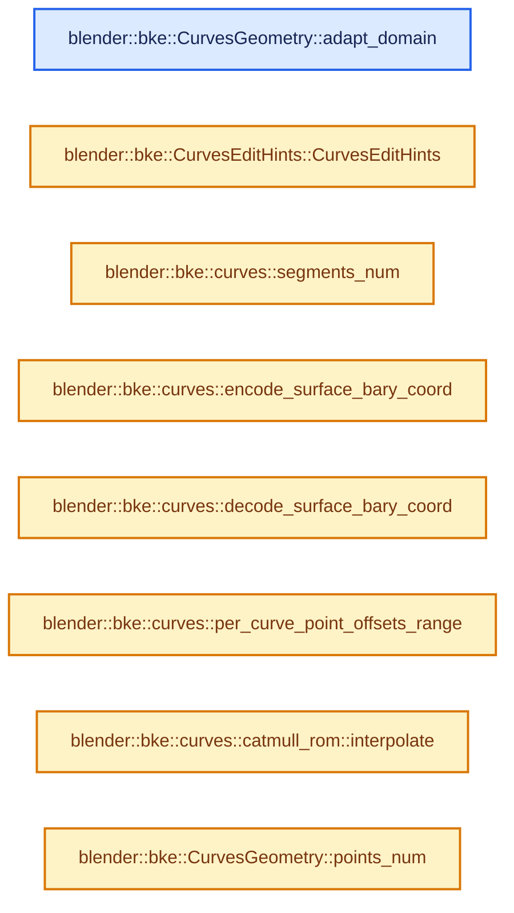
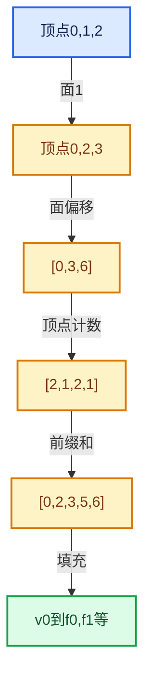

# 05-04 CurvesGeometry存储

[方向导航](README.md) · [总目录](../README.md) · [实现索引](../%E7%AC%A6%E5%8F%B7%E4%BE%9D%E8%B5%96%E4%B8%8E%E5%AE%9E%E7%8E%B0%E7%B4%A2%E5%BC%95.md)

## 从问题到实现

多条曲线的点如何组成连续数组？

曲线偏移把点按组组织，类型和循环性等曲线属性处于另一域；缓存依赖具体源数据。

**数据模型**

每曲线的点范围由偏移决定，曲线类型、循环性和点属性并不都属于同一域。

**设计取舍**

连续点数组利于批量计算，单条曲线独立增删可能引发整体搬移。

**最小反例**

把曲线数当点数分配位置数组。

**推导**

对每个属性标注域和元素数，拓扑改变后统一维护。

## 阅读地图与执行推演







图中的数值推演是本方向的教学模型；实际函数之间的调用边与概念分析边分别标注，不能把概念关系当作运行时调度顺序。

## 完整源码单元与就地讲解

中文讲解直接放在相关代码旁，复杂机制在代码下展开。原文折叠区保留基准行号；不需要在行号表和函数之间来回查找。类布局可分段展示，函数实现不按固定行数切开。

### 类型布局、声明与编译条件 · BKE_curves.hh L1—L498

<a id="t-1dbb5a7ca84b"></a>

<a id="t-368e2a3c7351"></a>

<a id="t-73b3c93c7ed9"></a>

<a id="t-e77b60db9b8a"></a>

<a id="t-7dbd767245d2"></a>

<a id="t-97e45022582c"></a>

<a id="t-3430ce450ac1"></a>

<a id="t-9e024f77ce0b"></a>

<a id="t-91883be12585"></a>

<a id="t-3f7a2f43e1be"></a>

<a id="t-441b3608ca07"></a>

`BasisCache`在这里声明的数据成员：

- `Vector<float> weights`
- `Vector<int> start_indices`
- `bool invalid`

<a id="t-b4a3d50e4d11"></a>

`CurvesGeometryRuntime`在这里声明的数据成员：

- `ImplicitSharingInfo curve_offsets_sharing_info`
- `ImplicitSharingInfo custom_knots_sharing_info`
- `std::array<int, CURVE_TYPES_NUM> type_counts`
- `SharedCache<EvaluatedOffsets> evaluated_offsets_cache`
- `SharedCache<bool> has_cyclic_curve_cache`
- `SharedCache<Vector<curves::nurbs::BasisCache>> nurbs_basis_cache`
- `SharedCache<Vector<float3>> evaluated_position_cache`
- `SharedCache<Bounds<float3>> bounds_cache`
- `SharedCache<Bounds<float3>> bounds_with_radius_cache`
- `SharedCache<Vector<float>> evaluated_length_cache`
- `SharedCache<Vector<float3>> evaluated_tangent_cache`
- `SharedCache<Vector<float3>> evaluated_normal_cache`
- `SharedCache<std::optional<int>> max_material_index_cache`
- `SharedCache<Vector<int>> custom_knot_offsets_cache`
- `std::unique_ptr<bake::BakeMaterialsList> bake_materials`
- `bool check_type_counts`

<a id="t-31ededb597a6"></a>

`EvaluatedOffsets`在这里声明的数据成员：

- `Vector<int> evaluated_offsets`
- `Vector<int> all_bezier_offsets`

<a id="t-84a29995f659"></a>

`CurvesGeometry`在这里声明的数据成员：

- `CurvesGeometry operator=`
- `CurvesGeometry operator=`
- `int points_num`
- `int curves_num`
- `bool is_empty`
- `IndexRange points_range`
- `IndexRange curves_range`
- `Span<int> offsets`
- `MutableSpan<int> offsets_for_write`
- `OffsetIndices<int> points_by_curve`
- `VArray<int8_t> curve_types`
- `MutableSpan<int8_t> curve_types_for_write`
- `void fill_curve_types`
- `void fill_curve_types`
- `void update_curve_types`
- `bool has_curve_with_type`
- `bool has_curve_with_type`
- `bool is_single_type`
- `std::array<int, CURVE_TYPES_NUM> curve_type_counts`
- `IndexMask indices_for_curve_type`
- `IndexMask indices_for_curve_type`
- `Array<int> point_to_curve_map`
- `Span<float3> positions`
- `MutableSpan<float3> positions_for_write`
- `VArray<float> radius`
- `MutableSpan<float> radius_for_write`
- `VArray<bool> cyclic`
- `MutableSpan<bool> cyclic_for_write`
- `VArray<int> resolution`
- `MutableSpan<int> resolution_for_write`
- `VArray<float> tilt`
- `MutableSpan<float> tilt_for_write`
- `VArray<int8_t> normal_mode`
- `MutableSpan<int8_t> normal_mode_for_write`
- `VArray<int8_t> handle_types_left`
- `MutableSpan<int8_t> handle_types_left_for_write`
- `VArray<int8_t> handle_types_right`
- `MutableSpan<int8_t> handle_types_right_for_write`
- `std::optional<Span<float3>> handle_positions_left`
- `MutableSpan<float3> handle_positions_left_for_write`
- `std::optional<Span<float3>> handle_positions_right`
- `MutableSpan<float3> handle_positions_right_for_write`
- `VArray<int8_t> nurbs_orders`
- `MutableSpan<int8_t> nurbs_orders_for_write`
- `VArray<int8_t> nurbs_knots_modes`
- `MutableSpan<int8_t> nurbs_knots_modes_for_write`
- `std::optional<Span<float>> nurbs_weights`
- `MutableSpan<float> nurbs_weights_for_write`
- `std::optional<Span<float2>> surface_uv_coords`
- `MutableSpan<float2> surface_uv_coords_for_write`
- `Span<float> nurbs_custom_knots`
- `MutableSpan<float> nurbs_custom_knots_for_write`
- `OffsetIndices<int> nurbs_custom_knots_by_curve`
- `IndexMask nurbs_custom_knot_curves`
- `bool nurbs_has_custom_knots`
- `void nurbs_custom_knots_update_size`
- `void nurbs_custom_knots_resize`
- `Span<MDeformVert> deform_verts`
- `MutableSpan<MDeformVert> deform_verts_for_write`
- `std::optional<Bounds<float3>> bounds_min_max`
- `void count_memory`
- `std::optional<int> material_index_max`
- `int evaluated_points_num`
- `OffsetIndices<int> evaluated_points_by_curve`
- `Span<int> bezier_evaluated_offsets_for_curve`
- `bool has_cyclic_curve`
- `Span<float3> evaluated_positions`
- `Span<float3> evaluated_tangents`
- `Span<float3> evaluated_normals`
- `Span<float> evaluated_lengths_for_curve`
- `float evaluated_length_total_for_curve`
- `void ensure_evaluated_lengths`
- `void ensure_can_interpolate_to_evaluated`
- `void interpolate_to_evaluated`
- `void interpolate_to_evaluated`
- `void ensure_nurbs_basis_cache`
- `IndexRange lengths_range_for_curve`
- `void resize`
- `void tag_positions_changed`
- `void tag_topology_changed`
- `void tag_normals_changed`
- `void tag_radii_changed`
- `void tag_material_index_changed`
- `void translate`
- `void transform`
- `void calculate_bezier_auto_handles`
- `void calculate_bezier_aligned_handles`
- `void remove_points`
- `void remove_curves`
- `void reverse_curves`
- `void remove_attributes_based_on_types`
- `AttributeAccessor attributes`
- `MutableAttributeAccessor attributes_for_write`
- `GVArray adapt_domain`

<!-- annotated:c022694d13c495 -->

```cpp
/* SPDX-FileCopyrightText: 2023 Blender Authors
 *
 * SPDX-License-Identifier: GPL-2.0-or-later */

#pragma once

/** \file
 * \ingroup bke
 * \brief Low-level operations for curves.
 */

#include "BLI_array_utils.hh"
#include "BLI_bounds_types.hh"
#include "BLI_implicit_sharing_ptr.hh"
#include "BLI_index_mask_fwd.hh"
#include "BLI_math_matrix_types.hh"
#include "BLI_math_vector_types.hh"
#include "BLI_memory_counter_fwd.hh"
#include "BLI_offset_indices.hh"
#include "BLI_shared_cache.hh"
#include "BLI_span.hh"
#include "BLI_vector.hh"
#include "BLI_virtual_array_fwd.hh"

#include "BKE_attribute_math.hh"
#include "BKE_attribute_storage.hh"
#include "BKE_curves.h"

namespace blender {

struct BlendDataReader;
struct BlendWriter;
struct MDeformVert;
namespace bke {
struct GeometrySet;
class AttributeAccessor;
class MutableAttributeAccessor;
enum class AttrDomain : int8_t;
struct AttributeAccessorFunctions;
}  // namespace bke
namespace bke::bake {
struct BakeMaterialsList;
}
class GVArray;

namespace bke {

namespace curves::nurbs {

struct BasisCache {
  /**
   * For each evaluated point, the weight for all control points that influences it.
   * The vector's size is the evaluated point count multiplied by the curve's order.
   */
  Vector<float> weights;
  /**
   * For each evaluated point, an offset into the curve's control points for the start of #weights.
   * In other words, the index of the first control point that influences this evaluated point.
   */
  Vector<int> start_indices;

  /**
   * The result of #check_valid_eval_params, to avoid retrieving its inputs later on.
   * If this is true, the data above will be invalid, and original data should be copied
   * to the evaluated result.
   */
  bool invalid = false;
};

}  // namespace curves::nurbs

/**
 * Contains derived data, caches, and other information not saved in files.
 */
class CurvesGeometryRuntime {
 public:
  /** Implicit sharing user count for #CurvesGeometry::curve_offsets. */
  const ImplicitSharingInfo *curve_offsets_sharing_info = nullptr;

  /** Implicit sharing user count for #CurvesGeometry::custom_knots. */
  const ImplicitSharingInfo *custom_knots_sharing_info = nullptr;

  /**
   * The cached number of curves with each type. Unlike other caches here, this is not computed
   * lazily, since it is needed so often and types are not adjusted much anyway.
   */
  std::array<int, CURVE_TYPES_NUM> type_counts;

  /**
   * Cache of offsets into the evaluated array for each curve, accounting for all previous
   * evaluated points, Bezier curve vector segments, different resolutions per curve, etc.
   */
  struct EvaluatedOffsets {
    Vector<int> evaluated_offsets;
    Vector<int> all_bezier_offsets;
  };
  mutable SharedCache<EvaluatedOffsets> evaluated_offsets_cache;

  mutable SharedCache<bool> has_cyclic_curve_cache;

  mutable SharedCache<Vector<curves::nurbs::BasisCache>> nurbs_basis_cache;

  /**
   * Cache of evaluated positions for all curves. The positions span will
   * be used directly rather than the cache when all curves are poly type.
   */
  mutable SharedCache<Vector<float3>> evaluated_position_cache;

  /**
   * A cache of bounds shared between data-blocks with unchanged positions.
   * When data changes affect the bounds, the cache is "un-shared" with other geometries.
   * See #SharedCache comments.
   */
  mutable SharedCache<Bounds<float3>> bounds_cache;
  mutable SharedCache<Bounds<float3>> bounds_with_radius_cache;

  /**
   * Cache of lengths along each evaluated curve for each evaluated point. If a curve is
   * cyclic, it needs one more length value to correspond to the last segment, so in order to
   * make slicing this array for a curve fast, an extra float is stored for every curve.
   */
  mutable SharedCache<Vector<float>> evaluated_length_cache;

  /** Direction of the curve at each evaluated point. */
  mutable SharedCache<Vector<float3>> evaluated_tangent_cache;

  /** Normal direction vectors for each evaluated point. */
  mutable SharedCache<Vector<float3>> evaluated_normal_cache;

  /** The maximum of the "material_index" attribute. */
  mutable SharedCache<std::optional<int>> max_material_index_cache;

  /**
   * Offsets of custom knots in #CurvesGeometry::custom_knots for each curve in #CurvesGeometry.
   * For curves with no custom knots next offset value stays the same.
   */
  mutable SharedCache<Vector<int>> custom_knot_offsets_cache;

  /** Stores weak references to material data blocks. */
  std::unique_ptr<bake::BakeMaterialsList> bake_materials;

  /**
   * Type counts have to be set eagerly after each operation. It's checked with asserts that the
   * type counts are correct when accessed. However, this check is expensive and shouldn't be done
   * all the time because it makes debug builds unusable in some situations that would be fine
   * otherwise.
   */
  bool check_type_counts = true;
};

/**
 * A C++ class that wraps the DNA struct for better encapsulation and ease of use. It inherits
 * directly from the struct rather than storing a pointer to avoid more complicated ownership
 * handling.
 */
class CurvesGeometry : public blender::CurvesGeometry {
 public:
  CurvesGeometry();
  /**
   * Create curves with the given size. Only the position attribute is created, along with the
   * offsets.
   */
  CurvesGeometry(int point_num, int curve_num);
  CurvesGeometry(const CurvesGeometry &other);
  CurvesGeometry(CurvesGeometry &&other);
  CurvesGeometry &operator=(const CurvesGeometry &other);
  CurvesGeometry &operator=(CurvesGeometry &&other);
  ~CurvesGeometry();

  /* --------------------------------------------------------------------
   * Accessors.
   */

  /**
   * The total number of control points in all curves.
   */
  int points_num() const;
  /**
   * The number of curves in the data-block.
   */
  int curves_num() const;
  /**
   * Return true if there are no curves in the geometry.
   */
  bool is_empty() const;

  IndexRange points_range() const;
  IndexRange curves_range() const;

  /**
   * The index of the first point in every curve. The size of this span is one larger than the
   * number of curves, but the spans will be empty if there are no curves/points.
   *
   * Consider using #points_by_curve rather than these offsets directly.
   */
  Span<int> offsets() const;
  MutableSpan<int> offsets_for_write();

  /**
   * The offsets of every curve into arrays on the points domain.
   */
  OffsetIndices<int> points_by_curve() const;

  /** The type (#CurveType) of each curve, or potentially a single if all are the same type. */
  VArray<int8_t> curve_types() const;
  /**
   * Mutable access to curve types. Call #tag_topology_changed and #update_curve_types after
   * changing any type. Consider using the other methods to change types below.
   */
  MutableSpan<int8_t> curve_types_for_write();
  /** Set all curve types to the value and call #update_curve_types. */
  void fill_curve_types(CurveType type);
  /** Set the types for the curves in the selection and call #update_curve_types. */
  void fill_curve_types(const IndexMask &selection, CurveType type);
  /** Update the cached count of curves of each type, necessary after #curve_types_for_write. */
  void update_curve_types();

  bool has_curve_with_type(CurveType type) const;
  bool has_curve_with_type(Span<CurveType> types) const;
  /** Return true if all of the curves have the provided type. */
  bool is_single_type(CurveType type) const;
  /** Return the number of curves with each type. */
  const std::array<int, CURVE_TYPES_NUM> &curve_type_counts() const;
  /**
   * All of the curve indices for curves with a specific type.
   */
  IndexMask indices_for_curve_type(CurveType type, IndexMaskMemory &memory) const;
  IndexMask indices_for_curve_type(CurveType type,
                                   const IndexMask &selection,
                                   IndexMaskMemory &memory) const;

  Array<int> point_to_curve_map() const;

  Span<float3> positions() const;
  MutableSpan<float3> positions_for_write();

  VArray<float> radius() const;
  MutableSpan<float> radius_for_write();

  /** Whether the curve loops around to connect to itself, on the curve domain. */
  VArray<bool> cyclic() const;
  /** Mutable access to curve cyclic values. Call #tag_topology_changed after changes. */
  MutableSpan<bool> cyclic_for_write();

  /**
   * How many evaluated points to create for each segment when evaluating Bezier,
   * Catmull Rom, and NURBS curves. On the curve domain. Values must be one or greater.
   */
  VArray<int> resolution() const;
  /** Mutable access to curve resolution. Call #tag_topology_changed after changes. */
  MutableSpan<int> resolution_for_write();

  /**
   * The angle used to rotate evaluated normals around the tangents after their calculation.
   * Call #tag_normals_changed after changes.
   */
  VArray<float> tilt() const;
  MutableSpan<float> tilt_for_write();

  /**
   * Which method to use for calculating the normals of evaluated points (#NormalMode).
   * Call #tag_normals_changed after changes.
   */
  VArray<int8_t> normal_mode() const;
  MutableSpan<int8_t> normal_mode_for_write();

  /**
   * Handle types for Bezier control points. Call #tag_topology_changed after changes.
   */
  VArray<int8_t> handle_types_left() const;
  MutableSpan<int8_t> handle_types_left_for_write();
  VArray<int8_t> handle_types_right() const;
  MutableSpan<int8_t> handle_types_right_for_write();

  /**
   * The positions of Bezier curve handles. Though these are really control points for the Bezier
   * segments, they are stored in separate arrays to better reflect user expectations. Note that
   * values may be generated automatically based on the handle types. Call #tag_positions_changed
   * after changes.
   */
  std::optional<Span<float3>> handle_positions_left() const;
  MutableSpan<float3> handle_positions_left_for_write();
  std::optional<Span<float3>> handle_positions_right() const;
  MutableSpan<float3> handle_positions_right_for_write();

  /**
   * The order (degree plus one) of each NURBS curve, on the curve domain.
   * Call #tag_topology_changed after changes.
   */
  VArray<int8_t> nurbs_orders() const;
  MutableSpan<int8_t> nurbs_orders_for_write();

  /**
   * The automatic generation mode for each NURBS curve's knots vector, on the curve domain.
   * Call #tag_topology_changed after changes.
   */
  VArray<int8_t> nurbs_knots_modes() const;
  MutableSpan<int8_t> nurbs_knots_modes_for_write();

  /**
   * The weight for each control point for NURBS curves. Call #tag_positions_changed after changes.
   */
  std::optional<Span<float>> nurbs_weights() const;
  MutableSpan<float> nurbs_weights_for_write();

  /**
   * UV coordinate for each curve that encodes where the curve is attached to the surface mesh.
   */
  std::optional<Span<float2>> surface_uv_coords() const;
  MutableSpan<float2> surface_uv_coords_for_write();

  /**
   * Custom knots for NURBS curves with knots mode #NURBS_KNOT_MODE_CUSTOM.
   */
  Span<float> nurbs_custom_knots() const;
  MutableSpan<float> nurbs_custom_knots_for_write();

  /**
   * The offsets of every curve into arrays on #CurvesGeometry::nurbs_custom_knots.
   * Curves with knot mode other than #NURBS_KNOT_MODE_CUSTOM will have zero sized #IndexRange.
   */
  OffsetIndices<int> nurbs_custom_knots_by_curve() const;

  /**
   * Builds mask of NURBS curves with knot mode #NURBS_KNOT_MODE_CUSTOM.
   */
  IndexMask nurbs_custom_knot_curves(IndexMaskMemory &memory) const;

  bool nurbs_has_custom_knots() const;

  /**
   * Resizes custom knots array depending on topological data.
   * Depends on curve offsets, knot modes, orders and cyclic data.
   * Used to resize internal knots array before writing knots.
   */
  void nurbs_custom_knots_update_size();

  /**
   * Resizes custom knots array. Used when knots number is known in advance and knot values are set
   * together with topological data.
   */
  void nurbs_custom_knots_resize(int knots_num);

  /**
   * Vertex group data, encoded as an array of indices and weights for every vertex.
   * \warning: May be empty.
   */
  Span<MDeformVert> deform_verts() const;
  MutableSpan<MDeformVert> deform_verts_for_write();

  /**
   * The largest and smallest position values of evaluated points.
   */
  std::optional<Bounds<float3>> bounds_min_max(bool use_radius = true) const;

  void count_memory(MemoryCounter &memory) const;

  /**
   * Get the largest material index used by the geometry or `nullopt` if there are none.
   * The returned value is clamped between 0 and MAXMAT even if the stored material indices may be
   * out of that range.
   */
  std::optional<int> material_index_max() const;

 private:
  /* --------------------------------------------------------------------
   * Evaluation.
   */

 public:
  /**
   * The total number of points in the evaluated poly curve.
   * This can depend on the resolution attribute if it exists.
   */
  int evaluated_points_num() const;

  /**
   * The offsets of every curve's evaluated points.
   */
  OffsetIndices<int> evaluated_points_by_curve() const;

  /**
   * Retrieve offsets into a Bezier curve's evaluated points for each control point. Stored in the
   * same format as #OffsetIndices. Call #evaluated_points_by_curve() first to ensure that the
   * evaluated offsets cache is current.
   */
  Span<int> bezier_evaluated_offsets_for_curve(int curve_index) const;

  bool has_cyclic_curve() const;

  Span<float3> evaluated_positions() const;
  Span<float3> evaluated_tangents() const;
  Span<float3> evaluated_normals() const;

  /**
   * Return a cache of accumulated lengths along the curve. Each item is the length of the
   * subsequent segment (the first value is the length of the first segment rather than 0).
   * This calculation is rather trivial, and only depends on the evaluated positions, but
   * the results are used often, and it is necessarily single threaded per curve, so it is cached.
   *
   * \param cyclic: This argument is redundant with the data stored for the curve,
   * but is passed for performance reasons to avoid looking up the attribute.
   */
  Span<float> evaluated_lengths_for_curve(int curve_index, bool cyclic) const;
  float evaluated_length_total_for_curve(int curve_index, bool cyclic) const;

  /** Calculates the data described by #evaluated_lengths_for_curve if necessary. */
  void ensure_evaluated_lengths() const;

  void ensure_can_interpolate_to_evaluated() const;

  /**
   * Evaluate a generic data to the standard evaluated points of a specific curve,
   * defined by the resolution attribute or other factors, depending on the curve type.
   *
   * \warning This function expects offsets to the evaluated points for each curve to be
   * calculated. That can be ensured with #ensure_can_interpolate_to_evaluated.
   */
  void interpolate_to_evaluated(int curve_index, GSpan src, GMutableSpan dst) const;
  /**
   * Evaluate generic data for curve control points to the standard evaluated points of the curves.
   */
  void interpolate_to_evaluated(GSpan src, GMutableSpan dst) const;

 private:
  /**
   * Make sure the basis weights for NURBS curve's evaluated points are calculated.
   */
  void ensure_nurbs_basis_cache() const;

  /** Return the slice of #evaluated_length_cache that corresponds to this curve index. */
  IndexRange lengths_range_for_curve(int curve_index, bool cyclic) const;

  /* --------------------------------------------------------------------
   * Operations.
   */

 public:
  /**
   * Change the number of curves and/or points.
   *
   * \warning To avoid redundant writes, newly created attribute values are not initialized.
   * They must be initialized by the caller afterwards.
   */
  void resize(int points_num, int curves_num);

  /** Call after deforming the position attribute. */
  void tag_positions_changed();
  /**
   * Call after any operation that changes the topology
   * (number of points, evaluated points, or the total count).
   */
  void tag_topology_changed();
  /** Call after changing the "tilt" or "up" attributes. */
  void tag_normals_changed();
  /**
   * Call when making manual changes to the "radius" attribute. The attribute API will also call
   * this in #finish() calls.
   */
  void tag_radii_changed();
  /** Call after changing the "material_index" attribute. */
  void tag_material_index_changed();

  void translate(const float3 &translation);
  void transform(const float4x4 &matrix);

  /**
   * Calculate handle positions for `Auto`, `Vector` handle types.
   */
  void calculate_bezier_auto_handles();
  /**
   * Calculate handle positions for `Align` handle types. Ensure that both handles position fall on
   * the same line, both handle will be moved unless the handles are already aligned.
   */
  void calculate_bezier_aligned_handles();

  void remove_points(const IndexMask &points_to_delete, const AttributeFilter &attribute_filter);
  void remove_curves(const IndexMask &curves_to_delete, const AttributeFilter &attribute_filter);

  /**
   * Change the direction of selected curves (switch the start and end) without changing their
   * shape.
   */
  void reverse_curves(const IndexMask &curves_to_reverse);

  /**
   * Remove any attributes that are unused based on the types in the curves.
   */
  void remove_attributes_based_on_types();

  AttributeAccessor attributes() const;
  MutableAttributeAccessor attributes_for_write();

  /* --------------------------------------------------------------------
   * Attributes.
   */

  GVArray adapt_domain(const GVArray &varray, AttrDomain from, AttrDomain to) const;
```

<details>
<summary>核对原始源码：source/blender/blenkernel/BKE_curves.hh · L1—L498</summary>

<!-- original:c022694d13c495:source/blender/blenkernel/BKE_curves.hh:1:498 -->

```cpp
/* SPDX-FileCopyrightText: 2023 Blender Authors
 *
 * SPDX-License-Identifier: GPL-2.0-or-later */

#pragma once

/** \file
 * \ingroup bke
 * \brief Low-level operations for curves.
 */

#include "BLI_array_utils.hh"
#include "BLI_bounds_types.hh"
#include "BLI_implicit_sharing_ptr.hh"
#include "BLI_index_mask_fwd.hh"
#include "BLI_math_matrix_types.hh"
#include "BLI_math_vector_types.hh"
#include "BLI_memory_counter_fwd.hh"
#include "BLI_offset_indices.hh"
#include "BLI_shared_cache.hh"
#include "BLI_span.hh"
#include "BLI_vector.hh"
#include "BLI_virtual_array_fwd.hh"

#include "BKE_attribute_math.hh"
#include "BKE_attribute_storage.hh"
#include "BKE_curves.h"

namespace blender {

struct BlendDataReader;
struct BlendWriter;
struct MDeformVert;
namespace bke {
struct GeometrySet;
class AttributeAccessor;
class MutableAttributeAccessor;
enum class AttrDomain : int8_t;
struct AttributeAccessorFunctions;
}  // namespace bke
namespace bke::bake {
struct BakeMaterialsList;
}
class GVArray;

namespace bke {

namespace curves::nurbs {

struct BasisCache {
  /**
   * For each evaluated point, the weight for all control points that influences it.
   * The vector's size is the evaluated point count multiplied by the curve's order.
   */
  Vector<float> weights;
  /**
   * For each evaluated point, an offset into the curve's control points for the start of #weights.
   * In other words, the index of the first control point that influences this evaluated point.
   */
  Vector<int> start_indices;

  /**
   * The result of #check_valid_eval_params, to avoid retrieving its inputs later on.
   * If this is true, the data above will be invalid, and original data should be copied
   * to the evaluated result.
   */
  bool invalid = false;
};

}  // namespace curves::nurbs

/**
 * Contains derived data, caches, and other information not saved in files.
 */
class CurvesGeometryRuntime {
 public:
  /** Implicit sharing user count for #CurvesGeometry::curve_offsets. */
  const ImplicitSharingInfo *curve_offsets_sharing_info = nullptr;

  /** Implicit sharing user count for #CurvesGeometry::custom_knots. */
  const ImplicitSharingInfo *custom_knots_sharing_info = nullptr;

  /**
   * The cached number of curves with each type. Unlike other caches here, this is not computed
   * lazily, since it is needed so often and types are not adjusted much anyway.
   */
  std::array<int, CURVE_TYPES_NUM> type_counts;

  /**
   * Cache of offsets into the evaluated array for each curve, accounting for all previous
   * evaluated points, Bezier curve vector segments, different resolutions per curve, etc.
   */
  struct EvaluatedOffsets {
    Vector<int> evaluated_offsets;
    Vector<int> all_bezier_offsets;
  };
  mutable SharedCache<EvaluatedOffsets> evaluated_offsets_cache;

  mutable SharedCache<bool> has_cyclic_curve_cache;

  mutable SharedCache<Vector<curves::nurbs::BasisCache>> nurbs_basis_cache;

  /**
   * Cache of evaluated positions for all curves. The positions span will
   * be used directly rather than the cache when all curves are poly type.
   */
  mutable SharedCache<Vector<float3>> evaluated_position_cache;

  /**
   * A cache of bounds shared between data-blocks with unchanged positions.
   * When data changes affect the bounds, the cache is "un-shared" with other geometries.
   * See #SharedCache comments.
   */
  mutable SharedCache<Bounds<float3>> bounds_cache;
  mutable SharedCache<Bounds<float3>> bounds_with_radius_cache;

  /**
   * Cache of lengths along each evaluated curve for each evaluated point. If a curve is
   * cyclic, it needs one more length value to correspond to the last segment, so in order to
   * make slicing this array for a curve fast, an extra float is stored for every curve.
   */
  mutable SharedCache<Vector<float>> evaluated_length_cache;

  /** Direction of the curve at each evaluated point. */
  mutable SharedCache<Vector<float3>> evaluated_tangent_cache;

  /** Normal direction vectors for each evaluated point. */
  mutable SharedCache<Vector<float3>> evaluated_normal_cache;

  /** The maximum of the "material_index" attribute. */
  mutable SharedCache<std::optional<int>> max_material_index_cache;

  /**
   * Offsets of custom knots in #CurvesGeometry::custom_knots for each curve in #CurvesGeometry.
   * For curves with no custom knots next offset value stays the same.
   */
  mutable SharedCache<Vector<int>> custom_knot_offsets_cache;

  /** Stores weak references to material data blocks. */
  std::unique_ptr<bake::BakeMaterialsList> bake_materials;

  /**
   * Type counts have to be set eagerly after each operation. It's checked with asserts that the
   * type counts are correct when accessed. However, this check is expensive and shouldn't be done
   * all the time because it makes debug builds unusable in some situations that would be fine
   * otherwise.
   */
  bool check_type_counts = true;
};

/**
 * A C++ class that wraps the DNA struct for better encapsulation and ease of use. It inherits
 * directly from the struct rather than storing a pointer to avoid more complicated ownership
 * handling.
 */
class CurvesGeometry : public blender::CurvesGeometry {
 public:
  CurvesGeometry();
  /**
   * Create curves with the given size. Only the position attribute is created, along with the
   * offsets.
   */
  CurvesGeometry(int point_num, int curve_num);
  CurvesGeometry(const CurvesGeometry &other);
  CurvesGeometry(CurvesGeometry &&other);
  CurvesGeometry &operator=(const CurvesGeometry &other);
  CurvesGeometry &operator=(CurvesGeometry &&other);
  ~CurvesGeometry();

  /* --------------------------------------------------------------------
   * Accessors.
   */

  /**
   * The total number of control points in all curves.
   */
  int points_num() const;
  /**
   * The number of curves in the data-block.
   */
  int curves_num() const;
  /**
   * Return true if there are no curves in the geometry.
   */
  bool is_empty() const;

  IndexRange points_range() const;
  IndexRange curves_range() const;

  /**
   * The index of the first point in every curve. The size of this span is one larger than the
   * number of curves, but the spans will be empty if there are no curves/points.
   *
   * Consider using #points_by_curve rather than these offsets directly.
   */
  Span<int> offsets() const;
  MutableSpan<int> offsets_for_write();

  /**
   * The offsets of every curve into arrays on the points domain.
   */
  OffsetIndices<int> points_by_curve() const;

  /** The type (#CurveType) of each curve, or potentially a single if all are the same type. */
  VArray<int8_t> curve_types() const;
  /**
   * Mutable access to curve types. Call #tag_topology_changed and #update_curve_types after
   * changing any type. Consider using the other methods to change types below.
   */
  MutableSpan<int8_t> curve_types_for_write();
  /** Set all curve types to the value and call #update_curve_types. */
  void fill_curve_types(CurveType type);
  /** Set the types for the curves in the selection and call #update_curve_types. */
  void fill_curve_types(const IndexMask &selection, CurveType type);
  /** Update the cached count of curves of each type, necessary after #curve_types_for_write. */
  void update_curve_types();

  bool has_curve_with_type(CurveType type) const;
  bool has_curve_with_type(Span<CurveType> types) const;
  /** Return true if all of the curves have the provided type. */
  bool is_single_type(CurveType type) const;
  /** Return the number of curves with each type. */
  const std::array<int, CURVE_TYPES_NUM> &curve_type_counts() const;
  /**
   * All of the curve indices for curves with a specific type.
   */
  IndexMask indices_for_curve_type(CurveType type, IndexMaskMemory &memory) const;
  IndexMask indices_for_curve_type(CurveType type,
                                   const IndexMask &selection,
                                   IndexMaskMemory &memory) const;

  Array<int> point_to_curve_map() const;

  Span<float3> positions() const;
  MutableSpan<float3> positions_for_write();

  VArray<float> radius() const;
  MutableSpan<float> radius_for_write();

  /** Whether the curve loops around to connect to itself, on the curve domain. */
  VArray<bool> cyclic() const;
  /** Mutable access to curve cyclic values. Call #tag_topology_changed after changes. */
  MutableSpan<bool> cyclic_for_write();

  /**
   * How many evaluated points to create for each segment when evaluating Bezier,
   * Catmull Rom, and NURBS curves. On the curve domain. Values must be one or greater.
   */
  VArray<int> resolution() const;
  /** Mutable access to curve resolution. Call #tag_topology_changed after changes. */
  MutableSpan<int> resolution_for_write();

  /**
   * The angle used to rotate evaluated normals around the tangents after their calculation.
   * Call #tag_normals_changed after changes.
   */
  VArray<float> tilt() const;
  MutableSpan<float> tilt_for_write();

  /**
   * Which method to use for calculating the normals of evaluated points (#NormalMode).
   * Call #tag_normals_changed after changes.
   */
  VArray<int8_t> normal_mode() const;
  MutableSpan<int8_t> normal_mode_for_write();

  /**
   * Handle types for Bezier control points. Call #tag_topology_changed after changes.
   */
  VArray<int8_t> handle_types_left() const;
  MutableSpan<int8_t> handle_types_left_for_write();
  VArray<int8_t> handle_types_right() const;
  MutableSpan<int8_t> handle_types_right_for_write();

  /**
   * The positions of Bezier curve handles. Though these are really control points for the Bezier
   * segments, they are stored in separate arrays to better reflect user expectations. Note that
   * values may be generated automatically based on the handle types. Call #tag_positions_changed
   * after changes.
   */
  std::optional<Span<float3>> handle_positions_left() const;
  MutableSpan<float3> handle_positions_left_for_write();
  std::optional<Span<float3>> handle_positions_right() const;
  MutableSpan<float3> handle_positions_right_for_write();

  /**
   * The order (degree plus one) of each NURBS curve, on the curve domain.
   * Call #tag_topology_changed after changes.
   */
  VArray<int8_t> nurbs_orders() const;
  MutableSpan<int8_t> nurbs_orders_for_write();

  /**
   * The automatic generation mode for each NURBS curve's knots vector, on the curve domain.
   * Call #tag_topology_changed after changes.
   */
  VArray<int8_t> nurbs_knots_modes() const;
  MutableSpan<int8_t> nurbs_knots_modes_for_write();

  /**
   * The weight for each control point for NURBS curves. Call #tag_positions_changed after changes.
   */
  std::optional<Span<float>> nurbs_weights() const;
  MutableSpan<float> nurbs_weights_for_write();

  /**
   * UV coordinate for each curve that encodes where the curve is attached to the surface mesh.
   */
  std::optional<Span<float2>> surface_uv_coords() const;
  MutableSpan<float2> surface_uv_coords_for_write();

  /**
   * Custom knots for NURBS curves with knots mode #NURBS_KNOT_MODE_CUSTOM.
   */
  Span<float> nurbs_custom_knots() const;
  MutableSpan<float> nurbs_custom_knots_for_write();

  /**
   * The offsets of every curve into arrays on #CurvesGeometry::nurbs_custom_knots.
   * Curves with knot mode other than #NURBS_KNOT_MODE_CUSTOM will have zero sized #IndexRange.
   */
  OffsetIndices<int> nurbs_custom_knots_by_curve() const;

  /**
   * Builds mask of NURBS curves with knot mode #NURBS_KNOT_MODE_CUSTOM.
   */
  IndexMask nurbs_custom_knot_curves(IndexMaskMemory &memory) const;

  bool nurbs_has_custom_knots() const;

  /**
   * Resizes custom knots array depending on topological data.
   * Depends on curve offsets, knot modes, orders and cyclic data.
   * Used to resize internal knots array before writing knots.
   */
  void nurbs_custom_knots_update_size();

  /**
   * Resizes custom knots array. Used when knots number is known in advance and knot values are set
   * together with topological data.
   */
  void nurbs_custom_knots_resize(int knots_num);

  /**
   * Vertex group data, encoded as an array of indices and weights for every vertex.
   * \warning: May be empty.
   */
  Span<MDeformVert> deform_verts() const;
  MutableSpan<MDeformVert> deform_verts_for_write();

  /**
   * The largest and smallest position values of evaluated points.
   */
  std::optional<Bounds<float3>> bounds_min_max(bool use_radius = true) const;

  void count_memory(MemoryCounter &memory) const;

  /**
   * Get the largest material index used by the geometry or `nullopt` if there are none.
   * The returned value is clamped between 0 and MAXMAT even if the stored material indices may be
   * out of that range.
   */
  std::optional<int> material_index_max() const;

 private:
  /* --------------------------------------------------------------------
   * Evaluation.
   */

 public:
  /**
   * The total number of points in the evaluated poly curve.
   * This can depend on the resolution attribute if it exists.
   */
  int evaluated_points_num() const;

  /**
   * The offsets of every curve's evaluated points.
   */
  OffsetIndices<int> evaluated_points_by_curve() const;

  /**
   * Retrieve offsets into a Bezier curve's evaluated points for each control point. Stored in the
   * same format as #OffsetIndices. Call #evaluated_points_by_curve() first to ensure that the
   * evaluated offsets cache is current.
   */
  Span<int> bezier_evaluated_offsets_for_curve(int curve_index) const;

  bool has_cyclic_curve() const;

  Span<float3> evaluated_positions() const;
  Span<float3> evaluated_tangents() const;
  Span<float3> evaluated_normals() const;

  /**
   * Return a cache of accumulated lengths along the curve. Each item is the length of the
   * subsequent segment (the first value is the length of the first segment rather than 0).
   * This calculation is rather trivial, and only depends on the evaluated positions, but
   * the results are used often, and it is necessarily single threaded per curve, so it is cached.
   *
   * \param cyclic: This argument is redundant with the data stored for the curve,
   * but is passed for performance reasons to avoid looking up the attribute.
   */
  Span<float> evaluated_lengths_for_curve(int curve_index, bool cyclic) const;
  float evaluated_length_total_for_curve(int curve_index, bool cyclic) const;

  /** Calculates the data described by #evaluated_lengths_for_curve if necessary. */
  void ensure_evaluated_lengths() const;

  void ensure_can_interpolate_to_evaluated() const;

  /**
   * Evaluate a generic data to the standard evaluated points of a specific curve,
   * defined by the resolution attribute or other factors, depending on the curve type.
   *
   * \warning This function expects offsets to the evaluated points for each curve to be
   * calculated. That can be ensured with #ensure_can_interpolate_to_evaluated.
   */
  void interpolate_to_evaluated(int curve_index, GSpan src, GMutableSpan dst) const;
  /**
   * Evaluate generic data for curve control points to the standard evaluated points of the curves.
   */
  void interpolate_to_evaluated(GSpan src, GMutableSpan dst) const;

 private:
  /**
   * Make sure the basis weights for NURBS curve's evaluated points are calculated.
   */
  void ensure_nurbs_basis_cache() const;

  /** Return the slice of #evaluated_length_cache that corresponds to this curve index. */
  IndexRange lengths_range_for_curve(int curve_index, bool cyclic) const;

  /* --------------------------------------------------------------------
   * Operations.
   */

 public:
  /**
   * Change the number of curves and/or points.
   *
   * \warning To avoid redundant writes, newly created attribute values are not initialized.
   * They must be initialized by the caller afterwards.
   */
  void resize(int points_num, int curves_num);

  /** Call after deforming the position attribute. */
  void tag_positions_changed();
  /**
   * Call after any operation that changes the topology
   * (number of points, evaluated points, or the total count).
   */
  void tag_topology_changed();
  /** Call after changing the "tilt" or "up" attributes. */
  void tag_normals_changed();
  /**
   * Call when making manual changes to the "radius" attribute. The attribute API will also call
   * this in #finish() calls.
   */
  void tag_radii_changed();
  /** Call after changing the "material_index" attribute. */
  void tag_material_index_changed();

  void translate(const float3 &translation);
  void transform(const float4x4 &matrix);

  /**
   * Calculate handle positions for `Auto`, `Vector` handle types.
   */
  void calculate_bezier_auto_handles();
  /**
   * Calculate handle positions for `Align` handle types. Ensure that both handles position fall on
   * the same line, both handle will be moved unless the handles are already aligned.
   */
  void calculate_bezier_aligned_handles();

  void remove_points(const IndexMask &points_to_delete, const AttributeFilter &attribute_filter);
  void remove_curves(const IndexMask &curves_to_delete, const AttributeFilter &attribute_filter);

  /**
   * Change the direction of selected curves (switch the start and end) without changing their
   * shape.
   */
  void reverse_curves(const IndexMask &curves_to_reverse);

  /**
   * Remove any attributes that are unused based on the types in the curves.
   */
  void remove_attributes_based_on_types();

  AttributeAccessor attributes() const;
  MutableAttributeAccessor attributes_for_write();

  /* --------------------------------------------------------------------
   * Attributes.
   */

  GVArray adapt_domain(const GVArray &varray, AttrDomain from, AttrDomain to) const;
```

</details>

<a id="f-352cb47463117f12"></a>

### `blender::bke::CurvesGeometry::adapt_domain`

实现位置：[source/blender/blenkernel/BKE_curves.hh](../../../../../source/blender/blenkernel/BKE_curves.hh) · L499—L503。

接口参数：

- `const VArray<T> &varray`
- `AttrDomain from`
- `AttrDomain to`

**教学注释版**

<!-- annotated:913059a6c19ebf -->

```cpp
  template<typename T>
  VArray<T> adapt_domain(const VArray<T> &varray, AttrDomain from, AttrDomain to) const
  {
    return this->adapt_domain(GVArray(varray), from, to).typed<T>();
  }
```

<details>
<summary>核对原始源码：source/blender/blenkernel/BKE_curves.hh · L499—L503</summary>

<!-- original:913059a6c19ebf:source/blender/blenkernel/BKE_curves.hh:499:503 -->

```cpp
  template<typename T>
  VArray<T> adapt_domain(const VArray<T> &varray, AttrDomain from, AttrDomain to) const
  {
    return this->adapt_domain(GVArray(varray), from, to).typed<T>();
  }
```

</details>

**结果出口**

- `return this->adapt_domain(GVArray(varray), from, to).typed<T>();`

**继续追踪实现**

- `this->adapt_domain(GVArray(varray), from, to).typed<T>` → [调用协议](../%E6%A8%A1%E6%9D%BF%E5%AE%8F%E4%B8%8E%E5%8A%A8%E6%80%81%E5%88%86%E6%B4%BE%E5%8D%8F%E8%AE%AE.md)：接收对象类型依赖auto、返回值或模板实例；不按同名猜测目标。调用位置L502。
- `this->adapt_domain` → [blender::bke::CurvesGeometry::adapt_domain · L499](04-CurvesGeometry%E5%AD%98%E5%82%A8.md#f-352cb47463117f12)。
- `GVArray` → [blender::GVArray::GVArray · L163](../04-%E8%99%9A%E6%8B%9F%E6%95%B0%E7%BB%84%E4%B8%8E%E7%B4%A2%E5%BC%95%E9%80%89%E6%8B%A9/05-GVArray%E8%BF%90%E8%A1%8C%E6%97%B6%E7%B1%BB%E5%9E%8B.md#f-64f7cbf5d9f0e955)；[blender::GVArray::GVArray · L800](../04-%E8%99%9A%E6%8B%9F%E6%95%B0%E7%BB%84%E4%B8%8E%E7%B4%A2%E5%BC%95%E9%80%89%E6%8B%A9/05-GVArray%E8%BF%90%E8%A1%8C%E6%97%B6%E7%B1%BB%E5%9E%8B.md#f-92ab30090a1a4c9d)；[blender::GVArray::GVArray · L808](../04-%E8%99%9A%E6%8B%9F%E6%95%B0%E7%BB%84%E4%B8%8E%E7%B4%A2%E5%BC%95%E9%80%89%E6%8B%A9/05-GVArray%E8%BF%90%E8%A1%8C%E6%97%B6%E7%B1%BB%E5%9E%8B.md#f-ffdfb9685892d387)；[blender::GVArray::GVArray · L848](../04-%E8%99%9A%E6%8B%9F%E6%95%B0%E7%BB%84%E4%B8%8E%E7%B4%A2%E5%BC%95%E9%80%89%E6%8B%A9/05-GVArray%E8%BF%90%E8%A1%8C%E6%97%B6%E7%B1%BB%E5%9E%8B.md#f-9750722bb98b7336)；[blender::GVArray::GVArray · L852](../04-%E8%99%9A%E6%8B%9F%E6%95%B0%E7%BB%84%E4%B8%8E%E7%B4%A2%E5%BC%95%E9%80%89%E6%8B%A9/05-GVArray%E8%BF%90%E8%A1%8C%E6%97%B6%E7%B1%BB%E5%9E%8B.md#f-570ef42684f1d635)；[blender::GVArray::GVArray · L874](../04-%E8%99%9A%E6%8B%9F%E6%95%B0%E7%BB%84%E4%B8%8E%E7%B4%A2%E5%BC%95%E9%80%89%E6%8B%A9/05-GVArray%E8%BF%90%E8%A1%8C%E6%97%B6%E7%B1%BB%E5%9E%8B.md#f-ae91aa8c66a4a0d1)；[blender::GVArray::GVArray · L876](../04-%E8%99%9A%E6%8B%9F%E6%95%B0%E7%BB%84%E4%B8%8E%E7%B4%A2%E5%BC%95%E9%80%89%E6%8B%A9/05-GVArray%E8%BF%90%E8%A1%8C%E6%97%B6%E7%B1%BB%E5%9E%8B.md#f-3397bbb4ba5e7ea4)；[blender::GVArray::GVArray · L626](../04-%E8%99%9A%E6%8B%9F%E6%95%B0%E7%BB%84%E4%B8%8E%E7%B4%A2%E5%BC%95%E9%80%89%E6%8B%A9/05-GVArray%E8%BF%90%E8%A1%8C%E6%97%B6%E7%B1%BB%E5%9E%8B.md#f-fac576444532110b)。同名重载需按实参类型选择。

### 类型布局、声明与编译条件 · BKE_curves.hh L504—L549

<a id="t-73c7dc5b59ca"></a>

`BlendWriteData`在这里声明的数据成员：

- `ResourceScope scope`
- `Vector<CustomDataLayer, 16> point_layers`
- `Vector<CustomDataLayer, 16> curve_layers`
- `AttributeStorage::BlendWriteData attribute_data`

<a id="t-efc3e3c5c042"></a>

`CurvesEditHints`在这里声明的数据成员：

- `Curves curves_id_orig`
- `ImplicitSharingPtrAndData positions_data`
- `std::optional<Array<float3x3>> deform_mats`

<!-- annotated:78ae3458622c63 -->

```cpp

  /* --------------------------------------------------------------------
   * File Read/Write.
   */
  void blend_read(BlendDataReader &reader);
  /**
   * Helper struct for `CurvesGeometry::blend_write_*` functions.
   */
  struct BlendWriteData {
    ResourceScope &scope;
    Vector<CustomDataLayer, 16> &point_layers;
    Vector<CustomDataLayer, 16> &curve_layers;
    AttributeStorage::BlendWriteData attribute_data;
    explicit BlendWriteData(BlendWriter *writer, ResourceScope &scope);
  };
  /**
   * This function needs to be called before `blend_write` and before the `CurvesGeometry` struct
   * is written because it can mutate the `CustomData` and `AttributeStorage` structs.
   */
  void blend_write_prepare(BlendWriteData &write_data, bool use_5_0_compatibility);
  void blend_write(BlendWriter &writer, ID &id, const BlendWriteData &write_data);
};

static_assert(sizeof(bke::CurvesGeometry) == sizeof(CurvesGeometry));

/**
 * Used to propagate deformation data through modifier evaluation so that sculpt tools can work on
 * evaluated data.
 */
class CurvesEditHints {
 public:
  /**
   * Original data that the edit hints below are meant to be used for.
   */
  const Curves &curves_id_orig;
  /**
   * Evaluated positions for the points in #curves_orig. If this is empty, the positions from the
   * evaluated #Curves should be used if possible.
   */
  ImplicitSharingPtrAndData positions_data;
  /**
   * Matrices which transform point movement vectors from original data to corresponding movements
   * of evaluated data.
   */
  std::optional<Array<float3x3>> deform_mats;

```

<details>
<summary>核对原始源码：source/blender/blenkernel/BKE_curves.hh · L504—L549</summary>

<!-- original:78ae3458622c63:source/blender/blenkernel/BKE_curves.hh:504:549 -->

```cpp

  /* --------------------------------------------------------------------
   * File Read/Write.
   */
  void blend_read(BlendDataReader &reader);
  /**
   * Helper struct for `CurvesGeometry::blend_write_*` functions.
   */
  struct BlendWriteData {
    ResourceScope &scope;
    Vector<CustomDataLayer, 16> &point_layers;
    Vector<CustomDataLayer, 16> &curve_layers;
    AttributeStorage::BlendWriteData attribute_data;
    explicit BlendWriteData(BlendWriter *writer, ResourceScope &scope);
  };
  /**
   * This function needs to be called before `blend_write` and before the `CurvesGeometry` struct
   * is written because it can mutate the `CustomData` and `AttributeStorage` structs.
   */
  void blend_write_prepare(BlendWriteData &write_data, bool use_5_0_compatibility);
  void blend_write(BlendWriter &writer, ID &id, const BlendWriteData &write_data);
};

static_assert(sizeof(bke::CurvesGeometry) == sizeof(CurvesGeometry));

/**
 * Used to propagate deformation data through modifier evaluation so that sculpt tools can work on
 * evaluated data.
 */
class CurvesEditHints {
 public:
  /**
   * Original data that the edit hints below are meant to be used for.
   */
  const Curves &curves_id_orig;
  /**
   * Evaluated positions for the points in #curves_orig. If this is empty, the positions from the
   * evaluated #Curves should be used if possible.
   */
  ImplicitSharingPtrAndData positions_data;
  /**
   * Matrices which transform point movement vectors from original data to corresponding movements
   * of evaluated data.
   */
  std::optional<Array<float3x3>> deform_mats;

```

</details>

<a id="f-f36a671bcf45a5a0"></a>

### `blender::bke::CurvesEditHints::CurvesEditHints`

实现位置：[source/blender/blenkernel/BKE_curves.hh](../../../../../source/blender/blenkernel/BKE_curves.hh) · L550—L550。

接口参数：

- `const Curves &curves_id_orig`

**教学注释版**

<!-- annotated:1c0276a5e622f2 -->

```cpp
  CurvesEditHints(const Curves &curves_id_orig) : curves_id_orig(curves_id_orig) {}
```

<details>
<summary>核对原始源码：source/blender/blenkernel/BKE_curves.hh · L550—L550</summary>

<!-- original:1c0276a5e622f2:source/blender/blenkernel/BKE_curves.hh:550:550 -->

```cpp
  CurvesEditHints(const Curves &curves_id_orig) : curves_id_orig(curves_id_orig) {}
```

</details>

**继续追踪实现**

本实现没有需要继续展开的显式调用；检查返回表达式、对象转换和调用者前置条件。

### 类型布局、声明与编译条件 · BKE_curves.hh L551—L573

<!-- annotated:6672de1f50e179 -->

```cpp

  std::optional<Span<float3>> positions() const;
  std::optional<MutableSpan<float3>> positions_for_write();

  /**
   * The edit hints have to correspond to the original curves, i.e. the number of deformed points
   * is the same as the number of original points.
   */
  bool is_valid() const;
};

void curves_normals_point_domain_calc(const CurvesGeometry &curves, MutableSpan<float3> normals);

namespace curves {

/* -------------------------------------------------------------------- */
/** \name Inline Curve Methods
 * \{ */

/**
 * The number of segments between control points, accounting for the last segment of cyclic
 * curves. The logic is simple, but this function should be used to make intentions clearer.
 */
```

<details>
<summary>核对原始源码：source/blender/blenkernel/BKE_curves.hh · L551—L573</summary>

<!-- original:6672de1f50e179:source/blender/blenkernel/BKE_curves.hh:551:573 -->

```cpp

  std::optional<Span<float3>> positions() const;
  std::optional<MutableSpan<float3>> positions_for_write();

  /**
   * The edit hints have to correspond to the original curves, i.e. the number of deformed points
   * is the same as the number of original points.
   */
  bool is_valid() const;
};

void curves_normals_point_domain_calc(const CurvesGeometry &curves, MutableSpan<float3> normals);

namespace curves {

/* -------------------------------------------------------------------- */
/** \name Inline Curve Methods
 * \{ */

/**
 * The number of segments between control points, accounting for the last segment of cyclic
 * curves. The logic is simple, but this function should be used to make intentions clearer.
 */
```

</details>

<a id="f-279080e6d7ab269f"></a>

### `blender::bke::curves::segments_num`

实现位置：[source/blender/blenkernel/BKE_curves.hh](../../../../../source/blender/blenkernel/BKE_curves.hh) · L574—L578。

接口参数：

- `const int points_num`
- `const bool cyclic`

**教学注释版**

<!-- annotated:d956ffc9c556ed -->

```cpp
inline int segments_num(const int points_num, const bool cyclic)
{
  BLI_assert(points_num > 0);
  return (cyclic && points_num > 1) ? points_num : points_num - 1;
}
```

<details>
<summary>核对原始源码：source/blender/blenkernel/BKE_curves.hh · L574—L578</summary>

<!-- original:d956ffc9c556ed:source/blender/blenkernel/BKE_curves.hh:574:578 -->

```cpp
inline int segments_num(const int points_num, const bool cyclic)
{
  BLI_assert(points_num > 0);
  return (cyclic && points_num > 1) ? points_num : points_num - 1;
}
```

</details>

**结果出口**

- `return (cyclic && points_num > 1) ? points_num : points_num - 1;`

**继续追踪实现**

- `BLI_assert` → [BLI_assert · L48](../01-%E5%9F%BA%E7%A1%80%E5%AE%B9%E5%99%A8%E4%B8%8E%E7%8E%B0%E4%BB%A3CPP/%E4%BE%9D%E8%B5%96-BLI_assert-cc98e8.md#m-57a88495704d)；[BLI_assert · L63](../01-%E5%9F%BA%E7%A1%80%E5%AE%B9%E5%99%A8%E4%B8%8E%E7%8E%B0%E4%BB%A3CPP/%E4%BE%9D%E8%B5%96-BLI_assert-cc98e8.md#m-d07050020cb5)。宏定义由构建条件选择。

<!-- annotated:5a8a81c7f54b10 -->

```cpp

```

<details>
<summary>核对原始源码：source/blender/blenkernel/BKE_curves.hh · L579—L579</summary>

<!-- original:5a8a81c7f54b10:source/blender/blenkernel/BKE_curves.hh:579:579 -->

```cpp

```

</details>

<a id="f-069309b2b6b5b6d6"></a>

### `blender::bke::curves::encode_surface_bary_coord`

实现位置：[source/blender/blenkernel/BKE_curves.hh](../../../../../source/blender/blenkernel/BKE_curves.hh) · L580—L584。

接口参数：

- `const float3 &v`

**教学注释版**

<!-- annotated:5f2063098c948c -->

```cpp
inline float2 encode_surface_bary_coord(const float3 &v)
{
  BLI_assert(std::abs(v.x + v.y + v.z - 1.0f) < 0.00001f);
  return {v.x, v.y};
}
```

<details>
<summary>核对原始源码：source/blender/blenkernel/BKE_curves.hh · L580—L584</summary>

<!-- original:5f2063098c948c:source/blender/blenkernel/BKE_curves.hh:580:584 -->

```cpp
inline float2 encode_surface_bary_coord(const float3 &v)
{
  BLI_assert(std::abs(v.x + v.y + v.z - 1.0f) < 0.00001f);
  return {v.x, v.y};
}
```

</details>

**结果出口**

- `return {v.x, v.y};`

**继续追踪实现**

- `BLI_assert` → [BLI_assert · L48](../01-%E5%9F%BA%E7%A1%80%E5%AE%B9%E5%99%A8%E4%B8%8E%E7%8E%B0%E4%BB%A3CPP/%E4%BE%9D%E8%B5%96-BLI_assert-cc98e8.md#m-57a88495704d)；[BLI_assert · L63](../01-%E5%9F%BA%E7%A1%80%E5%AE%B9%E5%99%A8%E4%B8%8E%E7%8E%B0%E4%BB%A3CPP/%E4%BE%9D%E8%B5%96-BLI_assert-cc98e8.md#m-d07050020cb5)。宏定义由构建条件选择。
- `std::abs` → [外部契约](https://eel.is/c++draft/)：这个边界按实际表达式及所属类型核对参数、返回值、寿命与失败行为。这里提供接口入口，不声称已解释该第三方版本的内部实现。

<!-- annotated:73a5a259fb1cc1 -->

```cpp

```

<details>
<summary>核对原始源码：source/blender/blenkernel/BKE_curves.hh · L585—L585</summary>

<!-- original:73a5a259fb1cc1:source/blender/blenkernel/BKE_curves.hh:585:585 -->

```cpp

```

</details>

<a id="f-5393a9b29b2b74a3"></a>

### `blender::bke::curves::decode_surface_bary_coord`

实现位置：[source/blender/blenkernel/BKE_curves.hh](../../../../../source/blender/blenkernel/BKE_curves.hh) · L586—L589。

接口参数：

- `const float2 &v`

**教学注释版**

<!-- annotated:1d164b2ac8b77d -->

```cpp
inline float3 decode_surface_bary_coord(const float2 &v)
{
  return {v.x, v.y, 1.0f - v.x - v.y};
}
```

<details>
<summary>核对原始源码：source/blender/blenkernel/BKE_curves.hh · L586—L589</summary>

<!-- original:1d164b2ac8b77d:source/blender/blenkernel/BKE_curves.hh:586:589 -->

```cpp
inline float3 decode_surface_bary_coord(const float2 &v)
{
  return {v.x, v.y, 1.0f - v.x - v.y};
}
```

</details>

**结果出口**

- `return {v.x, v.y, 1.0f - v.x - v.y};`

**继续追踪实现**

本实现没有需要继续展开的显式调用；检查返回表达式、对象转换和调用者前置条件。

### 类型布局、声明与编译条件 · BKE_curves.hh L590—L596

<!-- annotated:b500208b9dfa74 -->

```cpp

/**
 * Return a range used to retrieve values from an array of values stored per point, but with an
 * extra element at the end of each curve. This is useful for offsets within curves, where it is
 * convenient to store the first 0 and have the last offset be the total result curve size, using
 * the same rules as #OffsetIndices.
 */
```

<details>
<summary>核对原始源码：source/blender/blenkernel/BKE_curves.hh · L590—L596</summary>

<!-- original:b500208b9dfa74:source/blender/blenkernel/BKE_curves.hh:590:596 -->

```cpp

/**
 * Return a range used to retrieve values from an array of values stored per point, but with an
 * extra element at the end of each curve. This is useful for offsets within curves, where it is
 * convenient to store the first 0 and have the last offset be the total result curve size, using
 * the same rules as #OffsetIndices.
 */
```

</details>

<a id="f-92c59782b4fd056e"></a>

### `blender::bke::curves::per_curve_point_offsets_range`

实现位置：[source/blender/blenkernel/BKE_curves.hh](../../../../../source/blender/blenkernel/BKE_curves.hh) · L597—L600。

接口参数：

- `const IndexRange points`
- `const int curve_index`

**教学注释版**

<!-- annotated:b3a6d32d2b3b1a -->

```cpp
inline IndexRange per_curve_point_offsets_range(const IndexRange points, const int curve_index)
{
  // [讲解] points.start：读取连续区间或分组的边界信息。
  return {curve_index + points.start(), points.size() + 1};
}
```

<details>
<summary>核对原始源码：source/blender/blenkernel/BKE_curves.hh · L597—L600</summary>

<!-- original:b3a6d32d2b3b1a:source/blender/blenkernel/BKE_curves.hh:597:600 -->

```cpp
inline IndexRange per_curve_point_offsets_range(const IndexRange points, const int curve_index)
{
  return {curve_index + points.start(), points.size() + 1};
}
```

</details>

**结果出口**

- `return {curve_index + points.start(), points.size() + 1};`

**继续追踪实现**

- `points.start` → [blender::IndexRange::start · L243](../01-%E5%9F%BA%E7%A1%80%E5%AE%B9%E5%99%A8%E4%B8%8E%E7%8E%B0%E4%BB%A3CPP/04-IndexRange%E8%BF%9E%E7%BB%AD%E6%95%B4%E6%95%B0%E5%8C%BA%E9%97%B4.md#f-99d2195bd9cfd1f0)。
- `points.size` → [blender::IndexRange::size · L156](../01-%E5%9F%BA%E7%A1%80%E5%AE%B9%E5%99%A8%E4%B8%8E%E7%8E%B0%E4%BB%A3CPP/04-IndexRange%E8%BF%9E%E7%BB%AD%E6%95%B4%E6%95%B0%E5%8C%BA%E9%97%B4.md#f-05f66c3ebb2fdfec)。

### 类型布局、声明与编译条件 · BKE_curves.hh L601—L840

<a id="t-021b86b3e649"></a>

`Insertion`在这里声明的数据成员：

- `float3 handle_prev`
- `float3 left_handle`
- `float3 position`
- `float3 right_handle`
- `float3 handle_next`

<!-- annotated:6e61be93a6985d -->

```cpp

/** \} */

/* -------------------------------------------------------------------- */
/** \name Curve Poly Methods
 * \{ */

namespace poly {

/**
 * Calculate the direction at every point, defined as the normalized average of the two neighboring
 * segments (and if non-cyclic, the direction of the first and last segments). This is different
 * than evaluating the derivative of the basis functions for curve types like NURBS, Bezier, or
 * Catmull Rom, though the results may be similar.
 */
void calculate_tangents(Span<float3> positions, bool is_cyclic, MutableSpan<float3> tangents);

/**
 * Calculate directions perpendicular to the tangent at every point by rotating an arbitrary
 * starting vector by the same rotation of each tangent. If the curve is cyclic, propagate a
 * correction through the entire to make sure the first and last normal align.
 */
void calculate_normals_minimum(Span<float3> tangents, bool cyclic, MutableSpan<float3> normals);

/**
 * Calculate a vector perpendicular to every tangent on the X-Y plane (unless the tangent is
 * vertical, in that case use the X direction).
 */
void calculate_normals_z_up(Span<float3> tangents, MutableSpan<float3> normals);

}  // namespace poly

/** \} */

/* -------------------------------------------------------------------- */
/** \name Curve Bezier Methods
 * \{ */

namespace bezier {

/**
 * Return true if the handles that make up a segment both have a vector type. Vector segments for
 * Bezier curves have special behavior because they aren't divided into many evaluated points.
 */
bool segment_is_vector(const HandleType left, const HandleType right);
bool segment_is_vector(const int8_t left, const int8_t right);
bool segment_is_vector(Span<int8_t> handle_types_left,
                       Span<int8_t> handle_types_right,
                       int segment_index);

/**
 * True if the Bezier curve contains polygonal segments of HandleType::BEZIER_HANDLE_VECTOR.
 *
 * \param num_curve_points: Number of points in the curve.
 * \param evaluated_size: Number of evaluated points in the curve.
 * \param cyclic: If curve is cyclic.
 * \param resolution: Curve resolution.
 */
bool has_vector_handles(int num_curve_points, int64_t evaluated_size, bool cyclic, int resolution);

/**
 * Return true if the curve's last cyclic segment has a vector type.
 * This only makes a difference in the shape of cyclic curves.
 */
bool last_cyclic_segment_is_vector(Span<int8_t> handle_types_left,
                                   Span<int8_t> handle_types_right);

/**
 * Return true if the handle types at the index are free (#BEZIER_HANDLE_FREE) or vector
 * (#BEZIER_HANDLE_VECTOR). In these cases, directional continuities from the previous and next
 * evaluated segments is assumed not to be desired.
 */
bool point_is_sharp(Span<int8_t> handle_types_left, Span<int8_t> handle_types_right, int index);

/**
 * Calculate offsets into the curve's evaluated points for each control point. While most control
 * point edges generate the number of edges specified by the resolution, vector segments only
 * generate one edge.
 *
 * The expectations for the result \a evaluated_offsets are the same as for #OffsetIndices, so the
 * size must be one greater than the number of points. The value at each index is the evaluated
 * point at the start of that segment.
 */
void calculate_evaluated_offsets(Span<int8_t> handle_types_left,
                                 Span<int8_t> handle_types_right,
                                 bool cyclic,
                                 int resolution,
                                 MutableSpan<int> evaluated_offsets);

/** Knot insertion result, see #insert. */
struct Insertion {
  float3 handle_prev;
  float3 left_handle;
  float3 position;
  float3 right_handle;
  float3 handle_next;
};

/**
 * Compute the insertion of a control point and handles in a Bezier segment without changing its
 * shape.
 * \param parameter: Factor in from 0 to 1 defining the insertion point within the segment.
 * \return Inserted point parameters including position, and both new and updated handles for
 * neighboring control points.
 *
 * <pre>
 *           handle_prev         handle_next
 *                x-----------------x
 *               /                   \
 *              /      x---O---x      \
 *             /        result         \
 *            /                         \
 *           O                           O
 *       point_prev                   point_next
 * </pre>
 */
Insertion insert(const float3 &point_prev,
                 const float3 &handle_prev,
                 const float3 &handle_next,
                 const float3 &point_next,
                 float parameter);

/**
 * Calculate the automatically defined positions for a vector handle (#BEZIER_HANDLE_VECTOR). While
 * this can be calculated automatically with #calculate_auto_handles, when more context is
 * available, it can be preferable for performance reasons to calculate it for a single segment
 * when necessary.
 */
float3 calculate_vector_handle(const float3 &point, const float3 &next_point);

/**
 * Recalculate all auto (#BEZIER_HANDLE_AUTO) and vector (#BEZIER_HANDLE_VECTOR) handles with
 * positions automatically derived from the neighboring control points, and update aligned
 * (#BEZIER_HANDLE_ALIGN) handles to line up with neighboring non-aligned handles. The choices
 * made here are relatively arbitrary, but having standardized behavior is essential.
 */
void calculate_auto_handles(bool cyclic,
                            Span<int8_t> types_left,
                            Span<int8_t> types_right,
                            Span<float3> positions,
                            MutableSpan<float3> positions_left,
                            MutableSpan<float3> positions_right);

void calculate_single_aligned_handles(const IndexMask &selection,
                                      Span<float3> positions,
                                      Span<float3> align_with,
                                      MutableSpan<float3> align_handles);

void calculate_aligned_handles(const IndexMask &selection,
                               Span<float3> positions,
                               Span<float3> handles_left,
                               Span<float3> handles_right,
                               MutableSpan<float3> align_handles_left,
                               MutableSpan<float3> align_handles_right);
/**
 * Change the handles of a single control point, aligning any aligned (#BEZIER_HANDLE_ALIGN)
 * handles on the other side of the control point.
 *
 * \note This ignores the inputs if the handle types are automatically calculated,
 * so the types should be updated before-hand to be editable.
 */
void set_handle_position(const float3 &position,
                         HandleType type,
                         HandleType type_other,
                         const float3 &new_handle,
                         float3 &handle,
                         float3 &handle_other);

/**
 * Evaluate a cubic Bezier segment, using the "forward differencing" method.
 * A generic Bezier curve is made up by four points, but in many cases the first and last
 * points are referred to as the control points, and the middle points are the corresponding
 * handles.
 */
template<typename T>
void evaluate_segment(
    const T &point_0, const T &point_1, const T &point_2, const T &point_3, MutableSpan<T> result);

/**
 * Calculate all evaluated points for the Bezier curve.
 *
 * \param evaluated_offsets: The index in the evaluated points array for each control point,
 * including the points from the corresponding segment. Used to vary the number of evaluated
 * points per segment, i.e. to make vector segment only have one edge. This is expected to be
 * calculated by #calculate_evaluated_offsets, and is the reason why this function doesn't need
 * arguments like "cyclic" and "resolution".
 */
void calculate_evaluated_positions(Span<float3> positions,
                                   Span<float3> handles_left,
                                   Span<float3> handles_right,
                                   OffsetIndices<int> evaluated_offsets,
                                   MutableSpan<float3> evaluated_positions);

/**
 * Evaluate generic data to the evaluated points, with counts for each segment described by
 * #evaluated_offsets. Unlike other curve types, for Bezier curves generic data and positions
 * are treated separately, since attribute values aren't stored for the handle control points.
 */
void interpolate_to_evaluated(GSpan src, OffsetIndices<int> evaluated_offsets, GMutableSpan dst);

}  // namespace bezier

/** \} */

/* -------------------------------------------------------------------- */
/** \name Curve Catmull-Rom Methods
 * \{ */

namespace catmull_rom {

/**
 * Calculate the number of evaluated points that #interpolate_to_evaluated is expected to produce.
 * \param points_num: The number of points in the curve.
 * \param resolution: The resolution for each segment.
 */
int calculate_evaluated_num(int points_num, bool cyclic, int resolution);

/**
 * Evaluate the Catmull Rom curve. The length of the #dst span should be calculated with
 * #calculate_evaluated_num and is expected to divide evenly by the #src span's segment size.
 */
void interpolate_to_evaluated(GSpan src, bool cyclic, int resolution, GMutableSpan dst);

/**
 * Evaluate the Catmull Rom curve. The placement of each segment in the #dst span is described by
 * #evaluated_offsets.
 */
void interpolate_to_evaluated(const GSpan src,
                              const bool cyclic,
                              const OffsetIndices<int> evaluated_offsets,
                              GMutableSpan dst);

float4 calculate_basis(const float parameter);

/**
 * Interpolate the control point values for the given parameter on the piecewise segment.
 * \param a: Value associated with the first control point influencing the segment.
 * \param d: Value associated with the fourth control point.
 * \param parameter: Parameter in range [0, 1] to compute the interpolation for.
 */
```

<details>
<summary>核对原始源码：source/blender/blenkernel/BKE_curves.hh · L601—L840</summary>

<!-- original:6e61be93a6985d:source/blender/blenkernel/BKE_curves.hh:601:840 -->

```cpp

/** \} */

/* -------------------------------------------------------------------- */
/** \name Curve Poly Methods
 * \{ */

namespace poly {

/**
 * Calculate the direction at every point, defined as the normalized average of the two neighboring
 * segments (and if non-cyclic, the direction of the first and last segments). This is different
 * than evaluating the derivative of the basis functions for curve types like NURBS, Bezier, or
 * Catmull Rom, though the results may be similar.
 */
void calculate_tangents(Span<float3> positions, bool is_cyclic, MutableSpan<float3> tangents);

/**
 * Calculate directions perpendicular to the tangent at every point by rotating an arbitrary
 * starting vector by the same rotation of each tangent. If the curve is cyclic, propagate a
 * correction through the entire to make sure the first and last normal align.
 */
void calculate_normals_minimum(Span<float3> tangents, bool cyclic, MutableSpan<float3> normals);

/**
 * Calculate a vector perpendicular to every tangent on the X-Y plane (unless the tangent is
 * vertical, in that case use the X direction).
 */
void calculate_normals_z_up(Span<float3> tangents, MutableSpan<float3> normals);

}  // namespace poly

/** \} */

/* -------------------------------------------------------------------- */
/** \name Curve Bezier Methods
 * \{ */

namespace bezier {

/**
 * Return true if the handles that make up a segment both have a vector type. Vector segments for
 * Bezier curves have special behavior because they aren't divided into many evaluated points.
 */
bool segment_is_vector(const HandleType left, const HandleType right);
bool segment_is_vector(const int8_t left, const int8_t right);
bool segment_is_vector(Span<int8_t> handle_types_left,
                       Span<int8_t> handle_types_right,
                       int segment_index);

/**
 * True if the Bezier curve contains polygonal segments of HandleType::BEZIER_HANDLE_VECTOR.
 *
 * \param num_curve_points: Number of points in the curve.
 * \param evaluated_size: Number of evaluated points in the curve.
 * \param cyclic: If curve is cyclic.
 * \param resolution: Curve resolution.
 */
bool has_vector_handles(int num_curve_points, int64_t evaluated_size, bool cyclic, int resolution);

/**
 * Return true if the curve's last cyclic segment has a vector type.
 * This only makes a difference in the shape of cyclic curves.
 */
bool last_cyclic_segment_is_vector(Span<int8_t> handle_types_left,
                                   Span<int8_t> handle_types_right);

/**
 * Return true if the handle types at the index are free (#BEZIER_HANDLE_FREE) or vector
 * (#BEZIER_HANDLE_VECTOR). In these cases, directional continuities from the previous and next
 * evaluated segments is assumed not to be desired.
 */
bool point_is_sharp(Span<int8_t> handle_types_left, Span<int8_t> handle_types_right, int index);

/**
 * Calculate offsets into the curve's evaluated points for each control point. While most control
 * point edges generate the number of edges specified by the resolution, vector segments only
 * generate one edge.
 *
 * The expectations for the result \a evaluated_offsets are the same as for #OffsetIndices, so the
 * size must be one greater than the number of points. The value at each index is the evaluated
 * point at the start of that segment.
 */
void calculate_evaluated_offsets(Span<int8_t> handle_types_left,
                                 Span<int8_t> handle_types_right,
                                 bool cyclic,
                                 int resolution,
                                 MutableSpan<int> evaluated_offsets);

/** Knot insertion result, see #insert. */
struct Insertion {
  float3 handle_prev;
  float3 left_handle;
  float3 position;
  float3 right_handle;
  float3 handle_next;
};

/**
 * Compute the insertion of a control point and handles in a Bezier segment without changing its
 * shape.
 * \param parameter: Factor in from 0 to 1 defining the insertion point within the segment.
 * \return Inserted point parameters including position, and both new and updated handles for
 * neighboring control points.
 *
 * <pre>
 *           handle_prev         handle_next
 *                x-----------------x
 *               /                   \
 *              /      x---O---x      \
 *             /        result         \
 *            /                         \
 *           O                           O
 *       point_prev                   point_next
 * </pre>
 */
Insertion insert(const float3 &point_prev,
                 const float3 &handle_prev,
                 const float3 &handle_next,
                 const float3 &point_next,
                 float parameter);

/**
 * Calculate the automatically defined positions for a vector handle (#BEZIER_HANDLE_VECTOR). While
 * this can be calculated automatically with #calculate_auto_handles, when more context is
 * available, it can be preferable for performance reasons to calculate it for a single segment
 * when necessary.
 */
float3 calculate_vector_handle(const float3 &point, const float3 &next_point);

/**
 * Recalculate all auto (#BEZIER_HANDLE_AUTO) and vector (#BEZIER_HANDLE_VECTOR) handles with
 * positions automatically derived from the neighboring control points, and update aligned
 * (#BEZIER_HANDLE_ALIGN) handles to line up with neighboring non-aligned handles. The choices
 * made here are relatively arbitrary, but having standardized behavior is essential.
 */
void calculate_auto_handles(bool cyclic,
                            Span<int8_t> types_left,
                            Span<int8_t> types_right,
                            Span<float3> positions,
                            MutableSpan<float3> positions_left,
                            MutableSpan<float3> positions_right);

void calculate_single_aligned_handles(const IndexMask &selection,
                                      Span<float3> positions,
                                      Span<float3> align_with,
                                      MutableSpan<float3> align_handles);

void calculate_aligned_handles(const IndexMask &selection,
                               Span<float3> positions,
                               Span<float3> handles_left,
                               Span<float3> handles_right,
                               MutableSpan<float3> align_handles_left,
                               MutableSpan<float3> align_handles_right);
/**
 * Change the handles of a single control point, aligning any aligned (#BEZIER_HANDLE_ALIGN)
 * handles on the other side of the control point.
 *
 * \note This ignores the inputs if the handle types are automatically calculated,
 * so the types should be updated before-hand to be editable.
 */
void set_handle_position(const float3 &position,
                         HandleType type,
                         HandleType type_other,
                         const float3 &new_handle,
                         float3 &handle,
                         float3 &handle_other);

/**
 * Evaluate a cubic Bezier segment, using the "forward differencing" method.
 * A generic Bezier curve is made up by four points, but in many cases the first and last
 * points are referred to as the control points, and the middle points are the corresponding
 * handles.
 */
template<typename T>
void evaluate_segment(
    const T &point_0, const T &point_1, const T &point_2, const T &point_3, MutableSpan<T> result);

/**
 * Calculate all evaluated points for the Bezier curve.
 *
 * \param evaluated_offsets: The index in the evaluated points array for each control point,
 * including the points from the corresponding segment. Used to vary the number of evaluated
 * points per segment, i.e. to make vector segment only have one edge. This is expected to be
 * calculated by #calculate_evaluated_offsets, and is the reason why this function doesn't need
 * arguments like "cyclic" and "resolution".
 */
void calculate_evaluated_positions(Span<float3> positions,
                                   Span<float3> handles_left,
                                   Span<float3> handles_right,
                                   OffsetIndices<int> evaluated_offsets,
                                   MutableSpan<float3> evaluated_positions);

/**
 * Evaluate generic data to the evaluated points, with counts for each segment described by
 * #evaluated_offsets. Unlike other curve types, for Bezier curves generic data and positions
 * are treated separately, since attribute values aren't stored for the handle control points.
 */
void interpolate_to_evaluated(GSpan src, OffsetIndices<int> evaluated_offsets, GMutableSpan dst);

}  // namespace bezier

/** \} */

/* -------------------------------------------------------------------- */
/** \name Curve Catmull-Rom Methods
 * \{ */

namespace catmull_rom {

/**
 * Calculate the number of evaluated points that #interpolate_to_evaluated is expected to produce.
 * \param points_num: The number of points in the curve.
 * \param resolution: The resolution for each segment.
 */
int calculate_evaluated_num(int points_num, bool cyclic, int resolution);

/**
 * Evaluate the Catmull Rom curve. The length of the #dst span should be calculated with
 * #calculate_evaluated_num and is expected to divide evenly by the #src span's segment size.
 */
void interpolate_to_evaluated(GSpan src, bool cyclic, int resolution, GMutableSpan dst);

/**
 * Evaluate the Catmull Rom curve. The placement of each segment in the #dst span is described by
 * #evaluated_offsets.
 */
void interpolate_to_evaluated(const GSpan src,
                              const bool cyclic,
                              const OffsetIndices<int> evaluated_offsets,
                              GMutableSpan dst);

float4 calculate_basis(const float parameter);

/**
 * Interpolate the control point values for the given parameter on the piecewise segment.
 * \param a: Value associated with the first control point influencing the segment.
 * \param d: Value associated with the fourth control point.
 * \param parameter: Parameter in range [0, 1] to compute the interpolation for.
 */
```

</details>

<a id="f-fb6d6db316a5388b"></a>

### `blender::bke::curves::catmull_rom::interpolate`

实现位置：[source/blender/blenkernel/BKE_curves.hh](../../../../../source/blender/blenkernel/BKE_curves.hh) · L841—L853。

接口参数：

- `const T &a`
- `const T &b`
- `const T &c`
- `const T &d`
- `const float parameter`

**教学注释版**

<!-- annotated:1ff1d6245ab55b -->

```cpp
template<typename T>
T interpolate(const T &a, const T &b, const T &c, const T &d, const float parameter)
{
  BLI_assert(0.0f <= parameter && parameter <= 1.0f);
  const float4 weights = calculate_basis(parameter);
  if constexpr (is_same_any_v<T, float, float2, float3>) {
    /* Save multiplications by adjusting weights after mix. */
    return 0.5f * attribute_math::mix4<T>(weights, a, b, c, d);
  }
  else {
    return attribute_math::mix4<T>(weights * 0.5f, a, b, c, d);
  }
}
```

<details>
<summary>核对原始源码：source/blender/blenkernel/BKE_curves.hh · L841—L853</summary>

<!-- original:1ff1d6245ab55b:source/blender/blenkernel/BKE_curves.hh:841:853 -->

```cpp
template<typename T>
T interpolate(const T &a, const T &b, const T &c, const T &d, const float parameter)
{
  BLI_assert(0.0f <= parameter && parameter <= 1.0f);
  const float4 weights = calculate_basis(parameter);
  if constexpr (is_same_any_v<T, float, float2, float3>) {
    /* Save multiplications by adjusting weights after mix. */
    return 0.5f * attribute_math::mix4<T>(weights, a, b, c, d);
  }
  else {
    return attribute_math::mix4<T>(weights * 0.5f, a, b, c, d);
  }
}
```

</details>

**结果出口**

- `return 0.5f * attribute_math::mix4<T>(weights, a, b, c, d);`
- `return attribute_math::mix4<T>(weights * 0.5f, a, b, c, d);`

**继续追踪实现**

- `BLI_assert` → [BLI_assert · L48](../01-%E5%9F%BA%E7%A1%80%E5%AE%B9%E5%99%A8%E4%B8%8E%E7%8E%B0%E4%BB%A3CPP/%E4%BE%9D%E8%B5%96-BLI_assert-cc98e8.md#m-57a88495704d)；[BLI_assert · L63](../01-%E5%9F%BA%E7%A1%80%E5%AE%B9%E5%99%A8%E4%B8%8E%E7%8E%B0%E4%BB%A3CPP/%E4%BE%9D%E8%B5%96-BLI_assert-cc98e8.md#m-d07050020cb5)。宏定义由构建条件选择。
- `calculate_basis` → [blender::bke::curves::catmull_rom::calculate_basis · L28](%E4%BE%9D%E8%B5%96-curve_catmull_rom-e9ebc0.md#f-f99b22d64d08635a)。
- `attribute_math::mix4<T>` → [blender::bke::attribute_math::mix4 · L219](%E4%BE%9D%E8%B5%96-BKE_attribute_math-ac7998.md#f-85af8e84cba2f0da)；[blender::bke::attribute_math::mix4 · L226](%E4%BE%9D%E8%B5%96-BKE_attribute_math-ac7998.md#f-967e89d1be1ace48)；[blender::bke::attribute_math::mix4 · L233](%E4%BE%9D%E8%B5%96-BKE_attribute_math-ac7998.md#f-e6f853c01d530853)；[blender::bke::attribute_math::mix4 · L239](%E4%BE%9D%E8%B5%96-BKE_attribute_math-ac7998.md#f-23ee9c4dcbf8aeb5)；[blender::bke::attribute_math::mix4 · L247](%E4%BE%9D%E8%B5%96-BKE_attribute_math-ac7998.md#f-0ec66d431ae48d66)；[blender::bke::attribute_math::mix4 · L255](%E4%BE%9D%E8%B5%96-BKE_attribute_math-ac7998.md#f-39f875e4e6b49664)；[blender::bke::attribute_math::mix4 · L262](%E4%BE%9D%E8%B5%96-BKE_attribute_math-ac7998.md#f-e66911f38510d175)；[blender::bke::attribute_math::mix4 · L269](%E4%BE%9D%E8%B5%96-BKE_attribute_math-ac7998.md#f-b9e623b431abc37b)；[blender::bke::attribute_math::mix4 · L276](%E4%BE%9D%E8%B5%96-BKE_attribute_math-ac7998.md#f-49d7c2ccbd904198)；[blender::bke::attribute_math::mix4 · L283](%E4%BE%9D%E8%B5%96-BKE_attribute_math-ac7998.md#f-d623c982f5c767e4)；[blender::bke::attribute_math::mix4 · L295](%E4%BE%9D%E8%B5%96-BKE_attribute_math-ac7998.md#f-0a6155232f93d0ef)。同名重载需按实参类型选择。

### 类型布局、声明与编译条件 · BKE_curves.hh L854—L1000

<!-- annotated:06a563a6b9646e -->

```cpp

}  // namespace catmull_rom

/** \} */

/* -------------------------------------------------------------------- */
/** \name Curve NURBS Methods
 * \{ */

namespace nurbs {

/**
 * Checks the conditions that a NURBS curve needs to evaluate.
 */
bool check_valid_eval_params(
    int points_num, int8_t order, bool cyclic, KnotsMode knots_mode, int resolution);

/**
 * Calculate the standard evaluated size for a NURBS curve, using the standard that
 * the resolution is multiplied by the number of segments between the control points.
 *
 * \note Though the number of evaluated points is rather arbitrary, it's useful to have a standard
 * for predictability and so that cached basis weights of NURBS curves with these properties can be
 * shared.
 */
int calculate_evaluated_num(int points_num,
                            int8_t order,
                            bool cyclic,
                            int resolution,
                            KnotsMode knots_mode,
                            Span<float> knots);

/**
 * Calculate the length of the knot vector for a NURBS curve with the given properties.
 * The knots must be longer for a cyclic curve, for example, in order to provide weights for the
 * last evaluated points that are also influenced by the first control points.
 */
int knots_num(int points_num, int8_t order, bool cyclic);

/**
 * Calculate the total number of control points for a NURBS curve including virtual/repeated points
 * for a cyclic/closed curve.
 */
int control_points_num(int points_num, int8_t order, bool cyclic);

/**
 * Depending on KnotsMode calculates knots or copies custom knots into given `MutableSpan`.
 * Adds `order - 1` length tail for cyclic curves.
 */
void load_curve_knots(KnotsMode mode,
                      int points_num,
                      int8_t order,
                      bool cyclic,
                      IndexRange curve_knots,
                      Span<float> custom_knots,
                      MutableSpan<float> knots);

/**
 * Calculate the knots for a curve given its properties, based on built-in standards defined by
 * #KnotsMode.
 *
 * \note Theoretically any sorted values can be used for NURBS knots, but calculating based
 * on standard modes allows useful presets, automatic recalculation when the number of points
 * changes, and is generally more intuitive than defining the knot vector manually.
 */
void calculate_knots(
    int points_num, KnotsMode mode, int8_t order, bool cyclic, MutableSpan<float> knots);

/**
 * Compute the number of occurrences of each unique knot value (so knot multiplicity),
 * forming a sequence for which: `sum(multiplicity) == knots.size()`.
 *
 * Example:
 * Knots: [0, 0, 0, 0.1, 0.3, 0.4, 0.4, 0.4]
 * Result: [3, 1, 1, 3]
 */
Vector<int> calculate_multiplicity_sequence(Span<float> knots);

/**
 * Based on the knots, the order, and other properties of a NURBS curve, calculate a cache that can
 * be used to more simply interpolate attributes to the evaluated points later. The cache includes
 * two pieces of information for every evaluated point: the first control point that influences it,
 * and a weight for each control point.
 */
void calculate_basis_cache(int points_num,
                           int evaluated_num,
                           int8_t order,
                           int resolution,
                           bool cyclic,
                           KnotsMode knots_mode,
                           Span<float> knots,
                           BasisCache &basis_cache);

/**
 * Using a "basis cache" generated by #BasisCache, interpolate attribute values to the evaluated
 * points. The number of evaluated points is determined by the #basis_cache argument.
 *
 * \param control_weights: An optional span of control point weights, which must have the same size
 * as the number of control points in the curve if provided. Using this argument gives a NURBS
 * curve the "Rational" behavior that's part of its acronym; otherwise it is a NUBS.
 */
void interpolate_to_evaluated(const BasisCache &basis_cache,
                              int8_t order,
                              Span<float> control_weights,
                              GSpan src,
                              GMutableSpan dst);

}  // namespace nurbs

/** \} */

}  // namespace curves

Curves *curves_new_nomain(int points_num, int curves_num);
Curves *curves_new_nomain(CurvesGeometry curves);

/**
 * Create a new curves data-block containing a single curve with the given length and type.
 */
Curves *curves_new_nomain_single(int points_num, CurveType type);

/**
 * Copy data from #src to #dst, except the geometry data in #CurvesGeometry. Typically used to
 * copy high-level parameters when a geometry-altering operation creates a new curves data-block.
 */
void curves_copy_parameters(const Curves &src, Curves &dst);

void curves_store_surface_in_geometry_bundle(const Depsgraph &depsgraph,
                                             const Curves &curves,
                                             GeometrySet &geometry);

CurvesGeometry curves_copy_point_selection(const CurvesGeometry &curves,
                                           const IndexMask &points_to_copy,
                                           const AttributeFilter &attribute_filter);

CurvesGeometry curves_copy_curve_selection(const CurvesGeometry &curves,
                                           const IndexMask &curves_to_copy,
                                           const AttributeFilter &attribute_filter);

CurvesGeometry curves_new_no_attributes(int point_num, int curve_num);

std::array<int, CURVE_TYPES_NUM> calculate_type_counts(const VArray<int8_t> &types);

/* -------------------------------------------------------------------- */
/** \name #CurvesGeometry Inline Methods
 * \{ */

```

<details>
<summary>核对原始源码：source/blender/blenkernel/BKE_curves.hh · L854—L1000</summary>

<!-- original:06a563a6b9646e:source/blender/blenkernel/BKE_curves.hh:854:1000 -->

```cpp

}  // namespace catmull_rom

/** \} */

/* -------------------------------------------------------------------- */
/** \name Curve NURBS Methods
 * \{ */

namespace nurbs {

/**
 * Checks the conditions that a NURBS curve needs to evaluate.
 */
bool check_valid_eval_params(
    int points_num, int8_t order, bool cyclic, KnotsMode knots_mode, int resolution);

/**
 * Calculate the standard evaluated size for a NURBS curve, using the standard that
 * the resolution is multiplied by the number of segments between the control points.
 *
 * \note Though the number of evaluated points is rather arbitrary, it's useful to have a standard
 * for predictability and so that cached basis weights of NURBS curves with these properties can be
 * shared.
 */
int calculate_evaluated_num(int points_num,
                            int8_t order,
                            bool cyclic,
                            int resolution,
                            KnotsMode knots_mode,
                            Span<float> knots);

/**
 * Calculate the length of the knot vector for a NURBS curve with the given properties.
 * The knots must be longer for a cyclic curve, for example, in order to provide weights for the
 * last evaluated points that are also influenced by the first control points.
 */
int knots_num(int points_num, int8_t order, bool cyclic);

/**
 * Calculate the total number of control points for a NURBS curve including virtual/repeated points
 * for a cyclic/closed curve.
 */
int control_points_num(int points_num, int8_t order, bool cyclic);

/**
 * Depending on KnotsMode calculates knots or copies custom knots into given `MutableSpan`.
 * Adds `order - 1` length tail for cyclic curves.
 */
void load_curve_knots(KnotsMode mode,
                      int points_num,
                      int8_t order,
                      bool cyclic,
                      IndexRange curve_knots,
                      Span<float> custom_knots,
                      MutableSpan<float> knots);

/**
 * Calculate the knots for a curve given its properties, based on built-in standards defined by
 * #KnotsMode.
 *
 * \note Theoretically any sorted values can be used for NURBS knots, but calculating based
 * on standard modes allows useful presets, automatic recalculation when the number of points
 * changes, and is generally more intuitive than defining the knot vector manually.
 */
void calculate_knots(
    int points_num, KnotsMode mode, int8_t order, bool cyclic, MutableSpan<float> knots);

/**
 * Compute the number of occurrences of each unique knot value (so knot multiplicity),
 * forming a sequence for which: `sum(multiplicity) == knots.size()`.
 *
 * Example:
 * Knots: [0, 0, 0, 0.1, 0.3, 0.4, 0.4, 0.4]
 * Result: [3, 1, 1, 3]
 */
Vector<int> calculate_multiplicity_sequence(Span<float> knots);

/**
 * Based on the knots, the order, and other properties of a NURBS curve, calculate a cache that can
 * be used to more simply interpolate attributes to the evaluated points later. The cache includes
 * two pieces of information for every evaluated point: the first control point that influences it,
 * and a weight for each control point.
 */
void calculate_basis_cache(int points_num,
                           int evaluated_num,
                           int8_t order,
                           int resolution,
                           bool cyclic,
                           KnotsMode knots_mode,
                           Span<float> knots,
                           BasisCache &basis_cache);

/**
 * Using a "basis cache" generated by #BasisCache, interpolate attribute values to the evaluated
 * points. The number of evaluated points is determined by the #basis_cache argument.
 *
 * \param control_weights: An optional span of control point weights, which must have the same size
 * as the number of control points in the curve if provided. Using this argument gives a NURBS
 * curve the "Rational" behavior that's part of its acronym; otherwise it is a NUBS.
 */
void interpolate_to_evaluated(const BasisCache &basis_cache,
                              int8_t order,
                              Span<float> control_weights,
                              GSpan src,
                              GMutableSpan dst);

}  // namespace nurbs

/** \} */

}  // namespace curves

Curves *curves_new_nomain(int points_num, int curves_num);
Curves *curves_new_nomain(CurvesGeometry curves);

/**
 * Create a new curves data-block containing a single curve with the given length and type.
 */
Curves *curves_new_nomain_single(int points_num, CurveType type);

/**
 * Copy data from #src to #dst, except the geometry data in #CurvesGeometry. Typically used to
 * copy high-level parameters when a geometry-altering operation creates a new curves data-block.
 */
void curves_copy_parameters(const Curves &src, Curves &dst);

void curves_store_surface_in_geometry_bundle(const Depsgraph &depsgraph,
                                             const Curves &curves,
                                             GeometrySet &geometry);

CurvesGeometry curves_copy_point_selection(const CurvesGeometry &curves,
                                           const IndexMask &points_to_copy,
                                           const AttributeFilter &attribute_filter);

CurvesGeometry curves_copy_curve_selection(const CurvesGeometry &curves,
                                           const IndexMask &curves_to_copy,
                                           const AttributeFilter &attribute_filter);

CurvesGeometry curves_new_no_attributes(int point_num, int curve_num);

std::array<int, CURVE_TYPES_NUM> calculate_type_counts(const VArray<int8_t> &types);

/* -------------------------------------------------------------------- */
/** \name #CurvesGeometry Inline Methods
 * \{ */

```

</details>

<a id="f-049421b1f643c700"></a>

### `blender::bke::CurvesGeometry::points_num`

实现位置：[source/blender/blenkernel/BKE_curves.hh](../../../../../source/blender/blenkernel/BKE_curves.hh) · L1001—L1004。

**教学注释版**

<!-- annotated:ea96f595645bf1 -->

```cpp
inline int CurvesGeometry::points_num() const
{
  return this->point_num;
}
```

<details>
<summary>核对原始源码：source/blender/blenkernel/BKE_curves.hh · L1001—L1004</summary>

<!-- original:ea96f595645bf1:source/blender/blenkernel/BKE_curves.hh:1001:1004 -->

```cpp
inline int CurvesGeometry::points_num() const
{
  return this->point_num;
}
```

</details>

**结果出口**

- `return this->point_num;`

**继续追踪实现**

本实现没有需要继续展开的显式调用；检查返回表达式、对象转换和调用者前置条件。

<a id="f-eabb3f0e5d3c57be"></a>

### `blender::bke::CurvesGeometry::curves_num`

实现位置：[source/blender/blenkernel/BKE_curves.hh](../../../../../source/blender/blenkernel/BKE_curves.hh) · L1005—L1008。

**教学注释版**

<!-- annotated:a7f3e7cf555851 -->

```cpp
inline int CurvesGeometry::curves_num() const
{
  return this->curve_num;
}
```

<details>
<summary>核对原始源码：source/blender/blenkernel/BKE_curves.hh · L1005—L1008</summary>

<!-- original:a7f3e7cf555851:source/blender/blenkernel/BKE_curves.hh:1005:1008 -->

```cpp
inline int CurvesGeometry::curves_num() const
{
  return this->curve_num;
}
```

</details>

**结果出口**

- `return this->curve_num;`

**继续追踪实现**

本实现没有需要继续展开的显式调用；检查返回表达式、对象转换和调用者前置条件。

<a id="f-462177a6bae60d14"></a>

### `blender::bke::CurvesGeometry::nurbs_has_custom_knots`

实现位置：[source/blender/blenkernel/BKE_curves.hh](../../../../../source/blender/blenkernel/BKE_curves.hh) · L1009—L1012。

**教学注释版**

<!-- annotated:8d15b81b704cfc -->

```cpp
inline bool CurvesGeometry::nurbs_has_custom_knots() const
{
  return this->custom_knot_num != 0;
}
```

<details>
<summary>核对原始源码：source/blender/blenkernel/BKE_curves.hh · L1009—L1012</summary>

<!-- original:8d15b81b704cfc:source/blender/blenkernel/BKE_curves.hh:1009:1012 -->

```cpp
inline bool CurvesGeometry::nurbs_has_custom_knots() const
{
  return this->custom_knot_num != 0;
}
```

</details>

**结果出口**

- `return this->custom_knot_num != 0;`

**继续追踪实现**

本实现没有需要继续展开的显式调用；检查返回表达式、对象转换和调用者前置条件。

<a id="f-4c323ef62c4b64ab"></a>

### `blender::bke::CurvesGeometry::is_empty`

实现位置：[source/blender/blenkernel/BKE_curves.hh](../../../../../source/blender/blenkernel/BKE_curves.hh) · L1013—L1018。

**教学注释版**

<!-- annotated:cb7063b0f15cbf -->

```cpp
inline bool CurvesGeometry::is_empty() const
{
  /* Each curve must have at least one point. */
  BLI_assert((this->curve_num == 0) == (this->point_num == 0));
  return this->curve_num == 0;
}
```

<details>
<summary>核对原始源码：source/blender/blenkernel/BKE_curves.hh · L1013—L1018</summary>

<!-- original:cb7063b0f15cbf:source/blender/blenkernel/BKE_curves.hh:1013:1018 -->

```cpp
inline bool CurvesGeometry::is_empty() const
{
  /* Each curve must have at least one point. */
  BLI_assert((this->curve_num == 0) == (this->point_num == 0));
  return this->curve_num == 0;
}
```

</details>

**结果出口**

- `return this->curve_num == 0;`

**继续追踪实现**

- `BLI_assert` → [BLI_assert · L48](../01-%E5%9F%BA%E7%A1%80%E5%AE%B9%E5%99%A8%E4%B8%8E%E7%8E%B0%E4%BB%A3CPP/%E4%BE%9D%E8%B5%96-BLI_assert-cc98e8.md#m-57a88495704d)；[BLI_assert · L63](../01-%E5%9F%BA%E7%A1%80%E5%AE%B9%E5%99%A8%E4%B8%8E%E7%8E%B0%E4%BB%A3CPP/%E4%BE%9D%E8%B5%96-BLI_assert-cc98e8.md#m-d07050020cb5)。宏定义由构建条件选择。

<a id="f-4559390918002dfa"></a>

### `blender::bke::CurvesGeometry::points_range`

实现位置：[source/blender/blenkernel/BKE_curves.hh](../../../../../source/blender/blenkernel/BKE_curves.hh) · L1019—L1022。

**教学注释版**

<!-- annotated:f7e89f42a192b0 -->

```cpp
inline IndexRange CurvesGeometry::points_range() const
{
  return IndexRange(this->points_num());
}
```

<details>
<summary>核对原始源码：source/blender/blenkernel/BKE_curves.hh · L1019—L1022</summary>

<!-- original:f7e89f42a192b0:source/blender/blenkernel/BKE_curves.hh:1019:1022 -->

```cpp
inline IndexRange CurvesGeometry::points_range() const
{
  return IndexRange(this->points_num());
}
```

</details>

**结果出口**

- `return IndexRange(this->points_num());`

**继续追踪实现**

- `IndexRange` → [blender::IndexRange](../01-%E5%9F%BA%E7%A1%80%E5%AE%B9%E5%99%A8%E4%B8%8E%E7%8E%B0%E4%BB%A3CPP/%E4%BE%9D%E8%B5%96-BLI_index_range-7d7cc5.md#t-caa3466d6776)；[blender::gpu::shader::parser::IndexRange](%E4%BE%9D%E8%B5%96-utils-06433d.md#t-82d2bd4ea71c)；[blender::IndexRange](%E4%BE%9D%E8%B5%96-DNA_node_types-6708b9.md#t-0448cc889d39)。
- `this->points_num` → [blender::bke::CurvesGeometry::points_num · L1001](04-CurvesGeometry%E5%AD%98%E5%82%A8.md#f-049421b1f643c700)。

<a id="f-9aedfb1afc5ebcfb"></a>

### `blender::bke::CurvesGeometry::curves_range`

实现位置：[source/blender/blenkernel/BKE_curves.hh](../../../../../source/blender/blenkernel/BKE_curves.hh) · L1023—L1026。

**教学注释版**

<!-- annotated:be7d7ab2cf461d -->

```cpp
inline IndexRange CurvesGeometry::curves_range() const
{
  return IndexRange(this->curves_num());
}
```

<details>
<summary>核对原始源码：source/blender/blenkernel/BKE_curves.hh · L1023—L1026</summary>

<!-- original:be7d7ab2cf461d:source/blender/blenkernel/BKE_curves.hh:1023:1026 -->

```cpp
inline IndexRange CurvesGeometry::curves_range() const
{
  return IndexRange(this->curves_num());
}
```

</details>

**结果出口**

- `return IndexRange(this->curves_num());`

**继续追踪实现**

- `IndexRange` → [blender::IndexRange](../01-%E5%9F%BA%E7%A1%80%E5%AE%B9%E5%99%A8%E4%B8%8E%E7%8E%B0%E4%BB%A3CPP/%E4%BE%9D%E8%B5%96-BLI_index_range-7d7cc5.md#t-caa3466d6776)；[blender::gpu::shader::parser::IndexRange](%E4%BE%9D%E8%B5%96-utils-06433d.md#t-82d2bd4ea71c)；[blender::IndexRange](%E4%BE%9D%E8%B5%96-DNA_node_types-6708b9.md#t-0448cc889d39)。
- `this->curves_num` → [blender::bke::CurvesGeometry::curves_num · L1005](04-CurvesGeometry%E5%AD%98%E5%82%A8.md#f-eabb3f0e5d3c57be)。

<!-- annotated:613b865213e486 -->

```cpp

```

<details>
<summary>核对原始源码：source/blender/blenkernel/BKE_curves.hh · L1027—L1027</summary>

<!-- original:613b865213e486:source/blender/blenkernel/BKE_curves.hh:1027:1027 -->

```cpp

```

</details>

<a id="f-4a92c3c9cde2433d"></a>

### `blender::bke::CurvesGeometry::is_single_type`

实现位置：[source/blender/blenkernel/BKE_curves.hh](../../../../../source/blender/blenkernel/BKE_curves.hh) · L1028—L1031。

接口参数：

- `const CurveType type`

**教学注释版**

<!-- annotated:87ab0cafcf0f48 -->

```cpp
inline bool CurvesGeometry::is_single_type(const CurveType type) const
{
  return this->curve_type_counts()[type] == this->curves_num();
}
```

<details>
<summary>核对原始源码：source/blender/blenkernel/BKE_curves.hh · L1028—L1031</summary>

<!-- original:87ab0cafcf0f48:source/blender/blenkernel/BKE_curves.hh:1028:1031 -->

```cpp
inline bool CurvesGeometry::is_single_type(const CurveType type) const
{
  return this->curve_type_counts()[type] == this->curves_num();
}
```

</details>

**结果出口**

- `return this->curve_type_counts()[type] == this->curves_num();`

**继续追踪实现**

- `this->curve_type_counts` → [blender::bke::CurvesGeometry::curve_type_counts · L1044](04-CurvesGeometry%E5%AD%98%E5%82%A8.md#f-c350479811891ffd)。
- `this->curves_num` → [blender::bke::CurvesGeometry::curves_num · L1005](04-CurvesGeometry%E5%AD%98%E5%82%A8.md#f-eabb3f0e5d3c57be)。

<!-- annotated:289e295cbf9043 -->

```cpp

```

<details>
<summary>核对原始源码：source/blender/blenkernel/BKE_curves.hh · L1032—L1032</summary>

<!-- original:289e295cbf9043:source/blender/blenkernel/BKE_curves.hh:1032:1032 -->

```cpp

```

</details>

<a id="f-ad6af25919eba48f"></a>

### `blender::bke::CurvesGeometry::has_curve_with_type`

实现位置：[source/blender/blenkernel/BKE_curves.hh](../../../../../source/blender/blenkernel/BKE_curves.hh) · L1033—L1036。

接口参数：

- `const CurveType type`

**教学注释版**

<!-- annotated:4869f5ce366fd2 -->

```cpp
inline bool CurvesGeometry::has_curve_with_type(const CurveType type) const
{
  return this->curve_type_counts()[type] > 0;
}
```

<details>
<summary>核对原始源码：source/blender/blenkernel/BKE_curves.hh · L1033—L1036</summary>

<!-- original:4869f5ce366fd2:source/blender/blenkernel/BKE_curves.hh:1033:1036 -->

```cpp
inline bool CurvesGeometry::has_curve_with_type(const CurveType type) const
{
  return this->curve_type_counts()[type] > 0;
}
```

</details>

**结果出口**

- `return this->curve_type_counts()[type] > 0;`

**继续追踪实现**

- `this->curve_type_counts` → [blender::bke::CurvesGeometry::curve_type_counts · L1044](04-CurvesGeometry%E5%AD%98%E5%82%A8.md#f-c350479811891ffd)。

<!-- annotated:0928c894462c19 -->

```cpp

```

<details>
<summary>核对原始源码：source/blender/blenkernel/BKE_curves.hh · L1037—L1037</summary>

<!-- original:0928c894462c19:source/blender/blenkernel/BKE_curves.hh:1037:1037 -->

```cpp

```

</details>

<a id="f-63c87ca1983c206e"></a>

### `blender::bke::CurvesGeometry::has_curve_with_type`

实现位置：[source/blender/blenkernel/BKE_curves.hh](../../../../../source/blender/blenkernel/BKE_curves.hh) · L1038—L1042。

接口参数：

- `const Span<CurveType> types`

**教学注释版**

<!-- annotated:79143855bb5a2a -->

```cpp
inline bool CurvesGeometry::has_curve_with_type(const Span<CurveType> types) const
{
  return std::any_of(
      // [讲解] types.begin：返回借用范围的地址。
      types.begin(), types.end(), [&](CurveType type) { return this->has_curve_with_type(type); });
}
```

<details>
<summary>核对原始源码：source/blender/blenkernel/BKE_curves.hh · L1038—L1042</summary>

<!-- original:79143855bb5a2a:source/blender/blenkernel/BKE_curves.hh:1038:1042 -->

```cpp
inline bool CurvesGeometry::has_curve_with_type(const Span<CurveType> types) const
{
  return std::any_of(
      types.begin(), types.end(), [&](CurveType type) { return this->has_curve_with_type(type); });
}
```

</details>

**结果出口**

- `return std::any_of(`

**继续追踪实现**

- `std::any_of` → [外部契约](https://eel.is/c++draft/)：这个边界按实际表达式及所属类型核对参数、返回值、寿命与失败行为。这里提供接口入口，不声称已解释该第三方版本的内部实现。
- `types.begin` → [blender::Span::begin · L224](../01-%E5%9F%BA%E7%A1%80%E5%AE%B9%E5%99%A8%E4%B8%8E%E7%8E%B0%E4%BB%A3CPP/05-Span%E5%8F%AA%E8%AF%BB%E8%BF%9E%E7%BB%AD%E8%A7%86%E5%9B%BE.md#f-415883b512284f46)。
- `types.end` → [blender::Span::end · L228](../01-%E5%9F%BA%E7%A1%80%E5%AE%B9%E5%99%A8%E4%B8%8E%E7%8E%B0%E4%BB%A3CPP/05-Span%E5%8F%AA%E8%AF%BB%E8%BF%9E%E7%BB%AD%E8%A7%86%E5%9B%BE.md#f-a7d8b9e494c291a7)。
- `this->has_curve_with_type` → [blender::bke::CurvesGeometry::has_curve_with_type · L1033](04-CurvesGeometry%E5%AD%98%E5%82%A8.md#f-ad6af25919eba48f)；[blender::bke::CurvesGeometry::has_curve_with_type · L1038](04-CurvesGeometry%E5%AD%98%E5%82%A8.md#f-63c87ca1983c206e)。同名重载需按实参类型选择。

<!-- annotated:19d432dc8cfc80 -->

```cpp

```

<details>
<summary>核对原始源码：source/blender/blenkernel/BKE_curves.hh · L1043—L1043</summary>

<!-- original:19d432dc8cfc80:source/blender/blenkernel/BKE_curves.hh:1043:1043 -->

```cpp

```

</details>

<a id="f-c350479811891ffd"></a>

### `blender::bke::CurvesGeometry::curve_type_counts`

实现位置：[source/blender/blenkernel/BKE_curves.hh](../../../../../source/blender/blenkernel/BKE_curves.hh) · L1044—L1056。

**教学注释版**

<!-- annotated:897e384821cde8 -->

```cpp
inline const std::array<int, CURVE_TYPES_NUM> &CurvesGeometry::curve_type_counts() const
{
#ifndef NDEBUG

  if (this->runtime->check_type_counts) {
    const std::array<int, CURVE_TYPES_NUM> actual_type_counts = calculate_type_counts(
        this->curve_types());
    BLI_assert(this->runtime->type_counts == actual_type_counts);
    this->runtime->check_type_counts = false;
  }
#endif
  return this->runtime->type_counts;
}
```

<details>
<summary>核对原始源码：source/blender/blenkernel/BKE_curves.hh · L1044—L1056</summary>

<!-- original:897e384821cde8:source/blender/blenkernel/BKE_curves.hh:1044:1056 -->

```cpp
inline const std::array<int, CURVE_TYPES_NUM> &CurvesGeometry::curve_type_counts() const
{
#ifndef NDEBUG

  if (this->runtime->check_type_counts) {
    const std::array<int, CURVE_TYPES_NUM> actual_type_counts = calculate_type_counts(
        this->curve_types());
    BLI_assert(this->runtime->type_counts == actual_type_counts);
    this->runtime->check_type_counts = false;
  }
#endif
  return this->runtime->type_counts;
}
```

</details>

**沿实际写入检查状态**

- `this->runtime->check_type_counts = false;`

**结果出口**

- `return this->runtime->type_counts;`

**继续追踪实现**

- `calculate_type_counts` → [blender::bke::calculate_type_counts · L285](%E4%BE%9D%E8%B5%96-curves_geometry-ad7f9f.md#f-f7a150abf6fce904)。
- `this->curve_types` → [blender::bke::CurvesGeometry::curve_types · L229](%E4%BE%9D%E8%B5%96-curves_geometry-ad7f9f.md#f-e3847cb390c85e93)。
- `BLI_assert` → [BLI_assert · L48](../01-%E5%9F%BA%E7%A1%80%E5%AE%B9%E5%99%A8%E4%B8%8E%E7%8E%B0%E4%BB%A3CPP/%E4%BE%9D%E8%B5%96-BLI_assert-cc98e8.md#m-57a88495704d)；[BLI_assert · L63](../01-%E5%9F%BA%E7%A1%80%E5%AE%B9%E5%99%A8%E4%B8%8E%E7%8E%B0%E4%BB%A3CPP/%E4%BE%9D%E8%B5%96-BLI_assert-cc98e8.md#m-d07050020cb5)。宏定义由构建条件选择。

<!-- annotated:c058d7cf44cd35 -->

```cpp

```

<details>
<summary>核对原始源码：source/blender/blenkernel/BKE_curves.hh · L1057—L1057</summary>

<!-- original:c058d7cf44cd35:source/blender/blenkernel/BKE_curves.hh:1057:1057 -->

```cpp

```

</details>

<a id="f-a0416697e10ec205"></a>

### `blender::bke::CurvesGeometry::points_by_curve`

实现位置：[source/blender/blenkernel/BKE_curves.hh](../../../../../source/blender/blenkernel/BKE_curves.hh) · L1058—L1062。

**教学注释版**

<!-- annotated:da8d802ea29edb -->

```cpp
inline OffsetIndices<int> CurvesGeometry::points_by_curve() const
{
  return OffsetIndices<int>({this->curve_offsets, this->curve_num + 1},
                            offset_indices::NoSortCheck{});
}
```

<details>
<summary>核对原始源码：source/blender/blenkernel/BKE_curves.hh · L1058—L1062</summary>

<!-- original:da8d802ea29edb:source/blender/blenkernel/BKE_curves.hh:1058:1062 -->

```cpp
inline OffsetIndices<int> CurvesGeometry::points_by_curve() const
{
  return OffsetIndices<int>({this->curve_offsets, this->curve_num + 1},
                            offset_indices::NoSortCheck{});
}
```

</details>

**结果出口**

- `return OffsetIndices<int>({this->curve_offsets, this->curve_num + 1},`

**继续追踪实现**

- `OffsetIndices<int>` → [blender::offset_indices::OffsetIndices::OffsetIndices · L44](02-OffsetIndices%E5%AE%8C%E6%95%B4%E6%8E%A5%E5%8F%A3.md#f-52a26009810ef8ec)；[blender::offset_indices::OffsetIndices::OffsetIndices · L45](02-OffsetIndices%E5%AE%8C%E6%95%B4%E6%8E%A5%E5%8F%A3.md#f-7be713f9489f3dd7)；[blender::offset_indices::OffsetIndices::OffsetIndices · L55](02-OffsetIndices%E5%AE%8C%E6%95%B4%E6%8E%A5%E5%8F%A3.md#f-db7e81a5ec2dfb8d)。同名重载需按实参类型选择。

<!-- annotated:12cf06bd63f776 -->

```cpp

```

<details>
<summary>核对原始源码：source/blender/blenkernel/BKE_curves.hh · L1063—L1063</summary>

<!-- original:12cf06bd63f776:source/blender/blenkernel/BKE_curves.hh:1063:1063 -->

```cpp

```

</details>

<a id="f-2cd4b96399d1e7d8"></a>

### `blender::bke::CurvesGeometry::evaluated_points_num`

实现位置：[source/blender/blenkernel/BKE_curves.hh](../../../../../source/blender/blenkernel/BKE_curves.hh) · L1064—L1068。

**教学注释版**

<!-- annotated:0c5b8cfca8ba10 -->

```cpp
inline int CurvesGeometry::evaluated_points_num() const
{
  /* This could avoid calculating offsets in the future in simple circumstances. */
  return this->evaluated_points_by_curve().total_size();
}
```

<details>
<summary>核对原始源码：source/blender/blenkernel/BKE_curves.hh · L1064—L1068</summary>

<!-- original:0c5b8cfca8ba10:source/blender/blenkernel/BKE_curves.hh:1064:1068 -->

```cpp
inline int CurvesGeometry::evaluated_points_num() const
{
  /* This could avoid calculating offsets in the future in simple circumstances. */
  return this->evaluated_points_by_curve().total_size();
}
```

</details>

**结果出口**

- `return this->evaluated_points_by_curve().total_size();`

**继续追踪实现**

- `this->evaluated_points_by_curve().total_size` → [调用协议](../%E6%A8%A1%E6%9D%BF%E5%AE%8F%E4%B8%8E%E5%8A%A8%E6%80%81%E5%88%86%E6%B4%BE%E5%8D%8F%E8%AE%AE.md)：接收对象类型依赖auto、返回值或模板实例；不按同名猜测目标。调用位置L1067。
- `this->evaluated_points_by_curve` → [blender::bke::CurvesGeometry::evaluated_points_by_curve · L706](%E4%BE%9D%E8%B5%96-curves_geometry-ad7f9f.md#f-50a98b54f67dd20c)。

<!-- annotated:a5f5b7b6bd15f2 -->

```cpp

```

<details>
<summary>核对原始源码：source/blender/blenkernel/BKE_curves.hh · L1069—L1069</summary>

<!-- original:a5f5b7b6bd15f2:source/blender/blenkernel/BKE_curves.hh:1069:1069 -->

```cpp

```

</details>

<a id="f-b23f3527d5025ce2"></a>

### `blender::bke::CurvesGeometry::bezier_evaluated_offsets_for_curve`

实现位置：[source/blender/blenkernel/BKE_curves.hh](../../../../../source/blender/blenkernel/BKE_curves.hh) · L1070—L1077。

接口参数：

- `const int curve_index`

**教学注释版**

<!-- annotated:707c482b23314d -->

```cpp
inline Span<int> CurvesGeometry::bezier_evaluated_offsets_for_curve(const int curve_index) const
{
  const OffsetIndices points_by_curve = this->points_by_curve();
  const IndexRange points = points_by_curve[curve_index];
  const IndexRange range = curves::per_curve_point_offsets_range(points, curve_index);
  const Span<int> offsets = this->runtime->evaluated_offsets_cache.data().all_bezier_offsets;
  // [讲解] offsets.slice：建立原连续范围的子视图。
  return offsets.slice(range);
}
```

<details>
<summary>核对原始源码：source/blender/blenkernel/BKE_curves.hh · L1070—L1077</summary>

<!-- original:707c482b23314d:source/blender/blenkernel/BKE_curves.hh:1070:1077 -->

```cpp
inline Span<int> CurvesGeometry::bezier_evaluated_offsets_for_curve(const int curve_index) const
{
  const OffsetIndices points_by_curve = this->points_by_curve();
  const IndexRange points = points_by_curve[curve_index];
  const IndexRange range = curves::per_curve_point_offsets_range(points, curve_index);
  const Span<int> offsets = this->runtime->evaluated_offsets_cache.data().all_bezier_offsets;
  return offsets.slice(range);
}
```

</details>

**结果出口**

- `return offsets.slice(range);`

**继续追踪实现**

- `this->points_by_curve` → [blender::bke::CurvesGeometry::points_by_curve · L1058](04-CurvesGeometry%E5%AD%98%E5%82%A8.md#f-a0416697e10ec205)。
- `curves::per_curve_point_offsets_range` → [blender::bke::curves::per_curve_point_offsets_range · L597](04-CurvesGeometry%E5%AD%98%E5%82%A8.md#f-92c59782b4fd056e)。
- `this->runtime->evaluated_offsets_cache.data` → [调用协议](../%E6%A8%A1%E6%9D%BF%E5%AE%8F%E4%B8%8E%E5%8A%A8%E6%80%81%E5%88%86%E6%B4%BE%E5%8D%8F%E8%AE%AE.md)：接收对象类型依赖auto、返回值或模板实例；不按同名猜测目标。调用位置L1075。
- `offsets.slice` → [blender::Span::slice · L141](../01-%E5%9F%BA%E7%A1%80%E5%AE%B9%E5%99%A8%E4%B8%8E%E7%8E%B0%E4%BB%A3CPP/05-Span%E5%8F%AA%E8%AF%BB%E8%BF%9E%E7%BB%AD%E8%A7%86%E5%9B%BE.md#f-380a0e8fdcbd53cc)；[blender::Span::slice · L149](../01-%E5%9F%BA%E7%A1%80%E5%AE%B9%E5%99%A8%E4%B8%8E%E7%8E%B0%E4%BB%A3CPP/05-Span%E5%8F%AA%E8%AF%BB%E8%BF%9E%E7%BB%AD%E8%A7%86%E5%9B%BE.md#f-9b9c15e78dd54eec)。同名重载需按实参类型选择。

<!-- annotated:b22ca72b9785cb -->

```cpp

```

<details>
<summary>核对原始源码：source/blender/blenkernel/BKE_curves.hh · L1078—L1078</summary>

<!-- original:b22ca72b9785cb:source/blender/blenkernel/BKE_curves.hh:1078:1078 -->

```cpp

```

</details>

<a id="f-dd2120f77219d8be"></a>

### `blender::bke::CurvesGeometry::lengths_range_for_curve`

实现位置：[source/blender/blenkernel/BKE_curves.hh](../../../../../source/blender/blenkernel/BKE_curves.hh) · L1079—L1086。

接口参数：

- `const int curve_index`
- `const bool cyclic`

**教学注释版**

<!-- annotated:23a6680b38bf5d -->

```cpp
inline IndexRange CurvesGeometry::lengths_range_for_curve(const int curve_index,
                                                          const bool cyclic) const
{
  BLI_assert(cyclic == this->cyclic()[curve_index]);
  const IndexRange points = this->evaluated_points_by_curve()[curve_index];
  // [讲解] points.start：读取连续区间或分组的边界信息。
  const int start = points.start() + curve_index;
  // [讲解] points.size：读取连续区间或分组的边界信息。
  return {start, curves::segments_num(points.size(), cyclic)};
}
```

<details>
<summary>核对原始源码：source/blender/blenkernel/BKE_curves.hh · L1079—L1086</summary>

<!-- original:23a6680b38bf5d:source/blender/blenkernel/BKE_curves.hh:1079:1086 -->

```cpp
inline IndexRange CurvesGeometry::lengths_range_for_curve(const int curve_index,
                                                          const bool cyclic) const
{
  BLI_assert(cyclic == this->cyclic()[curve_index]);
  const IndexRange points = this->evaluated_points_by_curve()[curve_index];
  const int start = points.start() + curve_index;
  return {start, curves::segments_num(points.size(), cyclic)};
}
```

</details>

**结果出口**

- `return {start, curves::segments_num(points.size(), cyclic)};`

**继续追踪实现**

- `BLI_assert` → [BLI_assert · L48](../01-%E5%9F%BA%E7%A1%80%E5%AE%B9%E5%99%A8%E4%B8%8E%E7%8E%B0%E4%BB%A3CPP/%E4%BE%9D%E8%B5%96-BLI_assert-cc98e8.md#m-57a88495704d)；[BLI_assert · L63](../01-%E5%9F%BA%E7%A1%80%E5%AE%B9%E5%99%A8%E4%B8%8E%E7%8E%B0%E4%BB%A3CPP/%E4%BE%9D%E8%B5%96-BLI_assert-cc98e8.md#m-d07050020cb5)。宏定义由构建条件选择。
- `this->cyclic` → [blender::bke::CurvesGeometry::cyclic · L362](%E4%BE%9D%E8%B5%96-curves_geometry-ad7f9f.md#f-ec08c2a1d6f3bfea)。
- `this->evaluated_points_by_curve` → [blender::bke::CurvesGeometry::evaluated_points_by_curve · L706](%E4%BE%9D%E8%B5%96-curves_geometry-ad7f9f.md#f-50a98b54f67dd20c)。
- `points.start` → [blender::IndexRange::start · L243](../01-%E5%9F%BA%E7%A1%80%E5%AE%B9%E5%99%A8%E4%B8%8E%E7%8E%B0%E4%BB%A3CPP/04-IndexRange%E8%BF%9E%E7%BB%AD%E6%95%B4%E6%95%B0%E5%8C%BA%E9%97%B4.md#f-99d2195bd9cfd1f0)。
- `curves::segments_num` → [blender::bke::curves::segments_num · L574](04-CurvesGeometry%E5%AD%98%E5%82%A8.md#f-279080e6d7ab269f)。
- `points.size` → [blender::IndexRange::size · L156](../01-%E5%9F%BA%E7%A1%80%E5%AE%B9%E5%99%A8%E4%B8%8E%E7%8E%B0%E4%BB%A3CPP/04-IndexRange%E8%BF%9E%E7%BB%AD%E6%95%B4%E6%95%B0%E5%8C%BA%E9%97%B4.md#f-05f66c3ebb2fdfec)。

<!-- annotated:ed843917d4c1b7 -->

```cpp

```

<details>
<summary>核对原始源码：source/blender/blenkernel/BKE_curves.hh · L1087—L1087</summary>

<!-- original:ed843917d4c1b7:source/blender/blenkernel/BKE_curves.hh:1087:1087 -->

```cpp

```

</details>

<a id="f-d88b56fe4968987d"></a>

### `blender::bke::CurvesGeometry::evaluated_lengths_for_curve`

实现位置：[source/blender/blenkernel/BKE_curves.hh](../../../../../source/blender/blenkernel/BKE_curves.hh) · L1088—L1093。

接口参数：

- `const int curve_index`
- `const bool cyclic`

**教学注释版**

<!-- annotated:10ea6ae75ff827 -->

```cpp
inline Span<float> CurvesGeometry::evaluated_lengths_for_curve(const int curve_index,
                                                               const bool cyclic) const
{
  const IndexRange range = this->lengths_range_for_curve(curve_index, cyclic);
  return this->runtime->evaluated_length_cache.data().as_span().slice(range);
}
```

<details>
<summary>核对原始源码：source/blender/blenkernel/BKE_curves.hh · L1088—L1093</summary>

<!-- original:10ea6ae75ff827:source/blender/blenkernel/BKE_curves.hh:1088:1093 -->

```cpp
inline Span<float> CurvesGeometry::evaluated_lengths_for_curve(const int curve_index,
                                                               const bool cyclic) const
{
  const IndexRange range = this->lengths_range_for_curve(curve_index, cyclic);
  return this->runtime->evaluated_length_cache.data().as_span().slice(range);
}
```

</details>

**结果出口**

- `return this->runtime->evaluated_length_cache.data().as_span().slice(range);`

**继续追踪实现**

- `this->lengths_range_for_curve` → [blender::bke::CurvesGeometry::lengths_range_for_curve · L1079](04-CurvesGeometry%E5%AD%98%E5%82%A8.md#f-dd2120f77219d8be)。
- `this->runtime->evaluated_length_cache.data().as_span().slice` → [调用协议](../%E6%A8%A1%E6%9D%BF%E5%AE%8F%E4%B8%8E%E5%8A%A8%E6%80%81%E5%88%86%E6%B4%BE%E5%8D%8F%E8%AE%AE.md)：接收对象类型依赖auto、返回值或模板实例；不按同名猜测目标。调用位置L1092。
- `this->runtime->evaluated_length_cache.data().as_span` → [调用协议](../%E6%A8%A1%E6%9D%BF%E5%AE%8F%E4%B8%8E%E5%8A%A8%E6%80%81%E5%88%86%E6%B4%BE%E5%8D%8F%E8%AE%AE.md)：接收对象类型依赖auto、返回值或模板实例；不按同名猜测目标。调用位置L1092。
- `this->runtime->evaluated_length_cache.data` → [调用协议](../%E6%A8%A1%E6%9D%BF%E5%AE%8F%E4%B8%8E%E5%8A%A8%E6%80%81%E5%88%86%E6%B4%BE%E5%8D%8F%E8%AE%AE.md)：接收对象类型依赖auto、返回值或模板实例；不按同名猜测目标。调用位置L1092。

<!-- annotated:0f35d9ced15a68 -->

```cpp

```

<details>
<summary>核对原始源码：source/blender/blenkernel/BKE_curves.hh · L1094—L1094</summary>

<!-- original:0f35d9ced15a68:source/blender/blenkernel/BKE_curves.hh:1094:1094 -->

```cpp

```

</details>

<a id="f-e26e35a431ece56a"></a>

### `blender::bke::CurvesGeometry::evaluated_length_total_for_curve`

实现位置：[source/blender/blenkernel/BKE_curves.hh](../../../../../source/blender/blenkernel/BKE_curves.hh) · L1095—L1103。

接口参数：

- `const int curve_index`
- `const bool cyclic`

**教学注释版**

<!-- annotated:4e0dcc9f1b68d6 -->

```cpp
inline float CurvesGeometry::evaluated_length_total_for_curve(const int curve_index,
                                                              const bool cyclic) const
{
  const Span<float> lengths = this->evaluated_lengths_for_curve(curve_index, cyclic);
  // [讲解] lengths.is_empty：查询视图长度或生成对应有效索引区间。
  if (lengths.is_empty()) {
    return 0.0f;
  }
  // [讲解] lengths.last：按视图边界访问元素。
  return lengths.last();
}
```

<details>
<summary>核对原始源码：source/blender/blenkernel/BKE_curves.hh · L1095—L1103</summary>

<!-- original:4e0dcc9f1b68d6:source/blender/blenkernel/BKE_curves.hh:1095:1103 -->

```cpp
inline float CurvesGeometry::evaluated_length_total_for_curve(const int curve_index,
                                                              const bool cyclic) const
{
  const Span<float> lengths = this->evaluated_lengths_for_curve(curve_index, cyclic);
  if (lengths.is_empty()) {
    return 0.0f;
  }
  return lengths.last();
}
```

</details>

**结果出口**

- `return 0.0f;`
- `return lengths.last();`

**继续追踪实现**

- `this->evaluated_lengths_for_curve` → [blender::bke::CurvesGeometry::evaluated_lengths_for_curve · L1088](04-CurvesGeometry%E5%AD%98%E5%82%A8.md#f-d88b56fe4968987d)。
- `lengths.is_empty` → [blender::Span::is_empty · L264](../01-%E5%9F%BA%E7%A1%80%E5%AE%B9%E5%99%A8%E4%B8%8E%E7%8E%B0%E4%BB%A3CPP/05-Span%E5%8F%AA%E8%AF%BB%E8%BF%9E%E7%BB%AD%E8%A7%86%E5%9B%BE.md#f-8cc1d7ba8feb50e6)。
- `lengths.last` → [blender::Span::last · L329](../01-%E5%9F%BA%E7%A1%80%E5%AE%B9%E5%99%A8%E4%B8%8E%E7%8E%B0%E4%BB%A3CPP/05-Span%E5%8F%AA%E8%AF%BB%E8%BF%9E%E7%BB%AD%E8%A7%86%E5%9B%BE.md#f-a92146c285596891)。

### 类型布局、声明与编译条件 · BKE_curves.hh L1104—L1114

<!-- annotated:054d4584cafc9a -->

```cpp

/** \} */

namespace curves {

/* -------------------------------------------------------------------- */
/** \name Bezier Inline Methods
 * \{ */

namespace bezier {

```

<details>
<summary>核对原始源码：source/blender/blenkernel/BKE_curves.hh · L1104—L1114</summary>

<!-- original:054d4584cafc9a:source/blender/blenkernel/BKE_curves.hh:1104:1114 -->

```cpp

/** \} */

namespace curves {

/* -------------------------------------------------------------------- */
/** \name Bezier Inline Methods
 * \{ */

namespace bezier {

```

</details>

<a id="f-fb1b616944885465"></a>

### `blender::bke::curves::bezier::point_is_sharp`

实现位置：[source/blender/blenkernel/BKE_curves.hh](../../../../../source/blender/blenkernel/BKE_curves.hh) · L1115—L1121。

接口参数：

- `const Span<int8_t> handle_types_left`
- `const Span<int8_t> handle_types_right`
- `const int index`

**教学注释版**

<!-- annotated:d6be11a899e2ae -->

```cpp
inline bool point_is_sharp(const Span<int8_t> handle_types_left,
                           const Span<int8_t> handle_types_right,
                           const int index)
{
  return ELEM(handle_types_left[index], BEZIER_HANDLE_VECTOR, BEZIER_HANDLE_FREE) ||
         ELEM(handle_types_right[index], BEZIER_HANDLE_VECTOR, BEZIER_HANDLE_FREE);
}
```

<details>
<summary>核对原始源码：source/blender/blenkernel/BKE_curves.hh · L1115—L1121</summary>

<!-- original:d6be11a899e2ae:source/blender/blenkernel/BKE_curves.hh:1115:1121 -->

```cpp
inline bool point_is_sharp(const Span<int8_t> handle_types_left,
                           const Span<int8_t> handle_types_right,
                           const int index)
{
  return ELEM(handle_types_left[index], BEZIER_HANDLE_VECTOR, BEZIER_HANDLE_FREE) ||
         ELEM(handle_types_right[index], BEZIER_HANDLE_VECTOR, BEZIER_HANDLE_FREE);
}
```

</details>

**结果出口**

- `return ELEM(handle_types_left[index], BEZIER_HANDLE_VECTOR, BEZIER_HANDLE_FREE) ||`

**继续追踪实现**

- `ELEM` → [ELEM · L88](%E4%BE%9D%E8%B5%96-GHOST_utildefines-34b996.md#m-d28724a15928)；[ELEM · L135](../01-%E5%9F%BA%E7%A1%80%E5%AE%B9%E5%99%A8%E4%B8%8E%E7%8E%B0%E4%BB%A3CPP/%E4%BE%9D%E8%B5%96-BLI_utildefines-293a0a.md#m-d6572de7cae0)。宏定义由构建条件选择。

<!-- annotated:0c1513aca228db -->

```cpp

```

<details>
<summary>核对原始源码：source/blender/blenkernel/BKE_curves.hh · L1122—L1122</summary>

<!-- original:0c1513aca228db:source/blender/blenkernel/BKE_curves.hh:1122:1122 -->

```cpp

```

</details>

<a id="f-54be6c52a3cd4fb2"></a>

### `blender::bke::curves::bezier::segment_is_vector`

实现位置：[source/blender/blenkernel/BKE_curves.hh](../../../../../source/blender/blenkernel/BKE_curves.hh) · L1123—L1126。

接口参数：

- `const HandleType left`
- `const HandleType right`

**教学注释版**

<!-- annotated:b1afa5eb584d80 -->

```cpp
inline bool segment_is_vector(const HandleType left, const HandleType right)
{
  return left == BEZIER_HANDLE_VECTOR && right == BEZIER_HANDLE_VECTOR;
}
```

<details>
<summary>核对原始源码：source/blender/blenkernel/BKE_curves.hh · L1123—L1126</summary>

<!-- original:b1afa5eb584d80:source/blender/blenkernel/BKE_curves.hh:1123:1126 -->

```cpp
inline bool segment_is_vector(const HandleType left, const HandleType right)
{
  return left == BEZIER_HANDLE_VECTOR && right == BEZIER_HANDLE_VECTOR;
}
```

</details>

**结果出口**

- `return left == BEZIER_HANDLE_VECTOR && right == BEZIER_HANDLE_VECTOR;`

**继续追踪实现**

本实现没有需要继续展开的显式调用；检查返回表达式、对象转换和调用者前置条件。

<!-- annotated:8ca98c6c24c482 -->

```cpp

```

<details>
<summary>核对原始源码：source/blender/blenkernel/BKE_curves.hh · L1127—L1127</summary>

<!-- original:8ca98c6c24c482:source/blender/blenkernel/BKE_curves.hh:1127:1127 -->

```cpp

```

</details>

<a id="f-c7eda14849965cee"></a>

### `blender::bke::curves::bezier::segment_is_vector`

实现位置：[source/blender/blenkernel/BKE_curves.hh](../../../../../source/blender/blenkernel/BKE_curves.hh) · L1128—L1131。

接口参数：

- `const int8_t left`
- `const int8_t right`

**教学注释版**

<!-- annotated:81262f005df573 -->

```cpp
inline bool segment_is_vector(const int8_t left, const int8_t right)
{
  return segment_is_vector(HandleType(left), HandleType(right));
}
```

<details>
<summary>核对原始源码：source/blender/blenkernel/BKE_curves.hh · L1128—L1131</summary>

<!-- original:81262f005df573:source/blender/blenkernel/BKE_curves.hh:1128:1131 -->

```cpp
inline bool segment_is_vector(const int8_t left, const int8_t right)
{
  return segment_is_vector(HandleType(left), HandleType(right));
}
```

</details>

**结果出口**

- `return segment_is_vector(HandleType(left), HandleType(right));`

**继续追踪实现**

- `segment_is_vector` → [blender::bke::curves::bezier::segment_is_vector · L1123](04-CurvesGeometry%E5%AD%98%E5%82%A8.md#f-54be6c52a3cd4fb2)；[blender::bke::curves::bezier::segment_is_vector · L1128](04-CurvesGeometry%E5%AD%98%E5%82%A8.md#f-c7eda14849965cee)。同名重载需按实参类型选择。
- `HandleType` → [blender::HandleType](%E4%BE%9D%E8%B5%96-DNA_curves_types-3af677.md#t-daf7799cb5ba)。

<!-- annotated:3126751ea00837 -->

```cpp

```

<details>
<summary>核对原始源码：source/blender/blenkernel/BKE_curves.hh · L1132—L1132</summary>

<!-- original:3126751ea00837:source/blender/blenkernel/BKE_curves.hh:1132:1132 -->

```cpp

```

</details>

<a id="f-4d6f162b8574189c"></a>

### `blender::bke::curves::bezier::has_vector_handles`

实现位置：[source/blender/blenkernel/BKE_curves.hh](../../../../../source/blender/blenkernel/BKE_curves.hh) · L1133—L1139。

接口参数：

- `const int num_curve_points`
- `const int64_t evaluated_size`
- `const bool cyclic`
- `const int resolution`

**教学注释版**

<!-- annotated:6b2d47040d3bcf -->

```cpp
inline bool has_vector_handles(const int num_curve_points,
                               const int64_t evaluated_size,
                               const bool cyclic,
                               const int resolution)
{
  return evaluated_size - !cyclic != int64_t(segments_num(num_curve_points, cyclic)) * resolution;
}
```

<details>
<summary>核对原始源码：source/blender/blenkernel/BKE_curves.hh · L1133—L1139</summary>

<!-- original:6b2d47040d3bcf:source/blender/blenkernel/BKE_curves.hh:1133:1139 -->

```cpp
inline bool has_vector_handles(const int num_curve_points,
                               const int64_t evaluated_size,
                               const bool cyclic,
                               const int resolution)
{
  return evaluated_size - !cyclic != int64_t(segments_num(num_curve_points, cyclic)) * resolution;
}
```

</details>

**结果出口**

- `return evaluated_size - !cyclic != int64_t(segments_num(num_curve_points, cyclic)) * resolution;`

**继续追踪实现**

- `segments_num` → [blender::bke::curves::segments_num · L574](04-CurvesGeometry%E5%AD%98%E5%82%A8.md#f-279080e6d7ab269f)。

<!-- annotated:a8ed1a0e7448e1 -->

```cpp

```

<details>
<summary>核对原始源码：source/blender/blenkernel/BKE_curves.hh · L1140—L1140</summary>

<!-- original:a8ed1a0e7448e1:source/blender/blenkernel/BKE_curves.hh:1140:1140 -->

```cpp

```

</details>

<a id="f-14f87ea5301b948b"></a>

### `blender::bke::curves::bezier::calculate_vector_handle`

实现位置：[source/blender/blenkernel/BKE_curves.hh](../../../../../source/blender/blenkernel/BKE_curves.hh) · L1141—L1144。

接口参数：

- `const float3 &point`
- `const float3 &next_point`

**教学注释版**

<!-- annotated:b699e965a69097 -->

```cpp
inline float3 calculate_vector_handle(const float3 &point, const float3 &next_point)
{
  return math::interpolate(point, next_point, 1.0f / 3.0f);
}
```

<details>
<summary>核对原始源码：source/blender/blenkernel/BKE_curves.hh · L1141—L1144</summary>

<!-- original:b699e965a69097:source/blender/blenkernel/BKE_curves.hh:1141:1144 -->

```cpp
inline float3 calculate_vector_handle(const float3 &point, const float3 &next_point)
{
  return math::interpolate(point, next_point, 1.0f / 3.0f);
}
```

</details>

**结果出口**

- `return math::interpolate(point, next_point, 1.0f / 3.0f);`

**继续追踪实现**

- `math::interpolate` → [blender::bke::curves::catmull_rom::interpolate · L841](04-CurvesGeometry%E5%AD%98%E5%82%A8.md#f-fb6d6db316a5388b)。

### 类型布局、声明与编译条件 · BKE_curves.hh L1145—L1155

<!-- annotated:505e495e7dfbd4 -->

```cpp

}  // namespace bezier

/** \} */

/* -------------------------------------------------------------------- */
/** \name NURBS Inline Methods
 * \{ */

namespace nurbs {

```

<details>
<summary>核对原始源码：source/blender/blenkernel/BKE_curves.hh · L1145—L1155</summary>

<!-- original:505e495e7dfbd4:source/blender/blenkernel/BKE_curves.hh:1145:1155 -->

```cpp

}  // namespace bezier

/** \} */

/* -------------------------------------------------------------------- */
/** \name NURBS Inline Methods
 * \{ */

namespace nurbs {

```

</details>

<a id="f-9f7f95ef37bd8123"></a>

### `blender::bke::curves::nurbs::knots_num`

实现位置：[source/blender/blenkernel/BKE_curves.hh](../../../../../source/blender/blenkernel/BKE_curves.hh) · L1156—L1160。

接口参数：

- `const int points_num`
- `const int8_t order`
- `const bool cyclic`

**教学注释版**

<!-- annotated:970c8bd414b288 -->

```cpp
inline int knots_num(const int points_num, const int8_t order, const bool cyclic)
{
  /* Cyclic: points_num + order * 2 - 1 */
  return points_num + order + cyclic * (order - 1);
}
```

<details>
<summary>核对原始源码：source/blender/blenkernel/BKE_curves.hh · L1156—L1160</summary>

<!-- original:970c8bd414b288:source/blender/blenkernel/BKE_curves.hh:1156:1160 -->

```cpp
inline int knots_num(const int points_num, const int8_t order, const bool cyclic)
{
  /* Cyclic: points_num + order * 2 - 1 */
  return points_num + order + cyclic * (order - 1);
}
```

</details>

**结果出口**

- `return points_num + order + cyclic * (order - 1);`

**继续追踪实现**

本实现没有需要继续展开的显式调用；检查返回表达式、对象转换和调用者前置条件。

<!-- annotated:be2ead001f1577 -->

```cpp

```

<details>
<summary>核对原始源码：source/blender/blenkernel/BKE_curves.hh · L1161—L1161</summary>

<!-- original:be2ead001f1577:source/blender/blenkernel/BKE_curves.hh:1161:1161 -->

```cpp

```

</details>

<a id="f-3f36c56d6a2f7cbe"></a>

### `blender::bke::curves::nurbs::control_points_num`

实现位置：[source/blender/blenkernel/BKE_curves.hh](../../../../../source/blender/blenkernel/BKE_curves.hh) · L1162—L1165。

接口参数：

- `const int points_num`
- `const int8_t order`
- `const bool cyclic`

**教学注释版**

<!-- annotated:55bbe1f121b43b -->

```cpp
inline int control_points_num(const int points_num, const int8_t order, const bool cyclic)
{
  return points_num + cyclic * (order - 1);
}
```

<details>
<summary>核对原始源码：source/blender/blenkernel/BKE_curves.hh · L1162—L1165</summary>

<!-- original:55bbe1f121b43b:source/blender/blenkernel/BKE_curves.hh:1162:1165 -->

```cpp
inline int control_points_num(const int points_num, const int8_t order, const bool cyclic)
{
  return points_num + cyclic * (order - 1);
}
```

</details>

**结果出口**

- `return points_num + cyclic * (order - 1);`

**继续追踪实现**

本实现没有需要继续展开的显式调用；检查返回表达式、对象转换和调用者前置条件。

### 类型布局、声明与编译条件 · BKE_curves.hh L1166—L1183

<a id="t-a1909e68c834"></a>

`CurvesSurfaceTransforms`在这里声明的数据成员：

- `float4x4 curves_to_world`
- `float4x4 curves_to_surface`
- `float4x4 world_to_curves`
- `float4x4 world_to_surface`
- `float4x4 surface_to_world`
- `float4x4 surface_to_curves`
- `float4x4 surface_to_curves_normal`

<!-- annotated:586642e36ab5e5 -->

```cpp

}  // namespace nurbs

/** \} */

const AttributeAccessorFunctions &get_attribute_accessor_functions();

}  // namespace curves

struct CurvesSurfaceTransforms {
  float4x4 curves_to_world;
  float4x4 curves_to_surface;
  float4x4 world_to_curves;
  float4x4 world_to_surface;
  float4x4 surface_to_world;
  float4x4 surface_to_curves;
  float4x4 surface_to_curves_normal;

```

<details>
<summary>核对原始源码：source/blender/blenkernel/BKE_curves.hh · L1166—L1183</summary>

<!-- original:586642e36ab5e5:source/blender/blenkernel/BKE_curves.hh:1166:1183 -->

```cpp

}  // namespace nurbs

/** \} */

const AttributeAccessorFunctions &get_attribute_accessor_functions();

}  // namespace curves

struct CurvesSurfaceTransforms {
  float4x4 curves_to_world;
  float4x4 curves_to_surface;
  float4x4 world_to_curves;
  float4x4 world_to_surface;
  float4x4 surface_to_world;
  float4x4 surface_to_curves;
  float4x4 surface_to_curves_normal;

```

</details>

<a id="f-7ebf9d0cb34b5c6e"></a>

### `blender::bke::CurvesSurfaceTransforms::CurvesSurfaceTransforms`

实现位置：[source/blender/blenkernel/BKE_curves.hh](../../../../../source/blender/blenkernel/BKE_curves.hh) · L1184—L1184。

**教学注释版**

<!-- annotated:7e5a869855f095 -->

```cpp
  CurvesSurfaceTransforms() = default;
```

<details>
<summary>核对原始源码：source/blender/blenkernel/BKE_curves.hh · L1184—L1184</summary>

<!-- original:7e5a869855f095:source/blender/blenkernel/BKE_curves.hh:1184:1184 -->

```cpp
  CurvesSurfaceTransforms() = default;
```

</details>

**继续追踪实现**

本实现没有需要继续展开的显式调用；检查返回表达式、对象转换和调用者前置条件。

### 类型布局、声明与编译条件 · BKE_curves.hh L1185—L1189

<!-- annotated:d14a651892448e -->

```cpp
  CurvesSurfaceTransforms(const Object &curves_ob, const Object *surface_ob);
};

}  // namespace bke

```

<details>
<summary>核对原始源码：source/blender/blenkernel/BKE_curves.hh · L1185—L1189</summary>

<!-- original:d14a651892448e:source/blender/blenkernel/BKE_curves.hh:1185:1189 -->

```cpp
  CurvesSurfaceTransforms(const Object &curves_ob, const Object *surface_ob);
};

}  // namespace bke

```

</details>

<a id="f-a7765d40348cc475"></a>

### `blender::CurvesGeometry::wrap`

实现位置：[source/blender/blenkernel/BKE_curves.hh](../../../../../source/blender/blenkernel/BKE_curves.hh) · L1190—L1193。

**教学注释版**

<!-- annotated:fc0deb5501a204 -->

```cpp
inline bke::CurvesGeometry &CurvesGeometry::wrap()
{
  return *reinterpret_cast<bke::CurvesGeometry *>(this);
}
```

<details>
<summary>核对原始源码：source/blender/blenkernel/BKE_curves.hh · L1190—L1193</summary>

<!-- original:fc0deb5501a204:source/blender/blenkernel/BKE_curves.hh:1190:1193 -->

```cpp
inline bke::CurvesGeometry &CurvesGeometry::wrap()
{
  return *reinterpret_cast<bke::CurvesGeometry *>(this);
}
```

</details>

**结果出口**

- `return *reinterpret_cast<bke::CurvesGeometry *>(this);`

**继续追踪实现**

本实现没有需要继续展开的显式调用；检查返回表达式、对象转换和调用者前置条件。

<a id="f-0a1accc9d07df888"></a>

### `blender::CurvesGeometry::wrap`

实现位置：[source/blender/blenkernel/BKE_curves.hh](../../../../../source/blender/blenkernel/BKE_curves.hh) · L1194—L1197。

**教学注释版**

<!-- annotated:92becd3e9f132c -->

```cpp
inline const bke::CurvesGeometry &CurvesGeometry::wrap() const
{
  return *reinterpret_cast<const bke::CurvesGeometry *>(this);
}
```

<details>
<summary>核对原始源码：source/blender/blenkernel/BKE_curves.hh · L1194—L1197</summary>

<!-- original:92becd3e9f132c:source/blender/blenkernel/BKE_curves.hh:1194:1197 -->

```cpp
inline const bke::CurvesGeometry &CurvesGeometry::wrap() const
{
  return *reinterpret_cast<const bke::CurvesGeometry *>(this);
}
```

</details>

**结果出口**

- `return *reinterpret_cast<const bke::CurvesGeometry *>(this);`

**继续追踪实现**

本实现没有需要继续展开的显式调用；检查返回表达式、对象转换和调用者前置条件。

### 类型布局、声明与编译条件 · BKE_curves.hh L1198—L1199

<!-- annotated:430e4537a84d01 -->

```cpp

}  // namespace blender
```

<details>
<summary>核对原始源码：source/blender/blenkernel/BKE_curves.hh · L1198—L1199</summary>

<!-- original:430e4537a84d01:source/blender/blenkernel/BKE_curves.hh:1198:1199 -->

```cpp

}  // namespace blender
```

</details>

## 语法与相关类型

### 模板 template

模板把类型或常量作为生成实现的参数。读声明时先列出类型参数、非类型参数和默认值，再看使用者实际实例化了什么。模板声明本身不意味着每种T都支持其全部成员。

把T替换为int、string、只能移动的类型，分别检查每个被调用操作是否成立。

### 依赖名称 typename

typename既可引入类型模板参数，也可告诉编译器某个依赖名称是类型。它不创建运行时对象；解析期确认语法类别与实例化期检查具体类型是不同阶段。

区分typename T::value_type和T::size()，前者标记类型，后者是表达式。

### 常量求值 constexpr

constexpr声明允许相应实体参与常量求值，但constexpr函数仍可以在运行时执行。是否常量求值由调用场景和表达式合法性共同决定。

比较constexpr变量初始化和从运行时输入调用同一函数。

### 只读限定 const

const约束当前访问路径可做的修改。const指针、指向const的指针、const视图对象、const元素是不同位置的限定；其他别名可能仍可修改原对象。

分别写T* const、const T*与const T* const，并画出不可修改的层次。

### 异常边界 try与catch

try定义异常传播的局部边界。失败路径需要销毁已经成功构造的部分并释放相应存储；未构造的对象不能被析构。

在第k次构造失败，列出已经存在的对象集合与待释放缓冲。

### 表示层转换 reinterpret_cast

reinterpret_cast不能自动开始任意对象的生命周期，也不能豁免对齐和别名规则。读这类代码需要追溯原始分配与实际构造操作。

分别检查大小、对齐、生命周期和可访问类型，四项不能互相替代。

### 运行时多态 virtual

虚调用根据实际动态类型选择实现；经基类指针销毁对象时通常需要相应虚析构契约。每元素虚调用和循环外一次分派有不同开销。

找出虚接口的实现类和调用频率，再讨论是否值得去虚拟化。

### 可选值 optional

optional把不存在与存在的T区分开，T的构造和析构跟随engaged状态变化。访问前应由has_value或条件分支证明存在。

把空Field状态与合法常量零区分，不能用某个普通值代替不存在。

### 对象表示 sizeof

sizeof给出对象表示大小，不是其引用的所有堆内存总量。sizeof视图很小并不说明底层数组很小。

分别统计容器对象、容量字节和元素拥有的间接资源。

### 构造与new表达式

普通new可能分配并构造；placement new在给定地址构造，存储由其他机制提供。失败回滚应区分两类责任。

追踪地址来自哪里、构造何时成功、由谁析构、由谁释放。

### 内部断言 assert

断言表达开发者预期成立的内部契约，发布构建可能关闭。它不能替代对不可信输入的完整错误处理，也不保证后续操作被运行时保护。

对每条断言构造违反条件的输入，区分调用者错误与应向用户报告的错误。

### 编译期分支 if constexpr

条件在实例化时决定被保留的分支，这常用于不同类型的合法操作选择。它与运行时if有不同的实例化检查规则。

找出每个分支依赖哪些类型特征，再使用满足与不满足条件的类型。

### 独占拥有 unique_ptr

unique_ptr通过移动转移拥有关系，默认删除策略必须与资源来源匹配。get返回借用指针，release交出责任而不销毁。

区分move、get、release和reset后谁负责销毁。

### 类型别名 using

类型别名为已有类型建立名字，不创建运行期对象。它常把模板内部使用的类型统一暴露给泛型调用者。

展开别名直到基础类型，区分类型别名和变量声明。

### 枚举与状态模型 enum

枚举把有限状态命名；enum class避免许多隐式整数转换。状态机正确性还依赖允许的转移，不能只看有哪些枚举项。

列出每个状态的进入条件和离开条件，检查终止状态是否仍可能被调度。

## 实现练习与验证

画出长度3、0、4三条曲线的点范围与曲线属性。

参考推理：对每个属性标注域和元素数，拓扑改变后统一维护。

偏移单调不减；最终偏移与存储边界对应；每个角点引用合法顶点，每个反向映射可由正向关系验证。

## 历史、跨库比较与证据

把偏移数组与vector<vector<int>>、CSR邻接表示作比较：前者集中存储，后者方便独立增长；是否稳定修改比容器名字更影响选型。

[历史提交索引](../%E5%8E%86%E5%8F%B2%E6%8F%90%E4%BA%A4%E4%B8%8E%E8%AE%BE%E8%AE%A1%E6%BC%94%E5%8C%96%E7%B4%A2%E5%BC%95.md) · [源码基准](../%E6%BA%90%E7%A0%81%E7%89%88%E6%9C%AC%E4%B8%8E%E8%A6%86%E7%9B%96%E7%B4%A2%E5%BC%95.md) · [验收报告](../%E9%AA%8C%E6%94%B6%E6%8A%A5%E5%91%8A.md)
