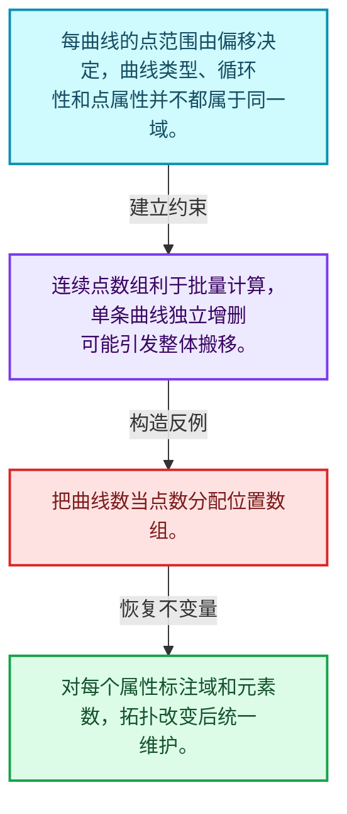
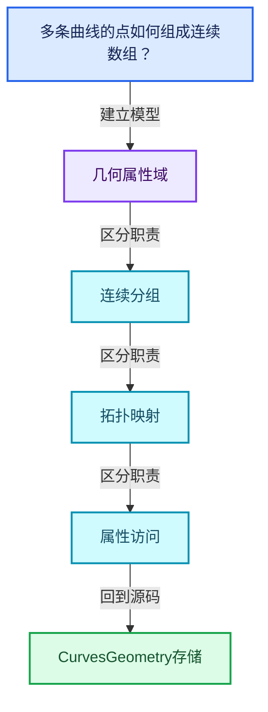
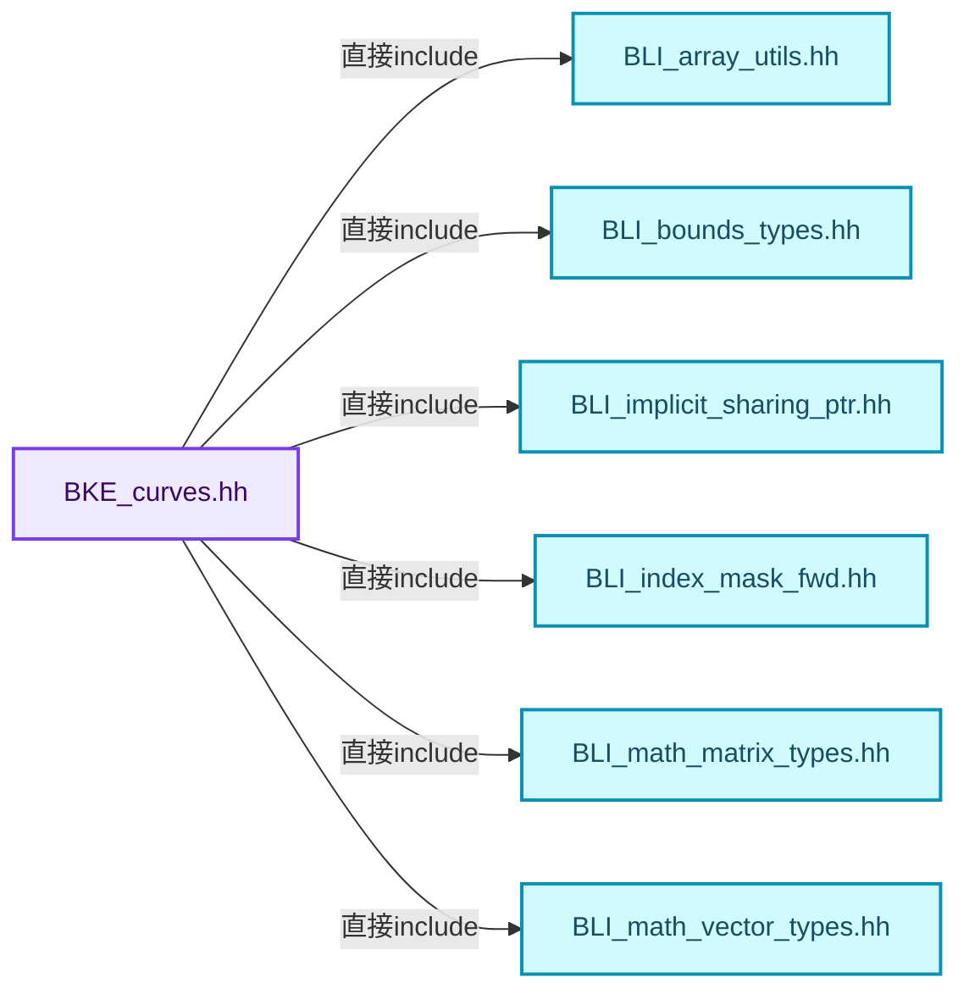
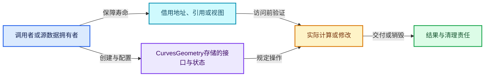
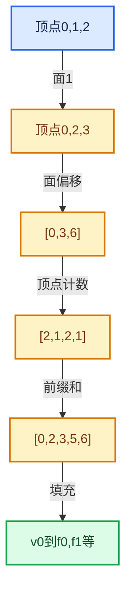

# 05-04 CurvesGeometry存储

[方向导航](README.md) · [总目录](../README.md) · [覆盖索引](../%E6%BA%90%E7%A0%81%E7%89%88%E6%9C%AC%E4%B8%8E%E8%A6%86%E7%9B%96%E7%B4%A2%E5%BC%95.md)

> 阅读顺序：问题与数据模型 → 语法与类型 → 源码逐行 → 调用线索 → 历史与取舍 → 推演和练习。

- 基准 HEAD：`cbda6b96c26c0dee3c3b5cbb93960c4ac06a6b30`。
- 记录日期：2026-10-14。
- 教学示例状态：正文中的推演不是本机性能实测；已运行练习见验收报告。

## 一、从问题到设计

多条曲线的点如何组成连续数组？

曲线偏移把点按组组织，类型和循环性等曲线属性处于另一域；缓存依赖具体源数据。

本篇把语法、数据语义和系统取舍连接起来。利用连续性和重复关系选择表示，让冗余状态尽量无法表达。

### 本篇独立模型与设计推理

每曲线的点范围由偏移决定，曲线类型、循环性和点属性并不都属于同一域。

设计取舍：连续点数组利于批量计算，单条曲线独立增删可能引发整体搬移。

最小反例：把曲线数当点数分配位置数组。

推导与处理：对每个属性标注域和元素数，拓扑改变后统一维护。



### 源码范围与相邻篇章

| 文件 | 本篇逐行范围 | 基准SHA-256 |
|---|---|---|
| [source/blender/blenkernel/BKE_curves.hh](../../../../../source/blender/blenkernel/BKE_curves.hh) | L1—L1199 | `18d3c57cc27021b0a89e013ad0a7212b3e9e93ef5ce6533627784721356c32a8` |

同一主讲文件可能分多篇覆盖；超出本篇范围的符号通过覆盖索引定位。空行与纯注释保留在源码摘录中，逐行表解释有效语句与语法边界；许可证头统一保留。

前篇：[MPoly迁移与兼容](03-MPoly%E8%BF%81%E7%A7%BB%E4%B8%8E%E5%85%BC%E5%AE%B9.md).

后篇：[邻接关系与前缀和](05-%E9%82%BB%E6%8E%A5%E5%85%B3%E7%B3%BB%E4%B8%8E%E5%89%8D%E7%BC%80%E5%92%8C.md).

## 二、类型、数据与阅读地图



这是概念依赖图，边表示阅读关系，不声称是运行时调用顺序。

### 直接编译依赖



箭头只表示头文件包含关系；完整调用线索见后面的符号定位表。

## 三、关键词、语法与类型角色

### 模板 template

模板把类型或常量作为生成实现的参数。读声明时先列出类型参数、非类型参数和默认值，再看使用者实际实例化了什么。模板声明本身不意味着每种T都支持其全部成员。

具体检查：把T替换为int、string、只能移动的类型，分别检查每个被调用操作是否成立。

### 依赖名称 typename

typename既可引入类型模板参数，也可告诉编译器某个依赖名称是类型。它不创建运行时对象；解析期确认语法类别与实例化期检查具体类型是不同阶段。

具体检查：区分typename T::value_type和T::size()，前者标记类型，后者是表达式。

### 常量求值 constexpr

constexpr声明允许相应实体参与常量求值，但constexpr函数仍可以在运行时执行。是否常量求值由调用场景和表达式合法性共同决定。

具体检查：比较constexpr变量初始化和从运行时输入调用同一函数。

### 只读限定 const

const约束当前访问路径可做的修改。const指针、指向const的指针、const视图对象、const元素是不同位置的限定；其他别名可能仍可修改原对象。

具体检查：分别写T* const、const T*与const T* const，并画出不可修改的层次。

### 异常边界 try与catch

try定义异常传播的局部边界。失败路径需要销毁已经成功构造的部分并释放相应存储；未构造的对象不能被析构。

具体检查：在第k次构造失败，列出已经存在的对象集合与待释放缓冲。

### 表示层转换 reinterpret_cast

reinterpret_cast不能自动开始任意对象的生命周期，也不能豁免对齐和别名规则。读这类代码需要追溯原始分配与实际构造操作。

具体检查：分别检查大小、对齐、生命周期和可访问类型，四项不能互相替代。

### 运行时多态 virtual

虚调用根据实际动态类型选择实现；经基类指针销毁对象时通常需要相应虚析构契约。每元素虚调用和循环外一次分派有不同开销。

具体检查：找出虚接口的实现类和调用频率，再讨论是否值得去虚拟化。

### 可选值 optional

optional把不存在与存在的T区分开，T的构造和析构跟随engaged状态变化。访问前应由has_value或条件分支证明存在。

具体检查：把空Field状态与合法常量零区分，不能用某个普通值代替不存在。

### 对象表示 sizeof

sizeof给出对象表示大小，不是其引用的所有堆内存总量。sizeof视图很小并不说明底层数组很小。

具体检查：分别统计容器对象、容量字节和元素拥有的间接资源。

### 构造与new表达式

普通new可能分配并构造；placement new在给定地址构造，存储由其他机制提供。失败回滚应区分两类责任。

具体检查：追踪地址来自哪里、构造何时成功、由谁析构、由谁释放。

### 内部断言 assert

断言表达开发者预期成立的内部契约，发布构建可能关闭。它不能替代对不可信输入的完整错误处理，也不保证后续操作被运行时保护。

具体检查：对每条断言构造违反条件的输入，区分调用者错误与应向用户报告的错误。

### 编译期分支 if constexpr

条件在实例化时决定被保留的分支，这常用于不同类型的合法操作选择。它与运行时if有不同的实例化检查规则。

具体检查：找出每个分支依赖哪些类型特征，再使用满足与不满足条件的类型。

### 独占拥有 unique_ptr

unique_ptr通过移动转移拥有关系，默认删除策略必须与资源来源匹配。get返回借用指针，release交出责任而不销毁。

具体检查：区分move、get、release和reset后谁负责销毁。

### 类型别名 using

类型别名为已有类型建立名字，不创建运行期对象。它常把模板内部使用的类型统一暴露给泛型调用者。

具体检查：展开别名直到基础类型，区分类型别名和变量声明。

### 枚举与状态模型 enum

枚举把有限状态命名；enum class避免许多隐式整数转换。状态机正确性还依赖允许的转移，不能只看有哪些枚举项。

具体检查：列出每个状态的进入条件和离开条件，检查终止状态是否仍可能被调度。

## 四、真实源码与逐行讲解

源码块保持原行内容，原始行号由小节标题及逐行表给出。表中的调用定位是静态阅读辅助；重载、模板实例化、宏展开和虚调用需结合完整声明，不能仅凭词法出现证明动态调用。

### BKE_curves.hh：L1—L44

<!-- source:source/blender/blenkernel/BKE_curves.hh:1:44 -->

```cpp
/* SPDX-FileCopyrightText: 2023 Blender Authors
 *
 * SPDX-License-Identifier: GPL-2.0-or-later */

#pragma once

/** \file
 * \ingroup bke
 * \brief Low-level operations for curves.
 */

#include "BLI_array_utils.hh"
#include "BLI_bounds_types.hh"
#include "BLI_implicit_sharing_ptr.hh"
#include "BLI_index_mask_fwd.hh"
#include "BLI_math_matrix_types.hh"
#include "BLI_math_vector_types.hh"
#include "BLI_memory_counter_fwd.hh"
#include "BLI_offset_indices.hh"
#include "BLI_shared_cache.hh"
#include "BLI_span.hh"
#include "BLI_vector.hh"
#include "BLI_virtual_array_fwd.hh"

#include "BKE_attribute_math.hh"
#include "BKE_attribute_storage.hh"
#include "BKE_curves.h"

namespace blender {

struct BlendDataReader;
struct BlendWriter;
struct MDeformVert;
namespace bke {
struct GeometrySet;
class AttributeAccessor;
class MutableAttributeAccessor;
enum class AttrDomain : int8_t;
struct AttributeAccessorFunctions;
}  // namespace bke
namespace bke::bake {
struct BakeMaterialsList;
}
class GVArray;
```

| 原始行 | 语义、约束与检查 |
|---|---|
| L5 | 防止同一头文件在一个翻译单元中重复展开；不控制多个源文件之间的链接或对象寿命。 |
| L12 | 引入编译依赖 "BLI_array_utils.hh"；这是声明可见性关系，不表示运行时一定调用该文件的所有接口。 |
| L13 | 引入编译依赖 "BLI_bounds_types.hh"；这是声明可见性关系，不表示运行时一定调用该文件的所有接口。 |
| L14 | 引入编译依赖 "BLI_implicit_sharing_ptr.hh"；这是声明可见性关系，不表示运行时一定调用该文件的所有接口。 |
| L15 | 引入编译依赖 "BLI_index_mask_fwd.hh"；这是声明可见性关系，不表示运行时一定调用该文件的所有接口。 |
| L16 | 引入编译依赖 "BLI_math_matrix_types.hh"；这是声明可见性关系，不表示运行时一定调用该文件的所有接口。 |
| L17 | 引入编译依赖 "BLI_math_vector_types.hh"；这是声明可见性关系，不表示运行时一定调用该文件的所有接口。 |
| L18 | 引入编译依赖 "BLI_memory_counter_fwd.hh"；这是声明可见性关系，不表示运行时一定调用该文件的所有接口。 |
| L19 | 引入编译依赖 "BLI_offset_indices.hh"；这是声明可见性关系，不表示运行时一定调用该文件的所有接口。 |
| L20 | 引入编译依赖 "BLI_shared_cache.hh"；这是声明可见性关系，不表示运行时一定调用该文件的所有接口。 |
| L21 | 引入编译依赖 "BLI_span.hh"；这是声明可见性关系，不表示运行时一定调用该文件的所有接口。 |
| L22 | 引入编译依赖 "BLI_vector.hh"；这是声明可见性关系，不表示运行时一定调用该文件的所有接口。 |
| L23 | 引入编译依赖 "BLI_virtual_array_fwd.hh"；这是声明可见性关系，不表示运行时一定调用该文件的所有接口。 |
| L25 | 引入编译依赖 "BKE_attribute_math.hh"；这是声明可见性关系，不表示运行时一定调用该文件的所有接口。 |
| L26 | 引入编译依赖 "BKE_attribute_storage.hh"；这是声明可见性关系，不表示运行时一定调用该文件的所有接口。 |
| L27 | 引入编译依赖 "BKE_curves.h"；这是声明可见性关系，不表示运行时一定调用该文件的所有接口。 |
| L29 | 把后续声明放入 blender 命名空间，影响名称查找和符号归属，不创建运行时对象。 |
| L31 | 声明或定义类型 `struct BlendDataReader`。结合继承、访问权限和成员布局确认接口与拥有关系；前向声明本身没有完整对象布局。 |
| L32 | 声明或定义类型 `struct BlendWriter`。结合继承、访问权限和成员布局确认接口与拥有关系；前向声明本身没有完整对象布局。 |
| L33 | 声明或定义类型 `struct MDeformVert`。结合继承、访问权限和成员布局确认接口与拥有关系；前向声明本身没有完整对象布局。 |
| L34 | 把后续声明放入 bke 命名空间，影响名称查找和符号归属，不创建运行时对象。 |
| L35 | 声明或定义类型 `struct GeometrySet`。结合继承、访问权限和成员布局确认接口与拥有关系；前向声明本身没有完整对象布局。 |
| L36 | 声明或定义类型 `class AttributeAccessor`。结合继承、访问权限和成员布局确认接口与拥有关系；前向声明本身没有完整对象布局。 |
| L37 | 声明或定义类型 `class MutableAttributeAccessor`。结合继承、访问权限和成员布局确认接口与拥有关系；前向声明本身没有完整对象布局。 |
| L38 | 声明或定义类型 `enum class AttrDomain : int8_t`。结合继承、访问权限和成员布局确认接口与拥有关系；前向声明本身没有完整对象布局。 |
| L39 | 声明或定义类型 `struct AttributeAccessorFunctions`。结合继承、访问权限和成员布局确认接口与拥有关系；前向声明本身没有完整对象布局。 |
| L40 | 结束当前语法单元。局部自动对象在离开其作用域时按规则销毁；这不等于所有被引用的外部数据也被释放。 |
| L41 | 把后续声明放入 bke::bake 命名空间，影响名称查找和符号归属，不创建运行时对象。 |
| L42 | 声明或定义类型 `struct BakeMaterialsList`。结合继承、访问权限和成员布局确认接口与拥有关系；前向声明本身没有完整对象布局。 |
| L43 | 结束当前语法单元。局部自动对象在离开其作用域时按规则销毁；这不等于所有被引用的外部数据也被释放。 |
| L44 | 声明或定义类型 `class GVArray`。结合继承、访问权限和成员布局确认接口与拥有关系；前向声明本身没有完整对象布局。 |

### BKE_curves.hh：L45—L94

<!-- source:source/blender/blenkernel/BKE_curves.hh:45:94 -->

```cpp

namespace bke {

namespace curves::nurbs {

struct BasisCache {
  /**
   * For each evaluated point, the weight for all control points that influences it.
   * The vector's size is the evaluated point count multiplied by the curve's order.
   */
  Vector<float> weights;
  /**
   * For each evaluated point, an offset into the curve's control points for the start of #weights.
   * In other words, the index of the first control point that influences this evaluated point.
   */
  Vector<int> start_indices;

  /**
   * The result of #check_valid_eval_params, to avoid retrieving its inputs later on.
   * If this is true, the data above will be invalid, and original data should be copied
   * to the evaluated result.
   */
  bool invalid = false;
};

}  // namespace curves::nurbs

/**
 * Contains derived data, caches, and other information not saved in files.
 */
class CurvesGeometryRuntime {
 public:
  /** Implicit sharing user count for #CurvesGeometry::curve_offsets. */
  const ImplicitSharingInfo *curve_offsets_sharing_info = nullptr;

  /** Implicit sharing user count for #CurvesGeometry::custom_knots. */
  const ImplicitSharingInfo *custom_knots_sharing_info = nullptr;

  /**
   * The cached number of curves with each type. Unlike other caches here, this is not computed
   * lazily, since it is needed so often and types are not adjusted much anyway.
   */
  std::array<int, CURVE_TYPES_NUM> type_counts;

  /**
   * Cache of offsets into the evaluated array for each curve, accounting for all previous
   * evaluated points, Bezier curve vector segments, different resolutions per curve, etc.
   */
  struct EvaluatedOffsets {
    Vector<int> evaluated_offsets;
```

| 原始行 | 语义、约束与检查 |
|---|---|
| L46 | 把后续声明放入 bke 命名空间，影响名称查找和符号归属，不创建运行时对象。 |
| L48 | 把后续声明放入 curves::nurbs 命名空间，影响名称查找和符号归属，不创建运行时对象。 |
| L50 | 声明或定义类型 `struct BasisCache`。结合继承、访问权限和成员布局确认接口与拥有关系；前向声明本身没有完整对象布局。 |
| L55 | 声明成员、局部对象或完成语句 `Vector<float> weights`。若为指针或引用，它本身不说明拥有；若为值对象，其构造析构由所在作用域或外层对象管理。 |
| L60 | 声明成员、局部对象或完成语句 `Vector<int> start_indices`。若为指针或引用，它本身不说明拥有；若为值对象，其构造析构由所在作用域或外层对象管理。 |
| L67 | 把右侧 `false` 用于初始化或更新左侧 `bool invalid`。声明初始化与已有对象赋值应按上下文区分；有资源的类型会调用相应特殊成员。 |
| L68 | 结束当前语法单元。局部自动对象在离开其作用域时按规则销毁；这不等于所有被引用的外部数据也被释放。 |
| L70 | 结束当前语法单元。局部自动对象在离开其作用域时按规则销毁；这不等于所有被引用的外部数据也被释放。 |
| L75 | 声明或定义类型 `class CurvesGeometryRuntime`。结合继承、访问权限和成员布局确认接口与拥有关系；前向声明本身没有完整对象布局。 |
| L76 | 切换成员访问权限为 public；它是编译期接口边界，不是线程同步或内存保护。 |
| L78 | 把右侧 `nullptr` 用于初始化或更新左侧 `const ImplicitSharingInfo *curve_offsets_sharing_info`。声明初始化与已有对象赋值应按上下文区分；有资源的类型会调用相应特殊成员。 |
| L81 | 把右侧 `nullptr` 用于初始化或更新左侧 `const ImplicitSharingInfo *custom_knots_sharing_info`。声明初始化与已有对象赋值应按上下文区分；有资源的类型会调用相应特殊成员。 |
| L87 | 声明成员、局部对象或完成语句 `std::array<int, CURVE_TYPES_NUM> type_counts`。若为指针或引用，它本身不说明拥有；若为值对象，其构造析构由所在作用域或外层对象管理。 |
| L93 | 声明或定义类型 `struct EvaluatedOffsets`。结合继承、访问权限和成员布局确认接口与拥有关系；前向声明本身没有完整对象布局。 |
| L94 | 声明成员、局部对象或完成语句 `Vector<int> evaluated_offsets`。若为指针或引用，它本身不说明拥有；若为值对象，其构造析构由所在作用域或外层对象管理。 |

### BKE_curves.hh：L95—L140

<!-- source:source/blender/blenkernel/BKE_curves.hh:95:140 -->

```cpp
    Vector<int> all_bezier_offsets;
  };
  mutable SharedCache<EvaluatedOffsets> evaluated_offsets_cache;

  mutable SharedCache<bool> has_cyclic_curve_cache;

  mutable SharedCache<Vector<curves::nurbs::BasisCache>> nurbs_basis_cache;

  /**
   * Cache of evaluated positions for all curves. The positions span will
   * be used directly rather than the cache when all curves are poly type.
   */
  mutable SharedCache<Vector<float3>> evaluated_position_cache;

  /**
   * A cache of bounds shared between data-blocks with unchanged positions.
   * When data changes affect the bounds, the cache is "un-shared" with other geometries.
   * See #SharedCache comments.
   */
  mutable SharedCache<Bounds<float3>> bounds_cache;
  mutable SharedCache<Bounds<float3>> bounds_with_radius_cache;

  /**
   * Cache of lengths along each evaluated curve for each evaluated point. If a curve is
   * cyclic, it needs one more length value to correspond to the last segment, so in order to
   * make slicing this array for a curve fast, an extra float is stored for every curve.
   */
  mutable SharedCache<Vector<float>> evaluated_length_cache;

  /** Direction of the curve at each evaluated point. */
  mutable SharedCache<Vector<float3>> evaluated_tangent_cache;

  /** Normal direction vectors for each evaluated point. */
  mutable SharedCache<Vector<float3>> evaluated_normal_cache;

  /** The maximum of the "material_index" attribute. */
  mutable SharedCache<std::optional<int>> max_material_index_cache;

  /**
   * Offsets of custom knots in #CurvesGeometry::custom_knots for each curve in #CurvesGeometry.
   * For curves with no custom knots next offset value stays the same.
   */
  mutable SharedCache<Vector<int>> custom_knot_offsets_cache;

  /** Stores weak references to material data blocks. */
  std::unique_ptr<bake::BakeMaterialsList> bake_materials;
```

| 原始行 | 语义、约束与检查 |
|---|---|
| L95 | 声明成员、局部对象或完成语句 `Vector<int> all_bezier_offsets`。若为指针或引用，它本身不说明拥有；若为值对象，其构造析构由所在作用域或外层对象管理。 |
| L96 | 结束当前语法单元。局部自动对象在离开其作用域时按规则销毁；这不等于所有被引用的外部数据也被释放。 |
| L97 | 声明成员、局部对象或完成语句 `mutable SharedCache<EvaluatedOffsets> evaluated_offsets_cache`。若为指针或引用，它本身不说明拥有；若为值对象，其构造析构由所在作用域或外层对象管理。 |
| L99 | 声明成员、局部对象或完成语句 `mutable SharedCache<bool> has_cyclic_curve_cache`。若为指针或引用，它本身不说明拥有；若为值对象，其构造析构由所在作用域或外层对象管理。 |
| L101 | 声明成员、局部对象或完成语句 `mutable SharedCache<Vector<curves::nurbs::BasisCache>> nurbs_basis_cache`。若为指针或引用，它本身不说明拥有；若为值对象，其构造析构由所在作用域或外层对象管理。 |
| L107 | 声明成员、局部对象或完成语句 `mutable SharedCache<Vector<float3>> evaluated_position_cache`。若为指针或引用，它本身不说明拥有；若为值对象，其构造析构由所在作用域或外层对象管理。 |
| L114 | 声明成员、局部对象或完成语句 `mutable SharedCache<Bounds<float3>> bounds_cache`。若为指针或引用，它本身不说明拥有；若为值对象，其构造析构由所在作用域或外层对象管理。 |
| L115 | 声明成员、局部对象或完成语句 `mutable SharedCache<Bounds<float3>> bounds_with_radius_cache`。若为指针或引用，它本身不说明拥有；若为值对象，其构造析构由所在作用域或外层对象管理。 |
| L122 | 声明成员、局部对象或完成语句 `mutable SharedCache<Vector<float>> evaluated_length_cache`。若为指针或引用，它本身不说明拥有；若为值对象，其构造析构由所在作用域或外层对象管理。 |
| L125 | 声明成员、局部对象或完成语句 `mutable SharedCache<Vector<float3>> evaluated_tangent_cache`。若为指针或引用，它本身不说明拥有；若为值对象，其构造析构由所在作用域或外层对象管理。 |
| L128 | 声明成员、局部对象或完成语句 `mutable SharedCache<Vector<float3>> evaluated_normal_cache`。若为指针或引用，它本身不说明拥有；若为值对象，其构造析构由所在作用域或外层对象管理。 |
| L131 | 声明成员、局部对象或完成语句 `mutable SharedCache<std::optional<int>> max_material_index_cache`。若为指针或引用，它本身不说明拥有；若为值对象，其构造析构由所在作用域或外层对象管理。 |
| L137 | 声明成员、局部对象或完成语句 `mutable SharedCache<Vector<int>> custom_knot_offsets_cache`。若为指针或引用，它本身不说明拥有；若为值对象，其构造析构由所在作用域或外层对象管理。 |
| L140 | 声明成员、局部对象或完成语句 `std::unique_ptr<bake::BakeMaterialsList> bake_materials`。若为指针或引用，它本身不说明拥有；若为值对象，其构造析构由所在作用域或外层对象管理。 |

### BKE_curves.hh：L141—L188

<!-- source:source/blender/blenkernel/BKE_curves.hh:141:188 -->

```cpp

  /**
   * Type counts have to be set eagerly after each operation. It's checked with asserts that the
   * type counts are correct when accessed. However, this check is expensive and shouldn't be done
   * all the time because it makes debug builds unusable in some situations that would be fine
   * otherwise.
   */
  bool check_type_counts = true;
};

/**
 * A C++ class that wraps the DNA struct for better encapsulation and ease of use. It inherits
 * directly from the struct rather than storing a pointer to avoid more complicated ownership
 * handling.
 */
class CurvesGeometry : public blender::CurvesGeometry {
 public:
  CurvesGeometry();
  /**
   * Create curves with the given size. Only the position attribute is created, along with the
   * offsets.
   */
  CurvesGeometry(int point_num, int curve_num);
  CurvesGeometry(const CurvesGeometry &other);
  CurvesGeometry(CurvesGeometry &&other);
  CurvesGeometry &operator=(const CurvesGeometry &other);
  CurvesGeometry &operator=(CurvesGeometry &&other);
  ~CurvesGeometry();

  /* --------------------------------------------------------------------
   * Accessors.
   */

  /**
   * The total number of control points in all curves.
   */
  int points_num() const;
  /**
   * The number of curves in the data-block.
   */
  int curves_num() const;
  /**
   * Return true if there are no curves in the geometry.
   */
  bool is_empty() const;

  IndexRange points_range() const;
  IndexRange curves_range() const;
```

| 原始行 | 语义、约束与检查 |
|---|---|
| L148 | 把右侧 `true` 用于初始化或更新左侧 `bool check_type_counts`。声明初始化与已有对象赋值应按上下文区分；有资源的类型会调用相应特殊成员。 |
| L149 | 结束当前语法单元。局部自动对象在离开其作用域时按规则销毁；这不等于所有被引用的外部数据也被释放。 |
| L156 | 声明或定义类型 `class CurvesGeometry : public blender::CurvesGeometry`。结合继承、访问权限和成员布局确认接口与拥有关系；前向声明本身没有完整对象布局。 |
| L157 | 切换成员访问权限为 public；它是编译期接口边界，不是线程同步或内存保护。 |
| L158 | 出现调用或函数声明 `CurvesGeometry`，对应表达式为 `CurvesGeometry();`。参数求值、返回类型与重载需结合前后完整语句；静态文本引用不能证明动态目标。 |
| L163 | 出现调用或函数声明 `CurvesGeometry`，对应表达式为 `CurvesGeometry(int point_num, int curve_num);`。参数求值、返回类型与重载需结合前后完整语句；静态文本引用不能证明动态目标。 |
| L164 | 出现调用或函数声明 `CurvesGeometry`，对应表达式为 `CurvesGeometry(const CurvesGeometry &other);`。参数求值、返回类型与重载需结合前后完整语句；静态文本引用不能证明动态目标。 |
| L165 | 出现调用或函数声明 `CurvesGeometry`，对应表达式为 `CurvesGeometry(CurvesGeometry &&other);`。参数求值、返回类型与重载需结合前后完整语句；静态文本引用不能证明动态目标。 |
| L166 | 运算符重载声明、定义或显式调用：`CurvesGeometry &operator=(const CurvesGeometry &other);`。结合参数和返回类型判断是赋值、索引、比较还是转换；operator=声明中的等号不是在给名为operator的变量赋值。 |
| L167 | 运算符重载声明、定义或显式调用：`CurvesGeometry &operator=(CurvesGeometry &&other);`。结合参数和返回类型判断是赋值、索引、比较还是转换；operator=声明中的等号不是在给名为operator的变量赋值。 |
| L168 | 涉及析构接口或显式析构：`~CurvesGeometry();`。检查目标对象已成功构造，且资源不会在另一条清理路径再次销毁。 |
| L177 | 声明接口 `int points_num() const`，本行没有对应函数体；返回类型、参数限定和const/noexcept共同组成调用契约，实际行为需继续定位实现。 |
| L181 | 声明接口 `int curves_num() const`，本行没有对应函数体；返回类型、参数限定和const/noexcept共同组成调用契约，实际行为需继续定位实现。 |
| L185 | 声明接口 `bool is_empty() const`，本行没有对应函数体；返回类型、参数限定和const/noexcept共同组成调用契约，实际行为需继续定位实现。 |
| L187 | 声明接口 `IndexRange points_range() const`，本行没有对应函数体；返回类型、参数限定和const/noexcept共同组成调用契约，实际行为需继续定位实现。 |
| L188 | 声明接口 `IndexRange curves_range() const`，本行没有对应函数体；返回类型、参数限定和const/noexcept共同组成调用契约，实际行为需继续定位实现。 |

### BKE_curves.hh：L189—L235

<!-- source:source/blender/blenkernel/BKE_curves.hh:189:235 -->

```cpp

  /**
   * The index of the first point in every curve. The size of this span is one larger than the
   * number of curves, but the spans will be empty if there are no curves/points.
   *
   * Consider using #points_by_curve rather than these offsets directly.
   */
  Span<int> offsets() const;
  MutableSpan<int> offsets_for_write();

  /**
   * The offsets of every curve into arrays on the points domain.
   */
  OffsetIndices<int> points_by_curve() const;

  /** The type (#CurveType) of each curve, or potentially a single if all are the same type. */
  VArray<int8_t> curve_types() const;
  /**
   * Mutable access to curve types. Call #tag_topology_changed and #update_curve_types after
   * changing any type. Consider using the other methods to change types below.
   */
  MutableSpan<int8_t> curve_types_for_write();
  /** Set all curve types to the value and call #update_curve_types. */
  void fill_curve_types(CurveType type);
  /** Set the types for the curves in the selection and call #update_curve_types. */
  void fill_curve_types(const IndexMask &selection, CurveType type);
  /** Update the cached count of curves of each type, necessary after #curve_types_for_write. */
  void update_curve_types();

  bool has_curve_with_type(CurveType type) const;
  bool has_curve_with_type(Span<CurveType> types) const;
  /** Return true if all of the curves have the provided type. */
  bool is_single_type(CurveType type) const;
  /** Return the number of curves with each type. */
  const std::array<int, CURVE_TYPES_NUM> &curve_type_counts() const;
  /**
   * All of the curve indices for curves with a specific type.
   */
  IndexMask indices_for_curve_type(CurveType type, IndexMaskMemory &memory) const;
  IndexMask indices_for_curve_type(CurveType type,
                                   const IndexMask &selection,
                                   IndexMaskMemory &memory) const;

  Array<int> point_to_curve_map() const;

  Span<float3> positions() const;
  MutableSpan<float3> positions_for_write();
```

| 原始行 | 语义、约束与检查 |
|---|---|
| L196 | 声明接口 `Span<int> offsets() const`，本行没有对应函数体；返回类型、参数限定和const/noexcept共同组成调用契约，实际行为需继续定位实现。 |
| L197 | 出现调用或函数声明 `offsets_for_write`，对应表达式为 `MutableSpan<int> offsets_for_write();`。参数求值、返回类型与重载需结合前后完整语句；静态文本引用不能证明动态目标。 |
| L202 | 声明接口 `OffsetIndices<int> points_by_curve() const`，本行没有对应函数体；返回类型、参数限定和const/noexcept共同组成调用契约，实际行为需继续定位实现。 |
| L205 | 声明接口 `VArray<int8_t> curve_types() const`，本行没有对应函数体；返回类型、参数限定和const/noexcept共同组成调用契约，实际行为需继续定位实现。 |
| L210 | 出现调用或函数声明 `curve_types_for_write`，对应表达式为 `MutableSpan<int8_t> curve_types_for_write();`。参数求值、返回类型与重载需结合前后完整语句；静态文本引用不能证明动态目标。 |
| L212 | 声明接口 `void fill_curve_types(CurveType type)`，本行没有对应函数体；返回类型、参数限定和const/noexcept共同组成调用契约，实际行为需继续定位实现。 |
| L214 | 声明接口 `void fill_curve_types(const IndexMask &selection, CurveType type)`，本行没有对应函数体；返回类型、参数限定和const/noexcept共同组成调用契约，实际行为需继续定位实现。 |
| L216 | 声明接口 `void update_curve_types()`，本行没有对应函数体；返回类型、参数限定和const/noexcept共同组成调用契约，实际行为需继续定位实现。 |
| L218 | 声明接口 `bool has_curve_with_type(CurveType type) const`，本行没有对应函数体；返回类型、参数限定和const/noexcept共同组成调用契约，实际行为需继续定位实现。 |
| L219 | 声明接口 `bool has_curve_with_type(Span<CurveType> types) const`，本行没有对应函数体；返回类型、参数限定和const/noexcept共同组成调用契约，实际行为需继续定位实现。 |
| L221 | 声明接口 `bool is_single_type(CurveType type) const`，本行没有对应函数体；返回类型、参数限定和const/noexcept共同组成调用契约，实际行为需继续定位实现。 |
| L223 | 声明接口 `const std::array<int, CURVE_TYPES_NUM> &curve_type_counts() const`，本行没有对应函数体；返回类型、参数限定和const/noexcept共同组成调用契约，实际行为需继续定位实现。 |
| L227 | 声明接口 `IndexMask indices_for_curve_type(CurveType type, IndexMaskMemory &memory) const`，本行没有对应函数体；返回类型、参数限定和const/noexcept共同组成调用契约，实际行为需继续定位实现。 |
| L228 | 出现调用或函数声明 `indices_for_curve_type`，对应表达式为 `IndexMask indices_for_curve_type(CurveType type,`。参数求值、返回类型与重载需结合前后完整语句；静态文本引用不能证明动态目标。 |
| L229 | 本行是连续声明或表达式的一部分：`const IndexMask &selection,`。与本段前后行合读；逗号、括号和限定符决定它属于参数、初始化列表还是实际计算。 |
| L230 | 声明成员、局部对象或完成语句 `IndexMaskMemory &memory) const`。若为指针或引用，它本身不说明拥有；若为值对象，其构造析构由所在作用域或外层对象管理。 |
| L232 | 声明接口 `Array<int> point_to_curve_map() const`，本行没有对应函数体；返回类型、参数限定和const/noexcept共同组成调用契约，实际行为需继续定位实现。 |
| L234 | 声明接口 `Span<float3> positions() const`，本行没有对应函数体；返回类型、参数限定和const/noexcept共同组成调用契约，实际行为需继续定位实现。 |
| L235 | 出现调用或函数声明 `positions_for_write`，对应表达式为 `MutableSpan<float3> positions_for_write();`。参数求值、返回类型与重载需结合前后完整语句；静态文本引用不能证明动态目标。 |

### BKE_curves.hh：L236—L283

<!-- source:source/blender/blenkernel/BKE_curves.hh:236:283 -->

```cpp

  VArray<float> radius() const;
  MutableSpan<float> radius_for_write();

  /** Whether the curve loops around to connect to itself, on the curve domain. */
  VArray<bool> cyclic() const;
  /** Mutable access to curve cyclic values. Call #tag_topology_changed after changes. */
  MutableSpan<bool> cyclic_for_write();

  /**
   * How many evaluated points to create for each segment when evaluating Bezier,
   * Catmull Rom, and NURBS curves. On the curve domain. Values must be one or greater.
   */
  VArray<int> resolution() const;
  /** Mutable access to curve resolution. Call #tag_topology_changed after changes. */
  MutableSpan<int> resolution_for_write();

  /**
   * The angle used to rotate evaluated normals around the tangents after their calculation.
   * Call #tag_normals_changed after changes.
   */
  VArray<float> tilt() const;
  MutableSpan<float> tilt_for_write();

  /**
   * Which method to use for calculating the normals of evaluated points (#NormalMode).
   * Call #tag_normals_changed after changes.
   */
  VArray<int8_t> normal_mode() const;
  MutableSpan<int8_t> normal_mode_for_write();

  /**
   * Handle types for Bezier control points. Call #tag_topology_changed after changes.
   */
  VArray<int8_t> handle_types_left() const;
  MutableSpan<int8_t> handle_types_left_for_write();
  VArray<int8_t> handle_types_right() const;
  MutableSpan<int8_t> handle_types_right_for_write();

  /**
   * The positions of Bezier curve handles. Though these are really control points for the Bezier
   * segments, they are stored in separate arrays to better reflect user expectations. Note that
   * values may be generated automatically based on the handle types. Call #tag_positions_changed
   * after changes.
   */
  std::optional<Span<float3>> handle_positions_left() const;
  MutableSpan<float3> handle_positions_left_for_write();
  std::optional<Span<float3>> handle_positions_right() const;
```

| 原始行 | 语义、约束与检查 |
|---|---|
| L237 | 声明接口 `VArray<float> radius() const`，本行没有对应函数体；返回类型、参数限定和const/noexcept共同组成调用契约，实际行为需继续定位实现。 |
| L238 | 出现调用或函数声明 `radius_for_write`，对应表达式为 `MutableSpan<float> radius_for_write();`。参数求值、返回类型与重载需结合前后完整语句；静态文本引用不能证明动态目标。 |
| L241 | 声明接口 `VArray<bool> cyclic() const`，本行没有对应函数体；返回类型、参数限定和const/noexcept共同组成调用契约，实际行为需继续定位实现。 |
| L243 | 出现调用或函数声明 `cyclic_for_write`，对应表达式为 `MutableSpan<bool> cyclic_for_write();`。参数求值、返回类型与重载需结合前后完整语句；静态文本引用不能证明动态目标。 |
| L249 | 声明接口 `VArray<int> resolution() const`，本行没有对应函数体；返回类型、参数限定和const/noexcept共同组成调用契约，实际行为需继续定位实现。 |
| L251 | 出现调用或函数声明 `resolution_for_write`，对应表达式为 `MutableSpan<int> resolution_for_write();`。参数求值、返回类型与重载需结合前后完整语句；静态文本引用不能证明动态目标。 |
| L257 | 声明接口 `VArray<float> tilt() const`，本行没有对应函数体；返回类型、参数限定和const/noexcept共同组成调用契约，实际行为需继续定位实现。 |
| L258 | 出现调用或函数声明 `tilt_for_write`，对应表达式为 `MutableSpan<float> tilt_for_write();`。参数求值、返回类型与重载需结合前后完整语句；静态文本引用不能证明动态目标。 |
| L264 | 声明接口 `VArray<int8_t> normal_mode() const`，本行没有对应函数体；返回类型、参数限定和const/noexcept共同组成调用契约，实际行为需继续定位实现。 |
| L265 | 出现调用或函数声明 `normal_mode_for_write`，对应表达式为 `MutableSpan<int8_t> normal_mode_for_write();`。参数求值、返回类型与重载需结合前后完整语句；静态文本引用不能证明动态目标。 |
| L270 | 声明接口 `VArray<int8_t> handle_types_left() const`，本行没有对应函数体；返回类型、参数限定和const/noexcept共同组成调用契约，实际行为需继续定位实现。 |
| L271 | 出现调用或函数声明 `handle_types_left_for_write`，对应表达式为 `MutableSpan<int8_t> handle_types_left_for_write();`。参数求值、返回类型与重载需结合前后完整语句；静态文本引用不能证明动态目标。 |
| L272 | 声明接口 `VArray<int8_t> handle_types_right() const`，本行没有对应函数体；返回类型、参数限定和const/noexcept共同组成调用契约，实际行为需继续定位实现。 |
| L273 | 出现调用或函数声明 `handle_types_right_for_write`，对应表达式为 `MutableSpan<int8_t> handle_types_right_for_write();`。参数求值、返回类型与重载需结合前后完整语句；静态文本引用不能证明动态目标。 |
| L281 | 声明接口 `std::optional<Span<float3>> handle_positions_left() const`，本行没有对应函数体；返回类型、参数限定和const/noexcept共同组成调用契约，实际行为需继续定位实现。 |
| L282 | 出现调用或函数声明 `handle_positions_left_for_write`，对应表达式为 `MutableSpan<float3> handle_positions_left_for_write();`。参数求值、返回类型与重载需结合前后完整语句；静态文本引用不能证明动态目标。 |
| L283 | 声明接口 `std::optional<Span<float3>> handle_positions_right() const`，本行没有对应函数体；返回类型、参数限定和const/noexcept共同组成调用契约，实际行为需继续定位实现。 |

### BKE_curves.hh：L284—L329

<!-- source:source/blender/blenkernel/BKE_curves.hh:284:329 -->

```cpp
  MutableSpan<float3> handle_positions_right_for_write();

  /**
   * The order (degree plus one) of each NURBS curve, on the curve domain.
   * Call #tag_topology_changed after changes.
   */
  VArray<int8_t> nurbs_orders() const;
  MutableSpan<int8_t> nurbs_orders_for_write();

  /**
   * The automatic generation mode for each NURBS curve's knots vector, on the curve domain.
   * Call #tag_topology_changed after changes.
   */
  VArray<int8_t> nurbs_knots_modes() const;
  MutableSpan<int8_t> nurbs_knots_modes_for_write();

  /**
   * The weight for each control point for NURBS curves. Call #tag_positions_changed after changes.
   */
  std::optional<Span<float>> nurbs_weights() const;
  MutableSpan<float> nurbs_weights_for_write();

  /**
   * UV coordinate for each curve that encodes where the curve is attached to the surface mesh.
   */
  std::optional<Span<float2>> surface_uv_coords() const;
  MutableSpan<float2> surface_uv_coords_for_write();

  /**
   * Custom knots for NURBS curves with knots mode #NURBS_KNOT_MODE_CUSTOM.
   */
  Span<float> nurbs_custom_knots() const;
  MutableSpan<float> nurbs_custom_knots_for_write();

  /**
   * The offsets of every curve into arrays on #CurvesGeometry::nurbs_custom_knots.
   * Curves with knot mode other than #NURBS_KNOT_MODE_CUSTOM will have zero sized #IndexRange.
   */
  OffsetIndices<int> nurbs_custom_knots_by_curve() const;

  /**
   * Builds mask of NURBS curves with knot mode #NURBS_KNOT_MODE_CUSTOM.
   */
  IndexMask nurbs_custom_knot_curves(IndexMaskMemory &memory) const;

  bool nurbs_has_custom_knots() const;
```

| 原始行 | 语义、约束与检查 |
|---|---|
| L284 | 出现调用或函数声明 `handle_positions_right_for_write`，对应表达式为 `MutableSpan<float3> handle_positions_right_for_write();`。参数求值、返回类型与重载需结合前后完整语句；静态文本引用不能证明动态目标。 |
| L290 | 声明接口 `VArray<int8_t> nurbs_orders() const`，本行没有对应函数体；返回类型、参数限定和const/noexcept共同组成调用契约，实际行为需继续定位实现。 |
| L291 | 出现调用或函数声明 `nurbs_orders_for_write`，对应表达式为 `MutableSpan<int8_t> nurbs_orders_for_write();`。参数求值、返回类型与重载需结合前后完整语句；静态文本引用不能证明动态目标。 |
| L297 | 声明接口 `VArray<int8_t> nurbs_knots_modes() const`，本行没有对应函数体；返回类型、参数限定和const/noexcept共同组成调用契约，实际行为需继续定位实现。 |
| L298 | 出现调用或函数声明 `nurbs_knots_modes_for_write`，对应表达式为 `MutableSpan<int8_t> nurbs_knots_modes_for_write();`。参数求值、返回类型与重载需结合前后完整语句；静态文本引用不能证明动态目标。 |
| L303 | 声明接口 `std::optional<Span<float>> nurbs_weights() const`，本行没有对应函数体；返回类型、参数限定和const/noexcept共同组成调用契约，实际行为需继续定位实现。 |
| L304 | 出现调用或函数声明 `nurbs_weights_for_write`，对应表达式为 `MutableSpan<float> nurbs_weights_for_write();`。参数求值、返回类型与重载需结合前后完整语句；静态文本引用不能证明动态目标。 |
| L309 | 声明接口 `std::optional<Span<float2>> surface_uv_coords() const`，本行没有对应函数体；返回类型、参数限定和const/noexcept共同组成调用契约，实际行为需继续定位实现。 |
| L310 | 出现调用或函数声明 `surface_uv_coords_for_write`，对应表达式为 `MutableSpan<float2> surface_uv_coords_for_write();`。参数求值、返回类型与重载需结合前后完整语句；静态文本引用不能证明动态目标。 |
| L315 | 声明接口 `Span<float> nurbs_custom_knots() const`，本行没有对应函数体；返回类型、参数限定和const/noexcept共同组成调用契约，实际行为需继续定位实现。 |
| L316 | 出现调用或函数声明 `nurbs_custom_knots_for_write`，对应表达式为 `MutableSpan<float> nurbs_custom_knots_for_write();`。参数求值、返回类型与重载需结合前后完整语句；静态文本引用不能证明动态目标。 |
| L322 | 声明接口 `OffsetIndices<int> nurbs_custom_knots_by_curve() const`，本行没有对应函数体；返回类型、参数限定和const/noexcept共同组成调用契约，实际行为需继续定位实现。 |
| L327 | 声明接口 `IndexMask nurbs_custom_knot_curves(IndexMaskMemory &memory) const`，本行没有对应函数体；返回类型、参数限定和const/noexcept共同组成调用契约，实际行为需继续定位实现。 |
| L329 | 声明接口 `bool nurbs_has_custom_knots() const`，本行没有对应函数体；返回类型、参数限定和const/noexcept共同组成调用契约，实际行为需继续定位实现。 |

### BKE_curves.hh：L330—L375

<!-- source:source/blender/blenkernel/BKE_curves.hh:330:375 -->

```cpp

  /**
   * Resizes custom knots array depending on topological data.
   * Depends on curve offsets, knot modes, orders and cyclic data.
   * Used to resize internal knots array before writing knots.
   */
  void nurbs_custom_knots_update_size();

  /**
   * Resizes custom knots array. Used when knots number is known in advance and knot values are set
   * together with topological data.
   */
  void nurbs_custom_knots_resize(int knots_num);

  /**
   * Vertex group data, encoded as an array of indices and weights for every vertex.
   * \warning: May be empty.
   */
  Span<MDeformVert> deform_verts() const;
  MutableSpan<MDeformVert> deform_verts_for_write();

  /**
   * The largest and smallest position values of evaluated points.
   */
  std::optional<Bounds<float3>> bounds_min_max(bool use_radius = true) const;

  void count_memory(MemoryCounter &memory) const;

  /**
   * Get the largest material index used by the geometry or `nullopt` if there are none.
   * The returned value is clamped between 0 and MAXMAT even if the stored material indices may be
   * out of that range.
   */
  std::optional<int> material_index_max() const;

 private:
  /* --------------------------------------------------------------------
   * Evaluation.
   */

 public:
  /**
   * The total number of points in the evaluated poly curve.
   * This can depend on the resolution attribute if it exists.
   */
  int evaluated_points_num() const;
```

| 原始行 | 语义、约束与检查 |
|---|---|
| L336 | 声明接口 `void nurbs_custom_knots_update_size()`，本行没有对应函数体；返回类型、参数限定和const/noexcept共同组成调用契约，实际行为需继续定位实现。 |
| L342 | 声明接口 `void nurbs_custom_knots_resize(int knots_num)`，本行没有对应函数体；返回类型、参数限定和const/noexcept共同组成调用契约，实际行为需继续定位实现。 |
| L348 | 声明接口 `Span<MDeformVert> deform_verts() const`，本行没有对应函数体；返回类型、参数限定和const/noexcept共同组成调用契约，实际行为需继续定位实现。 |
| L349 | 出现调用或函数声明 `deform_verts_for_write`，对应表达式为 `MutableSpan<MDeformVert> deform_verts_for_write();`。参数求值、返回类型与重载需结合前后完整语句；静态文本引用不能证明动态目标。 |
| L354 | 把右侧 `true) const` 用于初始化或更新左侧 `std::optional<Bounds<float3>> bounds_min_max(bool use_radius`。声明初始化与已有对象赋值应按上下文区分；有资源的类型会调用相应特殊成员。 |
| L356 | 声明接口 `void count_memory(MemoryCounter &memory) const`，本行没有对应函数体；返回类型、参数限定和const/noexcept共同组成调用契约，实际行为需继续定位实现。 |
| L363 | 声明接口 `std::optional<int> material_index_max() const`，本行没有对应函数体；返回类型、参数限定和const/noexcept共同组成调用契约，实际行为需继续定位实现。 |
| L365 | 切换成员访问权限为 private；它是编译期接口边界，不是线程同步或内存保护。 |
| L370 | 切换成员访问权限为 public；它是编译期接口边界，不是线程同步或内存保护。 |
| L375 | 声明接口 `int evaluated_points_num() const`，本行没有对应函数体；返回类型、参数限定和const/noexcept共同组成调用契约，实际行为需继续定位实现。 |

### BKE_curves.hh：L376—L423

<!-- source:source/blender/blenkernel/BKE_curves.hh:376:423 -->

```cpp

  /**
   * The offsets of every curve's evaluated points.
   */
  OffsetIndices<int> evaluated_points_by_curve() const;

  /**
   * Retrieve offsets into a Bezier curve's evaluated points for each control point. Stored in the
   * same format as #OffsetIndices. Call #evaluated_points_by_curve() first to ensure that the
   * evaluated offsets cache is current.
   */
  Span<int> bezier_evaluated_offsets_for_curve(int curve_index) const;

  bool has_cyclic_curve() const;

  Span<float3> evaluated_positions() const;
  Span<float3> evaluated_tangents() const;
  Span<float3> evaluated_normals() const;

  /**
   * Return a cache of accumulated lengths along the curve. Each item is the length of the
   * subsequent segment (the first value is the length of the first segment rather than 0).
   * This calculation is rather trivial, and only depends on the evaluated positions, but
   * the results are used often, and it is necessarily single threaded per curve, so it is cached.
   *
   * \param cyclic: This argument is redundant with the data stored for the curve,
   * but is passed for performance reasons to avoid looking up the attribute.
   */
  Span<float> evaluated_lengths_for_curve(int curve_index, bool cyclic) const;
  float evaluated_length_total_for_curve(int curve_index, bool cyclic) const;

  /** Calculates the data described by #evaluated_lengths_for_curve if necessary. */
  void ensure_evaluated_lengths() const;

  void ensure_can_interpolate_to_evaluated() const;

  /**
   * Evaluate a generic data to the standard evaluated points of a specific curve,
   * defined by the resolution attribute or other factors, depending on the curve type.
   *
   * \warning This function expects offsets to the evaluated points for each curve to be
   * calculated. That can be ensured with #ensure_can_interpolate_to_evaluated.
   */
  void interpolate_to_evaluated(int curve_index, GSpan src, GMutableSpan dst) const;
  /**
   * Evaluate generic data for curve control points to the standard evaluated points of the curves.
   */
  void interpolate_to_evaluated(GSpan src, GMutableSpan dst) const;
```

| 原始行 | 语义、约束与检查 |
|---|---|
| L380 | 声明接口 `OffsetIndices<int> evaluated_points_by_curve() const`，本行没有对应函数体；返回类型、参数限定和const/noexcept共同组成调用契约，实际行为需继续定位实现。 |
| L387 | 声明接口 `Span<int> bezier_evaluated_offsets_for_curve(int curve_index) const`，本行没有对应函数体；返回类型、参数限定和const/noexcept共同组成调用契约，实际行为需继续定位实现。 |
| L389 | 声明接口 `bool has_cyclic_curve() const`，本行没有对应函数体；返回类型、参数限定和const/noexcept共同组成调用契约，实际行为需继续定位实现。 |
| L391 | 声明接口 `Span<float3> evaluated_positions() const`，本行没有对应函数体；返回类型、参数限定和const/noexcept共同组成调用契约，实际行为需继续定位实现。 |
| L392 | 声明接口 `Span<float3> evaluated_tangents() const`，本行没有对应函数体；返回类型、参数限定和const/noexcept共同组成调用契约，实际行为需继续定位实现。 |
| L393 | 声明接口 `Span<float3> evaluated_normals() const`，本行没有对应函数体；返回类型、参数限定和const/noexcept共同组成调用契约，实际行为需继续定位实现。 |
| L404 | 声明接口 `Span<float> evaluated_lengths_for_curve(int curve_index, bool cyclic) const`，本行没有对应函数体；返回类型、参数限定和const/noexcept共同组成调用契约，实际行为需继续定位实现。 |
| L405 | 声明接口 `float evaluated_length_total_for_curve(int curve_index, bool cyclic) const`，本行没有对应函数体；返回类型、参数限定和const/noexcept共同组成调用契约，实际行为需继续定位实现。 |
| L408 | 声明接口 `void ensure_evaluated_lengths() const`，本行没有对应函数体；返回类型、参数限定和const/noexcept共同组成调用契约，实际行为需继续定位实现。 |
| L410 | 声明接口 `void ensure_can_interpolate_to_evaluated() const`，本行没有对应函数体；返回类型、参数限定和const/noexcept共同组成调用契约，实际行为需继续定位实现。 |
| L419 | 声明接口 `void interpolate_to_evaluated(int curve_index, GSpan src, GMutableSpan dst) const`，本行没有对应函数体；返回类型、参数限定和const/noexcept共同组成调用契约，实际行为需继续定位实现。 |
| L423 | 声明接口 `void interpolate_to_evaluated(GSpan src, GMutableSpan dst) const`，本行没有对应函数体；返回类型、参数限定和const/noexcept共同组成调用契约，实际行为需继续定位实现。 |

### BKE_curves.hh：L424—L470

<!-- source:source/blender/blenkernel/BKE_curves.hh:424:470 -->

```cpp

 private:
  /**
   * Make sure the basis weights for NURBS curve's evaluated points are calculated.
   */
  void ensure_nurbs_basis_cache() const;

  /** Return the slice of #evaluated_length_cache that corresponds to this curve index. */
  IndexRange lengths_range_for_curve(int curve_index, bool cyclic) const;

  /* --------------------------------------------------------------------
   * Operations.
   */

 public:
  /**
   * Change the number of curves and/or points.
   *
   * \warning To avoid redundant writes, newly created attribute values are not initialized.
   * They must be initialized by the caller afterwards.
   */
  void resize(int points_num, int curves_num);

  /** Call after deforming the position attribute. */
  void tag_positions_changed();
  /**
   * Call after any operation that changes the topology
   * (number of points, evaluated points, or the total count).
   */
  void tag_topology_changed();
  /** Call after changing the "tilt" or "up" attributes. */
  void tag_normals_changed();
  /**
   * Call when making manual changes to the "radius" attribute. The attribute API will also call
   * this in #finish() calls.
   */
  void tag_radii_changed();
  /** Call after changing the "material_index" attribute. */
  void tag_material_index_changed();

  void translate(const float3 &translation);
  void transform(const float4x4 &matrix);

  /**
   * Calculate handle positions for `Auto`, `Vector` handle types.
   */
  void calculate_bezier_auto_handles();
```

| 原始行 | 语义、约束与检查 |
|---|---|
| L425 | 切换成员访问权限为 private；它是编译期接口边界，不是线程同步或内存保护。 |
| L429 | 声明接口 `void ensure_nurbs_basis_cache() const`，本行没有对应函数体；返回类型、参数限定和const/noexcept共同组成调用契约，实际行为需继续定位实现。 |
| L432 | 声明接口 `IndexRange lengths_range_for_curve(int curve_index, bool cyclic) const`，本行没有对应函数体；返回类型、参数限定和const/noexcept共同组成调用契约，实际行为需继续定位实现。 |
| L438 | 切换成员访问权限为 public；它是编译期接口边界，不是线程同步或内存保护。 |
| L445 | 声明接口 `void resize(int points_num, int curves_num)`，本行没有对应函数体；返回类型、参数限定和const/noexcept共同组成调用契约，实际行为需继续定位实现。 |
| L448 | 声明接口 `void tag_positions_changed()`，本行没有对应函数体；返回类型、参数限定和const/noexcept共同组成调用契约，实际行为需继续定位实现。 |
| L453 | 声明接口 `void tag_topology_changed()`，本行没有对应函数体；返回类型、参数限定和const/noexcept共同组成调用契约，实际行为需继续定位实现。 |
| L455 | 声明接口 `void tag_normals_changed()`，本行没有对应函数体；返回类型、参数限定和const/noexcept共同组成调用契约，实际行为需继续定位实现。 |
| L460 | 声明接口 `void tag_radii_changed()`，本行没有对应函数体；返回类型、参数限定和const/noexcept共同组成调用契约，实际行为需继续定位实现。 |
| L462 | 声明接口 `void tag_material_index_changed()`，本行没有对应函数体；返回类型、参数限定和const/noexcept共同组成调用契约，实际行为需继续定位实现。 |
| L464 | 声明接口 `void translate(const float3 &translation)`，本行没有对应函数体；返回类型、参数限定和const/noexcept共同组成调用契约，实际行为需继续定位实现。 |
| L465 | 声明接口 `void transform(const float4x4 &matrix)`，本行没有对应函数体；返回类型、参数限定和const/noexcept共同组成调用契约，实际行为需继续定位实现。 |
| L470 | 声明接口 `void calculate_bezier_auto_handles()`，本行没有对应函数体；返回类型、参数限定和const/noexcept共同组成调用契约，实际行为需继续定位实现。 |

### BKE_curves.hh：L471—L518

<!-- source:source/blender/blenkernel/BKE_curves.hh:471:518 -->

```cpp
  /**
   * Calculate handle positions for `Align` handle types. Ensure that both handles position fall on
   * the same line, both handle will be moved unless the handles are already aligned.
   */
  void calculate_bezier_aligned_handles();

  void remove_points(const IndexMask &points_to_delete, const AttributeFilter &attribute_filter);
  void remove_curves(const IndexMask &curves_to_delete, const AttributeFilter &attribute_filter);

  /**
   * Change the direction of selected curves (switch the start and end) without changing their
   * shape.
   */
  void reverse_curves(const IndexMask &curves_to_reverse);

  /**
   * Remove any attributes that are unused based on the types in the curves.
   */
  void remove_attributes_based_on_types();

  AttributeAccessor attributes() const;
  MutableAttributeAccessor attributes_for_write();

  /* --------------------------------------------------------------------
   * Attributes.
   */

  GVArray adapt_domain(const GVArray &varray, AttrDomain from, AttrDomain to) const;
  template<typename T>
  VArray<T> adapt_domain(const VArray<T> &varray, AttrDomain from, AttrDomain to) const
  {
    return this->adapt_domain(GVArray(varray), from, to).typed<T>();
  }

  /* --------------------------------------------------------------------
   * File Read/Write.
   */
  void blend_read(BlendDataReader &reader);
  /**
   * Helper struct for `CurvesGeometry::blend_write_*` functions.
   */
  struct BlendWriteData {
    ResourceScope &scope;
    Vector<CustomDataLayer, 16> &point_layers;
    Vector<CustomDataLayer, 16> &curve_layers;
    AttributeStorage::BlendWriteData attribute_data;
    explicit BlendWriteData(BlendWriter *writer, ResourceScope &scope);
  };
```

| 原始行 | 语义、约束与检查 |
|---|---|
| L475 | 声明接口 `void calculate_bezier_aligned_handles()`，本行没有对应函数体；返回类型、参数限定和const/noexcept共同组成调用契约，实际行为需继续定位实现。 |
| L477 | 声明接口 `void remove_points(const IndexMask &points_to_delete, const AttributeFilter &attribute_filter)`，本行没有对应函数体；返回类型、参数限定和const/noexcept共同组成调用契约，实际行为需继续定位实现。 |
| L478 | 声明接口 `void remove_curves(const IndexMask &curves_to_delete, const AttributeFilter &attribute_filter)`，本行没有对应函数体；返回类型、参数限定和const/noexcept共同组成调用契约，实际行为需继续定位实现。 |
| L484 | 声明接口 `void reverse_curves(const IndexMask &curves_to_reverse)`，本行没有对应函数体；返回类型、参数限定和const/noexcept共同组成调用契约，实际行为需继续定位实现。 |
| L489 | 声明接口 `void remove_attributes_based_on_types()`，本行没有对应函数体；返回类型、参数限定和const/noexcept共同组成调用契约，实际行为需继续定位实现。 |
| L491 | 声明接口 `AttributeAccessor attributes() const`，本行没有对应函数体；返回类型、参数限定和const/noexcept共同组成调用契约，实际行为需继续定位实现。 |
| L492 | 出现调用或函数声明 `attributes_for_write`，对应表达式为 `MutableAttributeAccessor attributes_for_write();`。参数求值、返回类型与重载需结合前后完整语句；静态文本引用不能证明动态目标。 |
| L498 | 声明接口 `GVArray adapt_domain(const GVArray &varray, AttrDomain from, AttrDomain to) const`，本行没有对应函数体；返回类型、参数限定和const/noexcept共同组成调用契约，实际行为需继续定位实现。 |
| L499 | 声明模板参数 `template<typename T>`。类型参数决定生成操作的类型，非类型参数可决定内嵌容量或编译期分支。 |
| L500 | 出现调用或函数声明 `adapt_domain`，对应表达式为 `VArray<T> adapt_domain(const VArray<T> &varray, AttrDomain from, AttrDomain to) const`。参数求值、返回类型与重载需结合前后完整语句；静态文本引用不能证明动态目标。 |
| L501 | 连接上一行的声明或控制结构与其语句块；后续行在这个作用域中执行或声明。 |
| L502 | 返回表达式 `this->adapt_domain(GVArray(varray), from, to).typed<T>()`。 |
| L503 | 结束当前语法单元。局部自动对象在离开其作用域时按规则销毁；这不等于所有被引用的外部数据也被释放。 |
| L508 | 声明接口 `void blend_read(BlendDataReader &reader)`，本行没有对应函数体；返回类型、参数限定和const/noexcept共同组成调用契约，实际行为需继续定位实现。 |
| L512 | 声明或定义类型 `struct BlendWriteData`。结合继承、访问权限和成员布局确认接口与拥有关系；前向声明本身没有完整对象布局。 |
| L513 | 声明成员、局部对象或完成语句 `ResourceScope &scope`。若为指针或引用，它本身不说明拥有；若为值对象，其构造析构由所在作用域或外层对象管理。 |
| L514 | 声明成员、局部对象或完成语句 `Vector<CustomDataLayer, 16> &point_layers`。若为指针或引用，它本身不说明拥有；若为值对象，其构造析构由所在作用域或外层对象管理。 |
| L515 | 声明成员、局部对象或完成语句 `Vector<CustomDataLayer, 16> &curve_layers`。若为指针或引用，它本身不说明拥有；若为值对象，其构造析构由所在作用域或外层对象管理。 |
| L516 | 声明成员、局部对象或完成语句 `AttributeStorage::BlendWriteData attribute_data`。若为指针或引用，它本身不说明拥有；若为值对象，其构造析构由所在作用域或外层对象管理。 |
| L517 | 声明接口 `explicit BlendWriteData(BlendWriter *writer, ResourceScope &scope)`，本行没有对应函数体；返回类型、参数限定和const/noexcept共同组成调用契约，实际行为需继续定位实现。 |
| L518 | 结束当前语法单元。局部自动对象在离开其作用域时按规则销毁；这不等于所有被引用的外部数据也被释放。 |

### BKE_curves.hh：L519—L562

<!-- source:source/blender/blenkernel/BKE_curves.hh:519:562 -->

```cpp
  /**
   * This function needs to be called before `blend_write` and before the `CurvesGeometry` struct
   * is written because it can mutate the `CustomData` and `AttributeStorage` structs.
   */
  void blend_write_prepare(BlendWriteData &write_data, bool use_5_0_compatibility);
  void blend_write(BlendWriter &writer, ID &id, const BlendWriteData &write_data);
};

static_assert(sizeof(bke::CurvesGeometry) == sizeof(CurvesGeometry));

/**
 * Used to propagate deformation data through modifier evaluation so that sculpt tools can work on
 * evaluated data.
 */
class CurvesEditHints {
 public:
  /**
   * Original data that the edit hints below are meant to be used for.
   */
  const Curves &curves_id_orig;
  /**
   * Evaluated positions for the points in #curves_orig. If this is empty, the positions from the
   * evaluated #Curves should be used if possible.
   */
  ImplicitSharingPtrAndData positions_data;
  /**
   * Matrices which transform point movement vectors from original data to corresponding movements
   * of evaluated data.
   */
  std::optional<Array<float3x3>> deform_mats;

  CurvesEditHints(const Curves &curves_id_orig) : curves_id_orig(curves_id_orig) {}

  std::optional<Span<float3>> positions() const;
  std::optional<MutableSpan<float3>> positions_for_write();

  /**
   * The edit hints have to correspond to the original curves, i.e. the number of deformed points
   * is the same as the number of original points.
   */
  bool is_valid() const;
};

void curves_normals_point_domain_calc(const CurvesGeometry &curves, MutableSpan<float3> normals);
```

| 原始行 | 语义、约束与检查 |
|---|---|
| L523 | 声明接口 `void blend_write_prepare(BlendWriteData &write_data, bool use_5_0_compatibility)`，本行没有对应函数体；返回类型、参数限定和const/noexcept共同组成调用契约，实际行为需继续定位实现。 |
| L524 | 声明接口 `void blend_write(BlendWriter &writer, ID &id, const BlendWriteData &write_data)`，本行没有对应函数体；返回类型、参数限定和const/noexcept共同组成调用契约，实际行为需继续定位实现。 |
| L525 | 结束当前语法单元。局部自动对象在离开其作用域时按规则销毁；这不等于所有被引用的外部数据也被释放。 |
| L527 | 在编译期检查 `static_assert(sizeof(bke::CurvesGeometry) == sizeof(CurvesGeometry));`；条件失败导致编译错误，不存在运行时错误恢复路径。 |
| L533 | 声明或定义类型 `class CurvesEditHints`。结合继承、访问权限和成员布局确认接口与拥有关系；前向声明本身没有完整对象布局。 |
| L534 | 切换成员访问权限为 public；它是编译期接口边界，不是线程同步或内存保护。 |
| L538 | 声明成员、局部对象或完成语句 `const Curves &curves_id_orig`。若为指针或引用，它本身不说明拥有；若为值对象，其构造析构由所在作用域或外层对象管理。 |
| L543 | 声明成员、局部对象或完成语句 `ImplicitSharingPtrAndData positions_data`。若为指针或引用，它本身不说明拥有；若为值对象，其构造析构由所在作用域或外层对象管理。 |
| L548 | 声明成员、局部对象或完成语句 `std::optional<Array<float3x3>> deform_mats`。若为指针或引用，它本身不说明拥有；若为值对象，其构造析构由所在作用域或外层对象管理。 |
| L550 | 出现调用或函数声明 `CurvesEditHints`，对应表达式为 `CurvesEditHints(const Curves &curves_id_orig) : curves_id_orig(curves_id_orig) {}`。参数求值、返回类型与重载需结合前后完整语句；静态文本引用不能证明动态目标。 |
| L552 | 声明接口 `std::optional<Span<float3>> positions() const`，本行没有对应函数体；返回类型、参数限定和const/noexcept共同组成调用契约，实际行为需继续定位实现。 |
| L553 | 出现调用或函数声明 `positions_for_write`，对应表达式为 `std::optional<MutableSpan<float3>> positions_for_write();`。参数求值、返回类型与重载需结合前后完整语句；静态文本引用不能证明动态目标。 |
| L559 | 声明接口 `bool is_valid() const`，本行没有对应函数体；返回类型、参数限定和const/noexcept共同组成调用契约，实际行为需继续定位实现。 |
| L560 | 结束当前语法单元。局部自动对象在离开其作用域时按规则销毁；这不等于所有被引用的外部数据也被释放。 |
| L562 | 声明接口 `void curves_normals_point_domain_calc(const CurvesGeometry &curves, MutableSpan<float3> normals)`，本行没有对应函数体；返回类型、参数限定和const/noexcept共同组成调用契约，实际行为需继续定位实现。 |

### BKE_curves.hh：L563—L616

<!-- source:source/blender/blenkernel/BKE_curves.hh:563:616 -->

```cpp

namespace curves {

/* -------------------------------------------------------------------- */
/** \name Inline Curve Methods
 * \{ */

/**
 * The number of segments between control points, accounting for the last segment of cyclic
 * curves. The logic is simple, but this function should be used to make intentions clearer.
 */
inline int segments_num(const int points_num, const bool cyclic)
{
  BLI_assert(points_num > 0);
  return (cyclic && points_num > 1) ? points_num : points_num - 1;
}

inline float2 encode_surface_bary_coord(const float3 &v)
{
  BLI_assert(std::abs(v.x + v.y + v.z - 1.0f) < 0.00001f);
  return {v.x, v.y};
}

inline float3 decode_surface_bary_coord(const float2 &v)
{
  return {v.x, v.y, 1.0f - v.x - v.y};
}

/**
 * Return a range used to retrieve values from an array of values stored per point, but with an
 * extra element at the end of each curve. This is useful for offsets within curves, where it is
 * convenient to store the first 0 and have the last offset be the total result curve size, using
 * the same rules as #OffsetIndices.
 */
inline IndexRange per_curve_point_offsets_range(const IndexRange points, const int curve_index)
{
  return {curve_index + points.start(), points.size() + 1};
}

/** \} */

/* -------------------------------------------------------------------- */
/** \name Curve Poly Methods
 * \{ */

namespace poly {

/**
 * Calculate the direction at every point, defined as the normalized average of the two neighboring
 * segments (and if non-cyclic, the direction of the first and last segments). This is different
 * than evaluating the derivative of the basis functions for curve types like NURBS, Bezier, or
 * Catmull Rom, though the results may be similar.
 */
void calculate_tangents(Span<float3> positions, bool is_cyclic, MutableSpan<float3> tangents);
```

| 原始行 | 语义、约束与检查 |
|---|---|
| L564 | 把后续声明放入 curves 命名空间，影响名称查找和符号归属，不创建运行时对象。 |
| L574 | 出现调用或函数声明 `segments_num`，对应表达式为 `inline int segments_num(const int points_num, const bool cyclic)`。参数求值、返回类型与重载需结合前后完整语句；静态文本引用不能证明动态目标。 |
| L575 | 连接上一行的声明或控制结构与其语句块；后续行在这个作用域中执行或声明。 |
| L576 | 断言约束 `BLI_assert(points_num > 0);`。条件是后续访问的内部前置条件；发布构建可能不执行，不能把断言当作输入修复。 |
| L577 | 返回表达式 `(cyclic && points_num > 1) ? points_num : points_num - 1`。 |
| L578 | 结束当前语法单元。局部自动对象在离开其作用域时按规则销毁；这不等于所有被引用的外部数据也被释放。 |
| L580 | 出现调用或函数声明 `encode_surface_bary_coord`，对应表达式为 `inline float2 encode_surface_bary_coord(const float3 &v)`。参数求值、返回类型与重载需结合前后完整语句；静态文本引用不能证明动态目标。 |
| L581 | 连接上一行的声明或控制结构与其语句块；后续行在这个作用域中执行或声明。 |
| L582 | 断言约束 `BLI_assert(std::abs(v.x + v.y + v.z - 1.0f) < 0.00001f);`。条件是后续访问的内部前置条件；发布构建可能不执行，不能把断言当作输入修复。 |
| L583 | 返回表达式 `{v.x, v.y}`。 |
| L584 | 结束当前语法单元。局部自动对象在离开其作用域时按规则销毁；这不等于所有被引用的外部数据也被释放。 |
| L586 | 出现调用或函数声明 `decode_surface_bary_coord`，对应表达式为 `inline float3 decode_surface_bary_coord(const float2 &v)`。参数求值、返回类型与重载需结合前后完整语句；静态文本引用不能证明动态目标。 |
| L587 | 连接上一行的声明或控制结构与其语句块；后续行在这个作用域中执行或声明。 |
| L588 | 返回表达式 `{v.x, v.y, 1.0f - v.x - v.y}`。 |
| L589 | 结束当前语法单元。局部自动对象在离开其作用域时按规则销毁；这不等于所有被引用的外部数据也被释放。 |
| L597 | 出现调用或函数声明 `per_curve_point_offsets_range`，对应表达式为 `inline IndexRange per_curve_point_offsets_range(const IndexRange points, const int curve_index)`。参数求值、返回类型与重载需结合前后完整语句；静态文本引用不能证明动态目标。 |
| L598 | 连接上一行的声明或控制结构与其语句块；后续行在这个作用域中执行或声明。 |
| L599 | 返回表达式 `{curve_index + points.start(), points.size() + 1}`。 |
| L600 | 结束当前语法单元。局部自动对象在离开其作用域时按规则销毁；这不等于所有被引用的外部数据也被释放。 |
| L608 | 把后续声明放入 poly 命名空间，影响名称查找和符号归属，不创建运行时对象。 |
| L616 | 声明接口 `void calculate_tangents(Span<float3> positions, bool is_cyclic, MutableSpan<float3> tangents)`，本行没有对应函数体；返回类型、参数限定和const/noexcept共同组成调用契约，实际行为需继续定位实现。 |

### BKE_curves.hh：L617—L666

<!-- source:source/blender/blenkernel/BKE_curves.hh:617:666 -->

```cpp

/**
 * Calculate directions perpendicular to the tangent at every point by rotating an arbitrary
 * starting vector by the same rotation of each tangent. If the curve is cyclic, propagate a
 * correction through the entire to make sure the first and last normal align.
 */
void calculate_normals_minimum(Span<float3> tangents, bool cyclic, MutableSpan<float3> normals);

/**
 * Calculate a vector perpendicular to every tangent on the X-Y plane (unless the tangent is
 * vertical, in that case use the X direction).
 */
void calculate_normals_z_up(Span<float3> tangents, MutableSpan<float3> normals);

}  // namespace poly

/** \} */

/* -------------------------------------------------------------------- */
/** \name Curve Bezier Methods
 * \{ */

namespace bezier {

/**
 * Return true if the handles that make up a segment both have a vector type. Vector segments for
 * Bezier curves have special behavior because they aren't divided into many evaluated points.
 */
bool segment_is_vector(const HandleType left, const HandleType right);
bool segment_is_vector(const int8_t left, const int8_t right);
bool segment_is_vector(Span<int8_t> handle_types_left,
                       Span<int8_t> handle_types_right,
                       int segment_index);

/**
 * True if the Bezier curve contains polygonal segments of HandleType::BEZIER_HANDLE_VECTOR.
 *
 * \param num_curve_points: Number of points in the curve.
 * \param evaluated_size: Number of evaluated points in the curve.
 * \param cyclic: If curve is cyclic.
 * \param resolution: Curve resolution.
 */
bool has_vector_handles(int num_curve_points, int64_t evaluated_size, bool cyclic, int resolution);

/**
 * Return true if the curve's last cyclic segment has a vector type.
 * This only makes a difference in the shape of cyclic curves.
 */
bool last_cyclic_segment_is_vector(Span<int8_t> handle_types_left,
                                   Span<int8_t> handle_types_right);
```

| 原始行 | 语义、约束与检查 |
|---|---|
| L623 | 声明接口 `void calculate_normals_minimum(Span<float3> tangents, bool cyclic, MutableSpan<float3> normals)`，本行没有对应函数体；返回类型、参数限定和const/noexcept共同组成调用契约，实际行为需继续定位实现。 |
| L629 | 声明接口 `void calculate_normals_z_up(Span<float3> tangents, MutableSpan<float3> normals)`，本行没有对应函数体；返回类型、参数限定和const/noexcept共同组成调用契约，实际行为需继续定位实现。 |
| L631 | 结束当前语法单元。局部自动对象在离开其作用域时按规则销毁；这不等于所有被引用的外部数据也被释放。 |
| L639 | 把后续声明放入 bezier 命名空间，影响名称查找和符号归属，不创建运行时对象。 |
| L645 | 声明接口 `bool segment_is_vector(const HandleType left, const HandleType right)`，本行没有对应函数体；返回类型、参数限定和const/noexcept共同组成调用契约，实际行为需继续定位实现。 |
| L646 | 声明接口 `bool segment_is_vector(const int8_t left, const int8_t right)`，本行没有对应函数体；返回类型、参数限定和const/noexcept共同组成调用契约，实际行为需继续定位实现。 |
| L647 | 出现调用或函数声明 `segment_is_vector`，对应表达式为 `bool segment_is_vector(Span<int8_t> handle_types_left,`。参数求值、返回类型与重载需结合前后完整语句；静态文本引用不能证明动态目标。 |
| L648 | 本行是连续声明或表达式的一部分：`Span<int8_t> handle_types_right,`。与本段前后行合读；逗号、括号和限定符决定它属于参数、初始化列表还是实际计算。 |
| L649 | 声明成员、局部对象或完成语句 `int segment_index)`。若为指针或引用，它本身不说明拥有；若为值对象，其构造析构由所在作用域或外层对象管理。 |
| L659 | 声明接口 `bool has_vector_handles(int num_curve_points, int64_t evaluated_size, bool cyclic, int resolution)`，本行没有对应函数体；返回类型、参数限定和const/noexcept共同组成调用契约，实际行为需继续定位实现。 |
| L665 | 出现调用或函数声明 `last_cyclic_segment_is_vector`，对应表达式为 `bool last_cyclic_segment_is_vector(Span<int8_t> handle_types_left,`。参数求值、返回类型与重载需结合前后完整语句；静态文本引用不能证明动态目标。 |
| L666 | 声明成员、局部对象或完成语句 `Span<int8_t> handle_types_right)`。若为指针或引用，它本身不说明拥有；若为值对象，其构造析构由所在作用域或外层对象管理。 |

### BKE_curves.hh：L667—L721

<!-- source:source/blender/blenkernel/BKE_curves.hh:667:721 -->

```cpp

/**
 * Return true if the handle types at the index are free (#BEZIER_HANDLE_FREE) or vector
 * (#BEZIER_HANDLE_VECTOR). In these cases, directional continuities from the previous and next
 * evaluated segments is assumed not to be desired.
 */
bool point_is_sharp(Span<int8_t> handle_types_left, Span<int8_t> handle_types_right, int index);

/**
 * Calculate offsets into the curve's evaluated points for each control point. While most control
 * point edges generate the number of edges specified by the resolution, vector segments only
 * generate one edge.
 *
 * The expectations for the result \a evaluated_offsets are the same as for #OffsetIndices, so the
 * size must be one greater than the number of points. The value at each index is the evaluated
 * point at the start of that segment.
 */
void calculate_evaluated_offsets(Span<int8_t> handle_types_left,
                                 Span<int8_t> handle_types_right,
                                 bool cyclic,
                                 int resolution,
                                 MutableSpan<int> evaluated_offsets);

/** Knot insertion result, see #insert. */
struct Insertion {
  float3 handle_prev;
  float3 left_handle;
  float3 position;
  float3 right_handle;
  float3 handle_next;
};

/**
 * Compute the insertion of a control point and handles in a Bezier segment without changing its
 * shape.
 * \param parameter: Factor in from 0 to 1 defining the insertion point within the segment.
 * \return Inserted point parameters including position, and both new and updated handles for
 * neighboring control points.
 *
 * <pre>
 *           handle_prev         handle_next
 *                x-----------------x
 *               /                   \
 *              /      x---O---x      \
 *             /        result         \
 *            /                         \
 *           O                           O
 *       point_prev                   point_next
 * </pre>
 */
Insertion insert(const float3 &point_prev,
                 const float3 &handle_prev,
                 const float3 &handle_next,
                 const float3 &point_next,
                 float parameter);
```

| 原始行 | 语义、约束与检查 |
|---|---|
| L673 | 声明接口 `bool point_is_sharp(Span<int8_t> handle_types_left, Span<int8_t> handle_types_right, int index)`，本行没有对应函数体；返回类型、参数限定和const/noexcept共同组成调用契约，实际行为需继续定位实现。 |
| L684 | 出现调用或函数声明 `calculate_evaluated_offsets`，对应表达式为 `void calculate_evaluated_offsets(Span<int8_t> handle_types_left,`。参数求值、返回类型与重载需结合前后完整语句；静态文本引用不能证明动态目标。 |
| L685 | 本行是连续声明或表达式的一部分：`Span<int8_t> handle_types_right,`。与本段前后行合读；逗号、括号和限定符决定它属于参数、初始化列表还是实际计算。 |
| L686 | 本行是连续声明或表达式的一部分：`bool cyclic,`。与本段前后行合读；逗号、括号和限定符决定它属于参数、初始化列表还是实际计算。 |
| L687 | 本行是连续声明或表达式的一部分：`int resolution,`。与本段前后行合读；逗号、括号和限定符决定它属于参数、初始化列表还是实际计算。 |
| L688 | 声明成员、局部对象或完成语句 `MutableSpan<int> evaluated_offsets)`。若为指针或引用，它本身不说明拥有；若为值对象，其构造析构由所在作用域或外层对象管理。 |
| L691 | 声明或定义类型 `struct Insertion`。结合继承、访问权限和成员布局确认接口与拥有关系；前向声明本身没有完整对象布局。 |
| L692 | 声明成员、局部对象或完成语句 `float3 handle_prev`。若为指针或引用，它本身不说明拥有；若为值对象，其构造析构由所在作用域或外层对象管理。 |
| L693 | 声明成员、局部对象或完成语句 `float3 left_handle`。若为指针或引用，它本身不说明拥有；若为值对象，其构造析构由所在作用域或外层对象管理。 |
| L694 | 声明成员、局部对象或完成语句 `float3 position`。若为指针或引用，它本身不说明拥有；若为值对象，其构造析构由所在作用域或外层对象管理。 |
| L695 | 声明成员、局部对象或完成语句 `float3 right_handle`。若为指针或引用，它本身不说明拥有；若为值对象，其构造析构由所在作用域或外层对象管理。 |
| L696 | 声明成员、局部对象或完成语句 `float3 handle_next`。若为指针或引用，它本身不说明拥有；若为值对象，其构造析构由所在作用域或外层对象管理。 |
| L697 | 结束当前语法单元。局部自动对象在离开其作用域时按规则销毁；这不等于所有被引用的外部数据也被释放。 |
| L717 | 出现调用或函数声明 `insert`，对应表达式为 `Insertion insert(const float3 &point_prev,`。参数求值、返回类型与重载需结合前后完整语句；静态文本引用不能证明动态目标。 |
| L718 | 本行是连续声明或表达式的一部分：`const float3 &handle_prev,`。与本段前后行合读；逗号、括号和限定符决定它属于参数、初始化列表还是实际计算。 |
| L719 | 本行是连续声明或表达式的一部分：`const float3 &handle_next,`。与本段前后行合读；逗号、括号和限定符决定它属于参数、初始化列表还是实际计算。 |
| L720 | 本行是连续声明或表达式的一部分：`const float3 &point_next,`。与本段前后行合读；逗号、括号和限定符决定它属于参数、初始化列表还是实际计算。 |
| L721 | 声明成员、局部对象或完成语句 `float parameter)`。若为指针或引用，它本身不说明拥有；若为值对象，其构造析构由所在作用域或外层对象管理。 |

### BKE_curves.hh：L722—L767

<!-- source:source/blender/blenkernel/BKE_curves.hh:722:767 -->

```cpp

/**
 * Calculate the automatically defined positions for a vector handle (#BEZIER_HANDLE_VECTOR). While
 * this can be calculated automatically with #calculate_auto_handles, when more context is
 * available, it can be preferable for performance reasons to calculate it for a single segment
 * when necessary.
 */
float3 calculate_vector_handle(const float3 &point, const float3 &next_point);

/**
 * Recalculate all auto (#BEZIER_HANDLE_AUTO) and vector (#BEZIER_HANDLE_VECTOR) handles with
 * positions automatically derived from the neighboring control points, and update aligned
 * (#BEZIER_HANDLE_ALIGN) handles to line up with neighboring non-aligned handles. The choices
 * made here are relatively arbitrary, but having standardized behavior is essential.
 */
void calculate_auto_handles(bool cyclic,
                            Span<int8_t> types_left,
                            Span<int8_t> types_right,
                            Span<float3> positions,
                            MutableSpan<float3> positions_left,
                            MutableSpan<float3> positions_right);

void calculate_single_aligned_handles(const IndexMask &selection,
                                      Span<float3> positions,
                                      Span<float3> align_with,
                                      MutableSpan<float3> align_handles);

void calculate_aligned_handles(const IndexMask &selection,
                               Span<float3> positions,
                               Span<float3> handles_left,
                               Span<float3> handles_right,
                               MutableSpan<float3> align_handles_left,
                               MutableSpan<float3> align_handles_right);
/**
 * Change the handles of a single control point, aligning any aligned (#BEZIER_HANDLE_ALIGN)
 * handles on the other side of the control point.
 *
 * \note This ignores the inputs if the handle types are automatically calculated,
 * so the types should be updated before-hand to be editable.
 */
void set_handle_position(const float3 &position,
                         HandleType type,
                         HandleType type_other,
                         const float3 &new_handle,
                         float3 &handle,
                         float3 &handle_other);
```

| 原始行 | 语义、约束与检查 |
|---|---|
| L729 | 出现调用或函数声明 `calculate_vector_handle`，对应表达式为 `float3 calculate_vector_handle(const float3 &point, const float3 &next_point);`。参数求值、返回类型与重载需结合前后完整语句；静态文本引用不能证明动态目标。 |
| L737 | 出现调用或函数声明 `calculate_auto_handles`，对应表达式为 `void calculate_auto_handles(bool cyclic,`。参数求值、返回类型与重载需结合前后完整语句；静态文本引用不能证明动态目标。 |
| L738 | 本行是连续声明或表达式的一部分：`Span<int8_t> types_left,`。与本段前后行合读；逗号、括号和限定符决定它属于参数、初始化列表还是实际计算。 |
| L739 | 本行是连续声明或表达式的一部分：`Span<int8_t> types_right,`。与本段前后行合读；逗号、括号和限定符决定它属于参数、初始化列表还是实际计算。 |
| L740 | 本行是连续声明或表达式的一部分：`Span<float3> positions,`。与本段前后行合读；逗号、括号和限定符决定它属于参数、初始化列表还是实际计算。 |
| L741 | 本行是连续声明或表达式的一部分：`MutableSpan<float3> positions_left,`。与本段前后行合读；逗号、括号和限定符决定它属于参数、初始化列表还是实际计算。 |
| L742 | 声明成员、局部对象或完成语句 `MutableSpan<float3> positions_right)`。若为指针或引用，它本身不说明拥有；若为值对象，其构造析构由所在作用域或外层对象管理。 |
| L744 | 出现调用或函数声明 `calculate_single_aligned_handles`，对应表达式为 `void calculate_single_aligned_handles(const IndexMask &selection,`。参数求值、返回类型与重载需结合前后完整语句；静态文本引用不能证明动态目标。 |
| L745 | 本行是连续声明或表达式的一部分：`Span<float3> positions,`。与本段前后行合读；逗号、括号和限定符决定它属于参数、初始化列表还是实际计算。 |
| L746 | 本行是连续声明或表达式的一部分：`Span<float3> align_with,`。与本段前后行合读；逗号、括号和限定符决定它属于参数、初始化列表还是实际计算。 |
| L747 | 声明成员、局部对象或完成语句 `MutableSpan<float3> align_handles)`。若为指针或引用，它本身不说明拥有；若为值对象，其构造析构由所在作用域或外层对象管理。 |
| L749 | 出现调用或函数声明 `calculate_aligned_handles`，对应表达式为 `void calculate_aligned_handles(const IndexMask &selection,`。参数求值、返回类型与重载需结合前后完整语句；静态文本引用不能证明动态目标。 |
| L750 | 本行是连续声明或表达式的一部分：`Span<float3> positions,`。与本段前后行合读；逗号、括号和限定符决定它属于参数、初始化列表还是实际计算。 |
| L751 | 本行是连续声明或表达式的一部分：`Span<float3> handles_left,`。与本段前后行合读；逗号、括号和限定符决定它属于参数、初始化列表还是实际计算。 |
| L752 | 本行是连续声明或表达式的一部分：`Span<float3> handles_right,`。与本段前后行合读；逗号、括号和限定符决定它属于参数、初始化列表还是实际计算。 |
| L753 | 本行是连续声明或表达式的一部分：`MutableSpan<float3> align_handles_left,`。与本段前后行合读；逗号、括号和限定符决定它属于参数、初始化列表还是实际计算。 |
| L754 | 声明成员、局部对象或完成语句 `MutableSpan<float3> align_handles_right)`。若为指针或引用，它本身不说明拥有；若为值对象，其构造析构由所在作用域或外层对象管理。 |
| L762 | 出现调用或函数声明 `set_handle_position`，对应表达式为 `void set_handle_position(const float3 &position,`。参数求值、返回类型与重载需结合前后完整语句；静态文本引用不能证明动态目标。 |
| L763 | 本行是连续声明或表达式的一部分：`HandleType type,`。与本段前后行合读；逗号、括号和限定符决定它属于参数、初始化列表还是实际计算。 |
| L764 | 本行是连续声明或表达式的一部分：`HandleType type_other,`。与本段前后行合读；逗号、括号和限定符决定它属于参数、初始化列表还是实际计算。 |
| L765 | 本行是连续声明或表达式的一部分：`const float3 &new_handle,`。与本段前后行合读；逗号、括号和限定符决定它属于参数、初始化列表还是实际计算。 |
| L766 | 本行是连续声明或表达式的一部分：`float3 &handle,`。与本段前后行合读；逗号、括号和限定符决定它属于参数、初始化列表还是实际计算。 |
| L767 | 声明成员、局部对象或完成语句 `float3 &handle_other)`。若为指针或引用，它本身不说明拥有；若为值对象，其构造析构由所在作用域或外层对象管理。 |

### BKE_curves.hh：L768—L816

<!-- source:source/blender/blenkernel/BKE_curves.hh:768:816 -->

```cpp

/**
 * Evaluate a cubic Bezier segment, using the "forward differencing" method.
 * A generic Bezier curve is made up by four points, but in many cases the first and last
 * points are referred to as the control points, and the middle points are the corresponding
 * handles.
 */
template<typename T>
void evaluate_segment(
    const T &point_0, const T &point_1, const T &point_2, const T &point_3, MutableSpan<T> result);

/**
 * Calculate all evaluated points for the Bezier curve.
 *
 * \param evaluated_offsets: The index in the evaluated points array for each control point,
 * including the points from the corresponding segment. Used to vary the number of evaluated
 * points per segment, i.e. to make vector segment only have one edge. This is expected to be
 * calculated by #calculate_evaluated_offsets, and is the reason why this function doesn't need
 * arguments like "cyclic" and "resolution".
 */
void calculate_evaluated_positions(Span<float3> positions,
                                   Span<float3> handles_left,
                                   Span<float3> handles_right,
                                   OffsetIndices<int> evaluated_offsets,
                                   MutableSpan<float3> evaluated_positions);

/**
 * Evaluate generic data to the evaluated points, with counts for each segment described by
 * #evaluated_offsets. Unlike other curve types, for Bezier curves generic data and positions
 * are treated separately, since attribute values aren't stored for the handle control points.
 */
void interpolate_to_evaluated(GSpan src, OffsetIndices<int> evaluated_offsets, GMutableSpan dst);

}  // namespace bezier

/** \} */

/* -------------------------------------------------------------------- */
/** \name Curve Catmull-Rom Methods
 * \{ */

namespace catmull_rom {

/**
 * Calculate the number of evaluated points that #interpolate_to_evaluated is expected to produce.
 * \param points_num: The number of points in the curve.
 * \param resolution: The resolution for each segment.
 */
int calculate_evaluated_num(int points_num, bool cyclic, int resolution);
```

| 原始行 | 语义、约束与检查 |
|---|---|
| L775 | 声明模板参数 `template<typename T>`。类型参数决定生成操作的类型，非类型参数可决定内嵌容量或编译期分支。 |
| L776 | 出现调用或函数声明 `evaluate_segment`，对应表达式为 `void evaluate_segment(`。参数求值、返回类型与重载需结合前后完整语句；静态文本引用不能证明动态目标。 |
| L777 | 声明成员、局部对象或完成语句 `const T &point_0, const T &point_1, const T &point_2, const T &point_3, MutableSpan<T> result)`。若为指针或引用，它本身不说明拥有；若为值对象，其构造析构由所在作用域或外层对象管理。 |
| L788 | 出现调用或函数声明 `calculate_evaluated_positions`，对应表达式为 `void calculate_evaluated_positions(Span<float3> positions,`。参数求值、返回类型与重载需结合前后完整语句；静态文本引用不能证明动态目标。 |
| L789 | 本行是连续声明或表达式的一部分：`Span<float3> handles_left,`。与本段前后行合读；逗号、括号和限定符决定它属于参数、初始化列表还是实际计算。 |
| L790 | 本行是连续声明或表达式的一部分：`Span<float3> handles_right,`。与本段前后行合读；逗号、括号和限定符决定它属于参数、初始化列表还是实际计算。 |
| L791 | 本行是连续声明或表达式的一部分：`OffsetIndices<int> evaluated_offsets,`。与本段前后行合读；逗号、括号和限定符决定它属于参数、初始化列表还是实际计算。 |
| L792 | 声明成员、局部对象或完成语句 `MutableSpan<float3> evaluated_positions)`。若为指针或引用，它本身不说明拥有；若为值对象，其构造析构由所在作用域或外层对象管理。 |
| L799 | 声明接口 `void interpolate_to_evaluated(GSpan src, OffsetIndices<int> evaluated_offsets, GMutableSpan dst)`，本行没有对应函数体；返回类型、参数限定和const/noexcept共同组成调用契约，实际行为需继续定位实现。 |
| L801 | 结束当前语法单元。局部自动对象在离开其作用域时按规则销毁；这不等于所有被引用的外部数据也被释放。 |
| L809 | 把后续声明放入 catmull_rom 命名空间，影响名称查找和符号归属，不创建运行时对象。 |
| L816 | 声明接口 `int calculate_evaluated_num(int points_num, bool cyclic, int resolution)`，本行没有对应函数体；返回类型、参数限定和const/noexcept共同组成调用契约，实际行为需继续定位实现。 |

### BKE_curves.hh：L817—L869

<!-- source:source/blender/blenkernel/BKE_curves.hh:817:869 -->

```cpp

/**
 * Evaluate the Catmull Rom curve. The length of the #dst span should be calculated with
 * #calculate_evaluated_num and is expected to divide evenly by the #src span's segment size.
 */
void interpolate_to_evaluated(GSpan src, bool cyclic, int resolution, GMutableSpan dst);

/**
 * Evaluate the Catmull Rom curve. The placement of each segment in the #dst span is described by
 * #evaluated_offsets.
 */
void interpolate_to_evaluated(const GSpan src,
                              const bool cyclic,
                              const OffsetIndices<int> evaluated_offsets,
                              GMutableSpan dst);

float4 calculate_basis(const float parameter);

/**
 * Interpolate the control point values for the given parameter on the piecewise segment.
 * \param a: Value associated with the first control point influencing the segment.
 * \param d: Value associated with the fourth control point.
 * \param parameter: Parameter in range [0, 1] to compute the interpolation for.
 */
template<typename T>
T interpolate(const T &a, const T &b, const T &c, const T &d, const float parameter)
{
  BLI_assert(0.0f <= parameter && parameter <= 1.0f);
  const float4 weights = calculate_basis(parameter);
  if constexpr (is_same_any_v<T, float, float2, float3>) {
    /* Save multiplications by adjusting weights after mix. */
    return 0.5f * attribute_math::mix4<T>(weights, a, b, c, d);
  }
  else {
    return attribute_math::mix4<T>(weights * 0.5f, a, b, c, d);
  }
}

}  // namespace catmull_rom

/** \} */

/* -------------------------------------------------------------------- */
/** \name Curve NURBS Methods
 * \{ */

namespace nurbs {

/**
 * Checks the conditions that a NURBS curve needs to evaluate.
 */
bool check_valid_eval_params(
    int points_num, int8_t order, bool cyclic, KnotsMode knots_mode, int resolution);
```

| 原始行 | 语义、约束与检查 |
|---|---|
| L822 | 声明接口 `void interpolate_to_evaluated(GSpan src, bool cyclic, int resolution, GMutableSpan dst)`，本行没有对应函数体；返回类型、参数限定和const/noexcept共同组成调用契约，实际行为需继续定位实现。 |
| L828 | 出现调用或函数声明 `interpolate_to_evaluated`，对应表达式为 `void interpolate_to_evaluated(const GSpan src,`。参数求值、返回类型与重载需结合前后完整语句；静态文本引用不能证明动态目标。 |
| L829 | 本行是连续声明或表达式的一部分：`const bool cyclic,`。与本段前后行合读；逗号、括号和限定符决定它属于参数、初始化列表还是实际计算。 |
| L830 | 本行是连续声明或表达式的一部分：`const OffsetIndices<int> evaluated_offsets,`。与本段前后行合读；逗号、括号和限定符决定它属于参数、初始化列表还是实际计算。 |
| L831 | 声明成员、局部对象或完成语句 `GMutableSpan dst)`。若为指针或引用，它本身不说明拥有；若为值对象，其构造析构由所在作用域或外层对象管理。 |
| L833 | 出现调用或函数声明 `calculate_basis`，对应表达式为 `float4 calculate_basis(const float parameter);`。参数求值、返回类型与重载需结合前后完整语句；静态文本引用不能证明动态目标。 |
| L841 | 声明模板参数 `template<typename T>`。类型参数决定生成操作的类型，非类型参数可决定内嵌容量或编译期分支。 |
| L842 | 出现调用或函数声明 `interpolate`，对应表达式为 `T interpolate(const T &a, const T &b, const T &c, const T &d, const float parameter)`。参数求值、返回类型与重载需结合前后完整语句；静态文本引用不能证明动态目标。 |
| L843 | 连接上一行的声明或控制结构与其语句块；后续行在这个作用域中执行或声明。 |
| L844 | 断言约束 `BLI_assert(0.0f <= parameter && parameter <= 1.0f);`。条件是后续访问的内部前置条件；发布构建可能不执行，不能把断言当作输入修复。 |
| L845 | 把右侧 `calculate_basis(parameter)` 用于初始化或更新左侧 `const float4 weights`。声明初始化与已有对象赋值应按上下文区分；有资源的类型会调用相应特殊成员。 |
| L846 | 编译期条件分支 `if constexpr (is_same_any_v<T, float, float2, float3>)`。按实例化类型选择相应实现；被舍弃分支和运行期if具有不同检查规则，不能当作运行时输入验证。 |
| L848 | 返回表达式 `0.5f * attribute_math::mix4<T>(weights, a, b, c, d)`。 |
| L849 | 结束当前语法单元。局部自动对象在离开其作用域时按规则销毁；这不等于所有被引用的外部数据也被释放。 |
| L850 | 处理前一条件不成立的互补路径。比较两条路径最后是否恢复同一不变量，以及是否产生不同的资源责任。 |
| L851 | 返回表达式 `attribute_math::mix4<T>(weights * 0.5f, a, b, c, d)`。 |
| L852 | 结束当前语法单元。局部自动对象在离开其作用域时按规则销毁；这不等于所有被引用的外部数据也被释放。 |
| L853 | 结束当前语法单元。局部自动对象在离开其作用域时按规则销毁；这不等于所有被引用的外部数据也被释放。 |
| L855 | 结束当前语法单元。局部自动对象在离开其作用域时按规则销毁；这不等于所有被引用的外部数据也被释放。 |
| L863 | 把后续声明放入 nurbs 命名空间，影响名称查找和符号归属，不创建运行时对象。 |
| L868 | 出现调用或函数声明 `check_valid_eval_params`，对应表达式为 `bool check_valid_eval_params(`。参数求值、返回类型与重载需结合前后完整语句；静态文本引用不能证明动态目标。 |
| L869 | 声明成员、局部对象或完成语句 `int points_num, int8_t order, bool cyclic, KnotsMode knots_mode, int resolution)`。若为指针或引用，它本身不说明拥有；若为值对象，其构造析构由所在作用域或外层对象管理。 |

### BKE_curves.hh：L870—L920

<!-- source:source/blender/blenkernel/BKE_curves.hh:870:920 -->

```cpp

/**
 * Calculate the standard evaluated size for a NURBS curve, using the standard that
 * the resolution is multiplied by the number of segments between the control points.
 *
 * \note Though the number of evaluated points is rather arbitrary, it's useful to have a standard
 * for predictability and so that cached basis weights of NURBS curves with these properties can be
 * shared.
 */
int calculate_evaluated_num(int points_num,
                            int8_t order,
                            bool cyclic,
                            int resolution,
                            KnotsMode knots_mode,
                            Span<float> knots);

/**
 * Calculate the length of the knot vector for a NURBS curve with the given properties.
 * The knots must be longer for a cyclic curve, for example, in order to provide weights for the
 * last evaluated points that are also influenced by the first control points.
 */
int knots_num(int points_num, int8_t order, bool cyclic);

/**
 * Calculate the total number of control points for a NURBS curve including virtual/repeated points
 * for a cyclic/closed curve.
 */
int control_points_num(int points_num, int8_t order, bool cyclic);

/**
 * Depending on KnotsMode calculates knots or copies custom knots into given `MutableSpan`.
 * Adds `order - 1` length tail for cyclic curves.
 */
void load_curve_knots(KnotsMode mode,
                      int points_num,
                      int8_t order,
                      bool cyclic,
                      IndexRange curve_knots,
                      Span<float> custom_knots,
                      MutableSpan<float> knots);

/**
 * Calculate the knots for a curve given its properties, based on built-in standards defined by
 * #KnotsMode.
 *
 * \note Theoretically any sorted values can be used for NURBS knots, but calculating based
 * on standard modes allows useful presets, automatic recalculation when the number of points
 * changes, and is generally more intuitive than defining the knot vector manually.
 */
void calculate_knots(
    int points_num, KnotsMode mode, int8_t order, bool cyclic, MutableSpan<float> knots);
```

| 原始行 | 语义、约束与检查 |
|---|---|
| L879 | 出现调用或函数声明 `calculate_evaluated_num`，对应表达式为 `int calculate_evaluated_num(int points_num,`。参数求值、返回类型与重载需结合前后完整语句；静态文本引用不能证明动态目标。 |
| L880 | 本行是连续声明或表达式的一部分：`int8_t order,`。与本段前后行合读；逗号、括号和限定符决定它属于参数、初始化列表还是实际计算。 |
| L881 | 本行是连续声明或表达式的一部分：`bool cyclic,`。与本段前后行合读；逗号、括号和限定符决定它属于参数、初始化列表还是实际计算。 |
| L882 | 本行是连续声明或表达式的一部分：`int resolution,`。与本段前后行合读；逗号、括号和限定符决定它属于参数、初始化列表还是实际计算。 |
| L883 | 本行是连续声明或表达式的一部分：`KnotsMode knots_mode,`。与本段前后行合读；逗号、括号和限定符决定它属于参数、初始化列表还是实际计算。 |
| L884 | 声明成员、局部对象或完成语句 `Span<float> knots)`。若为指针或引用，它本身不说明拥有；若为值对象，其构造析构由所在作用域或外层对象管理。 |
| L891 | 声明接口 `int knots_num(int points_num, int8_t order, bool cyclic)`，本行没有对应函数体；返回类型、参数限定和const/noexcept共同组成调用契约，实际行为需继续定位实现。 |
| L897 | 声明接口 `int control_points_num(int points_num, int8_t order, bool cyclic)`，本行没有对应函数体；返回类型、参数限定和const/noexcept共同组成调用契约，实际行为需继续定位实现。 |
| L903 | 出现调用或函数声明 `load_curve_knots`，对应表达式为 `void load_curve_knots(KnotsMode mode,`。参数求值、返回类型与重载需结合前后完整语句；静态文本引用不能证明动态目标。 |
| L904 | 本行是连续声明或表达式的一部分：`int points_num,`。与本段前后行合读；逗号、括号和限定符决定它属于参数、初始化列表还是实际计算。 |
| L905 | 本行是连续声明或表达式的一部分：`int8_t order,`。与本段前后行合读；逗号、括号和限定符决定它属于参数、初始化列表还是实际计算。 |
| L906 | 本行是连续声明或表达式的一部分：`bool cyclic,`。与本段前后行合读；逗号、括号和限定符决定它属于参数、初始化列表还是实际计算。 |
| L907 | 本行是连续声明或表达式的一部分：`IndexRange curve_knots,`。与本段前后行合读；逗号、括号和限定符决定它属于参数、初始化列表还是实际计算。 |
| L908 | 本行是连续声明或表达式的一部分：`Span<float> custom_knots,`。与本段前后行合读；逗号、括号和限定符决定它属于参数、初始化列表还是实际计算。 |
| L909 | 声明成员、局部对象或完成语句 `MutableSpan<float> knots)`。若为指针或引用，它本身不说明拥有；若为值对象，其构造析构由所在作用域或外层对象管理。 |
| L919 | 出现调用或函数声明 `calculate_knots`，对应表达式为 `void calculate_knots(`。参数求值、返回类型与重载需结合前后完整语句；静态文本引用不能证明动态目标。 |
| L920 | 声明成员、局部对象或完成语句 `int points_num, KnotsMode mode, int8_t order, bool cyclic, MutableSpan<float> knots)`。若为指针或引用，它本身不说明拥有；若为值对象，其构造析构由所在作用域或外层对象管理。 |

### BKE_curves.hh：L921—L968

<!-- source:source/blender/blenkernel/BKE_curves.hh:921:968 -->

```cpp

/**
 * Compute the number of occurrences of each unique knot value (so knot multiplicity),
 * forming a sequence for which: `sum(multiplicity) == knots.size()`.
 *
 * Example:
 * Knots: [0, 0, 0, 0.1, 0.3, 0.4, 0.4, 0.4]
 * Result: [3, 1, 1, 3]
 */
Vector<int> calculate_multiplicity_sequence(Span<float> knots);

/**
 * Based on the knots, the order, and other properties of a NURBS curve, calculate a cache that can
 * be used to more simply interpolate attributes to the evaluated points later. The cache includes
 * two pieces of information for every evaluated point: the first control point that influences it,
 * and a weight for each control point.
 */
void calculate_basis_cache(int points_num,
                           int evaluated_num,
                           int8_t order,
                           int resolution,
                           bool cyclic,
                           KnotsMode knots_mode,
                           Span<float> knots,
                           BasisCache &basis_cache);

/**
 * Using a "basis cache" generated by #BasisCache, interpolate attribute values to the evaluated
 * points. The number of evaluated points is determined by the #basis_cache argument.
 *
 * \param control_weights: An optional span of control point weights, which must have the same size
 * as the number of control points in the curve if provided. Using this argument gives a NURBS
 * curve the "Rational" behavior that's part of its acronym; otherwise it is a NUBS.
 */
void interpolate_to_evaluated(const BasisCache &basis_cache,
                              int8_t order,
                              Span<float> control_weights,
                              GSpan src,
                              GMutableSpan dst);

}  // namespace nurbs

/** \} */

}  // namespace curves

Curves *curves_new_nomain(int points_num, int curves_num);
Curves *curves_new_nomain(CurvesGeometry curves);
```

| 原始行 | 语义、约束与检查 |
|---|---|
| L930 | 出现调用或函数声明 `calculate_multiplicity_sequence`，对应表达式为 `Vector<int> calculate_multiplicity_sequence(Span<float> knots);`。参数求值、返回类型与重载需结合前后完整语句；静态文本引用不能证明动态目标。 |
| L938 | 出现调用或函数声明 `calculate_basis_cache`，对应表达式为 `void calculate_basis_cache(int points_num,`。参数求值、返回类型与重载需结合前后完整语句；静态文本引用不能证明动态目标。 |
| L939 | 本行是连续声明或表达式的一部分：`int evaluated_num,`。与本段前后行合读；逗号、括号和限定符决定它属于参数、初始化列表还是实际计算。 |
| L940 | 本行是连续声明或表达式的一部分：`int8_t order,`。与本段前后行合读；逗号、括号和限定符决定它属于参数、初始化列表还是实际计算。 |
| L941 | 本行是连续声明或表达式的一部分：`int resolution,`。与本段前后行合读；逗号、括号和限定符决定它属于参数、初始化列表还是实际计算。 |
| L942 | 本行是连续声明或表达式的一部分：`bool cyclic,`。与本段前后行合读；逗号、括号和限定符决定它属于参数、初始化列表还是实际计算。 |
| L943 | 本行是连续声明或表达式的一部分：`KnotsMode knots_mode,`。与本段前后行合读；逗号、括号和限定符决定它属于参数、初始化列表还是实际计算。 |
| L944 | 本行是连续声明或表达式的一部分：`Span<float> knots,`。与本段前后行合读；逗号、括号和限定符决定它属于参数、初始化列表还是实际计算。 |
| L945 | 声明成员、局部对象或完成语句 `BasisCache &basis_cache)`。若为指针或引用，它本身不说明拥有；若为值对象，其构造析构由所在作用域或外层对象管理。 |
| L955 | 出现调用或函数声明 `interpolate_to_evaluated`，对应表达式为 `void interpolate_to_evaluated(const BasisCache &basis_cache,`。参数求值、返回类型与重载需结合前后完整语句；静态文本引用不能证明动态目标。 |
| L956 | 本行是连续声明或表达式的一部分：`int8_t order,`。与本段前后行合读；逗号、括号和限定符决定它属于参数、初始化列表还是实际计算。 |
| L957 | 本行是连续声明或表达式的一部分：`Span<float> control_weights,`。与本段前后行合读；逗号、括号和限定符决定它属于参数、初始化列表还是实际计算。 |
| L958 | 本行是连续声明或表达式的一部分：`GSpan src,`。与本段前后行合读；逗号、括号和限定符决定它属于参数、初始化列表还是实际计算。 |
| L959 | 声明成员、局部对象或完成语句 `GMutableSpan dst)`。若为指针或引用，它本身不说明拥有；若为值对象，其构造析构由所在作用域或外层对象管理。 |
| L961 | 结束当前语法单元。局部自动对象在离开其作用域时按规则销毁；这不等于所有被引用的外部数据也被释放。 |
| L965 | 结束当前语法单元。局部自动对象在离开其作用域时按规则销毁；这不等于所有被引用的外部数据也被释放。 |
| L967 | 出现调用或函数声明 `curves_new_nomain`，对应表达式为 `Curves *curves_new_nomain(int points_num, int curves_num);`。参数求值、返回类型与重载需结合前后完整语句；静态文本引用不能证明动态目标。 |
| L968 | 出现调用或函数声明 `curves_new_nomain`，对应表达式为 `Curves *curves_new_nomain(CurvesGeometry curves);`。参数求值、返回类型与重载需结合前后完整语句；静态文本引用不能证明动态目标。 |

### BKE_curves.hh：L969—L1018

<!-- source:source/blender/blenkernel/BKE_curves.hh:969:1018 -->

```cpp

/**
 * Create a new curves data-block containing a single curve with the given length and type.
 */
Curves *curves_new_nomain_single(int points_num, CurveType type);

/**
 * Copy data from #src to #dst, except the geometry data in #CurvesGeometry. Typically used to
 * copy high-level parameters when a geometry-altering operation creates a new curves data-block.
 */
void curves_copy_parameters(const Curves &src, Curves &dst);

void curves_store_surface_in_geometry_bundle(const Depsgraph &depsgraph,
                                             const Curves &curves,
                                             GeometrySet &geometry);

CurvesGeometry curves_copy_point_selection(const CurvesGeometry &curves,
                                           const IndexMask &points_to_copy,
                                           const AttributeFilter &attribute_filter);

CurvesGeometry curves_copy_curve_selection(const CurvesGeometry &curves,
                                           const IndexMask &curves_to_copy,
                                           const AttributeFilter &attribute_filter);

CurvesGeometry curves_new_no_attributes(int point_num, int curve_num);

std::array<int, CURVE_TYPES_NUM> calculate_type_counts(const VArray<int8_t> &types);

/* -------------------------------------------------------------------- */
/** \name #CurvesGeometry Inline Methods
 * \{ */

inline int CurvesGeometry::points_num() const
{
  return this->point_num;
}
inline int CurvesGeometry::curves_num() const
{
  return this->curve_num;
}
inline bool CurvesGeometry::nurbs_has_custom_knots() const
{
  return this->custom_knot_num != 0;
}
inline bool CurvesGeometry::is_empty() const
{
  /* Each curve must have at least one point. */
  BLI_assert((this->curve_num == 0) == (this->point_num == 0));
  return this->curve_num == 0;
}
```

| 原始行 | 语义、约束与检查 |
|---|---|
| L973 | 出现调用或函数声明 `curves_new_nomain_single`，对应表达式为 `Curves *curves_new_nomain_single(int points_num, CurveType type);`。参数求值、返回类型与重载需结合前后完整语句；静态文本引用不能证明动态目标。 |
| L979 | 声明接口 `void curves_copy_parameters(const Curves &src, Curves &dst)`，本行没有对应函数体；返回类型、参数限定和const/noexcept共同组成调用契约，实际行为需继续定位实现。 |
| L981 | 出现调用或函数声明 `curves_store_surface_in_geometry_bundle`，对应表达式为 `void curves_store_surface_in_geometry_bundle(const Depsgraph &depsgraph,`。参数求值、返回类型与重载需结合前后完整语句；静态文本引用不能证明动态目标。 |
| L982 | 本行是连续声明或表达式的一部分：`const Curves &curves,`。与本段前后行合读；逗号、括号和限定符决定它属于参数、初始化列表还是实际计算。 |
| L983 | 声明成员、局部对象或完成语句 `GeometrySet &geometry)`。若为指针或引用，它本身不说明拥有；若为值对象，其构造析构由所在作用域或外层对象管理。 |
| L985 | 出现调用或函数声明 `curves_copy_point_selection`，对应表达式为 `CurvesGeometry curves_copy_point_selection(const CurvesGeometry &curves,`。参数求值、返回类型与重载需结合前后完整语句；静态文本引用不能证明动态目标。 |
| L986 | 本行是连续声明或表达式的一部分：`const IndexMask &points_to_copy,`。与本段前后行合读；逗号、括号和限定符决定它属于参数、初始化列表还是实际计算。 |
| L987 | 声明成员、局部对象或完成语句 `const AttributeFilter &attribute_filter)`。若为指针或引用，它本身不说明拥有；若为值对象，其构造析构由所在作用域或外层对象管理。 |
| L989 | 出现调用或函数声明 `curves_copy_curve_selection`，对应表达式为 `CurvesGeometry curves_copy_curve_selection(const CurvesGeometry &curves,`。参数求值、返回类型与重载需结合前后完整语句；静态文本引用不能证明动态目标。 |
| L990 | 本行是连续声明或表达式的一部分：`const IndexMask &curves_to_copy,`。与本段前后行合读；逗号、括号和限定符决定它属于参数、初始化列表还是实际计算。 |
| L991 | 声明成员、局部对象或完成语句 `const AttributeFilter &attribute_filter)`。若为指针或引用，它本身不说明拥有；若为值对象，其构造析构由所在作用域或外层对象管理。 |
| L993 | 出现调用或函数声明 `curves_new_no_attributes`，对应表达式为 `CurvesGeometry curves_new_no_attributes(int point_num, int curve_num);`。参数求值、返回类型与重载需结合前后完整语句；静态文本引用不能证明动态目标。 |
| L995 | 出现调用或函数声明 `calculate_type_counts`，对应表达式为 `std::array<int, CURVE_TYPES_NUM> calculate_type_counts(const VArray<int8_t> &types);`。参数求值、返回类型与重载需结合前后完整语句；静态文本引用不能证明动态目标。 |
| L1001 | 出现调用或函数声明 `CurvesGeometry::points_num`，对应表达式为 `inline int CurvesGeometry::points_num() const`。参数求值、返回类型与重载需结合前后完整语句；静态文本引用不能证明动态目标。 |
| L1002 | 连接上一行的声明或控制结构与其语句块；后续行在这个作用域中执行或声明。 |
| L1003 | 返回表达式 `this->point_num`。 |
| L1004 | 结束当前语法单元。局部自动对象在离开其作用域时按规则销毁；这不等于所有被引用的外部数据也被释放。 |
| L1005 | 出现调用或函数声明 `CurvesGeometry::curves_num`，对应表达式为 `inline int CurvesGeometry::curves_num() const`。参数求值、返回类型与重载需结合前后完整语句；静态文本引用不能证明动态目标。 |
| L1006 | 连接上一行的声明或控制结构与其语句块；后续行在这个作用域中执行或声明。 |
| L1007 | 返回表达式 `this->curve_num`。 |
| L1008 | 结束当前语法单元。局部自动对象在离开其作用域时按规则销毁；这不等于所有被引用的外部数据也被释放。 |
| L1009 | 出现调用或函数声明 `CurvesGeometry::nurbs_has_custom_knots`，对应表达式为 `inline bool CurvesGeometry::nurbs_has_custom_knots() const`。参数求值、返回类型与重载需结合前后完整语句；静态文本引用不能证明动态目标。 |
| L1010 | 连接上一行的声明或控制结构与其语句块；后续行在这个作用域中执行或声明。 |
| L1011 | 返回表达式 `this->custom_knot_num != 0`。 |
| L1012 | 结束当前语法单元。局部自动对象在离开其作用域时按规则销毁；这不等于所有被引用的外部数据也被释放。 |
| L1013 | 出现调用或函数声明 `CurvesGeometry::is_empty`，对应表达式为 `inline bool CurvesGeometry::is_empty() const`。参数求值、返回类型与重载需结合前后完整语句；静态文本引用不能证明动态目标。 |
| L1014 | 连接上一行的声明或控制结构与其语句块；后续行在这个作用域中执行或声明。 |
| L1016 | 断言约束 `BLI_assert((this->curve_num == 0) == (this->point_num == 0));`。条件是后续访问的内部前置条件；发布构建可能不执行，不能把断言当作输入修复。 |
| L1017 | 返回表达式 `this->curve_num == 0`。 |
| L1018 | 结束当前语法单元。局部自动对象在离开其作用域时按规则销毁；这不等于所有被引用的外部数据也被释放。 |

### BKE_curves.hh：L1019—L1068

<!-- source:source/blender/blenkernel/BKE_curves.hh:1019:1068 -->

```cpp
inline IndexRange CurvesGeometry::points_range() const
{
  return IndexRange(this->points_num());
}
inline IndexRange CurvesGeometry::curves_range() const
{
  return IndexRange(this->curves_num());
}

inline bool CurvesGeometry::is_single_type(const CurveType type) const
{
  return this->curve_type_counts()[type] == this->curves_num();
}

inline bool CurvesGeometry::has_curve_with_type(const CurveType type) const
{
  return this->curve_type_counts()[type] > 0;
}

inline bool CurvesGeometry::has_curve_with_type(const Span<CurveType> types) const
{
  return std::any_of(
      types.begin(), types.end(), [&](CurveType type) { return this->has_curve_with_type(type); });
}

inline const std::array<int, CURVE_TYPES_NUM> &CurvesGeometry::curve_type_counts() const
{
#ifndef NDEBUG

  if (this->runtime->check_type_counts) {
    const std::array<int, CURVE_TYPES_NUM> actual_type_counts = calculate_type_counts(
        this->curve_types());
    BLI_assert(this->runtime->type_counts == actual_type_counts);
    this->runtime->check_type_counts = false;
  }
#endif
  return this->runtime->type_counts;
}

inline OffsetIndices<int> CurvesGeometry::points_by_curve() const
{
  return OffsetIndices<int>({this->curve_offsets, this->curve_num + 1},
                            offset_indices::NoSortCheck{});
}

inline int CurvesGeometry::evaluated_points_num() const
{
  /* This could avoid calculating offsets in the future in simple circumstances. */
  return this->evaluated_points_by_curve().total_size();
}
```

本段语义重点：

- `total_size`：布局所需总字节数或范围总量，具体单位由声明和使用决定。

| 原始行 | 语义、约束与检查 |
|---|---|
| L1019 | 出现调用或函数声明 `CurvesGeometry::points_range`，对应表达式为 `inline IndexRange CurvesGeometry::points_range() const`。参数求值、返回类型与重载需结合前后完整语句；静态文本引用不能证明动态目标。 |
| L1020 | 连接上一行的声明或控制结构与其语句块；后续行在这个作用域中执行或声明。 |
| L1021 | 返回表达式 `IndexRange(this->points_num())`。 |
| L1022 | 结束当前语法单元。局部自动对象在离开其作用域时按规则销毁；这不等于所有被引用的外部数据也被释放。 |
| L1023 | 出现调用或函数声明 `CurvesGeometry::curves_range`，对应表达式为 `inline IndexRange CurvesGeometry::curves_range() const`。参数求值、返回类型与重载需结合前后完整语句；静态文本引用不能证明动态目标。 |
| L1024 | 连接上一行的声明或控制结构与其语句块；后续行在这个作用域中执行或声明。 |
| L1025 | 返回表达式 `IndexRange(this->curves_num())`。 |
| L1026 | 结束当前语法单元。局部自动对象在离开其作用域时按规则销毁；这不等于所有被引用的外部数据也被释放。 |
| L1028 | 出现调用或函数声明 `CurvesGeometry::is_single_type`，对应表达式为 `inline bool CurvesGeometry::is_single_type(const CurveType type) const`。参数求值、返回类型与重载需结合前后完整语句；静态文本引用不能证明动态目标。 |
| L1029 | 连接上一行的声明或控制结构与其语句块；后续行在这个作用域中执行或声明。 |
| L1030 | 返回表达式 `this->curve_type_counts()[type] == this->curves_num()`。 |
| L1031 | 结束当前语法单元。局部自动对象在离开其作用域时按规则销毁；这不等于所有被引用的外部数据也被释放。 |
| L1033 | 出现调用或函数声明 `CurvesGeometry::has_curve_with_type`，对应表达式为 `inline bool CurvesGeometry::has_curve_with_type(const CurveType type) const`。参数求值、返回类型与重载需结合前后完整语句；静态文本引用不能证明动态目标。 |
| L1034 | 连接上一行的声明或控制结构与其语句块；后续行在这个作用域中执行或声明。 |
| L1035 | 返回表达式 `this->curve_type_counts()[type] > 0`。 |
| L1036 | 结束当前语法单元。局部自动对象在离开其作用域时按规则销毁；这不等于所有被引用的外部数据也被释放。 |
| L1038 | 出现调用或函数声明 `CurvesGeometry::has_curve_with_type`，对应表达式为 `inline bool CurvesGeometry::has_curve_with_type(const Span<CurveType> types) const`。参数求值、返回类型与重载需结合前后完整语句；静态文本引用不能证明动态目标。 |
| L1039 | 连接上一行的声明或控制结构与其语句块；后续行在这个作用域中执行或声明。 |
| L1040 | 返回表达式 `std::any_of(`。 |
| L1041 | 出现调用或函数声明 `begin`，对应表达式为 `types.begin(), types.end(), [&](CurveType type) { return this->has_curve_with_type(type); });`。参数求值、返回类型与重载需结合前后完整语句；静态文本引用不能证明动态目标。 |
| L1042 | 结束当前语法单元。局部自动对象在离开其作用域时按规则销毁；这不等于所有被引用的外部数据也被释放。 |
| L1044 | 出现调用或函数声明 `CurvesGeometry::curve_type_counts`，对应表达式为 `inline const std::array<int, CURVE_TYPES_NUM> &CurvesGeometry::curve_type_counts() const`。参数求值、返回类型与重载需结合前后完整语句；静态文本引用不能证明动态目标。 |
| L1045 | 连接上一行的声明或控制结构与其语句块；后续行在这个作用域中执行或声明。 |
| L1046 | 预处理阶段处理 #ifndef NDEBUG。它决定哪些代码进入编译，不是运行时分支；阅读行为时必须结合实际构建宏。 |
| L1048 | 判断 `this->runtime->check_type_counts`，成立时进入本分支，否则继续后续路径。 |
| L1049 | 把右侧 `calculate_type_counts(` 用于初始化或更新左侧 `const std::array<int, CURVE_TYPES_NUM> actual_type_counts`。声明初始化与已有对象赋值应按上下文区分；有资源的类型会调用相应特殊成员。 |
| L1050 | 出现调用或函数声明 `curve_types`，对应表达式为 `this->curve_types());`。参数求值、返回类型与重载需结合前后完整语句；静态文本引用不能证明动态目标。 |
| L1051 | 断言约束 `BLI_assert(this->runtime->type_counts == actual_type_counts);`。条件是后续访问的内部前置条件；发布构建可能不执行，不能把断言当作输入修复。 |
| L1052 | 把右侧 `false` 用于初始化或更新左侧 `this->runtime->check_type_counts`。声明初始化与已有对象赋值应按上下文区分；有资源的类型会调用相应特殊成员。 |
| L1053 | 结束当前语法单元。局部自动对象在离开其作用域时按规则销毁；这不等于所有被引用的外部数据也被释放。 |
| L1054 | 预处理阶段处理 #endif。它决定哪些代码进入编译，不是运行时分支；阅读行为时必须结合实际构建宏。 |
| L1055 | 返回表达式 `this->runtime->type_counts`。 |
| L1056 | 结束当前语法单元。局部自动对象在离开其作用域时按规则销毁；这不等于所有被引用的外部数据也被释放。 |
| L1058 | 出现调用或函数声明 `CurvesGeometry::points_by_curve`，对应表达式为 `inline OffsetIndices<int> CurvesGeometry::points_by_curve() const`。参数求值、返回类型与重载需结合前后完整语句；静态文本引用不能证明动态目标。 |
| L1059 | 连接上一行的声明或控制结构与其语句块；后续行在这个作用域中执行或声明。 |
| L1060 | 返回表达式 `OffsetIndices<int>({this->curve_offsets, this->curve_num + 1},`。 |
| L1061 | 声明成员、局部对象或完成语句 `offset_indices::NoSortCheck{})`。若为指针或引用，它本身不说明拥有；若为值对象，其构造析构由所在作用域或外层对象管理。 |
| L1062 | 结束当前语法单元。局部自动对象在离开其作用域时按规则销毁；这不等于所有被引用的外部数据也被释放。 |
| L1064 | 出现调用或函数声明 `CurvesGeometry::evaluated_points_num`，对应表达式为 `inline int CurvesGeometry::evaluated_points_num() const`。参数求值、返回类型与重载需结合前后完整语句；静态文本引用不能证明动态目标。 |
| L1065 | 连接上一行的声明或控制结构与其语句块；后续行在这个作用域中执行或声明。 |
| L1067 | 返回表达式 `this->evaluated_points_by_curve().total_size()`。 |
| L1068 | 结束当前语法单元。局部自动对象在离开其作用域时按规则销毁；这不等于所有被引用的外部数据也被释放。 |

### BKE_curves.hh：L1069—L1121

<!-- source:source/blender/blenkernel/BKE_curves.hh:1069:1121 -->

```cpp

inline Span<int> CurvesGeometry::bezier_evaluated_offsets_for_curve(const int curve_index) const
{
  const OffsetIndices points_by_curve = this->points_by_curve();
  const IndexRange points = points_by_curve[curve_index];
  const IndexRange range = curves::per_curve_point_offsets_range(points, curve_index);
  const Span<int> offsets = this->runtime->evaluated_offsets_cache.data().all_bezier_offsets;
  return offsets.slice(range);
}

inline IndexRange CurvesGeometry::lengths_range_for_curve(const int curve_index,
                                                          const bool cyclic) const
{
  BLI_assert(cyclic == this->cyclic()[curve_index]);
  const IndexRange points = this->evaluated_points_by_curve()[curve_index];
  const int start = points.start() + curve_index;
  return {start, curves::segments_num(points.size(), cyclic)};
}

inline Span<float> CurvesGeometry::evaluated_lengths_for_curve(const int curve_index,
                                                               const bool cyclic) const
{
  const IndexRange range = this->lengths_range_for_curve(curve_index, cyclic);
  return this->runtime->evaluated_length_cache.data().as_span().slice(range);
}

inline float CurvesGeometry::evaluated_length_total_for_curve(const int curve_index,
                                                              const bool cyclic) const
{
  const Span<float> lengths = this->evaluated_lengths_for_curve(curve_index, cyclic);
  if (lengths.is_empty()) {
    return 0.0f;
  }
  return lengths.last();
}

/** \} */

namespace curves {

/* -------------------------------------------------------------------- */
/** \name Bezier Inline Methods
 * \{ */

namespace bezier {

inline bool point_is_sharp(const Span<int8_t> handle_types_left,
                           const Span<int8_t> handle_types_right,
                           const int index)
{
  return ELEM(handle_types_left[index], BEZIER_HANDLE_VECTOR, BEZIER_HANDLE_FREE) ||
         ELEM(handle_types_right[index], BEZIER_HANDLE_VECTOR, BEZIER_HANDLE_FREE);
}
```

本段语义重点：

- 分支证据 `lengths.is_empty())`：分别推演条件成立与不成立，核对相同出口处的状态。

| 原始行 | 语义、约束与检查 |
|---|---|
| L1070 | 出现调用或函数声明 `CurvesGeometry::bezier_evaluated_offsets_for_curve`，对应表达式为 `inline Span<int> CurvesGeometry::bezier_evaluated_offsets_for_curve(const int curve_index) const`。参数求值、返回类型与重载需结合前后完整语句；静态文本引用不能证明动态目标。 |
| L1071 | 连接上一行的声明或控制结构与其语句块；后续行在这个作用域中执行或声明。 |
| L1072 | 把右侧 `this->points_by_curve()` 用于初始化或更新左侧 `const OffsetIndices points_by_curve`。声明初始化与已有对象赋值应按上下文区分；有资源的类型会调用相应特殊成员。 |
| L1073 | 把右侧 `points_by_curve[curve_index]` 用于初始化或更新左侧 `const IndexRange points`。声明初始化与已有对象赋值应按上下文区分；有资源的类型会调用相应特殊成员。 |
| L1074 | 把右侧 `curves::per_curve_point_offsets_range(points, curve_index)` 用于初始化或更新左侧 `const IndexRange range`。声明初始化与已有对象赋值应按上下文区分；有资源的类型会调用相应特殊成员。 |
| L1075 | 把右侧 `this->runtime->evaluated_offsets_cache.data().all_bezier_offsets` 用于初始化或更新左侧 `const Span<int> offsets`。声明初始化与已有对象赋值应按上下文区分；有资源的类型会调用相应特殊成员。 |
| L1076 | 返回表达式 `offsets.slice(range)`。 |
| L1077 | 结束当前语法单元。局部自动对象在离开其作用域时按规则销毁；这不等于所有被引用的外部数据也被释放。 |
| L1079 | 出现调用或函数声明 `CurvesGeometry::lengths_range_for_curve`，对应表达式为 `inline IndexRange CurvesGeometry::lengths_range_for_curve(const int curve_index,`。参数求值、返回类型与重载需结合前后完整语句；静态文本引用不能证明动态目标。 |
| L1080 | 本行是连续声明或表达式的一部分：`const bool cyclic) const`。与本段前后行合读；逗号、括号和限定符决定它属于参数、初始化列表还是实际计算。 |
| L1081 | 连接上一行的声明或控制结构与其语句块；后续行在这个作用域中执行或声明。 |
| L1082 | 断言约束 `BLI_assert(cyclic == this->cyclic()[curve_index]);`。条件是后续访问的内部前置条件；发布构建可能不执行，不能把断言当作输入修复。 |
| L1083 | 把右侧 `this->evaluated_points_by_curve()[curve_index]` 用于初始化或更新左侧 `const IndexRange points`。声明初始化与已有对象赋值应按上下文区分；有资源的类型会调用相应特殊成员。 |
| L1084 | 把右侧 `points.start() + curve_index` 用于初始化或更新左侧 `const int start`。声明初始化与已有对象赋值应按上下文区分；有资源的类型会调用相应特殊成员。 |
| L1085 | 返回表达式 `{start, curves::segments_num(points.size(), cyclic)}`。 |
| L1086 | 结束当前语法单元。局部自动对象在离开其作用域时按规则销毁；这不等于所有被引用的外部数据也被释放。 |
| L1088 | 出现调用或函数声明 `CurvesGeometry::evaluated_lengths_for_curve`，对应表达式为 `inline Span<float> CurvesGeometry::evaluated_lengths_for_curve(const int curve_index,`。参数求值、返回类型与重载需结合前后完整语句；静态文本引用不能证明动态目标。 |
| L1089 | 本行是连续声明或表达式的一部分：`const bool cyclic) const`。与本段前后行合读；逗号、括号和限定符决定它属于参数、初始化列表还是实际计算。 |
| L1090 | 连接上一行的声明或控制结构与其语句块；后续行在这个作用域中执行或声明。 |
| L1091 | 把右侧 `this->lengths_range_for_curve(curve_index, cyclic)` 用于初始化或更新左侧 `const IndexRange range`。声明初始化与已有对象赋值应按上下文区分；有资源的类型会调用相应特殊成员。 |
| L1092 | 返回表达式 `this->runtime->evaluated_length_cache.data().as_span().slice(range)`。 |
| L1093 | 结束当前语法单元。局部自动对象在离开其作用域时按规则销毁；这不等于所有被引用的外部数据也被释放。 |
| L1095 | 出现调用或函数声明 `CurvesGeometry::evaluated_length_total_for_curve`，对应表达式为 `inline float CurvesGeometry::evaluated_length_total_for_curve(const int curve_index,`。参数求值、返回类型与重载需结合前后完整语句；静态文本引用不能证明动态目标。 |
| L1096 | 本行是连续声明或表达式的一部分：`const bool cyclic) const`。与本段前后行合读；逗号、括号和限定符决定它属于参数、初始化列表还是实际计算。 |
| L1097 | 连接上一行的声明或控制结构与其语句块；后续行在这个作用域中执行或声明。 |
| L1098 | 把右侧 `this->evaluated_lengths_for_curve(curve_index, cyclic)` 用于初始化或更新左侧 `const Span<float> lengths`。声明初始化与已有对象赋值应按上下文区分；有资源的类型会调用相应特殊成员。 |
| L1099 | 判断 `lengths.is_empty()`，成立时进入本分支，否则继续后续路径。 |
| L1100 | 返回表达式 `0.0f`。 |
| L1101 | 结束当前语法单元。局部自动对象在离开其作用域时按规则销毁；这不等于所有被引用的外部数据也被释放。 |
| L1102 | 返回表达式 `lengths.last()`。 |
| L1103 | 结束当前语法单元。局部自动对象在离开其作用域时按规则销毁；这不等于所有被引用的外部数据也被释放。 |
| L1107 | 把后续声明放入 curves 命名空间，影响名称查找和符号归属，不创建运行时对象。 |
| L1113 | 把后续声明放入 bezier 命名空间，影响名称查找和符号归属，不创建运行时对象。 |
| L1115 | 出现调用或函数声明 `point_is_sharp`，对应表达式为 `inline bool point_is_sharp(const Span<int8_t> handle_types_left,`。参数求值、返回类型与重载需结合前后完整语句；静态文本引用不能证明动态目标。 |
| L1116 | 本行是连续声明或表达式的一部分：`const Span<int8_t> handle_types_right,`。与本段前后行合读；逗号、括号和限定符决定它属于参数、初始化列表还是实际计算。 |
| L1117 | 本行是连续声明或表达式的一部分：`const int index)`。与本段前后行合读；逗号、括号和限定符决定它属于参数、初始化列表还是实际计算。 |
| L1118 | 连接上一行的声明或控制结构与其语句块；后续行在这个作用域中执行或声明。 |
| L1119 | 返回表达式 `ELEM(handle_types_left[index], BEZIER_HANDLE_VECTOR, BEZIER_HANDLE_FREE) &#124;&#124;`。 |
| L1120 | 出现调用或函数声明 `ELEM`，对应表达式为 `ELEM(handle_types_right[index], BEZIER_HANDLE_VECTOR, BEZIER_HANDLE_FREE);`。参数求值、返回类型与重载需结合前后完整语句；静态文本引用不能证明动态目标。 |
| L1121 | 结束当前语法单元。局部自动对象在离开其作用域时按规则销毁；这不等于所有被引用的外部数据也被释放。 |

### BKE_curves.hh：L1122—L1167

<!-- source:source/blender/blenkernel/BKE_curves.hh:1122:1167 -->

```cpp

inline bool segment_is_vector(const HandleType left, const HandleType right)
{
  return left == BEZIER_HANDLE_VECTOR && right == BEZIER_HANDLE_VECTOR;
}

inline bool segment_is_vector(const int8_t left, const int8_t right)
{
  return segment_is_vector(HandleType(left), HandleType(right));
}

inline bool has_vector_handles(const int num_curve_points,
                               const int64_t evaluated_size,
                               const bool cyclic,
                               const int resolution)
{
  return evaluated_size - !cyclic != int64_t(segments_num(num_curve_points, cyclic)) * resolution;
}

inline float3 calculate_vector_handle(const float3 &point, const float3 &next_point)
{
  return math::interpolate(point, next_point, 1.0f / 3.0f);
}

}  // namespace bezier

/** \} */

/* -------------------------------------------------------------------- */
/** \name NURBS Inline Methods
 * \{ */

namespace nurbs {

inline int knots_num(const int points_num, const int8_t order, const bool cyclic)
{
  /* Cyclic: points_num + order * 2 - 1 */
  return points_num + order + cyclic * (order - 1);
}

inline int control_points_num(const int points_num, const int8_t order, const bool cyclic)
{
  return points_num + cyclic * (order - 1);
}

}  // namespace nurbs
```

| 原始行 | 语义、约束与检查 |
|---|---|
| L1123 | 出现调用或函数声明 `segment_is_vector`，对应表达式为 `inline bool segment_is_vector(const HandleType left, const HandleType right)`。参数求值、返回类型与重载需结合前后完整语句；静态文本引用不能证明动态目标。 |
| L1124 | 连接上一行的声明或控制结构与其语句块；后续行在这个作用域中执行或声明。 |
| L1125 | 返回表达式 `left == BEZIER_HANDLE_VECTOR && right == BEZIER_HANDLE_VECTOR`。 |
| L1126 | 结束当前语法单元。局部自动对象在离开其作用域时按规则销毁；这不等于所有被引用的外部数据也被释放。 |
| L1128 | 出现调用或函数声明 `segment_is_vector`，对应表达式为 `inline bool segment_is_vector(const int8_t left, const int8_t right)`。参数求值、返回类型与重载需结合前后完整语句；静态文本引用不能证明动态目标。 |
| L1129 | 连接上一行的声明或控制结构与其语句块；后续行在这个作用域中执行或声明。 |
| L1130 | 返回表达式 `segment_is_vector(HandleType(left), HandleType(right))`。 |
| L1131 | 结束当前语法单元。局部自动对象在离开其作用域时按规则销毁；这不等于所有被引用的外部数据也被释放。 |
| L1133 | 出现调用或函数声明 `has_vector_handles`，对应表达式为 `inline bool has_vector_handles(const int num_curve_points,`。参数求值、返回类型与重载需结合前后完整语句；静态文本引用不能证明动态目标。 |
| L1134 | 本行是连续声明或表达式的一部分：`const int64_t evaluated_size,`。与本段前后行合读；逗号、括号和限定符决定它属于参数、初始化列表还是实际计算。 |
| L1135 | 本行是连续声明或表达式的一部分：`const bool cyclic,`。与本段前后行合读；逗号、括号和限定符决定它属于参数、初始化列表还是实际计算。 |
| L1136 | 本行是连续声明或表达式的一部分：`const int resolution)`。与本段前后行合读；逗号、括号和限定符决定它属于参数、初始化列表还是实际计算。 |
| L1137 | 连接上一行的声明或控制结构与其语句块；后续行在这个作用域中执行或声明。 |
| L1138 | 返回表达式 `evaluated_size - !cyclic != int64_t(segments_num(num_curve_points, cyclic)) * resolution`。 |
| L1139 | 结束当前语法单元。局部自动对象在离开其作用域时按规则销毁；这不等于所有被引用的外部数据也被释放。 |
| L1141 | 出现调用或函数声明 `calculate_vector_handle`，对应表达式为 `inline float3 calculate_vector_handle(const float3 &point, const float3 &next_point)`。参数求值、返回类型与重载需结合前后完整语句；静态文本引用不能证明动态目标。 |
| L1142 | 连接上一行的声明或控制结构与其语句块；后续行在这个作用域中执行或声明。 |
| L1143 | 返回表达式 `math::interpolate(point, next_point, 1.0f / 3.0f)`。 |
| L1144 | 结束当前语法单元。局部自动对象在离开其作用域时按规则销毁；这不等于所有被引用的外部数据也被释放。 |
| L1146 | 结束当前语法单元。局部自动对象在离开其作用域时按规则销毁；这不等于所有被引用的外部数据也被释放。 |
| L1154 | 把后续声明放入 nurbs 命名空间，影响名称查找和符号归属，不创建运行时对象。 |
| L1156 | 出现调用或函数声明 `knots_num`，对应表达式为 `inline int knots_num(const int points_num, const int8_t order, const bool cyclic)`。参数求值、返回类型与重载需结合前后完整语句；静态文本引用不能证明动态目标。 |
| L1157 | 连接上一行的声明或控制结构与其语句块；后续行在这个作用域中执行或声明。 |
| L1159 | 返回表达式 `points_num + order + cyclic * (order - 1)`。 |
| L1160 | 结束当前语法单元。局部自动对象在离开其作用域时按规则销毁；这不等于所有被引用的外部数据也被释放。 |
| L1162 | 出现调用或函数声明 `control_points_num`，对应表达式为 `inline int control_points_num(const int points_num, const int8_t order, const bool cyclic)`。参数求值、返回类型与重载需结合前后完整语句；静态文本引用不能证明动态目标。 |
| L1163 | 连接上一行的声明或控制结构与其语句块；后续行在这个作用域中执行或声明。 |
| L1164 | 返回表达式 `points_num + cyclic * (order - 1)`。 |
| L1165 | 结束当前语法单元。局部自动对象在离开其作用域时按规则销毁；这不等于所有被引用的外部数据也被释放。 |
| L1167 | 结束当前语法单元。局部自动对象在离开其作用域时按规则销毁；这不等于所有被引用的外部数据也被释放。 |

### BKE_curves.hh：L1168—L1199

<!-- source:source/blender/blenkernel/BKE_curves.hh:1168:1199 -->

```cpp

/** \} */

const AttributeAccessorFunctions &get_attribute_accessor_functions();

}  // namespace curves

struct CurvesSurfaceTransforms {
  float4x4 curves_to_world;
  float4x4 curves_to_surface;
  float4x4 world_to_curves;
  float4x4 world_to_surface;
  float4x4 surface_to_world;
  float4x4 surface_to_curves;
  float4x4 surface_to_curves_normal;

  CurvesSurfaceTransforms() = default;
  CurvesSurfaceTransforms(const Object &curves_ob, const Object *surface_ob);
};

}  // namespace bke

inline bke::CurvesGeometry &CurvesGeometry::wrap()
{
  return *reinterpret_cast<bke::CurvesGeometry *>(this);
}
inline const bke::CurvesGeometry &CurvesGeometry::wrap() const
{
  return *reinterpret_cast<const bke::CurvesGeometry *>(this);
}

}  // namespace blender
```

| 原始行 | 语义、约束与检查 |
|---|---|
| L1171 | 声明接口 `const AttributeAccessorFunctions &get_attribute_accessor_functions()`，本行没有对应函数体；返回类型、参数限定和const/noexcept共同组成调用契约，实际行为需继续定位实现。 |
| L1173 | 结束当前语法单元。局部自动对象在离开其作用域时按规则销毁；这不等于所有被引用的外部数据也被释放。 |
| L1175 | 声明或定义类型 `struct CurvesSurfaceTransforms`。结合继承、访问权限和成员布局确认接口与拥有关系；前向声明本身没有完整对象布局。 |
| L1176 | 声明成员、局部对象或完成语句 `float4x4 curves_to_world`。若为指针或引用，它本身不说明拥有；若为值对象，其构造析构由所在作用域或外层对象管理。 |
| L1177 | 声明成员、局部对象或完成语句 `float4x4 curves_to_surface`。若为指针或引用，它本身不说明拥有；若为值对象，其构造析构由所在作用域或外层对象管理。 |
| L1178 | 声明成员、局部对象或完成语句 `float4x4 world_to_curves`。若为指针或引用，它本身不说明拥有；若为值对象，其构造析构由所在作用域或外层对象管理。 |
| L1179 | 声明成员、局部对象或完成语句 `float4x4 world_to_surface`。若为指针或引用，它本身不说明拥有；若为值对象，其构造析构由所在作用域或外层对象管理。 |
| L1180 | 声明成员、局部对象或完成语句 `float4x4 surface_to_world`。若为指针或引用，它本身不说明拥有；若为值对象，其构造析构由所在作用域或外层对象管理。 |
| L1181 | 声明成员、局部对象或完成语句 `float4x4 surface_to_curves`。若为指针或引用，它本身不说明拥有；若为值对象，其构造析构由所在作用域或外层对象管理。 |
| L1182 | 声明成员、局部对象或完成语句 `float4x4 surface_to_curves_normal`。若为指针或引用，它本身不说明拥有；若为值对象，其构造析构由所在作用域或外层对象管理。 |
| L1184 | 显式采用编译器生成的特殊成员行为：`CurvesSurfaceTransforms() = default;`。成员和基类的性质决定该操作是否可用、是否被删除及异常约定，不表示运行时给对象赋值为default。 |
| L1185 | 出现调用或函数声明 `CurvesSurfaceTransforms`，对应表达式为 `CurvesSurfaceTransforms(const Object &curves_ob, const Object *surface_ob);`。参数求值、返回类型与重载需结合前后完整语句；静态文本引用不能证明动态目标。 |
| L1186 | 结束当前语法单元。局部自动对象在离开其作用域时按规则销毁；这不等于所有被引用的外部数据也被释放。 |
| L1188 | 结束当前语法单元。局部自动对象在离开其作用域时按规则销毁；这不等于所有被引用的外部数据也被释放。 |
| L1190 | 出现调用或函数声明 `CurvesGeometry::wrap`，对应表达式为 `inline bke::CurvesGeometry &CurvesGeometry::wrap()`。参数求值、返回类型与重载需结合前后完整语句；静态文本引用不能证明动态目标。 |
| L1191 | 连接上一行的声明或控制结构与其语句块；后续行在这个作用域中执行或声明。 |
| L1192 | 返回表达式 `*reinterpret_cast<bke::CurvesGeometry *>(this)`。 |
| L1193 | 结束当前语法单元。局部自动对象在离开其作用域时按规则销毁；这不等于所有被引用的外部数据也被释放。 |
| L1194 | 出现调用或函数声明 `CurvesGeometry::wrap`，对应表达式为 `inline const bke::CurvesGeometry &CurvesGeometry::wrap() const`。参数求值、返回类型与重载需结合前后完整语句；静态文本引用不能证明动态目标。 |
| L1195 | 连接上一行的声明或控制结构与其语句块；后续行在这个作用域中执行或声明。 |
| L1196 | 返回表达式 `*reinterpret_cast<const bke::CurvesGeometry *>(this)`。 |
| L1197 | 结束当前语法单元。局部自动对象在离开其作用域时按规则销毁；这不等于所有被引用的外部数据也被释放。 |
| L1199 | 结束当前语法单元。局部自动对象在离开其作用域时按规则销毁；这不等于所有被引用的外部数据也被释放。 |

## 五、接口定位、调用线索与生命周期

### 本篇声明与实现入口

| 源码位置 | 实际声明片段 |
|---|---|
| [BKE_curves.hh:L31](../../../../../source/blender/blenkernel/BKE_curves.hh#L31) | `struct BlendDataReader;` |
| [BKE_curves.hh:L32](../../../../../source/blender/blenkernel/BKE_curves.hh#L32) | `struct BlendWriter;` |
| [BKE_curves.hh:L33](../../../../../source/blender/blenkernel/BKE_curves.hh#L33) | `struct MDeformVert;` |
| [BKE_curves.hh:L35](../../../../../source/blender/blenkernel/BKE_curves.hh#L35) | `struct GeometrySet;` |
| [BKE_curves.hh:L36](../../../../../source/blender/blenkernel/BKE_curves.hh#L36) | `class AttributeAccessor;` |
| [BKE_curves.hh:L37](../../../../../source/blender/blenkernel/BKE_curves.hh#L37) | `class MutableAttributeAccessor;` |
| [BKE_curves.hh:L38](../../../../../source/blender/blenkernel/BKE_curves.hh#L38) | `enum class AttrDomain : int8_t;` |
| [BKE_curves.hh:L39](../../../../../source/blender/blenkernel/BKE_curves.hh#L39) | `struct AttributeAccessorFunctions;` |
| [BKE_curves.hh:L42](../../../../../source/blender/blenkernel/BKE_curves.hh#L42) | `struct BakeMaterialsList;` |
| [BKE_curves.hh:L44](../../../../../source/blender/blenkernel/BKE_curves.hh#L44) | `class GVArray;` |
| [BKE_curves.hh:L50](../../../../../source/blender/blenkernel/BKE_curves.hh#L50) | `struct BasisCache` |
| [BKE_curves.hh:L75](../../../../../source/blender/blenkernel/BKE_curves.hh#L75) | `class CurvesGeometryRuntime` |
| [BKE_curves.hh:L93](../../../../../source/blender/blenkernel/BKE_curves.hh#L93) | `struct EvaluatedOffsets` |
| [BKE_curves.hh:L156](../../../../../source/blender/blenkernel/BKE_curves.hh#L156) | `class CurvesGeometry : public blender::CurvesGeometry` |
| [BKE_curves.hh:L158](../../../../../source/blender/blenkernel/BKE_curves.hh#L158) | `CurvesGeometry();` |
| [BKE_curves.hh:L163](../../../../../source/blender/blenkernel/BKE_curves.hh#L163) | `CurvesGeometry(int point_num, int curve_num);` |
| [BKE_curves.hh:L164](../../../../../source/blender/blenkernel/BKE_curves.hh#L164) | `CurvesGeometry(const CurvesGeometry &other);` |
| [BKE_curves.hh:L165](../../../../../source/blender/blenkernel/BKE_curves.hh#L165) | `CurvesGeometry(CurvesGeometry &&other);` |
| [BKE_curves.hh:L177](../../../../../source/blender/blenkernel/BKE_curves.hh#L177) | `int points_num() const;` |
| [BKE_curves.hh:L181](../../../../../source/blender/blenkernel/BKE_curves.hh#L181) | `int curves_num() const;` |
| [BKE_curves.hh:L185](../../../../../source/blender/blenkernel/BKE_curves.hh#L185) | `bool is_empty() const;` |
| [BKE_curves.hh:L187](../../../../../source/blender/blenkernel/BKE_curves.hh#L187) | `IndexRange points_range() const;` |
| [BKE_curves.hh:L188](../../../../../source/blender/blenkernel/BKE_curves.hh#L188) | `IndexRange curves_range() const;` |
| [BKE_curves.hh:L196](../../../../../source/blender/blenkernel/BKE_curves.hh#L196) | `Span<int> offsets() const;` |
| [BKE_curves.hh:L197](../../../../../source/blender/blenkernel/BKE_curves.hh#L197) | `MutableSpan<int> offsets_for_write();` |
| [BKE_curves.hh:L202](../../../../../source/blender/blenkernel/BKE_curves.hh#L202) | `OffsetIndices<int> points_by_curve() const;` |
| [BKE_curves.hh:L205](../../../../../source/blender/blenkernel/BKE_curves.hh#L205) | `VArray<int8_t> curve_types() const;` |
| [BKE_curves.hh:L210](../../../../../source/blender/blenkernel/BKE_curves.hh#L210) | `MutableSpan<int8_t> curve_types_for_write();` |
| [BKE_curves.hh:L212](../../../../../source/blender/blenkernel/BKE_curves.hh#L212) | `void fill_curve_types(CurveType type);` |
| [BKE_curves.hh:L214](../../../../../source/blender/blenkernel/BKE_curves.hh#L214) | `void fill_curve_types(const IndexMask &selection, CurveType type);` |
| [BKE_curves.hh:L216](../../../../../source/blender/blenkernel/BKE_curves.hh#L216) | `void update_curve_types();` |
| [BKE_curves.hh:L218](../../../../../source/blender/blenkernel/BKE_curves.hh#L218) | `bool has_curve_with_type(CurveType type) const;` |
| [BKE_curves.hh:L219](../../../../../source/blender/blenkernel/BKE_curves.hh#L219) | `bool has_curve_with_type(Span<CurveType> types) const;` |
| [BKE_curves.hh:L221](../../../../../source/blender/blenkernel/BKE_curves.hh#L221) | `bool is_single_type(CurveType type) const;` |
| [BKE_curves.hh:L227](../../../../../source/blender/blenkernel/BKE_curves.hh#L227) | `IndexMask indices_for_curve_type(CurveType type, IndexMaskMemory &memory) const;` |
| [BKE_curves.hh:L228](../../../../../source/blender/blenkernel/BKE_curves.hh#L228) | `IndexMask indices_for_curve_type(CurveType type,` |
| [BKE_curves.hh:L232](../../../../../source/blender/blenkernel/BKE_curves.hh#L232) | `Array<int> point_to_curve_map() const;` |
| [BKE_curves.hh:L234](../../../../../source/blender/blenkernel/BKE_curves.hh#L234) | `Span<float3> positions() const;` |
| [BKE_curves.hh:L235](../../../../../source/blender/blenkernel/BKE_curves.hh#L235) | `MutableSpan<float3> positions_for_write();` |
| [BKE_curves.hh:L237](../../../../../source/blender/blenkernel/BKE_curves.hh#L237) | `VArray<float> radius() const;` |
| [BKE_curves.hh:L238](../../../../../source/blender/blenkernel/BKE_curves.hh#L238) | `MutableSpan<float> radius_for_write();` |
| [BKE_curves.hh:L241](../../../../../source/blender/blenkernel/BKE_curves.hh#L241) | `VArray<bool> cyclic() const;` |
| [BKE_curves.hh:L243](../../../../../source/blender/blenkernel/BKE_curves.hh#L243) | `MutableSpan<bool> cyclic_for_write();` |
| [BKE_curves.hh:L249](../../../../../source/blender/blenkernel/BKE_curves.hh#L249) | `VArray<int> resolution() const;` |
| [BKE_curves.hh:L251](../../../../../source/blender/blenkernel/BKE_curves.hh#L251) | `MutableSpan<int> resolution_for_write();` |
| [BKE_curves.hh:L257](../../../../../source/blender/blenkernel/BKE_curves.hh#L257) | `VArray<float> tilt() const;` |
| [BKE_curves.hh:L258](../../../../../source/blender/blenkernel/BKE_curves.hh#L258) | `MutableSpan<float> tilt_for_write();` |
| [BKE_curves.hh:L264](../../../../../source/blender/blenkernel/BKE_curves.hh#L264) | `VArray<int8_t> normal_mode() const;` |
| [BKE_curves.hh:L265](../../../../../source/blender/blenkernel/BKE_curves.hh#L265) | `MutableSpan<int8_t> normal_mode_for_write();` |
| [BKE_curves.hh:L270](../../../../../source/blender/blenkernel/BKE_curves.hh#L270) | `VArray<int8_t> handle_types_left() const;` |
| [BKE_curves.hh:L271](../../../../../source/blender/blenkernel/BKE_curves.hh#L271) | `MutableSpan<int8_t> handle_types_left_for_write();` |
| [BKE_curves.hh:L272](../../../../../source/blender/blenkernel/BKE_curves.hh#L272) | `VArray<int8_t> handle_types_right() const;` |
| [BKE_curves.hh:L273](../../../../../source/blender/blenkernel/BKE_curves.hh#L273) | `MutableSpan<int8_t> handle_types_right_for_write();` |
| [BKE_curves.hh:L281](../../../../../source/blender/blenkernel/BKE_curves.hh#L281) | `std::optional<Span<float3>> handle_positions_left() const;` |
| [BKE_curves.hh:L282](../../../../../source/blender/blenkernel/BKE_curves.hh#L282) | `MutableSpan<float3> handle_positions_left_for_write();` |
| [BKE_curves.hh:L283](../../../../../source/blender/blenkernel/BKE_curves.hh#L283) | `std::optional<Span<float3>> handle_positions_right() const;` |
| [BKE_curves.hh:L284](../../../../../source/blender/blenkernel/BKE_curves.hh#L284) | `MutableSpan<float3> handle_positions_right_for_write();` |
| [BKE_curves.hh:L290](../../../../../source/blender/blenkernel/BKE_curves.hh#L290) | `VArray<int8_t> nurbs_orders() const;` |
| [BKE_curves.hh:L291](../../../../../source/blender/blenkernel/BKE_curves.hh#L291) | `MutableSpan<int8_t> nurbs_orders_for_write();` |
| [BKE_curves.hh:L297](../../../../../source/blender/blenkernel/BKE_curves.hh#L297) | `VArray<int8_t> nurbs_knots_modes() const;` |
| [BKE_curves.hh:L298](../../../../../source/blender/blenkernel/BKE_curves.hh#L298) | `MutableSpan<int8_t> nurbs_knots_modes_for_write();` |
| [BKE_curves.hh:L303](../../../../../source/blender/blenkernel/BKE_curves.hh#L303) | `std::optional<Span<float>> nurbs_weights() const;` |
| [BKE_curves.hh:L304](../../../../../source/blender/blenkernel/BKE_curves.hh#L304) | `MutableSpan<float> nurbs_weights_for_write();` |
| [BKE_curves.hh:L309](../../../../../source/blender/blenkernel/BKE_curves.hh#L309) | `std::optional<Span<float2>> surface_uv_coords() const;` |
| [BKE_curves.hh:L310](../../../../../source/blender/blenkernel/BKE_curves.hh#L310) | `MutableSpan<float2> surface_uv_coords_for_write();` |
| [BKE_curves.hh:L315](../../../../../source/blender/blenkernel/BKE_curves.hh#L315) | `Span<float> nurbs_custom_knots() const;` |
| [BKE_curves.hh:L316](../../../../../source/blender/blenkernel/BKE_curves.hh#L316) | `MutableSpan<float> nurbs_custom_knots_for_write();` |
| [BKE_curves.hh:L322](../../../../../source/blender/blenkernel/BKE_curves.hh#L322) | `OffsetIndices<int> nurbs_custom_knots_by_curve() const;` |
| [BKE_curves.hh:L327](../../../../../source/blender/blenkernel/BKE_curves.hh#L327) | `IndexMask nurbs_custom_knot_curves(IndexMaskMemory &memory) const;` |
| [BKE_curves.hh:L329](../../../../../source/blender/blenkernel/BKE_curves.hh#L329) | `bool nurbs_has_custom_knots() const;` |
| [BKE_curves.hh:L336](../../../../../source/blender/blenkernel/BKE_curves.hh#L336) | `void nurbs_custom_knots_update_size();` |
| [BKE_curves.hh:L342](../../../../../source/blender/blenkernel/BKE_curves.hh#L342) | `void nurbs_custom_knots_resize(int knots_num);` |
| [BKE_curves.hh:L348](../../../../../source/blender/blenkernel/BKE_curves.hh#L348) | `Span<MDeformVert> deform_verts() const;` |
| [BKE_curves.hh:L349](../../../../../source/blender/blenkernel/BKE_curves.hh#L349) | `MutableSpan<MDeformVert> deform_verts_for_write();` |
| [BKE_curves.hh:L354](../../../../../source/blender/blenkernel/BKE_curves.hh#L354) | `std::optional<Bounds<float3>> bounds_min_max(bool use_radius = true) const;` |
| [BKE_curves.hh:L356](../../../../../source/blender/blenkernel/BKE_curves.hh#L356) | `void count_memory(MemoryCounter &memory) const;` |
| [BKE_curves.hh:L363](../../../../../source/blender/blenkernel/BKE_curves.hh#L363) | `std::optional<int> material_index_max() const;` |
| [BKE_curves.hh:L375](../../../../../source/blender/blenkernel/BKE_curves.hh#L375) | `int evaluated_points_num() const;` |
| [BKE_curves.hh:L380](../../../../../source/blender/blenkernel/BKE_curves.hh#L380) | `OffsetIndices<int> evaluated_points_by_curve() const;` |
| [BKE_curves.hh:L387](../../../../../source/blender/blenkernel/BKE_curves.hh#L387) | `Span<int> bezier_evaluated_offsets_for_curve(int curve_index) const;` |
| [BKE_curves.hh:L389](../../../../../source/blender/blenkernel/BKE_curves.hh#L389) | `bool has_cyclic_curve() const;` |
| [BKE_curves.hh:L391](../../../../../source/blender/blenkernel/BKE_curves.hh#L391) | `Span<float3> evaluated_positions() const;` |
| [BKE_curves.hh:L392](../../../../../source/blender/blenkernel/BKE_curves.hh#L392) | `Span<float3> evaluated_tangents() const;` |
| [BKE_curves.hh:L393](../../../../../source/blender/blenkernel/BKE_curves.hh#L393) | `Span<float3> evaluated_normals() const;` |
| [BKE_curves.hh:L404](../../../../../source/blender/blenkernel/BKE_curves.hh#L404) | `Span<float> evaluated_lengths_for_curve(int curve_index, bool cyclic) const;` |
| [BKE_curves.hh:L405](../../../../../source/blender/blenkernel/BKE_curves.hh#L405) | `float evaluated_length_total_for_curve(int curve_index, bool cyclic) const;` |
| [BKE_curves.hh:L408](../../../../../source/blender/blenkernel/BKE_curves.hh#L408) | `void ensure_evaluated_lengths() const;` |
| [BKE_curves.hh:L410](../../../../../source/blender/blenkernel/BKE_curves.hh#L410) | `void ensure_can_interpolate_to_evaluated() const;` |
| [BKE_curves.hh:L419](../../../../../source/blender/blenkernel/BKE_curves.hh#L419) | `void interpolate_to_evaluated(int curve_index, GSpan src, GMutableSpan dst) const;` |
| [BKE_curves.hh:L423](../../../../../source/blender/blenkernel/BKE_curves.hh#L423) | `void interpolate_to_evaluated(GSpan src, GMutableSpan dst) const;` |
| [BKE_curves.hh:L429](../../../../../source/blender/blenkernel/BKE_curves.hh#L429) | `void ensure_nurbs_basis_cache() const;` |
| [BKE_curves.hh:L432](../../../../../source/blender/blenkernel/BKE_curves.hh#L432) | `IndexRange lengths_range_for_curve(int curve_index, bool cyclic) const;` |
| [BKE_curves.hh:L445](../../../../../source/blender/blenkernel/BKE_curves.hh#L445) | `void resize(int points_num, int curves_num);` |
| [BKE_curves.hh:L448](../../../../../source/blender/blenkernel/BKE_curves.hh#L448) | `void tag_positions_changed();` |
| [BKE_curves.hh:L453](../../../../../source/blender/blenkernel/BKE_curves.hh#L453) | `void tag_topology_changed();` |
| [BKE_curves.hh:L455](../../../../../source/blender/blenkernel/BKE_curves.hh#L455) | `void tag_normals_changed();` |
| [BKE_curves.hh:L460](../../../../../source/blender/blenkernel/BKE_curves.hh#L460) | `void tag_radii_changed();` |
| [BKE_curves.hh:L462](../../../../../source/blender/blenkernel/BKE_curves.hh#L462) | `void tag_material_index_changed();` |
| [BKE_curves.hh:L464](../../../../../source/blender/blenkernel/BKE_curves.hh#L464) | `void translate(const float3 &translation);` |
| [BKE_curves.hh:L465](../../../../../source/blender/blenkernel/BKE_curves.hh#L465) | `void transform(const float4x4 &matrix);` |
| [BKE_curves.hh:L470](../../../../../source/blender/blenkernel/BKE_curves.hh#L470) | `void calculate_bezier_auto_handles();` |
| [BKE_curves.hh:L475](../../../../../source/blender/blenkernel/BKE_curves.hh#L475) | `void calculate_bezier_aligned_handles();` |
| [BKE_curves.hh:L477](../../../../../source/blender/blenkernel/BKE_curves.hh#L477) | `void remove_points(const IndexMask &points_to_delete, const AttributeFilter &attribute_filter);` |
| [BKE_curves.hh:L478](../../../../../source/blender/blenkernel/BKE_curves.hh#L478) | `void remove_curves(const IndexMask &curves_to_delete, const AttributeFilter &attribute_filter);` |
| [BKE_curves.hh:L484](../../../../../source/blender/blenkernel/BKE_curves.hh#L484) | `void reverse_curves(const IndexMask &curves_to_reverse);` |
| [BKE_curves.hh:L489](../../../../../source/blender/blenkernel/BKE_curves.hh#L489) | `void remove_attributes_based_on_types();` |
| [BKE_curves.hh:L491](../../../../../source/blender/blenkernel/BKE_curves.hh#L491) | `AttributeAccessor attributes() const;` |
| [BKE_curves.hh:L492](../../../../../source/blender/blenkernel/BKE_curves.hh#L492) | `MutableAttributeAccessor attributes_for_write();` |
| [BKE_curves.hh:L498](../../../../../source/blender/blenkernel/BKE_curves.hh#L498) | `GVArray adapt_domain(const GVArray &varray, AttrDomain from, AttrDomain to) const;` |
| [BKE_curves.hh:L500](../../../../../source/blender/blenkernel/BKE_curves.hh#L500) | `VArray<T> adapt_domain(const VArray<T> &varray, AttrDomain from, AttrDomain to) const` |
| [BKE_curves.hh:L508](../../../../../source/blender/blenkernel/BKE_curves.hh#L508) | `void blend_read(BlendDataReader &reader);` |
| [BKE_curves.hh:L512](../../../../../source/blender/blenkernel/BKE_curves.hh#L512) | `struct BlendWriteData` |
| [BKE_curves.hh:L517](../../../../../source/blender/blenkernel/BKE_curves.hh#L517) | `explicit BlendWriteData(BlendWriter *writer, ResourceScope &scope);` |
| [BKE_curves.hh:L523](../../../../../source/blender/blenkernel/BKE_curves.hh#L523) | `void blend_write_prepare(BlendWriteData &write_data, bool use_5_0_compatibility);` |
| [BKE_curves.hh:L524](../../../../../source/blender/blenkernel/BKE_curves.hh#L524) | `void blend_write(BlendWriter &writer, ID &id, const BlendWriteData &write_data);` |
| [BKE_curves.hh:L533](../../../../../source/blender/blenkernel/BKE_curves.hh#L533) | `class CurvesEditHints` |
| [BKE_curves.hh:L550](../../../../../source/blender/blenkernel/BKE_curves.hh#L550) | `CurvesEditHints(const Curves &curves_id_orig) : curves_id_orig(curves_id_orig) {}` |
| [BKE_curves.hh:L552](../../../../../source/blender/blenkernel/BKE_curves.hh#L552) | `std::optional<Span<float3>> positions() const;` |
| [BKE_curves.hh:L553](../../../../../source/blender/blenkernel/BKE_curves.hh#L553) | `std::optional<MutableSpan<float3>> positions_for_write();` |
| [BKE_curves.hh:L559](../../../../../source/blender/blenkernel/BKE_curves.hh#L559) | `bool is_valid() const;` |
| [BKE_curves.hh:L562](../../../../../source/blender/blenkernel/BKE_curves.hh#L562) | `void curves_normals_point_domain_calc(const CurvesGeometry &curves, MutableSpan<float3> normals);` |
| [BKE_curves.hh:L574](../../../../../source/blender/blenkernel/BKE_curves.hh#L574) | `inline int segments_num(const int points_num, const bool cyclic)` |
| [BKE_curves.hh:L580](../../../../../source/blender/blenkernel/BKE_curves.hh#L580) | `inline float2 encode_surface_bary_coord(const float3 &v)` |
| [BKE_curves.hh:L586](../../../../../source/blender/blenkernel/BKE_curves.hh#L586) | `inline float3 decode_surface_bary_coord(const float2 &v)` |
| [BKE_curves.hh:L597](../../../../../source/blender/blenkernel/BKE_curves.hh#L597) | `inline IndexRange per_curve_point_offsets_range(const IndexRange points, const int curve_index)` |
| [BKE_curves.hh:L616](../../../../../source/blender/blenkernel/BKE_curves.hh#L616) | `void calculate_tangents(Span<float3> positions, bool is_cyclic, MutableSpan<float3> tangents);` |
| [BKE_curves.hh:L623](../../../../../source/blender/blenkernel/BKE_curves.hh#L623) | `void calculate_normals_minimum(Span<float3> tangents, bool cyclic, MutableSpan<float3> normals);` |
| [BKE_curves.hh:L629](../../../../../source/blender/blenkernel/BKE_curves.hh#L629) | `void calculate_normals_z_up(Span<float3> tangents, MutableSpan<float3> normals);` |
| [BKE_curves.hh:L645](../../../../../source/blender/blenkernel/BKE_curves.hh#L645) | `bool segment_is_vector(const HandleType left, const HandleType right);` |
| [BKE_curves.hh:L646](../../../../../source/blender/blenkernel/BKE_curves.hh#L646) | `bool segment_is_vector(const int8_t left, const int8_t right);` |
| [BKE_curves.hh:L647](../../../../../source/blender/blenkernel/BKE_curves.hh#L647) | `bool segment_is_vector(Span<int8_t> handle_types_left,` |
| [BKE_curves.hh:L659](../../../../../source/blender/blenkernel/BKE_curves.hh#L659) | `bool has_vector_handles(int num_curve_points, int64_t evaluated_size, bool cyclic, int resolution);` |
| [BKE_curves.hh:L665](../../../../../source/blender/blenkernel/BKE_curves.hh#L665) | `bool last_cyclic_segment_is_vector(Span<int8_t> handle_types_left,` |
| [BKE_curves.hh:L673](../../../../../source/blender/blenkernel/BKE_curves.hh#L673) | `bool point_is_sharp(Span<int8_t> handle_types_left, Span<int8_t> handle_types_right, int index);` |
| [BKE_curves.hh:L684](../../../../../source/blender/blenkernel/BKE_curves.hh#L684) | `void calculate_evaluated_offsets(Span<int8_t> handle_types_left,` |
| [BKE_curves.hh:L691](../../../../../source/blender/blenkernel/BKE_curves.hh#L691) | `struct Insertion` |
| [BKE_curves.hh:L717](../../../../../source/blender/blenkernel/BKE_curves.hh#L717) | `Insertion insert(const float3 &point_prev,` |
| [BKE_curves.hh:L729](../../../../../source/blender/blenkernel/BKE_curves.hh#L729) | `float3 calculate_vector_handle(const float3 &point, const float3 &next_point);` |
| [BKE_curves.hh:L737](../../../../../source/blender/blenkernel/BKE_curves.hh#L737) | `void calculate_auto_handles(bool cyclic,` |
| [BKE_curves.hh:L744](../../../../../source/blender/blenkernel/BKE_curves.hh#L744) | `void calculate_single_aligned_handles(const IndexMask &selection,` |
| [BKE_curves.hh:L749](../../../../../source/blender/blenkernel/BKE_curves.hh#L749) | `void calculate_aligned_handles(const IndexMask &selection,` |
| [BKE_curves.hh:L762](../../../../../source/blender/blenkernel/BKE_curves.hh#L762) | `void set_handle_position(const float3 &position,` |
| [BKE_curves.hh:L776](../../../../../source/blender/blenkernel/BKE_curves.hh#L776) | `void evaluate_segment(` |
| [BKE_curves.hh:L788](../../../../../source/blender/blenkernel/BKE_curves.hh#L788) | `void calculate_evaluated_positions(Span<float3> positions,` |
| [BKE_curves.hh:L799](../../../../../source/blender/blenkernel/BKE_curves.hh#L799) | `void interpolate_to_evaluated(GSpan src, OffsetIndices<int> evaluated_offsets, GMutableSpan dst);` |
| [BKE_curves.hh:L816](../../../../../source/blender/blenkernel/BKE_curves.hh#L816) | `int calculate_evaluated_num(int points_num, bool cyclic, int resolution);` |
| [BKE_curves.hh:L822](../../../../../source/blender/blenkernel/BKE_curves.hh#L822) | `void interpolate_to_evaluated(GSpan src, bool cyclic, int resolution, GMutableSpan dst);` |
| [BKE_curves.hh:L828](../../../../../source/blender/blenkernel/BKE_curves.hh#L828) | `void interpolate_to_evaluated(const GSpan src,` |
| [BKE_curves.hh:L833](../../../../../source/blender/blenkernel/BKE_curves.hh#L833) | `float4 calculate_basis(const float parameter);` |
| [BKE_curves.hh:L842](../../../../../source/blender/blenkernel/BKE_curves.hh#L842) | `T interpolate(const T &a, const T &b, const T &c, const T &d, const float parameter)` |
| [BKE_curves.hh:L868](../../../../../source/blender/blenkernel/BKE_curves.hh#L868) | `bool check_valid_eval_params(` |
| [BKE_curves.hh:L879](../../../../../source/blender/blenkernel/BKE_curves.hh#L879) | `int calculate_evaluated_num(int points_num,` |
| [BKE_curves.hh:L891](../../../../../source/blender/blenkernel/BKE_curves.hh#L891) | `int knots_num(int points_num, int8_t order, bool cyclic);` |
| [BKE_curves.hh:L897](../../../../../source/blender/blenkernel/BKE_curves.hh#L897) | `int control_points_num(int points_num, int8_t order, bool cyclic);` |
| [BKE_curves.hh:L903](../../../../../source/blender/blenkernel/BKE_curves.hh#L903) | `void load_curve_knots(KnotsMode mode,` |
| [BKE_curves.hh:L919](../../../../../source/blender/blenkernel/BKE_curves.hh#L919) | `void calculate_knots(` |
| [BKE_curves.hh:L930](../../../../../source/blender/blenkernel/BKE_curves.hh#L930) | `Vector<int> calculate_multiplicity_sequence(Span<float> knots);` |
| [BKE_curves.hh:L938](../../../../../source/blender/blenkernel/BKE_curves.hh#L938) | `void calculate_basis_cache(int points_num,` |
| [BKE_curves.hh:L955](../../../../../source/blender/blenkernel/BKE_curves.hh#L955) | `void interpolate_to_evaluated(const BasisCache &basis_cache,` |
| [BKE_curves.hh:L967](../../../../../source/blender/blenkernel/BKE_curves.hh#L967) | `Curves *curves_new_nomain(int points_num, int curves_num);` |
| [BKE_curves.hh:L968](../../../../../source/blender/blenkernel/BKE_curves.hh#L968) | `Curves *curves_new_nomain(CurvesGeometry curves);` |
| [BKE_curves.hh:L973](../../../../../source/blender/blenkernel/BKE_curves.hh#L973) | `Curves *curves_new_nomain_single(int points_num, CurveType type);` |
| [BKE_curves.hh:L979](../../../../../source/blender/blenkernel/BKE_curves.hh#L979) | `void curves_copy_parameters(const Curves &src, Curves &dst);` |
| [BKE_curves.hh:L981](../../../../../source/blender/blenkernel/BKE_curves.hh#L981) | `void curves_store_surface_in_geometry_bundle(const Depsgraph &depsgraph,` |
| [BKE_curves.hh:L985](../../../../../source/blender/blenkernel/BKE_curves.hh#L985) | `CurvesGeometry curves_copy_point_selection(const CurvesGeometry &curves,` |
| [BKE_curves.hh:L989](../../../../../source/blender/blenkernel/BKE_curves.hh#L989) | `CurvesGeometry curves_copy_curve_selection(const CurvesGeometry &curves,` |
| [BKE_curves.hh:L993](../../../../../source/blender/blenkernel/BKE_curves.hh#L993) | `CurvesGeometry curves_new_no_attributes(int point_num, int curve_num);` |
| [BKE_curves.hh:L1001](../../../../../source/blender/blenkernel/BKE_curves.hh#L1001) | `inline int CurvesGeometry::points_num() const` |
| [BKE_curves.hh:L1005](../../../../../source/blender/blenkernel/BKE_curves.hh#L1005) | `inline int CurvesGeometry::curves_num() const` |
| [BKE_curves.hh:L1009](../../../../../source/blender/blenkernel/BKE_curves.hh#L1009) | `inline bool CurvesGeometry::nurbs_has_custom_knots() const` |
| [BKE_curves.hh:L1013](../../../../../source/blender/blenkernel/BKE_curves.hh#L1013) | `inline bool CurvesGeometry::is_empty() const` |
| [BKE_curves.hh:L1019](../../../../../source/blender/blenkernel/BKE_curves.hh#L1019) | `inline IndexRange CurvesGeometry::points_range() const` |
| [BKE_curves.hh:L1023](../../../../../source/blender/blenkernel/BKE_curves.hh#L1023) | `inline IndexRange CurvesGeometry::curves_range() const` |
| [BKE_curves.hh:L1028](../../../../../source/blender/blenkernel/BKE_curves.hh#L1028) | `inline bool CurvesGeometry::is_single_type(const CurveType type) const` |
| [BKE_curves.hh:L1033](../../../../../source/blender/blenkernel/BKE_curves.hh#L1033) | `inline bool CurvesGeometry::has_curve_with_type(const CurveType type) const` |
| [BKE_curves.hh:L1038](../../../../../source/blender/blenkernel/BKE_curves.hh#L1038) | `inline bool CurvesGeometry::has_curve_with_type(const Span<CurveType> types) const` |
| [BKE_curves.hh:L1058](../../../../../source/blender/blenkernel/BKE_curves.hh#L1058) | `inline OffsetIndices<int> CurvesGeometry::points_by_curve() const` |
| [BKE_curves.hh:L1064](../../../../../source/blender/blenkernel/BKE_curves.hh#L1064) | `inline int CurvesGeometry::evaluated_points_num() const` |
| [BKE_curves.hh:L1070](../../../../../source/blender/blenkernel/BKE_curves.hh#L1070) | `inline Span<int> CurvesGeometry::bezier_evaluated_offsets_for_curve(const int curve_index) const` |
| [BKE_curves.hh:L1079](../../../../../source/blender/blenkernel/BKE_curves.hh#L1079) | `inline IndexRange CurvesGeometry::lengths_range_for_curve(const int curve_index,` |
| [BKE_curves.hh:L1088](../../../../../source/blender/blenkernel/BKE_curves.hh#L1088) | `inline Span<float> CurvesGeometry::evaluated_lengths_for_curve(const int curve_index,` |
| [BKE_curves.hh:L1095](../../../../../source/blender/blenkernel/BKE_curves.hh#L1095) | `inline float CurvesGeometry::evaluated_length_total_for_curve(const int curve_index,` |
| [BKE_curves.hh:L1115](../../../../../source/blender/blenkernel/BKE_curves.hh#L1115) | `inline bool point_is_sharp(const Span<int8_t> handle_types_left,` |
| [BKE_curves.hh:L1120](../../../../../source/blender/blenkernel/BKE_curves.hh#L1120) | `ELEM(handle_types_right[index], BEZIER_HANDLE_VECTOR, BEZIER_HANDLE_FREE);` |
| [BKE_curves.hh:L1123](../../../../../source/blender/blenkernel/BKE_curves.hh#L1123) | `inline bool segment_is_vector(const HandleType left, const HandleType right)` |
| [BKE_curves.hh:L1128](../../../../../source/blender/blenkernel/BKE_curves.hh#L1128) | `inline bool segment_is_vector(const int8_t left, const int8_t right)` |
| [BKE_curves.hh:L1133](../../../../../source/blender/blenkernel/BKE_curves.hh#L1133) | `inline bool has_vector_handles(const int num_curve_points,` |
| [BKE_curves.hh:L1141](../../../../../source/blender/blenkernel/BKE_curves.hh#L1141) | `inline float3 calculate_vector_handle(const float3 &point, const float3 &next_point)` |
| [BKE_curves.hh:L1156](../../../../../source/blender/blenkernel/BKE_curves.hh#L1156) | `inline int knots_num(const int points_num, const int8_t order, const bool cyclic)` |
| [BKE_curves.hh:L1162](../../../../../source/blender/blenkernel/BKE_curves.hh#L1162) | `inline int control_points_num(const int points_num, const int8_t order, const bool cyclic)` |
| [BKE_curves.hh:L1171](../../../../../source/blender/blenkernel/BKE_curves.hh#L1171) | `const AttributeAccessorFunctions &get_attribute_accessor_functions();` |
| [BKE_curves.hh:L1175](../../../../../source/blender/blenkernel/BKE_curves.hh#L1175) | `struct CurvesSurfaceTransforms` |
| [BKE_curves.hh:L1184](../../../../../source/blender/blenkernel/BKE_curves.hh#L1184) | `CurvesSurfaceTransforms() = default;` |
| [BKE_curves.hh:L1185](../../../../../source/blender/blenkernel/BKE_curves.hh#L1185) | `CurvesSurfaceTransforms(const Object &curves_ob, const Object *surface_ob);` |
| [BKE_curves.hh:L1190](../../../../../source/blender/blenkernel/BKE_curves.hh#L1190) | `inline bke::CurvesGeometry &CurvesGeometry::wrap()` |
| [BKE_curves.hh:L1194](../../../../../source/blender/blenkernel/BKE_curves.hh#L1194) | `inline const bke::CurvesGeometry &CurvesGeometry::wrap() const` |

### 同名符号出现位置

以下表提供跨文件阅读入口，包含声明、调用或测试使用；没有经过完整C++名称解析，不把它命名为已证明的运行时调用图。

| 符号 | 位置 | 文本证据 |
|---|---|---|
| `is_empty` | [BKE_attribute.hh:L780](../../../../../source/blender/blenkernel/BKE_attribute.hh#L780) | `if (name.is_empty()) {` |
| `is_empty` | [BKE_attribute.hh:L798](../../../../../source/blender/blenkernel/BKE_attribute.hh#L798) | `if (name.is_empty()) {` |
| `is_empty` | [BKE_geometry_set.hh:L122](../../../../../source/blender/blenkernel/BKE_geometry_set.hh#L122) | `virtual bool is_empty() const;` |
| `offsets` | [mesh_mapping.cc:L266](../../../../../source/blender/blenkernel/intern/mesh_mapping.cc#L266) | `Array<int> offsets(items_num + 1, 0);` |
| `offsets` | [mesh_mapping.cc:L285](../../../../../source/blender/blenkernel/intern/mesh_mapping.cc#L285) | `const OffsetIndices<int> offsets(r_offsets);` |
| `offsets` | [mesh_runtime.cc:L155](../../../../../source/blender/blenkernel/intern/mesh_runtime.cc#L155) | `const OffsetIndices<int> offsets(this->runtime->edge_to_corner_offset_cache.data());` |
| `positions` | [bvhutils.cc:L804](../../../../../source/blender/blenkernel/intern/bvhutils.cc#L804) | `const Span<float3> positions = this->positions();` |
| `positions` | [BLI_kdtree_test.cc:L27](../../../../../source/blender/blenlib/tests/BLI_kdtree_test.cc#L27) | `Array<float3> positions(points_num);` |
| `positions` | [BLI_kdtree_test.cc:L52](../../../../../source/blender/blenlib/tests/BLI_kdtree_test.cc#L52) | `Array<float3> positions(side * side * side);` |
| `deform_verts` | [mesh.cc:L471](../../../../../source/blender/blenkernel/intern/mesh.cc#L471) | `if (mesh->deform_verts().is_empty()) {` |
| `deform_verts` | [mesh.cc:L1266](../../../../../source/blender/blenkernel/intern/mesh.cc#L1266) | `Span<MDeformVert> Mesh::deform_verts() const` |
| `deform_verts_for_write` | [mesh.cc:L1275](../../../../../source/blender/blenkernel/intern/mesh.cc#L1275) | `MutableSpan<MDeformVert> Mesh::deform_verts_for_write()` |
| `bounds_min_max` | [geometry_set.cc:L188](../../../../../source/blender/blenkernel/intern/geometry_set.cc#L188) | `bounds = bounds::merge(bounds, pointcloud->bounds_min_max(use_radius));` |
| `bounds_min_max` | [geometry_set.cc:L193](../../../../../source/blender/blenkernel/intern/geometry_set.cc#L193) | `bounds = bounds::merge(bounds, mesh->runtime->mesh_eval->bounds_min_max());` |
| `bounds_min_max` | [geometry_set.cc:L196](../../../../../source/blender/blenkernel/intern/geometry_set.cc#L196) | `bounds = bounds::merge(bounds, mesh->bounds_min_max());` |
| `count_memory` | [BKE_attribute_storage.hh:L223](../../../../../source/blender/blenkernel/BKE_attribute_storage.hh#L223) | `void count_memory(MemoryCounter &memory) const;` |
| `count_memory` | [BKE_geometry_set.hh:L104](../../../../../source/blender/blenkernel/BKE_geometry_set.hh#L104) | `virtual void count_memory(MemoryCounter &memory) const;` |
| `count_memory` | [BKE_geometry_set.hh:L476](../../../../../source/blender/blenkernel/BKE_geometry_set.hh#L476) | `void count_memory(MemoryCounter &memory) const;` |
| `material_index_max` | [mesh.cc:L1973](../../../../../source/blender/blenkernel/intern/mesh.cc#L1973) | `std::optional<int> Mesh::material_index_max() const` |
| `material_index_max` | [mesh.cc:L2007](../../../../../source/blender/blenkernel/intern/mesh.cc#L2007) | `const std::optional<int> max_material_index_opt = this->material_index_max();` |
| `resize` | [BKE_attribute_storage.hh:L195](../../../../../source/blender/blenkernel/BKE_attribute_storage.hh#L195) | `void resize(AttrDomain domain, int64_t new_size);` |
| `resize` | [mesh.cc:L749](../../../../../source/blender/blenkernel/intern/mesh.cc#L749) | `groups.resize(groups.size() + 2);` |
| `resize` | [mesh.cc:L897](../../../../../source/blender/blenkernel/intern/mesh.cc#L897) | `groups.resize(1);` |
| `tag_positions_changed` | [mesh.cc:L1089](../../../../../source/blender/blenkernel/intern/mesh.cc#L1089) | `mesh.tag_positions_changed();` |
| `tag_positions_changed` | [mesh.cc:L2103](../../../../../source/blender/blenkernel/intern/mesh.cc#L2103) | `mesh.tag_positions_changed();` |
| `tag_positions_changed` | [mesh_runtime.cc:L407](../../../../../source/blender/blenkernel/intern/mesh_runtime.cc#L407) | `void Mesh::tag_positions_changed()` |
| `tag_topology_changed` | [mesh.cc:L1090](../../../../../source/blender/blenkernel/intern/mesh.cc#L1090) | `mesh.tag_topology_changed();` |
| `tag_topology_changed` | [mesh_runtime.cc:L433](../../../../../source/blender/blenkernel/intern/mesh_runtime.cc#L433) | `void Mesh::tag_topology_changed()` |
| `tag_material_index_changed` | [mesh_runtime.cc:L445](../../../../../source/blender/blenkernel/intern/mesh_runtime.cc#L445) | `void Mesh::tag_material_index_changed()` |
| `translate` | [BLI_bounds.hh:L548](../../../../../source/blender/blenlib/BLI_bounds.hh#L548) | `template<typename T> inline void Bounds<T>::translate(const T &offset)` |
| `translate` | [BLI_bounds.hh:L571](../../../../../source/blender/blenlib/BLI_bounds.hh#L571) | `this->translate(offset);` |
| `translate` | [BLI_bounds_types.hh:L41](../../../../../source/blender/blenlib/BLI_bounds_types.hh#L41) | `void translate(const T &offset);` |

### 生命周期推理图



这是审查生命周期的通用模型。具体类是否拥有数据由本篇成员、构造、析构和调用者一起证明；任何箭头都不自动代表shared_ptr。

## 六、把代码放进具体数据中推演

本方向的共同数值模型如下。本篇的专门检查是：画出长度3、0、4三条曲线的点范围与曲线属性。

| 步骤 | 数据或状态 | 为什么需要这一步 |
|---|---|---|
| 面0 | 顶点0,1,2 | 产生3个角点 |
| 面1 | 顶点0,2,3 | 另有3个角点 |
| 面偏移 | [0,3,6] | face0范围[0,3)，face1范围[3,6) |
| 顶点计数 | [2,1,2,1] | 分别统计相邻面数量 |
| 前缀和 | [0,2,3,5,6] | 分配6个映射条目 |
| 填充 | v0到f0,f1等 | 拓扑查询转为连续组访问 |



图是教学推演模型；精确分支与状态更新以本篇摘录及调用契约为准。

### 本篇独立练习与参考思路

画出长度3、0、4三条曲线的点范围与曲线属性。

参考思路：曲线偏移把点按组组织，类型和循环性等曲线属性处于另一域；缓存依赖具体源数据。

将输入、预期结果和资源责任分成三张清单。先用最直接的实现给出可核对的答案，再替换成对应源码使用的表示；比较结果不变的条件，而不是只比较接口名字。

验收依据：偏移单调不减；最终偏移与存储边界对应；每个角点引用合法顶点，每个反向映射可由正向关系验证。

## 七、复杂度、设计取舍与其他基础库

把偏移数组与vector<vector<int>>、CSR邻接表示作比较：前者集中存储，后者方便独立增长；是否稳定修改比容器名字更影响选型。

本篇的具体取舍：曲线偏移把点按组组织，类型和循环性等曲线属性处于另一域；缓存依赖具体源数据。

| 观察维度 | 从源码取得证据的方法 | 本篇要避免的误判 |
|---|---|---|
| 时间 | 对循环次数、分派次数和重建频率分别计数 | 看到单次常数操作就断定整个操作序列是常数成本 |
| 内存 | 区分对象本体、容量存储、间接资源和共享控制块 | 用sizeof代替总内存 |
| 安全 | 沿构造、失败回滚、销毁与失效逐路径检查 | 把断言或非空指针当作完整安全证明 |
| 并发 | 逐字段确认锁、发布顺序和借用寿命 | 把引用计数线程安全等同数据读写线程安全 |

相关一手资料：

- [C++公开工作草案](https://eel.is/c++draft/)：持续更新的工作草案；语言与标准库语义以相应章节为准。
- [Blender依赖图设计](https://developer.blender.org/docs/features/core/depsgraph/)：包含历史设计背景，当前行为以本地源码为准。

资料用于核对契约和进一步阅读；这里没有声称外部库与Blender实现相同，也没有把上游性能数字当作本机实测。

## 八、历史提交与设计演化

### 2023-04-14 · Hans Goudey

[Geometry: Use implicit sharing for curve and mesh offsets](https://projects.blender.org/blender/blender/commit/dcb3b1c1f9cb3d5b5e1827a7378b909745c55d64)

完整哈希：`dcb3b1c1f9cb3d5b5e1827a7378b909745c55d64`。提交标题与作者日期来自本地Git对象。

提交说明原文（历史证据，不能直接作为当前API说明）：

```text
Geometry: Use implicit sharing for curve and mesh offsets

Similar to 7eee378eccc8f87e1330, this change decreases memory usage and
improves performance when copying curves and meshes without changing
their topology. The same change used for custom data layers is applied
to face and curve offset indices, which aren't stored as a custom data
layer.

The implicit sharing info for the offsets is stored in the mesh and
curve runtime structs, since it doesn't need to be written to files
directly. When changing the offsets pointer directly, the sharing info
must be updated accordingly. To make that easier, a few utility
functions take care of common operations like making an array mutable,
resizing an array, and creating sharing info for allocated data.

This commit also clarifies the intention to not allocate the offsets
at all when there are no curves/faces. That slightly complicates some
of the logic, but there's no reason for the single `0` integer to be
allocated.

Pull Request: https://projects.blender.org/blender/blender/pulls/106907
```

阅读任务：先根据说明复述旧问题，提出一个自己的修复方案，再对照diff。结合本篇重点“多条曲线的点如何组成连续数组？”判断方案改变的是表示、接口、生命周期还是调度。

## 九、反例、测试入口与掌握标准

需要实际构造的反例：

- 空输入或没有结果需求：确认接口允许的空状态与不允许访问的操作。
- 边界位置和退化结构：把长度为1、末尾位置、重复值或深链代入真实分支。
- 生命周期结束或修改之后：检查保存的指针、引用、结果视图是否仍有效。
- 与本篇核心不变量相冲突的输入：画出长度3、0、4三条曲线的点范围与曲线属性。

### 可运行的教学参考程序

[reference_exercises.cc](../_tools/reference_exercises.cc)包含独立于Blender的C++20参考检查：视图、简化SmallVector、异常回滚、哈希碰撞与删除、偏移数组、拓扑映射、共享缓存、表达式、惰性分支、闭包和暴力最近邻。

参考程序有意省略生产实现的完整能力。例如SmallVector禁止复制移动容器，不支持只能移动的元素，并禁止append参数别名到自身元素；TinyMap固定8槽，不提供增长。程序通过不能替代Blender实现测试。实际运行结果、编译器与命令见验收报告。

掌握标准：离开源码解释“多条曲线的点如何组成连续数组？”；独立完成上述练习；能指出一个会破坏几何属性域相关约束的最小反例，并用具体代码行说明检查或修复应放在哪里。
