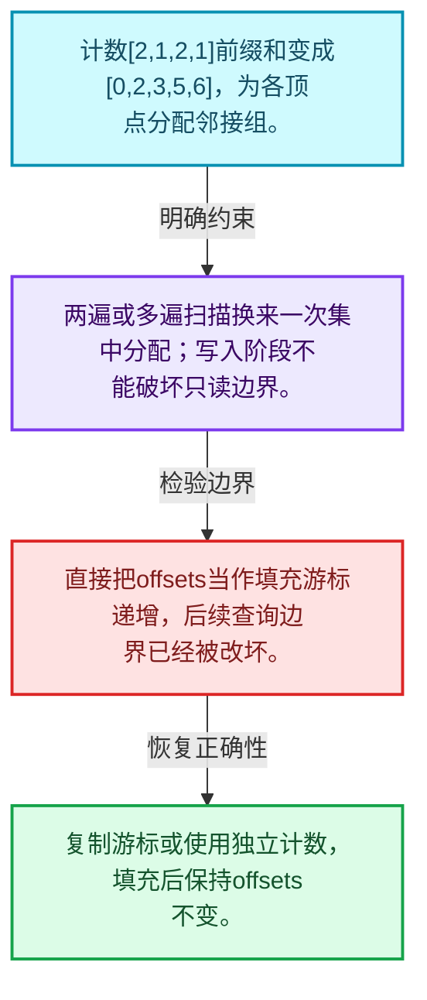
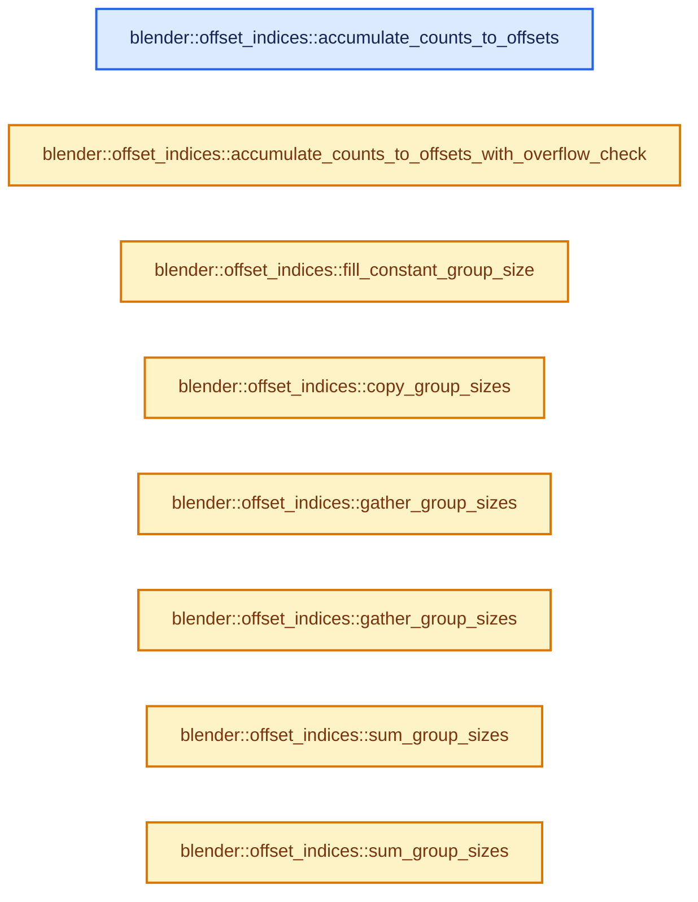
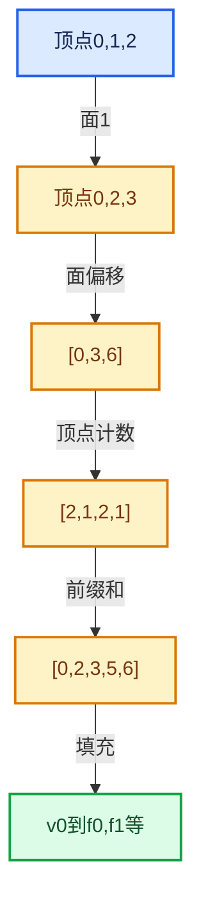

# 05-05 邻接关系与前缀和

[方向导航](README.md) · [总目录](../README.md) · [实现索引](../00-课程指南/02-源码与提交索引/符号依赖与实现索引.md)

## 从问题到实现

如何把零散邻接项压成连续数组？

先统计每组数量再前缀和，最后填充；计数、边界与写入游标具有不同阶段含义。

**数据模型**

计数[2,1,2,1]前缀和变成[0,2,3,5,6]，为各顶点分配邻接组。

**设计取舍**

两遍或多遍扫描换来一次集中分配；写入阶段不能破坏只读边界。

**最小反例**

直接把offsets当作填充游标递增，后续查询边界已经被改坏。

**推导**

复制游标或使用独立计数，填充后保持offsets不变。

## 阅读地图与执行推演








图中的数值推演是本方向的教学模型；实际函数之间的调用边与概念分析边分别标注，不能把概念关系当作运行时调度顺序。

## 完整源码单元与就地讲解

中文讲解直接放在相关代码旁，复杂机制在代码下展开。原文折叠区保留基准行号；不需要在行号表和函数之间来回查找。类布局可分段展示，函数实现不按固定行数切开。

### 类型布局、声明与编译条件 · offset_indices.cc L1—L23

<!-- annotated:a03283394b071c -->

```cpp
/* SPDX-FileCopyrightText: 2023 Blender Authors
 *
 * SPDX-License-Identifier: GPL-2.0-or-later */

/** \file
 * \ingroup bli
 */

#include <algorithm>

#include "BLI_array_utils.hh"
#include "BLI_index_mask.hh"
#include "BLI_math_base_c.hh"
#include "BLI_offset_indices.hh"
#include "BLI_sort.hh"
#include "BLI_task.hh"
#include "BLI_task_size_hints.hh"
#include "BLI_threads.hh"

#include "atomic_ops.h"

namespace blender::offset_indices {

```

<details>
<summary>核对原始源码：source/blender/blenlib/intern/offset_indices.cc · L1—L23</summary>

<!-- original:a03283394b071c:source/blender/blenlib/intern/offset_indices.cc:1:23 -->

```cpp
/* SPDX-FileCopyrightText: 2023 Blender Authors
 *
 * SPDX-License-Identifier: GPL-2.0-or-later */

/** \file
 * \ingroup bli
 */

#include <algorithm>

#include "BLI_array_utils.hh"
#include "BLI_index_mask.hh"
#include "BLI_math_base_c.hh"
#include "BLI_offset_indices.hh"
#include "BLI_sort.hh"
#include "BLI_task.hh"
#include "BLI_task_size_hints.hh"
#include "BLI_threads.hh"

#include "atomic_ops.h"

namespace blender::offset_indices {

```

</details>

<a id="f-cfa9fbd186afcdd5"></a>

### `blender::offset_indices::accumulate_counts_to_offsets`

实现位置：[source/blender/blenlib/intern/offset_indices.cc](../../../../../source/blender/blenlib/intern/offset_indices.cc) · L24—L45。

接口参数：

- `MutableSpan<int> counts_to_offsets`
- `const int start_offset`

**教学注释版**

<!-- annotated:12c9a04e8646c4 -->

```cpp
OffsetIndices<int> accumulate_counts_to_offsets(MutableSpan<int> counts_to_offsets,
                                                const int start_offset)
{
  int offset = start_offset;
  int64_t offset_i64 = start_offset;

  // [讲解] counts_to_offsets.index_range：查询视图长度或生成对应有效索引区间。
  for (const int i : counts_to_offsets.index_range().drop_back(1)) {
    const int count = counts_to_offsets[i];
    BLI_assert(count >= 0);
    counts_to_offsets[i] = offset;
    offset += count;
#ifndef NDEBUG
    offset_i64 += count;
#endif
  }
  // [讲解] counts_to_offsets.last：按视图边界访问元素。
  counts_to_offsets.last() = offset;

  BLI_assert_msg(offset == offset_i64, "Integer overflow occurred");
  UNUSED_VARS_NDEBUG(offset_i64);

  return OffsetIndices<int>(counts_to_offsets);
}
```

<details>
<summary>核对原始源码：source/blender/blenlib/intern/offset_indices.cc · L24—L45</summary>

<!-- original:12c9a04e8646c4:source/blender/blenlib/intern/offset_indices.cc:24:45 -->

```cpp
OffsetIndices<int> accumulate_counts_to_offsets(MutableSpan<int> counts_to_offsets,
                                                const int start_offset)
{
  int offset = start_offset;
  int64_t offset_i64 = start_offset;

  for (const int i : counts_to_offsets.index_range().drop_back(1)) {
    const int count = counts_to_offsets[i];
    BLI_assert(count >= 0);
    counts_to_offsets[i] = offset;
    offset += count;
#ifndef NDEBUG
    offset_i64 += count;
#endif
  }
  counts_to_offsets.last() = offset;

  BLI_assert_msg(offset == offset_i64, "Integer overflow occurred");
  UNUSED_VARS_NDEBUG(offset_i64);

  return OffsetIndices<int>(counts_to_offsets);
}
```

</details>

**沿实际写入检查状态**

- `counts_to_offsets[i] = offset;`
- `offset += count;`
- `offset_i64 += count;`

**结果出口**

- `return OffsetIndices<int>(counts_to_offsets);`

**继续追踪实现**

- `counts_to_offsets.index_range().drop_back` → [调用协议](../00-课程指南/01-路线与规范/模板宏与动态分派协议.md)：接收对象类型依赖auto、返回值或模板实例；不按同名猜测目标。调用位置L30。
- `counts_to_offsets.index_range` → [blender::MutableSpan::index_range · L676](../01-基础容器与现代CPP/06-MutableSpan可写视图.md#f-f9a9d59a69ca64b5)。
- `BLI_assert` → [BLI_assert · L48](../90-实现依赖专题/01-BLI基础库/BLI_assert.hh.md#m-57a88495704d)；[BLI_assert · L63](../90-实现依赖专题/01-BLI基础库/BLI_assert.hh.md#m-d07050020cb5)。宏定义由构建条件选择。
- `counts_to_offsets.last` → [blender::MutableSpan::last · L695](../01-基础容器与现代CPP/06-MutableSpan可写视图.md#f-73191eeabe29aab7)。
- `BLI_assert_msg` → [BLI_assert_msg · L55](../90-实现依赖专题/01-BLI基础库/BLI_assert.hh.md#m-695eed20dceb)；[BLI_assert_msg · L64](../90-实现依赖专题/01-BLI基础库/BLI_assert.hh.md#m-7de5563de4db)。宏定义由构建条件选择。
- `UNUSED_VARS_NDEBUG` → [UNUSED_VARS_NDEBUG · L526](../90-实现依赖专题/01-BLI基础库/BLI_utildefines.hh.md#m-fea439f7d366)；[UNUSED_VARS_NDEBUG · L528](../90-实现依赖专题/01-BLI基础库/BLI_utildefines.hh.md#m-a8f8cfac06c0)。宏定义由构建条件选择。
- `OffsetIndices<int>` → [blender::offset_indices::OffsetIndices::OffsetIndices · L44](02-OffsetIndices完整接口.md#f-52a26009810ef8ec)；[blender::offset_indices::OffsetIndices::OffsetIndices · L45](02-OffsetIndices完整接口.md#f-7be713f9489f3dd7)；[blender::offset_indices::OffsetIndices::OffsetIndices · L55](02-OffsetIndices完整接口.md#f-db7e81a5ec2dfb8d)。同名重载需按实参类型选择。

<!-- annotated:cd28307de9959f -->

```cpp

```

<details>
<summary>核对原始源码：source/blender/blenlib/intern/offset_indices.cc · L46—L46</summary>

<!-- original:cd28307de9959f:source/blender/blenlib/intern/offset_indices.cc:46:46 -->

```cpp

```

</details>

<a id="f-bebec884d0d4f7de"></a>

### `blender::offset_indices::accumulate_counts_to_offsets_with_overflow_check`

实现位置：[source/blender/blenlib/intern/offset_indices.cc](../../../../../source/blender/blenlib/intern/offset_indices.cc) · L47—L66。

接口参数：

- `MutableSpan<int> counts_to_offsets`
- `int start_offset`

**教学注释版**

<!-- annotated:7f3c54cd9dc330 -->

```cpp
std::optional<OffsetIndices<int>> accumulate_counts_to_offsets_with_overflow_check(
    MutableSpan<int> counts_to_offsets, int start_offset)
{
  /* This variant was measured to be about ~8% slower than the version without overflow check.
   * Since this function is often a serial bottleneck, we use a separate code path for when an
   * overflow check is requested. */
  int64_t offset = start_offset;
  // [讲解] counts_to_offsets.index_range：查询视图长度或生成对应有效索引区间。
  for (const int i : counts_to_offsets.index_range().drop_back(1)) {
    const int count = counts_to_offsets[i];
    BLI_assert(count >= 0);
    counts_to_offsets[i] = offset;
    offset += count;
  }
  // [讲解] counts_to_offsets.last：按视图边界访问元素。
  counts_to_offsets.last() = offset;
  // [讲解] std::numeric_limits<int>::max：按比较关系选取较大值。本讲解中的增长公式同时满足最低请求和几何增长；若保存返回引用，还需注意实参寿命。
  const bool has_overflow = offset >= std::numeric_limits<int>::max();
  if (has_overflow) {
    return std::nullopt;
  }
  return OffsetIndices<int>(counts_to_offsets);
}
```

<details>
<summary>核对原始源码：source/blender/blenlib/intern/offset_indices.cc · L47—L66</summary>

<!-- original:7f3c54cd9dc330:source/blender/blenlib/intern/offset_indices.cc:47:66 -->

```cpp
std::optional<OffsetIndices<int>> accumulate_counts_to_offsets_with_overflow_check(
    MutableSpan<int> counts_to_offsets, int start_offset)
{
  /* This variant was measured to be about ~8% slower than the version without overflow check.
   * Since this function is often a serial bottleneck, we use a separate code path for when an
   * overflow check is requested. */
  int64_t offset = start_offset;
  for (const int i : counts_to_offsets.index_range().drop_back(1)) {
    const int count = counts_to_offsets[i];
    BLI_assert(count >= 0);
    counts_to_offsets[i] = offset;
    offset += count;
  }
  counts_to_offsets.last() = offset;
  const bool has_overflow = offset >= std::numeric_limits<int>::max();
  if (has_overflow) {
    return std::nullopt;
  }
  return OffsetIndices<int>(counts_to_offsets);
}
```

</details>

**沿实际写入检查状态**

- `counts_to_offsets[i] = offset;`
- `offset += count;`

**结果出口**

- `return std::nullopt;`
- `return OffsetIndices<int>(counts_to_offsets);`

**继续追踪实现**

- `counts_to_offsets.index_range().drop_back` → [调用协议](../00-课程指南/01-路线与规范/模板宏与动态分派协议.md)：接收对象类型依赖auto、返回值或模板实例；不按同名猜测目标。调用位置L54。
- `counts_to_offsets.index_range` → [blender::MutableSpan::index_range · L676](../01-基础容器与现代CPP/06-MutableSpan可写视图.md#f-f9a9d59a69ca64b5)。
- `BLI_assert` → [BLI_assert · L48](../90-实现依赖专题/01-BLI基础库/BLI_assert.hh.md#m-57a88495704d)；[BLI_assert · L63](../90-实现依赖专题/01-BLI基础库/BLI_assert.hh.md#m-d07050020cb5)。宏定义由构建条件选择。
- `counts_to_offsets.last` → [blender::MutableSpan::last · L695](../01-基础容器与现代CPP/06-MutableSpan可写视图.md#f-73191eeabe29aab7)。
- `std::numeric_limits<int>::max` → [外部契约](https://eel.is/c++draft/alg.min.max)：按比较关系选取较大值。本讲解中的增长公式同时满足最低请求和几何增长；若保存返回引用，还需注意实参寿命。
- `OffsetIndices<int>` → [blender::offset_indices::OffsetIndices::OffsetIndices · L44](02-OffsetIndices完整接口.md#f-52a26009810ef8ec)；[blender::offset_indices::OffsetIndices::OffsetIndices · L45](02-OffsetIndices完整接口.md#f-7be713f9489f3dd7)；[blender::offset_indices::OffsetIndices::OffsetIndices · L55](02-OffsetIndices完整接口.md#f-db7e81a5ec2dfb8d)。同名重载需按实参类型选择。

<!-- annotated:7c937473e2379c -->

```cpp

```

<details>
<summary>核对原始源码：source/blender/blenlib/intern/offset_indices.cc · L67—L67</summary>

<!-- original:7c937473e2379c:source/blender/blenlib/intern/offset_indices.cc:67:67 -->

```cpp

```

</details>

<a id="f-9957fe9b72898d83"></a>

### `blender::offset_indices::fill_constant_group_size`

实现位置：[source/blender/blenlib/intern/offset_indices.cc](../../../../../source/blender/blenlib/intern/offset_indices.cc) · L68—L77。

接口参数：

- `const int size`
- `const int start_offset`
- `MutableSpan<int> offsets`

**教学注释版**

<!-- annotated:f90369cc8c39ab -->

```cpp
void fill_constant_group_size(const int size, const int start_offset, MutableSpan<int> offsets)
{
  threading::memory_bandwidth_bound_task(offsets.size_in_bytes(), [&]() {
    // [讲解] offsets.index_range：查询视图长度或生成对应有效索引区间。
    threading::parallel_for(offsets.index_range(), 1024, [&](const IndexRange range) {
      for (const int64_t i : range) {
        offsets[i] = size * i + start_offset;
      }
    });
  });
}
```

<details>
<summary>核对原始源码：source/blender/blenlib/intern/offset_indices.cc · L68—L77</summary>

<!-- original:f90369cc8c39ab:source/blender/blenlib/intern/offset_indices.cc:68:77 -->

```cpp
void fill_constant_group_size(const int size, const int start_offset, MutableSpan<int> offsets)
{
  threading::memory_bandwidth_bound_task(offsets.size_in_bytes(), [&]() {
    threading::parallel_for(offsets.index_range(), 1024, [&](const IndexRange range) {
      for (const int64_t i : range) {
        offsets[i] = size * i + start_offset;
      }
    });
  });
}
```

</details>

**沿实际写入检查状态**

- `offsets[i] = size * i + start_offset;`

**继续追踪实现**

- `threading::memory_bandwidth_bound_task` → [blender::threading::memory_bandwidth_bound_task · L250](../11-Depsgraph与并行任务系统/07-任务池与TBB接入.md#f-aa412ccec656928d)。
- `offsets.size_in_bytes` → [blender::MutableSpan::size_in_bytes · L507](../01-基础容器与现代CPP/06-MutableSpan可写视图.md#f-2e42823b970a8406)。
- `threading::parallel_for` → [blender::threading::parallel_for · L68](../11-Depsgraph与并行任务系统/07-任务池与TBB接入.md#f-838294754c24426c)。
- `offsets.index_range` → [blender::MutableSpan::index_range · L676](../01-基础容器与现代CPP/06-MutableSpan可写视图.md#f-f9a9d59a69ca64b5)。

<!-- annotated:9bdc43877cda04 -->

```cpp

```

<details>
<summary>核对原始源码：source/blender/blenlib/intern/offset_indices.cc · L78—L78</summary>

<!-- original:9bdc43877cda04:source/blender/blenlib/intern/offset_indices.cc:78:78 -->

```cpp

```

</details>

<a id="f-5727ee5259519dfa"></a>

### `blender::offset_indices::copy_group_sizes`

实现位置：[source/blender/blenlib/intern/offset_indices.cc](../../../../../source/blender/blenlib/intern/offset_indices.cc) · L79—L85。

接口参数：

- `const OffsetIndices<int> offsets`
- `const IndexMask &mask`
- `MutableSpan<int> sizes`

**教学注释版**

<!-- annotated:82838e3b3e412e -->

```cpp
void copy_group_sizes(const OffsetIndices<int> offsets,
                      const IndexMask &mask,
                      MutableSpan<int> sizes)
{
  mask.foreach_index_optimized<int64_t>([&](const int64_t i) { sizes[i] = offsets[i].size(); },
                                        exec_mode::grain_size(4096));
}
```

<details>
<summary>核对原始源码：source/blender/blenlib/intern/offset_indices.cc · L79—L85</summary>

<!-- original:82838e3b3e412e:source/blender/blenlib/intern/offset_indices.cc:79:85 -->

```cpp
void copy_group_sizes(const OffsetIndices<int> offsets,
                      const IndexMask &mask,
                      MutableSpan<int> sizes)
{
  mask.foreach_index_optimized<int64_t>([&](const int64_t i) { sizes[i] = offsets[i].size(); },
                                        exec_mode::grain_size(4096));
}
```

</details>

**继续追踪实现**

- `mask.foreach_index_optimized<int64_t>` → [blender::index_mask::IndexMask::foreach_index_optimized · L937](../04-虚拟数组与索引选择/12-重构历史与基准练习.md#f-a2c3e7876407eaaf)。
- `offsets[i].size` → [调用协议](../00-课程指南/01-路线与规范/模板宏与动态分派协议.md)：接收对象类型依赖auto、返回值或模板实例；不按同名猜测目标。调用位置L83。
- `exec_mode::grain_size` → [blender::exec_mode::grain_size · L79](../90-实现依赖专题/01-BLI基础库/BLI_execution_mode.hh.md#f-0b4fc2f9fa6e66e7)。

<!-- annotated:99c199afdc4db6 -->

```cpp

```

<details>
<summary>核对原始源码：source/blender/blenlib/intern/offset_indices.cc · L86—L86</summary>

<!-- original:99c199afdc4db6:source/blender/blenlib/intern/offset_indices.cc:86:86 -->

```cpp

```

</details>

<a id="f-19204b84ba6992bb"></a>

### `blender::offset_indices::gather_group_sizes`

实现位置：[source/blender/blenlib/intern/offset_indices.cc](../../../../../source/blender/blenlib/intern/offset_indices.cc) · L87—L94。

接口参数：

- `const OffsetIndices<int> offsets`
- `const IndexMask &mask`
- `MutableSpan<int> sizes`

**教学注释版**

<!-- annotated:20e5a2eb676bc9 -->

```cpp
void gather_group_sizes(const OffsetIndices<int> offsets,
                        const IndexMask &mask,
                        MutableSpan<int> sizes)
{
  mask.foreach_index_optimized<int64_t>(
      [&](const int64_t i, const int64_t pos) { sizes[pos] = offsets[i].size(); },
      exec_mode::grain_size(4096));
}
```

<details>
<summary>核对原始源码：source/blender/blenlib/intern/offset_indices.cc · L87—L94</summary>

<!-- original:20e5a2eb676bc9:source/blender/blenlib/intern/offset_indices.cc:87:94 -->

```cpp
void gather_group_sizes(const OffsetIndices<int> offsets,
                        const IndexMask &mask,
                        MutableSpan<int> sizes)
{
  mask.foreach_index_optimized<int64_t>(
      [&](const int64_t i, const int64_t pos) { sizes[pos] = offsets[i].size(); },
      exec_mode::grain_size(4096));
}
```

</details>

**继续追踪实现**

- `mask.foreach_index_optimized<int64_t>` → [blender::index_mask::IndexMask::foreach_index_optimized · L937](../04-虚拟数组与索引选择/12-重构历史与基准练习.md#f-a2c3e7876407eaaf)。
- `offsets[i].size` → [调用协议](../00-课程指南/01-路线与规范/模板宏与动态分派协议.md)：接收对象类型依赖auto、返回值或模板实例；不按同名猜测目标。调用位置L92。
- `exec_mode::grain_size` → [blender::exec_mode::grain_size · L79](../90-实现依赖专题/01-BLI基础库/BLI_execution_mode.hh.md#f-0b4fc2f9fa6e66e7)。

<!-- annotated:085d3257b126c8 -->

```cpp

```

<details>
<summary>核对原始源码：source/blender/blenlib/intern/offset_indices.cc · L95—L95</summary>

<!-- original:085d3257b126c8:source/blender/blenlib/intern/offset_indices.cc:95:95 -->

```cpp

```

</details>

<a id="f-4bb5520e88589c9b"></a>

### `blender::offset_indices::gather_group_sizes`

实现位置：[source/blender/blenlib/intern/offset_indices.cc](../../../../../source/blender/blenlib/intern/offset_indices.cc) · L96—L108。

接口参数：

- `const OffsetIndices<int> offsets`
- `const Span<int> indices`
- `MutableSpan<int> sizes`

**教学注释版**

<!-- annotated:7312b5e9f99feb -->

```cpp
void gather_group_sizes(const OffsetIndices<int> offsets,
                        const Span<int> indices,
                        MutableSpan<int> sizes)
{
  threading::memory_bandwidth_bound_task(
      sizes.size_in_bytes() + offsets.data().size_in_bytes() + indices.size_in_bytes(), [&]() {
        // [讲解] indices.index_range：查询视图长度或生成对应有效索引区间。
        threading::parallel_for(indices.index_range(), 4096, [&](const IndexRange range) {
          for (const int i : range) {
            sizes[i] = offsets[indices[i]].size();
          }
        });
      });
}
```

<details>
<summary>核对原始源码：source/blender/blenlib/intern/offset_indices.cc · L96—L108</summary>

<!-- original:7312b5e9f99feb:source/blender/blenlib/intern/offset_indices.cc:96:108 -->

```cpp
void gather_group_sizes(const OffsetIndices<int> offsets,
                        const Span<int> indices,
                        MutableSpan<int> sizes)
{
  threading::memory_bandwidth_bound_task(
      sizes.size_in_bytes() + offsets.data().size_in_bytes() + indices.size_in_bytes(), [&]() {
        threading::parallel_for(indices.index_range(), 4096, [&](const IndexRange range) {
          for (const int i : range) {
            sizes[i] = offsets[indices[i]].size();
          }
        });
      });
}
```

</details>

**沿实际写入检查状态**

- `sizes[i] = offsets[indices[i]].size();`

**继续追踪实现**

- `threading::memory_bandwidth_bound_task` → [blender::threading::memory_bandwidth_bound_task · L250](../11-Depsgraph与并行任务系统/07-任务池与TBB接入.md#f-aa412ccec656928d)。
- `sizes.size_in_bytes` → [blender::MutableSpan::size_in_bytes · L507](../01-基础容器与现代CPP/06-MutableSpan可写视图.md#f-2e42823b970a8406)。
- `offsets.data().size_in_bytes` → [调用协议](../00-课程指南/01-路线与规范/模板宏与动态分派协议.md)：接收对象类型依赖auto、返回值或模板实例；不按同名猜测目标。调用位置L101。
- `offsets.data` → [blender::offset_indices::OffsetIndices::data · L109](02-OffsetIndices完整接口.md#f-aab71e7e2c02fc06)。
- `indices.size_in_bytes` → [blender::Span::size_in_bytes · L272](../01-基础容器与现代CPP/05-Span只读连续视图.md#f-1369fbdcc037fcaf)。
- `threading::parallel_for` → [blender::threading::parallel_for · L68](../11-Depsgraph与并行任务系统/07-任务池与TBB接入.md#f-838294754c24426c)。
- `indices.index_range` → [blender::Span::index_range · L405](../01-基础容器与现代CPP/05-Span只读连续视图.md#f-caaa9b06e13e53e0)。
- `offsets[indices[i]].size` → [调用协议](../00-课程指南/01-路线与规范/模板宏与动态分派协议.md)：接收对象类型依赖auto、返回值或模板实例；不按同名猜测目标。调用位置L104。

<!-- annotated:c1953cb5cff2c7 -->

```cpp

```

<details>
<summary>核对原始源码：source/blender/blenlib/intern/offset_indices.cc · L109—L109</summary>

<!-- original:c1953cb5cff2c7:source/blender/blenlib/intern/offset_indices.cc:109:109 -->

```cpp

```

</details>

<a id="f-89e81645a99e1102"></a>

### `blender::offset_indices::sum_group_sizes`

实现位置：[source/blender/blenlib/intern/offset_indices.cc](../../../../../source/blender/blenlib/intern/offset_indices.cc) · L110—L117。

接口参数：

- `const OffsetIndices<int> offsets`
- `const Span<int> indices`

**教学注释版**

<!-- annotated:76d2629fbf75ba -->

```cpp
int sum_group_sizes(const OffsetIndices<int> offsets, const Span<int> indices)
{
  int count = 0;
  for (const int i : indices) {
    count += offsets[i].size();
  }
  return count;
}
```

<details>
<summary>核对原始源码：source/blender/blenlib/intern/offset_indices.cc · L110—L117</summary>

<!-- original:76d2629fbf75ba:source/blender/blenlib/intern/offset_indices.cc:110:117 -->

```cpp
int sum_group_sizes(const OffsetIndices<int> offsets, const Span<int> indices)
{
  int count = 0;
  for (const int i : indices) {
    count += offsets[i].size();
  }
  return count;
}
```

</details>

**沿实际写入检查状态**

- `count += offsets[i].size();`

**结果出口**

- `return count;`

**继续追踪实现**

- `offsets[i].size` → [调用协议](../00-课程指南/01-路线与规范/模板宏与动态分派协议.md)：接收对象类型依赖auto、返回值或模板实例；不按同名猜测目标。调用位置L114。

<!-- annotated:f5a67e18bca5cf -->

```cpp

```

<details>
<summary>核对原始源码：source/blender/blenlib/intern/offset_indices.cc · L118—L118</summary>

<!-- original:f5a67e18bca5cf:source/blender/blenlib/intern/offset_indices.cc:118:118 -->

```cpp

```

</details>

<a id="f-2d8c42ca6d454833"></a>

### `blender::offset_indices::sum_group_sizes`

实现位置：[source/blender/blenlib/intern/offset_indices.cc](../../../../../source/blender/blenlib/intern/offset_indices.cc) · L119—L133。

接口参数：

- `const OffsetIndices<int> offsets`
- `const IndexMask &mask`

**教学注释版**

<!-- annotated:44ae3204e0b9ee -->

```cpp
int sum_group_sizes(const OffsetIndices<int> offsets, const IndexMask &mask)
{
  int count = 0;
  mask.foreach_segment_optimized([&](const auto segment) {
    if constexpr (std::is_same_v<std::decay_t<decltype(segment)>, IndexRange>) {
      count += offsets[segment].size();
    }
    else {
      for (const int64_t i : segment) {
        count += offsets[i].size();
      }
    }
  });
  return count;
}
```

<details>
<summary>核对原始源码：source/blender/blenlib/intern/offset_indices.cc · L119—L133</summary>

<!-- original:44ae3204e0b9ee:source/blender/blenlib/intern/offset_indices.cc:119:133 -->

```cpp
int sum_group_sizes(const OffsetIndices<int> offsets, const IndexMask &mask)
{
  int count = 0;
  mask.foreach_segment_optimized([&](const auto segment) {
    if constexpr (std::is_same_v<std::decay_t<decltype(segment)>, IndexRange>) {
      count += offsets[segment].size();
    }
    else {
      for (const int64_t i : segment) {
        count += offsets[i].size();
      }
    }
  });
  return count;
}
```

</details>

**沿实际写入检查状态**

- `count += offsets[segment].size();`
- `count += offsets[i].size();`

**结果出口**

- `return count;`

**继续追踪实现**

- `mask.foreach_segment_optimized` → [blender::index_mask::IndexMask::foreach_segment_optimized · L968](../04-虚拟数组与索引选择/12-重构历史与基准练习.md#f-cf307bcd562186e0)。
- `offsets[segment].size` → [调用协议](../00-课程指南/01-路线与规范/模板宏与动态分派协议.md)：接收对象类型依赖auto、返回值或模板实例；不按同名猜测目标。调用位置L124。
- `offsets[i].size` → [调用协议](../00-课程指南/01-路线与规范/模板宏与动态分派协议.md)：接收对象类型依赖auto、返回值或模板实例；不按同名猜测目标。调用位置L128。

<!-- annotated:7a4e919a797979 -->

```cpp

```

<details>
<summary>核对原始源码：source/blender/blenlib/intern/offset_indices.cc · L134—L134</summary>

<!-- original:7a4e919a797979:source/blender/blenlib/intern/offset_indices.cc:134:134 -->

```cpp

```

</details>

<a id="f-db58dc5f33a70276"></a>

### `blender::offset_indices::gather_selected_offsets`

实现位置：[source/blender/blenlib/intern/offset_indices.cc](../../../../../source/blender/blenlib/intern/offset_indices.cc) · L135—L150。

接口参数：

- `const OffsetIndices<int> src_offsets`
- `const IndexMask &selection`
- `const int start_offset`
- `MutableSpan<int> dst_offsets`

**教学注释版**

<!-- annotated:f721a84b4815d9 -->

```cpp
OffsetIndices<int> gather_selected_offsets(const OffsetIndices<int> src_offsets,
                                           const IndexMask &selection,
                                           const int start_offset,
                                           MutableSpan<int> dst_offsets)
{
  if (selection.is_empty()) {
    return {};
  }
  int offset = start_offset;
  selection.foreach_index_optimized<int>([&](const int i, const int pos) {
    dst_offsets[pos] = offset;
    offset += src_offsets[i].size();
  });
  // [讲解] dst_offsets.last：按视图边界访问元素。
  dst_offsets.last() = offset;
  return OffsetIndices<int>(dst_offsets);
}
```

<details>
<summary>核对原始源码：source/blender/blenlib/intern/offset_indices.cc · L135—L150</summary>

<!-- original:f721a84b4815d9:source/blender/blenlib/intern/offset_indices.cc:135:150 -->

```cpp
OffsetIndices<int> gather_selected_offsets(const OffsetIndices<int> src_offsets,
                                           const IndexMask &selection,
                                           const int start_offset,
                                           MutableSpan<int> dst_offsets)
{
  if (selection.is_empty()) {
    return {};
  }
  int offset = start_offset;
  selection.foreach_index_optimized<int>([&](const int i, const int pos) {
    dst_offsets[pos] = offset;
    offset += src_offsets[i].size();
  });
  dst_offsets.last() = offset;
  return OffsetIndices<int>(dst_offsets);
}
```

</details>

**沿实际写入检查状态**

- `dst_offsets[pos] = offset;`
- `offset += src_offsets[i].size();`

**结果出口**

- `return {};`
- `return OffsetIndices<int>(dst_offsets);`

**继续追踪实现**

- `selection.is_empty` → [blender::index_mask::IndexMask::is_empty · L748](../04-虚拟数组与索引选择/09-分段存储与遍历.md#f-190ac996386064f4)。
- `selection.foreach_index_optimized<int>` → [blender::index_mask::IndexMask::foreach_index_optimized · L937](../04-虚拟数组与索引选择/12-重构历史与基准练习.md#f-a2c3e7876407eaaf)。
- `src_offsets[i].size` → [调用协议](../00-课程指南/01-路线与规范/模板宏与动态分派协议.md)：接收对象类型依赖auto、返回值或模板实例；不按同名猜测目标。调用位置L146。
- `dst_offsets.last` → [blender::MutableSpan::last · L695](../01-基础容器与现代CPP/06-MutableSpan可写视图.md#f-73191eeabe29aab7)。
- `OffsetIndices<int>` → [blender::offset_indices::OffsetIndices::OffsetIndices · L44](02-OffsetIndices完整接口.md#f-52a26009810ef8ec)；[blender::offset_indices::OffsetIndices::OffsetIndices · L45](02-OffsetIndices完整接口.md#f-7be713f9489f3dd7)；[blender::offset_indices::OffsetIndices::OffsetIndices · L55](02-OffsetIndices完整接口.md#f-db7e81a5ec2dfb8d)。同名重载需按实参类型选择。

<!-- annotated:e654c82e39f977 -->

```cpp

```

<details>
<summary>核对原始源码：source/blender/blenlib/intern/offset_indices.cc · L151—L151</summary>

<!-- original:e654c82e39f977:source/blender/blenlib/intern/offset_indices.cc:151:151 -->

```cpp

```

</details>

<a id="f-81774b7fe5ae69aa"></a>

### `blender::offset_indices::gather_selected_offsets`

实现位置：[source/blender/blenlib/intern/offset_indices.cc](../../../../../source/blender/blenlib/intern/offset_indices.cc) · L152—L167。

接口参数：

- `const OffsetIndices<int> src_offsets`
- `const Span<int> selection`
- `const int start_offset`
- `MutableSpan<int> dst_offsets`

**教学注释版**

<!-- annotated:9f2b619f225773 -->

```cpp
OffsetIndices<int> gather_selected_offsets(const OffsetIndices<int> src_offsets,
                                           const Span<int> selection,
                                           const int start_offset,
                                           MutableSpan<int> dst_offsets)
{
  // [讲解] selection.is_empty：查询视图长度或生成对应有效索引区间。
  if (selection.is_empty()) {
    return {};
  }
  int offset = start_offset;
  // [讲解] selection.index_range：查询视图长度或生成对应有效索引区间。
  for (const int i : selection.index_range()) {
    dst_offsets[i] = offset;
    offset += src_offsets[selection[i]].size();
  }
  // [讲解] dst_offsets.last：按视图边界访问元素。
  dst_offsets.last() = offset;
  return OffsetIndices<int>(dst_offsets);
}
```

<details>
<summary>核对原始源码：source/blender/blenlib/intern/offset_indices.cc · L152—L167</summary>

<!-- original:9f2b619f225773:source/blender/blenlib/intern/offset_indices.cc:152:167 -->

```cpp
OffsetIndices<int> gather_selected_offsets(const OffsetIndices<int> src_offsets,
                                           const Span<int> selection,
                                           const int start_offset,
                                           MutableSpan<int> dst_offsets)
{
  if (selection.is_empty()) {
    return {};
  }
  int offset = start_offset;
  for (const int i : selection.index_range()) {
    dst_offsets[i] = offset;
    offset += src_offsets[selection[i]].size();
  }
  dst_offsets.last() = offset;
  return OffsetIndices<int>(dst_offsets);
}
```

</details>

**沿实际写入检查状态**

- `dst_offsets[i] = offset;`
- `offset += src_offsets[selection[i]].size();`

**结果出口**

- `return {};`
- `return OffsetIndices<int>(dst_offsets);`

**继续追踪实现**

- `selection.is_empty` → [blender::Span::is_empty · L264](../01-基础容器与现代CPP/05-Span只读连续视图.md#f-8cc1d7ba8feb50e6)。
- `selection.index_range` → [blender::Span::index_range · L405](../01-基础容器与现代CPP/05-Span只读连续视图.md#f-caaa9b06e13e53e0)。
- `src_offsets[selection[i]].size` → [调用协议](../00-课程指南/01-路线与规范/模板宏与动态分派协议.md)：接收对象类型依赖auto、返回值或模板实例；不按同名猜测目标。调用位置L163。
- `dst_offsets.last` → [blender::MutableSpan::last · L695](../01-基础容器与现代CPP/06-MutableSpan可写视图.md#f-73191eeabe29aab7)。
- `OffsetIndices<int>` → [blender::offset_indices::OffsetIndices::OffsetIndices · L44](02-OffsetIndices完整接口.md#f-52a26009810ef8ec)；[blender::offset_indices::OffsetIndices::OffsetIndices · L45](02-OffsetIndices完整接口.md#f-7be713f9489f3dd7)；[blender::offset_indices::OffsetIndices::OffsetIndices · L55](02-OffsetIndices完整接口.md#f-db7e81a5ec2dfb8d)。同名重载需按实参类型选择。

<!-- annotated:caeea836e8c06e -->

```cpp

```

<details>
<summary>核对原始源码：source/blender/blenlib/intern/offset_indices.cc · L168—L168</summary>

<!-- original:caeea836e8c06e:source/blender/blenlib/intern/offset_indices.cc:168:168 -->

```cpp

```

</details>

<a id="f-e141ea8969e34cfa"></a>

### `blender::offset_indices::build_reverse_map`

实现位置：[source/blender/blenlib/intern/offset_indices.cc](../../../../../source/blender/blenlib/intern/offset_indices.cc) · L169—L176。

接口参数：

- `OffsetIndices<int> offsets`
- `MutableSpan<int> r_map`

**教学注释版**

<!-- annotated:0f66d3d0371c2a -->

```cpp
void build_reverse_map(OffsetIndices<int> offsets, MutableSpan<int> r_map)
{
  threading::parallel_for(offsets.index_range(), 1024, [&](const IndexRange range) {
    for (const int64_t i : range) {
      // [讲解] r_map.slice：建立原连续范围的子视图。
      r_map.slice(offsets[i]).fill(i);
    }
  });
}
```

<details>
<summary>核对原始源码：source/blender/blenlib/intern/offset_indices.cc · L169—L176</summary>

<!-- original:0f66d3d0371c2a:source/blender/blenlib/intern/offset_indices.cc:169:176 -->

```cpp
void build_reverse_map(OffsetIndices<int> offsets, MutableSpan<int> r_map)
{
  threading::parallel_for(offsets.index_range(), 1024, [&](const IndexRange range) {
    for (const int64_t i : range) {
      r_map.slice(offsets[i]).fill(i);
    }
  });
}
```

</details>

**继续追踪实现**

- `threading::parallel_for` → [blender::threading::parallel_for · L68](../11-Depsgraph与并行任务系统/07-任务池与TBB接入.md#f-838294754c24426c)。
- `offsets.index_range` → [blender::offset_indices::OffsetIndices::index_range · L77](02-OffsetIndices完整接口.md#f-19b5ca1456de007d)。
- `r_map.slice(offsets[i]).fill` → [调用协议](../00-课程指南/01-路线与规范/模板宏与动态分派协议.md)：接收对象类型依赖auto、返回值或模板实例；不按同名猜测目标。调用位置L173。
- `r_map.slice` → [blender::MutableSpan::slice · L579](../01-基础容器与现代CPP/06-MutableSpan可写视图.md#f-6808b4aefbf58808)；[blender::MutableSpan::slice · L587](../01-基础容器与现代CPP/06-MutableSpan可写视图.md#f-c05b010821861e4f)。同名重载需按实参类型选择。

<!-- annotated:e256147a10ecf7 -->

```cpp

```

<details>
<summary>核对原始源码：source/blender/blenlib/intern/offset_indices.cc · L177—L177</summary>

<!-- original:e256147a10ecf7:source/blender/blenlib/intern/offset_indices.cc:177:177 -->

```cpp

```

</details>

<a id="f-f9f2ea11aab00646"></a>

### `blender::offset_indices::build_reverse_offsets`

实现位置：[source/blender/blenlib/intern/offset_indices.cc](../../../../../source/blender/blenlib/intern/offset_indices.cc) · L178—L183。

接口参数：

- `const Span<int> indices`
- `MutableSpan<int> offsets`

**教学注释版**

<!-- annotated:e783e1c2296b4f -->

```cpp
OffsetIndices<int> build_reverse_offsets(const Span<int> indices, MutableSpan<int> offsets)
{
  // [讲解] offsets.begin：返回借用范围的地址。
  BLI_assert(std::all_of(offsets.begin(), offsets.end(), [](int value) { return value == 0; }));
  array_utils::count_indices(indices, offsets);
  return offset_indices::accumulate_counts_to_offsets(offsets);
}
```

<details>
<summary>核对原始源码：source/blender/blenlib/intern/offset_indices.cc · L178—L183</summary>

<!-- original:e783e1c2296b4f:source/blender/blenlib/intern/offset_indices.cc:178:183 -->

```cpp
OffsetIndices<int> build_reverse_offsets(const Span<int> indices, MutableSpan<int> offsets)
{
  BLI_assert(std::all_of(offsets.begin(), offsets.end(), [](int value) { return value == 0; }));
  array_utils::count_indices(indices, offsets);
  return offset_indices::accumulate_counts_to_offsets(offsets);
}
```

</details>

**结果出口**

- `return offset_indices::accumulate_counts_to_offsets(offsets);`

**继续追踪实现**

- `BLI_assert` → [BLI_assert · L48](../90-实现依赖专题/01-BLI基础库/BLI_assert.hh.md#m-57a88495704d)；[BLI_assert · L63](../90-实现依赖专题/01-BLI基础库/BLI_assert.hh.md#m-d07050020cb5)。宏定义由构建条件选择。
- `std::all_of` → [外部契约](https://eel.is/c++draft/)：这个边界按实际表达式及所属类型核对参数、返回值、寿命与失败行为。这里提供接口入口，不声称已解释该第三方版本的内部实现。
- `offsets.begin` → [blender::MutableSpan::begin · L550](../01-基础容器与现代CPP/06-MutableSpan可写视图.md#f-02a6b28889d59da1)；[blender::gpu::shader::parser::MutableSpan::begin · L97](../90-实现依赖专题/08-其他Blender模块/gpu/shader_tool/utils.hh.md#f-707ab8fcbd90899b)；[blender::gpu::shader::parser::MutableSpan::begin · L106](../90-实现依赖专题/08-其他Blender模块/gpu/shader_tool/utils.hh.md#f-24291c7b5f37860b)。同名重载需按实参类型选择。
- `offsets.end` → [blender::MutableSpan::end · L554](../01-基础容器与现代CPP/06-MutableSpan可写视图.md#f-4bf60034b9ddbc44)；[blender::gpu::shader::parser::MutableSpan::end · L101](../90-实现依赖专题/08-其他Blender模块/gpu/shader_tool/utils.hh.md#f-21cd00bb95944779)；[blender::gpu::shader::parser::MutableSpan::end · L110](../90-实现依赖专题/08-其他Blender模块/gpu/shader_tool/utils.hh.md#f-b75205cae5a07f2c)。同名重载需按实参类型选择。
- `array_utils::count_indices` → [blender::array_utils::count_indices · L147](../90-实现依赖专题/01-BLI基础库/intern/array_utils.cc.md#f-edf8c2e3ad390d06)。
- `offset_indices::accumulate_counts_to_offsets` → [blender::offset_indices::accumulate_counts_to_offsets · L24](05-邻接关系与前缀和.md#f-cfa9fbd186afcdd5)。

<!-- annotated:75240e48776a04 -->

```cpp

```

<details>
<summary>核对原始源码：source/blender/blenlib/intern/offset_indices.cc · L184—L184</summary>

<!-- original:75240e48776a04:source/blender/blenlib/intern/offset_indices.cc:184:184 -->

```cpp

```

</details>

<a id="f-fff299dd476fdddd"></a>

### `blender::offset_indices::sort_groups`

实现位置：[source/blender/blenlib/intern/offset_indices.cc](../../../../../source/blender/blenlib/intern/offset_indices.cc) · L185—L198。

接口参数：

- `const OffsetIndices<int> groups`
- `MutableSpan<int> indices`

**教学注释版**

<!-- annotated:d6d49b53815165 -->

```cpp
void sort_groups(const OffsetIndices<int> groups, MutableSpan<int> indices)
{
  threading::parallel_for(
      groups.index_range(),
      1024,
      [&](const IndexRange range) {
        for (const int64_t index : range) {
          // [讲解] indices.slice：建立原连续范围的子视图。
          MutableSpan<int> group = indices.slice(groups[index]);
          parallel_sort(group);
        }
      },
      threading::accumulated_task_sizes(
          [&](const IndexRange range) { return groups[range].size(); }));
}
```

<details>
<summary>核对原始源码：source/blender/blenlib/intern/offset_indices.cc · L185—L198</summary>

<!-- original:d6d49b53815165:source/blender/blenlib/intern/offset_indices.cc:185:198 -->

```cpp
void sort_groups(const OffsetIndices<int> groups, MutableSpan<int> indices)
{
  threading::parallel_for(
      groups.index_range(),
      1024,
      [&](const IndexRange range) {
        for (const int64_t index : range) {
          MutableSpan<int> group = indices.slice(groups[index]);
          parallel_sort(group);
        }
      },
      threading::accumulated_task_sizes(
          [&](const IndexRange range) { return groups[range].size(); }));
}
```

</details>

**继续追踪实现**

- `threading::parallel_for` → [blender::threading::parallel_for · L68](../11-Depsgraph与并行任务系统/07-任务池与TBB接入.md#f-838294754c24426c)。
- `groups.index_range` → [blender::offset_indices::OffsetIndices::index_range · L77](02-OffsetIndices完整接口.md#f-19b5ca1456de007d)。
- `indices.slice` → [blender::MutableSpan::slice · L579](../01-基础容器与现代CPP/06-MutableSpan可写视图.md#f-6808b4aefbf58808)；[blender::MutableSpan::slice · L587](../01-基础容器与现代CPP/06-MutableSpan可写视图.md#f-c05b010821861e4f)。同名重载需按实参类型选择。
- `parallel_sort` → [blender::parallel_sort · L36](../90-实现依赖专题/01-BLI基础库/BLI_sort.hh.md#f-c7bb69e225bb6ec0)；[blender::parallel_sort · L41](../90-实现依赖专题/01-BLI基础库/BLI_sort.hh.md#f-c4cdce306be83899)；[blender::parallel_sort · L46](../90-实现依赖专题/01-BLI基础库/BLI_sort.hh.md#f-7cdbab466f203f4f)；[blender::parallel_sort · L50](../90-实现依赖专题/01-BLI基础库/BLI_sort.hh.md#f-e8a3491a7ba9b37f)。同名重载需按实参类型选择。
- `threading::accumulated_task_sizes` → [blender::threading::accumulated_task_sizes · L177](../90-实现依赖专题/01-BLI基础库/BLI_task_size_hints.hh.md#f-6cdaf1aaed56993c)。
- `groups[range].size` → [调用协议](../00-课程指南/01-路线与规范/模板宏与动态分派协议.md)：接收对象类型依赖auto、返回值或模板实例；不按同名猜测目标。调用位置L197。

### 类型布局、声明与编译条件 · offset_indices.cc L199—L204

<!-- annotated:e95b57e73c7c74 -->

```cpp

/**
 * Number of indices per chunk when counting. An offset is stored for every group in every
 * chunk, so the number of chunks is limited to a small multiple of the number of threads.
 * More chunks than threads still helps load balancing.
 */
```

<details>
<summary>核对原始源码：source/blender/blenlib/intern/offset_indices.cc · L199—L204</summary>

<!-- original:e95b57e73c7c74:source/blender/blenlib/intern/offset_indices.cc:199:204 -->

```cpp

/**
 * Number of indices per chunk when counting. An offset is stored for every group in every
 * chunk, so the number of chunks is limited to a small multiple of the number of threads.
 * More chunks than threads still helps load balancing.
 */
```

</details>

<a id="f-80ce42d8074386dc"></a>

### `blender::offset_indices::counting_chunk_size`

实现位置：[source/blender/blenlib/intern/offset_indices.cc](../../../../../source/blender/blenlib/intern/offset_indices.cc) · L205—L210。

接口参数：

- `const int64_t indices_num`

**教学注释版**

<!-- annotated:e2326268e134cd -->

```cpp
static int64_t counting_chunk_size(const int64_t indices_num)
{
  const int64_t max_chunks = BLI_system_thread_count() * 4;
  const int64_t min_counting_chunk_size = 1 << 15;
  // [讲解] std::max：按比较关系选取较大值。本讲解中的增长公式同时满足最低请求和几何增长；若保存返回引用，还需注意实参寿命。
  return std::max(min_counting_chunk_size, int64_t(divide_ceil_ul(indices_num, max_chunks)));
}
```

<details>
<summary>核对原始源码：source/blender/blenlib/intern/offset_indices.cc · L205—L210</summary>

<!-- original:e2326268e134cd:source/blender/blenlib/intern/offset_indices.cc:205:210 -->

```cpp
static int64_t counting_chunk_size(const int64_t indices_num)
{
  const int64_t max_chunks = BLI_system_thread_count() * 4;
  const int64_t min_counting_chunk_size = 1 << 15;
  return std::max(min_counting_chunk_size, int64_t(divide_ceil_ul(indices_num, max_chunks)));
}
```

</details>

**结果出口**

- `return std::max(min_counting_chunk_size, int64_t(divide_ceil_ul(indices_num, max_chunks)));`

**继续追踪实现**

- `BLI_system_thread_count` → [BLI_system_thread_count · L258](../90-实现依赖专题/01-BLI基础库/intern/threads.cc.md#f-12aff71a24fecec4)。
- `std::max` → [外部契约](https://eel.is/c++draft/alg.min.max)：按比较关系选取较大值。本讲解中的增长公式同时满足最低请求和几何增长；若保存返回引用，还需注意实参寿命。
- `divide_ceil_ul` → [blender::divide_ceil_ul · L240](../90-实现依赖专题/01-BLI基础库/intern/math_base_inline.cc.md#f-0cb52ab4ea2cfdc5)。

### 类型布局、声明与编译条件 · offset_indices.cc L211—L219

<!-- annotated:99bf5c1185d490 -->

```cpp

/**
 * Fill the groups by first counting, for every chunk of indices, how many of its indices fall
 * into each group. Every chunk then knows where it can write in each group, so no atomics are
 * needed and the indices in each group end up sorted.
 *
 * This needs an offset for each group in each chunk, so it is only suitable while the number of
 * groups is small relative to the number of indices.
 */
```

<details>
<summary>核对原始源码：source/blender/blenlib/intern/offset_indices.cc · L211—L219</summary>

<!-- original:99bf5c1185d490:source/blender/blenlib/intern/offset_indices.cc:211:219 -->

```cpp

/**
 * Fill the groups by first counting, for every chunk of indices, how many of its indices fall
 * into each group. Every chunk then knows where it can write in each group, so no atomics are
 * needed and the indices in each group end up sorted.
 *
 * This needs an offset for each group in each chunk, so it is only suitable while the number of
 * groups is small relative to the number of indices.
 */
```

</details>

<a id="f-e5811bc6d2def117"></a>

### `blender::offset_indices::reverse_indices_in_groups_counting`

实现位置：[source/blender/blenlib/intern/offset_indices.cc](../../../../../source/blender/blenlib/intern/offset_indices.cc) · L220—L271。

接口参数：

- `const Span<int> group_indices`
- `const OffsetIndices<int> offsets`
- `const ValueSourceForeach &value_source_foreach`
- `MutableSpan<int> results`

**教学注释版**

<!-- annotated:3c01d26ff0d8a5 -->

```cpp
template<typename ValueSourceForeach>
static void reverse_indices_in_groups_counting(const Span<int> group_indices,
                                               const OffsetIndices<int> offsets,
                                               const ValueSourceForeach &value_source_foreach,
                                               MutableSpan<int> results)
{
  // [讲解] offsets.size：读取连续区间或分组的边界信息。
  const int64_t groups_num = offsets.size();
  const int64_t chunk_size = counting_chunk_size(group_indices.size());
  const int64_t chunks_num = divide_ceil_ul(group_indices.size(), chunk_size);

  /* Count how many indices of each chunk fall into each group. */
  Array<int> chunk_offsets(chunks_num * groups_num);
  threading::parallel_for(IndexRange(chunks_num), 1, [&](const IndexRange range) {
    for (const int64_t chunk : range) {
      // [讲解] chunk_offsets.as_mutable_span：提供数组的借用访问入口。
      MutableSpan<int> counts = chunk_offsets.as_mutable_span().slice(chunk * groups_num,
                                                                      groups_num);
      // [讲解] counts.fill：修改已有目标元素，不改变底层容器长度。
      counts.fill(0);
      // [讲解] group_indices.slice_safe：建立原连续范围的子视图。
      for (const int group : group_indices.slice_safe(chunk * chunk_size, chunk_size)) {
        counts[group]++;
      }
    }
  });

  /* Accumulate into the offset where each chunk starts writing in each group. */
  Array<int> current_offsets(groups_num);
  for (const int64_t group : IndexRange(groups_num)) {
    current_offsets[group] = int(offsets[group].start());
  }
  for (const int64_t chunk : IndexRange(chunks_num)) {
    MutableSpan<int> counts = chunk_offsets.as_mutable_span().slice(chunk * groups_num,
                                                                    groups_num);
    for (const int64_t group : IndexRange(groups_num)) {
      const int count = counts[group];
      counts[group] = current_offsets[group];
      current_offsets[group] += count;
    }
  }

  /* Write the index of every element into its group. */
  threading::parallel_for(IndexRange(chunks_num), 1, [&](const IndexRange range) {
    for (const int64_t chunk : range) {
      MutableSpan<int> group_offsets = chunk_offsets.as_mutable_span().slice(chunk * groups_num,
                                                                             groups_num);
      const int64_t begin = chunk * chunk_size;
      // [讲解] std::min：按比较关系选取较小值；截断范围时还需先满足非负和可表示范围，min本身不会证明边界安全。
      const int64_t size = std::min(chunk_size, group_indices.size() - begin);
      value_source_foreach(IndexRange(begin, size), [&](const int64_t pos, const int value) {
        const int position = group_offsets[group_indices[pos]]++;
        results[position] = value;
      });
    }
  });
}
```

<details>
<summary>核对原始源码：source/blender/blenlib/intern/offset_indices.cc · L220—L271</summary>

<!-- original:3c01d26ff0d8a5:source/blender/blenlib/intern/offset_indices.cc:220:271 -->

```cpp
template<typename ValueSourceForeach>
static void reverse_indices_in_groups_counting(const Span<int> group_indices,
                                               const OffsetIndices<int> offsets,
                                               const ValueSourceForeach &value_source_foreach,
                                               MutableSpan<int> results)
{
  const int64_t groups_num = offsets.size();
  const int64_t chunk_size = counting_chunk_size(group_indices.size());
  const int64_t chunks_num = divide_ceil_ul(group_indices.size(), chunk_size);

  /* Count how many indices of each chunk fall into each group. */
  Array<int> chunk_offsets(chunks_num * groups_num);
  threading::parallel_for(IndexRange(chunks_num), 1, [&](const IndexRange range) {
    for (const int64_t chunk : range) {
      MutableSpan<int> counts = chunk_offsets.as_mutable_span().slice(chunk * groups_num,
                                                                      groups_num);
      counts.fill(0);
      for (const int group : group_indices.slice_safe(chunk * chunk_size, chunk_size)) {
        counts[group]++;
      }
    }
  });

  /* Accumulate into the offset where each chunk starts writing in each group. */
  Array<int> current_offsets(groups_num);
  for (const int64_t group : IndexRange(groups_num)) {
    current_offsets[group] = int(offsets[group].start());
  }
  for (const int64_t chunk : IndexRange(chunks_num)) {
    MutableSpan<int> counts = chunk_offsets.as_mutable_span().slice(chunk * groups_num,
                                                                    groups_num);
    for (const int64_t group : IndexRange(groups_num)) {
      const int count = counts[group];
      counts[group] = current_offsets[group];
      current_offsets[group] += count;
    }
  }

  /* Write the index of every element into its group. */
  threading::parallel_for(IndexRange(chunks_num), 1, [&](const IndexRange range) {
    for (const int64_t chunk : range) {
      MutableSpan<int> group_offsets = chunk_offsets.as_mutable_span().slice(chunk * groups_num,
                                                                             groups_num);
      const int64_t begin = chunk * chunk_size;
      const int64_t size = std::min(chunk_size, group_indices.size() - begin);
      value_source_foreach(IndexRange(begin, size), [&](const int64_t pos, const int value) {
        const int position = group_offsets[group_indices[pos]]++;
        results[position] = value;
      });
    }
  });
}
```

</details>

**沿实际写入检查状态**

- `current_offsets[group] = int(offsets[group].start());`
- `counts[group] = current_offsets[group];`
- `current_offsets[group] += count;`
- `results[position] = value;`

**继续追踪实现**

- `offsets.size` → [blender::offset_indices::OffsetIndices::size · L67](02-OffsetIndices完整接口.md#f-e238abc62ed42abd)。
- `counting_chunk_size` → [blender::offset_indices::counting_chunk_size · L205](05-邻接关系与前缀和.md#f-80ce42d8074386dc)。
- `group_indices.size` → [blender::Span::size · L256](../01-基础容器与现代CPP/05-Span只读连续视图.md#f-5f80fa006089c998)。
- `divide_ceil_ul` → [blender::divide_ceil_ul · L240](../90-实现依赖专题/01-BLI基础库/intern/math_base_inline.cc.md#f-0cb52ab4ea2cfdc5)。
- `threading::parallel_for` → [blender::threading::parallel_for · L68](../11-Depsgraph与并行任务系统/07-任务池与TBB接入.md#f-838294754c24426c)。
- `IndexRange` → [blender::IndexRange](../90-实现依赖专题/01-BLI基础库/BLI_index_range.hh.md#t-caa3466d6776)；[blender::gpu::shader::parser::IndexRange](../90-实现依赖专题/08-其他Blender模块/gpu/shader_tool/utils.hh.md#t-82d2bd4ea71c)；[blender::IndexRange](../90-实现依赖专题/08-其他Blender模块/makesdna/DNA_node_types.h.md#t-0448cc889d39)。
- `chunk_offsets.as_mutable_span().slice` → [调用协议](../00-课程指南/01-路线与规范/模板宏与动态分派协议.md)：接收对象类型依赖auto、返回值或模板实例；不按同名猜测目标。调用位置L234。
- `chunk_offsets.as_mutable_span` → [blender::Array::as_mutable_span · L259](../01-基础容器与现代CPP/08-Array复制移动与销毁.md#f-4e91de9f1337c144)。
- `counts.fill` → [blender::MutableSpan::fill · L523](../01-基础容器与现代CPP/06-MutableSpan可写视图.md#f-8daedd52c727ec26)。
- `group_indices.slice_safe` → [blender::Span::slice_safe · L158](../01-基础容器与现代CPP/05-Span只读连续视图.md#f-5ffbda70864e9d0b)；[blender::Span::slice_safe · L166](../01-基础容器与现代CPP/05-Span只读连续视图.md#f-8438e78e505b5ff4)。同名重载需按实参类型选择。
- `offsets[group].start` → [调用协议](../00-课程指南/01-路线与规范/模板宏与动态分派协议.md)：接收对象类型依赖auto、返回值或模板实例；不按同名猜测目标。调用位置L246。
- `std::min` → [外部契约](https://eel.is/c++draft/alg.min.max)：按比较关系选取较小值；截断范围时还需先满足非负和可表示范围，min本身不会证明边界安全。
- `value_source_foreach` → [调用协议](../00-课程指南/01-路线与规范/模板宏与动态分派协议.md)：局部可调用对象，须结合其初始化与捕获环境。调用位置L265。

### 类型布局、声明与编译条件 · offset_indices.cc L272—L276

<!-- annotated:5f352d8d008aa3 -->

```cpp

/**
 * Fill the groups in parallel, using atomics to find the position to write to in each group. The
 * order within each group is non-deterministic.
 */
```

<details>
<summary>核对原始源码：source/blender/blenlib/intern/offset_indices.cc · L272—L276</summary>

<!-- original:5f352d8d008aa3:source/blender/blenlib/intern/offset_indices.cc:272:276 -->

```cpp

/**
 * Fill the groups in parallel, using atomics to find the position to write to in each group. The
 * order within each group is non-deterministic.
 */
```

</details>

<a id="f-04620da0274c274a"></a>

### `blender::offset_indices::reverse_indices_in_groups_atomic`

实现位置：[source/blender/blenlib/intern/offset_indices.cc](../../../../../source/blender/blenlib/intern/offset_indices.cc) · L277—L291。

接口参数：

- `const Span<int> group_indices`
- `const OffsetIndices<int> offsets`
- `const ValueSourceForeach &value_source_foreach`
- `MutableSpan<int> results`

**教学注释版**

<!-- annotated:18123c9a8bcb8c -->

```cpp
template<typename ValueSourceForeach>
static void reverse_indices_in_groups_atomic(const Span<int> group_indices,
                                             const OffsetIndices<int> offsets,
                                             const ValueSourceForeach &value_source_foreach,
                                             MutableSpan<int> results)
{
  // [讲解] offsets.size：读取连续区间或分组的边界信息。
  Array<int> counts(offsets.size(), 0);
  // [讲解] group_indices.index_range：查询视图长度或生成对应有效索引区间。
  threading::parallel_for(group_indices.index_range(), 1024, [&](const IndexRange range) {
    value_source_foreach(range, [&](const int64_t pos, const int value) {
      const int group_index = group_indices[pos];
      const int index_in_group = atomic_fetch_and_add_int32(&counts[group_index], 1);
      results[offsets[group_index][index_in_group]] = value;
    });
  });
}
```

<details>
<summary>核对原始源码：source/blender/blenlib/intern/offset_indices.cc · L277—L291</summary>

<!-- original:18123c9a8bcb8c:source/blender/blenlib/intern/offset_indices.cc:277:291 -->

```cpp
template<typename ValueSourceForeach>
static void reverse_indices_in_groups_atomic(const Span<int> group_indices,
                                             const OffsetIndices<int> offsets,
                                             const ValueSourceForeach &value_source_foreach,
                                             MutableSpan<int> results)
{
  Array<int> counts(offsets.size(), 0);
  threading::parallel_for(group_indices.index_range(), 1024, [&](const IndexRange range) {
    value_source_foreach(range, [&](const int64_t pos, const int value) {
      const int group_index = group_indices[pos];
      const int index_in_group = atomic_fetch_and_add_int32(&counts[group_index], 1);
      results[offsets[group_index][index_in_group]] = value;
    });
  });
}
```

</details>

**沿实际写入检查状态**

- `results[offsets[group_index][index_in_group]] = value;`

**继续追踪实现**

- `offsets.size` → [blender::offset_indices::OffsetIndices::size · L67](02-OffsetIndices完整接口.md#f-e238abc62ed42abd)。
- `threading::parallel_for` → [blender::threading::parallel_for · L68](../11-Depsgraph与并行任务系统/07-任务池与TBB接入.md#f-838294754c24426c)。
- `group_indices.index_range` → [blender::Span::index_range · L405](../01-基础容器与现代CPP/05-Span只读连续视图.md#f-caaa9b06e13e53e0)。
- `value_source_foreach` → [调用协议](../00-课程指南/01-路线与规范/模板宏与动态分派协议.md)：局部可调用对象，须结合其初始化与捕获环境。调用位置L285。
- `atomic_fetch_and_add_int32` → [atomic_fetch_and_add_int32 · L577](../90-实现依赖专题/07-Intern运行时与平台/atomic/intern/atomic_ops_unix.h.md#f-69ff836ea2a982eb)；[atomic_fetch_and_add_int32 · L203](../90-实现依赖专题/07-Intern运行时与平台/atomic/intern/atomic_ops_msvc.h.md#f-5f44e7646667f0e3)。同名重载需按实参类型选择。

### 类型布局、声明与编译条件 · offset_indices.cc L292—L296

<!-- annotated:7a07fe69ef95d6 -->

```cpp

/**
 * Fill the groups with the value of every element that maps to them. The values must not decrease
 * with the position in #group_indices, so that sorting them orders each group by position.
 */
```

<details>
<summary>核对原始源码：source/blender/blenlib/intern/offset_indices.cc · L292—L296</summary>

<!-- original:7a07fe69ef95d6:source/blender/blenlib/intern/offset_indices.cc:292:296 -->

```cpp

/**
 * Fill the groups with the value of every element that maps to them. The values must not decrease
 * with the position in #group_indices, so that sorting them orders each group by position.
 */
```

</details>

<a id="f-e7a8963a62987b35"></a>

### `blender::offset_indices::fill_groups`

实现位置：[source/blender/blenlib/intern/offset_indices.cc](../../../../../source/blender/blenlib/intern/offset_indices.cc) · L297—L320。

接口参数：

- `const Span<int> group_indices`
- `const OffsetIndices<int> offsets`
- `const ValueSourceForeach &value_source_foreach`
- `const bool sort`
- `MutableSpan<int> results`

**教学注释版**

<!-- annotated:a6f793f302c6c4 -->

```cpp
template<typename ValueSourceForeach>
static void fill_groups(const Span<int> group_indices,
                        const OffsetIndices<int> offsets,
                        const ValueSourceForeach &value_source_foreach,
                        const bool sort,
                        MutableSpan<int> results)
{
  /* Counting avoids both the atomic contention of filling the groups in parallel and the
   * sorting afterwards, but needs an offset per group for every chunk of indices. Use it while
   * that stays small, when there are many indices and few groups. */
  constexpr int64_t min_parallel_indices = 1 << 16;
  // [讲解] group_indices.size：查询视图长度或生成对应有效索引区间。
  const int64_t chunks_num = divide_ceil_ul(group_indices.size(),
                                            counting_chunk_size(group_indices.size()));
  if (group_indices.size() >= min_parallel_indices && BLI_system_thread_count() >= 4 &&
      chunks_num * offsets.size() <= group_indices.size() / 2)
  {
    reverse_indices_in_groups_counting(group_indices, offsets, value_source_foreach, results);
    return;
  }
  reverse_indices_in_groups_atomic(group_indices, offsets, value_source_foreach, results);
  if (sort) {
    sort_groups(offsets, results);
  }
}
```

<details>
<summary>核对原始源码：source/blender/blenlib/intern/offset_indices.cc · L297—L320</summary>

<!-- original:a6f793f302c6c4:source/blender/blenlib/intern/offset_indices.cc:297:320 -->

```cpp
template<typename ValueSourceForeach>
static void fill_groups(const Span<int> group_indices,
                        const OffsetIndices<int> offsets,
                        const ValueSourceForeach &value_source_foreach,
                        const bool sort,
                        MutableSpan<int> results)
{
  /* Counting avoids both the atomic contention of filling the groups in parallel and the
   * sorting afterwards, but needs an offset per group for every chunk of indices. Use it while
   * that stays small, when there are many indices and few groups. */
  constexpr int64_t min_parallel_indices = 1 << 16;
  const int64_t chunks_num = divide_ceil_ul(group_indices.size(),
                                            counting_chunk_size(group_indices.size()));
  if (group_indices.size() >= min_parallel_indices && BLI_system_thread_count() >= 4 &&
      chunks_num * offsets.size() <= group_indices.size() / 2)
  {
    reverse_indices_in_groups_counting(group_indices, offsets, value_source_foreach, results);
    return;
  }
  reverse_indices_in_groups_atomic(group_indices, offsets, value_source_foreach, results);
  if (sort) {
    sort_groups(offsets, results);
  }
}
```

</details>

**继续追踪实现**

- `divide_ceil_ul` → [blender::divide_ceil_ul · L240](../90-实现依赖专题/01-BLI基础库/intern/math_base_inline.cc.md#f-0cb52ab4ea2cfdc5)。
- `group_indices.size` → [blender::Span::size · L256](../01-基础容器与现代CPP/05-Span只读连续视图.md#f-5f80fa006089c998)。
- `counting_chunk_size` → [blender::offset_indices::counting_chunk_size · L205](05-邻接关系与前缀和.md#f-80ce42d8074386dc)。
- `BLI_system_thread_count` → [BLI_system_thread_count · L258](../90-实现依赖专题/01-BLI基础库/intern/threads.cc.md#f-12aff71a24fecec4)。
- `offsets.size` → [blender::offset_indices::OffsetIndices::size · L67](02-OffsetIndices完整接口.md#f-e238abc62ed42abd)。
- `reverse_indices_in_groups_counting` → [blender::offset_indices::reverse_indices_in_groups_counting · L220](05-邻接关系与前缀和.md#f-e5811bc6d2def117)。
- `reverse_indices_in_groups_atomic` → [blender::offset_indices::reverse_indices_in_groups_atomic · L277](05-邻接关系与前缀和.md#f-04620da0274c274a)。
- `sort_groups` → [blender::offset_indices::sort_groups · L185](05-邻接关系与前缀和.md#f-fff299dd476fdddd)。

### 类型布局、声明与编译条件 · offset_indices.cc L321—L322

<!-- annotated:f119d679461897 -->

```cpp

/** Check that every group index has a corresponding group in #offsets. */
```

<details>
<summary>核对原始源码：source/blender/blenlib/intern/offset_indices.cc · L321—L322</summary>

<!-- original:f119d679461897:source/blender/blenlib/intern/offset_indices.cc:321:322 -->

```cpp

/** Check that every group index has a corresponding group in #offsets. */
```

</details>

<a id="f-11d8788a5c4286f4"></a>

### `blender::offset_indices::assert_group_indices_valid`

实现位置：[source/blender/blenlib/intern/offset_indices.cc](../../../../../source/blender/blenlib/intern/offset_indices.cc) · L323—L329。

接口参数：

- `const Span<int> group_indices`
- `const OffsetIndices<int> offsets`

**教学注释版**

<!-- annotated:5e6a1827e277af -->

```cpp
static void assert_group_indices_valid(const Span<int> group_indices,
                                       const OffsetIndices<int> offsets)
{
  // [讲解] group_indices.begin：返回借用范围的地址。
  BLI_assert(*std::max_element(group_indices.begin(), group_indices.end()) < offsets.size());
  // [讲解] group_indices.end：返回借用范围的地址。
  BLI_assert(*std::min_element(group_indices.begin(), group_indices.end()) >= 0);
  UNUSED_VARS_NDEBUG(group_indices, offsets);
}
```

<details>
<summary>核对原始源码：source/blender/blenlib/intern/offset_indices.cc · L323—L329</summary>

<!-- original:5e6a1827e277af:source/blender/blenlib/intern/offset_indices.cc:323:329 -->

```cpp
static void assert_group_indices_valid(const Span<int> group_indices,
                                       const OffsetIndices<int> offsets)
{
  BLI_assert(*std::max_element(group_indices.begin(), group_indices.end()) < offsets.size());
  BLI_assert(*std::min_element(group_indices.begin(), group_indices.end()) >= 0);
  UNUSED_VARS_NDEBUG(group_indices, offsets);
}
```

</details>

**继续追踪实现**

- `BLI_assert` → [BLI_assert · L48](../90-实现依赖专题/01-BLI基础库/BLI_assert.hh.md#m-57a88495704d)；[BLI_assert · L63](../90-实现依赖专题/01-BLI基础库/BLI_assert.hh.md#m-d07050020cb5)。宏定义由构建条件选择。
- `std::max_element` → [外部契约](https://eel.is/c++draft/)：这个边界按实际表达式及所属类型核对参数、返回值、寿命与失败行为。这里提供接口入口，不声称已解释该第三方版本的内部实现。
- `group_indices.begin` → [blender::Span::begin · L224](../01-基础容器与现代CPP/05-Span只读连续视图.md#f-415883b512284f46)。
- `group_indices.end` → [blender::Span::end · L228](../01-基础容器与现代CPP/05-Span只读连续视图.md#f-a7d8b9e494c291a7)。
- `offsets.size` → [blender::offset_indices::OffsetIndices::size · L67](02-OffsetIndices完整接口.md#f-e238abc62ed42abd)。
- `std::min_element` → [外部契约](https://eel.is/c++draft/)：这个边界按实际表达式及所属类型核对参数、返回值、寿命与失败行为。这里提供接口入口，不声称已解释该第三方版本的内部实现。
- `UNUSED_VARS_NDEBUG` → [UNUSED_VARS_NDEBUG · L526](../90-实现依赖专题/01-BLI基础库/BLI_utildefines.hh.md#m-fea439f7d366)；[UNUSED_VARS_NDEBUG · L528](../90-实现依赖专题/01-BLI基础库/BLI_utildefines.hh.md#m-a8f8cfac06c0)。宏定义由构建条件选择。

<!-- annotated:b2da1904e59f41 -->

```cpp

```

<details>
<summary>核对原始源码：source/blender/blenlib/intern/offset_indices.cc · L330—L330</summary>

<!-- original:b2da1904e59f41:source/blender/blenlib/intern/offset_indices.cc:330:330 -->

```cpp

```

</details>

<a id="f-a6233b87f753fce6"></a>

### `blender::offset_indices::reverse_indices_in_groups`

实现位置：[source/blender/blenlib/intern/offset_indices.cc](../../../../../source/blender/blenlib/intern/offset_indices.cc) · L331—L351。

接口参数：

- `const Span<int> group_indices`
- `const OffsetIndices<int> offsets`
- `MutableSpan<int> results`
- `const bool sort`

**教学注释版**

<!-- annotated:00984ad0bcaaa9 -->

```cpp
void reverse_indices_in_groups(const Span<int> group_indices,
                               const OffsetIndices<int> offsets,
                               MutableSpan<int> results,
                               const bool sort)
{
  // [讲解] group_indices.is_empty：查询视图长度或生成对应有效索引区间。
  if (group_indices.is_empty()) {
    return;
  }
  // [讲解] results.size：查询视图长度或生成对应有效索引区间。
  BLI_assert(results.size() == group_indices.size());
  BLI_assert(results.size() == offsets.total_size());
  assert_group_indices_valid(group_indices, offsets);

  /* The value stored for a position is the position itself. */
  const auto position_values = [](const IndexRange range, const auto &fn) {
    for (const int64_t pos : range) {
      fn(pos, int(pos));
    }
  };

  fill_groups(group_indices, offsets, position_values, sort, results);
}
```

<details>
<summary>核对原始源码：source/blender/blenlib/intern/offset_indices.cc · L331—L351</summary>

<!-- original:00984ad0bcaaa9:source/blender/blenlib/intern/offset_indices.cc:331:351 -->

```cpp
void reverse_indices_in_groups(const Span<int> group_indices,
                               const OffsetIndices<int> offsets,
                               MutableSpan<int> results,
                               const bool sort)
{
  if (group_indices.is_empty()) {
    return;
  }
  BLI_assert(results.size() == group_indices.size());
  BLI_assert(results.size() == offsets.total_size());
  assert_group_indices_valid(group_indices, offsets);

  /* The value stored for a position is the position itself. */
  const auto position_values = [](const IndexRange range, const auto &fn) {
    for (const int64_t pos : range) {
      fn(pos, int(pos));
    }
  };

  fill_groups(group_indices, offsets, position_values, sort, results);
}
```

</details>

**继续追踪实现**

- `group_indices.is_empty` → [blender::Span::is_empty · L264](../01-基础容器与现代CPP/05-Span只读连续视图.md#f-8cc1d7ba8feb50e6)。
- `BLI_assert` → [BLI_assert · L48](../90-实现依赖专题/01-BLI基础库/BLI_assert.hh.md#m-57a88495704d)；[BLI_assert · L63](../90-实现依赖专题/01-BLI基础库/BLI_assert.hh.md#m-d07050020cb5)。宏定义由构建条件选择。
- `results.size` → [blender::MutableSpan::size · L499](../01-基础容器与现代CPP/06-MutableSpan可写视图.md#f-1de6a66839c304a8)；[blender::gpu::shader::parser::MutableSpan::size · L87](../90-实现依赖专题/08-其他Blender模块/gpu/shader_tool/utils.hh.md#f-5e684af6ee7990e9)。同名重载需按实参类型选择。
- `group_indices.size` → [blender::Span::size · L256](../01-基础容器与现代CPP/05-Span只读连续视图.md#f-5f80fa006089c998)。
- `offsets.total_size` → [blender::offset_indices::OffsetIndices::total_size · L58](02-OffsetIndices完整接口.md#f-c111ffdac7a19248)。
- `assert_group_indices_valid` → [blender::offset_indices::assert_group_indices_valid · L323](05-邻接关系与前缀和.md#f-11d8788a5c4286f4)。
- `fn` → [调用协议](../00-课程指南/01-路线与规范/模板宏与动态分派协议.md)：局部可调用对象，须结合其初始化与捕获环境。调用位置L346。
- `fill_groups` → [blender::offset_indices::fill_groups · L297](05-邻接关系与前缀和.md#f-e7a8963a62987b35)。

<!-- annotated:57a4b0de374e83 -->

```cpp

```

<details>
<summary>核对原始源码：source/blender/blenlib/intern/offset_indices.cc · L352—L352</summary>

<!-- original:57a4b0de374e83:source/blender/blenlib/intern/offset_indices.cc:352:352 -->

```cpp

```

</details>

<a id="f-8a5003c28b7e2b96"></a>

### `blender::offset_indices::reverse_indices_in_groups`

实现位置：[source/blender/blenlib/intern/offset_indices.cc](../../../../../source/blender/blenlib/intern/offset_indices.cc) · L353—L386。

接口参数：

- `const Span<int> group_indices`
- `const OffsetIndices<int> offsets`
- `MutableSpan<int> results`
- `const OffsetIndices<int> value_groups`

**教学注释版**

<!-- annotated:7e6b22f59ffeb2 -->

```cpp
void reverse_indices_in_groups(const Span<int> group_indices,
                               const OffsetIndices<int> offsets,
                               MutableSpan<int> results,
                               const OffsetIndices<int> value_groups)
{
  // [讲解] group_indices.is_empty：查询视图长度或生成对应有效索引区间。
  if (group_indices.is_empty()) {
    return;
  }
  // [讲解] results.size：查询视图长度或生成对应有效索引区间。
  BLI_assert(results.size() == group_indices.size());
  BLI_assert(results.size() == offsets.total_size());
  BLI_assert(value_groups.total_size() == group_indices.size());
  assert_group_indices_valid(group_indices, offsets);

  /* The value stored is the index of the group containing it. */
  const auto grouped_values = [&](const IndexRange range, const auto &fn) {
    const Span<int> value_group_offsets = value_groups.data();
    // [讲解] range.start：读取连续区间或分组的边界信息。
    int64_t group = std::ranges::upper_bound(value_group_offsets, int(range.start())) -
                    // [讲解] value_group_offsets.begin：返回借用范围的地址。
                    value_group_offsets.begin() - 1;
    int64_t pos = range.start();
    // [讲解] range.one_after_last：读取连续区间或分组的边界信息。
    while (pos < range.one_after_last()) {
      // [讲解] std::min：按比较关系选取较小值；截断范围时还需先满足非负和可表示范围，min本身不会证明边界安全。
      const int64_t group_end = std::min(range.one_after_last(),
                                         value_groups[group].one_after_last());
      for (; pos < group_end; pos++) {
        fn(pos, int(group));
      }
      group++;
    }
  };

  /* Counting per chunk is not used here, since these relations always have many groups relative
   * to the number of indices. */
  reverse_indices_in_groups_atomic(group_indices, offsets, grouped_values, results);
  sort_groups(offsets, results);
}
```

<details>
<summary>核对原始源码：source/blender/blenlib/intern/offset_indices.cc · L353—L386</summary>

<!-- original:7e6b22f59ffeb2:source/blender/blenlib/intern/offset_indices.cc:353:386 -->

```cpp
void reverse_indices_in_groups(const Span<int> group_indices,
                               const OffsetIndices<int> offsets,
                               MutableSpan<int> results,
                               const OffsetIndices<int> value_groups)
{
  if (group_indices.is_empty()) {
    return;
  }
  BLI_assert(results.size() == group_indices.size());
  BLI_assert(results.size() == offsets.total_size());
  BLI_assert(value_groups.total_size() == group_indices.size());
  assert_group_indices_valid(group_indices, offsets);

  /* The value stored is the index of the group containing it. */
  const auto grouped_values = [&](const IndexRange range, const auto &fn) {
    const Span<int> value_group_offsets = value_groups.data();
    int64_t group = std::ranges::upper_bound(value_group_offsets, int(range.start())) -
                    value_group_offsets.begin() - 1;
    int64_t pos = range.start();
    while (pos < range.one_after_last()) {
      const int64_t group_end = std::min(range.one_after_last(),
                                         value_groups[group].one_after_last());
      for (; pos < group_end; pos++) {
        fn(pos, int(group));
      }
      group++;
    }
  };

  /* Counting per chunk is not used here, since these relations always have many groups relative
   * to the number of indices. */
  reverse_indices_in_groups_atomic(group_indices, offsets, grouped_values, results);
  sort_groups(offsets, results);
}
```

</details>

**继续追踪实现**

- `group_indices.is_empty` → [blender::Span::is_empty · L264](../01-基础容器与现代CPP/05-Span只读连续视图.md#f-8cc1d7ba8feb50e6)。
- `BLI_assert` → [BLI_assert · L48](../90-实现依赖专题/01-BLI基础库/BLI_assert.hh.md#m-57a88495704d)；[BLI_assert · L63](../90-实现依赖专题/01-BLI基础库/BLI_assert.hh.md#m-d07050020cb5)。宏定义由构建条件选择。
- `results.size` → [blender::MutableSpan::size · L499](../01-基础容器与现代CPP/06-MutableSpan可写视图.md#f-1de6a66839c304a8)；[blender::gpu::shader::parser::MutableSpan::size · L87](../90-实现依赖专题/08-其他Blender模块/gpu/shader_tool/utils.hh.md#f-5e684af6ee7990e9)。同名重载需按实参类型选择。
- `group_indices.size` → [blender::Span::size · L256](../01-基础容器与现代CPP/05-Span只读连续视图.md#f-5f80fa006089c998)。
- `offsets.total_size` → [blender::offset_indices::OffsetIndices::total_size · L58](02-OffsetIndices完整接口.md#f-c111ffdac7a19248)。
- `value_groups.total_size` → [blender::offset_indices::OffsetIndices::total_size · L58](02-OffsetIndices完整接口.md#f-c111ffdac7a19248)。
- `assert_group_indices_valid` → [blender::offset_indices::assert_group_indices_valid · L323](05-邻接关系与前缀和.md#f-11d8788a5c4286f4)。
- `value_groups.data` → [blender::offset_indices::OffsetIndices::data · L109](02-OffsetIndices完整接口.md#f-aab71e7e2c02fc06)。
- `std::ranges::upper_bound` → [外部契约](https://eel.is/c++draft/)：这个边界按实际表达式及所属类型核对参数、返回值、寿命与失败行为。这里提供接口入口，不声称已解释该第三方版本的内部实现。
- `range.start` → [blender::IndexRange::start · L243](../01-基础容器与现代CPP/04-IndexRange连续整数区间.md#f-99d2195bd9cfd1f0)。
- `value_group_offsets.begin` → [blender::Span::begin · L224](../01-基础容器与现代CPP/05-Span只读连续视图.md#f-415883b512284f46)。
- `range.one_after_last` → [blender::IndexRange::one_after_last · L235](../01-基础容器与现代CPP/04-IndexRange连续整数区间.md#f-ed04bec9c731fc86)。
- `std::min` → [外部契约](https://eel.is/c++draft/alg.min.max)：按比较关系选取较小值；截断范围时还需先满足非负和可表示范围，min本身不会证明边界安全。
- `value_groups[group].one_after_last` → [调用协议](../00-课程指南/01-路线与规范/模板宏与动态分派协议.md)：接收对象类型依赖auto、返回值或模板实例；不按同名猜测目标。调用位置L374。
- `fn` → [调用协议](../00-课程指南/01-路线与规范/模板宏与动态分派协议.md)：局部可调用对象，须结合其初始化与捕获环境。调用位置L376。
- `reverse_indices_in_groups_atomic` → [blender::offset_indices::reverse_indices_in_groups_atomic · L277](05-邻接关系与前缀和.md#f-04620da0274c274a)。
- `sort_groups` → [blender::offset_indices::sort_groups · L185](05-邻接关系与前缀和.md#f-fff299dd476fdddd)。

<!-- annotated:63903d6d900b01 -->

```cpp

```

<details>
<summary>核对原始源码：source/blender/blenlib/intern/offset_indices.cc · L387—L387</summary>

<!-- original:63903d6d900b01:source/blender/blenlib/intern/offset_indices.cc:387:387 -->

```cpp

```

</details>

<a id="f-b670c6339bcc64cd"></a>

### `blender::offset_indices::reverse_indices_in_groups`

实现位置：[source/blender/blenlib/intern/offset_indices.cc](../../../../../source/blender/blenlib/intern/offset_indices.cc) · L388—L416。

接口参数：

- `const Span<int> group_indices`
- `const OffsetIndices<int> offsets`
- `MutableSpan<int> results`
- `const int value_group_size`

**教学注释版**

<!-- annotated:d5e72887959388 -->

```cpp
void reverse_indices_in_groups(const Span<int> group_indices,
                               const OffsetIndices<int> offsets,
                               MutableSpan<int> results,
                               const int value_group_size)
{
  // [讲解] group_indices.is_empty：查询视图长度或生成对应有效索引区间。
  if (group_indices.is_empty()) {
    return;
  }
  // [讲解] results.size：查询视图长度或生成对应有效索引区间。
  BLI_assert(results.size() == group_indices.size());
  BLI_assert(results.size() == offsets.total_size());
  BLI_assert(group_indices.size() % value_group_size == 0);
  assert_group_indices_valid(group_indices, offsets);

  /* The value stored is the index of the group containing it. */
  const auto uniform_grouped_values = [&](const IndexRange range, const auto &fn) {
    // [讲解] range.start：读取连续区间或分组的边界信息。
    int64_t group = range.start() / value_group_size;
    int64_t pos = range.start();
    // [讲解] range.one_after_last：读取连续区间或分组的边界信息。
    while (pos < range.one_after_last()) {
      // [讲解] std::min：按比较关系选取较小值；截断范围时还需先满足非负和可表示范围，min本身不会证明边界安全。
      const int64_t group_end = std::min(range.one_after_last(), (group + 1) * value_group_size);
      for (; pos < group_end; pos++) {
        fn(pos, int(group));
      }
      group++;
    }
  };

  reverse_indices_in_groups_atomic(group_indices, offsets, uniform_grouped_values, results);
  sort_groups(offsets, results);
}
```

<details>
<summary>核对原始源码：source/blender/blenlib/intern/offset_indices.cc · L388—L416</summary>

<!-- original:d5e72887959388:source/blender/blenlib/intern/offset_indices.cc:388:416 -->

```cpp
void reverse_indices_in_groups(const Span<int> group_indices,
                               const OffsetIndices<int> offsets,
                               MutableSpan<int> results,
                               const int value_group_size)
{
  if (group_indices.is_empty()) {
    return;
  }
  BLI_assert(results.size() == group_indices.size());
  BLI_assert(results.size() == offsets.total_size());
  BLI_assert(group_indices.size() % value_group_size == 0);
  assert_group_indices_valid(group_indices, offsets);

  /* The value stored is the index of the group containing it. */
  const auto uniform_grouped_values = [&](const IndexRange range, const auto &fn) {
    int64_t group = range.start() / value_group_size;
    int64_t pos = range.start();
    while (pos < range.one_after_last()) {
      const int64_t group_end = std::min(range.one_after_last(), (group + 1) * value_group_size);
      for (; pos < group_end; pos++) {
        fn(pos, int(group));
      }
      group++;
    }
  };

  reverse_indices_in_groups_atomic(group_indices, offsets, uniform_grouped_values, results);
  sort_groups(offsets, results);
}
```

</details>

**继续追踪实现**

- `group_indices.is_empty` → [blender::Span::is_empty · L264](../01-基础容器与现代CPP/05-Span只读连续视图.md#f-8cc1d7ba8feb50e6)。
- `BLI_assert` → [BLI_assert · L48](../90-实现依赖专题/01-BLI基础库/BLI_assert.hh.md#m-57a88495704d)；[BLI_assert · L63](../90-实现依赖专题/01-BLI基础库/BLI_assert.hh.md#m-d07050020cb5)。宏定义由构建条件选择。
- `results.size` → [blender::MutableSpan::size · L499](../01-基础容器与现代CPP/06-MutableSpan可写视图.md#f-1de6a66839c304a8)；[blender::gpu::shader::parser::MutableSpan::size · L87](../90-实现依赖专题/08-其他Blender模块/gpu/shader_tool/utils.hh.md#f-5e684af6ee7990e9)。同名重载需按实参类型选择。
- `group_indices.size` → [blender::Span::size · L256](../01-基础容器与现代CPP/05-Span只读连续视图.md#f-5f80fa006089c998)。
- `offsets.total_size` → [blender::offset_indices::OffsetIndices::total_size · L58](02-OffsetIndices完整接口.md#f-c111ffdac7a19248)。
- `assert_group_indices_valid` → [blender::offset_indices::assert_group_indices_valid · L323](05-邻接关系与前缀和.md#f-11d8788a5c4286f4)。
- `range.start` → [blender::IndexRange::start · L243](../01-基础容器与现代CPP/04-IndexRange连续整数区间.md#f-99d2195bd9cfd1f0)。
- `range.one_after_last` → [blender::IndexRange::one_after_last · L235](../01-基础容器与现代CPP/04-IndexRange连续整数区间.md#f-ed04bec9c731fc86)。
- `std::min` → [外部契约](https://eel.is/c++draft/alg.min.max)：按比较关系选取较小值；截断范围时还需先满足非负和可表示范围，min本身不会证明边界安全。
- `fn` → [调用协议](../00-课程指南/01-路线与规范/模板宏与动态分派协议.md)：局部可调用对象，须结合其初始化与捕获环境。调用位置L408。
- `reverse_indices_in_groups_atomic` → [blender::offset_indices::reverse_indices_in_groups_atomic · L277](05-邻接关系与前缀和.md#f-04620da0274c274a)。
- `sort_groups` → [blender::offset_indices::sort_groups · L185](05-邻接关系与前缀和.md#f-fff299dd476fdddd)。

<!-- annotated:dd3112cd3f2fb6 -->

```cpp

```

<details>
<summary>核对原始源码：source/blender/blenlib/intern/offset_indices.cc · L417—L417</summary>

<!-- original:dd3112cd3f2fb6:source/blender/blenlib/intern/offset_indices.cc:417:417 -->

```cpp

```

</details>

<a id="f-4c5bda776ec6ec9d"></a>

### `blender::offset_indices::build_groups_from_indices`

实现位置：[source/blender/blenlib/intern/offset_indices.cc](../../../../../source/blender/blenlib/intern/offset_indices.cc) · L418—L428。

接口参数：

- `const Span<int> indices`
- `const int groups_num`
- `Array<int> &offset_data`
- `Array<int> &index_data`

**教学注释版**

<!-- annotated:764432ce6aa765 -->

```cpp
GroupedSpan<int> build_groups_from_indices(const Span<int> indices,
                                           const int groups_num,
                                           Array<int> &offset_data,
                                           Array<int> &index_data)
{
  offset_data = Array<int>(groups_num + 1, 0);
  // [讲解] offset_data.as_mutable_span：提供数组的借用访问入口。
  const OffsetIndices offsets = build_reverse_offsets(indices, offset_data.as_mutable_span());
  // [讲解] index_data.reinitialize：以新长度重建数组。
  index_data.reinitialize(offsets.total_size());
  reverse_indices_in_groups(indices, offsets, index_data);
  return {OffsetIndices<int>(offsets), index_data};
}
```

<details>
<summary>核对原始源码：source/blender/blenlib/intern/offset_indices.cc · L418—L428</summary>

<!-- original:764432ce6aa765:source/blender/blenlib/intern/offset_indices.cc:418:428 -->

```cpp
GroupedSpan<int> build_groups_from_indices(const Span<int> indices,
                                           const int groups_num,
                                           Array<int> &offset_data,
                                           Array<int> &index_data)
{
  offset_data = Array<int>(groups_num + 1, 0);
  const OffsetIndices offsets = build_reverse_offsets(indices, offset_data.as_mutable_span());
  index_data.reinitialize(offsets.total_size());
  reverse_indices_in_groups(indices, offsets, index_data);
  return {OffsetIndices<int>(offsets), index_data};
}
```

</details>

**沿实际写入检查状态**

- `offset_data = Array<int>(groups_num + 1, 0);`

**结果出口**

- `return {OffsetIndices<int>(offsets), index_data};`

**继续追踪实现**

- `Array<int>` → [blender::Array::Array · L78](../01-基础容器与现代CPP/07-Array构造与存储.md#f-001fd5eb3c658238)；[blender::Array::Array · L84](../01-基础容器与现代CPP/07-Array构造与存储.md#f-674e2f10361a462b)；[blender::Array::Array · L89](../01-基础容器与现代CPP/07-Array构造与存储.md#f-aa1e5908a9b67557)；[blender::Array::Array · L103](../01-基础容器与现代CPP/07-Array构造与存储.md#f-b141be39084346f3)；[blender::Array::Array · L110](../01-基础容器与现代CPP/07-Array构造与存储.md#f-452e276f39e81a2a)；[blender::Array::Array · L123](../01-基础容器与现代CPP/07-Array构造与存储.md#f-646aa58152ec44f6)；[blender::Array::Array · L135](../01-基础容器与现代CPP/07-Array构造与存储.md#f-0a9de4a549125f99)；[blender::Array::Array · L168](../01-基础容器与现代CPP/07-Array构造与存储.md#f-31f001eb92069e9d)；[blender::Array::Array · L176](../01-基础容器与现代CPP/07-Array构造与存储.md#f-cf8148f06fc6747a)；[blender::Array::Array · L178](../01-基础容器与现代CPP/07-Array构造与存储.md#f-2ddca2fb9dd964b3)。同名重载需按实参类型选择。
- `build_reverse_offsets` → [blender::offset_indices::build_reverse_offsets · L178](05-邻接关系与前缀和.md#f-f9f2ea11aab00646)。
- `offset_data.as_mutable_span` → [blender::Array::as_mutable_span · L259](../01-基础容器与现代CPP/08-Array复制移动与销毁.md#f-4e91de9f1337c144)。
- `index_data.reinitialize` → [blender::Array::reinitialize · L430](../01-基础容器与现代CPP/08-Array复制移动与销毁.md#f-3414f619e246b688)。
- `offsets.total_size` → [blender::offset_indices::OffsetIndices::total_size · L58](02-OffsetIndices完整接口.md#f-c111ffdac7a19248)。
- `reverse_indices_in_groups` → [blender::offset_indices::reverse_indices_in_groups · L331](05-邻接关系与前缀和.md#f-a6233b87f753fce6)；[blender::offset_indices::reverse_indices_in_groups · L353](05-邻接关系与前缀和.md#f-8a5003c28b7e2b96)；[blender::offset_indices::reverse_indices_in_groups · L388](05-邻接关系与前缀和.md#f-b670c6339bcc64cd)。同名重载需按实参类型选择。
- `OffsetIndices<int>` → [blender::offset_indices::OffsetIndices::OffsetIndices · L44](02-OffsetIndices完整接口.md#f-52a26009810ef8ec)；[blender::offset_indices::OffsetIndices::OffsetIndices · L45](02-OffsetIndices完整接口.md#f-7be713f9489f3dd7)；[blender::offset_indices::OffsetIndices::OffsetIndices · L55](02-OffsetIndices完整接口.md#f-db7e81a5ec2dfb8d)。同名重载需按实参类型选择。

<!-- annotated:1c736373d9ddb6 -->

```cpp

```

<details>
<summary>核对原始源码：source/blender/blenlib/intern/offset_indices.cc · L429—L429</summary>

<!-- original:1c736373d9ddb6:source/blender/blenlib/intern/offset_indices.cc:429:429 -->

```cpp

```

</details>

<a id="f-6b34988c9f051249"></a>

### `blender::offset_indices::build_groups_from_indices`

实现位置：[source/blender/blenlib/intern/offset_indices.cc](../../../../../source/blender/blenlib/intern/offset_indices.cc) · L430—L452。

接口参数：

- `const Span<int> indices`
- `const int groups_num`
- `Array<int> &offset_data`
- `Array<int> &index_data`
- `const IndexMask &values`

**教学注释版**

<!-- annotated:a9e6e47a3456e9 -->

```cpp
GroupedSpan<int> build_groups_from_indices(const Span<int> indices,
                                           const int groups_num,
                                           Array<int> &offset_data,
                                           Array<int> &index_data,
                                           const IndexMask &values)
{
  offset_data = Array<int>(groups_num + 1, 0);
  // [讲解] offset_data.as_mutable_span：提供数组的借用访问入口。
  const OffsetIndices offsets = build_reverse_offsets(indices, offset_data.as_mutable_span());
  // [讲解] index_data.reinitialize：以新长度重建数组。
  index_data.reinitialize(offsets.total_size());
  // [讲解] indices.is_empty：查询视图长度或生成对应有效索引区间。
  if (!indices.is_empty()) {
    // [讲解] indices.size：查询视图长度或生成对应有效索引区间。
    BLI_assert(values.size() == indices.size());
    assert_group_indices_valid(indices, offsets);

    /* The value stored is the index at that position in the mask. */
    const auto mask_values = [&](const IndexRange range, const auto &fn) {
      values.slice(range).foreach_index_optimized<int>(
          // [讲解] range.start：读取连续区间或分组的边界信息。
          [&](const int index, const int64_t pos) { fn(range.start() + pos, index); });
    };

    fill_groups(indices, offsets, mask_values, true, index_data);
  }
  return {OffsetIndices<int>(offsets), index_data};
}
```

<details>
<summary>核对原始源码：source/blender/blenlib/intern/offset_indices.cc · L430—L452</summary>

<!-- original:a9e6e47a3456e9:source/blender/blenlib/intern/offset_indices.cc:430:452 -->

```cpp
GroupedSpan<int> build_groups_from_indices(const Span<int> indices,
                                           const int groups_num,
                                           Array<int> &offset_data,
                                           Array<int> &index_data,
                                           const IndexMask &values)
{
  offset_data = Array<int>(groups_num + 1, 0);
  const OffsetIndices offsets = build_reverse_offsets(indices, offset_data.as_mutable_span());
  index_data.reinitialize(offsets.total_size());
  if (!indices.is_empty()) {
    BLI_assert(values.size() == indices.size());
    assert_group_indices_valid(indices, offsets);

    /* The value stored is the index at that position in the mask. */
    const auto mask_values = [&](const IndexRange range, const auto &fn) {
      values.slice(range).foreach_index_optimized<int>(
          [&](const int index, const int64_t pos) { fn(range.start() + pos, index); });
    };

    fill_groups(indices, offsets, mask_values, true, index_data);
  }
  return {OffsetIndices<int>(offsets), index_data};
}
```

</details>

**沿实际写入检查状态**

- `offset_data = Array<int>(groups_num + 1, 0);`

**结果出口**

- `return {OffsetIndices<int>(offsets), index_data};`

**继续追踪实现**

- `Array<int>` → [blender::Array::Array · L78](../01-基础容器与现代CPP/07-Array构造与存储.md#f-001fd5eb3c658238)；[blender::Array::Array · L84](../01-基础容器与现代CPP/07-Array构造与存储.md#f-674e2f10361a462b)；[blender::Array::Array · L89](../01-基础容器与现代CPP/07-Array构造与存储.md#f-aa1e5908a9b67557)；[blender::Array::Array · L103](../01-基础容器与现代CPP/07-Array构造与存储.md#f-b141be39084346f3)；[blender::Array::Array · L110](../01-基础容器与现代CPP/07-Array构造与存储.md#f-452e276f39e81a2a)；[blender::Array::Array · L123](../01-基础容器与现代CPP/07-Array构造与存储.md#f-646aa58152ec44f6)；[blender::Array::Array · L135](../01-基础容器与现代CPP/07-Array构造与存储.md#f-0a9de4a549125f99)；[blender::Array::Array · L168](../01-基础容器与现代CPP/07-Array构造与存储.md#f-31f001eb92069e9d)；[blender::Array::Array · L176](../01-基础容器与现代CPP/07-Array构造与存储.md#f-cf8148f06fc6747a)；[blender::Array::Array · L178](../01-基础容器与现代CPP/07-Array构造与存储.md#f-2ddca2fb9dd964b3)。同名重载需按实参类型选择。
- `build_reverse_offsets` → [blender::offset_indices::build_reverse_offsets · L178](05-邻接关系与前缀和.md#f-f9f2ea11aab00646)。
- `offset_data.as_mutable_span` → [blender::Array::as_mutable_span · L259](../01-基础容器与现代CPP/08-Array复制移动与销毁.md#f-4e91de9f1337c144)。
- `index_data.reinitialize` → [blender::Array::reinitialize · L430](../01-基础容器与现代CPP/08-Array复制移动与销毁.md#f-3414f619e246b688)。
- `offsets.total_size` → [blender::offset_indices::OffsetIndices::total_size · L58](02-OffsetIndices完整接口.md#f-c111ffdac7a19248)。
- `indices.is_empty` → [blender::Span::is_empty · L264](../01-基础容器与现代CPP/05-Span只读连续视图.md#f-8cc1d7ba8feb50e6)。
- `BLI_assert` → [BLI_assert · L48](../90-实现依赖专题/01-BLI基础库/BLI_assert.hh.md#m-57a88495704d)；[BLI_assert · L63](../90-实现依赖专题/01-BLI基础库/BLI_assert.hh.md#m-d07050020cb5)。宏定义由构建条件选择。
- `values.size` → [blender::index_mask::IndexMask::size · L743](../04-虚拟数组与索引选择/09-分段存储与遍历.md#f-0163b32abc9a0d9c)。
- `indices.size` → [blender::Span::size · L256](../01-基础容器与现代CPP/05-Span只读连续视图.md#f-5f80fa006089c998)。
- `assert_group_indices_valid` → [blender::offset_indices::assert_group_indices_valid · L323](05-邻接关系与前缀和.md#f-11d8788a5c4286f4)。
- `values.slice(range).foreach_index_optimized<int>` → [调用协议](../00-课程指南/01-路线与规范/模板宏与动态分派协议.md)：接收对象类型依赖auto、返回值或模板实例；不按同名猜测目标。调用位置L445。
- `values.slice` → [blender::index_mask::IndexMask::slice · L125](../04-虚拟数组与索引选择/10-IndexMask构建与并行.md#f-ff79fd755a945991)；[blender::index_mask::IndexMask::slice · L144](../04-虚拟数组与索引选择/10-IndexMask构建与并行.md#f-c8b1c9029be81481)。同名重载需按实参类型选择。
- `fn` → [调用协议](../00-课程指南/01-路线与规范/模板宏与动态分派协议.md)：局部可调用对象，须结合其初始化与捕获环境。调用位置L446。
- `range.start` → [blender::IndexRange::start · L243](../01-基础容器与现代CPP/04-IndexRange连续整数区间.md#f-99d2195bd9cfd1f0)。
- `fill_groups` → [blender::offset_indices::fill_groups · L297](05-邻接关系与前缀和.md#f-e7a8963a62987b35)。
- `OffsetIndices<int>` → [blender::offset_indices::OffsetIndices::OffsetIndices · L44](02-OffsetIndices完整接口.md#f-52a26009810ef8ec)；[blender::offset_indices::OffsetIndices::OffsetIndices · L45](02-OffsetIndices完整接口.md#f-7be713f9489f3dd7)；[blender::offset_indices::OffsetIndices::OffsetIndices · L55](02-OffsetIndices完整接口.md#f-db7e81a5ec2dfb8d)。同名重载需按实参类型选择。

### 类型布局、声明与编译条件 · offset_indices.cc L453—L454

<!-- annotated:bfb031ac4e2df0 -->

```cpp

}  // namespace blender::offset_indices
```

<details>
<summary>核对原始源码：source/blender/blenlib/intern/offset_indices.cc · L453—L454</summary>

<!-- original:bfb031ac4e2df0:source/blender/blenlib/intern/offset_indices.cc:453:454 -->

```cpp

}  // namespace blender::offset_indices
```

</details>

## 语法与相关类型

### 模板 template

模板把类型或常量作为生成实现的参数。读声明时先列出类型参数、非类型参数和默认值，再看使用者实际实例化了什么。模板声明本身不意味着每种T都支持其全部成员。

把T替换为int、string、只能移动的类型，分别检查每个被调用操作是否成立。

### 依赖名称 typename

typename既可引入类型模板参数，也可告诉编译器某个依赖名称是类型。它不创建运行时对象；解析期确认语法类别与实例化期检查具体类型是不同阶段。

区分typename T::value_type和T::size()，前者标记类型，后者是表达式。

### 常量求值 constexpr

constexpr声明允许相应实体参与常量求值，但constexpr函数仍可以在运行时执行。是否常量求值由调用场景和表达式合法性共同决定。

比较constexpr变量初始化和从运行时输入调用同一函数。

### 只读限定 const

const约束当前访问路径可做的修改。const指针、指向const的指针、const视图对象、const元素是不同位置的限定；其他别名可能仍可修改原对象。

分别写T* const、const T*与const T* const，并画出不可修改的层次。

### 可选值 optional

optional把不存在与存在的T区分开，T的构造和析构跟随engaged状态变化。访问前应由has_value或条件分支证明存在。

把空Field状态与合法常量零区分，不能用某个普通值代替不存在。

### 内部断言 assert

断言表达开发者预期成立的内部契约，发布构建可能关闭。它不能替代对不可信输入的完整错误处理，也不保证后续操作被运行时保护。

对每条断言构造违反条件的输入，区分调用者错误与应向用户报告的错误。

### 编译期分支 if constexpr

条件在实例化时决定被保留的分支，这常用于不同类型的合法操作选择。它与运行时if有不同的实例化检查规则。

找出每个分支依赖哪些类型特征，再使用满足与不满足条件的类型。

### 类型别名 using

类型别名为已有类型建立名字，不创建运行期对象。它常把模板内部使用的类型统一暴露给泛型调用者。

展开别名直到基础类型，区分类型别名和变量声明。

## 实现练习与验证

手算四顶点两面的顶点到面映射。

参考推理：复制游标或使用独立计数，填充后保持offsets不变。

偏移单调不减；最终偏移与存储边界对应；每个角点引用合法顶点，每个反向映射可由正向关系验证。

## 历史、跨库比较与证据

把偏移数组与vector<vector<int>>、CSR邻接表示作比较：前者集中存储，后者方便独立增长；是否稳定修改比容器名字更影响选型。

[历史提交索引](../00-课程指南/02-源码与提交索引/历史提交与设计演化索引.md) · [源码基准](../00-课程指南/02-源码与提交索引/源码版本与覆盖索引.md) · [验收报告](../00-课程指南/03-验收报告/验收报告.md)
