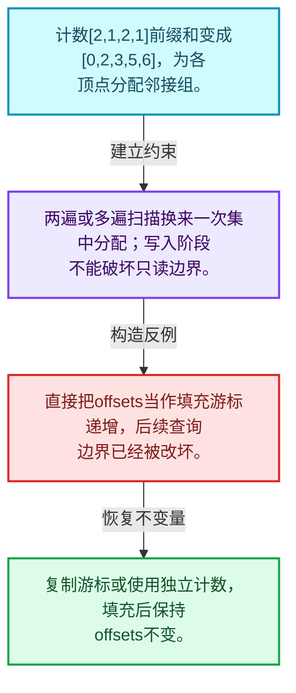
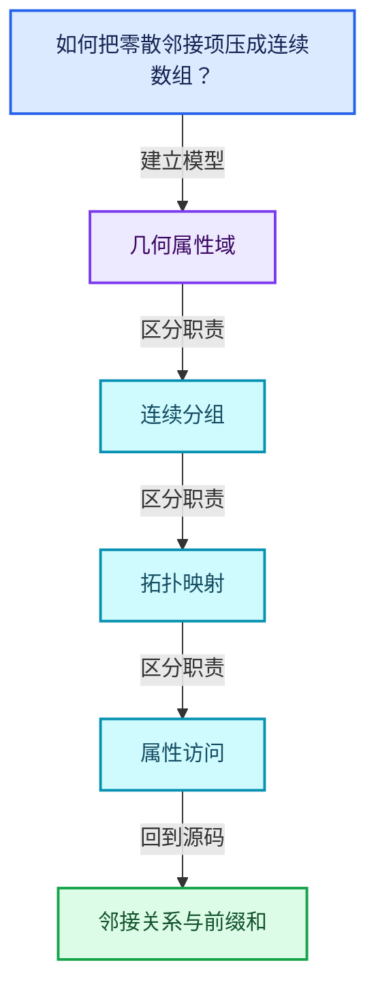
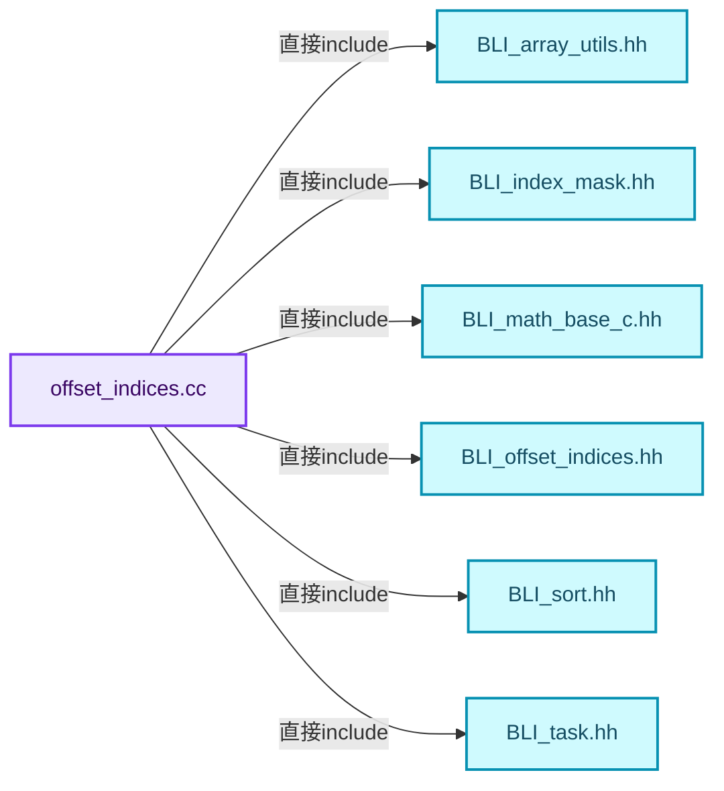
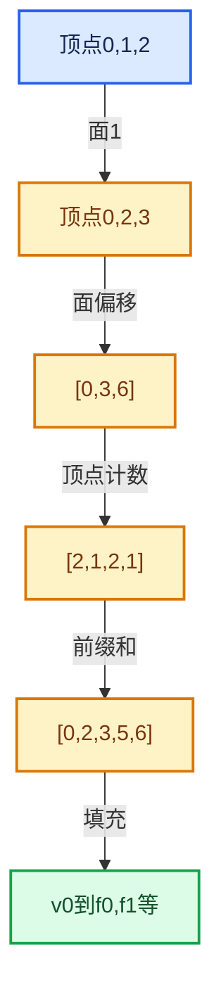

# 05-05 邻接关系与前缀和

[方向导航](README.md) · [总目录](../README.md) · [覆盖索引](../%E6%BA%90%E7%A0%81%E7%89%88%E6%9C%AC%E4%B8%8E%E8%A6%86%E7%9B%96%E7%B4%A2%E5%BC%95.md)

> 阅读顺序：问题与数据模型 → 语法与类型 → 源码逐行 → 调用线索 → 历史与取舍 → 推演和练习。

- 基准 HEAD：`cbda6b96c26c0dee3c3b5cbb93960c4ac06a6b30`。
- 记录日期：2026-10-14。
- 教学示例状态：正文中的推演不是本机性能实测；已运行练习见验收报告。

## 一、从问题到设计

如何把零散邻接项压成连续数组？

先统计每组数量再前缀和，最后填充；计数、边界与写入游标具有不同阶段含义。

本篇把语法、数据语义和系统取舍连接起来。利用连续性和重复关系选择表示，让冗余状态尽量无法表达。

### 本篇独立模型与设计推理

计数[2,1,2,1]前缀和变成[0,2,3,5,6]，为各顶点分配邻接组。

设计取舍：两遍或多遍扫描换来一次集中分配；写入阶段不能破坏只读边界。

最小反例：直接把offsets当作填充游标递增，后续查询边界已经被改坏。

推导与处理：复制游标或使用独立计数，填充后保持offsets不变。



### 源码范围与相邻篇章

| 文件 | 本篇逐行范围 | 基准SHA-256 |
|---|---|---|
| [source/blender/blenlib/intern/offset_indices.cc](../../../../../source/blender/blenlib/intern/offset_indices.cc) | L1—L454 | `1cf7594604253fd66c6b7bb84e9810975816f891afcb09d4a3b6450b8280b53e` |

同一主讲文件可能分多篇覆盖；超出本篇范围的符号通过覆盖索引定位。空行与纯注释保留在源码摘录中，逐行表解释有效语句与语法边界；许可证头统一保留。

前篇：[CurvesGeometry存储](04-CurvesGeometry%E5%AD%98%E5%82%A8.md).

后篇：[拓扑映射构建](06-%E6%8B%93%E6%89%91%E6%98%A0%E5%B0%84%E6%9E%84%E5%BB%BA.md).

## 二、类型、数据与阅读地图



这是概念依赖图，边表示阅读关系，不声称是运行时调用顺序。

### 直接编译依赖



箭头只表示头文件包含关系；完整调用线索见后面的符号定位表。

## 三、关键词、语法与类型角色

### 模板 template

模板把类型或常量作为生成实现的参数。读声明时先列出类型参数、非类型参数和默认值，再看使用者实际实例化了什么。模板声明本身不意味着每种T都支持其全部成员。

具体检查：把T替换为int、string、只能移动的类型，分别检查每个被调用操作是否成立。

### 依赖名称 typename

typename既可引入类型模板参数，也可告诉编译器某个依赖名称是类型。它不创建运行时对象；解析期确认语法类别与实例化期检查具体类型是不同阶段。

具体检查：区分typename T::value_type和T::size()，前者标记类型，后者是表达式。

### 常量求值 constexpr

constexpr声明允许相应实体参与常量求值，但constexpr函数仍可以在运行时执行。是否常量求值由调用场景和表达式合法性共同决定。

具体检查：比较constexpr变量初始化和从运行时输入调用同一函数。

### 只读限定 const

const约束当前访问路径可做的修改。const指针、指向const的指针、const视图对象、const元素是不同位置的限定；其他别名可能仍可修改原对象。

具体检查：分别写T* const、const T*与const T* const，并画出不可修改的层次。

### 可选值 optional

optional把不存在与存在的T区分开，T的构造和析构跟随engaged状态变化。访问前应由has_value或条件分支证明存在。

具体检查：把空Field状态与合法常量零区分，不能用某个普通值代替不存在。

### 内部断言 assert

断言表达开发者预期成立的内部契约，发布构建可能关闭。它不能替代对不可信输入的完整错误处理，也不保证后续操作被运行时保护。

具体检查：对每条断言构造违反条件的输入，区分调用者错误与应向用户报告的错误。

### 编译期分支 if constexpr

条件在实例化时决定被保留的分支，这常用于不同类型的合法操作选择。它与运行时if有不同的实例化检查规则。

具体检查：找出每个分支依赖哪些类型特征，再使用满足与不满足条件的类型。

### 类型别名 using

类型别名为已有类型建立名字，不创建运行期对象。它常把模板内部使用的类型统一暴露给泛型调用者。

具体检查：展开别名直到基础类型，区分类型别名和变量声明。

## 四、真实源码与逐行讲解

源码块保持原行内容，原始行号由小节标题及逐行表给出。表中的调用定位是静态阅读辅助；重载、模板实例化、宏展开和虚调用需结合完整声明，不能仅凭词法出现证明动态调用。

### offset_indices.cc：L1—L45

<!-- source:source/blender/blenlib/intern/offset_indices.cc:1:45 -->

```cpp
/* SPDX-FileCopyrightText: 2023 Blender Authors
 *
 * SPDX-License-Identifier: GPL-2.0-or-later */

/** \file
 * \ingroup bli
 */

#include <algorithm>

#include "BLI_array_utils.hh"
#include "BLI_index_mask.hh"
#include "BLI_math_base_c.hh"
#include "BLI_offset_indices.hh"
#include "BLI_sort.hh"
#include "BLI_task.hh"
#include "BLI_task_size_hints.hh"
#include "BLI_threads.hh"

#include "atomic_ops.h"

namespace blender::offset_indices {

OffsetIndices<int> accumulate_counts_to_offsets(MutableSpan<int> counts_to_offsets,
                                                const int start_offset)
{
  int offset = start_offset;
  int64_t offset_i64 = start_offset;

  for (const int i : counts_to_offsets.index_range().drop_back(1)) {
    const int count = counts_to_offsets[i];
    BLI_assert(count >= 0);
    counts_to_offsets[i] = offset;
    offset += count;
#ifndef NDEBUG
    offset_i64 += count;
#endif
  }
  counts_to_offsets.last() = offset;

  BLI_assert_msg(offset == offset_i64, "Integer overflow occurred");
  UNUSED_VARS_NDEBUG(offset_i64);

  return OffsetIndices<int>(counts_to_offsets);
}
```

| 原始行 | 语义、约束与检查 |
|---|---|
| L9 | 引入编译依赖 <algorithm>；这是声明可见性关系，不表示运行时一定调用该文件的所有接口。 |
| L11 | 引入编译依赖 "BLI_array_utils.hh"；这是声明可见性关系，不表示运行时一定调用该文件的所有接口。 |
| L12 | 引入编译依赖 "BLI_index_mask.hh"；这是声明可见性关系，不表示运行时一定调用该文件的所有接口。 |
| L13 | 引入编译依赖 "BLI_math_base_c.hh"；这是声明可见性关系，不表示运行时一定调用该文件的所有接口。 |
| L14 | 引入编译依赖 "BLI_offset_indices.hh"；这是声明可见性关系，不表示运行时一定调用该文件的所有接口。 |
| L15 | 引入编译依赖 "BLI_sort.hh"；这是声明可见性关系，不表示运行时一定调用该文件的所有接口。 |
| L16 | 引入编译依赖 "BLI_task.hh"；这是声明可见性关系，不表示运行时一定调用该文件的所有接口。 |
| L17 | 引入编译依赖 "BLI_task_size_hints.hh"；这是声明可见性关系，不表示运行时一定调用该文件的所有接口。 |
| L18 | 引入编译依赖 "BLI_threads.hh"；这是声明可见性关系，不表示运行时一定调用该文件的所有接口。 |
| L20 | 引入编译依赖 "atomic_ops.h"；这是声明可见性关系，不表示运行时一定调用该文件的所有接口。 |
| L22 | 把后续声明放入 blender::offset_indices 命名空间，影响名称查找和符号归属，不创建运行时对象。 |
| L24 | 出现调用或函数声明 `accumulate_counts_to_offsets`，对应表达式为 `OffsetIndices<int> accumulate_counts_to_offsets(MutableSpan<int> counts_to_offsets,`。参数求值、返回类型与重载需结合前后完整语句；静态文本引用不能证明动态目标。 |
| L25 | 本行是连续声明或表达式的一部分：`const int start_offset)`。与本段前后行合读；逗号、括号和限定符决定它属于参数、初始化列表还是实际计算。 |
| L26 | 连接上一行的声明或控制结构与其语句块；后续行在这个作用域中执行或声明。 |
| L27 | 把右侧 `start_offset` 用于初始化或更新左侧 `int offset`。声明初始化与已有对象赋值应按上下文区分；有资源的类型会调用相应特殊成员。 |
| L28 | 把右侧 `start_offset` 用于初始化或更新左侧 `int64_t offset_i64`。声明初始化与已有对象赋值应按上下文区分；有资源的类型会调用相应特殊成员。 |
| L30 | 按 `for (const int i : counts_to_offsets.index_range().drop_back(1))` 指定的范围或条件重复执行。对照循环变量与真实元素编号；循环内调用成本乘以实际迭代次数。 |
| L31 | 把右侧 `counts_to_offsets[i]` 用于初始化或更新左侧 `const int count`。声明初始化与已有对象赋值应按上下文区分；有资源的类型会调用相应特殊成员。 |
| L32 | 断言约束 `BLI_assert(count >= 0);`。条件是后续访问的内部前置条件；发布构建可能不执行，不能把断言当作输入修复。 |
| L33 | 把右侧 `offset` 用于初始化或更新左侧 `counts_to_offsets[i]`。声明初始化与已有对象赋值应按上下文区分；有资源的类型会调用相应特殊成员。 |
| L34 | 复合更新 `offset += count`：读取左侧现有值，与右侧按`+=`对应操作组合后写回。检查数值边界、位掩码或共享状态保护；它不是新对象的构造。 |
| L35 | 预处理阶段处理 #ifndef NDEBUG。它决定哪些代码进入编译，不是运行时分支；阅读行为时必须结合实际构建宏。 |
| L36 | 复合更新 `offset_i64 += count`：读取左侧现有值，与右侧按`+=`对应操作组合后写回。检查数值边界、位掩码或共享状态保护；它不是新对象的构造。 |
| L37 | 预处理阶段处理 #endif。它决定哪些代码进入编译，不是运行时分支；阅读行为时必须结合实际构建宏。 |
| L38 | 结束当前语法单元。局部自动对象在离开其作用域时按规则销毁；这不等于所有被引用的外部数据也被释放。 |
| L39 | 把右侧 `offset` 用于初始化或更新左侧 `counts_to_offsets.last()`。声明初始化与已有对象赋值应按上下文区分；有资源的类型会调用相应特殊成员。 |
| L41 | 断言约束 `BLI_assert_msg(offset == offset_i64, "Integer overflow occurred");`。条件是后续访问的内部前置条件；发布构建可能不执行，不能把断言当作输入修复。 |
| L42 | 出现调用或函数声明 `UNUSED_VARS_NDEBUG`，对应表达式为 `UNUSED_VARS_NDEBUG(offset_i64);`。参数求值、返回类型与重载需结合前后完整语句；静态文本引用不能证明动态目标。 |
| L44 | 返回表达式 `OffsetIndices<int>(counts_to_offsets)`。 |
| L45 | 结束当前语法单元。局部自动对象在离开其作用域时按规则销毁；这不等于所有被引用的外部数据也被释放。 |

### offset_indices.cc：L46—L94

<!-- source:source/blender/blenlib/intern/offset_indices.cc:46:94 -->

```cpp

std::optional<OffsetIndices<int>> accumulate_counts_to_offsets_with_overflow_check(
    MutableSpan<int> counts_to_offsets, int start_offset)
{
  /* This variant was measured to be about ~8% slower than the version without overflow check.
   * Since this function is often a serial bottleneck, we use a separate code path for when an
   * overflow check is requested. */
  int64_t offset = start_offset;
  for (const int i : counts_to_offsets.index_range().drop_back(1)) {
    const int count = counts_to_offsets[i];
    BLI_assert(count >= 0);
    counts_to_offsets[i] = offset;
    offset += count;
  }
  counts_to_offsets.last() = offset;
  const bool has_overflow = offset >= std::numeric_limits<int>::max();
  if (has_overflow) {
    return std::nullopt;
  }
  return OffsetIndices<int>(counts_to_offsets);
}

void fill_constant_group_size(const int size, const int start_offset, MutableSpan<int> offsets)
{
  threading::memory_bandwidth_bound_task(offsets.size_in_bytes(), [&]() {
    threading::parallel_for(offsets.index_range(), 1024, [&](const IndexRange range) {
      for (const int64_t i : range) {
        offsets[i] = size * i + start_offset;
      }
    });
  });
}

void copy_group_sizes(const OffsetIndices<int> offsets,
                      const IndexMask &mask,
                      MutableSpan<int> sizes)
{
  mask.foreach_index_optimized<int64_t>([&](const int64_t i) { sizes[i] = offsets[i].size(); },
                                        exec_mode::grain_size(4096));
}

void gather_group_sizes(const OffsetIndices<int> offsets,
                        const IndexMask &mask,
                        MutableSpan<int> sizes)
{
  mask.foreach_index_optimized<int64_t>(
      [&](const int64_t i, const int64_t pos) { sizes[pos] = offsets[i].size(); },
      exec_mode::grain_size(4096));
}
```

本段语义重点：

- 分支证据 `has_overflow)`：分别推演条件成立与不成立，核对相同出口处的状态。

| 原始行 | 语义、约束与检查 |
|---|---|
| L47 | 出现调用或函数声明 `accumulate_counts_to_offsets_with_overflow_check`，对应表达式为 `std::optional<OffsetIndices<int>> accumulate_counts_to_offsets_with_overflow_check(`。参数求值、返回类型与重载需结合前后完整语句；静态文本引用不能证明动态目标。 |
| L48 | 本行是连续声明或表达式的一部分：`MutableSpan<int> counts_to_offsets, int start_offset)`。与本段前后行合读；逗号、括号和限定符决定它属于参数、初始化列表还是实际计算。 |
| L49 | 连接上一行的声明或控制结构与其语句块；后续行在这个作用域中执行或声明。 |
| L53 | 把右侧 `start_offset` 用于初始化或更新左侧 `int64_t offset`。声明初始化与已有对象赋值应按上下文区分；有资源的类型会调用相应特殊成员。 |
| L54 | 按 `for (const int i : counts_to_offsets.index_range().drop_back(1))` 指定的范围或条件重复执行。对照循环变量与真实元素编号；循环内调用成本乘以实际迭代次数。 |
| L55 | 把右侧 `counts_to_offsets[i]` 用于初始化或更新左侧 `const int count`。声明初始化与已有对象赋值应按上下文区分；有资源的类型会调用相应特殊成员。 |
| L56 | 断言约束 `BLI_assert(count >= 0);`。条件是后续访问的内部前置条件；发布构建可能不执行，不能把断言当作输入修复。 |
| L57 | 把右侧 `offset` 用于初始化或更新左侧 `counts_to_offsets[i]`。声明初始化与已有对象赋值应按上下文区分；有资源的类型会调用相应特殊成员。 |
| L58 | 复合更新 `offset += count`：读取左侧现有值，与右侧按`+=`对应操作组合后写回。检查数值边界、位掩码或共享状态保护；它不是新对象的构造。 |
| L59 | 结束当前语法单元。局部自动对象在离开其作用域时按规则销毁；这不等于所有被引用的外部数据也被释放。 |
| L60 | 把右侧 `offset` 用于初始化或更新左侧 `counts_to_offsets.last()`。声明初始化与已有对象赋值应按上下文区分；有资源的类型会调用相应特殊成员。 |
| L61 | 把右侧 `offset >= std::numeric_limits<int>::max()` 用于初始化或更新左侧 `const bool has_overflow`。声明初始化与已有对象赋值应按上下文区分；有资源的类型会调用相应特殊成员。 |
| L62 | 判断 `has_overflow`，成立时进入本分支，否则继续后续路径。 |
| L63 | 返回表达式 `std::nullopt`。 |
| L64 | 结束当前语法单元。局部自动对象在离开其作用域时按规则销毁；这不等于所有被引用的外部数据也被释放。 |
| L65 | 返回表达式 `OffsetIndices<int>(counts_to_offsets)`。 |
| L66 | 结束当前语法单元。局部自动对象在离开其作用域时按规则销毁；这不等于所有被引用的外部数据也被释放。 |
| L68 | 出现调用或函数声明 `fill_constant_group_size`，对应表达式为 `void fill_constant_group_size(const int size, const int start_offset, MutableSpan<int> offsets)`。参数求值、返回类型与重载需结合前后完整语句；静态文本引用不能证明动态目标。 |
| L69 | 连接上一行的声明或控制结构与其语句块；后续行在这个作用域中执行或声明。 |
| L70 | 出现调用或函数声明 `threading::memory_bandwidth_bound_task`，对应表达式为 `threading::memory_bandwidth_bound_task(offsets.size_in_bytes(), [&]() {`。参数求值、返回类型与重载需结合前后完整语句；静态文本引用不能证明动态目标。 |
| L71 | 出现调用或函数声明 `threading::parallel_for`，对应表达式为 `threading::parallel_for(offsets.index_range(), 1024, [&](const IndexRange range) {`。参数求值、返回类型与重载需结合前后完整语句；静态文本引用不能证明动态目标。 |
| L72 | 按 `for (const int64_t i : range)` 指定的范围或条件重复执行。对照循环变量与真实元素编号；循环内调用成本乘以实际迭代次数。 |
| L73 | 把右侧 `size * i + start_offset` 用于初始化或更新左侧 `offsets[i]`。声明初始化与已有对象赋值应按上下文区分；有资源的类型会调用相应特殊成员。 |
| L74 | 结束当前语法单元。局部自动对象在离开其作用域时按规则销毁；这不等于所有被引用的外部数据也被释放。 |
| L75 | 结束当前语法单元。局部自动对象在离开其作用域时按规则销毁；这不等于所有被引用的外部数据也被释放。 |
| L76 | 结束当前语法单元。局部自动对象在离开其作用域时按规则销毁；这不等于所有被引用的外部数据也被释放。 |
| L77 | 结束当前语法单元。局部自动对象在离开其作用域时按规则销毁；这不等于所有被引用的外部数据也被释放。 |
| L79 | 出现调用或函数声明 `copy_group_sizes`，对应表达式为 `void copy_group_sizes(const OffsetIndices<int> offsets,`。参数求值、返回类型与重载需结合前后完整语句；静态文本引用不能证明动态目标。 |
| L80 | 本行是连续声明或表达式的一部分：`const IndexMask &mask,`。与本段前后行合读；逗号、括号和限定符决定它属于参数、初始化列表还是实际计算。 |
| L81 | 本行是连续声明或表达式的一部分：`MutableSpan<int> sizes)`。与本段前后行合读；逗号、括号和限定符决定它属于参数、初始化列表还是实际计算。 |
| L82 | 连接上一行的声明或控制结构与其语句块；后续行在这个作用域中执行或声明。 |
| L83 | 把右侧 `offsets[i].size(); },` 用于初始化或更新左侧 `mask.foreach_index_optimized<int64_t>([&](const int64_t i) { sizes[i]`。声明初始化与已有对象赋值应按上下文区分；有资源的类型会调用相应特殊成员。 |
| L84 | 出现调用或函数声明 `exec_mode::grain_size`，对应表达式为 `exec_mode::grain_size(4096));`。参数求值、返回类型与重载需结合前后完整语句；静态文本引用不能证明动态目标。 |
| L85 | 结束当前语法单元。局部自动对象在离开其作用域时按规则销毁；这不等于所有被引用的外部数据也被释放。 |
| L87 | 出现调用或函数声明 `gather_group_sizes`，对应表达式为 `void gather_group_sizes(const OffsetIndices<int> offsets,`。参数求值、返回类型与重载需结合前后完整语句；静态文本引用不能证明动态目标。 |
| L88 | 本行是连续声明或表达式的一部分：`const IndexMask &mask,`。与本段前后行合读；逗号、括号和限定符决定它属于参数、初始化列表还是实际计算。 |
| L89 | 本行是连续声明或表达式的一部分：`MutableSpan<int> sizes)`。与本段前后行合读；逗号、括号和限定符决定它属于参数、初始化列表还是实际计算。 |
| L90 | 连接上一行的声明或控制结构与其语句块；后续行在这个作用域中执行或声明。 |
| L91 | 出现调用或函数声明 `foreach_index_optimized`，对应表达式为 `mask.foreach_index_optimized<int64_t>(`。参数求值、返回类型与重载需结合前后完整语句；静态文本引用不能证明动态目标。 |
| L92 | 把右侧 `offsets[i].size(); },` 用于初始化或更新左侧 `[&](const int64_t i, const int64_t pos) { sizes[pos]`。声明初始化与已有对象赋值应按上下文区分；有资源的类型会调用相应特殊成员。 |
| L93 | 出现调用或函数声明 `exec_mode::grain_size`，对应表达式为 `exec_mode::grain_size(4096));`。参数求值、返回类型与重载需结合前后完整语句；静态文本引用不能证明动态目标。 |
| L94 | 结束当前语法单元。局部自动对象在离开其作用域时按规则销毁；这不等于所有被引用的外部数据也被释放。 |

### offset_indices.cc：L95—L150

<!-- source:source/blender/blenlib/intern/offset_indices.cc:95:150 -->

```cpp

void gather_group_sizes(const OffsetIndices<int> offsets,
                        const Span<int> indices,
                        MutableSpan<int> sizes)
{
  threading::memory_bandwidth_bound_task(
      sizes.size_in_bytes() + offsets.data().size_in_bytes() + indices.size_in_bytes(), [&]() {
        threading::parallel_for(indices.index_range(), 4096, [&](const IndexRange range) {
          for (const int i : range) {
            sizes[i] = offsets[indices[i]].size();
          }
        });
      });
}

int sum_group_sizes(const OffsetIndices<int> offsets, const Span<int> indices)
{
  int count = 0;
  for (const int i : indices) {
    count += offsets[i].size();
  }
  return count;
}

int sum_group_sizes(const OffsetIndices<int> offsets, const IndexMask &mask)
{
  int count = 0;
  mask.foreach_segment_optimized([&](const auto segment) {
    if constexpr (std::is_same_v<std::decay_t<decltype(segment)>, IndexRange>) {
      count += offsets[segment].size();
    }
    else {
      for (const int64_t i : segment) {
        count += offsets[i].size();
      }
    }
  });
  return count;
}

OffsetIndices<int> gather_selected_offsets(const OffsetIndices<int> src_offsets,
                                           const IndexMask &selection,
                                           const int start_offset,
                                           MutableSpan<int> dst_offsets)
{
  if (selection.is_empty()) {
    return {};
  }
  int offset = start_offset;
  selection.foreach_index_optimized<int>([&](const int i, const int pos) {
    dst_offsets[pos] = offset;
    offset += src_offsets[i].size();
  });
  dst_offsets.last() = offset;
  return OffsetIndices<int>(dst_offsets);
}
```

本段语义重点：

- 分支证据 `selection.is_empty())`：分别推演条件成立与不成立，核对相同出口处的状态。

| 原始行 | 语义、约束与检查 |
|---|---|
| L96 | 出现调用或函数声明 `gather_group_sizes`，对应表达式为 `void gather_group_sizes(const OffsetIndices<int> offsets,`。参数求值、返回类型与重载需结合前后完整语句；静态文本引用不能证明动态目标。 |
| L97 | 本行是连续声明或表达式的一部分：`const Span<int> indices,`。与本段前后行合读；逗号、括号和限定符决定它属于参数、初始化列表还是实际计算。 |
| L98 | 本行是连续声明或表达式的一部分：`MutableSpan<int> sizes)`。与本段前后行合读；逗号、括号和限定符决定它属于参数、初始化列表还是实际计算。 |
| L99 | 连接上一行的声明或控制结构与其语句块；后续行在这个作用域中执行或声明。 |
| L100 | 出现调用或函数声明 `threading::memory_bandwidth_bound_task`，对应表达式为 `threading::memory_bandwidth_bound_task(`。参数求值、返回类型与重载需结合前后完整语句；静态文本引用不能证明动态目标。 |
| L101 | 出现调用或函数声明 `size_in_bytes`，对应表达式为 `sizes.size_in_bytes() + offsets.data().size_in_bytes() + indices.size_in_bytes(), [&]() {`。参数求值、返回类型与重载需结合前后完整语句；静态文本引用不能证明动态目标。 |
| L102 | 出现调用或函数声明 `threading::parallel_for`，对应表达式为 `threading::parallel_for(indices.index_range(), 4096, [&](const IndexRange range) {`。参数求值、返回类型与重载需结合前后完整语句；静态文本引用不能证明动态目标。 |
| L103 | 按 `for (const int i : range)` 指定的范围或条件重复执行。对照循环变量与真实元素编号；循环内调用成本乘以实际迭代次数。 |
| L104 | 把右侧 `offsets[indices[i]].size()` 用于初始化或更新左侧 `sizes[i]`。声明初始化与已有对象赋值应按上下文区分；有资源的类型会调用相应特殊成员。 |
| L105 | 结束当前语法单元。局部自动对象在离开其作用域时按规则销毁；这不等于所有被引用的外部数据也被释放。 |
| L106 | 结束当前语法单元。局部自动对象在离开其作用域时按规则销毁；这不等于所有被引用的外部数据也被释放。 |
| L107 | 结束当前语法单元。局部自动对象在离开其作用域时按规则销毁；这不等于所有被引用的外部数据也被释放。 |
| L108 | 结束当前语法单元。局部自动对象在离开其作用域时按规则销毁；这不等于所有被引用的外部数据也被释放。 |
| L110 | 出现调用或函数声明 `sum_group_sizes`，对应表达式为 `int sum_group_sizes(const OffsetIndices<int> offsets, const Span<int> indices)`。参数求值、返回类型与重载需结合前后完整语句；静态文本引用不能证明动态目标。 |
| L111 | 连接上一行的声明或控制结构与其语句块；后续行在这个作用域中执行或声明。 |
| L112 | 把右侧 `0` 用于初始化或更新左侧 `int count`。声明初始化与已有对象赋值应按上下文区分；有资源的类型会调用相应特殊成员。 |
| L113 | 按 `for (const int i : indices)` 指定的范围或条件重复执行。对照循环变量与真实元素编号；循环内调用成本乘以实际迭代次数。 |
| L114 | 复合更新 `count += offsets[i].size()`：读取左侧现有值，与右侧按`+=`对应操作组合后写回。检查数值边界、位掩码或共享状态保护；它不是新对象的构造。 |
| L115 | 结束当前语法单元。局部自动对象在离开其作用域时按规则销毁；这不等于所有被引用的外部数据也被释放。 |
| L116 | 返回表达式 `count`。 |
| L117 | 结束当前语法单元。局部自动对象在离开其作用域时按规则销毁；这不等于所有被引用的外部数据也被释放。 |
| L119 | 出现调用或函数声明 `sum_group_sizes`，对应表达式为 `int sum_group_sizes(const OffsetIndices<int> offsets, const IndexMask &mask)`。参数求值、返回类型与重载需结合前后完整语句；静态文本引用不能证明动态目标。 |
| L120 | 连接上一行的声明或控制结构与其语句块；后续行在这个作用域中执行或声明。 |
| L121 | 把右侧 `0` 用于初始化或更新左侧 `int count`。声明初始化与已有对象赋值应按上下文区分；有资源的类型会调用相应特殊成员。 |
| L122 | 出现调用或函数声明 `foreach_segment_optimized`，对应表达式为 `mask.foreach_segment_optimized([&](const auto segment) {`。参数求值、返回类型与重载需结合前后完整语句；静态文本引用不能证明动态目标。 |
| L123 | 编译期条件分支 `if constexpr (std::is_same_v<std::decay_t<decltype(segment)>, IndexRange>)`。按实例化类型选择相应实现；被舍弃分支和运行期if具有不同检查规则，不能当作运行时输入验证。 |
| L124 | 复合更新 `count += offsets[segment].size()`：读取左侧现有值，与右侧按`+=`对应操作组合后写回。检查数值边界、位掩码或共享状态保护；它不是新对象的构造。 |
| L125 | 结束当前语法单元。局部自动对象在离开其作用域时按规则销毁；这不等于所有被引用的外部数据也被释放。 |
| L126 | 处理前一条件不成立的互补路径。比较两条路径最后是否恢复同一不变量，以及是否产生不同的资源责任。 |
| L127 | 按 `for (const int64_t i : segment)` 指定的范围或条件重复执行。对照循环变量与真实元素编号；循环内调用成本乘以实际迭代次数。 |
| L128 | 复合更新 `count += offsets[i].size()`：读取左侧现有值，与右侧按`+=`对应操作组合后写回。检查数值边界、位掩码或共享状态保护；它不是新对象的构造。 |
| L129 | 结束当前语法单元。局部自动对象在离开其作用域时按规则销毁；这不等于所有被引用的外部数据也被释放。 |
| L130 | 结束当前语法单元。局部自动对象在离开其作用域时按规则销毁；这不等于所有被引用的外部数据也被释放。 |
| L131 | 结束当前语法单元。局部自动对象在离开其作用域时按规则销毁；这不等于所有被引用的外部数据也被释放。 |
| L132 | 返回表达式 `count`。 |
| L133 | 结束当前语法单元。局部自动对象在离开其作用域时按规则销毁；这不等于所有被引用的外部数据也被释放。 |
| L135 | 出现调用或函数声明 `gather_selected_offsets`，对应表达式为 `OffsetIndices<int> gather_selected_offsets(const OffsetIndices<int> src_offsets,`。参数求值、返回类型与重载需结合前后完整语句；静态文本引用不能证明动态目标。 |
| L136 | 本行是连续声明或表达式的一部分：`const IndexMask &selection,`。与本段前后行合读；逗号、括号和限定符决定它属于参数、初始化列表还是实际计算。 |
| L137 | 本行是连续声明或表达式的一部分：`const int start_offset,`。与本段前后行合读；逗号、括号和限定符决定它属于参数、初始化列表还是实际计算。 |
| L138 | 本行是连续声明或表达式的一部分：`MutableSpan<int> dst_offsets)`。与本段前后行合读；逗号、括号和限定符决定它属于参数、初始化列表还是实际计算。 |
| L139 | 连接上一行的声明或控制结构与其语句块；后续行在这个作用域中执行或声明。 |
| L140 | 判断 `selection.is_empty()`，成立时进入本分支，否则继续后续路径。 |
| L141 | 返回表达式 `{}`。 |
| L142 | 结束当前语法单元。局部自动对象在离开其作用域时按规则销毁；这不等于所有被引用的外部数据也被释放。 |
| L143 | 把右侧 `start_offset` 用于初始化或更新左侧 `int offset`。声明初始化与已有对象赋值应按上下文区分；有资源的类型会调用相应特殊成员。 |
| L144 | 出现调用或函数声明 `foreach_index_optimized`，对应表达式为 `selection.foreach_index_optimized<int>([&](const int i, const int pos) {`。参数求值、返回类型与重载需结合前后完整语句；静态文本引用不能证明动态目标。 |
| L145 | 把右侧 `offset` 用于初始化或更新左侧 `dst_offsets[pos]`。声明初始化与已有对象赋值应按上下文区分；有资源的类型会调用相应特殊成员。 |
| L146 | 复合更新 `offset += src_offsets[i].size()`：读取左侧现有值，与右侧按`+=`对应操作组合后写回。检查数值边界、位掩码或共享状态保护；它不是新对象的构造。 |
| L147 | 结束当前语法单元。局部自动对象在离开其作用域时按规则销毁；这不等于所有被引用的外部数据也被释放。 |
| L148 | 把右侧 `offset` 用于初始化或更新左侧 `dst_offsets.last()`。声明初始化与已有对象赋值应按上下文区分；有资源的类型会调用相应特殊成员。 |
| L149 | 返回表达式 `OffsetIndices<int>(dst_offsets)`。 |
| L150 | 结束当前语法单元。局部自动对象在离开其作用域时按规则销毁；这不等于所有被引用的外部数据也被释放。 |

### offset_indices.cc：L151—L198

<!-- source:source/blender/blenlib/intern/offset_indices.cc:151:198 -->

```cpp

OffsetIndices<int> gather_selected_offsets(const OffsetIndices<int> src_offsets,
                                           const Span<int> selection,
                                           const int start_offset,
                                           MutableSpan<int> dst_offsets)
{
  if (selection.is_empty()) {
    return {};
  }
  int offset = start_offset;
  for (const int i : selection.index_range()) {
    dst_offsets[i] = offset;
    offset += src_offsets[selection[i]].size();
  }
  dst_offsets.last() = offset;
  return OffsetIndices<int>(dst_offsets);
}

void build_reverse_map(OffsetIndices<int> offsets, MutableSpan<int> r_map)
{
  threading::parallel_for(offsets.index_range(), 1024, [&](const IndexRange range) {
    for (const int64_t i : range) {
      r_map.slice(offsets[i]).fill(i);
    }
  });
}

OffsetIndices<int> build_reverse_offsets(const Span<int> indices, MutableSpan<int> offsets)
{
  BLI_assert(std::all_of(offsets.begin(), offsets.end(), [](int value) { return value == 0; }));
  array_utils::count_indices(indices, offsets);
  return offset_indices::accumulate_counts_to_offsets(offsets);
}

void sort_groups(const OffsetIndices<int> groups, MutableSpan<int> indices)
{
  threading::parallel_for(
      groups.index_range(),
      1024,
      [&](const IndexRange range) {
        for (const int64_t index : range) {
          MutableSpan<int> group = indices.slice(groups[index]);
          parallel_sort(group);
        }
      },
      threading::accumulated_task_sizes(
          [&](const IndexRange range) { return groups[range].size(); }));
}
```

本段语义重点：

- 分支证据 `selection.is_empty())`：分别推演条件成立与不成立，核对相同出口处的状态。

| 原始行 | 语义、约束与检查 |
|---|---|
| L152 | 出现调用或函数声明 `gather_selected_offsets`，对应表达式为 `OffsetIndices<int> gather_selected_offsets(const OffsetIndices<int> src_offsets,`。参数求值、返回类型与重载需结合前后完整语句；静态文本引用不能证明动态目标。 |
| L153 | 本行是连续声明或表达式的一部分：`const Span<int> selection,`。与本段前后行合读；逗号、括号和限定符决定它属于参数、初始化列表还是实际计算。 |
| L154 | 本行是连续声明或表达式的一部分：`const int start_offset,`。与本段前后行合读；逗号、括号和限定符决定它属于参数、初始化列表还是实际计算。 |
| L155 | 本行是连续声明或表达式的一部分：`MutableSpan<int> dst_offsets)`。与本段前后行合读；逗号、括号和限定符决定它属于参数、初始化列表还是实际计算。 |
| L156 | 连接上一行的声明或控制结构与其语句块；后续行在这个作用域中执行或声明。 |
| L157 | 判断 `selection.is_empty()`，成立时进入本分支，否则继续后续路径。 |
| L158 | 返回表达式 `{}`。 |
| L159 | 结束当前语法单元。局部自动对象在离开其作用域时按规则销毁；这不等于所有被引用的外部数据也被释放。 |
| L160 | 把右侧 `start_offset` 用于初始化或更新左侧 `int offset`。声明初始化与已有对象赋值应按上下文区分；有资源的类型会调用相应特殊成员。 |
| L161 | 按 `for (const int i : selection.index_range())` 指定的范围或条件重复执行。对照循环变量与真实元素编号；循环内调用成本乘以实际迭代次数。 |
| L162 | 把右侧 `offset` 用于初始化或更新左侧 `dst_offsets[i]`。声明初始化与已有对象赋值应按上下文区分；有资源的类型会调用相应特殊成员。 |
| L163 | 复合更新 `offset += src_offsets[selection[i]].size()`：读取左侧现有值，与右侧按`+=`对应操作组合后写回。检查数值边界、位掩码或共享状态保护；它不是新对象的构造。 |
| L164 | 结束当前语法单元。局部自动对象在离开其作用域时按规则销毁；这不等于所有被引用的外部数据也被释放。 |
| L165 | 把右侧 `offset` 用于初始化或更新左侧 `dst_offsets.last()`。声明初始化与已有对象赋值应按上下文区分；有资源的类型会调用相应特殊成员。 |
| L166 | 返回表达式 `OffsetIndices<int>(dst_offsets)`。 |
| L167 | 结束当前语法单元。局部自动对象在离开其作用域时按规则销毁；这不等于所有被引用的外部数据也被释放。 |
| L169 | 出现调用或函数声明 `build_reverse_map`，对应表达式为 `void build_reverse_map(OffsetIndices<int> offsets, MutableSpan<int> r_map)`。参数求值、返回类型与重载需结合前后完整语句；静态文本引用不能证明动态目标。 |
| L170 | 连接上一行的声明或控制结构与其语句块；后续行在这个作用域中执行或声明。 |
| L171 | 出现调用或函数声明 `threading::parallel_for`，对应表达式为 `threading::parallel_for(offsets.index_range(), 1024, [&](const IndexRange range) {`。参数求值、返回类型与重载需结合前后完整语句；静态文本引用不能证明动态目标。 |
| L172 | 按 `for (const int64_t i : range)` 指定的范围或条件重复执行。对照循环变量与真实元素编号；循环内调用成本乘以实际迭代次数。 |
| L173 | 出现调用或函数声明 `slice`，对应表达式为 `r_map.slice(offsets[i]).fill(i);`。参数求值、返回类型与重载需结合前后完整语句；静态文本引用不能证明动态目标。 |
| L174 | 结束当前语法单元。局部自动对象在离开其作用域时按规则销毁；这不等于所有被引用的外部数据也被释放。 |
| L175 | 结束当前语法单元。局部自动对象在离开其作用域时按规则销毁；这不等于所有被引用的外部数据也被释放。 |
| L176 | 结束当前语法单元。局部自动对象在离开其作用域时按规则销毁；这不等于所有被引用的外部数据也被释放。 |
| L178 | 出现调用或函数声明 `build_reverse_offsets`，对应表达式为 `OffsetIndices<int> build_reverse_offsets(const Span<int> indices, MutableSpan<int> offsets)`。参数求值、返回类型与重载需结合前后完整语句；静态文本引用不能证明动态目标。 |
| L179 | 连接上一行的声明或控制结构与其语句块；后续行在这个作用域中执行或声明。 |
| L180 | 纯虚接口声明：`BLI_assert(std::all_of(offsets.begin(), offsets.end(), [](int value) { return value == 0; }));`。等号零标记抽象接口，需要按继承约定提供覆写；不表示执行函数并把结果设为零。 |
| L181 | 出现调用或函数声明 `array_utils::count_indices`，对应表达式为 `array_utils::count_indices(indices, offsets);`。参数求值、返回类型与重载需结合前后完整语句；静态文本引用不能证明动态目标。 |
| L182 | 返回表达式 `offset_indices::accumulate_counts_to_offsets(offsets)`。 |
| L183 | 结束当前语法单元。局部自动对象在离开其作用域时按规则销毁；这不等于所有被引用的外部数据也被释放。 |
| L185 | 出现调用或函数声明 `sort_groups`，对应表达式为 `void sort_groups(const OffsetIndices<int> groups, MutableSpan<int> indices)`。参数求值、返回类型与重载需结合前后完整语句；静态文本引用不能证明动态目标。 |
| L186 | 连接上一行的声明或控制结构与其语句块；后续行在这个作用域中执行或声明。 |
| L187 | 出现调用或函数声明 `threading::parallel_for`，对应表达式为 `threading::parallel_for(`。参数求值、返回类型与重载需结合前后完整语句；静态文本引用不能证明动态目标。 |
| L188 | 出现调用或函数声明 `index_range`，对应表达式为 `groups.index_range(),`。参数求值、返回类型与重载需结合前后完整语句；静态文本引用不能证明动态目标。 |
| L189 | 本行是连续声明或表达式的一部分：`1024,`。与本段前后行合读；逗号、括号和限定符决定它属于参数、初始化列表还是实际计算。 |
| L190 | 本行是连续声明或表达式的一部分：`[&](const IndexRange range) {`。与本段前后行合读；逗号、括号和限定符决定它属于参数、初始化列表还是实际计算。 |
| L191 | 按 `for (const int64_t index : range)` 指定的范围或条件重复执行。对照循环变量与真实元素编号；循环内调用成本乘以实际迭代次数。 |
| L192 | 把右侧 `indices.slice(groups[index])` 用于初始化或更新左侧 `MutableSpan<int> group`。声明初始化与已有对象赋值应按上下文区分；有资源的类型会调用相应特殊成员。 |
| L193 | 出现调用或函数声明 `parallel_sort`，对应表达式为 `parallel_sort(group);`。参数求值、返回类型与重载需结合前后完整语句；静态文本引用不能证明动态目标。 |
| L194 | 结束当前语法单元。局部自动对象在离开其作用域时按规则销毁；这不等于所有被引用的外部数据也被释放。 |
| L195 | 结束当前语法单元。局部自动对象在离开其作用域时按规则销毁；这不等于所有被引用的外部数据也被释放。 |
| L196 | 出现调用或函数声明 `threading::accumulated_task_sizes`，对应表达式为 `threading::accumulated_task_sizes(`。参数求值、返回类型与重载需结合前后完整语句；静态文本引用不能证明动态目标。 |
| L197 | 出现调用或函数声明 `size`，对应表达式为 `[&](const IndexRange range) { return groups[range].size(); }));`。参数求值、返回类型与重载需结合前后完整语句；静态文本引用不能证明动态目标。 |
| L198 | 结束当前语法单元。局部自动对象在离开其作用域时按规则销毁；这不等于所有被引用的外部数据也被释放。 |

### offset_indices.cc：L199—L271

<!-- source:source/blender/blenlib/intern/offset_indices.cc:199:271 -->

```cpp

/**
 * Number of indices per chunk when counting. An offset is stored for every group in every
 * chunk, so the number of chunks is limited to a small multiple of the number of threads.
 * More chunks than threads still helps load balancing.
 */
static int64_t counting_chunk_size(const int64_t indices_num)
{
  const int64_t max_chunks = BLI_system_thread_count() * 4;
  const int64_t min_counting_chunk_size = 1 << 15;
  return std::max(min_counting_chunk_size, int64_t(divide_ceil_ul(indices_num, max_chunks)));
}

/**
 * Fill the groups by first counting, for every chunk of indices, how many of its indices fall
 * into each group. Every chunk then knows where it can write in each group, so no atomics are
 * needed and the indices in each group end up sorted.
 *
 * This needs an offset for each group in each chunk, so it is only suitable while the number of
 * groups is small relative to the number of indices.
 */
template<typename ValueSourceForeach>
static void reverse_indices_in_groups_counting(const Span<int> group_indices,
                                               const OffsetIndices<int> offsets,
                                               const ValueSourceForeach &value_source_foreach,
                                               MutableSpan<int> results)
{
  const int64_t groups_num = offsets.size();
  const int64_t chunk_size = counting_chunk_size(group_indices.size());
  const int64_t chunks_num = divide_ceil_ul(group_indices.size(), chunk_size);

  /* Count how many indices of each chunk fall into each group. */
  Array<int> chunk_offsets(chunks_num * groups_num);
  threading::parallel_for(IndexRange(chunks_num), 1, [&](const IndexRange range) {
    for (const int64_t chunk : range) {
      MutableSpan<int> counts = chunk_offsets.as_mutable_span().slice(chunk * groups_num,
                                                                      groups_num);
      counts.fill(0);
      for (const int group : group_indices.slice_safe(chunk * chunk_size, chunk_size)) {
        counts[group]++;
      }
    }
  });

  /* Accumulate into the offset where each chunk starts writing in each group. */
  Array<int> current_offsets(groups_num);
  for (const int64_t group : IndexRange(groups_num)) {
    current_offsets[group] = int(offsets[group].start());
  }
  for (const int64_t chunk : IndexRange(chunks_num)) {
    MutableSpan<int> counts = chunk_offsets.as_mutable_span().slice(chunk * groups_num,
                                                                    groups_num);
    for (const int64_t group : IndexRange(groups_num)) {
      const int count = counts[group];
      counts[group] = current_offsets[group];
      current_offsets[group] += count;
    }
  }

  /* Write the index of every element into its group. */
  threading::parallel_for(IndexRange(chunks_num), 1, [&](const IndexRange range) {
    for (const int64_t chunk : range) {
      MutableSpan<int> group_offsets = chunk_offsets.as_mutable_span().slice(chunk * groups_num,
                                                                             groups_num);
      const int64_t begin = chunk * chunk_size;
      const int64_t size = std::min(chunk_size, group_indices.size() - begin);
      value_source_foreach(IndexRange(begin, size), [&](const int64_t pos, const int value) {
        const int position = group_offsets[group_indices[pos]]++;
        results[position] = value;
      });
    }
  });
}
```

本段语义重点：

- `std::max`：取较大值，在容量计算中常用于同时满足请求量和增长策略。
- `std::min`：取较小值，常用于截断范围；还要检查负值、溢出和空范围。

| 原始行 | 语义、约束与检查 |
|---|---|
| L205 | 出现调用或函数声明 `counting_chunk_size`，对应表达式为 `static int64_t counting_chunk_size(const int64_t indices_num)`。参数求值、返回类型与重载需结合前后完整语句；静态文本引用不能证明动态目标。 |
| L206 | 连接上一行的声明或控制结构与其语句块；后续行在这个作用域中执行或声明。 |
| L207 | 把右侧 `BLI_system_thread_count() * 4` 用于初始化或更新左侧 `const int64_t max_chunks`。声明初始化与已有对象赋值应按上下文区分；有资源的类型会调用相应特殊成员。 |
| L208 | 把右侧 `1 << 15` 用于初始化或更新左侧 `const int64_t min_counting_chunk_size`。声明初始化与已有对象赋值应按上下文区分；有资源的类型会调用相应特殊成员。 |
| L209 | 返回表达式 `std::max(min_counting_chunk_size, int64_t(divide_ceil_ul(indices_num, max_chunks)))`。 |
| L210 | 结束当前语法单元。局部自动对象在离开其作用域时按规则销毁；这不等于所有被引用的外部数据也被释放。 |
| L220 | 声明模板参数 `template<typename ValueSourceForeach>`。类型参数决定生成操作的类型，非类型参数可决定内嵌容量或编译期分支。 |
| L221 | 出现调用或函数声明 `reverse_indices_in_groups_counting`，对应表达式为 `static void reverse_indices_in_groups_counting(const Span<int> group_indices,`。参数求值、返回类型与重载需结合前后完整语句；静态文本引用不能证明动态目标。 |
| L222 | 本行是连续声明或表达式的一部分：`const OffsetIndices<int> offsets,`。与本段前后行合读；逗号、括号和限定符决定它属于参数、初始化列表还是实际计算。 |
| L223 | 本行是连续声明或表达式的一部分：`const ValueSourceForeach &value_source_foreach,`。与本段前后行合读；逗号、括号和限定符决定它属于参数、初始化列表还是实际计算。 |
| L224 | 本行是连续声明或表达式的一部分：`MutableSpan<int> results)`。与本段前后行合读；逗号、括号和限定符决定它属于参数、初始化列表还是实际计算。 |
| L225 | 连接上一行的声明或控制结构与其语句块；后续行在这个作用域中执行或声明。 |
| L226 | 把右侧 `offsets.size()` 用于初始化或更新左侧 `const int64_t groups_num`。声明初始化与已有对象赋值应按上下文区分；有资源的类型会调用相应特殊成员。 |
| L227 | 把右侧 `counting_chunk_size(group_indices.size())` 用于初始化或更新左侧 `const int64_t chunk_size`。声明初始化与已有对象赋值应按上下文区分；有资源的类型会调用相应特殊成员。 |
| L228 | 把右侧 `divide_ceil_ul(group_indices.size(), chunk_size)` 用于初始化或更新左侧 `const int64_t chunks_num`。声明初始化与已有对象赋值应按上下文区分；有资源的类型会调用相应特殊成员。 |
| L231 | 出现调用或函数声明 `chunk_offsets`，对应表达式为 `Array<int> chunk_offsets(chunks_num * groups_num);`。参数求值、返回类型与重载需结合前后完整语句；静态文本引用不能证明动态目标。 |
| L232 | 出现调用或函数声明 `threading::parallel_for`，对应表达式为 `threading::parallel_for(IndexRange(chunks_num), 1, [&](const IndexRange range) {`。参数求值、返回类型与重载需结合前后完整语句；静态文本引用不能证明动态目标。 |
| L233 | 按 `for (const int64_t chunk : range)` 指定的范围或条件重复执行。对照循环变量与真实元素编号；循环内调用成本乘以实际迭代次数。 |
| L234 | 把右侧 `chunk_offsets.as_mutable_span().slice(chunk * groups_num,` 用于初始化或更新左侧 `MutableSpan<int> counts`。声明初始化与已有对象赋值应按上下文区分；有资源的类型会调用相应特殊成员。 |
| L235 | 声明成员、局部对象或完成语句 `groups_num)`。若为指针或引用，它本身不说明拥有；若为值对象，其构造析构由所在作用域或外层对象管理。 |
| L236 | 出现调用或函数声明 `fill`，对应表达式为 `counts.fill(0);`。参数求值、返回类型与重载需结合前后完整语句；静态文本引用不能证明动态目标。 |
| L237 | 按 `for (const int group : group_indices.slice_safe(chunk * chunk_size, chunk_size))` 指定的范围或条件重复执行。对照循环变量与真实元素编号；循环内调用成本乘以实际迭代次数。 |
| L238 | 声明成员、局部对象或完成语句 `counts[group]++`。若为指针或引用，它本身不说明拥有；若为值对象，其构造析构由所在作用域或外层对象管理。 |
| L239 | 结束当前语法单元。局部自动对象在离开其作用域时按规则销毁；这不等于所有被引用的外部数据也被释放。 |
| L240 | 结束当前语法单元。局部自动对象在离开其作用域时按规则销毁；这不等于所有被引用的外部数据也被释放。 |
| L241 | 结束当前语法单元。局部自动对象在离开其作用域时按规则销毁；这不等于所有被引用的外部数据也被释放。 |
| L244 | 出现调用或函数声明 `current_offsets`，对应表达式为 `Array<int> current_offsets(groups_num);`。参数求值、返回类型与重载需结合前后完整语句；静态文本引用不能证明动态目标。 |
| L245 | 按 `for (const int64_t group : IndexRange(groups_num))` 指定的范围或条件重复执行。对照循环变量与真实元素编号；循环内调用成本乘以实际迭代次数。 |
| L246 | 把右侧 `int(offsets[group].start())` 用于初始化或更新左侧 `current_offsets[group]`。声明初始化与已有对象赋值应按上下文区分；有资源的类型会调用相应特殊成员。 |
| L247 | 结束当前语法单元。局部自动对象在离开其作用域时按规则销毁；这不等于所有被引用的外部数据也被释放。 |
| L248 | 按 `for (const int64_t chunk : IndexRange(chunks_num))` 指定的范围或条件重复执行。对照循环变量与真实元素编号；循环内调用成本乘以实际迭代次数。 |
| L249 | 把右侧 `chunk_offsets.as_mutable_span().slice(chunk * groups_num,` 用于初始化或更新左侧 `MutableSpan<int> counts`。声明初始化与已有对象赋值应按上下文区分；有资源的类型会调用相应特殊成员。 |
| L250 | 声明成员、局部对象或完成语句 `groups_num)`。若为指针或引用，它本身不说明拥有；若为值对象，其构造析构由所在作用域或外层对象管理。 |
| L251 | 按 `for (const int64_t group : IndexRange(groups_num))` 指定的范围或条件重复执行。对照循环变量与真实元素编号；循环内调用成本乘以实际迭代次数。 |
| L252 | 把右侧 `counts[group]` 用于初始化或更新左侧 `const int count`。声明初始化与已有对象赋值应按上下文区分；有资源的类型会调用相应特殊成员。 |
| L253 | 把右侧 `current_offsets[group]` 用于初始化或更新左侧 `counts[group]`。声明初始化与已有对象赋值应按上下文区分；有资源的类型会调用相应特殊成员。 |
| L254 | 复合更新 `current_offsets[group] += count`：读取左侧现有值，与右侧按`+=`对应操作组合后写回。检查数值边界、位掩码或共享状态保护；它不是新对象的构造。 |
| L255 | 结束当前语法单元。局部自动对象在离开其作用域时按规则销毁；这不等于所有被引用的外部数据也被释放。 |
| L256 | 结束当前语法单元。局部自动对象在离开其作用域时按规则销毁；这不等于所有被引用的外部数据也被释放。 |
| L259 | 出现调用或函数声明 `threading::parallel_for`，对应表达式为 `threading::parallel_for(IndexRange(chunks_num), 1, [&](const IndexRange range) {`。参数求值、返回类型与重载需结合前后完整语句；静态文本引用不能证明动态目标。 |
| L260 | 按 `for (const int64_t chunk : range)` 指定的范围或条件重复执行。对照循环变量与真实元素编号；循环内调用成本乘以实际迭代次数。 |
| L261 | 把右侧 `chunk_offsets.as_mutable_span().slice(chunk * groups_num,` 用于初始化或更新左侧 `MutableSpan<int> group_offsets`。声明初始化与已有对象赋值应按上下文区分；有资源的类型会调用相应特殊成员。 |
| L262 | 声明成员、局部对象或完成语句 `groups_num)`。若为指针或引用，它本身不说明拥有；若为值对象，其构造析构由所在作用域或外层对象管理。 |
| L263 | 把右侧 `chunk * chunk_size` 用于初始化或更新左侧 `const int64_t begin`。声明初始化与已有对象赋值应按上下文区分；有资源的类型会调用相应特殊成员。 |
| L264 | 本行使用 `std::min`：取较小值，常用于截断范围；还要检查负值、溢出和空范围。 |
| L265 | 出现调用或函数声明 `value_source_foreach`，对应表达式为 `value_source_foreach(IndexRange(begin, size), [&](const int64_t pos, const int value) {`。参数求值、返回类型与重载需结合前后完整语句；静态文本引用不能证明动态目标。 |
| L266 | 把右侧 `group_offsets[group_indices[pos]]++` 用于初始化或更新左侧 `const int position`。声明初始化与已有对象赋值应按上下文区分；有资源的类型会调用相应特殊成员。 |
| L267 | 把右侧 `value` 用于初始化或更新左侧 `results[position]`。声明初始化与已有对象赋值应按上下文区分；有资源的类型会调用相应特殊成员。 |
| L268 | 结束当前语法单元。局部自动对象在离开其作用域时按规则销毁；这不等于所有被引用的外部数据也被释放。 |
| L269 | 结束当前语法单元。局部自动对象在离开其作用域时按规则销毁；这不等于所有被引用的外部数据也被释放。 |
| L270 | 结束当前语法单元。局部自动对象在离开其作用域时按规则销毁；这不等于所有被引用的外部数据也被释放。 |
| L271 | 结束当前语法单元。局部自动对象在离开其作用域时按规则销毁；这不等于所有被引用的外部数据也被释放。 |

### offset_indices.cc：L272—L320

<!-- source:source/blender/blenlib/intern/offset_indices.cc:272:320 -->

```cpp

/**
 * Fill the groups in parallel, using atomics to find the position to write to in each group. The
 * order within each group is non-deterministic.
 */
template<typename ValueSourceForeach>
static void reverse_indices_in_groups_atomic(const Span<int> group_indices,
                                             const OffsetIndices<int> offsets,
                                             const ValueSourceForeach &value_source_foreach,
                                             MutableSpan<int> results)
{
  Array<int> counts(offsets.size(), 0);
  threading::parallel_for(group_indices.index_range(), 1024, [&](const IndexRange range) {
    value_source_foreach(range, [&](const int64_t pos, const int value) {
      const int group_index = group_indices[pos];
      const int index_in_group = atomic_fetch_and_add_int32(&counts[group_index], 1);
      results[offsets[group_index][index_in_group]] = value;
    });
  });
}

/**
 * Fill the groups with the value of every element that maps to them. The values must not decrease
 * with the position in #group_indices, so that sorting them orders each group by position.
 */
template<typename ValueSourceForeach>
static void fill_groups(const Span<int> group_indices,
                        const OffsetIndices<int> offsets,
                        const ValueSourceForeach &value_source_foreach,
                        const bool sort,
                        MutableSpan<int> results)
{
  /* Counting avoids both the atomic contention of filling the groups in parallel and the
   * sorting afterwards, but needs an offset per group for every chunk of indices. Use it while
   * that stays small, when there are many indices and few groups. */
  constexpr int64_t min_parallel_indices = 1 << 16;
  const int64_t chunks_num = divide_ceil_ul(group_indices.size(),
                                            counting_chunk_size(group_indices.size()));
  if (group_indices.size() >= min_parallel_indices && BLI_system_thread_count() >= 4 &&
      chunks_num * offsets.size() <= group_indices.size() / 2)
  {
    reverse_indices_in_groups_counting(group_indices, offsets, value_source_foreach, results);
    return;
  }
  reverse_indices_in_groups_atomic(group_indices, offsets, value_source_foreach, results);
  if (sort) {
    sort_groups(offsets, results);
  }
}
```

本段语义重点：

- 分支证据 `group_indices.size() >= min_parallel_indices && BLI_system_thread_count() >= 4 &&`：分别推演条件成立与不成立，核对相同出口处的状态。
- 分支证据 `sort)`：分别推演条件成立与不成立，核对相同出口处的状态。

| 原始行 | 语义、约束与检查 |
|---|---|
| L277 | 声明模板参数 `template<typename ValueSourceForeach>`。类型参数决定生成操作的类型，非类型参数可决定内嵌容量或编译期分支。 |
| L278 | 出现调用或函数声明 `reverse_indices_in_groups_atomic`，对应表达式为 `static void reverse_indices_in_groups_atomic(const Span<int> group_indices,`。参数求值、返回类型与重载需结合前后完整语句；静态文本引用不能证明动态目标。 |
| L279 | 本行是连续声明或表达式的一部分：`const OffsetIndices<int> offsets,`。与本段前后行合读；逗号、括号和限定符决定它属于参数、初始化列表还是实际计算。 |
| L280 | 本行是连续声明或表达式的一部分：`const ValueSourceForeach &value_source_foreach,`。与本段前后行合读；逗号、括号和限定符决定它属于参数、初始化列表还是实际计算。 |
| L281 | 本行是连续声明或表达式的一部分：`MutableSpan<int> results)`。与本段前后行合读；逗号、括号和限定符决定它属于参数、初始化列表还是实际计算。 |
| L282 | 连接上一行的声明或控制结构与其语句块；后续行在这个作用域中执行或声明。 |
| L283 | 出现调用或函数声明 `counts`，对应表达式为 `Array<int> counts(offsets.size(), 0);`。参数求值、返回类型与重载需结合前后完整语句；静态文本引用不能证明动态目标。 |
| L284 | 出现调用或函数声明 `threading::parallel_for`，对应表达式为 `threading::parallel_for(group_indices.index_range(), 1024, [&](const IndexRange range) {`。参数求值、返回类型与重载需结合前后完整语句；静态文本引用不能证明动态目标。 |
| L285 | 出现调用或函数声明 `value_source_foreach`，对应表达式为 `value_source_foreach(range, [&](const int64_t pos, const int value) {`。参数求值、返回类型与重载需结合前后完整语句；静态文本引用不能证明动态目标。 |
| L286 | 把右侧 `group_indices[pos]` 用于初始化或更新左侧 `const int group_index`。声明初始化与已有对象赋值应按上下文区分；有资源的类型会调用相应特殊成员。 |
| L287 | 把右侧 `atomic_fetch_and_add_int32(&counts[group_index], 1)` 用于初始化或更新左侧 `const int index_in_group`。声明初始化与已有对象赋值应按上下文区分；有资源的类型会调用相应特殊成员。 |
| L288 | 把右侧 `value` 用于初始化或更新左侧 `results[offsets[group_index][index_in_group]]`。声明初始化与已有对象赋值应按上下文区分；有资源的类型会调用相应特殊成员。 |
| L289 | 结束当前语法单元。局部自动对象在离开其作用域时按规则销毁；这不等于所有被引用的外部数据也被释放。 |
| L290 | 结束当前语法单元。局部自动对象在离开其作用域时按规则销毁；这不等于所有被引用的外部数据也被释放。 |
| L291 | 结束当前语法单元。局部自动对象在离开其作用域时按规则销毁；这不等于所有被引用的外部数据也被释放。 |
| L297 | 声明模板参数 `template<typename ValueSourceForeach>`。类型参数决定生成操作的类型，非类型参数可决定内嵌容量或编译期分支。 |
| L298 | 出现调用或函数声明 `fill_groups`，对应表达式为 `static void fill_groups(const Span<int> group_indices,`。参数求值、返回类型与重载需结合前后完整语句；静态文本引用不能证明动态目标。 |
| L299 | 本行是连续声明或表达式的一部分：`const OffsetIndices<int> offsets,`。与本段前后行合读；逗号、括号和限定符决定它属于参数、初始化列表还是实际计算。 |
| L300 | 本行是连续声明或表达式的一部分：`const ValueSourceForeach &value_source_foreach,`。与本段前后行合读；逗号、括号和限定符决定它属于参数、初始化列表还是实际计算。 |
| L301 | 本行是连续声明或表达式的一部分：`const bool sort,`。与本段前后行合读；逗号、括号和限定符决定它属于参数、初始化列表还是实际计算。 |
| L302 | 本行是连续声明或表达式的一部分：`MutableSpan<int> results)`。与本段前后行合读；逗号、括号和限定符决定它属于参数、初始化列表还是实际计算。 |
| L303 | 连接上一行的声明或控制结构与其语句块；后续行在这个作用域中执行或声明。 |
| L307 | 把右侧 `1 << 16` 用于初始化或更新左侧 `constexpr int64_t min_parallel_indices`。声明初始化与已有对象赋值应按上下文区分；有资源的类型会调用相应特殊成员。 |
| L308 | 把右侧 `divide_ceil_ul(group_indices.size(),` 用于初始化或更新左侧 `const int64_t chunks_num`。声明初始化与已有对象赋值应按上下文区分；有资源的类型会调用相应特殊成员。 |
| L309 | 出现调用或函数声明 `counting_chunk_size`，对应表达式为 `counting_chunk_size(group_indices.size()));`。参数求值、返回类型与重载需结合前后完整语句；静态文本引用不能证明动态目标。 |
| L310 | 判断 `group_indices.size() >= min_parallel_indices && BLI_system_thread_count(`，成立时进入本分支，否则继续后续路径。该边界影响可访问元素或可用容量，两者要按各变量的定义区分。 |
| L311 | 出现调用或函数声明 `size`，对应表达式为 `chunks_num * offsets.size() <= group_indices.size() / 2)`。参数求值、返回类型与重载需结合前后完整语句；静态文本引用不能证明动态目标。 |
| L312 | 连接上一行的声明或控制结构与其语句块；后续行在这个作用域中执行或声明。 |
| L313 | 出现调用或函数声明 `reverse_indices_in_groups_counting`，对应表达式为 `reverse_indices_in_groups_counting(group_indices, offsets, value_source_foreach, results);`。参数求值、返回类型与重载需结合前后完整语句；静态文本引用不能证明动态目标。 |
| L314 | 结束当前函数，本路径不再执行后续语句；局部对象按作用域规则清理。 |
| L315 | 结束当前语法单元。局部自动对象在离开其作用域时按规则销毁；这不等于所有被引用的外部数据也被释放。 |
| L316 | 出现调用或函数声明 `reverse_indices_in_groups_atomic`，对应表达式为 `reverse_indices_in_groups_atomic(group_indices, offsets, value_source_foreach, results);`。参数求值、返回类型与重载需结合前后完整语句；静态文本引用不能证明动态目标。 |
| L317 | 判断 `sort`，成立时进入本分支，否则继续后续路径。 |
| L318 | 出现调用或函数声明 `sort_groups`，对应表达式为 `sort_groups(offsets, results);`。参数求值、返回类型与重载需结合前后完整语句；静态文本引用不能证明动态目标。 |
| L319 | 结束当前语法单元。局部自动对象在离开其作用域时按规则销毁；这不等于所有被引用的外部数据也被释放。 |
| L320 | 结束当前语法单元。局部自动对象在离开其作用域时按规则销毁；这不等于所有被引用的外部数据也被释放。 |

### offset_indices.cc：L321—L351

<!-- source:source/blender/blenlib/intern/offset_indices.cc:321:351 -->

```cpp

/** Check that every group index has a corresponding group in #offsets. */
static void assert_group_indices_valid(const Span<int> group_indices,
                                       const OffsetIndices<int> offsets)
{
  BLI_assert(*std::max_element(group_indices.begin(), group_indices.end()) < offsets.size());
  BLI_assert(*std::min_element(group_indices.begin(), group_indices.end()) >= 0);
  UNUSED_VARS_NDEBUG(group_indices, offsets);
}

void reverse_indices_in_groups(const Span<int> group_indices,
                               const OffsetIndices<int> offsets,
                               MutableSpan<int> results,
                               const bool sort)
{
  if (group_indices.is_empty()) {
    return;
  }
  BLI_assert(results.size() == group_indices.size());
  BLI_assert(results.size() == offsets.total_size());
  assert_group_indices_valid(group_indices, offsets);

  /* The value stored for a position is the position itself. */
  const auto position_values = [](const IndexRange range, const auto &fn) {
    for (const int64_t pos : range) {
      fn(pos, int(pos));
    }
  };

  fill_groups(group_indices, offsets, position_values, sort, results);
}
```

本段语义重点：

- `std::max`：取较大值，在容量计算中常用于同时满足请求量和增长策略。
- `std::min`：取较小值，常用于截断范围；还要检查负值、溢出和空范围。
- `total_size`：布局所需总字节数或范围总量，具体单位由声明和使用决定。

| 原始行 | 语义、约束与检查 |
|---|---|
| L323 | 出现调用或函数声明 `assert_group_indices_valid`，对应表达式为 `static void assert_group_indices_valid(const Span<int> group_indices,`。参数求值、返回类型与重载需结合前后完整语句；静态文本引用不能证明动态目标。 |
| L324 | 本行是连续声明或表达式的一部分：`const OffsetIndices<int> offsets)`。与本段前后行合读；逗号、括号和限定符决定它属于参数、初始化列表还是实际计算。 |
| L325 | 连接上一行的声明或控制结构与其语句块；后续行在这个作用域中执行或声明。 |
| L326 | 断言约束 `BLI_assert(*std::max_element(group_indices.begin(), group_indices.end()) < offsets.size());`。条件是后续访问的内部前置条件；发布构建可能不执行，不能把断言当作输入修复。 |
| L327 | 断言约束 `BLI_assert(*std::min_element(group_indices.begin(), group_indices.end()) >= 0);`。条件是后续访问的内部前置条件；发布构建可能不执行，不能把断言当作输入修复。 |
| L328 | 出现调用或函数声明 `UNUSED_VARS_NDEBUG`，对应表达式为 `UNUSED_VARS_NDEBUG(group_indices, offsets);`。参数求值、返回类型与重载需结合前后完整语句；静态文本引用不能证明动态目标。 |
| L329 | 结束当前语法单元。局部自动对象在离开其作用域时按规则销毁；这不等于所有被引用的外部数据也被释放。 |
| L331 | 出现调用或函数声明 `reverse_indices_in_groups`，对应表达式为 `void reverse_indices_in_groups(const Span<int> group_indices,`。参数求值、返回类型与重载需结合前后完整语句；静态文本引用不能证明动态目标。 |
| L332 | 本行是连续声明或表达式的一部分：`const OffsetIndices<int> offsets,`。与本段前后行合读；逗号、括号和限定符决定它属于参数、初始化列表还是实际计算。 |
| L333 | 本行是连续声明或表达式的一部分：`MutableSpan<int> results,`。与本段前后行合读；逗号、括号和限定符决定它属于参数、初始化列表还是实际计算。 |
| L334 | 本行是连续声明或表达式的一部分：`const bool sort)`。与本段前后行合读；逗号、括号和限定符决定它属于参数、初始化列表还是实际计算。 |
| L335 | 连接上一行的声明或控制结构与其语句块；后续行在这个作用域中执行或声明。 |
| L336 | 判断 `group_indices.is_empty()`，成立时进入本分支，否则继续后续路径。 |
| L337 | 结束当前函数，本路径不再执行后续语句；局部对象按作用域规则清理。 |
| L338 | 结束当前语法单元。局部自动对象在离开其作用域时按规则销毁；这不等于所有被引用的外部数据也被释放。 |
| L339 | 断言约束 `BLI_assert(results.size() == group_indices.size());`。条件是后续访问的内部前置条件；发布构建可能不执行，不能把断言当作输入修复。 |
| L340 | 断言约束 `BLI_assert(results.size() == offsets.total_size());`。条件是后续访问的内部前置条件；发布构建可能不执行，不能把断言当作输入修复。 |
| L341 | 出现调用或函数声明 `assert_group_indices_valid`，对应表达式为 `assert_group_indices_valid(group_indices, offsets);`。参数求值、返回类型与重载需结合前后完整语句；静态文本引用不能证明动态目标。 |
| L344 | 把右侧 `[](const IndexRange range, const auto &fn) {` 用于初始化或更新左侧 `const auto position_values`。声明初始化与已有对象赋值应按上下文区分；有资源的类型会调用相应特殊成员。 |
| L345 | 按 `for (const int64_t pos : range)` 指定的范围或条件重复执行。对照循环变量与真实元素编号；循环内调用成本乘以实际迭代次数。 |
| L346 | 出现调用或函数声明 `fn`，对应表达式为 `fn(pos, int(pos));`。参数求值、返回类型与重载需结合前后完整语句；静态文本引用不能证明动态目标。 |
| L347 | 结束当前语法单元。局部自动对象在离开其作用域时按规则销毁；这不等于所有被引用的外部数据也被释放。 |
| L348 | 结束当前语法单元。局部自动对象在离开其作用域时按规则销毁；这不等于所有被引用的外部数据也被释放。 |
| L350 | 出现调用或函数声明 `fill_groups`，对应表达式为 `fill_groups(group_indices, offsets, position_values, sort, results);`。参数求值、返回类型与重载需结合前后完整语句；静态文本引用不能证明动态目标。 |
| L351 | 结束当前语法单元。局部自动对象在离开其作用域时按规则销毁；这不等于所有被引用的外部数据也被释放。 |

### offset_indices.cc：L352—L386

<!-- source:source/blender/blenlib/intern/offset_indices.cc:352:386 -->

```cpp

void reverse_indices_in_groups(const Span<int> group_indices,
                               const OffsetIndices<int> offsets,
                               MutableSpan<int> results,
                               const OffsetIndices<int> value_groups)
{
  if (group_indices.is_empty()) {
    return;
  }
  BLI_assert(results.size() == group_indices.size());
  BLI_assert(results.size() == offsets.total_size());
  BLI_assert(value_groups.total_size() == group_indices.size());
  assert_group_indices_valid(group_indices, offsets);

  /* The value stored is the index of the group containing it. */
  const auto grouped_values = [&](const IndexRange range, const auto &fn) {
    const Span<int> value_group_offsets = value_groups.data();
    int64_t group = std::ranges::upper_bound(value_group_offsets, int(range.start())) -
                    value_group_offsets.begin() - 1;
    int64_t pos = range.start();
    while (pos < range.one_after_last()) {
      const int64_t group_end = std::min(range.one_after_last(),
                                         value_groups[group].one_after_last());
      for (; pos < group_end; pos++) {
        fn(pos, int(group));
      }
      group++;
    }
  };

  /* Counting per chunk is not used here, since these relations always have many groups relative
   * to the number of indices. */
  reverse_indices_in_groups_atomic(group_indices, offsets, grouped_values, results);
  sort_groups(offsets, results);
}
```

本段语义重点：

- `std::min`：取较小值，常用于截断范围；还要检查负值、溢出和空范围。
- `total_size`：布局所需总字节数或范围总量，具体单位由声明和使用决定。

| 原始行 | 语义、约束与检查 |
|---|---|
| L353 | 出现调用或函数声明 `reverse_indices_in_groups`，对应表达式为 `void reverse_indices_in_groups(const Span<int> group_indices,`。参数求值、返回类型与重载需结合前后完整语句；静态文本引用不能证明动态目标。 |
| L354 | 本行是连续声明或表达式的一部分：`const OffsetIndices<int> offsets,`。与本段前后行合读；逗号、括号和限定符决定它属于参数、初始化列表还是实际计算。 |
| L355 | 本行是连续声明或表达式的一部分：`MutableSpan<int> results,`。与本段前后行合读；逗号、括号和限定符决定它属于参数、初始化列表还是实际计算。 |
| L356 | 本行是连续声明或表达式的一部分：`const OffsetIndices<int> value_groups)`。与本段前后行合读；逗号、括号和限定符决定它属于参数、初始化列表还是实际计算。 |
| L357 | 连接上一行的声明或控制结构与其语句块；后续行在这个作用域中执行或声明。 |
| L358 | 判断 `group_indices.is_empty()`，成立时进入本分支，否则继续后续路径。 |
| L359 | 结束当前函数，本路径不再执行后续语句；局部对象按作用域规则清理。 |
| L360 | 结束当前语法单元。局部自动对象在离开其作用域时按规则销毁；这不等于所有被引用的外部数据也被释放。 |
| L361 | 断言约束 `BLI_assert(results.size() == group_indices.size());`。条件是后续访问的内部前置条件；发布构建可能不执行，不能把断言当作输入修复。 |
| L362 | 断言约束 `BLI_assert(results.size() == offsets.total_size());`。条件是后续访问的内部前置条件；发布构建可能不执行，不能把断言当作输入修复。 |
| L363 | 断言约束 `BLI_assert(value_groups.total_size() == group_indices.size());`。条件是后续访问的内部前置条件；发布构建可能不执行，不能把断言当作输入修复。 |
| L364 | 出现调用或函数声明 `assert_group_indices_valid`，对应表达式为 `assert_group_indices_valid(group_indices, offsets);`。参数求值、返回类型与重载需结合前后完整语句；静态文本引用不能证明动态目标。 |
| L367 | 把右侧 `[&](const IndexRange range, const auto &fn) {` 用于初始化或更新左侧 `const auto grouped_values`。声明初始化与已有对象赋值应按上下文区分；有资源的类型会调用相应特殊成员。 |
| L368 | 把右侧 `value_groups.data()` 用于初始化或更新左侧 `const Span<int> value_group_offsets`。声明初始化与已有对象赋值应按上下文区分；有资源的类型会调用相应特殊成员。 |
| L369 | 把右侧 `std::ranges::upper_bound(value_group_offsets, int(range.start())) -` 用于初始化或更新左侧 `int64_t group`。声明初始化与已有对象赋值应按上下文区分；有资源的类型会调用相应特殊成员。 |
| L370 | 出现调用或函数声明 `begin`，对应表达式为 `value_group_offsets.begin() - 1;`。参数求值、返回类型与重载需结合前后完整语句；静态文本引用不能证明动态目标。 |
| L371 | 把右侧 `range.start()` 用于初始化或更新左侧 `int64_t pos`。声明初始化与已有对象赋值应按上下文区分；有资源的类型会调用相应特殊成员。 |
| L372 | 按 `while (pos < range.one_after_last())` 指定的范围或条件重复执行。对照循环变量与真实元素编号；循环内调用成本乘以实际迭代次数。 |
| L373 | 本行使用 `std::min`：取较小值，常用于截断范围；还要检查负值、溢出和空范围。 |
| L374 | 出现调用或函数声明 `one_after_last`，对应表达式为 `value_groups[group].one_after_last());`。参数求值、返回类型与重载需结合前后完整语句；静态文本引用不能证明动态目标。 |
| L375 | 按 `for (; pos < group_end; pos++)` 指定的范围或条件重复执行。对照循环变量与真实元素编号；循环内调用成本乘以实际迭代次数。 |
| L376 | 出现调用或函数声明 `fn`，对应表达式为 `fn(pos, int(group));`。参数求值、返回类型与重载需结合前后完整语句；静态文本引用不能证明动态目标。 |
| L377 | 结束当前语法单元。局部自动对象在离开其作用域时按规则销毁；这不等于所有被引用的外部数据也被释放。 |
| L378 | 递增或递减现有状态：`group++;`。这改变计数或游标；检查边界、计数单位，以及并发访问是否有相应保护。 |
| L379 | 结束当前语法单元。局部自动对象在离开其作用域时按规则销毁；这不等于所有被引用的外部数据也被释放。 |
| L380 | 结束当前语法单元。局部自动对象在离开其作用域时按规则销毁；这不等于所有被引用的外部数据也被释放。 |
| L384 | 出现调用或函数声明 `reverse_indices_in_groups_atomic`，对应表达式为 `reverse_indices_in_groups_atomic(group_indices, offsets, grouped_values, results);`。参数求值、返回类型与重载需结合前后完整语句；静态文本引用不能证明动态目标。 |
| L385 | 出现调用或函数声明 `sort_groups`，对应表达式为 `sort_groups(offsets, results);`。参数求值、返回类型与重载需结合前后完整语句；静态文本引用不能证明动态目标。 |
| L386 | 结束当前语法单元。局部自动对象在离开其作用域时按规则销毁；这不等于所有被引用的外部数据也被释放。 |

### offset_indices.cc：L387—L428

<!-- source:source/blender/blenlib/intern/offset_indices.cc:387:428 -->

```cpp

void reverse_indices_in_groups(const Span<int> group_indices,
                               const OffsetIndices<int> offsets,
                               MutableSpan<int> results,
                               const int value_group_size)
{
  if (group_indices.is_empty()) {
    return;
  }
  BLI_assert(results.size() == group_indices.size());
  BLI_assert(results.size() == offsets.total_size());
  BLI_assert(group_indices.size() % value_group_size == 0);
  assert_group_indices_valid(group_indices, offsets);

  /* The value stored is the index of the group containing it. */
  const auto uniform_grouped_values = [&](const IndexRange range, const auto &fn) {
    int64_t group = range.start() / value_group_size;
    int64_t pos = range.start();
    while (pos < range.one_after_last()) {
      const int64_t group_end = std::min(range.one_after_last(), (group + 1) * value_group_size);
      for (; pos < group_end; pos++) {
        fn(pos, int(group));
      }
      group++;
    }
  };

  reverse_indices_in_groups_atomic(group_indices, offsets, uniform_grouped_values, results);
  sort_groups(offsets, results);
}

GroupedSpan<int> build_groups_from_indices(const Span<int> indices,
                                           const int groups_num,
                                           Array<int> &offset_data,
                                           Array<int> &index_data)
{
  offset_data = Array<int>(groups_num + 1, 0);
  const OffsetIndices offsets = build_reverse_offsets(indices, offset_data.as_mutable_span());
  index_data.reinitialize(offsets.total_size());
  reverse_indices_in_groups(indices, offsets, index_data);
  return {OffsetIndices<int>(offsets), index_data};
}
```

本段语义重点：

- `std::min`：取较小值，常用于截断范围；还要检查负值、溢出和空范围。
- `total_size`：布局所需总字节数或范围总量，具体单位由声明和使用决定。

| 原始行 | 语义、约束与检查 |
|---|---|
| L388 | 出现调用或函数声明 `reverse_indices_in_groups`，对应表达式为 `void reverse_indices_in_groups(const Span<int> group_indices,`。参数求值、返回类型与重载需结合前后完整语句；静态文本引用不能证明动态目标。 |
| L389 | 本行是连续声明或表达式的一部分：`const OffsetIndices<int> offsets,`。与本段前后行合读；逗号、括号和限定符决定它属于参数、初始化列表还是实际计算。 |
| L390 | 本行是连续声明或表达式的一部分：`MutableSpan<int> results,`。与本段前后行合读；逗号、括号和限定符决定它属于参数、初始化列表还是实际计算。 |
| L391 | 本行是连续声明或表达式的一部分：`const int value_group_size)`。与本段前后行合读；逗号、括号和限定符决定它属于参数、初始化列表还是实际计算。 |
| L392 | 连接上一行的声明或控制结构与其语句块；后续行在这个作用域中执行或声明。 |
| L393 | 判断 `group_indices.is_empty()`，成立时进入本分支，否则继续后续路径。 |
| L394 | 结束当前函数，本路径不再执行后续语句；局部对象按作用域规则清理。 |
| L395 | 结束当前语法单元。局部自动对象在离开其作用域时按规则销毁；这不等于所有被引用的外部数据也被释放。 |
| L396 | 断言约束 `BLI_assert(results.size() == group_indices.size());`。条件是后续访问的内部前置条件；发布构建可能不执行，不能把断言当作输入修复。 |
| L397 | 断言约束 `BLI_assert(results.size() == offsets.total_size());`。条件是后续访问的内部前置条件；发布构建可能不执行，不能把断言当作输入修复。 |
| L398 | 断言约束 `BLI_assert(group_indices.size() % value_group_size == 0);`。条件是后续访问的内部前置条件；发布构建可能不执行，不能把断言当作输入修复。 |
| L399 | 出现调用或函数声明 `assert_group_indices_valid`，对应表达式为 `assert_group_indices_valid(group_indices, offsets);`。参数求值、返回类型与重载需结合前后完整语句；静态文本引用不能证明动态目标。 |
| L402 | 把右侧 `[&](const IndexRange range, const auto &fn) {` 用于初始化或更新左侧 `const auto uniform_grouped_values`。声明初始化与已有对象赋值应按上下文区分；有资源的类型会调用相应特殊成员。 |
| L403 | 把右侧 `range.start() / value_group_size` 用于初始化或更新左侧 `int64_t group`。声明初始化与已有对象赋值应按上下文区分；有资源的类型会调用相应特殊成员。 |
| L404 | 把右侧 `range.start()` 用于初始化或更新左侧 `int64_t pos`。声明初始化与已有对象赋值应按上下文区分；有资源的类型会调用相应特殊成员。 |
| L405 | 按 `while (pos < range.one_after_last())` 指定的范围或条件重复执行。对照循环变量与真实元素编号；循环内调用成本乘以实际迭代次数。 |
| L406 | 本行使用 `std::min`：取较小值，常用于截断范围；还要检查负值、溢出和空范围。 |
| L407 | 按 `for (; pos < group_end; pos++)` 指定的范围或条件重复执行。对照循环变量与真实元素编号；循环内调用成本乘以实际迭代次数。 |
| L408 | 出现调用或函数声明 `fn`，对应表达式为 `fn(pos, int(group));`。参数求值、返回类型与重载需结合前后完整语句；静态文本引用不能证明动态目标。 |
| L409 | 结束当前语法单元。局部自动对象在离开其作用域时按规则销毁；这不等于所有被引用的外部数据也被释放。 |
| L410 | 递增或递减现有状态：`group++;`。这改变计数或游标；检查边界、计数单位，以及并发访问是否有相应保护。 |
| L411 | 结束当前语法单元。局部自动对象在离开其作用域时按规则销毁；这不等于所有被引用的外部数据也被释放。 |
| L412 | 结束当前语法单元。局部自动对象在离开其作用域时按规则销毁；这不等于所有被引用的外部数据也被释放。 |
| L414 | 出现调用或函数声明 `reverse_indices_in_groups_atomic`，对应表达式为 `reverse_indices_in_groups_atomic(group_indices, offsets, uniform_grouped_values, results);`。参数求值、返回类型与重载需结合前后完整语句；静态文本引用不能证明动态目标。 |
| L415 | 出现调用或函数声明 `sort_groups`，对应表达式为 `sort_groups(offsets, results);`。参数求值、返回类型与重载需结合前后完整语句；静态文本引用不能证明动态目标。 |
| L416 | 结束当前语法单元。局部自动对象在离开其作用域时按规则销毁；这不等于所有被引用的外部数据也被释放。 |
| L418 | 出现调用或函数声明 `build_groups_from_indices`，对应表达式为 `GroupedSpan<int> build_groups_from_indices(const Span<int> indices,`。参数求值、返回类型与重载需结合前后完整语句；静态文本引用不能证明动态目标。 |
| L419 | 本行是连续声明或表达式的一部分：`const int groups_num,`。与本段前后行合读；逗号、括号和限定符决定它属于参数、初始化列表还是实际计算。 |
| L420 | 本行是连续声明或表达式的一部分：`Array<int> &offset_data,`。与本段前后行合读；逗号、括号和限定符决定它属于参数、初始化列表还是实际计算。 |
| L421 | 本行是连续声明或表达式的一部分：`Array<int> &index_data)`。与本段前后行合读；逗号、括号和限定符决定它属于参数、初始化列表还是实际计算。 |
| L422 | 连接上一行的声明或控制结构与其语句块；后续行在这个作用域中执行或声明。 |
| L423 | 把右侧 `Array<int>(groups_num + 1, 0)` 用于初始化或更新左侧 `offset_data`。声明初始化与已有对象赋值应按上下文区分；有资源的类型会调用相应特殊成员。 |
| L424 | 把右侧 `build_reverse_offsets(indices, offset_data.as_mutable_span())` 用于初始化或更新左侧 `const OffsetIndices offsets`。声明初始化与已有对象赋值应按上下文区分；有资源的类型会调用相应特殊成员。 |
| L425 | 本行涉及 `total_size`：布局所需总字节数或范围总量，具体单位由声明和使用决定。按此语义解读 `index_data.reinitialize(offsets.total_size())`，不要把地址、数量或状态混用。 |
| L426 | 出现调用或函数声明 `reverse_indices_in_groups`，对应表达式为 `reverse_indices_in_groups(indices, offsets, index_data);`。参数求值、返回类型与重载需结合前后完整语句；静态文本引用不能证明动态目标。 |
| L427 | 返回表达式 `{OffsetIndices<int>(offsets), index_data}`。 |
| L428 | 结束当前语法单元。局部自动对象在离开其作用域时按规则销毁；这不等于所有被引用的外部数据也被释放。 |

### offset_indices.cc：L429—L454

<!-- source:source/blender/blenlib/intern/offset_indices.cc:429:454 -->

```cpp

GroupedSpan<int> build_groups_from_indices(const Span<int> indices,
                                           const int groups_num,
                                           Array<int> &offset_data,
                                           Array<int> &index_data,
                                           const IndexMask &values)
{
  offset_data = Array<int>(groups_num + 1, 0);
  const OffsetIndices offsets = build_reverse_offsets(indices, offset_data.as_mutable_span());
  index_data.reinitialize(offsets.total_size());
  if (!indices.is_empty()) {
    BLI_assert(values.size() == indices.size());
    assert_group_indices_valid(indices, offsets);

    /* The value stored is the index at that position in the mask. */
    const auto mask_values = [&](const IndexRange range, const auto &fn) {
      values.slice(range).foreach_index_optimized<int>(
          [&](const int index, const int64_t pos) { fn(range.start() + pos, index); });
    };

    fill_groups(indices, offsets, mask_values, true, index_data);
  }
  return {OffsetIndices<int>(offsets), index_data};
}

}  // namespace blender::offset_indices
```

本段语义重点：

- `total_size`：布局所需总字节数或范围总量，具体单位由声明和使用决定。

| 原始行 | 语义、约束与检查 |
|---|---|
| L430 | 出现调用或函数声明 `build_groups_from_indices`，对应表达式为 `GroupedSpan<int> build_groups_from_indices(const Span<int> indices,`。参数求值、返回类型与重载需结合前后完整语句；静态文本引用不能证明动态目标。 |
| L431 | 本行是连续声明或表达式的一部分：`const int groups_num,`。与本段前后行合读；逗号、括号和限定符决定它属于参数、初始化列表还是实际计算。 |
| L432 | 本行是连续声明或表达式的一部分：`Array<int> &offset_data,`。与本段前后行合读；逗号、括号和限定符决定它属于参数、初始化列表还是实际计算。 |
| L433 | 本行是连续声明或表达式的一部分：`Array<int> &index_data,`。与本段前后行合读；逗号、括号和限定符决定它属于参数、初始化列表还是实际计算。 |
| L434 | 本行是连续声明或表达式的一部分：`const IndexMask &values)`。与本段前后行合读；逗号、括号和限定符决定它属于参数、初始化列表还是实际计算。 |
| L435 | 连接上一行的声明或控制结构与其语句块；后续行在这个作用域中执行或声明。 |
| L436 | 把右侧 `Array<int>(groups_num + 1, 0)` 用于初始化或更新左侧 `offset_data`。声明初始化与已有对象赋值应按上下文区分；有资源的类型会调用相应特殊成员。 |
| L437 | 把右侧 `build_reverse_offsets(indices, offset_data.as_mutable_span())` 用于初始化或更新左侧 `const OffsetIndices offsets`。声明初始化与已有对象赋值应按上下文区分；有资源的类型会调用相应特殊成员。 |
| L438 | 本行涉及 `total_size`：布局所需总字节数或范围总量，具体单位由声明和使用决定。按此语义解读 `index_data.reinitialize(offsets.total_size())`，不要把地址、数量或状态混用。 |
| L439 | 判断 `!indices.is_empty()`，成立时进入本分支，否则继续后续路径。 |
| L440 | 断言约束 `BLI_assert(values.size() == indices.size());`。条件是后续访问的内部前置条件；发布构建可能不执行，不能把断言当作输入修复。 |
| L441 | 出现调用或函数声明 `assert_group_indices_valid`，对应表达式为 `assert_group_indices_valid(indices, offsets);`。参数求值、返回类型与重载需结合前后完整语句；静态文本引用不能证明动态目标。 |
| L444 | 把右侧 `[&](const IndexRange range, const auto &fn) {` 用于初始化或更新左侧 `const auto mask_values`。声明初始化与已有对象赋值应按上下文区分；有资源的类型会调用相应特殊成员。 |
| L445 | 出现调用或函数声明 `slice`，对应表达式为 `values.slice(range).foreach_index_optimized<int>(`。参数求值、返回类型与重载需结合前后完整语句；静态文本引用不能证明动态目标。 |
| L446 | 出现调用或函数声明 `fn`，对应表达式为 `[&](const int index, const int64_t pos) { fn(range.start() + pos, index); });`。参数求值、返回类型与重载需结合前后完整语句；静态文本引用不能证明动态目标。 |
| L447 | 结束当前语法单元。局部自动对象在离开其作用域时按规则销毁；这不等于所有被引用的外部数据也被释放。 |
| L449 | 出现调用或函数声明 `fill_groups`，对应表达式为 `fill_groups(indices, offsets, mask_values, true, index_data);`。参数求值、返回类型与重载需结合前后完整语句；静态文本引用不能证明动态目标。 |
| L450 | 结束当前语法单元。局部自动对象在离开其作用域时按规则销毁；这不等于所有被引用的外部数据也被释放。 |
| L451 | 返回表达式 `{OffsetIndices<int>(offsets), index_data}`。 |
| L452 | 结束当前语法单元。局部自动对象在离开其作用域时按规则销毁；这不等于所有被引用的外部数据也被释放。 |
| L454 | 结束当前语法单元。局部自动对象在离开其作用域时按规则销毁；这不等于所有被引用的外部数据也被释放。 |

## 五、接口定位、调用线索与生命周期

### 本篇声明与实现入口

| 源码位置 | 实际声明片段 |
|---|---|
| [offset_indices.cc:L24](../../../../../source/blender/blenlib/intern/offset_indices.cc#L24) | `OffsetIndices<int> accumulate_counts_to_offsets(MutableSpan<int> counts_to_offsets,` |
| [offset_indices.cc:L42](../../../../../source/blender/blenlib/intern/offset_indices.cc#L42) | `UNUSED_VARS_NDEBUG(offset_i64);` |
| [offset_indices.cc:L47](../../../../../source/blender/blenlib/intern/offset_indices.cc#L47) | `std::optional<OffsetIndices<int>> accumulate_counts_to_offsets_with_overflow_check(` |
| [offset_indices.cc:L68](../../../../../source/blender/blenlib/intern/offset_indices.cc#L68) | `void fill_constant_group_size(const int size, const int start_offset, MutableSpan<int> offsets)` |
| [offset_indices.cc:L79](../../../../../source/blender/blenlib/intern/offset_indices.cc#L79) | `void copy_group_sizes(const OffsetIndices<int> offsets,` |
| [offset_indices.cc:L87](../../../../../source/blender/blenlib/intern/offset_indices.cc#L87) | `void gather_group_sizes(const OffsetIndices<int> offsets,` |
| [offset_indices.cc:L96](../../../../../source/blender/blenlib/intern/offset_indices.cc#L96) | `void gather_group_sizes(const OffsetIndices<int> offsets,` |
| [offset_indices.cc:L110](../../../../../source/blender/blenlib/intern/offset_indices.cc#L110) | `int sum_group_sizes(const OffsetIndices<int> offsets, const Span<int> indices)` |
| [offset_indices.cc:L119](../../../../../source/blender/blenlib/intern/offset_indices.cc#L119) | `int sum_group_sizes(const OffsetIndices<int> offsets, const IndexMask &mask)` |
| [offset_indices.cc:L135](../../../../../source/blender/blenlib/intern/offset_indices.cc#L135) | `OffsetIndices<int> gather_selected_offsets(const OffsetIndices<int> src_offsets,` |
| [offset_indices.cc:L152](../../../../../source/blender/blenlib/intern/offset_indices.cc#L152) | `OffsetIndices<int> gather_selected_offsets(const OffsetIndices<int> src_offsets,` |
| [offset_indices.cc:L169](../../../../../source/blender/blenlib/intern/offset_indices.cc#L169) | `void build_reverse_map(OffsetIndices<int> offsets, MutableSpan<int> r_map)` |
| [offset_indices.cc:L178](../../../../../source/blender/blenlib/intern/offset_indices.cc#L178) | `OffsetIndices<int> build_reverse_offsets(const Span<int> indices, MutableSpan<int> offsets)` |
| [offset_indices.cc:L185](../../../../../source/blender/blenlib/intern/offset_indices.cc#L185) | `void sort_groups(const OffsetIndices<int> groups, MutableSpan<int> indices)` |
| [offset_indices.cc:L205](../../../../../source/blender/blenlib/intern/offset_indices.cc#L205) | `static int64_t counting_chunk_size(const int64_t indices_num)` |
| [offset_indices.cc:L221](../../../../../source/blender/blenlib/intern/offset_indices.cc#L221) | `static void reverse_indices_in_groups_counting(const Span<int> group_indices,` |
| [offset_indices.cc:L231](../../../../../source/blender/blenlib/intern/offset_indices.cc#L231) | `Array<int> chunk_offsets(chunks_num * groups_num);` |
| [offset_indices.cc:L244](../../../../../source/blender/blenlib/intern/offset_indices.cc#L244) | `Array<int> current_offsets(groups_num);` |
| [offset_indices.cc:L278](../../../../../source/blender/blenlib/intern/offset_indices.cc#L278) | `static void reverse_indices_in_groups_atomic(const Span<int> group_indices,` |
| [offset_indices.cc:L283](../../../../../source/blender/blenlib/intern/offset_indices.cc#L283) | `Array<int> counts(offsets.size(), 0);` |
| [offset_indices.cc:L298](../../../../../source/blender/blenlib/intern/offset_indices.cc#L298) | `static void fill_groups(const Span<int> group_indices,` |
| [offset_indices.cc:L323](../../../../../source/blender/blenlib/intern/offset_indices.cc#L323) | `static void assert_group_indices_valid(const Span<int> group_indices,` |
| [offset_indices.cc:L328](../../../../../source/blender/blenlib/intern/offset_indices.cc#L328) | `UNUSED_VARS_NDEBUG(group_indices, offsets);` |
| [offset_indices.cc:L331](../../../../../source/blender/blenlib/intern/offset_indices.cc#L331) | `void reverse_indices_in_groups(const Span<int> group_indices,` |
| [offset_indices.cc:L353](../../../../../source/blender/blenlib/intern/offset_indices.cc#L353) | `void reverse_indices_in_groups(const Span<int> group_indices,` |
| [offset_indices.cc:L388](../../../../../source/blender/blenlib/intern/offset_indices.cc#L388) | `void reverse_indices_in_groups(const Span<int> group_indices,` |
| [offset_indices.cc:L418](../../../../../source/blender/blenlib/intern/offset_indices.cc#L418) | `GroupedSpan<int> build_groups_from_indices(const Span<int> indices,` |
| [offset_indices.cc:L430](../../../../../source/blender/blenlib/intern/offset_indices.cc#L430) | `GroupedSpan<int> build_groups_from_indices(const Span<int> indices,` |

### 同名符号出现位置

以下表提供跨文件阅读入口，包含声明、调用或测试使用；没有经过完整C++名称解析，不把它命名为已证明的运行时调用图。

| 符号 | 位置 | 文本证据 |
|---|---|---|
| `accumulate_counts_to_offsets` | [mesh.cc:L1049](../../../../../source/blender/blenkernel/intern/mesh.cc#L1049) | `offset_indices::accumulate_counts_to_offsets(face_offsets);` |
| `accumulate_counts_to_offsets` | [mesh_normals.cc:L1359](../../../../../source/blender/blenkernel/intern/mesh_normals.cc#L1359) | `const OffsetIndices<int> space_offsets = offset_indices::accumulate_counts_to_offsets(` |
| `accumulate_counts_to_offsets` | [BLI_offset_indices.hh:L157](../../../../../source/blender/blenlib/BLI_offset_indices.hh#L157) | `OffsetIndices<int> accumulate_counts_to_offsets(MutableSpan<int> counts_to_offsets,` |
| `UNUSED_VARS_NDEBUG` | [BLI_virtual_array.hh:L1135](../../../../../source/blender/blenlib/BLI_virtual_array.hh#L1135) | `UNUSED_VARS_NDEBUG(index);` |
| `UNUSED_VARS_NDEBUG` | [index_mask.cc:L68](../../../../../source/blender/blenlib/intern/index_mask.cc#L68) | `UNUSED_VARS_NDEBUG(min_size);` |
| `UNUSED_VARS_NDEBUG` | [FN_multi_function_params.hh:L292](../../../../../source/blender/functions/FN_multi_function_params.hh#L292) | `UNUSED_VARS_NDEBUG(param_type, expected_name);` |
| `accumulate_counts_to_offsets_with_overflow_check` | [BLI_offset_indices.hh:L160](../../../../../source/blender/blenlib/BLI_offset_indices.hh#L160) | `std::optional<OffsetIndices<int>> accumulate_counts_to_offsets_with_overflow_check(` |
| `fill_constant_group_size` | [BLI_offset_indices.hh:L164](../../../../../source/blender/blenlib/BLI_offset_indices.hh#L164) | `void fill_constant_group_size(int size, int start_offset, MutableSpan<int> offsets);` |
| `copy_group_sizes` | [BLI_offset_indices.hh:L167](../../../../../source/blender/blenlib/BLI_offset_indices.hh#L167) | `void copy_group_sizes(OffsetIndices<int> offsets, const IndexMask &mask, MutableSpan<int> sizes);` |
| `gather_group_sizes` | [mesh.cc:L1046](../../../../../source/blender/blenkernel/intern/mesh.cc#L1046) | `gather_group_sizes(old_faces, new_face_order, face_sizes);` |
| `gather_group_sizes` | [BLI_offset_indices.hh:L170](../../../../../source/blender/blenlib/BLI_offset_indices.hh#L170) | `void gather_group_sizes(OffsetIndices<int> offsets, const IndexMask &mask, MutableSpan<int> sizes);` |
| `gather_group_sizes` | [BLI_offset_indices.hh:L171](../../../../../source/blender/blenlib/BLI_offset_indices.hh#L171) | `void gather_group_sizes(OffsetIndices<int> offsets, Span<int> indices, MutableSpan<int> sizes);` |
| `sum_group_sizes` | [BLI_offset_indices.hh:L174](../../../../../source/blender/blenlib/BLI_offset_indices.hh#L174) | `int sum_group_sizes(OffsetIndices<int> offsets, const IndexMask &mask);` |
| `sum_group_sizes` | [BLI_offset_indices.hh:L175](../../../../../source/blender/blenlib/BLI_offset_indices.hh#L175) | `int sum_group_sizes(OffsetIndices<int> offsets, Span<int> indices);` |
| `gather_selected_offsets` | [BLI_offset_indices.hh:L178](../../../../../source/blender/blenlib/BLI_offset_indices.hh#L178) | `OffsetIndices<int> gather_selected_offsets(OffsetIndices<int> src_offsets,` |
| `gather_selected_offsets` | [BLI_offset_indices.hh:L182](../../../../../source/blender/blenlib/BLI_offset_indices.hh#L182) | `inline OffsetIndices<int> gather_selected_offsets(OffsetIndices<int> src_offsets,` |
| `gather_selected_offsets` | [BLI_offset_indices.hh:L186](../../../../../source/blender/blenlib/BLI_offset_indices.hh#L186) | `return gather_selected_offsets(src_offsets, selection, 0, dst_offsets);` |
| `build_reverse_map` | [mesh_mapping.cc:L274](../../../../../source/blender/blenkernel/intern/mesh_mapping.cc#L274) | `offset_indices::build_reverse_map(faces, map);` |
| `build_reverse_map` | [BLI_index_mask.hh:L624](../../../../../source/blender/blenlib/BLI_index_mask.hh#L624) | `template<typename T> void build_reverse_map(const IndexMask &mask, MutableSpan<T> r_map);` |
| `build_reverse_map` | [BLI_offset_indices.hh:L205](../../../../../source/blender/blenlib/BLI_offset_indices.hh#L205) | `void build_reverse_map(OffsetIndices<int> offsets, MutableSpan<int> r_map);` |
| `build_reverse_offsets` | [mesh_mapping.cc:L267](../../../../../source/blender/blenkernel/intern/mesh_mapping.cc#L267) | `offset_indices::build_reverse_offsets(indices, offsets);` |
| `build_reverse_offsets` | [mesh_runtime.cc:L114](../../../../../source/blender/blenkernel/intern/mesh_runtime.cc#L114) | `offset_indices::build_reverse_offsets(this->corner_verts(), r_data);` |
| `build_reverse_offsets` | [mesh_runtime.cc:L153](../../../../../source/blender/blenkernel/intern/mesh_runtime.cc#L153) | `offset_indices::build_reverse_offsets(this->corner_edges(), r_data);` |
| `sort_groups` | [BLI_offset_indices.hh:L218](../../../../../source/blender/blenlib/BLI_offset_indices.hh#L218) | `void sort_groups(OffsetIndices<int> groups, MutableSpan<int> indices);` |
| `reverse_indices_in_groups` | [mesh_mapping.cc:L290](../../../../../source/blender/blenkernel/intern/mesh_mapping.cc#L290) | `offset_indices::reverse_indices_in_groups(edge_verts, offsets, r_indices, 2);` |
| `reverse_indices_in_groups` | [mesh_mapping.cc:L299](../../../../../source/blender/blenkernel/intern/mesh_mapping.cc#L299) | `offset_indices::reverse_indices_in_groups(corner_verts, offsets, face_indices, faces);` |
| `reverse_indices_in_groups` | [mesh_mapping.cc:L318](../../../../../source/blender/blenkernel/intern/mesh_mapping.cc#L318) | `offset_indices::reverse_indices_in_groups(corner_verts, offsets, results);` |
| `build_groups_from_indices` | [mesh_mapping.cc:L327](../../../../../source/blender/blenkernel/intern/mesh_mapping.cc#L327) | `return offset_indices::build_groups_from_indices(corner_verts, verts_num, r_offsets, r_indices);` |
| `build_groups_from_indices` | [mesh_mapping.cc:L335](../../../../../source/blender/blenkernel/intern/mesh_mapping.cc#L335) | `return offset_indices::build_groups_from_indices(corner_edges, edges_num, r_offsets, r_indices);` |
| `build_groups_from_indices` | [BLI_offset_indices.hh:L261](../../../../../source/blender/blenlib/BLI_offset_indices.hh#L261) | `GroupedSpan<int> build_groups_from_indices(Span<int> indices,` |

### 生命周期推理图


这是审查生命周期的通用模型。具体类是否拥有数据由本篇成员、构造、析构和调用者一起证明；任何箭头都不自动代表shared_ptr。

## 六、把代码放进具体数据中推演

本方向的共同数值模型如下。本篇的专门检查是：手算四顶点两面的顶点到面映射。

| 步骤 | 数据或状态 | 为什么需要这一步 |
|---|---|---|
| 面0 | 顶点0,1,2 | 产生3个角点 |
| 面1 | 顶点0,2,3 | 另有3个角点 |
| 面偏移 | [0,3,6] | face0范围[0,3)，face1范围[3,6) |
| 顶点计数 | [2,1,2,1] | 分别统计相邻面数量 |
| 前缀和 | [0,2,3,5,6] | 分配6个映射条目 |
| 填充 | v0到f0,f1等 | 拓扑查询转为连续组访问 |



图是教学推演模型；精确分支与状态更新以本篇摘录及调用契约为准。

### 本篇独立练习与参考思路

手算四顶点两面的顶点到面映射。

参考思路：先统计每组数量再前缀和，最后填充；计数、边界与写入游标具有不同阶段含义。

将输入、预期结果和资源责任分成三张清单。先用最直接的实现给出可核对的答案，再替换成对应源码使用的表示；比较结果不变的条件，而不是只比较接口名字。

验收依据：偏移单调不减；最终偏移与存储边界对应；每个角点引用合法顶点，每个反向映射可由正向关系验证。

## 七、复杂度、设计取舍与其他基础库

把偏移数组与vector<vector<int>>、CSR邻接表示作比较：前者集中存储，后者方便独立增长；是否稳定修改比容器名字更影响选型。

本篇的具体取舍：先统计每组数量再前缀和，最后填充；计数、边界与写入游标具有不同阶段含义。

| 观察维度 | 从源码取得证据的方法 | 本篇要避免的误判 |
|---|---|---|
| 时间 | 对循环次数、分派次数和重建频率分别计数 | 看到单次常数操作就断定整个操作序列是常数成本 |
| 内存 | 区分对象本体、容量存储、间接资源和共享控制块 | 用sizeof代替总内存 |
| 安全 | 沿构造、失败回滚、销毁与失效逐路径检查 | 把断言或非空指针当作完整安全证明 |
| 并发 | 逐字段确认锁、发布顺序和借用寿命 | 把引用计数线程安全等同数据读写线程安全 |

相关一手资料：

- [C++公开工作草案](https://eel.is/c++draft/)：持续更新的工作草案；语言与标准库语义以相应章节为准。
- [Blender依赖图设计](https://developer.blender.org/docs/features/core/depsgraph/)：包含历史设计背景，当前行为以本地源码为准。

资料用于核对契约和进一步阅读；这里没有声称外部库与Blender实现相同，也没有把上游性能数字当作本机实测。

## 八、历史提交与设计演化

### 2023-05-24 · Hans Goudey

[Mesh: Reimplement and unify topology maps](https://projects.blender.org/blender/blender/commit/4d841e1b355959aba4b55e9f7bfa83af0ed2d162)

完整哈希：`4d841e1b355959aba4b55e9f7bfa83af0ed2d162`。提交标题与作者日期来自本地Git对象。

提交说明原文（历史证据，不能直接作为当前API说明）：

```text
Mesh: Reimplement and unify topology maps

Combine the newer less efficient C++ implementations and the older
less convenient C functions. The maps now contain one large array of
indices, split into groups by a separate array of offset indices.
Though performance of creating the maps is relatively unchanged, the
new implementation uses 4 bytes less per source element than the C
maps, and 20 bytes less than the newer C++ functions (which also
had more overhead with larger N-gons). The usage syntax is simpler
than the C functions as well.

The reduced memory usage is helpful for when these maps are cached
in the near future. It will also allow sharing the offsets between
maps for different domains like vertex to corner and vertex to face.

A simple `GroupedSpan` class is introduced to make accessing the
topology maps much simpler. It combines offset indices and a separate
span, splitting it into chunks in an efficient way.

Pull Request: https://projects.blender.org/blender/blender/pulls/107861
```

阅读任务：先根据说明复述旧问题，提出一个自己的修复方案，再对照diff。结合本篇重点“如何把零散邻接项压成连续数组？”判断方案改变的是表示、接口、生命周期还是调度。

## 九、反例、测试入口与掌握标准

需要实际构造的反例：

- 空输入或没有结果需求：确认接口允许的空状态与不允许访问的操作。
- 边界位置和退化结构：把长度为1、末尾位置、重复值或深链代入真实分支。
- 生命周期结束或修改之后：检查保存的指针、引用、结果视图是否仍有效。
- 与本篇核心不变量相冲突的输入：手算四顶点两面的顶点到面映射。

### 可运行的教学参考程序

[reference_exercises.cc](../_tools/reference_exercises.cc)包含独立于Blender的C++20参考检查：视图、简化SmallVector、异常回滚、哈希碰撞与删除、偏移数组、拓扑映射、共享缓存、表达式、惰性分支、闭包和暴力最近邻。

参考程序有意省略生产实现的完整能力。例如SmallVector禁止复制移动容器，不支持只能移动的元素，并禁止append参数别名到自身元素；TinyMap固定8槽，不提供增长。程序通过不能替代Blender实现测试。实际运行结果、编译器与命令见验收报告。

掌握标准：离开源码解释“如何把零散邻接项压成连续数组？”；独立完成上述练习；能指出一个会破坏几何属性域相关约束的最小反例，并用具体代码行说明检查或修复应放在哪里。
