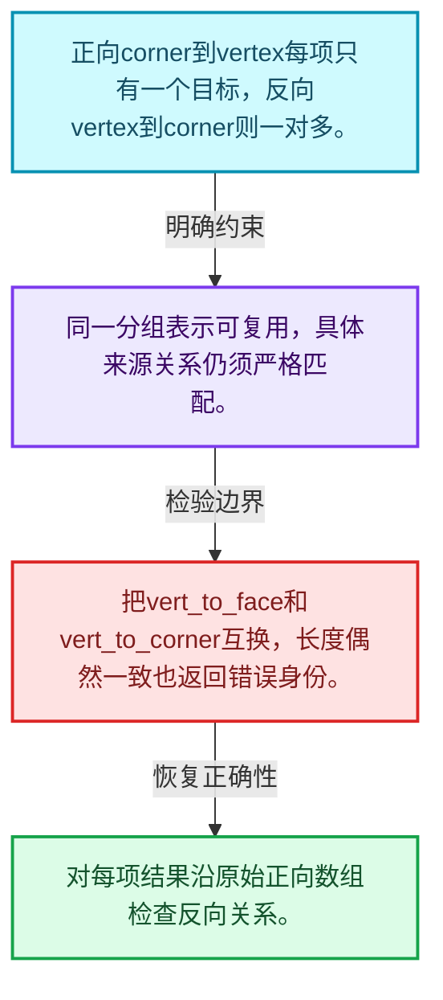
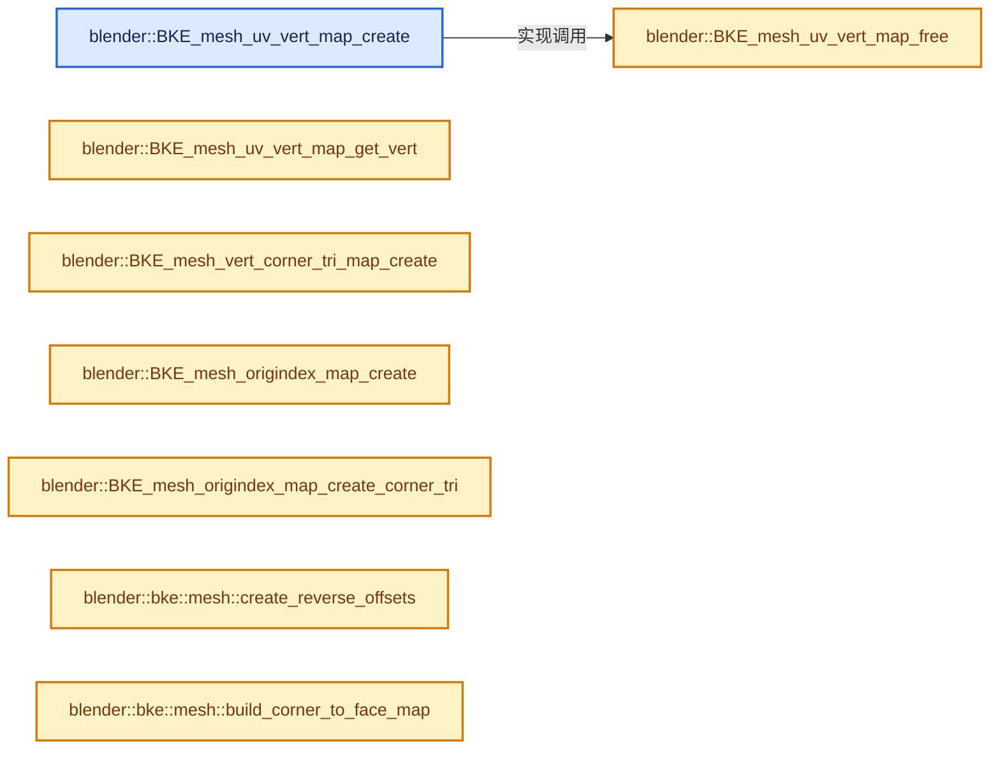
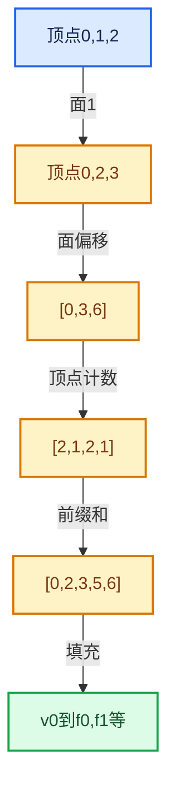

# 05-06 拓扑映射构建

[方向导航](README.md) · [总目录](../README.md) · [实现索引](../%E7%AC%A6%E5%8F%B7%E4%BE%9D%E8%B5%96%E4%B8%8E%E5%AE%9E%E7%8E%B0%E7%B4%A2%E5%BC%95.md)

## 从问题到实现

如何统一多种域之间的邻接查询？

使用一组偏移和一段索引可表达一对多关系；相同长度并不代表不同映射可以互换。

**数据模型**

正向corner到vertex每项只有一个目标，反向vertex到corner则一对多。

**设计取舍**

同一分组表示可复用，具体来源关系仍须严格匹配。

**最小反例**

把vert_to_face和vert_to_corner互换，长度偶然一致也返回错误身份。

**推导**

对每项结果沿原始正向数组检查反向关系。

## 阅读地图与执行推演








图中的数值推演是本方向的教学模型；实际函数之间的调用边与概念分析边分别标注，不能把概念关系当作运行时调度顺序。

## 完整源码单元与就地讲解

中文讲解直接放在相关代码旁，复杂机制在代码下展开。原文折叠区保留基准行号；不需要在行号表和函数之间来回查找。类布局可分段展示，函数实现不按固定行数切开。

### 类型布局、声明与编译条件 · BKE_mesh_mapping.hh L1—L314

<a id="t-ec37224c80fb"></a>

<a id="t-803feaca6e78"></a>

<a id="t-f7db00eb87a8"></a>

`UvMapVert`在这里声明的数据成员：

- `UvMapVert next`
- `unsigned int face_index`
- `unsigned short loop_of_face_index`
- `bool separate`

<a id="t-39c95d67f854"></a>

`UvVertMap`在这里声明的数据成员：

- `UvMapVert vert`
- `UvMapVert buf`

<a id="t-08564035b950"></a>

`UvElement`在这里声明的数据成员：

- `UvElement next`
- `BMLoop l`
- `unsigned short loop_of_face_index`
- `bool separate`
- `unsigned char flag`
- `unsigned int island`

<a id="t-b49cfb5f3ec3"></a>

`UvElementMap`在这里声明的数据成员：

- `UvElement storage`
- `int total_uvs`
- `int total_unique_uvs`
- `UvElement vertex`
- `UvElement head_table`
- `int unique_index_table`
- `int total_islands`
- `int island_indices`
- `int island_total_uvs`
- `int island_total_unique_uvs`

<a id="t-84137284f6d5"></a>

`MeshElemMap`在这里声明的数据成员：

- `int indices`
- `int count`

<a id="t-c0f4abaeafc6"></a>

`MeshIslandStore`在这里声明的数据成员：

- `short item_type`
- `short island_type`
- `short innercut_type`
- `int items_to_islands_num`
- `int items_to_islands`
- `int islands_num`
- `size_t islands_num_alloc`
- `MeshElemMap islands`
- `MeshElemMap innercuts`
- `MemArena mem`

<!-- annotated:80c5951e23c71d -->

```cpp
/* SPDX-FileCopyrightText: 2001-2002 NaN Holding BV. All rights reserved.
 *
 * SPDX-License-Identifier: GPL-2.0-or-later */
#pragma once

/** \file
 * \ingroup bke
 */

#include "BLI_array.hh"
#include "BLI_math_vector_types.hh"
#include "BLI_offset_indices.hh"

namespace blender {

struct BMLoop;
struct MemArena;

/* UvVertMap */
#define STD_UV_CONNECT_LIMIT 0.0001f

struct UvMapVert {
  UvMapVert *next;
  unsigned int face_index;
  unsigned short loop_of_face_index;
  bool separate;
};

/** Map from UV vertex to face. Used by select linked, UV subdivision-surface and obj exporter. */
struct UvVertMap {
  UvMapVert **vert;
  UvMapVert *buf;
};

/**
 * UvElement stores per uv information so that we can quickly access information for a uv.
 * it is actually an improved UvMapVert, including an island and a direct pointer to the face
 * to avoid initializing face arrays.
 */
struct UvElement {
  /** Next UvElement corresponding to same vertex */
  UvElement *next;
  /** Face the element belongs to */
  BMLoop *l;
  /** Index in loop. */
  unsigned short loop_of_face_index;
  /** Whether this element is the first of coincident elements */
  bool separate;
  /** general use flag. */
  unsigned char flag;
  /** If generating element map with island sorting, this stores the island index */
  unsigned int island;
};

/**
 * UvElementMap is a container for UvElements of a BMesh.
 *
 * It simplifies access to UV information and ensures the
 * different UV selection modes are respected.
 *
 * If islands are calculated, it also stores UvElements
 * belonging to the same uv island in sequence and
 * the number of uvs per island.
 *
 * \note in C++, #head_table and #unique_index_table would
 * be `mutable`, as they are created on demand, and never
 * changed after creation.
 */
struct UvElementMap {
  /** UvElement Storage. */
  UvElement *storage;
  /** Total number of UVs. */
  int total_uvs;
  /** Total number of unique UVs. */
  int total_unique_uvs;

  /** If Non-NULL, address UvElements by `BM_elem_index_get(BMVert*)`. */
  UvElement **vertex;

  /** If Non-NULL, pointer to local head of each unique UV. */
  UvElement **head_table;

  /** If Non-NULL, pointer to index of each unique UV. */
  int *unique_index_table;

  /** Number of islands, or zero if not calculated. */
  int total_islands;
  /** Array of starting index in #storage where each island begins. */
  int *island_indices;
  /** Array of number of UVs in each island. */
  int *island_total_uvs;
  /** Array of number of unique UVs in each island. */
  int *island_total_unique_uvs;
};

/* Connectivity data */
struct MeshElemMap {
  int *indices;
  int count;
};

/* mapping */

UvVertMap *BKE_mesh_uv_vert_map_create(OffsetIndices<int> faces,
                                       Span<int> corner_verts,
                                       Span<float2> uv_map,
                                       int verts_num,
                                       const float2 &limit,
                                       bool use_winding);

UvMapVert *BKE_mesh_uv_vert_map_get_vert(UvVertMap *vmap, unsigned int v);
void BKE_mesh_uv_vert_map_free(UvVertMap *vmap);

/**
 * Generates a map where the key is the edge and the value
 * is a list of corner_tris that use that edge.
 * The lists are allocated from one memory pool.
 */
void BKE_mesh_vert_corner_tri_map_create(MeshElemMap **r_map,
                                         int **r_mem,
                                         int totvert,
                                         const int3 *corner_tris,
                                         int tris_num,
                                         const int *corner_verts,
                                         int corners_num);
/**
 * This function creates a map so the source-data (vert/edge/loop/face)
 * can loop over the destination data (using the destination arrays origindex).
 *
 * This has the advantage that it can operate on any data-types.
 *
 * \param totsource: The total number of elements that \a final_origindex points to.
 * \param final_origindex: The size of the final array.
 * \param totfinal: The size of \a final_origindex
 *
 * \note `totsource` could be `faces_num`,
 *       `totfinal` could be `tottessface` and `final_origindex` its ORIGINDEX custom-data.
 *       This would allow a face to loop over its tessfaces.
 */
void BKE_mesh_origindex_map_create(
    MeshElemMap **r_map, int **r_mem, int totsource, const int *final_origindex, int totfinal);
/**
 * A version of #BKE_mesh_origindex_map_create that takes a corner tri array.
 * Making a face -> corner tri map.
 */
void BKE_mesh_origindex_map_create_corner_tri(MeshElemMap **r_map,
                                              int **r_mem,
                                              OffsetIndices<int> faces,
                                              const int *corner_tri_faces,
                                              int corner_tris_num);

/* islands */

/* Loop islands data helpers. */
enum {
  MISLAND_TYPE_NONE = 0,
  MISLAND_TYPE_VERT = 1,
  MISLAND_TYPE_EDGE = 2,
  MISLAND_TYPE_POLY = 3,
  MISLAND_TYPE_LOOP = 4,
};

struct MeshIslandStore {
  short item_type;     /* MISLAND_TYPE_... */
  short island_type;   /* MISLAND_TYPE_... */
  short innercut_type; /* MISLAND_TYPE_... */

  int items_to_islands_num;
  int *items_to_islands; /* map the item to the island index */

  int islands_num;
  size_t islands_num_alloc;
  MeshElemMap **islands;   /* Array of pointers, one item per island. */
  MeshElemMap **innercuts; /* Array of pointers, one item per island. */

  MemArena *mem; /* Memory arena, internal use only. */
};

void BKE_mesh_loop_islands_init(MeshIslandStore *island_store,
                                short item_type,
                                int items_num,
                                short island_type,
                                short innercut_type);
void BKE_mesh_loop_islands_clear(MeshIslandStore *island_store);
void BKE_mesh_loop_islands_free(MeshIslandStore *island_store);
void BKE_mesh_loop_islands_add(MeshIslandStore *island_store,
                               int item_num,
                               const int *items_indices,
                               int num_island_items,
                               int *island_item_indices,
                               int num_innercut_items,
                               int *innercut_item_indices);

using MeshRemapIslandsCalc = bool (*)(Span<float3> vert_positions,
                                      Span<int2> edges,
                                      Span<bool> uv_seams,
                                      OffsetIndices<int> faces,
                                      Span<int> corner_verts,
                                      Span<int> corner_edges,
                                      MeshIslandStore *r_island_store);

/* Above vert/UV mapping stuff does not do what we need here, but does things we do not need here.
 * So better keep them separated for now, I think. */

/**
 * Calculate 'generic' UV islands, i.e. based only on actual geometry data (edge seams),
 * not some UV layers coordinates.
 *
 * \param uv_seams: Optional (possibly empty) span.
 */
bool BKE_mesh_calc_islands_loop_face_edgeseam(Span<float3> vert_positions,
                                              Span<int2> edges,
                                              Span<bool> uv_seams,
                                              OffsetIndices<int> faces,
                                              Span<int> corner_verts,
                                              Span<int> corner_edges,
                                              MeshIslandStore *r_island_store);

/**
 * Calculate smooth groups from sharp edges, using increasing numbers as identifier for each group.
 *
 * \param sharp_edges: Optional (possibly empty) span.
 * \param sharp_faces: Optional (possibly empty) span.
 * \param r_totgroup: The total number of groups, 1 or more.
 * \return Face aligned array of group index values, starting at 1 (0 being used as 'invalid'
 * flag). Note that it's the callers responsibility to MEM_delete the returned array.
 */
int *BKE_mesh_calc_smoothgroups(int edges_num,
                                OffsetIndices<int> faces,
                                Span<int> corner_edges,
                                Span<bool> sharp_edges,
                                Span<bool> sharp_faces,
                                int *r_totgroup);
/**
 * Same as #BKE_mesh_calc_smoothgroups, but use bit-flags instead of increasing numbers for each
 * group.
 *
 * This means that the same value (bit) can be re-used for different groups, as long as they are
 * not neighbors. Values of each group are always powers of two.
 *
 * By default, only groups that share a same sharp edge are considered neighbors, and therefore
 * prevented to use the same bit-flag value.
 *
 * If #use_boundary_vertices_for_bitflags is set to `true`, then groups are also considered
 * neighbors (and therefore cannot have the same bit-flag value) if they share a single vertex,
 * even if they have no common edge. This behavior seems to be required by some DCCs to recompute
 * correct normals, see e.g. #104434. It will however make it much more likely to run out of
 * available bits with certain types of topology (e.g. large fans of sharp faces).
 *
 * \param sharp_edges: Optional (possibly empty) span.
 * \param sharp_faces: Optional (possibly empty) span.
 * \param r_totgroup: The total number of groups, 1 or more.
 * \return Face aligned array of group bit-flags values (i.e. always powers of 2), starting at 1 (0
 * being used as 'invalid' flag). Note that it's the callers responsibility to MEM_delete the
 * returned array.
 */
int *BKE_mesh_calc_smoothgroups_bitflags(int edges_num,
                                         int verts_num,
                                         OffsetIndices<int> faces,
                                         Span<int> corner_edges,
                                         Span<int> corner_verts,
                                         Span<bool> sharp_edges,
                                         Span<bool> sharp_faces,
                                         bool use_boundary_vertices_for_bitflags,
                                         int *r_totgroup);

/* Use on corner_tri vertex values. */
#define BKE_MESH_TESSTRI_VINDEX_ORDER(_tri, _v) \
  ((CHECK_TYPE_ANY( \
        _tri, unsigned int *, int *, int[3], const unsigned int *, const int *, const int[3]), \
    CHECK_TYPE_ANY(_v, unsigned int, const unsigned int, int, const int)), \
   (((_tri)[0] == _v) ? 0 : \
    ((_tri)[1] == _v) ? 1 : \
    ((_tri)[2] == _v) ? 2 : \
                        -1))

namespace bke::mesh {

Array<int> build_corner_to_face_map(OffsetIndices<int> faces);

GroupedSpan<int> build_vert_to_edge_map(Span<int2> edges,
                                        int verts_num,
                                        Array<int> &r_offsets,
                                        Array<int> &r_indices);

void build_vert_to_face_indices(OffsetIndices<int> faces,
                                Span<int> corner_verts,
                                OffsetIndices<int> offsets,
                                MutableSpan<int> face_indices);
GroupedSpan<int> build_vert_to_face_map(OffsetIndices<int> faces,
                                        Span<int> corner_verts,
                                        int verts_num,
                                        Array<int> &r_offsets,
                                        Array<int> &r_indices);

Array<int> build_vert_to_corner_indices(Span<int> corner_verts, OffsetIndices<int> offsets);
GroupedSpan<int> build_vert_to_corner_map(Span<int> corner_verts,
                                          int verts_num,
                                          Array<int> &r_offsets,
                                          Array<int> &r_indices);

GroupedSpan<int> build_edge_to_corner_map(Span<int> corner_edges,
                                          int edges_num,
                                          Array<int> &r_offsets,
                                          Array<int> &r_indices);

GroupedSpan<int> build_edge_to_face_map(OffsetIndices<int> faces,
                                        Span<int> corner_edges,
                                        int edges_num,
                                        Array<int> &r_offsets,
                                        Array<int> &r_indices);

}  // namespace bke::mesh
}  // namespace blender
```

<details>
<summary>核对原始源码：source/blender/blenkernel/BKE_mesh_mapping.hh · L1—L314</summary>

<!-- original:80c5951e23c71d:source/blender/blenkernel/BKE_mesh_mapping.hh:1:314 -->

```cpp
/* SPDX-FileCopyrightText: 2001-2002 NaN Holding BV. All rights reserved.
 *
 * SPDX-License-Identifier: GPL-2.0-or-later */
#pragma once

/** \file
 * \ingroup bke
 */

#include "BLI_array.hh"
#include "BLI_math_vector_types.hh"
#include "BLI_offset_indices.hh"

namespace blender {

struct BMLoop;
struct MemArena;

/* UvVertMap */
#define STD_UV_CONNECT_LIMIT 0.0001f

struct UvMapVert {
  UvMapVert *next;
  unsigned int face_index;
  unsigned short loop_of_face_index;
  bool separate;
};

/** Map from UV vertex to face. Used by select linked, UV subdivision-surface and obj exporter. */
struct UvVertMap {
  UvMapVert **vert;
  UvMapVert *buf;
};

/**
 * UvElement stores per uv information so that we can quickly access information for a uv.
 * it is actually an improved UvMapVert, including an island and a direct pointer to the face
 * to avoid initializing face arrays.
 */
struct UvElement {
  /** Next UvElement corresponding to same vertex */
  UvElement *next;
  /** Face the element belongs to */
  BMLoop *l;
  /** Index in loop. */
  unsigned short loop_of_face_index;
  /** Whether this element is the first of coincident elements */
  bool separate;
  /** general use flag. */
  unsigned char flag;
  /** If generating element map with island sorting, this stores the island index */
  unsigned int island;
};

/**
 * UvElementMap is a container for UvElements of a BMesh.
 *
 * It simplifies access to UV information and ensures the
 * different UV selection modes are respected.
 *
 * If islands are calculated, it also stores UvElements
 * belonging to the same uv island in sequence and
 * the number of uvs per island.
 *
 * \note in C++, #head_table and #unique_index_table would
 * be `mutable`, as they are created on demand, and never
 * changed after creation.
 */
struct UvElementMap {
  /** UvElement Storage. */
  UvElement *storage;
  /** Total number of UVs. */
  int total_uvs;
  /** Total number of unique UVs. */
  int total_unique_uvs;

  /** If Non-NULL, address UvElements by `BM_elem_index_get(BMVert*)`. */
  UvElement **vertex;

  /** If Non-NULL, pointer to local head of each unique UV. */
  UvElement **head_table;

  /** If Non-NULL, pointer to index of each unique UV. */
  int *unique_index_table;

  /** Number of islands, or zero if not calculated. */
  int total_islands;
  /** Array of starting index in #storage where each island begins. */
  int *island_indices;
  /** Array of number of UVs in each island. */
  int *island_total_uvs;
  /** Array of number of unique UVs in each island. */
  int *island_total_unique_uvs;
};

/* Connectivity data */
struct MeshElemMap {
  int *indices;
  int count;
};

/* mapping */

UvVertMap *BKE_mesh_uv_vert_map_create(OffsetIndices<int> faces,
                                       Span<int> corner_verts,
                                       Span<float2> uv_map,
                                       int verts_num,
                                       const float2 &limit,
                                       bool use_winding);

UvMapVert *BKE_mesh_uv_vert_map_get_vert(UvVertMap *vmap, unsigned int v);
void BKE_mesh_uv_vert_map_free(UvVertMap *vmap);

/**
 * Generates a map where the key is the edge and the value
 * is a list of corner_tris that use that edge.
 * The lists are allocated from one memory pool.
 */
void BKE_mesh_vert_corner_tri_map_create(MeshElemMap **r_map,
                                         int **r_mem,
                                         int totvert,
                                         const int3 *corner_tris,
                                         int tris_num,
                                         const int *corner_verts,
                                         int corners_num);
/**
 * This function creates a map so the source-data (vert/edge/loop/face)
 * can loop over the destination data (using the destination arrays origindex).
 *
 * This has the advantage that it can operate on any data-types.
 *
 * \param totsource: The total number of elements that \a final_origindex points to.
 * \param final_origindex: The size of the final array.
 * \param totfinal: The size of \a final_origindex
 *
 * \note `totsource` could be `faces_num`,
 *       `totfinal` could be `tottessface` and `final_origindex` its ORIGINDEX custom-data.
 *       This would allow a face to loop over its tessfaces.
 */
void BKE_mesh_origindex_map_create(
    MeshElemMap **r_map, int **r_mem, int totsource, const int *final_origindex, int totfinal);
/**
 * A version of #BKE_mesh_origindex_map_create that takes a corner tri array.
 * Making a face -> corner tri map.
 */
void BKE_mesh_origindex_map_create_corner_tri(MeshElemMap **r_map,
                                              int **r_mem,
                                              OffsetIndices<int> faces,
                                              const int *corner_tri_faces,
                                              int corner_tris_num);

/* islands */

/* Loop islands data helpers. */
enum {
  MISLAND_TYPE_NONE = 0,
  MISLAND_TYPE_VERT = 1,
  MISLAND_TYPE_EDGE = 2,
  MISLAND_TYPE_POLY = 3,
  MISLAND_TYPE_LOOP = 4,
};

struct MeshIslandStore {
  short item_type;     /* MISLAND_TYPE_... */
  short island_type;   /* MISLAND_TYPE_... */
  short innercut_type; /* MISLAND_TYPE_... */

  int items_to_islands_num;
  int *items_to_islands; /* map the item to the island index */

  int islands_num;
  size_t islands_num_alloc;
  MeshElemMap **islands;   /* Array of pointers, one item per island. */
  MeshElemMap **innercuts; /* Array of pointers, one item per island. */

  MemArena *mem; /* Memory arena, internal use only. */
};

void BKE_mesh_loop_islands_init(MeshIslandStore *island_store,
                                short item_type,
                                int items_num,
                                short island_type,
                                short innercut_type);
void BKE_mesh_loop_islands_clear(MeshIslandStore *island_store);
void BKE_mesh_loop_islands_free(MeshIslandStore *island_store);
void BKE_mesh_loop_islands_add(MeshIslandStore *island_store,
                               int item_num,
                               const int *items_indices,
                               int num_island_items,
                               int *island_item_indices,
                               int num_innercut_items,
                               int *innercut_item_indices);

using MeshRemapIslandsCalc = bool (*)(Span<float3> vert_positions,
                                      Span<int2> edges,
                                      Span<bool> uv_seams,
                                      OffsetIndices<int> faces,
                                      Span<int> corner_verts,
                                      Span<int> corner_edges,
                                      MeshIslandStore *r_island_store);

/* Above vert/UV mapping stuff does not do what we need here, but does things we do not need here.
 * So better keep them separated for now, I think. */

/**
 * Calculate 'generic' UV islands, i.e. based only on actual geometry data (edge seams),
 * not some UV layers coordinates.
 *
 * \param uv_seams: Optional (possibly empty) span.
 */
bool BKE_mesh_calc_islands_loop_face_edgeseam(Span<float3> vert_positions,
                                              Span<int2> edges,
                                              Span<bool> uv_seams,
                                              OffsetIndices<int> faces,
                                              Span<int> corner_verts,
                                              Span<int> corner_edges,
                                              MeshIslandStore *r_island_store);

/**
 * Calculate smooth groups from sharp edges, using increasing numbers as identifier for each group.
 *
 * \param sharp_edges: Optional (possibly empty) span.
 * \param sharp_faces: Optional (possibly empty) span.
 * \param r_totgroup: The total number of groups, 1 or more.
 * \return Face aligned array of group index values, starting at 1 (0 being used as 'invalid'
 * flag). Note that it's the callers responsibility to MEM_delete the returned array.
 */
int *BKE_mesh_calc_smoothgroups(int edges_num,
                                OffsetIndices<int> faces,
                                Span<int> corner_edges,
                                Span<bool> sharp_edges,
                                Span<bool> sharp_faces,
                                int *r_totgroup);
/**
 * Same as #BKE_mesh_calc_smoothgroups, but use bit-flags instead of increasing numbers for each
 * group.
 *
 * This means that the same value (bit) can be re-used for different groups, as long as they are
 * not neighbors. Values of each group are always powers of two.
 *
 * By default, only groups that share a same sharp edge are considered neighbors, and therefore
 * prevented to use the same bit-flag value.
 *
 * If #use_boundary_vertices_for_bitflags is set to `true`, then groups are also considered
 * neighbors (and therefore cannot have the same bit-flag value) if they share a single vertex,
 * even if they have no common edge. This behavior seems to be required by some DCCs to recompute
 * correct normals, see e.g. #104434. It will however make it much more likely to run out of
 * available bits with certain types of topology (e.g. large fans of sharp faces).
 *
 * \param sharp_edges: Optional (possibly empty) span.
 * \param sharp_faces: Optional (possibly empty) span.
 * \param r_totgroup: The total number of groups, 1 or more.
 * \return Face aligned array of group bit-flags values (i.e. always powers of 2), starting at 1 (0
 * being used as 'invalid' flag). Note that it's the callers responsibility to MEM_delete the
 * returned array.
 */
int *BKE_mesh_calc_smoothgroups_bitflags(int edges_num,
                                         int verts_num,
                                         OffsetIndices<int> faces,
                                         Span<int> corner_edges,
                                         Span<int> corner_verts,
                                         Span<bool> sharp_edges,
                                         Span<bool> sharp_faces,
                                         bool use_boundary_vertices_for_bitflags,
                                         int *r_totgroup);

/* Use on corner_tri vertex values. */
#define BKE_MESH_TESSTRI_VINDEX_ORDER(_tri, _v) \
  ((CHECK_TYPE_ANY( \
        _tri, unsigned int *, int *, int[3], const unsigned int *, const int *, const int[3]), \
    CHECK_TYPE_ANY(_v, unsigned int, const unsigned int, int, const int)), \
   (((_tri)[0] == _v) ? 0 : \
    ((_tri)[1] == _v) ? 1 : \
    ((_tri)[2] == _v) ? 2 : \
                        -1))

namespace bke::mesh {

Array<int> build_corner_to_face_map(OffsetIndices<int> faces);

GroupedSpan<int> build_vert_to_edge_map(Span<int2> edges,
                                        int verts_num,
                                        Array<int> &r_offsets,
                                        Array<int> &r_indices);

void build_vert_to_face_indices(OffsetIndices<int> faces,
                                Span<int> corner_verts,
                                OffsetIndices<int> offsets,
                                MutableSpan<int> face_indices);
GroupedSpan<int> build_vert_to_face_map(OffsetIndices<int> faces,
                                        Span<int> corner_verts,
                                        int verts_num,
                                        Array<int> &r_offsets,
                                        Array<int> &r_indices);

Array<int> build_vert_to_corner_indices(Span<int> corner_verts, OffsetIndices<int> offsets);
GroupedSpan<int> build_vert_to_corner_map(Span<int> corner_verts,
                                          int verts_num,
                                          Array<int> &r_offsets,
                                          Array<int> &r_indices);

GroupedSpan<int> build_edge_to_corner_map(Span<int> corner_edges,
                                          int edges_num,
                                          Array<int> &r_offsets,
                                          Array<int> &r_indices);

GroupedSpan<int> build_edge_to_face_map(OffsetIndices<int> faces,
                                        Span<int> corner_edges,
                                        int edges_num,
                                        Array<int> &r_offsets,
                                        Array<int> &r_indices);

}  // namespace bke::mesh
}  // namespace blender
```

</details>

### 类型布局、声明与编译条件 · mesh_mapping.cc L1—L36

<!-- annotated:c679e73aab0409 -->

```cpp
/* SPDX-FileCopyrightText: 2023 Blender Authors
 *
 * SPDX-License-Identifier: GPL-2.0-or-later */

/** \file
 * \ingroup bke
 *
 * Functions for accessing mesh connectivity data.
 * eg: faces connected to verts, UVs connected to verts.
 */

#include <algorithm>

#include "MEM_guardedalloc.h"

#include "BLI_array.hh"
#include "BLI_bitmap.hh"
#include "BLI_function_ref.hh"
#include "BLI_math_geom_c.hh"
#include "BLI_math_vector_c.hh"
#include "BLI_task.hh"
#include "BLI_utildefines.hh"

#include "BKE_customdata.hh"
#include "BKE_mesh.hh"
#include "BKE_mesh_mapping.hh"
#include "BLI_memarena.hh"

#include "BLI_strict_flags.hh" /* IWYU pragma: keep. Keep last. */

namespace blender {

/* -------------------------------------------------------------------- */
/** \name Mesh Connectivity Mapping
 * \{ */

```

<details>
<summary>核对原始源码：source/blender/blenkernel/intern/mesh_mapping.cc · L1—L36</summary>

<!-- original:c679e73aab0409:source/blender/blenkernel/intern/mesh_mapping.cc:1:36 -->

```cpp
/* SPDX-FileCopyrightText: 2023 Blender Authors
 *
 * SPDX-License-Identifier: GPL-2.0-or-later */

/** \file
 * \ingroup bke
 *
 * Functions for accessing mesh connectivity data.
 * eg: faces connected to verts, UVs connected to verts.
 */

#include <algorithm>

#include "MEM_guardedalloc.h"

#include "BLI_array.hh"
#include "BLI_bitmap.hh"
#include "BLI_function_ref.hh"
#include "BLI_math_geom_c.hh"
#include "BLI_math_vector_c.hh"
#include "BLI_task.hh"
#include "BLI_utildefines.hh"

#include "BKE_customdata.hh"
#include "BKE_mesh.hh"
#include "BKE_mesh_mapping.hh"
#include "BLI_memarena.hh"

#include "BLI_strict_flags.hh" /* IWYU pragma: keep. Keep last. */

namespace blender {

/* -------------------------------------------------------------------- */
/** \name Mesh Connectivity Mapping
 * \{ */

```

</details>

<a id="f-880b8c4f30f451cb"></a>

### `blender::BKE_mesh_uv_vert_map_create`

实现位置：[source/blender/blenkernel/intern/mesh_mapping.cc](../../../../../source/blender/blenkernel/intern/mesh_mapping.cc) · L37—L132。

接口参数：

- `OffsetIndices<int> faces`
- `Span<int> corner_verts`
- `Span<float2> uv_map`
- `int verts_num`
- `const float2 &limit`
- `bool use_winding`

**教学注释版**

<!-- annotated:61d5be97840e91 -->

```cpp
UvVertMap *BKE_mesh_uv_vert_map_create(OffsetIndices<int> faces,
                                       Span<int> corner_verts,
                                       Span<float2> uv_map,
                                       int verts_num,
                                       const float2 &limit,
                                       bool use_winding)
{
  /* NOTE: N-gon version WIP, based on #BM_uv_vert_map_create. */
  // [讲解] faces.is_empty：读取连续区间或分组的边界信息。
  if (faces.is_empty()) {
    return nullptr;
  }
  const int corners_num = faces.total_size();

  UvVertMap *vmap = MEM_new_zeroed<UvVertMap>("UvVertMap");
  UvMapVert *buf = vmap->buf = MEM_new_array_zeroed<UvMapVert>(size_t(corners_num), "UvMapVert");
  vmap->vert = MEM_new_array_zeroed<UvMapVert *>(size_t(verts_num), "UvMapVert*");

  if (!vmap->vert || !vmap->buf) {
    BKE_mesh_uv_vert_map_free(vmap);
    return nullptr;
  }

  Array<bool> winding;
  if (use_winding) {
    // [讲解] faces.size：读取连续区间或分组的边界信息。
    winding = Array<bool>(faces.size(), false);
    threading::parallel_for(faces.index_range(), 1024, [&](const IndexRange range) {
      for (const int64_t face : range) {
        // [讲解] uv_map.slice：建立原连续范围的子视图。
        const Span<float2> face_uvs = uv_map.slice(faces[face]);
        // [讲解] face_uvs.data：返回借用范围的地址。
        winding[face] = cross_poly_v2(reinterpret_cast<const float (*)[2]>(face_uvs.data()),
                                      uint(faces[face].size())) < 0.0f;
      }
    });
  }

  for (const int64_t a : faces.index_range()) {
    const IndexRange face = faces[a];
    for (const int64_t i : face.index_range()) {
      buf->loop_of_face_index = ushort(i);
      buf->face_index = uint(a);
      buf->separate = false;
      buf->next = vmap->vert[corner_verts[face[i]]];
      vmap->vert[corner_verts[face[i]]] = buf;
      buf++;
    }
  }

  /* sort individual uvs for each vert */
  for (const int64_t vert : IndexRange(verts_num)) {
    UvMapVert *newvlist = nullptr, *vlist = vmap->vert[vert];
    UvMapVert *iterv, *v, *lastv, *next;
    const float *uv, *uv2;
    float uvdiff[2];

    while (vlist) {
      v = vlist;
      vlist = vlist->next;
      v->next = newvlist;
      newvlist = v;

      uv = uv_map[faces[v->face_index].start() + v->loop_of_face_index];
      lastv = nullptr;
      iterv = vlist;

      while (iterv) {
        next = iterv->next;

        uv2 = uv_map[faces[iterv->face_index].start() + iterv->loop_of_face_index];
        sub_v2_v2v2(uvdiff, uv2, uv);

        if (fabsf(uv[0] - uv2[0]) < limit[0] && fabsf(uv[1] - uv2[1]) < limit[1] &&
            (!use_winding || winding[iterv->face_index] == winding[v->face_index]))
        {
          if (lastv) {
            lastv->next = next;
          }
          else {
            vlist = next;
          }
          iterv->next = newvlist;
          newvlist = iterv;
        }
        else {
          lastv = iterv;
        }

        iterv = next;
      }

      newvlist->separate = true;
    }

    vmap->vert[vert] = newvlist;
  }

  return vmap;
}
```

<details>
<summary>核对原始源码：source/blender/blenkernel/intern/mesh_mapping.cc · L37—L132</summary>

<!-- original:61d5be97840e91:source/blender/blenkernel/intern/mesh_mapping.cc:37:132 -->

```cpp
UvVertMap *BKE_mesh_uv_vert_map_create(OffsetIndices<int> faces,
                                       Span<int> corner_verts,
                                       Span<float2> uv_map,
                                       int verts_num,
                                       const float2 &limit,
                                       bool use_winding)
{
  /* NOTE: N-gon version WIP, based on #BM_uv_vert_map_create. */
  if (faces.is_empty()) {
    return nullptr;
  }
  const int corners_num = faces.total_size();

  UvVertMap *vmap = MEM_new_zeroed<UvVertMap>("UvVertMap");
  UvMapVert *buf = vmap->buf = MEM_new_array_zeroed<UvMapVert>(size_t(corners_num), "UvMapVert");
  vmap->vert = MEM_new_array_zeroed<UvMapVert *>(size_t(verts_num), "UvMapVert*");

  if (!vmap->vert || !vmap->buf) {
    BKE_mesh_uv_vert_map_free(vmap);
    return nullptr;
  }

  Array<bool> winding;
  if (use_winding) {
    winding = Array<bool>(faces.size(), false);
    threading::parallel_for(faces.index_range(), 1024, [&](const IndexRange range) {
      for (const int64_t face : range) {
        const Span<float2> face_uvs = uv_map.slice(faces[face]);
        winding[face] = cross_poly_v2(reinterpret_cast<const float (*)[2]>(face_uvs.data()),
                                      uint(faces[face].size())) < 0.0f;
      }
    });
  }

  for (const int64_t a : faces.index_range()) {
    const IndexRange face = faces[a];
    for (const int64_t i : face.index_range()) {
      buf->loop_of_face_index = ushort(i);
      buf->face_index = uint(a);
      buf->separate = false;
      buf->next = vmap->vert[corner_verts[face[i]]];
      vmap->vert[corner_verts[face[i]]] = buf;
      buf++;
    }
  }

  /* sort individual uvs for each vert */
  for (const int64_t vert : IndexRange(verts_num)) {
    UvMapVert *newvlist = nullptr, *vlist = vmap->vert[vert];
    UvMapVert *iterv, *v, *lastv, *next;
    const float *uv, *uv2;
    float uvdiff[2];

    while (vlist) {
      v = vlist;
      vlist = vlist->next;
      v->next = newvlist;
      newvlist = v;

      uv = uv_map[faces[v->face_index].start() + v->loop_of_face_index];
      lastv = nullptr;
      iterv = vlist;

      while (iterv) {
        next = iterv->next;

        uv2 = uv_map[faces[iterv->face_index].start() + iterv->loop_of_face_index];
        sub_v2_v2v2(uvdiff, uv2, uv);

        if (fabsf(uv[0] - uv2[0]) < limit[0] && fabsf(uv[1] - uv2[1]) < limit[1] &&
            (!use_winding || winding[iterv->face_index] == winding[v->face_index]))
        {
          if (lastv) {
            lastv->next = next;
          }
          else {
            vlist = next;
          }
          iterv->next = newvlist;
          newvlist = iterv;
        }
        else {
          lastv = iterv;
        }

        iterv = next;
      }

      newvlist->separate = true;
    }

    vmap->vert[vert] = newvlist;
  }

  return vmap;
}
```

</details>

**沿实际写入检查状态**

- `vmap->vert = MEM_new_array_zeroed<UvMapVert *>(size_t(verts_num), "UvMapVert*");`
- `winding = Array<bool>(faces.size(), false);`
- `winding[face] = cross_poly_v2(reinterpret_cast<const float (*)[2]>(face_uvs.data()),`
- `buf->loop_of_face_index = ushort(i);`
- `buf->face_index = uint(a);`
- `buf->separate = false;`
- `buf->next = vmap->vert[corner_verts[face[i]]];`
- `vmap->vert[corner_verts[face[i]]] = buf;`
- `v = vlist;`
- `vlist = vlist->next;`
- `v->next = newvlist;`
- `newvlist = v;`
- `uv = uv_map[faces[v->face_index].start() + v->loop_of_face_index];`
- `lastv = nullptr;`
- `iterv = vlist;`
- `next = iterv->next;`
- `uv2 = uv_map[faces[iterv->face_index].start() + iterv->loop_of_face_index];`
- `lastv->next = next;`
- `vlist = next;`
- `iterv->next = newvlist;`
- `newvlist = iterv;`
- `lastv = iterv;`
- `iterv = next;`
- `newvlist->separate = true;`
- `vmap->vert[vert] = newvlist;`

**结果出口**

- `return nullptr;`
- `return vmap;`

**继续追踪实现**

- `faces.is_empty` → [blender::offset_indices::OffsetIndices::is_empty · L72](02-OffsetIndices%E5%AE%8C%E6%95%B4%E6%8E%A5%E5%8F%A3.md#f-e348e19b62d50b3e)。
- `faces.total_size` → [blender::offset_indices::OffsetIndices::total_size · L58](02-OffsetIndices%E5%AE%8C%E6%95%B4%E6%8E%A5%E5%8F%A3.md#f-c111ffdac7a19248)。
- `MEM_new_zeroed<UvVertMap>` → [MEM_new_zeroed · L550](../03-%E5%86%85%E5%AD%98%E5%88%86%E9%85%8D%E4%B8%8E%E8%BF%90%E8%A1%8C%E6%97%B6%E7%B1%BB%E5%9E%8B/%E4%BE%9D%E8%B5%96-MEM_guardedalloc-b54eca.md#f-eeb1e2a7f57dd231)；[MEM_new_zeroed · L114](../03-%E5%86%85%E5%AD%98%E5%88%86%E9%85%8D%E4%B8%8E%E8%BF%90%E8%A1%8C%E6%97%B6%E7%B1%BB%E5%9E%8B/%E4%BE%9D%E8%B5%96-mallocn-afdcd4.md#f-e04cf01c64c8b180)。同名重载需按实参类型选择。
- `MEM_new_array_zeroed<UvMapVert>` → [MEM_new_array_zeroed · L566](../03-%E5%86%85%E5%AD%98%E5%88%86%E9%85%8D%E4%B8%8E%E8%BF%90%E8%A1%8C%E6%97%B6%E7%B1%BB%E5%9E%8B/%E4%BE%9D%E8%B5%96-MEM_guardedalloc-b54eca.md#f-3a0cf63fb5216500)；[MEM_new_array_zeroed · L119](../03-%E5%86%85%E5%AD%98%E5%88%86%E9%85%8D%E4%B8%8E%E8%BF%90%E8%A1%8C%E6%97%B6%E7%B1%BB%E5%9E%8B/%E4%BE%9D%E8%B5%96-mallocn-afdcd4.md#f-6825557da566fdbe)。同名重载需按实参类型选择。
- `MEM_new_array_zeroed<UvMapVert *>` → [MEM_new_array_zeroed · L566](../03-%E5%86%85%E5%AD%98%E5%88%86%E9%85%8D%E4%B8%8E%E8%BF%90%E8%A1%8C%E6%97%B6%E7%B1%BB%E5%9E%8B/%E4%BE%9D%E8%B5%96-MEM_guardedalloc-b54eca.md#f-3a0cf63fb5216500)；[MEM_new_array_zeroed · L119](../03-%E5%86%85%E5%AD%98%E5%88%86%E9%85%8D%E4%B8%8E%E8%BF%90%E8%A1%8C%E6%97%B6%E7%B1%BB%E5%9E%8B/%E4%BE%9D%E8%B5%96-mallocn-afdcd4.md#f-6825557da566fdbe)。同名重载需按实参类型选择。
- `BKE_mesh_uv_vert_map_free` → [blender::BKE_mesh_uv_vert_map_free · L139](06-%E6%8B%93%E6%89%91%E6%98%A0%E5%B0%84%E6%9E%84%E5%BB%BA.md#f-0f80ab094a4b51ac)。
- `Array<bool>` → [blender::Array::Array · L78](../01-%E5%9F%BA%E7%A1%80%E5%AE%B9%E5%99%A8%E4%B8%8E%E7%8E%B0%E4%BB%A3CPP/07-Array%E6%9E%84%E9%80%A0%E4%B8%8E%E5%AD%98%E5%82%A8.md#f-001fd5eb3c658238)；[blender::Array::Array · L84](../01-%E5%9F%BA%E7%A1%80%E5%AE%B9%E5%99%A8%E4%B8%8E%E7%8E%B0%E4%BB%A3CPP/07-Array%E6%9E%84%E9%80%A0%E4%B8%8E%E5%AD%98%E5%82%A8.md#f-674e2f10361a462b)；[blender::Array::Array · L89](../01-%E5%9F%BA%E7%A1%80%E5%AE%B9%E5%99%A8%E4%B8%8E%E7%8E%B0%E4%BB%A3CPP/07-Array%E6%9E%84%E9%80%A0%E4%B8%8E%E5%AD%98%E5%82%A8.md#f-aa1e5908a9b67557)；[blender::Array::Array · L103](../01-%E5%9F%BA%E7%A1%80%E5%AE%B9%E5%99%A8%E4%B8%8E%E7%8E%B0%E4%BB%A3CPP/07-Array%E6%9E%84%E9%80%A0%E4%B8%8E%E5%AD%98%E5%82%A8.md#f-b141be39084346f3)；[blender::Array::Array · L110](../01-%E5%9F%BA%E7%A1%80%E5%AE%B9%E5%99%A8%E4%B8%8E%E7%8E%B0%E4%BB%A3CPP/07-Array%E6%9E%84%E9%80%A0%E4%B8%8E%E5%AD%98%E5%82%A8.md#f-452e276f39e81a2a)；[blender::Array::Array · L123](../01-%E5%9F%BA%E7%A1%80%E5%AE%B9%E5%99%A8%E4%B8%8E%E7%8E%B0%E4%BB%A3CPP/07-Array%E6%9E%84%E9%80%A0%E4%B8%8E%E5%AD%98%E5%82%A8.md#f-646aa58152ec44f6)；[blender::Array::Array · L135](../01-%E5%9F%BA%E7%A1%80%E5%AE%B9%E5%99%A8%E4%B8%8E%E7%8E%B0%E4%BB%A3CPP/07-Array%E6%9E%84%E9%80%A0%E4%B8%8E%E5%AD%98%E5%82%A8.md#f-0a9de4a549125f99)；[blender::Array::Array · L168](../01-%E5%9F%BA%E7%A1%80%E5%AE%B9%E5%99%A8%E4%B8%8E%E7%8E%B0%E4%BB%A3CPP/07-Array%E6%9E%84%E9%80%A0%E4%B8%8E%E5%AD%98%E5%82%A8.md#f-31f001eb92069e9d)；[blender::Array::Array · L176](../01-%E5%9F%BA%E7%A1%80%E5%AE%B9%E5%99%A8%E4%B8%8E%E7%8E%B0%E4%BB%A3CPP/07-Array%E6%9E%84%E9%80%A0%E4%B8%8E%E5%AD%98%E5%82%A8.md#f-cf8148f06fc6747a)；[blender::Array::Array · L178](../01-%E5%9F%BA%E7%A1%80%E5%AE%B9%E5%99%A8%E4%B8%8E%E7%8E%B0%E4%BB%A3CPP/07-Array%E6%9E%84%E9%80%A0%E4%B8%8E%E5%AD%98%E5%82%A8.md#f-2ddca2fb9dd964b3)。同名重载需按实参类型选择。
- `faces.size` → [blender::offset_indices::OffsetIndices::size · L67](02-OffsetIndices%E5%AE%8C%E6%95%B4%E6%8E%A5%E5%8F%A3.md#f-e238abc62ed42abd)。
- `threading::parallel_for` → [blender::threading::parallel_for · L68](../11-Depsgraph%E4%B8%8E%E5%B9%B6%E8%A1%8C%E4%BB%BB%E5%8A%A1%E7%B3%BB%E7%BB%9F/07-%E4%BB%BB%E5%8A%A1%E6%B1%A0%E4%B8%8ETBB%E6%8E%A5%E5%85%A5.md#f-838294754c24426c)。
- `faces.index_range` → [blender::offset_indices::OffsetIndices::index_range · L77](02-OffsetIndices%E5%AE%8C%E6%95%B4%E6%8E%A5%E5%8F%A3.md#f-19b5ca1456de007d)。
- `uv_map.slice` → [blender::Span::slice · L141](../01-%E5%9F%BA%E7%A1%80%E5%AE%B9%E5%99%A8%E4%B8%8E%E7%8E%B0%E4%BB%A3CPP/05-Span%E5%8F%AA%E8%AF%BB%E8%BF%9E%E7%BB%AD%E8%A7%86%E5%9B%BE.md#f-380a0e8fdcbd53cc)；[blender::Span::slice · L149](../01-%E5%9F%BA%E7%A1%80%E5%AE%B9%E5%99%A8%E4%B8%8E%E7%8E%B0%E4%BB%A3CPP/05-Span%E5%8F%AA%E8%AF%BB%E8%BF%9E%E7%BB%AD%E8%A7%86%E5%9B%BE.md#f-9b9c15e78dd54eec)。同名重载需按实参类型选择。
- `cross_poly_v2` → [blender::cross_poly_v2 · L153](../12-%E7%A9%BA%E9%97%B4%E6%95%B0%E6%8D%AE%E7%BB%93%E6%9E%84%E4%B8%8E%E5%87%A0%E4%BD%95%E7%AE%97%E6%B3%95/%E4%BE%9D%E8%B5%96-math_geom-8d91a3.md#f-8812c9f84a991b4f)。
- `face_uvs.data` → [blender::Span::data · L219](../01-%E5%9F%BA%E7%A1%80%E5%AE%B9%E5%99%A8%E4%B8%8E%E7%8E%B0%E4%BB%A3CPP/05-Span%E5%8F%AA%E8%AF%BB%E8%BF%9E%E7%BB%AD%E8%A7%86%E5%9B%BE.md#f-10c5889198935800)。
- `faces[face].size` → [调用协议](../%E6%A8%A1%E6%9D%BF%E5%AE%8F%E4%B8%8E%E5%8A%A8%E6%80%81%E5%88%86%E6%B4%BE%E5%8D%8F%E8%AE%AE.md)：接收对象类型依赖auto、返回值或模板实例；不按同名猜测目标。调用位置L66。
- `face.index_range` → [blender::IndexRange::index_range · L161](../01-%E5%9F%BA%E7%A1%80%E5%AE%B9%E5%99%A8%E4%B8%8E%E7%8E%B0%E4%BB%A3CPP/04-IndexRange%E8%BF%9E%E7%BB%AD%E6%95%B4%E6%95%B0%E5%8C%BA%E9%97%B4.md#f-fd83072b4b81bce5)。
- `ushort` → [调用协议](../%E6%A8%A1%E6%9D%BF%E5%AE%8F%E4%B8%8E%E5%8A%A8%E6%80%81%E5%88%86%E6%B4%BE%E5%8D%8F%E8%AE%AE.md)：函数指针、局部可调用对象或未展开的宏；必须结合调用者环境。调用位置L74。
- `IndexRange` → [blender::IndexRange](../01-%E5%9F%BA%E7%A1%80%E5%AE%B9%E5%99%A8%E4%B8%8E%E7%8E%B0%E4%BB%A3CPP/%E4%BE%9D%E8%B5%96-BLI_index_range-7d7cc5.md#t-caa3466d6776)；[blender::gpu::shader::parser::IndexRange](%E4%BE%9D%E8%B5%96-utils-06433d.md#t-82d2bd4ea71c)；[blender::IndexRange](%E4%BE%9D%E8%B5%96-DNA_node_types-6708b9.md#t-0448cc889d39)。
- `faces[v->face_index].start` → [调用协议](../%E6%A8%A1%E6%9D%BF%E5%AE%8F%E4%B8%8E%E5%8A%A8%E6%80%81%E5%88%86%E6%B4%BE%E5%8D%8F%E8%AE%AE.md)：接收对象类型依赖auto、返回值或模板实例；不按同名猜测目标。调用位置L96。
- `faces[iterv->face_index].start` → [调用协议](../%E6%A8%A1%E6%9D%BF%E5%AE%8F%E4%B8%8E%E5%8A%A8%E6%80%81%E5%88%86%E6%B4%BE%E5%8D%8F%E8%AE%AE.md)：接收对象类型依赖auto、返回值或模板实例；不按同名猜测目标。调用位置L103。
- `sub_v2_v2v2` → [blender::sub_v2_v2v2 · L335](../12-%E7%A9%BA%E9%97%B4%E6%95%B0%E6%8D%AE%E7%BB%93%E6%9E%84%E4%B8%8E%E5%87%A0%E4%BD%95%E7%AE%97%E6%B3%95/%E4%BE%9D%E8%B5%96-math_vector_inline-0c8541.md#f-f37d18ab53de26ca)。
- `fabsf` → [fabsf · L21](%E4%BE%9D%E8%B5%96-radial_tiling_shared-98abf9.md#m-02cc4c69cfb3)；[fabsf · L43](%E4%BE%9D%E8%B5%96-radial_tiling_shared-98abf9.md#m-04effe61803b)；[fabsf · L74](%E4%BE%9D%E8%B5%96-radial_tiling_shared-98abf9.md#m-927dd4eba7dc)；[fabsf · L25](../01-%E5%9F%BA%E7%A1%80%E5%AE%B9%E5%99%A8%E4%B8%8E%E7%8E%B0%E4%BB%A3CPP/%E4%BE%9D%E8%B5%96-radial_tiling_shared-7989a4.md#m-8348d6b3d08f)；[fabsf · L47](../01-%E5%9F%BA%E7%A1%80%E5%AE%B9%E5%99%A8%E4%B8%8E%E7%8E%B0%E4%BB%A3CPP/%E4%BE%9D%E8%B5%96-radial_tiling_shared-7989a4.md#m-13b7e0b6d84f)；[fabsf · L78](../01-%E5%9F%BA%E7%A1%80%E5%AE%B9%E5%99%A8%E4%B8%8E%E7%8E%B0%E4%BB%A3CPP/%E4%BE%9D%E8%B5%96-radial_tiling_shared-7989a4.md#m-326c83464a0d)；[fabsf · L21](%E4%BE%9D%E8%B5%96-node_radial_tiling_shared-b14bc2.md#m-7c3ee12fc119)；[fabsf · L43](%E4%BE%9D%E8%B5%96-node_radial_tiling_shared-b14bc2.md#m-9112db0e2dd1)；[fabsf · L74](%E4%BE%9D%E8%B5%96-node_radial_tiling_shared-b14bc2.md#m-ee4e61908a6f)；[fabsf · L167](%E4%BE%9D%E8%B5%96-compat-56205c.md#m-b039ee6c1601)；[fabsf · L265](%E4%BE%9D%E8%B5%96-compat-efe0e9.md#m-6b21869e9f3f)。宏定义由构建条件选择。

<!-- annotated:69b686cbb38f4f -->

```cpp

```

<details>
<summary>核对原始源码：source/blender/blenkernel/intern/mesh_mapping.cc · L133—L133</summary>

<!-- original:69b686cbb38f4f:source/blender/blenkernel/intern/mesh_mapping.cc:133:133 -->

```cpp

```

</details>

<a id="f-f9984247e1f01c8c"></a>

### `blender::BKE_mesh_uv_vert_map_get_vert`

实现位置：[source/blender/blenkernel/intern/mesh_mapping.cc](../../../../../source/blender/blenkernel/intern/mesh_mapping.cc) · L134—L137。

接口参数：

- `UvVertMap *vmap`
- `uint v`

**教学注释版**

<!-- annotated:27c248f2c0a924 -->

```cpp
UvMapVert *BKE_mesh_uv_vert_map_get_vert(UvVertMap *vmap, uint v)
{
  return vmap->vert[v];
}
```

<details>
<summary>核对原始源码：source/blender/blenkernel/intern/mesh_mapping.cc · L134—L137</summary>

<!-- original:27c248f2c0a924:source/blender/blenkernel/intern/mesh_mapping.cc:134:137 -->

```cpp
UvMapVert *BKE_mesh_uv_vert_map_get_vert(UvVertMap *vmap, uint v)
{
  return vmap->vert[v];
}
```

</details>

**结果出口**

- `return vmap->vert[v];`

**继续追踪实现**

本实现没有需要继续展开的显式调用；检查返回表达式、对象转换和调用者前置条件。

<!-- annotated:1a67f5d06df5c5 -->

```cpp

```

<details>
<summary>核对原始源码：source/blender/blenkernel/intern/mesh_mapping.cc · L138—L138</summary>

<!-- original:1a67f5d06df5c5:source/blender/blenkernel/intern/mesh_mapping.cc:138:138 -->

```cpp

```

</details>

<a id="f-0f80ab094a4b51ac"></a>

### `blender::BKE_mesh_uv_vert_map_free`

实现位置：[source/blender/blenkernel/intern/mesh_mapping.cc](../../../../../source/blender/blenkernel/intern/mesh_mapping.cc) · L139—L150。

接口参数：

- `UvVertMap *vmap`

**教学注释版**

<!-- annotated:ce8010e0874bdd -->

```cpp
void BKE_mesh_uv_vert_map_free(UvVertMap *vmap)
{
  if (vmap) {
    if (vmap->vert) {
      MEM_delete(vmap->vert);
    }
    if (vmap->buf) {
      MEM_delete(vmap->buf);
    }
    MEM_delete(vmap);
  }
}
```

<details>
<summary>核对原始源码：source/blender/blenkernel/intern/mesh_mapping.cc · L139—L150</summary>

<!-- original:ce8010e0874bdd:source/blender/blenkernel/intern/mesh_mapping.cc:139:150 -->

```cpp
void BKE_mesh_uv_vert_map_free(UvVertMap *vmap)
{
  if (vmap) {
    if (vmap->vert) {
      MEM_delete(vmap->vert);
    }
    if (vmap->buf) {
      MEM_delete(vmap->buf);
    }
    MEM_delete(vmap);
  }
}
```

</details>

**继续追踪实现**

- `MEM_delete` → [MEM_delete · L400](../03-%E5%86%85%E5%AD%98%E5%88%86%E9%85%8D%E4%B8%8E%E8%BF%90%E8%A1%8C%E6%97%B6%E7%B1%BB%E5%9E%8B/%E4%BE%9D%E8%B5%96-MEM_guardedalloc-b54eca.md#f-9049ffdd1682887c)。

<!-- annotated:9f30d904f3aac8 -->

```cpp

```

<details>
<summary>核对原始源码：source/blender/blenkernel/intern/mesh_mapping.cc · L151—L151</summary>

<!-- original:9f30d904f3aac8:source/blender/blenkernel/intern/mesh_mapping.cc:151:151 -->

```cpp

```

</details>

<a id="f-8d38f1e900f3aca3"></a>

### `blender::BKE_mesh_vert_corner_tri_map_create`

实现位置：[source/blender/blenkernel/intern/mesh_mapping.cc](../../../../../source/blender/blenkernel/intern/mesh_mapping.cc) · L152—L192。

接口参数：

- `MeshElemMap **r_map`
- `int **r_mem`
- `const int totvert`
- `const int3 *corner_tris`
- `const int tris_num`
- `const int *corner_verts`
- `const int`

**教学注释版**

<!-- annotated:401af22621075c -->

```cpp
void BKE_mesh_vert_corner_tri_map_create(MeshElemMap **r_map,
                                         int **r_mem,
                                         const int totvert,
                                         const int3 *corner_tris,
                                         const int tris_num,
                                         const int *corner_verts,
                                         const int /*corners_num*/)
{
  MeshElemMap *map = MEM_new_array_zeroed<MeshElemMap>(size_t(totvert), __func__);
  int *indices = MEM_new_array_uninitialized<int>(size_t(tris_num) * 3, __func__);
  int *index_step;
  int i;

  /* count face users */
  for (i = 0; i < tris_num; i++) {
    for (int j = 3; j--;) {
      map[corner_verts[corner_tris[i][j]]].count++;
    }
  }

  /* create offsets */
  index_step = indices;
  for (i = 0; i < totvert; i++) {
    map[i].indices = index_step;
    index_step += map[i].count;

    /* re-count, using this as an index below */
    map[i].count = 0;
  }

  /* assign corner_tri-edge users */
  for (i = 0; i < tris_num; i++) {
    for (int j = 3; j--;) {
      MeshElemMap *map_ele = &map[corner_verts[corner_tris[i][j]]];
      map_ele->indices[map_ele->count++] = i;
    }
  }

  *r_map = map;
  *r_mem = indices;
}
```

<details>
<summary>核对原始源码：source/blender/blenkernel/intern/mesh_mapping.cc · L152—L192</summary>

<!-- original:401af22621075c:source/blender/blenkernel/intern/mesh_mapping.cc:152:192 -->

```cpp
void BKE_mesh_vert_corner_tri_map_create(MeshElemMap **r_map,
                                         int **r_mem,
                                         const int totvert,
                                         const int3 *corner_tris,
                                         const int tris_num,
                                         const int *corner_verts,
                                         const int /*corners_num*/)
{
  MeshElemMap *map = MEM_new_array_zeroed<MeshElemMap>(size_t(totvert), __func__);
  int *indices = MEM_new_array_uninitialized<int>(size_t(tris_num) * 3, __func__);
  int *index_step;
  int i;

  /* count face users */
  for (i = 0; i < tris_num; i++) {
    for (int j = 3; j--;) {
      map[corner_verts[corner_tris[i][j]]].count++;
    }
  }

  /* create offsets */
  index_step = indices;
  for (i = 0; i < totvert; i++) {
    map[i].indices = index_step;
    index_step += map[i].count;

    /* re-count, using this as an index below */
    map[i].count = 0;
  }

  /* assign corner_tri-edge users */
  for (i = 0; i < tris_num; i++) {
    for (int j = 3; j--;) {
      MeshElemMap *map_ele = &map[corner_verts[corner_tris[i][j]]];
      map_ele->indices[map_ele->count++] = i;
    }
  }

  *r_map = map;
  *r_mem = indices;
}
```

</details>

**沿实际写入检查状态**

- `index_step = indices;`
- `map[i].indices = index_step;`
- `index_step += map[i].count;`
- `map[i].count = 0;`

**继续追踪实现**

- `MEM_new_array_zeroed<MeshElemMap>` → [MEM_new_array_zeroed · L566](../03-%E5%86%85%E5%AD%98%E5%88%86%E9%85%8D%E4%B8%8E%E8%BF%90%E8%A1%8C%E6%97%B6%E7%B1%BB%E5%9E%8B/%E4%BE%9D%E8%B5%96-MEM_guardedalloc-b54eca.md#f-3a0cf63fb5216500)；[MEM_new_array_zeroed · L119](../03-%E5%86%85%E5%AD%98%E5%88%86%E9%85%8D%E4%B8%8E%E8%BF%90%E8%A1%8C%E6%97%B6%E7%B1%BB%E5%9E%8B/%E4%BE%9D%E8%B5%96-mallocn-afdcd4.md#f-6825557da566fdbe)。同名重载需按实参类型选择。
- `MEM_new_array_uninitialized<int>` → [MEM_new_array_uninitialized · L608](../03-%E5%86%85%E5%AD%98%E5%88%86%E9%85%8D%E4%B8%8E%E8%BF%90%E8%A1%8C%E6%97%B6%E7%B1%BB%E5%9E%8B/%E4%BE%9D%E8%B5%96-MEM_guardedalloc-b54eca.md#f-b7103eae8eb57b05)；[MEM_new_array_uninitialized · L129](../03-%E5%86%85%E5%AD%98%E5%88%86%E9%85%8D%E4%B8%8E%E8%BF%90%E8%A1%8C%E6%97%B6%E7%B1%BB%E5%9E%8B/%E4%BE%9D%E8%B5%96-mallocn-afdcd4.md#f-bf6ef4ddcfb6e5df)。同名重载需按实参类型选择。

<!-- annotated:dcf4d03513a1de -->

```cpp

```

<details>
<summary>核对原始源码：source/blender/blenkernel/intern/mesh_mapping.cc · L193—L193</summary>

<!-- original:dcf4d03513a1de:source/blender/blenkernel/intern/mesh_mapping.cc:193:193 -->

```cpp

```

</details>

<a id="f-024f18bb88f89050"></a>

### `blender::BKE_mesh_origindex_map_create`

实现位置：[source/blender/blenkernel/intern/mesh_mapping.cc](../../../../../source/blender/blenkernel/intern/mesh_mapping.cc) · L194—L233。

接口参数：

- `MeshElemMap **r_map`
- `int **r_mem`
- `const int totsource`
- `const int *final_origindex`
- `const int totfinal`

**教学注释版**

<!-- annotated:e4159fbe0777f2 -->

```cpp
void BKE_mesh_origindex_map_create(MeshElemMap **r_map,
                                   int **r_mem,
                                   const int totsource,
                                   const int *final_origindex,
                                   const int totfinal)
{
  MeshElemMap *map = MEM_new_array_zeroed<MeshElemMap>(size_t(totsource), __func__);
  int *indices = MEM_new_array_uninitialized<int>(size_t(totfinal), __func__);
  int *index_step;
  int i;

  /* count face users */
  for (i = 0; i < totfinal; i++) {
    if (final_origindex[i] != ORIGINDEX_NONE) {
      BLI_assert(final_origindex[i] < totsource);
      map[final_origindex[i]].count++;
    }
  }

  /* create offsets */
  index_step = indices;
  for (i = 0; i < totsource; i++) {
    map[i].indices = index_step;
    index_step += map[i].count;

    /* re-count, using this as an index below */
    map[i].count = 0;
  }

  /* Assign face-tessellation users. */
  for (i = 0; i < totfinal; i++) {
    if (final_origindex[i] != ORIGINDEX_NONE) {
      MeshElemMap *map_ele = &map[final_origindex[i]];
      map_ele->indices[map_ele->count++] = i;
    }
  }

  *r_map = map;
  *r_mem = indices;
}
```

<details>
<summary>核对原始源码：source/blender/blenkernel/intern/mesh_mapping.cc · L194—L233</summary>

<!-- original:e4159fbe0777f2:source/blender/blenkernel/intern/mesh_mapping.cc:194:233 -->

```cpp
void BKE_mesh_origindex_map_create(MeshElemMap **r_map,
                                   int **r_mem,
                                   const int totsource,
                                   const int *final_origindex,
                                   const int totfinal)
{
  MeshElemMap *map = MEM_new_array_zeroed<MeshElemMap>(size_t(totsource), __func__);
  int *indices = MEM_new_array_uninitialized<int>(size_t(totfinal), __func__);
  int *index_step;
  int i;

  /* count face users */
  for (i = 0; i < totfinal; i++) {
    if (final_origindex[i] != ORIGINDEX_NONE) {
      BLI_assert(final_origindex[i] < totsource);
      map[final_origindex[i]].count++;
    }
  }

  /* create offsets */
  index_step = indices;
  for (i = 0; i < totsource; i++) {
    map[i].indices = index_step;
    index_step += map[i].count;

    /* re-count, using this as an index below */
    map[i].count = 0;
  }

  /* Assign face-tessellation users. */
  for (i = 0; i < totfinal; i++) {
    if (final_origindex[i] != ORIGINDEX_NONE) {
      MeshElemMap *map_ele = &map[final_origindex[i]];
      map_ele->indices[map_ele->count++] = i;
    }
  }

  *r_map = map;
  *r_mem = indices;
}
```

</details>

**沿实际写入检查状态**

- `index_step = indices;`
- `map[i].indices = index_step;`
- `index_step += map[i].count;`
- `map[i].count = 0;`

**继续追踪实现**

- `MEM_new_array_zeroed<MeshElemMap>` → [MEM_new_array_zeroed · L566](../03-%E5%86%85%E5%AD%98%E5%88%86%E9%85%8D%E4%B8%8E%E8%BF%90%E8%A1%8C%E6%97%B6%E7%B1%BB%E5%9E%8B/%E4%BE%9D%E8%B5%96-MEM_guardedalloc-b54eca.md#f-3a0cf63fb5216500)；[MEM_new_array_zeroed · L119](../03-%E5%86%85%E5%AD%98%E5%88%86%E9%85%8D%E4%B8%8E%E8%BF%90%E8%A1%8C%E6%97%B6%E7%B1%BB%E5%9E%8B/%E4%BE%9D%E8%B5%96-mallocn-afdcd4.md#f-6825557da566fdbe)。同名重载需按实参类型选择。
- `MEM_new_array_uninitialized<int>` → [MEM_new_array_uninitialized · L608](../03-%E5%86%85%E5%AD%98%E5%88%86%E9%85%8D%E4%B8%8E%E8%BF%90%E8%A1%8C%E6%97%B6%E7%B1%BB%E5%9E%8B/%E4%BE%9D%E8%B5%96-MEM_guardedalloc-b54eca.md#f-b7103eae8eb57b05)；[MEM_new_array_uninitialized · L129](../03-%E5%86%85%E5%AD%98%E5%88%86%E9%85%8D%E4%B8%8E%E8%BF%90%E8%A1%8C%E6%97%B6%E7%B1%BB%E5%9E%8B/%E4%BE%9D%E8%B5%96-mallocn-afdcd4.md#f-bf6ef4ddcfb6e5df)。同名重载需按实参类型选择。
- `BLI_assert` → [BLI_assert · L48](../01-%E5%9F%BA%E7%A1%80%E5%AE%B9%E5%99%A8%E4%B8%8E%E7%8E%B0%E4%BB%A3CPP/%E4%BE%9D%E8%B5%96-BLI_assert-cc98e8.md#m-57a88495704d)；[BLI_assert · L63](../01-%E5%9F%BA%E7%A1%80%E5%AE%B9%E5%99%A8%E4%B8%8E%E7%8E%B0%E4%BB%A3CPP/%E4%BE%9D%E8%B5%96-BLI_assert-cc98e8.md#m-d07050020cb5)。宏定义由构建条件选择。

<!-- annotated:6c9ad400c962e0 -->

```cpp

```

<details>
<summary>核对原始源码：source/blender/blenkernel/intern/mesh_mapping.cc · L234—L234</summary>

<!-- original:6c9ad400c962e0:source/blender/blenkernel/intern/mesh_mapping.cc:234:234 -->

```cpp

```

</details>

<a id="f-acb4c21b53c6be92"></a>

### `blender::BKE_mesh_origindex_map_create_corner_tri`

实现位置：[source/blender/blenkernel/intern/mesh_mapping.cc](../../../../../source/blender/blenkernel/intern/mesh_mapping.cc) · L235—L260。

接口参数：

- `MeshElemMap **r_map`
- `int **r_mem`
- `const OffsetIndices<int> faces`
- `const int *corner_tri_faces`
- `const int corner_tris_num`

**教学注释版**

<!-- annotated:cd59cd41e0a1ee -->

```cpp
void BKE_mesh_origindex_map_create_corner_tri(MeshElemMap **r_map,
                                              int **r_mem,
                                              const OffsetIndices<int> faces,
                                              const int *corner_tri_faces,
                                              const int corner_tris_num)
{
  // [讲解] faces.size：读取连续区间或分组的边界信息。
  MeshElemMap *map = MEM_new_array_zeroed<MeshElemMap>(size_t(faces.size()), __func__);
  int *indices = MEM_new_array_uninitialized<int>(size_t(corner_tris_num), __func__);
  int *index_step;

  /* create offsets */
  index_step = indices;
  for (const int64_t i : faces.index_range()) {
    map[i].indices = index_step;
    index_step += bke::mesh::face_triangles_num(int(faces[i].size()));
  }

  /* Assign face-tessellation users. */
  for (int i = 0; i < corner_tris_num; i++) {
    MeshElemMap *map_ele = &map[corner_tri_faces[i]];
    map_ele->indices[map_ele->count++] = i;
  }

  *r_map = map;
  *r_mem = indices;
}
```

<details>
<summary>核对原始源码：source/blender/blenkernel/intern/mesh_mapping.cc · L235—L260</summary>

<!-- original:cd59cd41e0a1ee:source/blender/blenkernel/intern/mesh_mapping.cc:235:260 -->

```cpp
void BKE_mesh_origindex_map_create_corner_tri(MeshElemMap **r_map,
                                              int **r_mem,
                                              const OffsetIndices<int> faces,
                                              const int *corner_tri_faces,
                                              const int corner_tris_num)
{
  MeshElemMap *map = MEM_new_array_zeroed<MeshElemMap>(size_t(faces.size()), __func__);
  int *indices = MEM_new_array_uninitialized<int>(size_t(corner_tris_num), __func__);
  int *index_step;

  /* create offsets */
  index_step = indices;
  for (const int64_t i : faces.index_range()) {
    map[i].indices = index_step;
    index_step += bke::mesh::face_triangles_num(int(faces[i].size()));
  }

  /* Assign face-tessellation users. */
  for (int i = 0; i < corner_tris_num; i++) {
    MeshElemMap *map_ele = &map[corner_tri_faces[i]];
    map_ele->indices[map_ele->count++] = i;
  }

  *r_map = map;
  *r_mem = indices;
}
```

</details>

**沿实际写入检查状态**

- `index_step = indices;`
- `map[i].indices = index_step;`
- `index_step += bke::mesh::face_triangles_num(int(faces[i].size()));`

**继续追踪实现**

- `MEM_new_array_zeroed<MeshElemMap>` → [MEM_new_array_zeroed · L566](../03-%E5%86%85%E5%AD%98%E5%88%86%E9%85%8D%E4%B8%8E%E8%BF%90%E8%A1%8C%E6%97%B6%E7%B1%BB%E5%9E%8B/%E4%BE%9D%E8%B5%96-MEM_guardedalloc-b54eca.md#f-3a0cf63fb5216500)；[MEM_new_array_zeroed · L119](../03-%E5%86%85%E5%AD%98%E5%88%86%E9%85%8D%E4%B8%8E%E8%BF%90%E8%A1%8C%E6%97%B6%E7%B1%BB%E5%9E%8B/%E4%BE%9D%E8%B5%96-mallocn-afdcd4.md#f-6825557da566fdbe)。同名重载需按实参类型选择。
- `faces.size` → [blender::offset_indices::OffsetIndices::size · L67](02-OffsetIndices%E5%AE%8C%E6%95%B4%E6%8E%A5%E5%8F%A3.md#f-e238abc62ed42abd)。
- `MEM_new_array_uninitialized<int>` → [MEM_new_array_uninitialized · L608](../03-%E5%86%85%E5%AD%98%E5%88%86%E9%85%8D%E4%B8%8E%E8%BF%90%E8%A1%8C%E6%97%B6%E7%B1%BB%E5%9E%8B/%E4%BE%9D%E8%B5%96-MEM_guardedalloc-b54eca.md#f-b7103eae8eb57b05)；[MEM_new_array_uninitialized · L129](../03-%E5%86%85%E5%AD%98%E5%88%86%E9%85%8D%E4%B8%8E%E8%BF%90%E8%A1%8C%E6%97%B6%E7%B1%BB%E5%9E%8B/%E4%BE%9D%E8%B5%96-mallocn-afdcd4.md#f-bf6ef4ddcfb6e5df)。同名重载需按实参类型选择。
- `faces.index_range` → [blender::offset_indices::OffsetIndices::index_range · L77](02-OffsetIndices%E5%AE%8C%E6%95%B4%E6%8E%A5%E5%8F%A3.md#f-19b5ca1456de007d)。
- `bke::mesh::face_triangles_num` → [blender::bke::mesh::face_triangles_num · L350](01-Mesh%E9%A1%B6%E7%82%B9%E8%BE%B9%E9%9D%A2%E8%A7%92%E7%82%B9.md#f-720b4d927730b800)。
- `faces[i].size` → [调用协议](../%E6%A8%A1%E6%9D%BF%E5%AE%8F%E4%B8%8E%E5%8A%A8%E6%80%81%E5%88%86%E6%B4%BE%E5%8D%8F%E8%AE%AE.md)：接收对象类型依赖auto、返回值或模板实例；不按同名猜测目标。调用位置L249。

### 类型布局、声明与编译条件 · mesh_mapping.cc L261—L263

<!-- annotated:6375d4b72f3fa6 -->

```cpp

namespace bke::mesh {

```

<details>
<summary>核对原始源码：source/blender/blenkernel/intern/mesh_mapping.cc · L261—L263</summary>

<!-- original:6375d4b72f3fa6:source/blender/blenkernel/intern/mesh_mapping.cc:261:263 -->

```cpp

namespace bke::mesh {

```

</details>

<a id="f-73c8f3d09a0786d8"></a>

### `blender::bke::mesh::create_reverse_offsets`

实现位置：[source/blender/blenkernel/intern/mesh_mapping.cc](../../../../../source/blender/blenkernel/intern/mesh_mapping.cc) · L264—L269。

接口参数：

- `const Span<int> indices`
- `const int items_num`

**教学注释版**

<!-- annotated:c55995e67b6746 -->

```cpp
static Array<int> create_reverse_offsets(const Span<int> indices, const int items_num)
{
  Array<int> offsets(items_num + 1, 0);
  offset_indices::build_reverse_offsets(indices, offsets);
  return offsets;
}
```

<details>
<summary>核对原始源码：source/blender/blenkernel/intern/mesh_mapping.cc · L264—L269</summary>

<!-- original:c55995e67b6746:source/blender/blenkernel/intern/mesh_mapping.cc:264:269 -->

```cpp
static Array<int> create_reverse_offsets(const Span<int> indices, const int items_num)
{
  Array<int> offsets(items_num + 1, 0);
  offset_indices::build_reverse_offsets(indices, offsets);
  return offsets;
}
```

</details>

**结果出口**

- `return offsets;`

**继续追踪实现**

- `offset_indices::build_reverse_offsets` → [blender::offset_indices::build_reverse_offsets · L178](05-%E9%82%BB%E6%8E%A5%E5%85%B3%E7%B3%BB%E4%B8%8E%E5%89%8D%E7%BC%80%E5%92%8C.md#f-f9f2ea11aab00646)。

<!-- annotated:ae34b356ea5c90 -->

```cpp

```

<details>
<summary>核对原始源码：source/blender/blenkernel/intern/mesh_mapping.cc · L270—L270</summary>

<!-- original:ae34b356ea5c90:source/blender/blenkernel/intern/mesh_mapping.cc:270:270 -->

```cpp

```

</details>

<a id="f-03abee56cb704ad5"></a>

### `blender::bke::mesh::build_corner_to_face_map`

实现位置：[source/blender/blenkernel/intern/mesh_mapping.cc](../../../../../source/blender/blenkernel/intern/mesh_mapping.cc) · L271—L276。

接口参数：

- `const OffsetIndices<int> faces`

**教学注释版**

<!-- annotated:0439d83fa2ad33 -->

```cpp
Array<int> build_corner_to_face_map(const OffsetIndices<int> faces)
{
  Array<int> map(faces.total_size());
  offset_indices::build_reverse_map(faces, map);
  return map;
}
```

<details>
<summary>核对原始源码：source/blender/blenkernel/intern/mesh_mapping.cc · L271—L276</summary>

<!-- original:0439d83fa2ad33:source/blender/blenkernel/intern/mesh_mapping.cc:271:276 -->

```cpp
Array<int> build_corner_to_face_map(const OffsetIndices<int> faces)
{
  Array<int> map(faces.total_size());
  offset_indices::build_reverse_map(faces, map);
  return map;
}
```

</details>

**结果出口**

- `return map;`

**继续追踪实现**

- `faces.total_size` → [blender::offset_indices::OffsetIndices::total_size · L58](02-OffsetIndices%E5%AE%8C%E6%95%B4%E6%8E%A5%E5%8F%A3.md#f-c111ffdac7a19248)。
- `offset_indices::build_reverse_map` → [blender::offset_indices::build_reverse_map · L169](05-%E9%82%BB%E6%8E%A5%E5%85%B3%E7%B3%BB%E4%B8%8E%E5%89%8D%E7%BC%80%E5%92%8C.md#f-e141ea8969e34cfa)。

<!-- annotated:0425941feef2cc -->

```cpp

```

<details>
<summary>核对原始源码：source/blender/blenkernel/intern/mesh_mapping.cc · L277—L277</summary>

<!-- original:0425941feef2cc:source/blender/blenkernel/intern/mesh_mapping.cc:277:277 -->

```cpp

```

</details>

<a id="f-066f7f6eb05684e1"></a>

### `blender::bke::mesh::build_vert_to_edge_map`

实现位置：[source/blender/blenkernel/intern/mesh_mapping.cc](../../../../../source/blender/blenkernel/intern/mesh_mapping.cc) · L278—L292。

接口参数：

- `const Span<int2> edges`
- `const int verts_num`
- `Array<int> &r_offsets`
- `Array<int> &r_indices`

**教学注释版**

<!-- annotated:4e724bf2b9d011 -->

```cpp
GroupedSpan<int> build_vert_to_edge_map(const Span<int2> edges,
                                        const int verts_num,
                                        Array<int> &r_offsets,
                                        Array<int> &r_indices)
{
  // [讲解] edges.cast<int>：按类型与布局约束重新解释视图。
  const Span<int> edge_verts = edges.cast<int>();
  r_offsets = create_reverse_offsets(edge_verts, verts_num);
  const OffsetIndices<int> offsets(r_offsets);
  // [讲解] r_indices.reinitialize：以新长度重建数组。
  r_indices.reinitialize(offsets.total_size());

  /* Group edges by vertex. Each edge stores two vertices consecutively, so the edge index for a
   * position in #edge_verts is that position divided by two. */
  offset_indices::reverse_indices_in_groups(edge_verts, offsets, r_indices, 2);
  return {offsets, r_indices};
}
```

<details>
<summary>核对原始源码：source/blender/blenkernel/intern/mesh_mapping.cc · L278—L292</summary>

<!-- original:4e724bf2b9d011:source/blender/blenkernel/intern/mesh_mapping.cc:278:292 -->

```cpp
GroupedSpan<int> build_vert_to_edge_map(const Span<int2> edges,
                                        const int verts_num,
                                        Array<int> &r_offsets,
                                        Array<int> &r_indices)
{
  const Span<int> edge_verts = edges.cast<int>();
  r_offsets = create_reverse_offsets(edge_verts, verts_num);
  const OffsetIndices<int> offsets(r_offsets);
  r_indices.reinitialize(offsets.total_size());

  /* Group edges by vertex. Each edge stores two vertices consecutively, so the edge index for a
   * position in #edge_verts is that position divided by two. */
  offset_indices::reverse_indices_in_groups(edge_verts, offsets, r_indices, 2);
  return {offsets, r_indices};
}
```

</details>

**沿实际写入检查状态**

- `r_offsets = create_reverse_offsets(edge_verts, verts_num);`

**结果出口**

- `return {offsets, r_indices};`

**继续追踪实现**

- `edges.cast<int>` → [blender::Span::cast · L422](../01-%E5%9F%BA%E7%A1%80%E5%AE%B9%E5%99%A8%E4%B8%8E%E7%8E%B0%E4%BB%A3CPP/05-Span%E5%8F%AA%E8%AF%BB%E8%BF%9E%E7%BB%AD%E8%A7%86%E5%9B%BE.md#f-e082d823028af8f6)。
- `create_reverse_offsets` → [blender::bke::mesh::create_reverse_offsets · L264](06-%E6%8B%93%E6%89%91%E6%98%A0%E5%B0%84%E6%9E%84%E5%BB%BA.md#f-73c8f3d09a0786d8)。
- `r_indices.reinitialize` → [blender::Array::reinitialize · L430](../01-%E5%9F%BA%E7%A1%80%E5%AE%B9%E5%99%A8%E4%B8%8E%E7%8E%B0%E4%BB%A3CPP/08-Array%E5%A4%8D%E5%88%B6%E7%A7%BB%E5%8A%A8%E4%B8%8E%E9%94%80%E6%AF%81.md#f-3414f619e246b688)。
- `offsets.total_size` → [blender::offset_indices::OffsetIndices::total_size · L58](02-OffsetIndices%E5%AE%8C%E6%95%B4%E6%8E%A5%E5%8F%A3.md#f-c111ffdac7a19248)。
- `offset_indices::reverse_indices_in_groups` → [blender::offset_indices::reverse_indices_in_groups · L331](05-%E9%82%BB%E6%8E%A5%E5%85%B3%E7%B3%BB%E4%B8%8E%E5%89%8D%E7%BC%80%E5%92%8C.md#f-a6233b87f753fce6)；[blender::offset_indices::reverse_indices_in_groups · L353](05-%E9%82%BB%E6%8E%A5%E5%85%B3%E7%B3%BB%E4%B8%8E%E5%89%8D%E7%BC%80%E5%92%8C.md#f-8a5003c28b7e2b96)；[blender::offset_indices::reverse_indices_in_groups · L388](05-%E9%82%BB%E6%8E%A5%E5%85%B3%E7%B3%BB%E4%B8%8E%E5%89%8D%E7%BC%80%E5%92%8C.md#f-b670c6339bcc64cd)。同名重载需按实参类型选择。

<!-- annotated:24ff0aaff63e5f -->

```cpp

```

<details>
<summary>核对原始源码：source/blender/blenkernel/intern/mesh_mapping.cc · L293—L293</summary>

<!-- original:24ff0aaff63e5f:source/blender/blenkernel/intern/mesh_mapping.cc:293:293 -->

```cpp

```

</details>

<a id="f-584fa6de12700e95"></a>

### `blender::bke::mesh::build_vert_to_face_indices`

实现位置：[source/blender/blenkernel/intern/mesh_mapping.cc](../../../../../source/blender/blenkernel/intern/mesh_mapping.cc) · L294—L300。

接口参数：

- `const OffsetIndices<int> faces`
- `const Span<int> corner_verts`
- `const OffsetIndices<int> offsets`
- `MutableSpan<int> face_indices`

**教学注释版**

<!-- annotated:c7f859b817e898 -->

```cpp
void build_vert_to_face_indices(const OffsetIndices<int> faces,
                                const Span<int> corner_verts,
                                const OffsetIndices<int> offsets,
                                MutableSpan<int> face_indices)
{
  offset_indices::reverse_indices_in_groups(corner_verts, offsets, face_indices, faces);
}
```

<details>
<summary>核对原始源码：source/blender/blenkernel/intern/mesh_mapping.cc · L294—L300</summary>

<!-- original:c7f859b817e898:source/blender/blenkernel/intern/mesh_mapping.cc:294:300 -->

```cpp
void build_vert_to_face_indices(const OffsetIndices<int> faces,
                                const Span<int> corner_verts,
                                const OffsetIndices<int> offsets,
                                MutableSpan<int> face_indices)
{
  offset_indices::reverse_indices_in_groups(corner_verts, offsets, face_indices, faces);
}
```

</details>

**继续追踪实现**

- `offset_indices::reverse_indices_in_groups` → [blender::offset_indices::reverse_indices_in_groups · L331](05-%E9%82%BB%E6%8E%A5%E5%85%B3%E7%B3%BB%E4%B8%8E%E5%89%8D%E7%BC%80%E5%92%8C.md#f-a6233b87f753fce6)；[blender::offset_indices::reverse_indices_in_groups · L353](05-%E9%82%BB%E6%8E%A5%E5%85%B3%E7%B3%BB%E4%B8%8E%E5%89%8D%E7%BC%80%E5%92%8C.md#f-8a5003c28b7e2b96)；[blender::offset_indices::reverse_indices_in_groups · L388](05-%E9%82%BB%E6%8E%A5%E5%85%B3%E7%B3%BB%E4%B8%8E%E5%89%8D%E7%BC%80%E5%92%8C.md#f-b670c6339bcc64cd)。同名重载需按实参类型选择。

<!-- annotated:678f5cce843901 -->

```cpp

```

<details>
<summary>核对原始源码：source/blender/blenkernel/intern/mesh_mapping.cc · L301—L301</summary>

<!-- original:678f5cce843901:source/blender/blenkernel/intern/mesh_mapping.cc:301:301 -->

```cpp

```

</details>

<a id="f-8ac7ac30f034d556"></a>

### `blender::bke::mesh::build_vert_to_face_map`

实现位置：[source/blender/blenkernel/intern/mesh_mapping.cc](../../../../../source/blender/blenkernel/intern/mesh_mapping.cc) · L302—L312。

接口参数：

- `const OffsetIndices<int> faces`
- `const Span<int> corner_verts`
- `const int verts_num`
- `Array<int> &r_offsets`
- `Array<int> &r_indices`

**教学注释版**

<!-- annotated:3590c6af90c24f -->

```cpp
GroupedSpan<int> build_vert_to_face_map(const OffsetIndices<int> faces,
                                        const Span<int> corner_verts,
                                        const int verts_num,
                                        Array<int> &r_offsets,
                                        Array<int> &r_indices)
{
  r_offsets = create_reverse_offsets(corner_verts, verts_num);
  // [讲解] r_indices.reinitialize：以新长度重建数组。
  r_indices.reinitialize(r_offsets.last());
  build_vert_to_face_indices(faces, corner_verts, OffsetIndices<int>(r_offsets), r_indices);
  return {OffsetIndices<int>(r_offsets), r_indices};
}
```

<details>
<summary>核对原始源码：source/blender/blenkernel/intern/mesh_mapping.cc · L302—L312</summary>

<!-- original:3590c6af90c24f:source/blender/blenkernel/intern/mesh_mapping.cc:302:312 -->

```cpp
GroupedSpan<int> build_vert_to_face_map(const OffsetIndices<int> faces,
                                        const Span<int> corner_verts,
                                        const int verts_num,
                                        Array<int> &r_offsets,
                                        Array<int> &r_indices)
{
  r_offsets = create_reverse_offsets(corner_verts, verts_num);
  r_indices.reinitialize(r_offsets.last());
  build_vert_to_face_indices(faces, corner_verts, OffsetIndices<int>(r_offsets), r_indices);
  return {OffsetIndices<int>(r_offsets), r_indices};
}
```

</details>

**沿实际写入检查状态**

- `r_offsets = create_reverse_offsets(corner_verts, verts_num);`

**结果出口**

- `return {OffsetIndices<int>(r_offsets), r_indices};`

**继续追踪实现**

- `create_reverse_offsets` → [blender::bke::mesh::create_reverse_offsets · L264](06-%E6%8B%93%E6%89%91%E6%98%A0%E5%B0%84%E6%9E%84%E5%BB%BA.md#f-73c8f3d09a0786d8)。
- `r_indices.reinitialize` → [blender::Array::reinitialize · L430](../01-%E5%9F%BA%E7%A1%80%E5%AE%B9%E5%99%A8%E4%B8%8E%E7%8E%B0%E4%BB%A3CPP/08-Array%E5%A4%8D%E5%88%B6%E7%A7%BB%E5%8A%A8%E4%B8%8E%E9%94%80%E6%AF%81.md#f-3414f619e246b688)。
- `r_offsets.last` → [blender::Array::last · L307](../01-%E5%9F%BA%E7%A1%80%E5%AE%B9%E5%99%A8%E4%B8%8E%E7%8E%B0%E4%BB%A3CPP/08-Array%E5%A4%8D%E5%88%B6%E7%A7%BB%E5%8A%A8%E4%B8%8E%E9%94%80%E6%AF%81.md#f-022e4eec5e52edfe)；[blender::Array::last · L313](../01-%E5%9F%BA%E7%A1%80%E5%AE%B9%E5%99%A8%E4%B8%8E%E7%8E%B0%E4%BB%A3CPP/08-Array%E5%A4%8D%E5%88%B6%E7%A7%BB%E5%8A%A8%E4%B8%8E%E9%94%80%E6%AF%81.md#f-5026b1478e15b195)。同名重载需按实参类型选择。
- `build_vert_to_face_indices` → [blender::bke::mesh::build_vert_to_face_indices · L294](06-%E6%8B%93%E6%89%91%E6%98%A0%E5%B0%84%E6%9E%84%E5%BB%BA.md#f-584fa6de12700e95)。
- `OffsetIndices<int>` → [blender::offset_indices::OffsetIndices::OffsetIndices · L44](02-OffsetIndices%E5%AE%8C%E6%95%B4%E6%8E%A5%E5%8F%A3.md#f-52a26009810ef8ec)；[blender::offset_indices::OffsetIndices::OffsetIndices · L45](02-OffsetIndices%E5%AE%8C%E6%95%B4%E6%8E%A5%E5%8F%A3.md#f-7be713f9489f3dd7)；[blender::offset_indices::OffsetIndices::OffsetIndices · L55](02-OffsetIndices%E5%AE%8C%E6%95%B4%E6%8E%A5%E5%8F%A3.md#f-db7e81a5ec2dfb8d)。同名重载需按实参类型选择。

<!-- annotated:4e3e612471972c -->

```cpp

```

<details>
<summary>核对原始源码：source/blender/blenkernel/intern/mesh_mapping.cc · L313—L313</summary>

<!-- original:4e3e612471972c:source/blender/blenkernel/intern/mesh_mapping.cc:313:313 -->

```cpp

```

</details>

<a id="f-e101eb282f5adaf0"></a>

### `blender::bke::mesh::build_vert_to_corner_indices`

实现位置：[source/blender/blenkernel/intern/mesh_mapping.cc](../../../../../source/blender/blenkernel/intern/mesh_mapping.cc) · L314—L320。

接口参数：

- `const Span<int> corner_verts`
- `const OffsetIndices<int> offsets`

**教学注释版**

<!-- annotated:b98d073830b3ea -->

```cpp
Array<int> build_vert_to_corner_indices(const Span<int> corner_verts,
                                        const OffsetIndices<int> offsets)
{
  Array<int> results(offsets.total_size());
  offset_indices::reverse_indices_in_groups(corner_verts, offsets, results);
  return results;
}
```

<details>
<summary>核对原始源码：source/blender/blenkernel/intern/mesh_mapping.cc · L314—L320</summary>

<!-- original:b98d073830b3ea:source/blender/blenkernel/intern/mesh_mapping.cc:314:320 -->

```cpp
Array<int> build_vert_to_corner_indices(const Span<int> corner_verts,
                                        const OffsetIndices<int> offsets)
{
  Array<int> results(offsets.total_size());
  offset_indices::reverse_indices_in_groups(corner_verts, offsets, results);
  return results;
}
```

</details>

**结果出口**

- `return results;`

**继续追踪实现**

- `offsets.total_size` → [blender::offset_indices::OffsetIndices::total_size · L58](02-OffsetIndices%E5%AE%8C%E6%95%B4%E6%8E%A5%E5%8F%A3.md#f-c111ffdac7a19248)。
- `offset_indices::reverse_indices_in_groups` → [blender::offset_indices::reverse_indices_in_groups · L331](05-%E9%82%BB%E6%8E%A5%E5%85%B3%E7%B3%BB%E4%B8%8E%E5%89%8D%E7%BC%80%E5%92%8C.md#f-a6233b87f753fce6)；[blender::offset_indices::reverse_indices_in_groups · L353](05-%E9%82%BB%E6%8E%A5%E5%85%B3%E7%B3%BB%E4%B8%8E%E5%89%8D%E7%BC%80%E5%92%8C.md#f-8a5003c28b7e2b96)；[blender::offset_indices::reverse_indices_in_groups · L388](05-%E9%82%BB%E6%8E%A5%E5%85%B3%E7%B3%BB%E4%B8%8E%E5%89%8D%E7%BC%80%E5%92%8C.md#f-b670c6339bcc64cd)。同名重载需按实参类型选择。

<!-- annotated:a38c4684161661 -->

```cpp

```

<details>
<summary>核对原始源码：source/blender/blenkernel/intern/mesh_mapping.cc · L321—L321</summary>

<!-- original:a38c4684161661:source/blender/blenkernel/intern/mesh_mapping.cc:321:321 -->

```cpp

```

</details>

<a id="f-8380e069bcb58a92"></a>

### `blender::bke::mesh::build_vert_to_corner_map`

实现位置：[source/blender/blenkernel/intern/mesh_mapping.cc](../../../../../source/blender/blenkernel/intern/mesh_mapping.cc) · L322—L328。

接口参数：

- `const Span<int> corner_verts`
- `const int verts_num`
- `Array<int> &r_offsets`
- `Array<int> &r_indices`

**教学注释版**

<!-- annotated:a1878a67082d3c -->

```cpp
GroupedSpan<int> build_vert_to_corner_map(const Span<int> corner_verts,
                                          const int verts_num,
                                          Array<int> &r_offsets,
                                          Array<int> &r_indices)
{
  return offset_indices::build_groups_from_indices(corner_verts, verts_num, r_offsets, r_indices);
}
```

<details>
<summary>核对原始源码：source/blender/blenkernel/intern/mesh_mapping.cc · L322—L328</summary>

<!-- original:a1878a67082d3c:source/blender/blenkernel/intern/mesh_mapping.cc:322:328 -->

```cpp
GroupedSpan<int> build_vert_to_corner_map(const Span<int> corner_verts,
                                          const int verts_num,
                                          Array<int> &r_offsets,
                                          Array<int> &r_indices)
{
  return offset_indices::build_groups_from_indices(corner_verts, verts_num, r_offsets, r_indices);
}
```

</details>

**结果出口**

- `return offset_indices::build_groups_from_indices(corner_verts, verts_num, r_offsets, r_indices);`

**继续追踪实现**

- `offset_indices::build_groups_from_indices` → [blender::offset_indices::build_groups_from_indices · L418](05-%E9%82%BB%E6%8E%A5%E5%85%B3%E7%B3%BB%E4%B8%8E%E5%89%8D%E7%BC%80%E5%92%8C.md#f-4c5bda776ec6ec9d)；[blender::offset_indices::build_groups_from_indices · L430](05-%E9%82%BB%E6%8E%A5%E5%85%B3%E7%B3%BB%E4%B8%8E%E5%89%8D%E7%BC%80%E5%92%8C.md#f-6b34988c9f051249)。同名重载需按实参类型选择。

<!-- annotated:1e80dfa773432d -->

```cpp

```

<details>
<summary>核对原始源码：source/blender/blenkernel/intern/mesh_mapping.cc · L329—L329</summary>

<!-- original:1e80dfa773432d:source/blender/blenkernel/intern/mesh_mapping.cc:329:329 -->

```cpp

```

</details>

<a id="f-5f491c2586ac177d"></a>

### `blender::bke::mesh::build_edge_to_corner_map`

实现位置：[source/blender/blenkernel/intern/mesh_mapping.cc](../../../../../source/blender/blenkernel/intern/mesh_mapping.cc) · L330—L336。

接口参数：

- `const Span<int> corner_edges`
- `const int edges_num`
- `Array<int> &r_offsets`
- `Array<int> &r_indices`

**教学注释版**

<!-- annotated:491de97c4bcbde -->

```cpp
GroupedSpan<int> build_edge_to_corner_map(const Span<int> corner_edges,
                                          const int edges_num,
                                          Array<int> &r_offsets,
                                          Array<int> &r_indices)
{
  return offset_indices::build_groups_from_indices(corner_edges, edges_num, r_offsets, r_indices);
}
```

<details>
<summary>核对原始源码：source/blender/blenkernel/intern/mesh_mapping.cc · L330—L336</summary>

<!-- original:491de97c4bcbde:source/blender/blenkernel/intern/mesh_mapping.cc:330:336 -->

```cpp
GroupedSpan<int> build_edge_to_corner_map(const Span<int> corner_edges,
                                          const int edges_num,
                                          Array<int> &r_offsets,
                                          Array<int> &r_indices)
{
  return offset_indices::build_groups_from_indices(corner_edges, edges_num, r_offsets, r_indices);
}
```

</details>

**结果出口**

- `return offset_indices::build_groups_from_indices(corner_edges, edges_num, r_offsets, r_indices);`

**继续追踪实现**

- `offset_indices::build_groups_from_indices` → [blender::offset_indices::build_groups_from_indices · L418](05-%E9%82%BB%E6%8E%A5%E5%85%B3%E7%B3%BB%E4%B8%8E%E5%89%8D%E7%BC%80%E5%92%8C.md#f-4c5bda776ec6ec9d)；[blender::offset_indices::build_groups_from_indices · L430](05-%E9%82%BB%E6%8E%A5%E5%85%B3%E7%B3%BB%E4%B8%8E%E5%89%8D%E7%BC%80%E5%92%8C.md#f-6b34988c9f051249)。同名重载需按实参类型选择。

<!-- annotated:d8645a7b1abfb3 -->

```cpp

```

<details>
<summary>核对原始源码：source/blender/blenkernel/intern/mesh_mapping.cc · L337—L337</summary>

<!-- original:d8645a7b1abfb3:source/blender/blenkernel/intern/mesh_mapping.cc:337:337 -->

```cpp

```

</details>

<a id="f-f873db1fb4f85999"></a>

### `blender::bke::mesh::build_edge_to_face_map`

实现位置：[source/blender/blenkernel/intern/mesh_mapping.cc](../../../../../source/blender/blenkernel/intern/mesh_mapping.cc) · L338—L349。

接口参数：

- `const OffsetIndices<int> faces`
- `const Span<int> corner_edges`
- `const int edges_num`
- `Array<int> &r_offsets`
- `Array<int> &r_indices`

**教学注释版**

<!-- annotated:9cb54986d7a26b -->

```cpp
GroupedSpan<int> build_edge_to_face_map(const OffsetIndices<int> faces,
                                        const Span<int> corner_edges,
                                        const int edges_num,
                                        Array<int> &r_offsets,
                                        Array<int> &r_indices)
{
  r_offsets = create_reverse_offsets(corner_edges, edges_num);
  // [讲解] r_indices.reinitialize：以新长度重建数组。
  r_indices.reinitialize(r_offsets.last());
  offset_indices::reverse_indices_in_groups(
      corner_edges, OffsetIndices<int>(r_offsets), r_indices, faces);
  return {OffsetIndices<int>(r_offsets), r_indices};
}
```

<details>
<summary>核对原始源码：source/blender/blenkernel/intern/mesh_mapping.cc · L338—L349</summary>

<!-- original:9cb54986d7a26b:source/blender/blenkernel/intern/mesh_mapping.cc:338:349 -->

```cpp
GroupedSpan<int> build_edge_to_face_map(const OffsetIndices<int> faces,
                                        const Span<int> corner_edges,
                                        const int edges_num,
                                        Array<int> &r_offsets,
                                        Array<int> &r_indices)
{
  r_offsets = create_reverse_offsets(corner_edges, edges_num);
  r_indices.reinitialize(r_offsets.last());
  offset_indices::reverse_indices_in_groups(
      corner_edges, OffsetIndices<int>(r_offsets), r_indices, faces);
  return {OffsetIndices<int>(r_offsets), r_indices};
}
```

</details>

**沿实际写入检查状态**

- `r_offsets = create_reverse_offsets(corner_edges, edges_num);`

**结果出口**

- `return {OffsetIndices<int>(r_offsets), r_indices};`

**继续追踪实现**

- `create_reverse_offsets` → [blender::bke::mesh::create_reverse_offsets · L264](06-%E6%8B%93%E6%89%91%E6%98%A0%E5%B0%84%E6%9E%84%E5%BB%BA.md#f-73c8f3d09a0786d8)。
- `r_indices.reinitialize` → [blender::Array::reinitialize · L430](../01-%E5%9F%BA%E7%A1%80%E5%AE%B9%E5%99%A8%E4%B8%8E%E7%8E%B0%E4%BB%A3CPP/08-Array%E5%A4%8D%E5%88%B6%E7%A7%BB%E5%8A%A8%E4%B8%8E%E9%94%80%E6%AF%81.md#f-3414f619e246b688)。
- `r_offsets.last` → [blender::Array::last · L307](../01-%E5%9F%BA%E7%A1%80%E5%AE%B9%E5%99%A8%E4%B8%8E%E7%8E%B0%E4%BB%A3CPP/08-Array%E5%A4%8D%E5%88%B6%E7%A7%BB%E5%8A%A8%E4%B8%8E%E9%94%80%E6%AF%81.md#f-022e4eec5e52edfe)；[blender::Array::last · L313](../01-%E5%9F%BA%E7%A1%80%E5%AE%B9%E5%99%A8%E4%B8%8E%E7%8E%B0%E4%BB%A3CPP/08-Array%E5%A4%8D%E5%88%B6%E7%A7%BB%E5%8A%A8%E4%B8%8E%E9%94%80%E6%AF%81.md#f-5026b1478e15b195)。同名重载需按实参类型选择。
- `offset_indices::reverse_indices_in_groups` → [blender::offset_indices::reverse_indices_in_groups · L331](05-%E9%82%BB%E6%8E%A5%E5%85%B3%E7%B3%BB%E4%B8%8E%E5%89%8D%E7%BC%80%E5%92%8C.md#f-a6233b87f753fce6)；[blender::offset_indices::reverse_indices_in_groups · L353](05-%E9%82%BB%E6%8E%A5%E5%85%B3%E7%B3%BB%E4%B8%8E%E5%89%8D%E7%BC%80%E5%92%8C.md#f-8a5003c28b7e2b96)；[blender::offset_indices::reverse_indices_in_groups · L388](05-%E9%82%BB%E6%8E%A5%E5%85%B3%E7%B3%BB%E4%B8%8E%E5%89%8D%E7%BC%80%E5%92%8C.md#f-b670c6339bcc64cd)。同名重载需按实参类型选择。
- `OffsetIndices<int>` → [blender::offset_indices::OffsetIndices::OffsetIndices · L44](02-OffsetIndices%E5%AE%8C%E6%95%B4%E6%8E%A5%E5%8F%A3.md#f-52a26009810ef8ec)；[blender::offset_indices::OffsetIndices::OffsetIndices · L45](02-OffsetIndices%E5%AE%8C%E6%95%B4%E6%8E%A5%E5%8F%A3.md#f-7be713f9489f3dd7)；[blender::offset_indices::OffsetIndices::OffsetIndices · L55](02-OffsetIndices%E5%AE%8C%E6%95%B4%E6%8E%A5%E5%8F%A3.md#f-db7e81a5ec2dfb8d)。同名重载需按实参类型选择。

### 类型布局、声明与编译条件 · mesh_mapping.cc L350—L368

<!-- annotated:8257d0bf327308 -->

```cpp

}  // namespace bke::mesh

/** \} */

/* -------------------------------------------------------------------- */
/** \name Mesh loops/face islands.
 * Used currently for UVs and 'smooth groups'.
 * \{ */

/**
 * Callback deciding whether the given face/loop/edge define an island boundary or not.
 */
using MeshRemap_CheckIslandBoundary = FunctionRef<bool(int face_index,
                                                       int corner,
                                                       int edge_index,
                                                       int edge_user_count,
                                                       const Span<int> edge_face_map_elem)>;

```

<details>
<summary>核对原始源码：source/blender/blenkernel/intern/mesh_mapping.cc · L350—L368</summary>

<!-- original:8257d0bf327308:source/blender/blenkernel/intern/mesh_mapping.cc:350:368 -->

```cpp

}  // namespace bke::mesh

/** \} */

/* -------------------------------------------------------------------- */
/** \name Mesh loops/face islands.
 * Used currently for UVs and 'smooth groups'.
 * \{ */

/**
 * Callback deciding whether the given face/loop/edge define an island boundary or not.
 */
using MeshRemap_CheckIslandBoundary = FunctionRef<bool(int face_index,
                                                       int corner,
                                                       int edge_index,
                                                       int edge_user_count,
                                                       const Span<int> edge_face_map_elem)>;

```

</details>

<a id="f-1c6b99d0f120bb72"></a>

### `blender::face_edge_loop_islands_calc_bitflags_exclude_at_boundary`

实现位置：[source/blender/blenkernel/intern/mesh_mapping.cc](../../../../../source/blender/blenkernel/intern/mesh_mapping.cc) · L369—L385。

接口参数：

- `const int *face_groups`
- `const Span<int> faces_from_item`
- `const int face_group_id`
- `const int face_group_id_overflowed`
- `int &r_bit_face_group_mask`

**教学注释版**

<!-- annotated:43c1c6035bac6e -->

```cpp
static void face_edge_loop_islands_calc_bitflags_exclude_at_boundary(
    const int *face_groups,
    const Span<int> faces_from_item,
    const int face_group_id,
    const int face_group_id_overflowed,
    int &r_bit_face_group_mask)
{
  /* Find neighbor faces (either from a boundary edge, or a boundary vertex) that already have a
   * group assigned, and exclude these groups' bits from the available set of groups bits that can
   * be assigned to the currently processed group. */
  for (const int face_idx : faces_from_item) {
    int bit = face_groups[face_idx];
    if (!ELEM(bit, 0, face_group_id, face_group_id_overflowed) && !(r_bit_face_group_mask & bit)) {
      r_bit_face_group_mask |= bit;
    }
  }
}
```

<details>
<summary>核对原始源码：source/blender/blenkernel/intern/mesh_mapping.cc · L369—L385</summary>

<!-- original:43c1c6035bac6e:source/blender/blenkernel/intern/mesh_mapping.cc:369:385 -->

```cpp
static void face_edge_loop_islands_calc_bitflags_exclude_at_boundary(
    const int *face_groups,
    const Span<int> faces_from_item,
    const int face_group_id,
    const int face_group_id_overflowed,
    int &r_bit_face_group_mask)
{
  /* Find neighbor faces (either from a boundary edge, or a boundary vertex) that already have a
   * group assigned, and exclude these groups' bits from the available set of groups bits that can
   * be assigned to the currently processed group. */
  for (const int face_idx : faces_from_item) {
    int bit = face_groups[face_idx];
    if (!ELEM(bit, 0, face_group_id, face_group_id_overflowed) && !(r_bit_face_group_mask & bit)) {
      r_bit_face_group_mask |= bit;
    }
  }
}
```

</details>

**沿实际写入检查状态**

- `r_bit_face_group_mask |= bit;`

**继续追踪实现**

- `ELEM` → [ELEM · L88](%E4%BE%9D%E8%B5%96-GHOST_utildefines-34b996.md#m-d28724a15928)；[ELEM · L135](../01-%E5%9F%BA%E7%A1%80%E5%AE%B9%E5%99%A8%E4%B8%8E%E7%8E%B0%E4%BB%A3CPP/%E4%BE%9D%E8%B5%96-BLI_utildefines-293a0a.md#m-d6572de7cae0)。宏定义由构建条件选择。

### 类型布局、声明与编译条件 · mesh_mapping.cc L386—L402

<!-- annotated:bd4864607bcdbe -->

```cpp

/**
 * ABOUT #use_boundary_vertices_for_bitflags:
 *
 * Also exclude bits used in other groups sharing the same boundary vertex, i.e. if one edge
 * around the vertex of the current corner is a boundary edge.
 *
 * NOTE: The reason for this requirement is not very clear. Bit-flags groups are only handled here
 * for I/O purposes, Blender itself does not have this feature. Main external apps heavily
 * relying on these bit-flags groups for their smooth shading computation seem to generate invalid
 * results when two different groups share the same bits, and are connected by a vertex only
 * (i.e. have no edge in common). See #104434.
 *
 * The downside of also considering boundary vertex-only neighbor faces is that it becomes much
 * more likely to run out of bits, e.g. in a case of a fan with many faces/edges around a same
 * vertex, each in their own face group...
 */
```

<details>
<summary>核对原始源码：source/blender/blenkernel/intern/mesh_mapping.cc · L386—L402</summary>

<!-- original:bd4864607bcdbe:source/blender/blenkernel/intern/mesh_mapping.cc:386:402 -->

```cpp

/**
 * ABOUT #use_boundary_vertices_for_bitflags:
 *
 * Also exclude bits used in other groups sharing the same boundary vertex, i.e. if one edge
 * around the vertex of the current corner is a boundary edge.
 *
 * NOTE: The reason for this requirement is not very clear. Bit-flags groups are only handled here
 * for I/O purposes, Blender itself does not have this feature. Main external apps heavily
 * relying on these bit-flags groups for their smooth shading computation seem to generate invalid
 * results when two different groups share the same bits, and are connected by a vertex only
 * (i.e. have no edge in common). See #104434.
 *
 * The downside of also considering boundary vertex-only neighbor faces is that it becomes much
 * more likely to run out of bits, e.g. in a case of a fan with many faces/edges around a same
 * vertex, each in their own face group...
 */
```

</details>

<a id="f-c4a54b126948f409"></a>

### `blender::face_edge_loop_islands_calc`

实现位置：[source/blender/blenkernel/intern/mesh_mapping.cc](../../../../../source/blender/blenkernel/intern/mesh_mapping.cc) · L403—L613。

接口参数：

- `const int totedge`
- `const int totvert`
- `const OffsetIndices<int> faces`
- `const Span<int> corner_edges`
- `const Span<int> corner_verts`
- `GroupedSpan<int> edge_face_map`
- `GroupedSpan<int> vert_face_map`
- `const bool use_bitflags`
- `const bool use_boundary_vertices_for_bitflags`
- `MeshRemap_CheckIslandBoundary edge_boundary_check`
- `int **r_face_groups`
- `int *r_totgroup`
- `BLI_bitmap **r_edge_boundaries`
- `int *r_totedgeboundaries`

**教学注释版**

<!-- annotated:64e69f966857b3 -->

```cpp
static void face_edge_loop_islands_calc(const int totedge,
                                        const int totvert,
                                        const OffsetIndices<int> faces,
                                        const Span<int> corner_edges,
                                        const Span<int> corner_verts,
                                        GroupedSpan<int> edge_face_map,
                                        GroupedSpan<int> vert_face_map,
                                        const bool use_bitflags,
                                        const bool use_boundary_vertices_for_bitflags,
                                        MeshRemap_CheckIslandBoundary edge_boundary_check,
                                        int **r_face_groups,
                                        int *r_totgroup,
                                        BLI_bitmap **r_edge_boundaries,
                                        int *r_totedgeboundaries)
{
  int *face_groups;
  int *face_stack;

  BLI_bitmap *edge_boundaries = nullptr;
  int num_edgeboundaries = 0;

  int face_prev = 0;
  constexpr int temp_face_group_id = 3; /* Placeholder value. */

  /* For bitflags groups, group we could not find any available bit for, will be reset to 0 at the
   * end. */
  constexpr int face_group_id_overflowed = 5;

  int tot_group = 0;
  bool group_id_overflow = false;

  // [讲解] faces.is_empty：读取连续区间或分组的边界信息。
  if (faces.is_empty()) {
    *r_totgroup = 0;
    *r_face_groups = nullptr;
    if (r_edge_boundaries) {
      *r_edge_boundaries = nullptr;
      *r_totedgeboundaries = 0;
    }
    return;
  }

  if (r_edge_boundaries) {
    edge_boundaries = BLI_BITMAP_NEW(totedge, __func__);
    *r_totedgeboundaries = 0;
  }

  Array<int> edge_to_face_src_offsets;
  Array<int> edge_to_face_src_indices;
  if (edge_face_map.is_empty()) {
    edge_face_map = bke::mesh::build_edge_to_face_map(
        faces, corner_edges, totedge, edge_to_face_src_offsets, edge_to_face_src_indices);
  }
  Array<int> vert_to_face_src_offsets;
  Array<int> vert_to_face_src_indices;
  if (use_bitflags && vert_face_map.is_empty()) {
    vert_face_map = bke::mesh::build_vert_to_face_map(
        faces, corner_verts, totvert, vert_to_face_src_offsets, vert_to_face_src_indices);
  }

  // [讲解] faces.size：读取连续区间或分组的边界信息。
  face_groups = MEM_new_array_zeroed<int>(size_t(faces.size()), __func__);
  face_stack = MEM_new_array_uninitialized<int>(size_t(faces.size()), __func__);

  while (true) {
    int face;
    int bit_face_group_mask = 0;
    int face_group_id;
    int ps_curr_idx = 0, ps_end_idx = 0; /* stack indices */

    for (face = face_prev; face < int(faces.size()); face++) {
      if (face_groups[face] == 0) {
        break;
      }
    }

    if (face == int(faces.size())) {
      /* all done */
      break;
    }

    face_group_id = use_bitflags ? temp_face_group_id : ++tot_group;

    /* start searching from here next time */
    face_prev = face + 1;

    face_groups[face] = face_group_id;
    face_stack[ps_end_idx++] = face;

    while (ps_curr_idx != ps_end_idx) {
      face = face_stack[ps_curr_idx++];
      BLI_assert(face_groups[face] == face_group_id);

      for (const int64_t loop : faces[face]) {
        const int edge = corner_edges[loop];
        /* loop over face users */
        const Span<int> map_ele = edge_face_map[edge];
        // [讲解] map_ele.data：返回借用范围的地址。
        const int *p = map_ele.data();
        int i = int(map_ele.size());
        if (!edge_boundary_check(face, int(loop), edge, i, map_ele)) {
          for (; i--; p++) {
            /* if we meet other non initialized its a bug */
            BLI_assert(ELEM(face_groups[*p], 0, face_group_id));

            if (face_groups[*p] == 0) {
              face_groups[*p] = face_group_id;
              face_stack[ps_end_idx++] = *p;
            }
          }
        }
        else {
          if (edge_boundaries && !BLI_BITMAP_TEST(edge_boundaries, edge)) {
            BLI_BITMAP_ENABLE(edge_boundaries, edge);
            num_edgeboundaries++;
          }
          if (use_bitflags) {
            /* Exclude bits used in other groups sharing the same boundary edge. */
            face_edge_loop_islands_calc_bitflags_exclude_at_boundary(face_groups,
                                                                     map_ele,
                                                                     face_group_id,
                                                                     face_group_id_overflowed,
                                                                     bit_face_group_mask);
            if (use_boundary_vertices_for_bitflags) {
              /* Exclude bits used in other groups sharing the same boundary vertex. */
              /* NOTE: Checking one vertex for each edge (the corner vertex) should be enough:
               *   - Thanks to winding, a fully boundary vertex (i.e. a vertex for which at least
               *     two of the adjacent edges in the same group are boundary ones) will be
               *     processed by at least one of the edges/corners. If not when processing the
               *     first face's corner, then when processing the other face's corner in the same
               *     group.
               *   - Isolated boundary edges (i.e. boundary edges only connected to faces of the
               *     same group) cannot be represented by bit-flags groups, at least not with
               *     current algorithm (they cannot define more than one group).
               *   - Inversions of winding (aka flipped faces) always generate boundary edges in
               *     current use-case (smooth groups), i.e. two faces with opposed winding cannot
               *     belong to the same group. */
              const int vert = corner_verts[loop];
              face_edge_loop_islands_calc_bitflags_exclude_at_boundary(face_groups,
                                                                       vert_face_map[vert],
                                                                       face_group_id,
                                                                       face_group_id_overflowed,
                                                                       bit_face_group_mask);
            }
          }
        }
      }
    }
    /* And now, we have all our face from current group in face_stack
     * (from 0 to (ps_end_idx - 1)),
     * as well as all smoothgroups bits we can't use in bit_face_group_mask.
     */
    if (use_bitflags) {
      int i, *p, gid_bit = 0;
      face_group_id = 1;

      /* Find first bit available! */
      for (; (face_group_id & bit_face_group_mask) && (gid_bit < 32); gid_bit++) {
        face_group_id <<= 1; /* will 'overflow' on last possible iteration. */
      }
      if (gid_bit > 31) [[unlikely]] {
        /* All bits used in contiguous smooth groups, not much to do.
         *
         * NOTE: If only considering boundary edges, this is *very* unlikely to happen.
         * Theoretically, four groups are enough, this is probably not achievable with such a
         * simple algorithm, but 32 groups should always be more than enough.
         *
         * When also considering boundary vertices (which is the case currently, see comment
         * above), a fairly simple fan case with over 30 faces all belonging to different groups
         * will be enough to cause an overflow.
         */
        printf(
            "Warning, could not find an available id for current smooth group, faces will me "
            "marked "
            "as out of any smooth group...\n");

        /* Can't use 0, will have to set them to this value later. */
        face_group_id = face_group_id_overflowed;

        group_id_overflow = true;
      }
      // [讲解] std::max：按比较关系选取较大值。本讲解中的增长公式同时满足最低请求和几何增长；若保存返回引用，还需注意实参寿命。
      tot_group = std::max(gid_bit, tot_group);
      /* And assign the final smooth group id to that face group! */
      for (i = ps_end_idx, p = face_stack; i--; p++) {
        face_groups[*p] = face_group_id;
      }
    }
  }

  if (use_bitflags) {
    /* used bits are zero-based. */
    tot_group++;
  }

  if (group_id_overflow) [[unlikely]] {
    int i = int(faces.size()), *gid = face_groups;
    for (; i--; gid++) {
      if (*gid == face_group_id_overflowed) {
        *gid = 0;
      }
    }
    /* Using 0 as group id adds one more group! */
    tot_group++;
  }

  MEM_delete(face_stack);

  *r_totgroup = tot_group;
  *r_face_groups = face_groups;
  if (r_edge_boundaries) {
    *r_edge_boundaries = edge_boundaries;
    *r_totedgeboundaries = num_edgeboundaries;
  }
}
```

<details>
<summary>核对原始源码：source/blender/blenkernel/intern/mesh_mapping.cc · L403—L613</summary>

<!-- original:64e69f966857b3:source/blender/blenkernel/intern/mesh_mapping.cc:403:613 -->

```cpp
static void face_edge_loop_islands_calc(const int totedge,
                                        const int totvert,
                                        const OffsetIndices<int> faces,
                                        const Span<int> corner_edges,
                                        const Span<int> corner_verts,
                                        GroupedSpan<int> edge_face_map,
                                        GroupedSpan<int> vert_face_map,
                                        const bool use_bitflags,
                                        const bool use_boundary_vertices_for_bitflags,
                                        MeshRemap_CheckIslandBoundary edge_boundary_check,
                                        int **r_face_groups,
                                        int *r_totgroup,
                                        BLI_bitmap **r_edge_boundaries,
                                        int *r_totedgeboundaries)
{
  int *face_groups;
  int *face_stack;

  BLI_bitmap *edge_boundaries = nullptr;
  int num_edgeboundaries = 0;

  int face_prev = 0;
  constexpr int temp_face_group_id = 3; /* Placeholder value. */

  /* For bitflags groups, group we could not find any available bit for, will be reset to 0 at the
   * end. */
  constexpr int face_group_id_overflowed = 5;

  int tot_group = 0;
  bool group_id_overflow = false;

  if (faces.is_empty()) {
    *r_totgroup = 0;
    *r_face_groups = nullptr;
    if (r_edge_boundaries) {
      *r_edge_boundaries = nullptr;
      *r_totedgeboundaries = 0;
    }
    return;
  }

  if (r_edge_boundaries) {
    edge_boundaries = BLI_BITMAP_NEW(totedge, __func__);
    *r_totedgeboundaries = 0;
  }

  Array<int> edge_to_face_src_offsets;
  Array<int> edge_to_face_src_indices;
  if (edge_face_map.is_empty()) {
    edge_face_map = bke::mesh::build_edge_to_face_map(
        faces, corner_edges, totedge, edge_to_face_src_offsets, edge_to_face_src_indices);
  }
  Array<int> vert_to_face_src_offsets;
  Array<int> vert_to_face_src_indices;
  if (use_bitflags && vert_face_map.is_empty()) {
    vert_face_map = bke::mesh::build_vert_to_face_map(
        faces, corner_verts, totvert, vert_to_face_src_offsets, vert_to_face_src_indices);
  }

  face_groups = MEM_new_array_zeroed<int>(size_t(faces.size()), __func__);
  face_stack = MEM_new_array_uninitialized<int>(size_t(faces.size()), __func__);

  while (true) {
    int face;
    int bit_face_group_mask = 0;
    int face_group_id;
    int ps_curr_idx = 0, ps_end_idx = 0; /* stack indices */

    for (face = face_prev; face < int(faces.size()); face++) {
      if (face_groups[face] == 0) {
        break;
      }
    }

    if (face == int(faces.size())) {
      /* all done */
      break;
    }

    face_group_id = use_bitflags ? temp_face_group_id : ++tot_group;

    /* start searching from here next time */
    face_prev = face + 1;

    face_groups[face] = face_group_id;
    face_stack[ps_end_idx++] = face;

    while (ps_curr_idx != ps_end_idx) {
      face = face_stack[ps_curr_idx++];
      BLI_assert(face_groups[face] == face_group_id);

      for (const int64_t loop : faces[face]) {
        const int edge = corner_edges[loop];
        /* loop over face users */
        const Span<int> map_ele = edge_face_map[edge];
        const int *p = map_ele.data();
        int i = int(map_ele.size());
        if (!edge_boundary_check(face, int(loop), edge, i, map_ele)) {
          for (; i--; p++) {
            /* if we meet other non initialized its a bug */
            BLI_assert(ELEM(face_groups[*p], 0, face_group_id));

            if (face_groups[*p] == 0) {
              face_groups[*p] = face_group_id;
              face_stack[ps_end_idx++] = *p;
            }
          }
        }
        else {
          if (edge_boundaries && !BLI_BITMAP_TEST(edge_boundaries, edge)) {
            BLI_BITMAP_ENABLE(edge_boundaries, edge);
            num_edgeboundaries++;
          }
          if (use_bitflags) {
            /* Exclude bits used in other groups sharing the same boundary edge. */
            face_edge_loop_islands_calc_bitflags_exclude_at_boundary(face_groups,
                                                                     map_ele,
                                                                     face_group_id,
                                                                     face_group_id_overflowed,
                                                                     bit_face_group_mask);
            if (use_boundary_vertices_for_bitflags) {
              /* Exclude bits used in other groups sharing the same boundary vertex. */
              /* NOTE: Checking one vertex for each edge (the corner vertex) should be enough:
               *   - Thanks to winding, a fully boundary vertex (i.e. a vertex for which at least
               *     two of the adjacent edges in the same group are boundary ones) will be
               *     processed by at least one of the edges/corners. If not when processing the
               *     first face's corner, then when processing the other face's corner in the same
               *     group.
               *   - Isolated boundary edges (i.e. boundary edges only connected to faces of the
               *     same group) cannot be represented by bit-flags groups, at least not with
               *     current algorithm (they cannot define more than one group).
               *   - Inversions of winding (aka flipped faces) always generate boundary edges in
               *     current use-case (smooth groups), i.e. two faces with opposed winding cannot
               *     belong to the same group. */
              const int vert = corner_verts[loop];
              face_edge_loop_islands_calc_bitflags_exclude_at_boundary(face_groups,
                                                                       vert_face_map[vert],
                                                                       face_group_id,
                                                                       face_group_id_overflowed,
                                                                       bit_face_group_mask);
            }
          }
        }
      }
    }
    /* And now, we have all our face from current group in face_stack
     * (from 0 to (ps_end_idx - 1)),
     * as well as all smoothgroups bits we can't use in bit_face_group_mask.
     */
    if (use_bitflags) {
      int i, *p, gid_bit = 0;
      face_group_id = 1;

      /* Find first bit available! */
      for (; (face_group_id & bit_face_group_mask) && (gid_bit < 32); gid_bit++) {
        face_group_id <<= 1; /* will 'overflow' on last possible iteration. */
      }
      if (gid_bit > 31) [[unlikely]] {
        /* All bits used in contiguous smooth groups, not much to do.
         *
         * NOTE: If only considering boundary edges, this is *very* unlikely to happen.
         * Theoretically, four groups are enough, this is probably not achievable with such a
         * simple algorithm, but 32 groups should always be more than enough.
         *
         * When also considering boundary vertices (which is the case currently, see comment
         * above), a fairly simple fan case with over 30 faces all belonging to different groups
         * will be enough to cause an overflow.
         */
        printf(
            "Warning, could not find an available id for current smooth group, faces will me "
            "marked "
            "as out of any smooth group...\n");

        /* Can't use 0, will have to set them to this value later. */
        face_group_id = face_group_id_overflowed;

        group_id_overflow = true;
      }
      tot_group = std::max(gid_bit, tot_group);
      /* And assign the final smooth group id to that face group! */
      for (i = ps_end_idx, p = face_stack; i--; p++) {
        face_groups[*p] = face_group_id;
      }
    }
  }

  if (use_bitflags) {
    /* used bits are zero-based. */
    tot_group++;
  }

  if (group_id_overflow) [[unlikely]] {
    int i = int(faces.size()), *gid = face_groups;
    for (; i--; gid++) {
      if (*gid == face_group_id_overflowed) {
        *gid = 0;
      }
    }
    /* Using 0 as group id adds one more group! */
    tot_group++;
  }

  MEM_delete(face_stack);

  *r_totgroup = tot_group;
  *r_face_groups = face_groups;
  if (r_edge_boundaries) {
    *r_edge_boundaries = edge_boundaries;
    *r_totedgeboundaries = num_edgeboundaries;
  }
}
```

</details>

**沿实际写入检查状态**

- `edge_boundaries = BLI_BITMAP_NEW(totedge, __func__);`
- `edge_face_map = bke::mesh::build_edge_to_face_map(`
- `vert_face_map = bke::mesh::build_vert_to_face_map(`
- `face_groups = MEM_new_array_zeroed<int>(size_t(faces.size()), __func__);`
- `face_stack = MEM_new_array_uninitialized<int>(size_t(faces.size()), __func__);`
- `face_group_id = use_bitflags ? temp_face_group_id : ++tot_group;`
- `face_prev = face + 1;`
- `face_groups[face] = face_group_id;`
- `face = face_stack[ps_curr_idx++];`
- `face_group_id = 1;`
- `face_group_id = face_group_id_overflowed;`
- `group_id_overflow = true;`
- `tot_group = std::max(gid_bit, tot_group);`

**继续追踪实现**

- `faces.is_empty` → [blender::offset_indices::OffsetIndices::is_empty · L72](02-OffsetIndices%E5%AE%8C%E6%95%B4%E6%8E%A5%E5%8F%A3.md#f-e348e19b62d50b3e)。
- `BLI_BITMAP_NEW` → [BLI_BITMAP_NEW · L39](../02-%E5%93%88%E5%B8%8C%E8%A1%A8%E4%B8%8E%E5%85%B3%E8%81%94%E6%95%B0%E6%8D%AE%E7%BB%93%E6%9E%84/%E4%BE%9D%E8%B5%96-BLI_bitmap-693b86.md#m-77dce9cd8859)。宏定义由构建条件选择。
- `edge_face_map.is_empty` → [blender::offset_indices::GroupedSpan::is_empty · L148](02-OffsetIndices%E5%AE%8C%E6%95%B4%E6%8E%A5%E5%8F%A3.md#f-fbf8831b9c376155)。
- `bke::mesh::build_edge_to_face_map` → [blender::bke::mesh::build_edge_to_face_map · L338](06-%E6%8B%93%E6%89%91%E6%98%A0%E5%B0%84%E6%9E%84%E5%BB%BA.md#f-f873db1fb4f85999)。
- `vert_face_map.is_empty` → [blender::offset_indices::GroupedSpan::is_empty · L148](02-OffsetIndices%E5%AE%8C%E6%95%B4%E6%8E%A5%E5%8F%A3.md#f-fbf8831b9c376155)。
- `bke::mesh::build_vert_to_face_map` → [blender::bke::mesh::build_vert_to_face_map · L302](06-%E6%8B%93%E6%89%91%E6%98%A0%E5%B0%84%E6%9E%84%E5%BB%BA.md#f-8ac7ac30f034d556)。
- `MEM_new_array_zeroed<int>` → [MEM_new_array_zeroed · L566](../03-%E5%86%85%E5%AD%98%E5%88%86%E9%85%8D%E4%B8%8E%E8%BF%90%E8%A1%8C%E6%97%B6%E7%B1%BB%E5%9E%8B/%E4%BE%9D%E8%B5%96-MEM_guardedalloc-b54eca.md#f-3a0cf63fb5216500)；[MEM_new_array_zeroed · L119](../03-%E5%86%85%E5%AD%98%E5%88%86%E9%85%8D%E4%B8%8E%E8%BF%90%E8%A1%8C%E6%97%B6%E7%B1%BB%E5%9E%8B/%E4%BE%9D%E8%B5%96-mallocn-afdcd4.md#f-6825557da566fdbe)。同名重载需按实参类型选择。
- `faces.size` → [blender::offset_indices::OffsetIndices::size · L67](02-OffsetIndices%E5%AE%8C%E6%95%B4%E6%8E%A5%E5%8F%A3.md#f-e238abc62ed42abd)。
- `MEM_new_array_uninitialized<int>` → [MEM_new_array_uninitialized · L608](../03-%E5%86%85%E5%AD%98%E5%88%86%E9%85%8D%E4%B8%8E%E8%BF%90%E8%A1%8C%E6%97%B6%E7%B1%BB%E5%9E%8B/%E4%BE%9D%E8%B5%96-MEM_guardedalloc-b54eca.md#f-b7103eae8eb57b05)；[MEM_new_array_uninitialized · L129](../03-%E5%86%85%E5%AD%98%E5%88%86%E9%85%8D%E4%B8%8E%E8%BF%90%E8%A1%8C%E6%97%B6%E7%B1%BB%E5%9E%8B/%E4%BE%9D%E8%B5%96-mallocn-afdcd4.md#f-bf6ef4ddcfb6e5df)。同名重载需按实参类型选择。
- `BLI_assert` → [BLI_assert · L48](../01-%E5%9F%BA%E7%A1%80%E5%AE%B9%E5%99%A8%E4%B8%8E%E7%8E%B0%E4%BB%A3CPP/%E4%BE%9D%E8%B5%96-BLI_assert-cc98e8.md#m-57a88495704d)；[BLI_assert · L63](../01-%E5%9F%BA%E7%A1%80%E5%AE%B9%E5%99%A8%E4%B8%8E%E7%8E%B0%E4%BB%A3CPP/%E4%BE%9D%E8%B5%96-BLI_assert-cc98e8.md#m-d07050020cb5)。宏定义由构建条件选择。
- `map_ele.data` → [blender::Span::data · L219](../01-%E5%9F%BA%E7%A1%80%E5%AE%B9%E5%99%A8%E4%B8%8E%E7%8E%B0%E4%BB%A3CPP/05-Span%E5%8F%AA%E8%AF%BB%E8%BF%9E%E7%BB%AD%E8%A7%86%E5%9B%BE.md#f-10c5889198935800)。
- `map_ele.size` → [blender::Span::size · L256](../01-%E5%9F%BA%E7%A1%80%E5%AE%B9%E5%99%A8%E4%B8%8E%E7%8E%B0%E4%BB%A3CPP/05-Span%E5%8F%AA%E8%AF%BB%E8%BF%9E%E7%BB%AD%E8%A7%86%E5%9B%BE.md#f-5f80fa006089c998)。
- `edge_boundary_check` → [调用协议](../%E6%A8%A1%E6%9D%BF%E5%AE%8F%E4%B8%8E%E5%8A%A8%E6%80%81%E5%88%86%E6%B4%BE%E5%8D%8F%E8%AE%AE.md)：局部可调用对象，须结合其初始化与捕获环境。调用位置L500。
- `ELEM` → [ELEM · L88](%E4%BE%9D%E8%B5%96-GHOST_utildefines-34b996.md#m-d28724a15928)；[ELEM · L135](../01-%E5%9F%BA%E7%A1%80%E5%AE%B9%E5%99%A8%E4%B8%8E%E7%8E%B0%E4%BB%A3CPP/%E4%BE%9D%E8%B5%96-BLI_utildefines-293a0a.md#m-d6572de7cae0)。宏定义由构建条件选择。
- `BLI_BITMAP_TEST` → [BLI_BITMAP_TEST · L63](../02-%E5%93%88%E5%B8%8C%E8%A1%A8%E4%B8%8E%E5%85%B3%E8%81%94%E6%95%B0%E6%8D%AE%E7%BB%93%E6%9E%84/%E4%BE%9D%E8%B5%96-BLI_bitmap-693b86.md#m-631c4702a77d)。宏定义由构建条件选择。
- `BLI_BITMAP_ENABLE` → [BLI_BITMAP_ENABLE · L80](../02-%E5%93%88%E5%B8%8C%E8%A1%A8%E4%B8%8E%E5%85%B3%E8%81%94%E6%95%B0%E6%8D%AE%E7%BB%93%E6%9E%84/%E4%BE%9D%E8%B5%96-BLI_bitmap-693b86.md#m-6b0abc936749)。宏定义由构建条件选择。
- `face_edge_loop_islands_calc_bitflags_exclude_at_boundary` → [blender::face_edge_loop_islands_calc_bitflags_exclude_at_boundary · L369](06-%E6%8B%93%E6%89%91%E6%98%A0%E5%B0%84%E6%9E%84%E5%BB%BA.md#f-1c6b99d0f120bb72)。
- `printf` → [外部契约](https://eel.is/c++draft/)：这个边界按实际表达式及所属类型核对参数、返回值、寿命与失败行为。这里提供接口入口，不声称已解释该第三方版本的内部实现。
- `std::max` → [外部契约](https://eel.is/c++draft/alg.min.max)：按比较关系选取较大值。本讲解中的增长公式同时满足最低请求和几何增长；若保存返回引用，还需注意实参寿命。
- `MEM_delete` → [MEM_delete · L400](../03-%E5%86%85%E5%AD%98%E5%88%86%E9%85%8D%E4%B8%8E%E8%BF%90%E8%A1%8C%E6%97%B6%E7%B1%BB%E5%9E%8B/%E4%BE%9D%E8%B5%96-MEM_guardedalloc-b54eca.md#f-9049ffdd1682887c)。

<!-- annotated:91a1befdd33f01 -->

```cpp

```

<details>
<summary>核对原始源码：source/blender/blenkernel/intern/mesh_mapping.cc · L614—L614</summary>

<!-- original:91a1befdd33f01:source/blender/blenkernel/intern/mesh_mapping.cc:614:614 -->

```cpp

```

</details>

<a id="f-ebb5819306b04fa8"></a>

### `blender::mesh_calc_smoothgroups`

实现位置：[source/blender/blenkernel/intern/mesh_mapping.cc](../../../../../source/blender/blenkernel/intern/mesh_mapping.cc) · L615—L664。

接口参数：

- `const int edges_num`
- `const int verts_num`
- `const OffsetIndices<int> faces`
- `const Span<int> corner_edges`
- `const Span<int> corner_verts`
- `const Span<bool> sharp_edges`
- `const Span<bool> sharp_faces`
- `int *r_totgroup`
- `const bool use_bitflags`
- `const bool use_boundary_vertices_for_bitflags`

**教学注释版**

<!-- annotated:cd3893daef351b -->

```cpp
static int *mesh_calc_smoothgroups(const int edges_num,
                                   const int verts_num,
                                   const OffsetIndices<int> faces,
                                   const Span<int> corner_edges,
                                   const Span<int> corner_verts,
                                   const Span<bool> sharp_edges,
                                   const Span<bool> sharp_faces,
                                   int *r_totgroup,
                                   const bool use_bitflags,
                                   const bool use_boundary_vertices_for_bitflags)
{
  int *face_groups = nullptr;

  // [讲解] sharp_faces.is_empty：查询视图长度或生成对应有效索引区间。
  auto face_is_smooth = [&](const int i) { return sharp_faces.is_empty() || !sharp_faces[i]; };

  auto face_is_island_boundary_smooth = [&](const int face_index,
                                            const int /*corner*/,
                                            const int edge_index,
                                            const int edge_user_count,
                                            const Span<int> edge_face_map_elem) {
    /* Edge is sharp if one of its faces is flat, or edge itself is sharp,
     * or edge is not used by exactly two faces. */
    if (face_is_smooth(face_index) && !(!sharp_edges.is_empty() && sharp_edges[edge_index]) &&
        (edge_user_count == 2))
    {
      /* In that case, edge appears to be smooth, but we need to check its other face too. */
      const int other_face_index = (face_index == edge_face_map_elem[0]) ? edge_face_map_elem[1] :
                                                                           edge_face_map_elem[0];
      return !face_is_smooth(other_face_index);
    }
    return true;
  };

  face_edge_loop_islands_calc(edges_num,
                              verts_num,
                              faces,
                              corner_edges,
                              corner_verts,
                              {},
                              {},
                              use_bitflags,
                              use_boundary_vertices_for_bitflags,
                              face_is_island_boundary_smooth,
                              &face_groups,
                              r_totgroup,
                              nullptr,
                              nullptr);

  return face_groups;
}
```

<details>
<summary>核对原始源码：source/blender/blenkernel/intern/mesh_mapping.cc · L615—L664</summary>

<!-- original:cd3893daef351b:source/blender/blenkernel/intern/mesh_mapping.cc:615:664 -->

```cpp
static int *mesh_calc_smoothgroups(const int edges_num,
                                   const int verts_num,
                                   const OffsetIndices<int> faces,
                                   const Span<int> corner_edges,
                                   const Span<int> corner_verts,
                                   const Span<bool> sharp_edges,
                                   const Span<bool> sharp_faces,
                                   int *r_totgroup,
                                   const bool use_bitflags,
                                   const bool use_boundary_vertices_for_bitflags)
{
  int *face_groups = nullptr;

  auto face_is_smooth = [&](const int i) { return sharp_faces.is_empty() || !sharp_faces[i]; };

  auto face_is_island_boundary_smooth = [&](const int face_index,
                                            const int /*corner*/,
                                            const int edge_index,
                                            const int edge_user_count,
                                            const Span<int> edge_face_map_elem) {
    /* Edge is sharp if one of its faces is flat, or edge itself is sharp,
     * or edge is not used by exactly two faces. */
    if (face_is_smooth(face_index) && !(!sharp_edges.is_empty() && sharp_edges[edge_index]) &&
        (edge_user_count == 2))
    {
      /* In that case, edge appears to be smooth, but we need to check its other face too. */
      const int other_face_index = (face_index == edge_face_map_elem[0]) ? edge_face_map_elem[1] :
                                                                           edge_face_map_elem[0];
      return !face_is_smooth(other_face_index);
    }
    return true;
  };

  face_edge_loop_islands_calc(edges_num,
                              verts_num,
                              faces,
                              corner_edges,
                              corner_verts,
                              {},
                              {},
                              use_bitflags,
                              use_boundary_vertices_for_bitflags,
                              face_is_island_boundary_smooth,
                              &face_groups,
                              r_totgroup,
                              nullptr,
                              nullptr);

  return face_groups;
}
```

</details>

**结果出口**

- `return !face_is_smooth(other_face_index);`
- `return true;`
- `return face_groups;`

**继续追踪实现**

- `sharp_faces.is_empty` → [blender::Span::is_empty · L264](../01-%E5%9F%BA%E7%A1%80%E5%AE%B9%E5%99%A8%E4%B8%8E%E7%8E%B0%E4%BB%A3CPP/05-Span%E5%8F%AA%E8%AF%BB%E8%BF%9E%E7%BB%AD%E8%A7%86%E5%9B%BE.md#f-8cc1d7ba8feb50e6)。
- `face_is_smooth` → [调用协议](../%E6%A8%A1%E6%9D%BF%E5%AE%8F%E4%B8%8E%E5%8A%A8%E6%80%81%E5%88%86%E6%B4%BE%E5%8D%8F%E8%AE%AE.md)：局部可调用对象，须结合其初始化与捕获环境。调用位置L637。
- `sharp_edges.is_empty` → [blender::Span::is_empty · L264](../01-%E5%9F%BA%E7%A1%80%E5%AE%B9%E5%99%A8%E4%B8%8E%E7%8E%B0%E4%BB%A3CPP/05-Span%E5%8F%AA%E8%AF%BB%E8%BF%9E%E7%BB%AD%E8%A7%86%E5%9B%BE.md#f-8cc1d7ba8feb50e6)。
- `face_edge_loop_islands_calc` → [blender::face_edge_loop_islands_calc · L403](06-%E6%8B%93%E6%89%91%E6%98%A0%E5%B0%84%E6%9E%84%E5%BB%BA.md#f-c4a54b126948f409)。

<!-- annotated:fb54c1512f33f1 -->

```cpp

```

<details>
<summary>核对原始源码：source/blender/blenkernel/intern/mesh_mapping.cc · L665—L665</summary>

<!-- original:fb54c1512f33f1:source/blender/blenkernel/intern/mesh_mapping.cc:665:665 -->

```cpp

```

</details>

<a id="f-a50e959cea136fbe"></a>

### `blender::BKE_mesh_calc_smoothgroups`

实现位置：[source/blender/blenkernel/intern/mesh_mapping.cc](../../../../../source/blender/blenkernel/intern/mesh_mapping.cc) · L666—L675。

接口参数：

- `int edges_num`
- `const OffsetIndices<int> faces`
- `const Span<int> corner_edges`
- `const Span<bool> sharp_edges`
- `const Span<bool> sharp_faces`
- `int *r_totgroup`

**教学注释版**

<!-- annotated:911ddf1e61baff -->

```cpp
int *BKE_mesh_calc_smoothgroups(int edges_num,
                                const OffsetIndices<int> faces,
                                const Span<int> corner_edges,
                                const Span<bool> sharp_edges,
                                const Span<bool> sharp_faces,
                                int *r_totgroup)
{
  return mesh_calc_smoothgroups(
      edges_num, 0, faces, corner_edges, {}, sharp_edges, sharp_faces, r_totgroup, false, false);
}
```

<details>
<summary>核对原始源码：source/blender/blenkernel/intern/mesh_mapping.cc · L666—L675</summary>

<!-- original:911ddf1e61baff:source/blender/blenkernel/intern/mesh_mapping.cc:666:675 -->

```cpp
int *BKE_mesh_calc_smoothgroups(int edges_num,
                                const OffsetIndices<int> faces,
                                const Span<int> corner_edges,
                                const Span<bool> sharp_edges,
                                const Span<bool> sharp_faces,
                                int *r_totgroup)
{
  return mesh_calc_smoothgroups(
      edges_num, 0, faces, corner_edges, {}, sharp_edges, sharp_faces, r_totgroup, false, false);
}
```

</details>

**结果出口**

- `return mesh_calc_smoothgroups(`

**继续追踪实现**

- `mesh_calc_smoothgroups` → [blender::mesh_calc_smoothgroups · L615](06-%E6%8B%93%E6%89%91%E6%98%A0%E5%B0%84%E6%9E%84%E5%BB%BA.md#f-ebb5819306b04fa8)。

<!-- annotated:4f5f33e4b148ea -->

```cpp

```

<details>
<summary>核对原始源码：source/blender/blenkernel/intern/mesh_mapping.cc · L676—L676</summary>

<!-- original:4f5f33e4b148ea:source/blender/blenkernel/intern/mesh_mapping.cc:676:676 -->

```cpp

```

</details>

<a id="f-48e1984c90feab45"></a>

### `blender::BKE_mesh_calc_smoothgroups_bitflags`

实现位置：[source/blender/blenkernel/intern/mesh_mapping.cc](../../../../../source/blender/blenkernel/intern/mesh_mapping.cc) · L677—L697。

接口参数：

- `int edges_num`
- `int verts_num`
- `const OffsetIndices<int> faces`
- `const Span<int> corner_edges`
- `const Span<int> corner_verts`
- `const Span<bool> sharp_edges`
- `const Span<bool> sharp_faces`
- `const bool use_boundary_vertices_for_bitflags`
- `int *r_totgroup`

**教学注释版**

<!-- annotated:8b3bf7bb571c17 -->

```cpp
int *BKE_mesh_calc_smoothgroups_bitflags(int edges_num,
                                         int verts_num,
                                         const OffsetIndices<int> faces,
                                         const Span<int> corner_edges,
                                         const Span<int> corner_verts,
                                         const Span<bool> sharp_edges,
                                         const Span<bool> sharp_faces,
                                         const bool use_boundary_vertices_for_bitflags,
                                         int *r_totgroup)
{
  return mesh_calc_smoothgroups(edges_num,
                                verts_num,
                                faces,
                                corner_edges,
                                corner_verts,
                                sharp_edges,
                                sharp_faces,
                                r_totgroup,
                                true,
                                use_boundary_vertices_for_bitflags);
}
```

<details>
<summary>核对原始源码：source/blender/blenkernel/intern/mesh_mapping.cc · L677—L697</summary>

<!-- original:8b3bf7bb571c17:source/blender/blenkernel/intern/mesh_mapping.cc:677:697 -->

```cpp
int *BKE_mesh_calc_smoothgroups_bitflags(int edges_num,
                                         int verts_num,
                                         const OffsetIndices<int> faces,
                                         const Span<int> corner_edges,
                                         const Span<int> corner_verts,
                                         const Span<bool> sharp_edges,
                                         const Span<bool> sharp_faces,
                                         const bool use_boundary_vertices_for_bitflags,
                                         int *r_totgroup)
{
  return mesh_calc_smoothgroups(edges_num,
                                verts_num,
                                faces,
                                corner_edges,
                                corner_verts,
                                sharp_edges,
                                sharp_faces,
                                r_totgroup,
                                true,
                                use_boundary_vertices_for_bitflags);
}
```

</details>

**结果出口**

- `return mesh_calc_smoothgroups(edges_num,`

**继续追踪实现**

- `mesh_calc_smoothgroups` → [blender::mesh_calc_smoothgroups · L615](06-%E6%8B%93%E6%89%91%E6%98%A0%E5%B0%84%E6%9E%84%E5%BB%BA.md#f-ebb5819306b04fa8)。

### 类型布局、声明与编译条件 · mesh_mapping.cc L698—L700

<!-- annotated:c06785aaf0caf9 -->

```cpp

#define MISLAND_DEFAULT_BUFSIZE 64

```

<details>
<summary>核对原始源码：source/blender/blenkernel/intern/mesh_mapping.cc · L698—L700</summary>

<!-- original:c06785aaf0caf9:source/blender/blenkernel/intern/mesh_mapping.cc:698:700 -->

```cpp

#define MISLAND_DEFAULT_BUFSIZE 64

```

</details>

<a id="f-1b5b52fe5d8e6f27"></a>

### `blender::BKE_mesh_loop_islands_init`

实现位置：[source/blender/blenkernel/intern/mesh_mapping.cc](../../../../../source/blender/blenkernel/intern/mesh_mapping.cc) · L701—L733。

接口参数：

- `MeshIslandStore *island_store`
- `const short item_type`
- `const int items_num`
- `const short island_type`
- `const short innercut_type`

**教学注释版**

<!-- annotated:d4562ea6c564eb -->

```cpp
void BKE_mesh_loop_islands_init(MeshIslandStore *island_store,
                                const short item_type,
                                const int items_num,
                                const short island_type,
                                const short innercut_type)
{
  MemArena *mem = island_store->mem;

  if (mem == nullptr) {
    mem = BLI_memarena_new(BLI_MEMARENA_STD_BUFSIZE, __func__);
    island_store->mem = mem;
  }
  /* else memarena should be cleared */

  BLI_assert(
      ELEM(item_type, MISLAND_TYPE_VERT, MISLAND_TYPE_EDGE, MISLAND_TYPE_POLY, MISLAND_TYPE_LOOP));
  BLI_assert(ELEM(
      island_type, MISLAND_TYPE_VERT, MISLAND_TYPE_EDGE, MISLAND_TYPE_POLY, MISLAND_TYPE_LOOP));

  island_store->item_type = item_type;
  island_store->items_to_islands_num = items_num;
  island_store->items_to_islands = static_cast<int *>(
      BLI_memarena_alloc(mem, sizeof(*island_store->items_to_islands) * size_t(items_num)));

  island_store->island_type = island_type;
  island_store->islands_num_alloc = MISLAND_DEFAULT_BUFSIZE;
  island_store->islands = static_cast<MeshElemMap **>(
      BLI_memarena_alloc(mem, sizeof(*island_store->islands) * island_store->islands_num_alloc));

  island_store->innercut_type = innercut_type;
  island_store->innercuts = static_cast<MeshElemMap **>(
      BLI_memarena_alloc(mem, sizeof(*island_store->innercuts) * island_store->islands_num_alloc));
}
```

<details>
<summary>核对原始源码：source/blender/blenkernel/intern/mesh_mapping.cc · L701—L733</summary>

<!-- original:d4562ea6c564eb:source/blender/blenkernel/intern/mesh_mapping.cc:701:733 -->

```cpp
void BKE_mesh_loop_islands_init(MeshIslandStore *island_store,
                                const short item_type,
                                const int items_num,
                                const short island_type,
                                const short innercut_type)
{
  MemArena *mem = island_store->mem;

  if (mem == nullptr) {
    mem = BLI_memarena_new(BLI_MEMARENA_STD_BUFSIZE, __func__);
    island_store->mem = mem;
  }
  /* else memarena should be cleared */

  BLI_assert(
      ELEM(item_type, MISLAND_TYPE_VERT, MISLAND_TYPE_EDGE, MISLAND_TYPE_POLY, MISLAND_TYPE_LOOP));
  BLI_assert(ELEM(
      island_type, MISLAND_TYPE_VERT, MISLAND_TYPE_EDGE, MISLAND_TYPE_POLY, MISLAND_TYPE_LOOP));

  island_store->item_type = item_type;
  island_store->items_to_islands_num = items_num;
  island_store->items_to_islands = static_cast<int *>(
      BLI_memarena_alloc(mem, sizeof(*island_store->items_to_islands) * size_t(items_num)));

  island_store->island_type = island_type;
  island_store->islands_num_alloc = MISLAND_DEFAULT_BUFSIZE;
  island_store->islands = static_cast<MeshElemMap **>(
      BLI_memarena_alloc(mem, sizeof(*island_store->islands) * island_store->islands_num_alloc));

  island_store->innercut_type = innercut_type;
  island_store->innercuts = static_cast<MeshElemMap **>(
      BLI_memarena_alloc(mem, sizeof(*island_store->innercuts) * island_store->islands_num_alloc));
}
```

</details>

**沿实际写入检查状态**

- `mem = BLI_memarena_new(BLI_MEMARENA_STD_BUFSIZE, __func__);`
- `island_store->mem = mem;`
- `island_store->item_type = item_type;`
- `island_store->items_to_islands_num = items_num;`
- `island_store->items_to_islands = static_cast<int *>(`
- `island_store->island_type = island_type;`
- `island_store->islands_num_alloc = MISLAND_DEFAULT_BUFSIZE;`
- `island_store->islands = static_cast<MeshElemMap **>(`
- `island_store->innercut_type = innercut_type;`
- `island_store->innercuts = static_cast<MeshElemMap **>(`

**继续追踪实现**

- `BLI_memarena_new` → [blender::BLI_memarena_new · L73](../01-%E5%9F%BA%E7%A1%80%E5%AE%B9%E5%99%A8%E4%B8%8E%E7%8E%B0%E4%BB%A3CPP/%E4%BE%9D%E8%B5%96-BLI_memarena-aea32a.md#f-590ef4f6ab548c98)。
- `BLI_assert` → [BLI_assert · L48](../01-%E5%9F%BA%E7%A1%80%E5%AE%B9%E5%99%A8%E4%B8%8E%E7%8E%B0%E4%BB%A3CPP/%E4%BE%9D%E8%B5%96-BLI_assert-cc98e8.md#m-57a88495704d)；[BLI_assert · L63](../01-%E5%9F%BA%E7%A1%80%E5%AE%B9%E5%99%A8%E4%B8%8E%E7%8E%B0%E4%BB%A3CPP/%E4%BE%9D%E8%B5%96-BLI_assert-cc98e8.md#m-d07050020cb5)。宏定义由构建条件选择。
- `ELEM` → [ELEM · L88](%E4%BE%9D%E8%B5%96-GHOST_utildefines-34b996.md#m-d28724a15928)；[ELEM · L135](../01-%E5%9F%BA%E7%A1%80%E5%AE%B9%E5%99%A8%E4%B8%8E%E7%8E%B0%E4%BB%A3CPP/%E4%BE%9D%E8%B5%96-BLI_utildefines-293a0a.md#m-d6572de7cae0)。宏定义由构建条件选择。
- `BLI_memarena_alloc` → [blender::BLI_memarena_alloc · L125](../01-%E5%9F%BA%E7%A1%80%E5%AE%B9%E5%99%A8%E4%B8%8E%E7%8E%B0%E4%BB%A3CPP/%E4%BE%9D%E8%B5%96-BLI_memarena-aea32a.md#f-ae79828c3629e134)；[blender::BLI_memarena_alloc · L43](../01-%E5%9F%BA%E7%A1%80%E5%AE%B9%E5%99%A8%E4%B8%8E%E7%8E%B0%E4%BB%A3CPP/%E4%BE%9D%E8%B5%96-BLI_memarena-d0ed90.md#f-3c7ccf0d8384021b)。同名重载需按实参类型选择。

<!-- annotated:06da0c1f6f8381 -->

```cpp

```

<details>
<summary>核对原始源码：source/blender/blenkernel/intern/mesh_mapping.cc · L734—L734</summary>

<!-- original:06da0c1f6f8381:source/blender/blenkernel/intern/mesh_mapping.cc:734:734 -->

```cpp

```

</details>

<a id="f-43b929c2690aad76"></a>

### `blender::BKE_mesh_loop_islands_clear`

实现位置：[source/blender/blenkernel/intern/mesh_mapping.cc](../../../../../source/blender/blenkernel/intern/mesh_mapping.cc) · L735—L753。

接口参数：

- `MeshIslandStore *island_store`

**教学注释版**

<!-- annotated:bed9587467e6c6 -->

```cpp
void BKE_mesh_loop_islands_clear(MeshIslandStore *island_store)
{
  island_store->item_type = MISLAND_TYPE_NONE;
  island_store->items_to_islands_num = 0;
  island_store->items_to_islands = nullptr;

  island_store->island_type = MISLAND_TYPE_NONE;
  island_store->islands_num = 0;
  island_store->islands = nullptr;

  island_store->innercut_type = MISLAND_TYPE_NONE;
  island_store->innercuts = nullptr;

  if (island_store->mem) {
    BLI_memarena_clear(island_store->mem);
  }

  island_store->islands_num_alloc = 0;
}
```

<details>
<summary>核对原始源码：source/blender/blenkernel/intern/mesh_mapping.cc · L735—L753</summary>

<!-- original:bed9587467e6c6:source/blender/blenkernel/intern/mesh_mapping.cc:735:753 -->

```cpp
void BKE_mesh_loop_islands_clear(MeshIslandStore *island_store)
{
  island_store->item_type = MISLAND_TYPE_NONE;
  island_store->items_to_islands_num = 0;
  island_store->items_to_islands = nullptr;

  island_store->island_type = MISLAND_TYPE_NONE;
  island_store->islands_num = 0;
  island_store->islands = nullptr;

  island_store->innercut_type = MISLAND_TYPE_NONE;
  island_store->innercuts = nullptr;

  if (island_store->mem) {
    BLI_memarena_clear(island_store->mem);
  }

  island_store->islands_num_alloc = 0;
}
```

</details>

**沿实际写入检查状态**

- `island_store->item_type = MISLAND_TYPE_NONE;`
- `island_store->items_to_islands_num = 0;`
- `island_store->items_to_islands = nullptr;`
- `island_store->island_type = MISLAND_TYPE_NONE;`
- `island_store->islands_num = 0;`
- `island_store->islands = nullptr;`
- `island_store->innercut_type = MISLAND_TYPE_NONE;`
- `island_store->innercuts = nullptr;`
- `island_store->islands_num_alloc = 0;`

**继续追踪实现**

- `BLI_memarena_clear` → [blender::BLI_memarena_clear · L225](../01-%E5%9F%BA%E7%A1%80%E5%AE%B9%E5%99%A8%E4%B8%8E%E7%8E%B0%E4%BB%A3CPP/%E4%BE%9D%E8%B5%96-BLI_memarena-aea32a.md#f-58102a3c4f840caa)。

<!-- annotated:d0982cbdef8c58 -->

```cpp

```

<details>
<summary>核对原始源码：source/blender/blenkernel/intern/mesh_mapping.cc · L754—L754</summary>

<!-- original:d0982cbdef8c58:source/blender/blenkernel/intern/mesh_mapping.cc:754:754 -->

```cpp

```

</details>

<a id="f-7c52daa1bcc34c55"></a>

### `blender::BKE_mesh_loop_islands_free`

实现位置：[source/blender/blenkernel/intern/mesh_mapping.cc](../../../../../source/blender/blenkernel/intern/mesh_mapping.cc) · L755—L761。

接口参数：

- `MeshIslandStore *island_store`

**教学注释版**

<!-- annotated:f6c65ae38e0eef -->

```cpp
void BKE_mesh_loop_islands_free(MeshIslandStore *island_store)
{
  if (island_store->mem) {
    BLI_memarena_free(island_store->mem);
    island_store->mem = nullptr;
  }
}
```

<details>
<summary>核对原始源码：source/blender/blenkernel/intern/mesh_mapping.cc · L755—L761</summary>

<!-- original:f6c65ae38e0eef:source/blender/blenkernel/intern/mesh_mapping.cc:755:761 -->

```cpp
void BKE_mesh_loop_islands_free(MeshIslandStore *island_store)
{
  if (island_store->mem) {
    BLI_memarena_free(island_store->mem);
    island_store->mem = nullptr;
  }
}
```

</details>

**沿实际写入检查状态**

- `island_store->mem = nullptr;`

**继续追踪实现**

- `BLI_memarena_free` → [blender::BLI_memarena_free · L103](../01-%E5%9F%BA%E7%A1%80%E5%AE%B9%E5%99%A8%E4%B8%8E%E7%8E%B0%E4%BB%A3CPP/%E4%BE%9D%E8%B5%96-BLI_memarena-aea32a.md#f-a655794ad41d1bdf)。

<!-- annotated:06b990dd2ef254 -->

```cpp

```

<details>
<summary>核对原始源码：source/blender/blenkernel/intern/mesh_mapping.cc · L762—L762</summary>

<!-- original:06b990dd2ef254:source/blender/blenkernel/intern/mesh_mapping.cc:762:762 -->

```cpp

```

</details>

<a id="f-b07a87ba24c2ef66"></a>

### `blender::BKE_mesh_loop_islands_add`

实现位置：[source/blender/blenkernel/intern/mesh_mapping.cc](../../../../../source/blender/blenkernel/intern/mesh_mapping.cc) · L763—L812。

接口参数：

- `MeshIslandStore *island_store`
- `const int item_num`
- `const int *items_indices`
- `const int num_island_items`
- `int *island_item_indices`
- `const int num_innercut_items`
- `int *innercut_item_indices`

**教学注释版**

<!-- annotated:595516f13141a9 -->

```cpp
void BKE_mesh_loop_islands_add(MeshIslandStore *island_store,
                               const int item_num,
                               const int *items_indices,
                               const int num_island_items,
                               int *island_item_indices,
                               const int num_innercut_items,
                               int *innercut_item_indices)
{
  MemArena *mem = island_store->mem;

  MeshElemMap *isld, *innrcut;
  const int curr_island_idx = island_store->islands_num++;
  const size_t curr_num_islands = size_t(island_store->islands_num);
  int i = item_num;

  while (i--) {
    island_store->items_to_islands[items_indices[i]] = curr_island_idx;
  }

  if (curr_num_islands > island_store->islands_num_alloc) [[unlikely]] {
    MeshElemMap **islds, **innrcuts;

    island_store->islands_num_alloc *= 2;
    islds = static_cast<MeshElemMap **>(
        BLI_memarena_alloc(mem, sizeof(*islds) * island_store->islands_num_alloc));
    // [讲解] memcpy：复制字节，源与目标不应重叠。类型生命周期、对齐和可复制表示须由调用者证明，不是任意对象的复制构造。
    memcpy(islds, island_store->islands, sizeof(*islds) * (curr_num_islands - 1));
    island_store->islands = islds;

    innrcuts = static_cast<MeshElemMap **>(
        BLI_memarena_alloc(mem, sizeof(*innrcuts) * island_store->islands_num_alloc));
    memcpy(innrcuts, island_store->innercuts, sizeof(*innrcuts) * (curr_num_islands - 1));
    island_store->innercuts = innrcuts;
  }

  island_store->islands[curr_island_idx] = isld = static_cast<MeshElemMap *>(
      BLI_memarena_alloc(mem, sizeof(*isld)));
  isld->count = num_island_items;
  isld->indices = static_cast<int *>(
      BLI_memarena_alloc(mem, sizeof(*isld->indices) * size_t(num_island_items)));
  memcpy(isld->indices, island_item_indices, sizeof(*isld->indices) * size_t(num_island_items));

  island_store->innercuts[curr_island_idx] = innrcut = static_cast<MeshElemMap *>(
      BLI_memarena_alloc(mem, sizeof(*innrcut)));
  innrcut->count = num_innercut_items;
  innrcut->indices = static_cast<int *>(
      BLI_memarena_alloc(mem, sizeof(*innrcut->indices) * size_t(num_innercut_items)));
  memcpy(innrcut->indices,
         innercut_item_indices,
         sizeof(*innrcut->indices) * size_t(num_innercut_items));
}
```

<details>
<summary>核对原始源码：source/blender/blenkernel/intern/mesh_mapping.cc · L763—L812</summary>

<!-- original:595516f13141a9:source/blender/blenkernel/intern/mesh_mapping.cc:763:812 -->

```cpp
void BKE_mesh_loop_islands_add(MeshIslandStore *island_store,
                               const int item_num,
                               const int *items_indices,
                               const int num_island_items,
                               int *island_item_indices,
                               const int num_innercut_items,
                               int *innercut_item_indices)
{
  MemArena *mem = island_store->mem;

  MeshElemMap *isld, *innrcut;
  const int curr_island_idx = island_store->islands_num++;
  const size_t curr_num_islands = size_t(island_store->islands_num);
  int i = item_num;

  while (i--) {
    island_store->items_to_islands[items_indices[i]] = curr_island_idx;
  }

  if (curr_num_islands > island_store->islands_num_alloc) [[unlikely]] {
    MeshElemMap **islds, **innrcuts;

    island_store->islands_num_alloc *= 2;
    islds = static_cast<MeshElemMap **>(
        BLI_memarena_alloc(mem, sizeof(*islds) * island_store->islands_num_alloc));
    memcpy(islds, island_store->islands, sizeof(*islds) * (curr_num_islands - 1));
    island_store->islands = islds;

    innrcuts = static_cast<MeshElemMap **>(
        BLI_memarena_alloc(mem, sizeof(*innrcuts) * island_store->islands_num_alloc));
    memcpy(innrcuts, island_store->innercuts, sizeof(*innrcuts) * (curr_num_islands - 1));
    island_store->innercuts = innrcuts;
  }

  island_store->islands[curr_island_idx] = isld = static_cast<MeshElemMap *>(
      BLI_memarena_alloc(mem, sizeof(*isld)));
  isld->count = num_island_items;
  isld->indices = static_cast<int *>(
      BLI_memarena_alloc(mem, sizeof(*isld->indices) * size_t(num_island_items)));
  memcpy(isld->indices, island_item_indices, sizeof(*isld->indices) * size_t(num_island_items));

  island_store->innercuts[curr_island_idx] = innrcut = static_cast<MeshElemMap *>(
      BLI_memarena_alloc(mem, sizeof(*innrcut)));
  innrcut->count = num_innercut_items;
  innrcut->indices = static_cast<int *>(
      BLI_memarena_alloc(mem, sizeof(*innrcut->indices) * size_t(num_innercut_items)));
  memcpy(innrcut->indices,
         innercut_item_indices,
         sizeof(*innrcut->indices) * size_t(num_innercut_items));
}
```

</details>

**沿实际写入检查状态**

- `island_store->items_to_islands[items_indices[i]] = curr_island_idx;`
- `island_store->islands_num_alloc *= 2;`
- `islds = static_cast<MeshElemMap **>(`
- `island_store->islands = islds;`
- `innrcuts = static_cast<MeshElemMap **>(`
- `island_store->innercuts = innrcuts;`
- `island_store->islands[curr_island_idx] = isld = static_cast<MeshElemMap *>(`
- `isld->count = num_island_items;`
- `isld->indices = static_cast<int *>(`
- `island_store->innercuts[curr_island_idx] = innrcut = static_cast<MeshElemMap *>(`
- `innrcut->count = num_innercut_items;`
- `innrcut->indices = static_cast<int *>(`

**继续追踪实现**

- `BLI_memarena_alloc` → [blender::BLI_memarena_alloc · L125](../01-%E5%9F%BA%E7%A1%80%E5%AE%B9%E5%99%A8%E4%B8%8E%E7%8E%B0%E4%BB%A3CPP/%E4%BE%9D%E8%B5%96-BLI_memarena-aea32a.md#f-ae79828c3629e134)；[blender::BLI_memarena_alloc · L43](../01-%E5%9F%BA%E7%A1%80%E5%AE%B9%E5%99%A8%E4%B8%8E%E7%8E%B0%E4%BB%A3CPP/%E4%BE%9D%E8%B5%96-BLI_memarena-d0ed90.md#f-3c7ccf0d8384021b)。同名重载需按实参类型选择。
- `memcpy` → [外部契约](https://eel.is/c++draft/cstring.syn)：复制字节，源与目标不应重叠。类型生命周期、对齐和可复制表示须由调用者证明，不是任意对象的复制构造。

<!-- annotated:b163ad6cd5e07f -->

```cpp

```

<details>
<summary>核对原始源码：source/blender/blenkernel/intern/mesh_mapping.cc · L813—L813</summary>

<!-- original:b163ad6cd5e07f:source/blender/blenkernel/intern/mesh_mapping.cc:813:813 -->

```cpp

```

</details>

<a id="f-aa15c86e8bd84d04"></a>

### `blender::mesh_calc_islands_loop_face_uv`

实现位置：[source/blender/blenkernel/intern/mesh_mapping.cc](../../../../../source/blender/blenkernel/intern/mesh_mapping.cc) · L814—L945。

接口参数：

- `const int totedge`
- `const Span<bool> uv_seams`
- `const OffsetIndices<int> faces`
- `const Span<int> corner_edges`
- `MeshIslandStore *r_island_store`

**教学注释版**

<!-- annotated:6da02d10e2811c -->

```cpp
static bool mesh_calc_islands_loop_face_uv(const int totedge,
                                           const Span<bool> uv_seams,
                                           const OffsetIndices<int> faces,
                                           const Span<int> corner_edges,
                                           MeshIslandStore *r_island_store)
{
  int *face_groups = nullptr;
  int num_face_groups;

  int *face_indices;
  int *loop_indices;
  int num_pidx, num_lidx;

  /* Those are used to detect 'inner cuts', i.e. edges that are boundaries,
   * and yet have two or more faces of a same group using them
   * (typical case: seam used to unwrap properly a cylinder). */
  BLI_bitmap *edge_boundaries = nullptr;
  int num_edge_boundaries = 0;
  char *edge_boundary_count = nullptr;
  int *edge_innercut_indices = nullptr;
  int num_einnercuts = 0;

  int grp_idx;

  BKE_mesh_loop_islands_clear(r_island_store);
  BKE_mesh_loop_islands_init(r_island_store,
                             MISLAND_TYPE_LOOP,
                             // [讲解] corner_edges.size：查询视图长度或生成对应有效索引区间。
                             int(corner_edges.size()),
                             MISLAND_TYPE_POLY,
                             MISLAND_TYPE_EDGE);

  Array<int> edge_to_face_offsets;
  Array<int> edge_to_face_indices;
  const GroupedSpan<int> edge_to_face_map = bke::mesh::build_edge_to_face_map(
      faces, corner_edges, totedge, edge_to_face_offsets, edge_to_face_indices);

  /* TODO: I'm not sure edge seam flag is enough to define UV islands?
   *       Maybe we should also consider UV-maps values
   *       themselves (i.e. different UV-edges for a same mesh-edge => boundary edge too?).
   *       Would make things much more complex though,
   *       and each UVMap would then need its own mesh mapping, not sure we want that at all!
   */
  auto mesh_check_island_boundary_uv = [&](const int /*face_index*/,
                                           const int /*corner*/,
                                           const int edge_index,
                                           const int /*edge_user_count*/,
                                           const Span<int> /*edge_face_map_elem*/) -> bool {
    /* Edge is UV boundary if tagged as seam. */
    // [讲解] uv_seams.is_empty：查询视图长度或生成对应有效索引区间。
    return !uv_seams.is_empty() && uv_seams[edge_index];
  };

  face_edge_loop_islands_calc(totedge,
                              0,
                              faces,
                              corner_edges,
                              {},
                              edge_to_face_map,
                              {},
                              false,
                              false,
                              mesh_check_island_boundary_uv,
                              &face_groups,
                              &num_face_groups,
                              &edge_boundaries,
                              &num_edge_boundaries);

  if (!num_face_groups) {
    if (num_edge_boundaries) {
      MEM_delete(edge_boundaries);
    }
    return false;
  }

  if (num_edge_boundaries) {
    edge_boundary_count = MEM_new_array_uninitialized<char>(size_t(totedge), __func__);
    edge_innercut_indices = MEM_new_array_uninitialized<int>(size_t(num_edge_boundaries),
                                                             __func__);
  }

  face_indices = MEM_new_array_uninitialized<int>(size_t(faces.size()), __func__);
  loop_indices = MEM_new_array_uninitialized<int>(size_t(corner_edges.size()), __func__);

  /* NOTE: here we ignore '0' invalid group - this should *never* happen in this case anyway? */
  for (grp_idx = 1; grp_idx <= num_face_groups; grp_idx++) {
    num_pidx = num_lidx = 0;
    if (num_edge_boundaries) {
      num_einnercuts = 0;
      // [讲解] memset：填充字节，不调用T构造函数，也不保证任意类型的全零表示是合法或期望值。
      memset(edge_boundary_count, 0, sizeof(*edge_boundary_count) * size_t(totedge));
    }

    for (const int64_t p_idx : faces.index_range()) {
      if (face_groups[p_idx] != grp_idx) {
        continue;
      }
      face_indices[num_pidx++] = int(p_idx);
      for (const int64_t corner : faces[p_idx]) {
        const int edge_i = corner_edges[corner];
        loop_indices[num_lidx++] = int(corner);
        if (num_edge_boundaries && BLI_BITMAP_TEST(edge_boundaries, edge_i) &&
            (edge_boundary_count[edge_i] < 2))
        {
          edge_boundary_count[edge_i]++;
          if (edge_boundary_count[edge_i] == 2) {
            edge_innercut_indices[num_einnercuts++] = edge_i;
          }
        }
      }
    }

    BKE_mesh_loop_islands_add(r_island_store,
                              num_lidx,
                              loop_indices,
                              num_pidx,
                              face_indices,
                              num_einnercuts,
                              edge_innercut_indices);
  }

  MEM_delete(face_indices);
  MEM_delete(loop_indices);
  MEM_delete(face_groups);

  if (num_edge_boundaries) {
    MEM_delete(edge_boundaries);
  }

  if (num_edge_boundaries) {
    MEM_delete(edge_boundary_count);
    MEM_delete(edge_innercut_indices);
  }
  return true;
}
```

<details>
<summary>核对原始源码：source/blender/blenkernel/intern/mesh_mapping.cc · L814—L945</summary>

<!-- original:6da02d10e2811c:source/blender/blenkernel/intern/mesh_mapping.cc:814:945 -->

```cpp
static bool mesh_calc_islands_loop_face_uv(const int totedge,
                                           const Span<bool> uv_seams,
                                           const OffsetIndices<int> faces,
                                           const Span<int> corner_edges,
                                           MeshIslandStore *r_island_store)
{
  int *face_groups = nullptr;
  int num_face_groups;

  int *face_indices;
  int *loop_indices;
  int num_pidx, num_lidx;

  /* Those are used to detect 'inner cuts', i.e. edges that are boundaries,
   * and yet have two or more faces of a same group using them
   * (typical case: seam used to unwrap properly a cylinder). */
  BLI_bitmap *edge_boundaries = nullptr;
  int num_edge_boundaries = 0;
  char *edge_boundary_count = nullptr;
  int *edge_innercut_indices = nullptr;
  int num_einnercuts = 0;

  int grp_idx;

  BKE_mesh_loop_islands_clear(r_island_store);
  BKE_mesh_loop_islands_init(r_island_store,
                             MISLAND_TYPE_LOOP,
                             int(corner_edges.size()),
                             MISLAND_TYPE_POLY,
                             MISLAND_TYPE_EDGE);

  Array<int> edge_to_face_offsets;
  Array<int> edge_to_face_indices;
  const GroupedSpan<int> edge_to_face_map = bke::mesh::build_edge_to_face_map(
      faces, corner_edges, totedge, edge_to_face_offsets, edge_to_face_indices);

  /* TODO: I'm not sure edge seam flag is enough to define UV islands?
   *       Maybe we should also consider UV-maps values
   *       themselves (i.e. different UV-edges for a same mesh-edge => boundary edge too?).
   *       Would make things much more complex though,
   *       and each UVMap would then need its own mesh mapping, not sure we want that at all!
   */
  auto mesh_check_island_boundary_uv = [&](const int /*face_index*/,
                                           const int /*corner*/,
                                           const int edge_index,
                                           const int /*edge_user_count*/,
                                           const Span<int> /*edge_face_map_elem*/) -> bool {
    /* Edge is UV boundary if tagged as seam. */
    return !uv_seams.is_empty() && uv_seams[edge_index];
  };

  face_edge_loop_islands_calc(totedge,
                              0,
                              faces,
                              corner_edges,
                              {},
                              edge_to_face_map,
                              {},
                              false,
                              false,
                              mesh_check_island_boundary_uv,
                              &face_groups,
                              &num_face_groups,
                              &edge_boundaries,
                              &num_edge_boundaries);

  if (!num_face_groups) {
    if (num_edge_boundaries) {
      MEM_delete(edge_boundaries);
    }
    return false;
  }

  if (num_edge_boundaries) {
    edge_boundary_count = MEM_new_array_uninitialized<char>(size_t(totedge), __func__);
    edge_innercut_indices = MEM_new_array_uninitialized<int>(size_t(num_edge_boundaries),
                                                             __func__);
  }

  face_indices = MEM_new_array_uninitialized<int>(size_t(faces.size()), __func__);
  loop_indices = MEM_new_array_uninitialized<int>(size_t(corner_edges.size()), __func__);

  /* NOTE: here we ignore '0' invalid group - this should *never* happen in this case anyway? */
  for (grp_idx = 1; grp_idx <= num_face_groups; grp_idx++) {
    num_pidx = num_lidx = 0;
    if (num_edge_boundaries) {
      num_einnercuts = 0;
      memset(edge_boundary_count, 0, sizeof(*edge_boundary_count) * size_t(totedge));
    }

    for (const int64_t p_idx : faces.index_range()) {
      if (face_groups[p_idx] != grp_idx) {
        continue;
      }
      face_indices[num_pidx++] = int(p_idx);
      for (const int64_t corner : faces[p_idx]) {
        const int edge_i = corner_edges[corner];
        loop_indices[num_lidx++] = int(corner);
        if (num_edge_boundaries && BLI_BITMAP_TEST(edge_boundaries, edge_i) &&
            (edge_boundary_count[edge_i] < 2))
        {
          edge_boundary_count[edge_i]++;
          if (edge_boundary_count[edge_i] == 2) {
            edge_innercut_indices[num_einnercuts++] = edge_i;
          }
        }
      }
    }

    BKE_mesh_loop_islands_add(r_island_store,
                              num_lidx,
                              loop_indices,
                              num_pidx,
                              face_indices,
                              num_einnercuts,
                              edge_innercut_indices);
  }

  MEM_delete(face_indices);
  MEM_delete(loop_indices);
  MEM_delete(face_groups);

  if (num_edge_boundaries) {
    MEM_delete(edge_boundaries);
  }

  if (num_edge_boundaries) {
    MEM_delete(edge_boundary_count);
    MEM_delete(edge_innercut_indices);
  }
  return true;
}
```

</details>

**沿实际写入检查状态**

- `edge_boundary_count = MEM_new_array_uninitialized<char>(size_t(totedge), __func__);`
- `edge_innercut_indices = MEM_new_array_uninitialized<int>(size_t(num_edge_boundaries),`
- `face_indices = MEM_new_array_uninitialized<int>(size_t(faces.size()), __func__);`
- `loop_indices = MEM_new_array_uninitialized<int>(size_t(corner_edges.size()), __func__);`
- `num_pidx = num_lidx = 0;`
- `num_einnercuts = 0;`

**结果出口**

- `return !uv_seams.is_empty() && uv_seams[edge_index];`
- `return false;`
- `return true;`

**继续追踪实现**

- `BKE_mesh_loop_islands_clear` → [blender::BKE_mesh_loop_islands_clear · L735](06-%E6%8B%93%E6%89%91%E6%98%A0%E5%B0%84%E6%9E%84%E5%BB%BA.md#f-43b929c2690aad76)。
- `BKE_mesh_loop_islands_init` → [blender::BKE_mesh_loop_islands_init · L701](06-%E6%8B%93%E6%89%91%E6%98%A0%E5%B0%84%E6%9E%84%E5%BB%BA.md#f-1b5b52fe5d8e6f27)。
- `corner_edges.size` → [blender::Span::size · L256](../01-%E5%9F%BA%E7%A1%80%E5%AE%B9%E5%99%A8%E4%B8%8E%E7%8E%B0%E4%BB%A3CPP/05-Span%E5%8F%AA%E8%AF%BB%E8%BF%9E%E7%BB%AD%E8%A7%86%E5%9B%BE.md#f-5f80fa006089c998)。
- `bke::mesh::build_edge_to_face_map` → [blender::bke::mesh::build_edge_to_face_map · L338](06-%E6%8B%93%E6%89%91%E6%98%A0%E5%B0%84%E6%9E%84%E5%BB%BA.md#f-f873db1fb4f85999)。
- `uv_seams.is_empty` → [blender::Span::is_empty · L264](../01-%E5%9F%BA%E7%A1%80%E5%AE%B9%E5%99%A8%E4%B8%8E%E7%8E%B0%E4%BB%A3CPP/05-Span%E5%8F%AA%E8%AF%BB%E8%BF%9E%E7%BB%AD%E8%A7%86%E5%9B%BE.md#f-8cc1d7ba8feb50e6)。
- `face_edge_loop_islands_calc` → [blender::face_edge_loop_islands_calc · L403](06-%E6%8B%93%E6%89%91%E6%98%A0%E5%B0%84%E6%9E%84%E5%BB%BA.md#f-c4a54b126948f409)。
- `MEM_delete` → [MEM_delete · L400](../03-%E5%86%85%E5%AD%98%E5%88%86%E9%85%8D%E4%B8%8E%E8%BF%90%E8%A1%8C%E6%97%B6%E7%B1%BB%E5%9E%8B/%E4%BE%9D%E8%B5%96-MEM_guardedalloc-b54eca.md#f-9049ffdd1682887c)。
- `MEM_new_array_uninitialized<char>` → [MEM_new_array_uninitialized · L608](../03-%E5%86%85%E5%AD%98%E5%88%86%E9%85%8D%E4%B8%8E%E8%BF%90%E8%A1%8C%E6%97%B6%E7%B1%BB%E5%9E%8B/%E4%BE%9D%E8%B5%96-MEM_guardedalloc-b54eca.md#f-b7103eae8eb57b05)；[MEM_new_array_uninitialized · L129](../03-%E5%86%85%E5%AD%98%E5%88%86%E9%85%8D%E4%B8%8E%E8%BF%90%E8%A1%8C%E6%97%B6%E7%B1%BB%E5%9E%8B/%E4%BE%9D%E8%B5%96-mallocn-afdcd4.md#f-bf6ef4ddcfb6e5df)。同名重载需按实参类型选择。
- `MEM_new_array_uninitialized<int>` → [MEM_new_array_uninitialized · L608](../03-%E5%86%85%E5%AD%98%E5%88%86%E9%85%8D%E4%B8%8E%E8%BF%90%E8%A1%8C%E6%97%B6%E7%B1%BB%E5%9E%8B/%E4%BE%9D%E8%B5%96-MEM_guardedalloc-b54eca.md#f-b7103eae8eb57b05)；[MEM_new_array_uninitialized · L129](../03-%E5%86%85%E5%AD%98%E5%88%86%E9%85%8D%E4%B8%8E%E8%BF%90%E8%A1%8C%E6%97%B6%E7%B1%BB%E5%9E%8B/%E4%BE%9D%E8%B5%96-mallocn-afdcd4.md#f-bf6ef4ddcfb6e5df)。同名重载需按实参类型选择。
- `faces.size` → [blender::offset_indices::OffsetIndices::size · L67](02-OffsetIndices%E5%AE%8C%E6%95%B4%E6%8E%A5%E5%8F%A3.md#f-e238abc62ed42abd)。
- `memset` → [外部契约](https://eel.is/c++draft/cstring.syn)：填充字节，不调用T构造函数，也不保证任意类型的全零表示是合法或期望值。
- `faces.index_range` → [blender::offset_indices::OffsetIndices::index_range · L77](02-OffsetIndices%E5%AE%8C%E6%95%B4%E6%8E%A5%E5%8F%A3.md#f-19b5ca1456de007d)。
- `BLI_BITMAP_TEST` → [BLI_BITMAP_TEST · L63](../02-%E5%93%88%E5%B8%8C%E8%A1%A8%E4%B8%8E%E5%85%B3%E8%81%94%E6%95%B0%E6%8D%AE%E7%BB%93%E6%9E%84/%E4%BE%9D%E8%B5%96-BLI_bitmap-693b86.md#m-631c4702a77d)。宏定义由构建条件选择。
- `BKE_mesh_loop_islands_add` → [blender::BKE_mesh_loop_islands_add · L763](06-%E6%8B%93%E6%89%91%E6%98%A0%E5%B0%84%E6%9E%84%E5%BB%BA.md#f-b07a87ba24c2ef66)。

<!-- annotated:fd15e202909388 -->

```cpp

```

<details>
<summary>核对原始源码：source/blender/blenkernel/intern/mesh_mapping.cc · L946—L946</summary>

<!-- original:fd15e202909388:source/blender/blenkernel/intern/mesh_mapping.cc:946:946 -->

```cpp

```

</details>

<a id="f-3560982b96ccb53d"></a>

### `blender::BKE_mesh_calc_islands_loop_face_edgeseam`

实现位置：[source/blender/blenkernel/intern/mesh_mapping.cc](../../../../../source/blender/blenkernel/intern/mesh_mapping.cc) · L947—L958。

接口参数：

- `const Span<float3> vert_positions`
- `const Span<int2> edges`
- `const Span<bool> uv_seams`
- `const OffsetIndices<int> faces`
- `const Span<int>`
- `const Span<int> corner_edges`
- `MeshIslandStore *r_island_store`

**教学注释版**

<!-- annotated:87a585c4c97135 -->

```cpp
bool BKE_mesh_calc_islands_loop_face_edgeseam(const Span<float3> vert_positions,
                                              const Span<int2> edges,
                                              const Span<bool> uv_seams,
                                              const OffsetIndices<int> faces,
                                              const Span<int> /*corner_verts*/,
                                              const Span<int> corner_edges,
                                              MeshIslandStore *r_island_store)
{
  UNUSED_VARS(vert_positions);
  return mesh_calc_islands_loop_face_uv(
      // [讲解] edges.size：查询视图长度或生成对应有效索引区间。
      int(edges.size()), uv_seams, faces, corner_edges, r_island_store);
}
```

<details>
<summary>核对原始源码：source/blender/blenkernel/intern/mesh_mapping.cc · L947—L958</summary>

<!-- original:87a585c4c97135:source/blender/blenkernel/intern/mesh_mapping.cc:947:958 -->

```cpp
bool BKE_mesh_calc_islands_loop_face_edgeseam(const Span<float3> vert_positions,
                                              const Span<int2> edges,
                                              const Span<bool> uv_seams,
                                              const OffsetIndices<int> faces,
                                              const Span<int> /*corner_verts*/,
                                              const Span<int> corner_edges,
                                              MeshIslandStore *r_island_store)
{
  UNUSED_VARS(vert_positions);
  return mesh_calc_islands_loop_face_uv(
      int(edges.size()), uv_seams, faces, corner_edges, r_island_store);
}
```

</details>

**结果出口**

- `return mesh_calc_islands_loop_face_uv(`

**继续追踪实现**

- `UNUSED_VARS` → [UNUSED_VARS · L522](../01-%E5%9F%BA%E7%A1%80%E5%AE%B9%E5%99%A8%E4%B8%8E%E7%8E%B0%E4%BB%A3CPP/%E4%BE%9D%E8%B5%96-BLI_utildefines-293a0a.md#m-013582537634)；[UNUSED_VARS · L41](%E4%BE%9D%E8%B5%96-GPU_shader_shared_utils-0adda3.md#m-05d9d7a33da0)；[UNUSED_VARS · L62](%E4%BE%9D%E8%B5%96-GPU_shader_shared_utils-0adda3.md#m-e12c683a4aca)。宏定义由构建条件选择。
- `mesh_calc_islands_loop_face_uv` → [blender::mesh_calc_islands_loop_face_uv · L814](06-%E6%8B%93%E6%89%91%E6%98%A0%E5%B0%84%E6%9E%84%E5%BB%BA.md#f-aa15c86e8bd84d04)。
- `edges.size` → [blender::Span::size · L256](../01-%E5%9F%BA%E7%A1%80%E5%AE%B9%E5%99%A8%E4%B8%8E%E7%8E%B0%E4%BB%A3CPP/05-Span%E5%8F%AA%E8%AF%BB%E8%BF%9E%E7%BB%AD%E8%A7%86%E5%9B%BE.md#f-5f80fa006089c998)。

### 类型布局、声明与编译条件 · mesh_mapping.cc L959—L962

<!-- annotated:4fbb46f52f58e9 -->

```cpp

/** \} */

}  // namespace blender
```

<details>
<summary>核对原始源码：source/blender/blenkernel/intern/mesh_mapping.cc · L959—L962</summary>

<!-- original:4fbb46f52f58e9:source/blender/blenkernel/intern/mesh_mapping.cc:959:962 -->

```cpp

/** \} */

}  // namespace blender
```

</details>

## 语法与相关类型

### 常量求值 constexpr

constexpr声明允许相应实体参与常量求值，但constexpr函数仍可以在运行时执行。是否常量求值由调用场景和表达式合法性共同决定。

比较constexpr变量初始化和从运行时输入调用同一函数。

### 只读限定 const

const约束当前访问路径可做的修改。const指针、指向const的指针、const视图对象、const元素是不同位置的限定；其他别名可能仍可修改原对象。

分别写T* const、const T*与const T* const，并画出不可修改的层次。

### 异常边界 try与catch

try定义异常传播的局部边界。失败路径需要销毁已经成功构造的部分并释放相应存储；未构造的对象不能被析构。

在第k次构造失败，列出已经存在的对象集合与待释放缓冲。

### 显式静态转换 static_cast

static_cast表达编译期允许的转换，不会自动验证运行时真实类型、指针寿命或索引边界。由void指针恢复T指针时，调用者仍须保证实际存储中确有合法T对象。

标出转换前后的类型以及正确性依据来自哪里。

### 表示层转换 reinterpret_cast

reinterpret_cast不能自动开始任意对象的生命周期，也不能豁免对齐和别名规则。读这类代码需要追溯原始分配与实际构造操作。

分别检查大小、对齐、生命周期和可访问类型，四项不能互相替代。

### 对象表示 sizeof

sizeof给出对象表示大小，不是其引用的所有堆内存总量。sizeof视图很小并不说明底层数组很小。

分别统计容器对象、容量字节和元素拥有的间接资源。

### 内部断言 assert

断言表达开发者预期成立的内部契约，发布构建可能关闭。它不能替代对不可信输入的完整错误处理，也不保证后续操作被运行时保护。

对每条断言构造违反条件的输入，区分调用者错误与应向用户报告的错误。

### 类型别名 using

类型别名为已有类型建立名字，不创建运行期对象。它常把模板内部使用的类型统一暴露给泛型调用者。

展开别名直到基础类型，区分类型别名和变量声明。

### 枚举与状态模型 enum

枚举把有限状态命名；enum class避免许多隐式整数转换。状态机正确性还依赖允许的转移，不能只看有哪些枚举项。

列出每个状态的进入条件和离开条件，检查终止状态是否仍可能被调度。

## 实现练习与验证

构造顶点到边和边到面的映射，对照暴力枚举。

参考推理：对每项结果沿原始正向数组检查反向关系。

偏移单调不减；最终偏移与存储边界对应；每个角点引用合法顶点，每个反向映射可由正向关系验证。

## 历史、跨库比较与证据

把偏移数组与vector<vector<int>>、CSR邻接表示作比较：前者集中存储，后者方便独立增长；是否稳定修改比容器名字更影响选型。

[历史提交索引](../%E5%8E%86%E5%8F%B2%E6%8F%90%E4%BA%A4%E4%B8%8E%E8%AE%BE%E8%AE%A1%E6%BC%94%E5%8C%96%E7%B4%A2%E5%BC%95.md) · [源码基准](../%E6%BA%90%E7%A0%81%E7%89%88%E6%9C%AC%E4%B8%8E%E8%A6%86%E7%9B%96%E7%B4%A2%E5%BC%95.md) · [验收报告](../%E9%AA%8C%E6%94%B6%E6%8A%A5%E5%91%8A.md)
