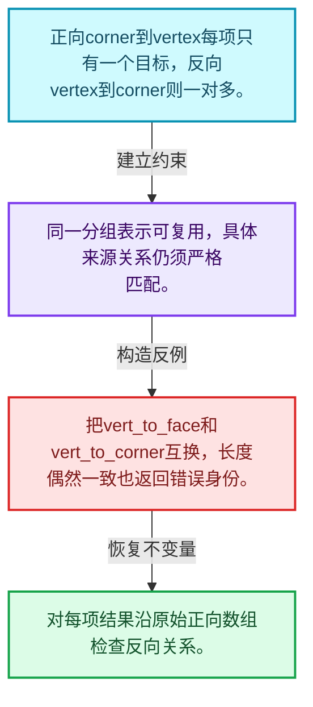
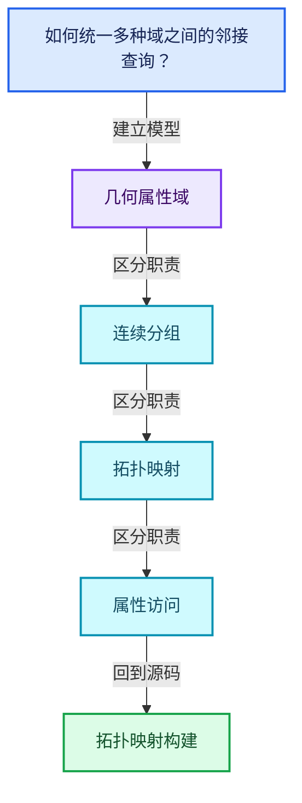
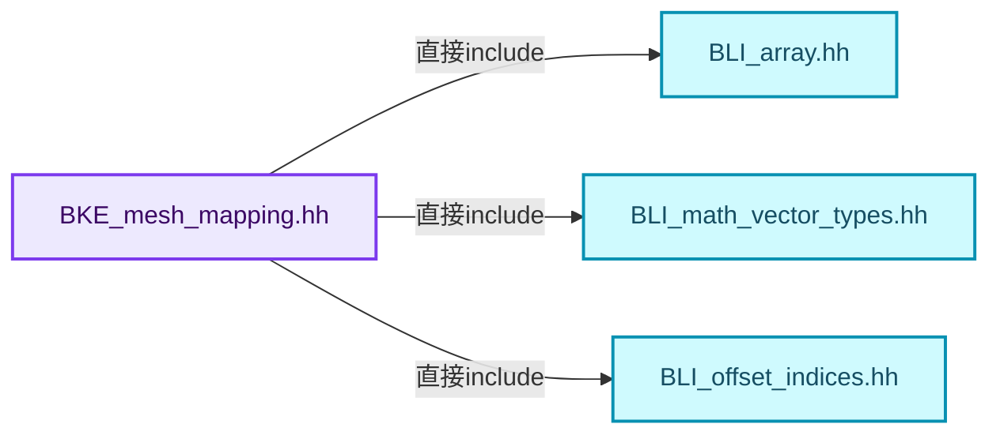
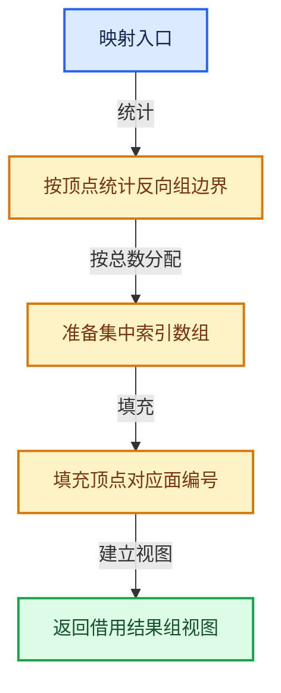
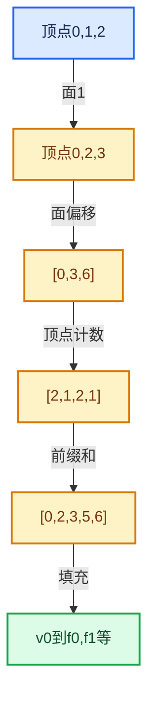

# 05-06 拓扑映射构建

[方向导航](README.md) · [总目录](../README.md) · [覆盖索引](../%E6%BA%90%E7%A0%81%E7%89%88%E6%9C%AC%E4%B8%8E%E8%A6%86%E7%9B%96%E7%B4%A2%E5%BC%95.md)

> 阅读顺序：问题与数据模型 → 语法与类型 → 源码逐行 → 调用线索 → 历史与取舍 → 推演和练习。

- 基准 HEAD：`cbda6b96c26c0dee3c3b5cbb93960c4ac06a6b30`。
- 记录日期：2026-10-14。
- 教学示例状态：正文中的推演不是本机性能实测；已运行练习见验收报告。

## 一、从问题到设计

如何统一多种域之间的邻接查询？

使用一组偏移和一段索引可表达一对多关系；相同长度并不代表不同映射可以互换。

本篇把语法、数据语义和系统取舍连接起来。利用连续性和重复关系选择表示，让冗余状态尽量无法表达。

### 本篇独立模型与设计推理

正向corner到vertex每项只有一个目标，反向vertex到corner则一对多。

设计取舍：同一分组表示可复用，具体来源关系仍须严格匹配。

最小反例：把vert_to_face和vert_to_corner互换，长度偶然一致也返回错误身份。

推导与处理：对每项结果沿原始正向数组检查反向关系。



### 源码范围与相邻篇章

| 文件 | 本篇逐行范围 | 基准SHA-256 |
|---|---|---|
| [source/blender/blenkernel/BKE_mesh_mapping.hh](../../../../../source/blender/blenkernel/BKE_mesh_mapping.hh) | L1—L314 | `e9b9a61c6e370614b7bc60e9a920bfc6cc711101a02b2096aa6763604a973b3e` |
| [source/blender/blenkernel/intern/mesh_mapping.cc](../../../../../source/blender/blenkernel/intern/mesh_mapping.cc) | L1—L962 | `c2432ed6324052eed3ef1e1f9927fa6be2500e5844275498d41919121357aaee` |

同一主讲文件可能分多篇覆盖；超出本篇范围的符号通过覆盖索引定位。空行与纯注释保留在源码摘录中，逐行表解释有效语句与语法边界；许可证头统一保留。

前篇：[邻接关系与前缀和](05-%E9%82%BB%E6%8E%A5%E5%85%B3%E7%B3%BB%E4%B8%8E%E5%89%8D%E7%BC%80%E5%92%8C.md).

后篇：[分组访问与反向索引](07-%E5%88%86%E7%BB%84%E8%AE%BF%E9%97%AE%E4%B8%8E%E5%8F%8D%E5%90%91%E7%B4%A2%E5%BC%95.md).

## 二、类型、数据与阅读地图



这是概念依赖图，边表示阅读关系，不声称是运行时调用顺序。

### 直接编译依赖



箭头只表示头文件包含关系；完整调用线索见后面的符号定位表。

## 三、关键词、语法与类型角色

### 常量求值 constexpr

constexpr声明允许相应实体参与常量求值，但constexpr函数仍可以在运行时执行。是否常量求值由调用场景和表达式合法性共同决定。

具体检查：比较constexpr变量初始化和从运行时输入调用同一函数。

### 只读限定 const

const约束当前访问路径可做的修改。const指针、指向const的指针、const视图对象、const元素是不同位置的限定；其他别名可能仍可修改原对象。

具体检查：分别写T* const、const T*与const T* const，并画出不可修改的层次。

### 异常边界 try与catch

try定义异常传播的局部边界。失败路径需要销毁已经成功构造的部分并释放相应存储；未构造的对象不能被析构。

具体检查：在第k次构造失败，列出已经存在的对象集合与待释放缓冲。

### 显式静态转换 static_cast

static_cast表达编译期允许的转换，不会自动验证运行时真实类型、指针寿命或索引边界。由void指针恢复T指针时，调用者仍须保证实际存储中确有合法T对象。

具体检查：标出转换前后的类型以及正确性依据来自哪里。

### 表示层转换 reinterpret_cast

reinterpret_cast不能自动开始任意对象的生命周期，也不能豁免对齐和别名规则。读这类代码需要追溯原始分配与实际构造操作。

具体检查：分别检查大小、对齐、生命周期和可访问类型，四项不能互相替代。

### 对象表示 sizeof

sizeof给出对象表示大小，不是其引用的所有堆内存总量。sizeof视图很小并不说明底层数组很小。

具体检查：分别统计容器对象、容量字节和元素拥有的间接资源。

### 内部断言 assert

断言表达开发者预期成立的内部契约，发布构建可能关闭。它不能替代对不可信输入的完整错误处理，也不保证后续操作被运行时保护。

具体检查：对每条断言构造违反条件的输入，区分调用者错误与应向用户报告的错误。

### 类型别名 using

类型别名为已有类型建立名字，不创建运行期对象。它常把模板内部使用的类型统一暴露给泛型调用者。

具体检查：展开别名直到基础类型，区分类型别名和变量声明。

### 枚举与状态模型 enum

枚举把有限状态命名；enum class避免许多隐式整数转换。状态机正确性还依赖允许的转移，不能只看有哪些枚举项。

具体检查：列出每个状态的进入条件和离开条件，检查终止状态是否仍可能被调度。

## 四、真实源码与逐行讲解

源码块保持原行内容，原始行号由小节标题及逐行表给出。表中的调用定位是静态阅读辅助；重载、模板实例化、宏展开和虚调用需结合完整声明，不能仅凭词法出现证明动态调用。

### BKE_mesh_mapping.hh：L1—L48

<!-- source:source/blender/blenkernel/BKE_mesh_mapping.hh:1:48 -->

```cpp
/* SPDX-FileCopyrightText: 2001-2002 NaN Holding BV. All rights reserved.
 *
 * SPDX-License-Identifier: GPL-2.0-or-later */
#pragma once

/** \file
 * \ingroup bke
 */

#include "BLI_array.hh"
#include "BLI_math_vector_types.hh"
#include "BLI_offset_indices.hh"

namespace blender {

struct BMLoop;
struct MemArena;

/* UvVertMap */
#define STD_UV_CONNECT_LIMIT 0.0001f

struct UvMapVert {
  UvMapVert *next;
  unsigned int face_index;
  unsigned short loop_of_face_index;
  bool separate;
};

/** Map from UV vertex to face. Used by select linked, UV subdivision-surface and obj exporter. */
struct UvVertMap {
  UvMapVert **vert;
  UvMapVert *buf;
};

/**
 * UvElement stores per uv information so that we can quickly access information for a uv.
 * it is actually an improved UvMapVert, including an island and a direct pointer to the face
 * to avoid initializing face arrays.
 */
struct UvElement {
  /** Next UvElement corresponding to same vertex */
  UvElement *next;
  /** Face the element belongs to */
  BMLoop *l;
  /** Index in loop. */
  unsigned short loop_of_face_index;
  /** Whether this element is the first of coincident elements */
  bool separate;
```

| 原始行 | 语义、约束与检查 |
|---|---|
| L4 | 防止同一头文件在一个翻译单元中重复展开；不控制多个源文件之间的链接或对象寿命。 |
| L10 | 引入编译依赖 "BLI_array.hh"；这是声明可见性关系，不表示运行时一定调用该文件的所有接口。 |
| L11 | 引入编译依赖 "BLI_math_vector_types.hh"；这是声明可见性关系，不表示运行时一定调用该文件的所有接口。 |
| L12 | 引入编译依赖 "BLI_offset_indices.hh"；这是声明可见性关系，不表示运行时一定调用该文件的所有接口。 |
| L14 | 把后续声明放入 blender 命名空间，影响名称查找和符号归属，不创建运行时对象。 |
| L16 | 声明或定义类型 `struct BMLoop`。结合继承、访问权限和成员布局确认接口与拥有关系；前向声明本身没有完整对象布局。 |
| L17 | 声明或定义类型 `struct MemArena`。结合继承、访问权限和成员布局确认接口与拥有关系；前向声明本身没有完整对象布局。 |
| L20 | 预处理阶段处理 #define STD_UV_CONNECT_LIMIT 0.0001f。它决定哪些代码进入编译，不是运行时分支；阅读行为时必须结合实际构建宏。 |
| L22 | 声明或定义类型 `struct UvMapVert`。结合继承、访问权限和成员布局确认接口与拥有关系；前向声明本身没有完整对象布局。 |
| L23 | 声明成员、局部对象或完成语句 `UvMapVert *next`。若为指针或引用，它本身不说明拥有；若为值对象，其构造析构由所在作用域或外层对象管理。 |
| L24 | 声明成员、局部对象或完成语句 `unsigned int face_index`。若为指针或引用，它本身不说明拥有；若为值对象，其构造析构由所在作用域或外层对象管理。 |
| L25 | 声明成员、局部对象或完成语句 `unsigned short loop_of_face_index`。若为指针或引用，它本身不说明拥有；若为值对象，其构造析构由所在作用域或外层对象管理。 |
| L26 | 声明成员、局部对象或完成语句 `bool separate`。若为指针或引用，它本身不说明拥有；若为值对象，其构造析构由所在作用域或外层对象管理。 |
| L27 | 结束当前语法单元。局部自动对象在离开其作用域时按规则销毁；这不等于所有被引用的外部数据也被释放。 |
| L30 | 声明或定义类型 `struct UvVertMap`。结合继承、访问权限和成员布局确认接口与拥有关系；前向声明本身没有完整对象布局。 |
| L31 | 声明成员、局部对象或完成语句 `UvMapVert **vert`。若为指针或引用，它本身不说明拥有；若为值对象，其构造析构由所在作用域或外层对象管理。 |
| L32 | 声明成员、局部对象或完成语句 `UvMapVert *buf`。若为指针或引用，它本身不说明拥有；若为值对象，其构造析构由所在作用域或外层对象管理。 |
| L33 | 结束当前语法单元。局部自动对象在离开其作用域时按规则销毁；这不等于所有被引用的外部数据也被释放。 |
| L40 | 声明或定义类型 `struct UvElement`。结合继承、访问权限和成员布局确认接口与拥有关系；前向声明本身没有完整对象布局。 |
| L42 | 声明成员、局部对象或完成语句 `UvElement *next`。若为指针或引用，它本身不说明拥有；若为值对象，其构造析构由所在作用域或外层对象管理。 |
| L44 | 声明成员、局部对象或完成语句 `BMLoop *l`。若为指针或引用，它本身不说明拥有；若为值对象，其构造析构由所在作用域或外层对象管理。 |
| L46 | 声明成员、局部对象或完成语句 `unsigned short loop_of_face_index`。若为指针或引用，它本身不说明拥有；若为值对象，其构造析构由所在作用域或外层对象管理。 |
| L48 | 声明成员、局部对象或完成语句 `bool separate`。若为指针或引用，它本身不说明拥有；若为值对象，其构造析构由所在作用域或外层对象管理。 |

### BKE_mesh_mapping.hh：L49—L94

<!-- source:source/blender/blenkernel/BKE_mesh_mapping.hh:49:94 -->

```cpp
  /** general use flag. */
  unsigned char flag;
  /** If generating element map with island sorting, this stores the island index */
  unsigned int island;
};

/**
 * UvElementMap is a container for UvElements of a BMesh.
 *
 * It simplifies access to UV information and ensures the
 * different UV selection modes are respected.
 *
 * If islands are calculated, it also stores UvElements
 * belonging to the same uv island in sequence and
 * the number of uvs per island.
 *
 * \note in C++, #head_table and #unique_index_table would
 * be `mutable`, as they are created on demand, and never
 * changed after creation.
 */
struct UvElementMap {
  /** UvElement Storage. */
  UvElement *storage;
  /** Total number of UVs. */
  int total_uvs;
  /** Total number of unique UVs. */
  int total_unique_uvs;

  /** If Non-NULL, address UvElements by `BM_elem_index_get(BMVert*)`. */
  UvElement **vertex;

  /** If Non-NULL, pointer to local head of each unique UV. */
  UvElement **head_table;

  /** If Non-NULL, pointer to index of each unique UV. */
  int *unique_index_table;

  /** Number of islands, or zero if not calculated. */
  int total_islands;
  /** Array of starting index in #storage where each island begins. */
  int *island_indices;
  /** Array of number of UVs in each island. */
  int *island_total_uvs;
  /** Array of number of unique UVs in each island. */
  int *island_total_unique_uvs;
};
```

| 原始行 | 语义、约束与检查 |
|---|---|
| L50 | 声明成员、局部对象或完成语句 `unsigned char flag`。若为指针或引用，它本身不说明拥有；若为值对象，其构造析构由所在作用域或外层对象管理。 |
| L52 | 声明成员、局部对象或完成语句 `unsigned int island`。若为指针或引用，它本身不说明拥有；若为值对象，其构造析构由所在作用域或外层对象管理。 |
| L53 | 结束当前语法单元。局部自动对象在离开其作用域时按规则销毁；这不等于所有被引用的外部数据也被释放。 |
| L69 | 声明或定义类型 `struct UvElementMap`。结合继承、访问权限和成员布局确认接口与拥有关系；前向声明本身没有完整对象布局。 |
| L71 | 声明成员、局部对象或完成语句 `UvElement *storage`。若为指针或引用，它本身不说明拥有；若为值对象，其构造析构由所在作用域或外层对象管理。 |
| L73 | 声明成员、局部对象或完成语句 `int total_uvs`。若为指针或引用，它本身不说明拥有；若为值对象，其构造析构由所在作用域或外层对象管理。 |
| L75 | 声明成员、局部对象或完成语句 `int total_unique_uvs`。若为指针或引用，它本身不说明拥有；若为值对象，其构造析构由所在作用域或外层对象管理。 |
| L78 | 声明成员、局部对象或完成语句 `UvElement **vertex`。若为指针或引用，它本身不说明拥有；若为值对象，其构造析构由所在作用域或外层对象管理。 |
| L81 | 声明成员、局部对象或完成语句 `UvElement **head_table`。若为指针或引用，它本身不说明拥有；若为值对象，其构造析构由所在作用域或外层对象管理。 |
| L84 | 声明成员、局部对象或完成语句 `int *unique_index_table`。若为指针或引用，它本身不说明拥有；若为值对象，其构造析构由所在作用域或外层对象管理。 |
| L87 | 声明成员、局部对象或完成语句 `int total_islands`。若为指针或引用，它本身不说明拥有；若为值对象，其构造析构由所在作用域或外层对象管理。 |
| L89 | 声明成员、局部对象或完成语句 `int *island_indices`。若为指针或引用，它本身不说明拥有；若为值对象，其构造析构由所在作用域或外层对象管理。 |
| L91 | 声明成员、局部对象或完成语句 `int *island_total_uvs`。若为指针或引用，它本身不说明拥有；若为值对象，其构造析构由所在作用域或外层对象管理。 |
| L93 | 声明成员、局部对象或完成语句 `int *island_total_unique_uvs`。若为指针或引用，它本身不说明拥有；若为值对象，其构造析构由所在作用域或外层对象管理。 |
| L94 | 结束当前语法单元。局部自动对象在离开其作用域时按规则销毁；这不等于所有被引用的外部数据也被释放。 |

### BKE_mesh_mapping.hh：L95—L141

<!-- source:source/blender/blenkernel/BKE_mesh_mapping.hh:95:141 -->

```cpp

/* Connectivity data */
struct MeshElemMap {
  int *indices;
  int count;
};

/* mapping */

UvVertMap *BKE_mesh_uv_vert_map_create(OffsetIndices<int> faces,
                                       Span<int> corner_verts,
                                       Span<float2> uv_map,
                                       int verts_num,
                                       const float2 &limit,
                                       bool use_winding);

UvMapVert *BKE_mesh_uv_vert_map_get_vert(UvVertMap *vmap, unsigned int v);
void BKE_mesh_uv_vert_map_free(UvVertMap *vmap);

/**
 * Generates a map where the key is the edge and the value
 * is a list of corner_tris that use that edge.
 * The lists are allocated from one memory pool.
 */
void BKE_mesh_vert_corner_tri_map_create(MeshElemMap **r_map,
                                         int **r_mem,
                                         int totvert,
                                         const int3 *corner_tris,
                                         int tris_num,
                                         const int *corner_verts,
                                         int corners_num);
/**
 * This function creates a map so the source-data (vert/edge/loop/face)
 * can loop over the destination data (using the destination arrays origindex).
 *
 * This has the advantage that it can operate on any data-types.
 *
 * \param totsource: The total number of elements that \a final_origindex points to.
 * \param final_origindex: The size of the final array.
 * \param totfinal: The size of \a final_origindex
 *
 * \note `totsource` could be `faces_num`,
 *       `totfinal` could be `tottessface` and `final_origindex` its ORIGINDEX custom-data.
 *       This would allow a face to loop over its tessfaces.
 */
void BKE_mesh_origindex_map_create(
    MeshElemMap **r_map, int **r_mem, int totsource, const int *final_origindex, int totfinal);
```

| 原始行 | 语义、约束与检查 |
|---|---|
| L97 | 声明或定义类型 `struct MeshElemMap`。结合继承、访问权限和成员布局确认接口与拥有关系；前向声明本身没有完整对象布局。 |
| L98 | 声明成员、局部对象或完成语句 `int *indices`。若为指针或引用，它本身不说明拥有；若为值对象，其构造析构由所在作用域或外层对象管理。 |
| L99 | 声明成员、局部对象或完成语句 `int count`。若为指针或引用，它本身不说明拥有；若为值对象，其构造析构由所在作用域或外层对象管理。 |
| L100 | 结束当前语法单元。局部自动对象在离开其作用域时按规则销毁；这不等于所有被引用的外部数据也被释放。 |
| L104 | 出现调用或函数声明 `BKE_mesh_uv_vert_map_create`，对应表达式为 `UvVertMap *BKE_mesh_uv_vert_map_create(OffsetIndices<int> faces,`。参数求值、返回类型与重载需结合前后完整语句；静态文本引用不能证明动态目标。 |
| L105 | 本行是连续声明或表达式的一部分：`Span<int> corner_verts,`。与本段前后行合读；逗号、括号和限定符决定它属于参数、初始化列表还是实际计算。 |
| L106 | 本行是连续声明或表达式的一部分：`Span<float2> uv_map,`。与本段前后行合读；逗号、括号和限定符决定它属于参数、初始化列表还是实际计算。 |
| L107 | 本行是连续声明或表达式的一部分：`int verts_num,`。与本段前后行合读；逗号、括号和限定符决定它属于参数、初始化列表还是实际计算。 |
| L108 | 本行是连续声明或表达式的一部分：`const float2 &limit,`。与本段前后行合读；逗号、括号和限定符决定它属于参数、初始化列表还是实际计算。 |
| L109 | 声明成员、局部对象或完成语句 `bool use_winding)`。若为指针或引用，它本身不说明拥有；若为值对象，其构造析构由所在作用域或外层对象管理。 |
| L111 | 出现调用或函数声明 `BKE_mesh_uv_vert_map_get_vert`，对应表达式为 `UvMapVert *BKE_mesh_uv_vert_map_get_vert(UvVertMap *vmap, unsigned int v);`。参数求值、返回类型与重载需结合前后完整语句；静态文本引用不能证明动态目标。 |
| L112 | 声明接口 `void BKE_mesh_uv_vert_map_free(UvVertMap *vmap)`，本行没有对应函数体；返回类型、参数限定和const/noexcept共同组成调用契约，实际行为需继续定位实现。 |
| L119 | 出现调用或函数声明 `BKE_mesh_vert_corner_tri_map_create`，对应表达式为 `void BKE_mesh_vert_corner_tri_map_create(MeshElemMap **r_map,`。参数求值、返回类型与重载需结合前后完整语句；静态文本引用不能证明动态目标。 |
| L120 | 本行是连续声明或表达式的一部分：`int **r_mem,`。与本段前后行合读；逗号、括号和限定符决定它属于参数、初始化列表还是实际计算。 |
| L121 | 本行是连续声明或表达式的一部分：`int totvert,`。与本段前后行合读；逗号、括号和限定符决定它属于参数、初始化列表还是实际计算。 |
| L122 | 本行是连续声明或表达式的一部分：`const int3 *corner_tris,`。与本段前后行合读；逗号、括号和限定符决定它属于参数、初始化列表还是实际计算。 |
| L123 | 本行是连续声明或表达式的一部分：`int tris_num,`。与本段前后行合读；逗号、括号和限定符决定它属于参数、初始化列表还是实际计算。 |
| L124 | 本行是连续声明或表达式的一部分：`const int *corner_verts,`。与本段前后行合读；逗号、括号和限定符决定它属于参数、初始化列表还是实际计算。 |
| L125 | 声明成员、局部对象或完成语句 `int corners_num)`。若为指针或引用，它本身不说明拥有；若为值对象，其构造析构由所在作用域或外层对象管理。 |
| L140 | 出现调用或函数声明 `BKE_mesh_origindex_map_create`，对应表达式为 `void BKE_mesh_origindex_map_create(`。参数求值、返回类型与重载需结合前后完整语句；静态文本引用不能证明动态目标。 |
| L141 | 声明成员、局部对象或完成语句 `MeshElemMap **r_map, int **r_mem, int totsource, const int *final_origindex, int totfinal)`。若为指针或引用，它本身不说明拥有；若为值对象，其构造析构由所在作用域或外层对象管理。 |

### BKE_mesh_mapping.hh：L142—L192

<!-- source:source/blender/blenkernel/BKE_mesh_mapping.hh:142:192 -->

```cpp
/**
 * A version of #BKE_mesh_origindex_map_create that takes a corner tri array.
 * Making a face -> corner tri map.
 */
void BKE_mesh_origindex_map_create_corner_tri(MeshElemMap **r_map,
                                              int **r_mem,
                                              OffsetIndices<int> faces,
                                              const int *corner_tri_faces,
                                              int corner_tris_num);

/* islands */

/* Loop islands data helpers. */
enum {
  MISLAND_TYPE_NONE = 0,
  MISLAND_TYPE_VERT = 1,
  MISLAND_TYPE_EDGE = 2,
  MISLAND_TYPE_POLY = 3,
  MISLAND_TYPE_LOOP = 4,
};

struct MeshIslandStore {
  short item_type;     /* MISLAND_TYPE_... */
  short island_type;   /* MISLAND_TYPE_... */
  short innercut_type; /* MISLAND_TYPE_... */

  int items_to_islands_num;
  int *items_to_islands; /* map the item to the island index */

  int islands_num;
  size_t islands_num_alloc;
  MeshElemMap **islands;   /* Array of pointers, one item per island. */
  MeshElemMap **innercuts; /* Array of pointers, one item per island. */

  MemArena *mem; /* Memory arena, internal use only. */
};

void BKE_mesh_loop_islands_init(MeshIslandStore *island_store,
                                short item_type,
                                int items_num,
                                short island_type,
                                short innercut_type);
void BKE_mesh_loop_islands_clear(MeshIslandStore *island_store);
void BKE_mesh_loop_islands_free(MeshIslandStore *island_store);
void BKE_mesh_loop_islands_add(MeshIslandStore *island_store,
                               int item_num,
                               const int *items_indices,
                               int num_island_items,
                               int *island_item_indices,
                               int num_innercut_items,
                               int *innercut_item_indices);
```

| 原始行 | 语义、约束与检查 |
|---|---|
| L146 | 出现调用或函数声明 `BKE_mesh_origindex_map_create_corner_tri`，对应表达式为 `void BKE_mesh_origindex_map_create_corner_tri(MeshElemMap **r_map,`。参数求值、返回类型与重载需结合前后完整语句；静态文本引用不能证明动态目标。 |
| L147 | 本行是连续声明或表达式的一部分：`int **r_mem,`。与本段前后行合读；逗号、括号和限定符决定它属于参数、初始化列表还是实际计算。 |
| L148 | 本行是连续声明或表达式的一部分：`OffsetIndices<int> faces,`。与本段前后行合读；逗号、括号和限定符决定它属于参数、初始化列表还是实际计算。 |
| L149 | 本行是连续声明或表达式的一部分：`const int *corner_tri_faces,`。与本段前后行合读；逗号、括号和限定符决定它属于参数、初始化列表还是实际计算。 |
| L150 | 声明成员、局部对象或完成语句 `int corner_tris_num)`。若为指针或引用，它本身不说明拥有；若为值对象，其构造析构由所在作用域或外层对象管理。 |
| L155 | 声明或定义类型 `enum`。结合继承、访问权限和成员布局确认接口与拥有关系；前向声明本身没有完整对象布局。 |
| L156 | 把右侧 `0,` 用于初始化或更新左侧 `MISLAND_TYPE_NONE`。声明初始化与已有对象赋值应按上下文区分；有资源的类型会调用相应特殊成员。 |
| L157 | 把右侧 `1,` 用于初始化或更新左侧 `MISLAND_TYPE_VERT`。声明初始化与已有对象赋值应按上下文区分；有资源的类型会调用相应特殊成员。 |
| L158 | 把右侧 `2,` 用于初始化或更新左侧 `MISLAND_TYPE_EDGE`。声明初始化与已有对象赋值应按上下文区分；有资源的类型会调用相应特殊成员。 |
| L159 | 把右侧 `3,` 用于初始化或更新左侧 `MISLAND_TYPE_POLY`。声明初始化与已有对象赋值应按上下文区分；有资源的类型会调用相应特殊成员。 |
| L160 | 把右侧 `4,` 用于初始化或更新左侧 `MISLAND_TYPE_LOOP`。声明初始化与已有对象赋值应按上下文区分；有资源的类型会调用相应特殊成员。 |
| L161 | 结束当前语法单元。局部自动对象在离开其作用域时按规则销毁；这不等于所有被引用的外部数据也被释放。 |
| L163 | 声明或定义类型 `struct MeshIslandStore`。结合继承、访问权限和成员布局确认接口与拥有关系；前向声明本身没有完整对象布局。 |
| L164 | 声明成员、局部对象或完成语句 `short item_type`。若为指针或引用，它本身不说明拥有；若为值对象，其构造析构由所在作用域或外层对象管理。 |
| L165 | 声明成员、局部对象或完成语句 `short island_type`。若为指针或引用，它本身不说明拥有；若为值对象，其构造析构由所在作用域或外层对象管理。 |
| L166 | 声明成员、局部对象或完成语句 `short innercut_type`。若为指针或引用，它本身不说明拥有；若为值对象，其构造析构由所在作用域或外层对象管理。 |
| L168 | 声明成员、局部对象或完成语句 `int items_to_islands_num`。若为指针或引用，它本身不说明拥有；若为值对象，其构造析构由所在作用域或外层对象管理。 |
| L169 | 声明成员、局部对象或完成语句 `int *items_to_islands`。若为指针或引用，它本身不说明拥有；若为值对象，其构造析构由所在作用域或外层对象管理。 |
| L171 | 声明成员、局部对象或完成语句 `int islands_num`。若为指针或引用，它本身不说明拥有；若为值对象，其构造析构由所在作用域或外层对象管理。 |
| L172 | 声明成员、局部对象或完成语句 `size_t islands_num_alloc`。若为指针或引用，它本身不说明拥有；若为值对象，其构造析构由所在作用域或外层对象管理。 |
| L173 | 声明成员、局部对象或完成语句 `MeshElemMap **islands`。若为指针或引用，它本身不说明拥有；若为值对象，其构造析构由所在作用域或外层对象管理。 |
| L174 | 声明成员、局部对象或完成语句 `MeshElemMap **innercuts`。若为指针或引用，它本身不说明拥有；若为值对象，其构造析构由所在作用域或外层对象管理。 |
| L176 | 声明成员、局部对象或完成语句 `MemArena *mem`。若为指针或引用，它本身不说明拥有；若为值对象，其构造析构由所在作用域或外层对象管理。 |
| L177 | 结束当前语法单元。局部自动对象在离开其作用域时按规则销毁；这不等于所有被引用的外部数据也被释放。 |
| L179 | 出现调用或函数声明 `BKE_mesh_loop_islands_init`，对应表达式为 `void BKE_mesh_loop_islands_init(MeshIslandStore *island_store,`。参数求值、返回类型与重载需结合前后完整语句；静态文本引用不能证明动态目标。 |
| L180 | 本行是连续声明或表达式的一部分：`short item_type,`。与本段前后行合读；逗号、括号和限定符决定它属于参数、初始化列表还是实际计算。 |
| L181 | 本行是连续声明或表达式的一部分：`int items_num,`。与本段前后行合读；逗号、括号和限定符决定它属于参数、初始化列表还是实际计算。 |
| L182 | 本行是连续声明或表达式的一部分：`short island_type,`。与本段前后行合读；逗号、括号和限定符决定它属于参数、初始化列表还是实际计算。 |
| L183 | 声明成员、局部对象或完成语句 `short innercut_type)`。若为指针或引用，它本身不说明拥有；若为值对象，其构造析构由所在作用域或外层对象管理。 |
| L184 | 声明接口 `void BKE_mesh_loop_islands_clear(MeshIslandStore *island_store)`，本行没有对应函数体；返回类型、参数限定和const/noexcept共同组成调用契约，实际行为需继续定位实现。 |
| L185 | 声明接口 `void BKE_mesh_loop_islands_free(MeshIslandStore *island_store)`，本行没有对应函数体；返回类型、参数限定和const/noexcept共同组成调用契约，实际行为需继续定位实现。 |
| L186 | 出现调用或函数声明 `BKE_mesh_loop_islands_add`，对应表达式为 `void BKE_mesh_loop_islands_add(MeshIslandStore *island_store,`。参数求值、返回类型与重载需结合前后完整语句；静态文本引用不能证明动态目标。 |
| L187 | 本行是连续声明或表达式的一部分：`int item_num,`。与本段前后行合读；逗号、括号和限定符决定它属于参数、初始化列表还是实际计算。 |
| L188 | 本行是连续声明或表达式的一部分：`const int *items_indices,`。与本段前后行合读；逗号、括号和限定符决定它属于参数、初始化列表还是实际计算。 |
| L189 | 本行是连续声明或表达式的一部分：`int num_island_items,`。与本段前后行合读；逗号、括号和限定符决定它属于参数、初始化列表还是实际计算。 |
| L190 | 本行是连续声明或表达式的一部分：`int *island_item_indices,`。与本段前后行合读；逗号、括号和限定符决定它属于参数、初始化列表还是实际计算。 |
| L191 | 本行是连续声明或表达式的一部分：`int num_innercut_items,`。与本段前后行合读；逗号、括号和限定符决定它属于参数、初始化列表还是实际计算。 |
| L192 | 声明成员、局部对象或完成语句 `int *innercut_item_indices)`。若为指针或引用，它本身不说明拥有；若为值对象，其构造析构由所在作用域或外层对象管理。 |

### BKE_mesh_mapping.hh：L193—L233

<!-- source:source/blender/blenkernel/BKE_mesh_mapping.hh:193:233 -->

```cpp

using MeshRemapIslandsCalc = bool (*)(Span<float3> vert_positions,
                                      Span<int2> edges,
                                      Span<bool> uv_seams,
                                      OffsetIndices<int> faces,
                                      Span<int> corner_verts,
                                      Span<int> corner_edges,
                                      MeshIslandStore *r_island_store);

/* Above vert/UV mapping stuff does not do what we need here, but does things we do not need here.
 * So better keep them separated for now, I think. */

/**
 * Calculate 'generic' UV islands, i.e. based only on actual geometry data (edge seams),
 * not some UV layers coordinates.
 *
 * \param uv_seams: Optional (possibly empty) span.
 */
bool BKE_mesh_calc_islands_loop_face_edgeseam(Span<float3> vert_positions,
                                              Span<int2> edges,
                                              Span<bool> uv_seams,
                                              OffsetIndices<int> faces,
                                              Span<int> corner_verts,
                                              Span<int> corner_edges,
                                              MeshIslandStore *r_island_store);

/**
 * Calculate smooth groups from sharp edges, using increasing numbers as identifier for each group.
 *
 * \param sharp_edges: Optional (possibly empty) span.
 * \param sharp_faces: Optional (possibly empty) span.
 * \param r_totgroup: The total number of groups, 1 or more.
 * \return Face aligned array of group index values, starting at 1 (0 being used as 'invalid'
 * flag). Note that it's the callers responsibility to MEM_delete the returned array.
 */
int *BKE_mesh_calc_smoothgroups(int edges_num,
                                OffsetIndices<int> faces,
                                Span<int> corner_edges,
                                Span<bool> sharp_edges,
                                Span<bool> sharp_faces,
                                int *r_totgroup);
```

| 原始行 | 语义、约束与检查 |
|---|---|
| L194 | 定义类型别名 `using MeshRemapIslandsCalc = bool (*)(Span<float3> vert_positions,`，为模板接口或内部实现统一命名；本行不分配该类型对象。 |
| L195 | 本行是连续声明或表达式的一部分：`Span<int2> edges,`。与本段前后行合读；逗号、括号和限定符决定它属于参数、初始化列表还是实际计算。 |
| L196 | 本行是连续声明或表达式的一部分：`Span<bool> uv_seams,`。与本段前后行合读；逗号、括号和限定符决定它属于参数、初始化列表还是实际计算。 |
| L197 | 本行是连续声明或表达式的一部分：`OffsetIndices<int> faces,`。与本段前后行合读；逗号、括号和限定符决定它属于参数、初始化列表还是实际计算。 |
| L198 | 本行是连续声明或表达式的一部分：`Span<int> corner_verts,`。与本段前后行合读；逗号、括号和限定符决定它属于参数、初始化列表还是实际计算。 |
| L199 | 本行是连续声明或表达式的一部分：`Span<int> corner_edges,`。与本段前后行合读；逗号、括号和限定符决定它属于参数、初始化列表还是实际计算。 |
| L200 | 声明成员、局部对象或完成语句 `MeshIslandStore *r_island_store)`。若为指针或引用，它本身不说明拥有；若为值对象，其构造析构由所在作用域或外层对象管理。 |
| L211 | 出现调用或函数声明 `BKE_mesh_calc_islands_loop_face_edgeseam`，对应表达式为 `bool BKE_mesh_calc_islands_loop_face_edgeseam(Span<float3> vert_positions,`。参数求值、返回类型与重载需结合前后完整语句；静态文本引用不能证明动态目标。 |
| L212 | 本行是连续声明或表达式的一部分：`Span<int2> edges,`。与本段前后行合读；逗号、括号和限定符决定它属于参数、初始化列表还是实际计算。 |
| L213 | 本行是连续声明或表达式的一部分：`Span<bool> uv_seams,`。与本段前后行合读；逗号、括号和限定符决定它属于参数、初始化列表还是实际计算。 |
| L214 | 本行是连续声明或表达式的一部分：`OffsetIndices<int> faces,`。与本段前后行合读；逗号、括号和限定符决定它属于参数、初始化列表还是实际计算。 |
| L215 | 本行是连续声明或表达式的一部分：`Span<int> corner_verts,`。与本段前后行合读；逗号、括号和限定符决定它属于参数、初始化列表还是实际计算。 |
| L216 | 本行是连续声明或表达式的一部分：`Span<int> corner_edges,`。与本段前后行合读；逗号、括号和限定符决定它属于参数、初始化列表还是实际计算。 |
| L217 | 声明成员、局部对象或完成语句 `MeshIslandStore *r_island_store)`。若为指针或引用，它本身不说明拥有；若为值对象，其构造析构由所在作用域或外层对象管理。 |
| L228 | 出现调用或函数声明 `BKE_mesh_calc_smoothgroups`，对应表达式为 `int *BKE_mesh_calc_smoothgroups(int edges_num,`。参数求值、返回类型与重载需结合前后完整语句；静态文本引用不能证明动态目标。 |
| L229 | 本行是连续声明或表达式的一部分：`OffsetIndices<int> faces,`。与本段前后行合读；逗号、括号和限定符决定它属于参数、初始化列表还是实际计算。 |
| L230 | 本行是连续声明或表达式的一部分：`Span<int> corner_edges,`。与本段前后行合读；逗号、括号和限定符决定它属于参数、初始化列表还是实际计算。 |
| L231 | 本行是连续声明或表达式的一部分：`Span<bool> sharp_edges,`。与本段前后行合读；逗号、括号和限定符决定它属于参数、初始化列表还是实际计算。 |
| L232 | 本行是连续声明或表达式的一部分：`Span<bool> sharp_faces,`。与本段前后行合读；逗号、括号和限定符决定它属于参数、初始化列表还是实际计算。 |
| L233 | 声明成员、局部对象或完成语句 `int *r_totgroup)`。若为指针或引用，它本身不说明拥有；若为值对象，其构造析构由所在作用域或外层对象管理。 |

### BKE_mesh_mapping.hh：L234—L279

<!-- source:source/blender/blenkernel/BKE_mesh_mapping.hh:234:279 -->

```cpp
/**
 * Same as #BKE_mesh_calc_smoothgroups, but use bit-flags instead of increasing numbers for each
 * group.
 *
 * This means that the same value (bit) can be re-used for different groups, as long as they are
 * not neighbors. Values of each group are always powers of two.
 *
 * By default, only groups that share a same sharp edge are considered neighbors, and therefore
 * prevented to use the same bit-flag value.
 *
 * If #use_boundary_vertices_for_bitflags is set to `true`, then groups are also considered
 * neighbors (and therefore cannot have the same bit-flag value) if they share a single vertex,
 * even if they have no common edge. This behavior seems to be required by some DCCs to recompute
 * correct normals, see e.g. #104434. It will however make it much more likely to run out of
 * available bits with certain types of topology (e.g. large fans of sharp faces).
 *
 * \param sharp_edges: Optional (possibly empty) span.
 * \param sharp_faces: Optional (possibly empty) span.
 * \param r_totgroup: The total number of groups, 1 or more.
 * \return Face aligned array of group bit-flags values (i.e. always powers of 2), starting at 1 (0
 * being used as 'invalid' flag). Note that it's the callers responsibility to MEM_delete the
 * returned array.
 */
int *BKE_mesh_calc_smoothgroups_bitflags(int edges_num,
                                         int verts_num,
                                         OffsetIndices<int> faces,
                                         Span<int> corner_edges,
                                         Span<int> corner_verts,
                                         Span<bool> sharp_edges,
                                         Span<bool> sharp_faces,
                                         bool use_boundary_vertices_for_bitflags,
                                         int *r_totgroup);

/* Use on corner_tri vertex values. */
#define BKE_MESH_TESSTRI_VINDEX_ORDER(_tri, _v) \
  ((CHECK_TYPE_ANY( \
        _tri, unsigned int *, int *, int[3], const unsigned int *, const int *, const int[3]), \
    CHECK_TYPE_ANY(_v, unsigned int, const unsigned int, int, const int)), \
   (((_tri)[0] == _v) ? 0 : \
    ((_tri)[1] == _v) ? 1 : \
    ((_tri)[2] == _v) ? 2 : \
                        -1))

namespace bke::mesh {

Array<int> build_corner_to_face_map(OffsetIndices<int> faces);
```

| 原始行 | 语义、约束与检查 |
|---|---|
| L257 | 出现调用或函数声明 `BKE_mesh_calc_smoothgroups_bitflags`，对应表达式为 `int *BKE_mesh_calc_smoothgroups_bitflags(int edges_num,`。参数求值、返回类型与重载需结合前后完整语句；静态文本引用不能证明动态目标。 |
| L258 | 本行是连续声明或表达式的一部分：`int verts_num,`。与本段前后行合读；逗号、括号和限定符决定它属于参数、初始化列表还是实际计算。 |
| L259 | 本行是连续声明或表达式的一部分：`OffsetIndices<int> faces,`。与本段前后行合读；逗号、括号和限定符决定它属于参数、初始化列表还是实际计算。 |
| L260 | 本行是连续声明或表达式的一部分：`Span<int> corner_edges,`。与本段前后行合读；逗号、括号和限定符决定它属于参数、初始化列表还是实际计算。 |
| L261 | 本行是连续声明或表达式的一部分：`Span<int> corner_verts,`。与本段前后行合读；逗号、括号和限定符决定它属于参数、初始化列表还是实际计算。 |
| L262 | 本行是连续声明或表达式的一部分：`Span<bool> sharp_edges,`。与本段前后行合读；逗号、括号和限定符决定它属于参数、初始化列表还是实际计算。 |
| L263 | 本行是连续声明或表达式的一部分：`Span<bool> sharp_faces,`。与本段前后行合读；逗号、括号和限定符决定它属于参数、初始化列表还是实际计算。 |
| L264 | 本行是连续声明或表达式的一部分：`bool use_boundary_vertices_for_bitflags,`。与本段前后行合读；逗号、括号和限定符决定它属于参数、初始化列表还是实际计算。 |
| L265 | 声明成员、局部对象或完成语句 `int *r_totgroup)`。若为指针或引用，它本身不说明拥有；若为值对象，其构造析构由所在作用域或外层对象管理。 |
| L268 | 预处理阶段处理 #define BKE_MESH_TESSTRI_VINDEX_ORDER(_tri, _v) \。它决定哪些代码进入编译，不是运行时分支；阅读行为时必须结合实际构建宏。 |
| L269 | 出现调用或函数声明 `CHECK_TYPE_ANY`，对应表达式为 `((CHECK_TYPE_ANY( \`。参数求值、返回类型与重载需结合前后完整语句；静态文本引用不能证明动态目标。 |
| L270 | 本行是连续声明或表达式的一部分：`_tri, unsigned int *, int *, int[3], const unsigned int *, const int *, const int[3]), \`。与本段前后行合读；逗号、括号和限定符决定它属于参数、初始化列表还是实际计算。 |
| L271 | 出现调用或函数声明 `CHECK_TYPE_ANY`，对应表达式为 `CHECK_TYPE_ANY(_v, unsigned int, const unsigned int, int, const int)), \`。参数求值、返回类型与重载需结合前后完整语句；静态文本引用不能证明动态目标。 |
| L272 | 本行是连续声明或表达式的一部分：`(((_tri)[0] == _v) ? 0 : \`。与本段前后行合读；逗号、括号和限定符决定它属于参数、初始化列表还是实际计算。 |
| L273 | 本行是连续声明或表达式的一部分：`((_tri)[1] == _v) ? 1 : \`。与本段前后行合读；逗号、括号和限定符决定它属于参数、初始化列表还是实际计算。 |
| L274 | 本行是连续声明或表达式的一部分：`((_tri)[2] == _v) ? 2 : \`。与本段前后行合读；逗号、括号和限定符决定它属于参数、初始化列表还是实际计算。 |
| L275 | 本行是连续声明或表达式的一部分：`-1))`。与本段前后行合读；逗号、括号和限定符决定它属于参数、初始化列表还是实际计算。 |
| L277 | 把后续声明放入 bke::mesh 命名空间，影响名称查找和符号归属，不创建运行时对象。 |
| L279 | 出现调用或函数声明 `build_corner_to_face_map`，对应表达式为 `Array<int> build_corner_to_face_map(OffsetIndices<int> faces);`。参数求值、返回类型与重载需结合前后完整语句；静态文本引用不能证明动态目标。 |

### BKE_mesh_mapping.hh：L280—L314

<!-- source:source/blender/blenkernel/BKE_mesh_mapping.hh:280:314 -->

```cpp

GroupedSpan<int> build_vert_to_edge_map(Span<int2> edges,
                                        int verts_num,
                                        Array<int> &r_offsets,
                                        Array<int> &r_indices);

void build_vert_to_face_indices(OffsetIndices<int> faces,
                                Span<int> corner_verts,
                                OffsetIndices<int> offsets,
                                MutableSpan<int> face_indices);
GroupedSpan<int> build_vert_to_face_map(OffsetIndices<int> faces,
                                        Span<int> corner_verts,
                                        int verts_num,
                                        Array<int> &r_offsets,
                                        Array<int> &r_indices);

Array<int> build_vert_to_corner_indices(Span<int> corner_verts, OffsetIndices<int> offsets);
GroupedSpan<int> build_vert_to_corner_map(Span<int> corner_verts,
                                          int verts_num,
                                          Array<int> &r_offsets,
                                          Array<int> &r_indices);

GroupedSpan<int> build_edge_to_corner_map(Span<int> corner_edges,
                                          int edges_num,
                                          Array<int> &r_offsets,
                                          Array<int> &r_indices);

GroupedSpan<int> build_edge_to_face_map(OffsetIndices<int> faces,
                                        Span<int> corner_edges,
                                        int edges_num,
                                        Array<int> &r_offsets,
                                        Array<int> &r_indices);

}  // namespace bke::mesh
}  // namespace blender
```

| 原始行 | 语义、约束与检查 |
|---|---|
| L281 | 出现调用或函数声明 `build_vert_to_edge_map`，对应表达式为 `GroupedSpan<int> build_vert_to_edge_map(Span<int2> edges,`。参数求值、返回类型与重载需结合前后完整语句；静态文本引用不能证明动态目标。 |
| L282 | 本行是连续声明或表达式的一部分：`int verts_num,`。与本段前后行合读；逗号、括号和限定符决定它属于参数、初始化列表还是实际计算。 |
| L283 | 本行是连续声明或表达式的一部分：`Array<int> &r_offsets,`。与本段前后行合读；逗号、括号和限定符决定它属于参数、初始化列表还是实际计算。 |
| L284 | 声明成员、局部对象或完成语句 `Array<int> &r_indices)`。若为指针或引用，它本身不说明拥有；若为值对象，其构造析构由所在作用域或外层对象管理。 |
| L286 | 出现调用或函数声明 `build_vert_to_face_indices`，对应表达式为 `void build_vert_to_face_indices(OffsetIndices<int> faces,`。参数求值、返回类型与重载需结合前后完整语句；静态文本引用不能证明动态目标。 |
| L287 | 本行是连续声明或表达式的一部分：`Span<int> corner_verts,`。与本段前后行合读；逗号、括号和限定符决定它属于参数、初始化列表还是实际计算。 |
| L288 | 本行是连续声明或表达式的一部分：`OffsetIndices<int> offsets,`。与本段前后行合读；逗号、括号和限定符决定它属于参数、初始化列表还是实际计算。 |
| L289 | 声明成员、局部对象或完成语句 `MutableSpan<int> face_indices)`。若为指针或引用，它本身不说明拥有；若为值对象，其构造析构由所在作用域或外层对象管理。 |
| L290 | 出现调用或函数声明 `build_vert_to_face_map`，对应表达式为 `GroupedSpan<int> build_vert_to_face_map(OffsetIndices<int> faces,`。参数求值、返回类型与重载需结合前后完整语句；静态文本引用不能证明动态目标。 |
| L291 | 本行是连续声明或表达式的一部分：`Span<int> corner_verts,`。与本段前后行合读；逗号、括号和限定符决定它属于参数、初始化列表还是实际计算。 |
| L292 | 本行是连续声明或表达式的一部分：`int verts_num,`。与本段前后行合读；逗号、括号和限定符决定它属于参数、初始化列表还是实际计算。 |
| L293 | 本行是连续声明或表达式的一部分：`Array<int> &r_offsets,`。与本段前后行合读；逗号、括号和限定符决定它属于参数、初始化列表还是实际计算。 |
| L294 | 声明成员、局部对象或完成语句 `Array<int> &r_indices)`。若为指针或引用，它本身不说明拥有；若为值对象，其构造析构由所在作用域或外层对象管理。 |
| L296 | 出现调用或函数声明 `build_vert_to_corner_indices`，对应表达式为 `Array<int> build_vert_to_corner_indices(Span<int> corner_verts, OffsetIndices<int> offsets);`。参数求值、返回类型与重载需结合前后完整语句；静态文本引用不能证明动态目标。 |
| L297 | 出现调用或函数声明 `build_vert_to_corner_map`，对应表达式为 `GroupedSpan<int> build_vert_to_corner_map(Span<int> corner_verts,`。参数求值、返回类型与重载需结合前后完整语句；静态文本引用不能证明动态目标。 |
| L298 | 本行是连续声明或表达式的一部分：`int verts_num,`。与本段前后行合读；逗号、括号和限定符决定它属于参数、初始化列表还是实际计算。 |
| L299 | 本行是连续声明或表达式的一部分：`Array<int> &r_offsets,`。与本段前后行合读；逗号、括号和限定符决定它属于参数、初始化列表还是实际计算。 |
| L300 | 声明成员、局部对象或完成语句 `Array<int> &r_indices)`。若为指针或引用，它本身不说明拥有；若为值对象，其构造析构由所在作用域或外层对象管理。 |
| L302 | 出现调用或函数声明 `build_edge_to_corner_map`，对应表达式为 `GroupedSpan<int> build_edge_to_corner_map(Span<int> corner_edges,`。参数求值、返回类型与重载需结合前后完整语句；静态文本引用不能证明动态目标。 |
| L303 | 本行是连续声明或表达式的一部分：`int edges_num,`。与本段前后行合读；逗号、括号和限定符决定它属于参数、初始化列表还是实际计算。 |
| L304 | 本行是连续声明或表达式的一部分：`Array<int> &r_offsets,`。与本段前后行合读；逗号、括号和限定符决定它属于参数、初始化列表还是实际计算。 |
| L305 | 声明成员、局部对象或完成语句 `Array<int> &r_indices)`。若为指针或引用，它本身不说明拥有；若为值对象，其构造析构由所在作用域或外层对象管理。 |
| L307 | 出现调用或函数声明 `build_edge_to_face_map`，对应表达式为 `GroupedSpan<int> build_edge_to_face_map(OffsetIndices<int> faces,`。参数求值、返回类型与重载需结合前后完整语句；静态文本引用不能证明动态目标。 |
| L308 | 本行是连续声明或表达式的一部分：`Span<int> corner_edges,`。与本段前后行合读；逗号、括号和限定符决定它属于参数、初始化列表还是实际计算。 |
| L309 | 本行是连续声明或表达式的一部分：`int edges_num,`。与本段前后行合读；逗号、括号和限定符决定它属于参数、初始化列表还是实际计算。 |
| L310 | 本行是连续声明或表达式的一部分：`Array<int> &r_offsets,`。与本段前后行合读；逗号、括号和限定符决定它属于参数、初始化列表还是实际计算。 |
| L311 | 声明成员、局部对象或完成语句 `Array<int> &r_indices)`。若为指针或引用，它本身不说明拥有；若为值对象，其构造析构由所在作用域或外层对象管理。 |
| L313 | 结束当前语法单元。局部自动对象在离开其作用域时按规则销毁；这不等于所有被引用的外部数据也被释放。 |
| L314 | 结束当前语法单元。局部自动对象在离开其作用域时按规则销毁；这不等于所有被引用的外部数据也被释放。 |

### mesh_mapping.cc：L1—L29

<!-- source:source/blender/blenkernel/intern/mesh_mapping.cc:1:29 -->

```cpp
/* SPDX-FileCopyrightText: 2023 Blender Authors
 *
 * SPDX-License-Identifier: GPL-2.0-or-later */

/** \file
 * \ingroup bke
 *
 * Functions for accessing mesh connectivity data.
 * eg: faces connected to verts, UVs connected to verts.
 */

#include <algorithm>

#include "MEM_guardedalloc.h"

#include "BLI_array.hh"
#include "BLI_bitmap.hh"
#include "BLI_function_ref.hh"
#include "BLI_math_geom_c.hh"
#include "BLI_math_vector_c.hh"
#include "BLI_task.hh"
#include "BLI_utildefines.hh"

#include "BKE_customdata.hh"
#include "BKE_mesh.hh"
#include "BKE_mesh_mapping.hh"
#include "BLI_memarena.hh"

#include "BLI_strict_flags.hh" /* IWYU pragma: keep. Keep last. */
```

| 原始行 | 语义、约束与检查 |
|---|---|
| L12 | 引入编译依赖 <algorithm>；这是声明可见性关系，不表示运行时一定调用该文件的所有接口。 |
| L14 | 引入编译依赖 "MEM_guardedalloc.h"；这是声明可见性关系，不表示运行时一定调用该文件的所有接口。 |
| L16 | 引入编译依赖 "BLI_array.hh"；这是声明可见性关系，不表示运行时一定调用该文件的所有接口。 |
| L17 | 引入编译依赖 "BLI_bitmap.hh"；这是声明可见性关系，不表示运行时一定调用该文件的所有接口。 |
| L18 | 引入编译依赖 "BLI_function_ref.hh"；这是声明可见性关系，不表示运行时一定调用该文件的所有接口。 |
| L19 | 引入编译依赖 "BLI_math_geom_c.hh"；这是声明可见性关系，不表示运行时一定调用该文件的所有接口。 |
| L20 | 引入编译依赖 "BLI_math_vector_c.hh"；这是声明可见性关系，不表示运行时一定调用该文件的所有接口。 |
| L21 | 引入编译依赖 "BLI_task.hh"；这是声明可见性关系，不表示运行时一定调用该文件的所有接口。 |
| L22 | 引入编译依赖 "BLI_utildefines.hh"；这是声明可见性关系，不表示运行时一定调用该文件的所有接口。 |
| L24 | 引入编译依赖 "BKE_customdata.hh"；这是声明可见性关系，不表示运行时一定调用该文件的所有接口。 |
| L25 | 引入编译依赖 "BKE_mesh.hh"；这是声明可见性关系，不表示运行时一定调用该文件的所有接口。 |
| L26 | 引入编译依赖 "BKE_mesh_mapping.hh"；这是声明可见性关系，不表示运行时一定调用该文件的所有接口。 |
| L27 | 引入编译依赖 "BLI_memarena.hh"；这是声明可见性关系，不表示运行时一定调用该文件的所有接口。 |
| L29 | 引入编译依赖 "BLI_strict_flags.hh"；这是声明可见性关系，不表示运行时一定调用该文件的所有接口。 |

### mesh_mapping.cc：L30—L132

<!-- source:source/blender/blenkernel/intern/mesh_mapping.cc:30:132 -->

```cpp

namespace blender {

/* -------------------------------------------------------------------- */
/** \name Mesh Connectivity Mapping
 * \{ */

UvVertMap *BKE_mesh_uv_vert_map_create(OffsetIndices<int> faces,
                                       Span<int> corner_verts,
                                       Span<float2> uv_map,
                                       int verts_num,
                                       const float2 &limit,
                                       bool use_winding)
{
  /* NOTE: N-gon version WIP, based on #BM_uv_vert_map_create. */
  if (faces.is_empty()) {
    return nullptr;
  }
  const int corners_num = faces.total_size();

  UvVertMap *vmap = MEM_new_zeroed<UvVertMap>("UvVertMap");
  UvMapVert *buf = vmap->buf = MEM_new_array_zeroed<UvMapVert>(size_t(corners_num), "UvMapVert");
  vmap->vert = MEM_new_array_zeroed<UvMapVert *>(size_t(verts_num), "UvMapVert*");

  if (!vmap->vert || !vmap->buf) {
    BKE_mesh_uv_vert_map_free(vmap);
    return nullptr;
  }

  Array<bool> winding;
  if (use_winding) {
    winding = Array<bool>(faces.size(), false);
    threading::parallel_for(faces.index_range(), 1024, [&](const IndexRange range) {
      for (const int64_t face : range) {
        const Span<float2> face_uvs = uv_map.slice(faces[face]);
        winding[face] = cross_poly_v2(reinterpret_cast<const float (*)[2]>(face_uvs.data()),
                                      uint(faces[face].size())) < 0.0f;
      }
    });
  }

  for (const int64_t a : faces.index_range()) {
    const IndexRange face = faces[a];
    for (const int64_t i : face.index_range()) {
      buf->loop_of_face_index = ushort(i);
      buf->face_index = uint(a);
      buf->separate = false;
      buf->next = vmap->vert[corner_verts[face[i]]];
      vmap->vert[corner_verts[face[i]]] = buf;
      buf++;
    }
  }

  /* sort individual uvs for each vert */
  for (const int64_t vert : IndexRange(verts_num)) {
    UvMapVert *newvlist = nullptr, *vlist = vmap->vert[vert];
    UvMapVert *iterv, *v, *lastv, *next;
    const float *uv, *uv2;
    float uvdiff[2];

    while (vlist) {
      v = vlist;
      vlist = vlist->next;
      v->next = newvlist;
      newvlist = v;

      uv = uv_map[faces[v->face_index].start() + v->loop_of_face_index];
      lastv = nullptr;
      iterv = vlist;

      while (iterv) {
        next = iterv->next;

        uv2 = uv_map[faces[iterv->face_index].start() + iterv->loop_of_face_index];
        sub_v2_v2v2(uvdiff, uv2, uv);

        if (fabsf(uv[0] - uv2[0]) < limit[0] && fabsf(uv[1] - uv2[1]) < limit[1] &&
            (!use_winding || winding[iterv->face_index] == winding[v->face_index]))
        {
          if (lastv) {
            lastv->next = next;
          }
          else {
            vlist = next;
          }
          iterv->next = newvlist;
          newvlist = iterv;
        }
        else {
          lastv = iterv;
        }

        iterv = next;
      }

      newvlist->separate = true;
    }

    vmap->vert[vert] = newvlist;
  }

  return vmap;
}
```

本段语义重点：

- `total_size`：布局所需总字节数或范围总量，具体单位由声明和使用决定。

| 原始行 | 语义、约束与检查 |
|---|---|
| L31 | 把后续声明放入 blender 命名空间，影响名称查找和符号归属，不创建运行时对象。 |
| L37 | 出现调用或函数声明 `BKE_mesh_uv_vert_map_create`，对应表达式为 `UvVertMap *BKE_mesh_uv_vert_map_create(OffsetIndices<int> faces,`。参数求值、返回类型与重载需结合前后完整语句；静态文本引用不能证明动态目标。 |
| L38 | 本行是连续声明或表达式的一部分：`Span<int> corner_verts,`。与本段前后行合读；逗号、括号和限定符决定它属于参数、初始化列表还是实际计算。 |
| L39 | 本行是连续声明或表达式的一部分：`Span<float2> uv_map,`。与本段前后行合读；逗号、括号和限定符决定它属于参数、初始化列表还是实际计算。 |
| L40 | 本行是连续声明或表达式的一部分：`int verts_num,`。与本段前后行合读；逗号、括号和限定符决定它属于参数、初始化列表还是实际计算。 |
| L41 | 本行是连续声明或表达式的一部分：`const float2 &limit,`。与本段前后行合读；逗号、括号和限定符决定它属于参数、初始化列表还是实际计算。 |
| L42 | 本行是连续声明或表达式的一部分：`bool use_winding)`。与本段前后行合读；逗号、括号和限定符决定它属于参数、初始化列表还是实际计算。 |
| L43 | 连接上一行的声明或控制结构与其语句块；后续行在这个作用域中执行或声明。 |
| L45 | 判断 `faces.is_empty()`，成立时进入本分支，否则继续后续路径。 |
| L46 | 返回表达式 `nullptr`。 |
| L47 | 结束当前语法单元。局部自动对象在离开其作用域时按规则销毁；这不等于所有被引用的外部数据也被释放。 |
| L48 | 建立或更新 `total_size`：布局所需总字节数或范围总量，具体单位由声明和使用决定。本行的具体值关系为 `const int corners_num = faces.total_size()`；对照更新前后相应范围或状态是否一致。 |
| L50 | 把右侧 `MEM_new_zeroed<UvVertMap>("UvVertMap")` 用于初始化或更新左侧 `UvVertMap *vmap`。声明初始化与已有对象赋值应按上下文区分；有资源的类型会调用相应特殊成员。 |
| L51 | 把右侧 `vmap->buf = MEM_new_array_zeroed<UvMapVert>(size_t(corners_num), "UvMapVert")` 用于初始化或更新左侧 `UvMapVert *buf`。声明初始化与已有对象赋值应按上下文区分；有资源的类型会调用相应特殊成员。 |
| L52 | 把右侧 `MEM_new_array_zeroed<UvMapVert *>(size_t(verts_num), "UvMapVert*")` 用于初始化或更新左侧 `vmap->vert`。声明初始化与已有对象赋值应按上下文区分；有资源的类型会调用相应特殊成员。 |
| L54 | 判断 `!vmap->vert &#124;&#124; !vmap->buf`，成立时进入本分支，否则继续后续路径。 |
| L55 | 出现调用或函数声明 `BKE_mesh_uv_vert_map_free`，对应表达式为 `BKE_mesh_uv_vert_map_free(vmap);`。参数求值、返回类型与重载需结合前后完整语句；静态文本引用不能证明动态目标。 |
| L56 | 返回表达式 `nullptr`。 |
| L57 | 结束当前语法单元。局部自动对象在离开其作用域时按规则销毁；这不等于所有被引用的外部数据也被释放。 |
| L59 | 声明成员、局部对象或完成语句 `Array<bool> winding`。若为指针或引用，它本身不说明拥有；若为值对象，其构造析构由所在作用域或外层对象管理。 |
| L60 | 判断 `use_winding`，成立时进入本分支，否则继续后续路径。 |
| L61 | 把右侧 `Array<bool>(faces.size(), false)` 用于初始化或更新左侧 `winding`。声明初始化与已有对象赋值应按上下文区分；有资源的类型会调用相应特殊成员。 |
| L62 | 出现调用或函数声明 `threading::parallel_for`，对应表达式为 `threading::parallel_for(faces.index_range(), 1024, [&](const IndexRange range) {`。参数求值、返回类型与重载需结合前后完整语句；静态文本引用不能证明动态目标。 |
| L63 | 按 `for (const int64_t face : range)` 指定的范围或条件重复执行。对照循环变量与真实元素编号；循环内调用成本乘以实际迭代次数。 |
| L64 | 把右侧 `uv_map.slice(faces[face])` 用于初始化或更新左侧 `const Span<float2> face_uvs`。声明初始化与已有对象赋值应按上下文区分；有资源的类型会调用相应特殊成员。 |
| L65 | 把右侧 `cross_poly_v2(reinterpret_cast<const float (*)[2]>(face_uvs.data()),` 用于初始化或更新左侧 `winding[face]`。声明初始化与已有对象赋值应按上下文区分；有资源的类型会调用相应特殊成员。 |
| L66 | 出现调用或函数声明 `uint`，对应表达式为 `uint(faces[face].size())) < 0.0f;`。参数求值、返回类型与重载需结合前后完整语句；静态文本引用不能证明动态目标。 |
| L67 | 结束当前语法单元。局部自动对象在离开其作用域时按规则销毁；这不等于所有被引用的外部数据也被释放。 |
| L68 | 结束当前语法单元。局部自动对象在离开其作用域时按规则销毁；这不等于所有被引用的外部数据也被释放。 |
| L69 | 结束当前语法单元。局部自动对象在离开其作用域时按规则销毁；这不等于所有被引用的外部数据也被释放。 |
| L71 | 按 `for (const int64_t a : faces.index_range())` 指定的范围或条件重复执行。对照循环变量与真实元素编号；循环内调用成本乘以实际迭代次数。 |
| L72 | 把右侧 `faces[a]` 用于初始化或更新左侧 `const IndexRange face`。声明初始化与已有对象赋值应按上下文区分；有资源的类型会调用相应特殊成员。 |
| L73 | 按 `for (const int64_t i : face.index_range())` 指定的范围或条件重复执行。对照循环变量与真实元素编号；循环内调用成本乘以实际迭代次数。 |
| L74 | 把右侧 `ushort(i)` 用于初始化或更新左侧 `buf->loop_of_face_index`。声明初始化与已有对象赋值应按上下文区分；有资源的类型会调用相应特殊成员。 |
| L75 | 把右侧 `uint(a)` 用于初始化或更新左侧 `buf->face_index`。声明初始化与已有对象赋值应按上下文区分；有资源的类型会调用相应特殊成员。 |
| L76 | 把右侧 `false` 用于初始化或更新左侧 `buf->separate`。声明初始化与已有对象赋值应按上下文区分；有资源的类型会调用相应特殊成员。 |
| L77 | 把右侧 `vmap->vert[corner_verts[face[i]]]` 用于初始化或更新左侧 `buf->next`。声明初始化与已有对象赋值应按上下文区分；有资源的类型会调用相应特殊成员。 |
| L78 | 把右侧 `buf` 用于初始化或更新左侧 `vmap->vert[corner_verts[face[i]]]`。声明初始化与已有对象赋值应按上下文区分；有资源的类型会调用相应特殊成员。 |
| L79 | 递增或递减现有状态：`buf++;`。这改变计数或游标；检查边界、计数单位，以及并发访问是否有相应保护。 |
| L80 | 结束当前语法单元。局部自动对象在离开其作用域时按规则销毁；这不等于所有被引用的外部数据也被释放。 |
| L81 | 结束当前语法单元。局部自动对象在离开其作用域时按规则销毁；这不等于所有被引用的外部数据也被释放。 |
| L84 | 按 `for (const int64_t vert : IndexRange(verts_num))` 指定的范围或条件重复执行。对照循环变量与真实元素编号；循环内调用成本乘以实际迭代次数。 |
| L85 | 把右侧 `nullptr, *vlist = vmap->vert[vert]` 用于初始化或更新左侧 `UvMapVert *newvlist`。声明初始化与已有对象赋值应按上下文区分；有资源的类型会调用相应特殊成员。 |
| L86 | 声明成员、局部对象或完成语句 `UvMapVert *iterv, *v, *lastv, *next`。若为指针或引用，它本身不说明拥有；若为值对象，其构造析构由所在作用域或外层对象管理。 |
| L87 | 声明成员、局部对象或完成语句 `const float *uv, *uv2`。若为指针或引用，它本身不说明拥有；若为值对象，其构造析构由所在作用域或外层对象管理。 |
| L88 | 声明成员、局部对象或完成语句 `float uvdiff[2]`。若为指针或引用，它本身不说明拥有；若为值对象，其构造析构由所在作用域或外层对象管理。 |
| L90 | 按 `while (vlist)` 指定的范围或条件重复执行。对照循环变量与真实元素编号；循环内调用成本乘以实际迭代次数。 |
| L91 | 把右侧 `vlist` 用于初始化或更新左侧 `v`。声明初始化与已有对象赋值应按上下文区分；有资源的类型会调用相应特殊成员。 |
| L92 | 把右侧 `vlist->next` 用于初始化或更新左侧 `vlist`。声明初始化与已有对象赋值应按上下文区分；有资源的类型会调用相应特殊成员。 |
| L93 | 把右侧 `newvlist` 用于初始化或更新左侧 `v->next`。声明初始化与已有对象赋值应按上下文区分；有资源的类型会调用相应特殊成员。 |
| L94 | 把右侧 `v` 用于初始化或更新左侧 `newvlist`。声明初始化与已有对象赋值应按上下文区分；有资源的类型会调用相应特殊成员。 |
| L96 | 把右侧 `uv_map[faces[v->face_index].start() + v->loop_of_face_index]` 用于初始化或更新左侧 `uv`。声明初始化与已有对象赋值应按上下文区分；有资源的类型会调用相应特殊成员。 |
| L97 | 把右侧 `nullptr` 用于初始化或更新左侧 `lastv`。声明初始化与已有对象赋值应按上下文区分；有资源的类型会调用相应特殊成员。 |
| L98 | 把右侧 `vlist` 用于初始化或更新左侧 `iterv`。声明初始化与已有对象赋值应按上下文区分；有资源的类型会调用相应特殊成员。 |
| L100 | 按 `while (iterv)` 指定的范围或条件重复执行。对照循环变量与真实元素编号；循环内调用成本乘以实际迭代次数。 |
| L101 | 把右侧 `iterv->next` 用于初始化或更新左侧 `next`。声明初始化与已有对象赋值应按上下文区分；有资源的类型会调用相应特殊成员。 |
| L103 | 把右侧 `uv_map[faces[iterv->face_index].start() + iterv->loop_of_face_index]` 用于初始化或更新左侧 `uv2`。声明初始化与已有对象赋值应按上下文区分；有资源的类型会调用相应特殊成员。 |
| L104 | 出现调用或函数声明 `sub_v2_v2v2`，对应表达式为 `sub_v2_v2v2(uvdiff, uv2, uv);`。参数求值、返回类型与重载需结合前后完整语句；静态文本引用不能证明动态目标。 |
| L106 | 判断 `fabsf(uv[0] - uv2[0]) < limit[0] && fabsf(uv[1] - uv2[1]`，成立时进入本分支，否则继续后续路径。 |
| L107 | 本行是连续声明或表达式的一部分：`(!use_winding &#124;&#124; winding[iterv->face_index] == winding[v->face_index]))`。与本段前后行合读；逗号、括号和限定符决定它属于参数、初始化列表还是实际计算。 |
| L108 | 连接上一行的声明或控制结构与其语句块；后续行在这个作用域中执行或声明。 |
| L109 | 判断 `lastv`，成立时进入本分支，否则继续后续路径。 |
| L110 | 把右侧 `next` 用于初始化或更新左侧 `lastv->next`。声明初始化与已有对象赋值应按上下文区分；有资源的类型会调用相应特殊成员。 |
| L111 | 结束当前语法单元。局部自动对象在离开其作用域时按规则销毁；这不等于所有被引用的外部数据也被释放。 |
| L112 | 处理前一条件不成立的互补路径。比较两条路径最后是否恢复同一不变量，以及是否产生不同的资源责任。 |
| L113 | 把右侧 `next` 用于初始化或更新左侧 `vlist`。声明初始化与已有对象赋值应按上下文区分；有资源的类型会调用相应特殊成员。 |
| L114 | 结束当前语法单元。局部自动对象在离开其作用域时按规则销毁；这不等于所有被引用的外部数据也被释放。 |
| L115 | 把右侧 `newvlist` 用于初始化或更新左侧 `iterv->next`。声明初始化与已有对象赋值应按上下文区分；有资源的类型会调用相应特殊成员。 |
| L116 | 把右侧 `iterv` 用于初始化或更新左侧 `newvlist`。声明初始化与已有对象赋值应按上下文区分；有资源的类型会调用相应特殊成员。 |
| L117 | 结束当前语法单元。局部自动对象在离开其作用域时按规则销毁；这不等于所有被引用的外部数据也被释放。 |
| L118 | 处理前一条件不成立的互补路径。比较两条路径最后是否恢复同一不变量，以及是否产生不同的资源责任。 |
| L119 | 把右侧 `iterv` 用于初始化或更新左侧 `lastv`。声明初始化与已有对象赋值应按上下文区分；有资源的类型会调用相应特殊成员。 |
| L120 | 结束当前语法单元。局部自动对象在离开其作用域时按规则销毁；这不等于所有被引用的外部数据也被释放。 |
| L122 | 把右侧 `next` 用于初始化或更新左侧 `iterv`。声明初始化与已有对象赋值应按上下文区分；有资源的类型会调用相应特殊成员。 |
| L123 | 结束当前语法单元。局部自动对象在离开其作用域时按规则销毁；这不等于所有被引用的外部数据也被释放。 |
| L125 | 把右侧 `true` 用于初始化或更新左侧 `newvlist->separate`。声明初始化与已有对象赋值应按上下文区分；有资源的类型会调用相应特殊成员。 |
| L126 | 结束当前语法单元。局部自动对象在离开其作用域时按规则销毁；这不等于所有被引用的外部数据也被释放。 |
| L128 | 把右侧 `newvlist` 用于初始化或更新左侧 `vmap->vert[vert]`。声明初始化与已有对象赋值应按上下文区分；有资源的类型会调用相应特殊成员。 |
| L129 | 结束当前语法单元。局部自动对象在离开其作用域时按规则销毁；这不等于所有被引用的外部数据也被释放。 |
| L131 | 返回表达式 `vmap`。 |
| L132 | 结束当前语法单元。局部自动对象在离开其作用域时按规则销毁；这不等于所有被引用的外部数据也被释放。 |

### mesh_mapping.cc：L133—L192

<!-- source:source/blender/blenkernel/intern/mesh_mapping.cc:133:192 -->

```cpp

UvMapVert *BKE_mesh_uv_vert_map_get_vert(UvVertMap *vmap, uint v)
{
  return vmap->vert[v];
}

void BKE_mesh_uv_vert_map_free(UvVertMap *vmap)
{
  if (vmap) {
    if (vmap->vert) {
      MEM_delete(vmap->vert);
    }
    if (vmap->buf) {
      MEM_delete(vmap->buf);
    }
    MEM_delete(vmap);
  }
}

void BKE_mesh_vert_corner_tri_map_create(MeshElemMap **r_map,
                                         int **r_mem,
                                         const int totvert,
                                         const int3 *corner_tris,
                                         const int tris_num,
                                         const int *corner_verts,
                                         const int /*corners_num*/)
{
  MeshElemMap *map = MEM_new_array_zeroed<MeshElemMap>(size_t(totvert), __func__);
  int *indices = MEM_new_array_uninitialized<int>(size_t(tris_num) * 3, __func__);
  int *index_step;
  int i;

  /* count face users */
  for (i = 0; i < tris_num; i++) {
    for (int j = 3; j--;) {
      map[corner_verts[corner_tris[i][j]]].count++;
    }
  }

  /* create offsets */
  index_step = indices;
  for (i = 0; i < totvert; i++) {
    map[i].indices = index_step;
    index_step += map[i].count;

    /* re-count, using this as an index below */
    map[i].count = 0;
  }

  /* assign corner_tri-edge users */
  for (i = 0; i < tris_num; i++) {
    for (int j = 3; j--;) {
      MeshElemMap *map_ele = &map[corner_verts[corner_tris[i][j]]];
      map_ele->indices[map_ele->count++] = i;
    }
  }

  *r_map = map;
  *r_mem = indices;
}
```

本段语义重点：

- 分支证据 `vmap)`：分别推演条件成立与不成立，核对相同出口处的状态。
- 分支证据 `vmap->vert)`：分别推演条件成立与不成立，核对相同出口处的状态。

| 原始行 | 语义、约束与检查 |
|---|---|
| L134 | 出现调用或函数声明 `BKE_mesh_uv_vert_map_get_vert`，对应表达式为 `UvMapVert *BKE_mesh_uv_vert_map_get_vert(UvVertMap *vmap, uint v)`。参数求值、返回类型与重载需结合前后完整语句；静态文本引用不能证明动态目标。 |
| L135 | 连接上一行的声明或控制结构与其语句块；后续行在这个作用域中执行或声明。 |
| L136 | 返回表达式 `vmap->vert[v]`。 |
| L137 | 结束当前语法单元。局部自动对象在离开其作用域时按规则销毁；这不等于所有被引用的外部数据也被释放。 |
| L139 | 出现调用或函数声明 `BKE_mesh_uv_vert_map_free`，对应表达式为 `void BKE_mesh_uv_vert_map_free(UvVertMap *vmap)`。参数求值、返回类型与重载需结合前后完整语句；静态文本引用不能证明动态目标。 |
| L140 | 连接上一行的声明或控制结构与其语句块；后续行在这个作用域中执行或声明。 |
| L141 | 判断 `vmap`，成立时进入本分支，否则继续后续路径。 |
| L142 | 判断 `vmap->vert`，成立时进入本分支，否则继续后续路径。 |
| L143 | 出现调用或函数声明 `MEM_delete`，对应表达式为 `MEM_delete(vmap->vert);`。参数求值、返回类型与重载需结合前后完整语句；静态文本引用不能证明动态目标。 |
| L144 | 结束当前语法单元。局部自动对象在离开其作用域时按规则销毁；这不等于所有被引用的外部数据也被释放。 |
| L145 | 判断 `vmap->buf`，成立时进入本分支，否则继续后续路径。 |
| L146 | 出现调用或函数声明 `MEM_delete`，对应表达式为 `MEM_delete(vmap->buf);`。参数求值、返回类型与重载需结合前后完整语句；静态文本引用不能证明动态目标。 |
| L147 | 结束当前语法单元。局部自动对象在离开其作用域时按规则销毁；这不等于所有被引用的外部数据也被释放。 |
| L148 | 出现调用或函数声明 `MEM_delete`，对应表达式为 `MEM_delete(vmap);`。参数求值、返回类型与重载需结合前后完整语句；静态文本引用不能证明动态目标。 |
| L149 | 结束当前语法单元。局部自动对象在离开其作用域时按规则销毁；这不等于所有被引用的外部数据也被释放。 |
| L150 | 结束当前语法单元。局部自动对象在离开其作用域时按规则销毁；这不等于所有被引用的外部数据也被释放。 |
| L152 | 出现调用或函数声明 `BKE_mesh_vert_corner_tri_map_create`，对应表达式为 `void BKE_mesh_vert_corner_tri_map_create(MeshElemMap **r_map,`。参数求值、返回类型与重载需结合前后完整语句；静态文本引用不能证明动态目标。 |
| L153 | 本行是连续声明或表达式的一部分：`int **r_mem,`。与本段前后行合读；逗号、括号和限定符决定它属于参数、初始化列表还是实际计算。 |
| L154 | 本行是连续声明或表达式的一部分：`const int totvert,`。与本段前后行合读；逗号、括号和限定符决定它属于参数、初始化列表还是实际计算。 |
| L155 | 本行是连续声明或表达式的一部分：`const int3 *corner_tris,`。与本段前后行合读；逗号、括号和限定符决定它属于参数、初始化列表还是实际计算。 |
| L156 | 本行是连续声明或表达式的一部分：`const int tris_num,`。与本段前后行合读；逗号、括号和限定符决定它属于参数、初始化列表还是实际计算。 |
| L157 | 本行是连续声明或表达式的一部分：`const int *corner_verts,`。与本段前后行合读；逗号、括号和限定符决定它属于参数、初始化列表还是实际计算。 |
| L158 | 本行是连续声明或表达式的一部分：`const int )`。与本段前后行合读；逗号、括号和限定符决定它属于参数、初始化列表还是实际计算。 |
| L159 | 连接上一行的声明或控制结构与其语句块；后续行在这个作用域中执行或声明。 |
| L160 | 把右侧 `MEM_new_array_zeroed<MeshElemMap>(size_t(totvert), __func__)` 用于初始化或更新左侧 `MeshElemMap *map`。声明初始化与已有对象赋值应按上下文区分；有资源的类型会调用相应特殊成员。 |
| L161 | 把右侧 `MEM_new_array_uninitialized<int>(size_t(tris_num) * 3, __func__)` 用于初始化或更新左侧 `int *indices`。声明初始化与已有对象赋值应按上下文区分；有资源的类型会调用相应特殊成员。 |
| L162 | 声明成员、局部对象或完成语句 `int *index_step`。若为指针或引用，它本身不说明拥有；若为值对象，其构造析构由所在作用域或外层对象管理。 |
| L163 | 声明成员、局部对象或完成语句 `int i`。若为指针或引用，它本身不说明拥有；若为值对象，其构造析构由所在作用域或外层对象管理。 |
| L166 | 纯虚接口声明：`for (i = 0; i < tris_num; i++) {`。等号零标记抽象接口，需要按继承约定提供覆写；不表示执行函数并把结果设为零。 |
| L167 | 按 `for (int j = 3; j--;)` 指定的范围或条件重复执行。对照循环变量与真实元素编号；循环内调用成本乘以实际迭代次数。 |
| L168 | 声明成员、局部对象或完成语句 `map[corner_verts[corner_tris[i][j]]].count++`。若为指针或引用，它本身不说明拥有；若为值对象，其构造析构由所在作用域或外层对象管理。 |
| L169 | 结束当前语法单元。局部自动对象在离开其作用域时按规则销毁；这不等于所有被引用的外部数据也被释放。 |
| L170 | 结束当前语法单元。局部自动对象在离开其作用域时按规则销毁；这不等于所有被引用的外部数据也被释放。 |
| L173 | 把右侧 `indices` 用于初始化或更新左侧 `index_step`。声明初始化与已有对象赋值应按上下文区分；有资源的类型会调用相应特殊成员。 |
| L174 | 纯虚接口声明：`for (i = 0; i < totvert; i++) {`。等号零标记抽象接口，需要按继承约定提供覆写；不表示执行函数并把结果设为零。 |
| L175 | 把右侧 `index_step` 用于初始化或更新左侧 `map[i].indices`。声明初始化与已有对象赋值应按上下文区分；有资源的类型会调用相应特殊成员。 |
| L176 | 复合更新 `index_step += map[i].count`：读取左侧现有值，与右侧按`+=`对应操作组合后写回。检查数值边界、位掩码或共享状态保护；它不是新对象的构造。 |
| L179 | 把右侧 `0` 用于初始化或更新左侧 `map[i].count`。声明初始化与已有对象赋值应按上下文区分；有资源的类型会调用相应特殊成员。 |
| L180 | 结束当前语法单元。局部自动对象在离开其作用域时按规则销毁；这不等于所有被引用的外部数据也被释放。 |
| L183 | 纯虚接口声明：`for (i = 0; i < tris_num; i++) {`。等号零标记抽象接口，需要按继承约定提供覆写；不表示执行函数并把结果设为零。 |
| L184 | 按 `for (int j = 3; j--;)` 指定的范围或条件重复执行。对照循环变量与真实元素编号；循环内调用成本乘以实际迭代次数。 |
| L185 | 把右侧 `&map[corner_verts[corner_tris[i][j]]]` 用于初始化或更新左侧 `MeshElemMap *map_ele`。声明初始化与已有对象赋值应按上下文区分；有资源的类型会调用相应特殊成员。 |
| L186 | 把右侧 `i` 用于初始化或更新左侧 `map_ele->indices[map_ele->count++]`。声明初始化与已有对象赋值应按上下文区分；有资源的类型会调用相应特殊成员。 |
| L187 | 结束当前语法单元。局部自动对象在离开其作用域时按规则销毁；这不等于所有被引用的外部数据也被释放。 |
| L188 | 结束当前语法单元。局部自动对象在离开其作用域时按规则销毁；这不等于所有被引用的外部数据也被释放。 |
| L190 | 把右侧 `map` 用于初始化或更新左侧 `*r_map`。声明初始化与已有对象赋值应按上下文区分；有资源的类型会调用相应特殊成员。 |
| L191 | 把右侧 `indices` 用于初始化或更新左侧 `*r_mem`。声明初始化与已有对象赋值应按上下文区分；有资源的类型会调用相应特殊成员。 |
| L192 | 结束当前语法单元。局部自动对象在离开其作用域时按规则销毁；这不等于所有被引用的外部数据也被释放。 |

### mesh_mapping.cc：L193—L233

<!-- source:source/blender/blenkernel/intern/mesh_mapping.cc:193:233 -->

```cpp

void BKE_mesh_origindex_map_create(MeshElemMap **r_map,
                                   int **r_mem,
                                   const int totsource,
                                   const int *final_origindex,
                                   const int totfinal)
{
  MeshElemMap *map = MEM_new_array_zeroed<MeshElemMap>(size_t(totsource), __func__);
  int *indices = MEM_new_array_uninitialized<int>(size_t(totfinal), __func__);
  int *index_step;
  int i;

  /* count face users */
  for (i = 0; i < totfinal; i++) {
    if (final_origindex[i] != ORIGINDEX_NONE) {
      BLI_assert(final_origindex[i] < totsource);
      map[final_origindex[i]].count++;
    }
  }

  /* create offsets */
  index_step = indices;
  for (i = 0; i < totsource; i++) {
    map[i].indices = index_step;
    index_step += map[i].count;

    /* re-count, using this as an index below */
    map[i].count = 0;
  }

  /* Assign face-tessellation users. */
  for (i = 0; i < totfinal; i++) {
    if (final_origindex[i] != ORIGINDEX_NONE) {
      MeshElemMap *map_ele = &map[final_origindex[i]];
      map_ele->indices[map_ele->count++] = i;
    }
  }

  *r_map = map;
  *r_mem = indices;
}
```

本段语义重点：

- 分支证据 `final_origindex[i] != ORIGINDEX_NONE)`：分别推演条件成立与不成立，核对相同出口处的状态。
- 分支证据 `final_origindex[i] != ORIGINDEX_NONE)`：分别推演条件成立与不成立，核对相同出口处的状态。

| 原始行 | 语义、约束与检查 |
|---|---|
| L194 | 出现调用或函数声明 `BKE_mesh_origindex_map_create`，对应表达式为 `void BKE_mesh_origindex_map_create(MeshElemMap **r_map,`。参数求值、返回类型与重载需结合前后完整语句；静态文本引用不能证明动态目标。 |
| L195 | 本行是连续声明或表达式的一部分：`int **r_mem,`。与本段前后行合读；逗号、括号和限定符决定它属于参数、初始化列表还是实际计算。 |
| L196 | 本行是连续声明或表达式的一部分：`const int totsource,`。与本段前后行合读；逗号、括号和限定符决定它属于参数、初始化列表还是实际计算。 |
| L197 | 本行是连续声明或表达式的一部分：`const int *final_origindex,`。与本段前后行合读；逗号、括号和限定符决定它属于参数、初始化列表还是实际计算。 |
| L198 | 本行是连续声明或表达式的一部分：`const int totfinal)`。与本段前后行合读；逗号、括号和限定符决定它属于参数、初始化列表还是实际计算。 |
| L199 | 连接上一行的声明或控制结构与其语句块；后续行在这个作用域中执行或声明。 |
| L200 | 把右侧 `MEM_new_array_zeroed<MeshElemMap>(size_t(totsource), __func__)` 用于初始化或更新左侧 `MeshElemMap *map`。声明初始化与已有对象赋值应按上下文区分；有资源的类型会调用相应特殊成员。 |
| L201 | 把右侧 `MEM_new_array_uninitialized<int>(size_t(totfinal), __func__)` 用于初始化或更新左侧 `int *indices`。声明初始化与已有对象赋值应按上下文区分；有资源的类型会调用相应特殊成员。 |
| L202 | 声明成员、局部对象或完成语句 `int *index_step`。若为指针或引用，它本身不说明拥有；若为值对象，其构造析构由所在作用域或外层对象管理。 |
| L203 | 声明成员、局部对象或完成语句 `int i`。若为指针或引用，它本身不说明拥有；若为值对象，其构造析构由所在作用域或外层对象管理。 |
| L206 | 纯虚接口声明：`for (i = 0; i < totfinal; i++) {`。等号零标记抽象接口，需要按继承约定提供覆写；不表示执行函数并把结果设为零。 |
| L207 | 判断 `final_origindex[i] != ORIGINDEX_NONE`，成立时进入本分支，否则继续后续路径。 |
| L208 | 断言约束 `BLI_assert(final_origindex[i] < totsource);`。条件是后续访问的内部前置条件；发布构建可能不执行，不能把断言当作输入修复。 |
| L209 | 声明成员、局部对象或完成语句 `map[final_origindex[i]].count++`。若为指针或引用，它本身不说明拥有；若为值对象，其构造析构由所在作用域或外层对象管理。 |
| L210 | 结束当前语法单元。局部自动对象在离开其作用域时按规则销毁；这不等于所有被引用的外部数据也被释放。 |
| L211 | 结束当前语法单元。局部自动对象在离开其作用域时按规则销毁；这不等于所有被引用的外部数据也被释放。 |
| L214 | 把右侧 `indices` 用于初始化或更新左侧 `index_step`。声明初始化与已有对象赋值应按上下文区分；有资源的类型会调用相应特殊成员。 |
| L215 | 纯虚接口声明：`for (i = 0; i < totsource; i++) {`。等号零标记抽象接口，需要按继承约定提供覆写；不表示执行函数并把结果设为零。 |
| L216 | 把右侧 `index_step` 用于初始化或更新左侧 `map[i].indices`。声明初始化与已有对象赋值应按上下文区分；有资源的类型会调用相应特殊成员。 |
| L217 | 复合更新 `index_step += map[i].count`：读取左侧现有值，与右侧按`+=`对应操作组合后写回。检查数值边界、位掩码或共享状态保护；它不是新对象的构造。 |
| L220 | 把右侧 `0` 用于初始化或更新左侧 `map[i].count`。声明初始化与已有对象赋值应按上下文区分；有资源的类型会调用相应特殊成员。 |
| L221 | 结束当前语法单元。局部自动对象在离开其作用域时按规则销毁；这不等于所有被引用的外部数据也被释放。 |
| L224 | 纯虚接口声明：`for (i = 0; i < totfinal; i++) {`。等号零标记抽象接口，需要按继承约定提供覆写；不表示执行函数并把结果设为零。 |
| L225 | 判断 `final_origindex[i] != ORIGINDEX_NONE`，成立时进入本分支，否则继续后续路径。 |
| L226 | 把右侧 `&map[final_origindex[i]]` 用于初始化或更新左侧 `MeshElemMap *map_ele`。声明初始化与已有对象赋值应按上下文区分；有资源的类型会调用相应特殊成员。 |
| L227 | 把右侧 `i` 用于初始化或更新左侧 `map_ele->indices[map_ele->count++]`。声明初始化与已有对象赋值应按上下文区分；有资源的类型会调用相应特殊成员。 |
| L228 | 结束当前语法单元。局部自动对象在离开其作用域时按规则销毁；这不等于所有被引用的外部数据也被释放。 |
| L229 | 结束当前语法单元。局部自动对象在离开其作用域时按规则销毁；这不等于所有被引用的外部数据也被释放。 |
| L231 | 把右侧 `map` 用于初始化或更新左侧 `*r_map`。声明初始化与已有对象赋值应按上下文区分；有资源的类型会调用相应特殊成员。 |
| L232 | 把右侧 `indices` 用于初始化或更新左侧 `*r_mem`。声明初始化与已有对象赋值应按上下文区分；有资源的类型会调用相应特殊成员。 |
| L233 | 结束当前语法单元。局部自动对象在离开其作用域时按规则销毁；这不等于所有被引用的外部数据也被释放。 |

### mesh_mapping.cc：L234—L276

<!-- source:source/blender/blenkernel/intern/mesh_mapping.cc:234:276 -->

```cpp

void BKE_mesh_origindex_map_create_corner_tri(MeshElemMap **r_map,
                                              int **r_mem,
                                              const OffsetIndices<int> faces,
                                              const int *corner_tri_faces,
                                              const int corner_tris_num)
{
  MeshElemMap *map = MEM_new_array_zeroed<MeshElemMap>(size_t(faces.size()), __func__);
  int *indices = MEM_new_array_uninitialized<int>(size_t(corner_tris_num), __func__);
  int *index_step;

  /* create offsets */
  index_step = indices;
  for (const int64_t i : faces.index_range()) {
    map[i].indices = index_step;
    index_step += bke::mesh::face_triangles_num(int(faces[i].size()));
  }

  /* Assign face-tessellation users. */
  for (int i = 0; i < corner_tris_num; i++) {
    MeshElemMap *map_ele = &map[corner_tri_faces[i]];
    map_ele->indices[map_ele->count++] = i;
  }

  *r_map = map;
  *r_mem = indices;
}

namespace bke::mesh {

static Array<int> create_reverse_offsets(const Span<int> indices, const int items_num)
{
  Array<int> offsets(items_num + 1, 0);
  offset_indices::build_reverse_offsets(indices, offsets);
  return offsets;
}

Array<int> build_corner_to_face_map(const OffsetIndices<int> faces)
{
  Array<int> map(faces.total_size());
  offset_indices::build_reverse_map(faces, map);
  return map;
}
```

本段语义重点：

- `total_size`：布局所需总字节数或范围总量，具体单位由声明和使用决定。

| 原始行 | 语义、约束与检查 |
|---|---|
| L235 | 出现调用或函数声明 `BKE_mesh_origindex_map_create_corner_tri`，对应表达式为 `void BKE_mesh_origindex_map_create_corner_tri(MeshElemMap **r_map,`。参数求值、返回类型与重载需结合前后完整语句；静态文本引用不能证明动态目标。 |
| L236 | 本行是连续声明或表达式的一部分：`int **r_mem,`。与本段前后行合读；逗号、括号和限定符决定它属于参数、初始化列表还是实际计算。 |
| L237 | 本行是连续声明或表达式的一部分：`const OffsetIndices<int> faces,`。与本段前后行合读；逗号、括号和限定符决定它属于参数、初始化列表还是实际计算。 |
| L238 | 本行是连续声明或表达式的一部分：`const int *corner_tri_faces,`。与本段前后行合读；逗号、括号和限定符决定它属于参数、初始化列表还是实际计算。 |
| L239 | 本行是连续声明或表达式的一部分：`const int corner_tris_num)`。与本段前后行合读；逗号、括号和限定符决定它属于参数、初始化列表还是实际计算。 |
| L240 | 连接上一行的声明或控制结构与其语句块；后续行在这个作用域中执行或声明。 |
| L241 | 把右侧 `MEM_new_array_zeroed<MeshElemMap>(size_t(faces.size()), __func__)` 用于初始化或更新左侧 `MeshElemMap *map`。声明初始化与已有对象赋值应按上下文区分；有资源的类型会调用相应特殊成员。 |
| L242 | 把右侧 `MEM_new_array_uninitialized<int>(size_t(corner_tris_num), __func__)` 用于初始化或更新左侧 `int *indices`。声明初始化与已有对象赋值应按上下文区分；有资源的类型会调用相应特殊成员。 |
| L243 | 声明成员、局部对象或完成语句 `int *index_step`。若为指针或引用，它本身不说明拥有；若为值对象，其构造析构由所在作用域或外层对象管理。 |
| L246 | 把右侧 `indices` 用于初始化或更新左侧 `index_step`。声明初始化与已有对象赋值应按上下文区分；有资源的类型会调用相应特殊成员。 |
| L247 | 按 `for (const int64_t i : faces.index_range())` 指定的范围或条件重复执行。对照循环变量与真实元素编号；循环内调用成本乘以实际迭代次数。 |
| L248 | 把右侧 `index_step` 用于初始化或更新左侧 `map[i].indices`。声明初始化与已有对象赋值应按上下文区分；有资源的类型会调用相应特殊成员。 |
| L249 | 复合更新 `index_step += bke::mesh::face_triangles_num(int(faces[i].size()))`：读取左侧现有值，与右侧按`+=`对应操作组合后写回。检查数值边界、位掩码或共享状态保护；它不是新对象的构造。 |
| L250 | 结束当前语法单元。局部自动对象在离开其作用域时按规则销毁；这不等于所有被引用的外部数据也被释放。 |
| L253 | 纯虚接口声明：`for (int i = 0; i < corner_tris_num; i++) {`。等号零标记抽象接口，需要按继承约定提供覆写；不表示执行函数并把结果设为零。 |
| L254 | 把右侧 `&map[corner_tri_faces[i]]` 用于初始化或更新左侧 `MeshElemMap *map_ele`。声明初始化与已有对象赋值应按上下文区分；有资源的类型会调用相应特殊成员。 |
| L255 | 把右侧 `i` 用于初始化或更新左侧 `map_ele->indices[map_ele->count++]`。声明初始化与已有对象赋值应按上下文区分；有资源的类型会调用相应特殊成员。 |
| L256 | 结束当前语法单元。局部自动对象在离开其作用域时按规则销毁；这不等于所有被引用的外部数据也被释放。 |
| L258 | 把右侧 `map` 用于初始化或更新左侧 `*r_map`。声明初始化与已有对象赋值应按上下文区分；有资源的类型会调用相应特殊成员。 |
| L259 | 把右侧 `indices` 用于初始化或更新左侧 `*r_mem`。声明初始化与已有对象赋值应按上下文区分；有资源的类型会调用相应特殊成员。 |
| L260 | 结束当前语法单元。局部自动对象在离开其作用域时按规则销毁；这不等于所有被引用的外部数据也被释放。 |
| L262 | 把后续声明放入 bke::mesh 命名空间，影响名称查找和符号归属，不创建运行时对象。 |
| L264 | 出现调用或函数声明 `create_reverse_offsets`，对应表达式为 `static Array<int> create_reverse_offsets(const Span<int> indices, const int items_num)`。参数求值、返回类型与重载需结合前后完整语句；静态文本引用不能证明动态目标。 |
| L265 | 连接上一行的声明或控制结构与其语句块；后续行在这个作用域中执行或声明。 |
| L266 | 出现调用或函数声明 `offsets`，对应表达式为 `Array<int> offsets(items_num + 1, 0);`。参数求值、返回类型与重载需结合前后完整语句；静态文本引用不能证明动态目标。 |
| L267 | 出现调用或函数声明 `offset_indices::build_reverse_offsets`，对应表达式为 `offset_indices::build_reverse_offsets(indices, offsets);`。参数求值、返回类型与重载需结合前后完整语句；静态文本引用不能证明动态目标。 |
| L268 | 返回表达式 `offsets`。 |
| L269 | 结束当前语法单元。局部自动对象在离开其作用域时按规则销毁；这不等于所有被引用的外部数据也被释放。 |
| L271 | 出现调用或函数声明 `build_corner_to_face_map`，对应表达式为 `Array<int> build_corner_to_face_map(const OffsetIndices<int> faces)`。参数求值、返回类型与重载需结合前后完整语句；静态文本引用不能证明动态目标。 |
| L272 | 连接上一行的声明或控制结构与其语句块；后续行在这个作用域中执行或声明。 |
| L273 | 本行涉及 `total_size`：布局所需总字节数或范围总量，具体单位由声明和使用决定。按此语义解读 `Array<int> map(faces.total_size())`，不要把地址、数量或状态混用。 |
| L274 | 出现调用或函数声明 `offset_indices::build_reverse_map`，对应表达式为 `offset_indices::build_reverse_map(faces, map);`。参数求值、返回类型与重载需结合前后完整语句；静态文本引用不能证明动态目标。 |
| L275 | 返回表达式 `map`。 |
| L276 | 结束当前语法单元。局部自动对象在离开其作用域时按规则销毁；这不等于所有被引用的外部数据也被释放。 |

### mesh_mapping.cc：L277—L320

<!-- source:source/blender/blenkernel/intern/mesh_mapping.cc:277:320 -->

```cpp

GroupedSpan<int> build_vert_to_edge_map(const Span<int2> edges,
                                        const int verts_num,
                                        Array<int> &r_offsets,
                                        Array<int> &r_indices)
{
  const Span<int> edge_verts = edges.cast<int>();
  r_offsets = create_reverse_offsets(edge_verts, verts_num);
  const OffsetIndices<int> offsets(r_offsets);
  r_indices.reinitialize(offsets.total_size());

  /* Group edges by vertex. Each edge stores two vertices consecutively, so the edge index for a
   * position in #edge_verts is that position divided by two. */
  offset_indices::reverse_indices_in_groups(edge_verts, offsets, r_indices, 2);
  return {offsets, r_indices};
}

void build_vert_to_face_indices(const OffsetIndices<int> faces,
                                const Span<int> corner_verts,
                                const OffsetIndices<int> offsets,
                                MutableSpan<int> face_indices)
{
  offset_indices::reverse_indices_in_groups(corner_verts, offsets, face_indices, faces);
}

GroupedSpan<int> build_vert_to_face_map(const OffsetIndices<int> faces,
                                        const Span<int> corner_verts,
                                        const int verts_num,
                                        Array<int> &r_offsets,
                                        Array<int> &r_indices)
{
  r_offsets = create_reverse_offsets(corner_verts, verts_num);
  r_indices.reinitialize(r_offsets.last());
  build_vert_to_face_indices(faces, corner_verts, OffsetIndices<int>(r_offsets), r_indices);
  return {OffsetIndices<int>(r_offsets), r_indices};
}

Array<int> build_vert_to_corner_indices(const Span<int> corner_verts,
                                        const OffsetIndices<int> offsets)
{
  Array<int> results(offsets.total_size());
  offset_indices::reverse_indices_in_groups(corner_verts, offsets, results);
  return results;
}
```

本段语义重点：

- `total_size`：布局所需总字节数或范围总量，具体单位由声明和使用决定。

| 原始行 | 语义、约束与检查 |
|---|---|
| L278 | 出现调用或函数声明 `build_vert_to_edge_map`，对应表达式为 `GroupedSpan<int> build_vert_to_edge_map(const Span<int2> edges,`。参数求值、返回类型与重载需结合前后完整语句；静态文本引用不能证明动态目标。 |
| L279 | 本行是连续声明或表达式的一部分：`const int verts_num,`。与本段前后行合读；逗号、括号和限定符决定它属于参数、初始化列表还是实际计算。 |
| L280 | 本行是连续声明或表达式的一部分：`Array<int> &r_offsets,`。与本段前后行合读；逗号、括号和限定符决定它属于参数、初始化列表还是实际计算。 |
| L281 | 本行是连续声明或表达式的一部分：`Array<int> &r_indices)`。与本段前后行合读；逗号、括号和限定符决定它属于参数、初始化列表还是实际计算。 |
| L282 | 连接上一行的声明或控制结构与其语句块；后续行在这个作用域中执行或声明。 |
| L283 | 把右侧 `edges.cast<int>()` 用于初始化或更新左侧 `const Span<int> edge_verts`。声明初始化与已有对象赋值应按上下文区分；有资源的类型会调用相应特殊成员。 |
| L284 | 把右侧 `create_reverse_offsets(edge_verts, verts_num)` 用于初始化或更新左侧 `r_offsets`。声明初始化与已有对象赋值应按上下文区分；有资源的类型会调用相应特殊成员。 |
| L285 | 声明接口 `const OffsetIndices<int> offsets(r_offsets)`，本行没有对应函数体；返回类型、参数限定和const/noexcept共同组成调用契约，实际行为需继续定位实现。 |
| L286 | 本行涉及 `total_size`：布局所需总字节数或范围总量，具体单位由声明和使用决定。按此语义解读 `r_indices.reinitialize(offsets.total_size())`，不要把地址、数量或状态混用。 |
| L290 | 出现调用或函数声明 `offset_indices::reverse_indices_in_groups`，对应表达式为 `offset_indices::reverse_indices_in_groups(edge_verts, offsets, r_indices, 2);`。参数求值、返回类型与重载需结合前后完整语句；静态文本引用不能证明动态目标。 |
| L291 | 返回表达式 `{offsets, r_indices}`。 |
| L292 | 结束当前语法单元。局部自动对象在离开其作用域时按规则销毁；这不等于所有被引用的外部数据也被释放。 |
| L294 | 出现调用或函数声明 `build_vert_to_face_indices`，对应表达式为 `void build_vert_to_face_indices(const OffsetIndices<int> faces,`。参数求值、返回类型与重载需结合前后完整语句；静态文本引用不能证明动态目标。 |
| L295 | 本行是连续声明或表达式的一部分：`const Span<int> corner_verts,`。与本段前后行合读；逗号、括号和限定符决定它属于参数、初始化列表还是实际计算。 |
| L296 | 本行是连续声明或表达式的一部分：`const OffsetIndices<int> offsets,`。与本段前后行合读；逗号、括号和限定符决定它属于参数、初始化列表还是实际计算。 |
| L297 | 本行是连续声明或表达式的一部分：`MutableSpan<int> face_indices)`。与本段前后行合读；逗号、括号和限定符决定它属于参数、初始化列表还是实际计算。 |
| L298 | 连接上一行的声明或控制结构与其语句块；后续行在这个作用域中执行或声明。 |
| L299 | 出现调用或函数声明 `offset_indices::reverse_indices_in_groups`，对应表达式为 `offset_indices::reverse_indices_in_groups(corner_verts, offsets, face_indices, faces);`。参数求值、返回类型与重载需结合前后完整语句；静态文本引用不能证明动态目标。 |
| L300 | 结束当前语法单元。局部自动对象在离开其作用域时按规则销毁；这不等于所有被引用的外部数据也被释放。 |
| L302 | 出现调用或函数声明 `build_vert_to_face_map`，对应表达式为 `GroupedSpan<int> build_vert_to_face_map(const OffsetIndices<int> faces,`。参数求值、返回类型与重载需结合前后完整语句；静态文本引用不能证明动态目标。 |
| L303 | 本行是连续声明或表达式的一部分：`const Span<int> corner_verts,`。与本段前后行合读；逗号、括号和限定符决定它属于参数、初始化列表还是实际计算。 |
| L304 | 本行是连续声明或表达式的一部分：`const int verts_num,`。与本段前后行合读；逗号、括号和限定符决定它属于参数、初始化列表还是实际计算。 |
| L305 | 本行是连续声明或表达式的一部分：`Array<int> &r_offsets,`。与本段前后行合读；逗号、括号和限定符决定它属于参数、初始化列表还是实际计算。 |
| L306 | 本行是连续声明或表达式的一部分：`Array<int> &r_indices)`。与本段前后行合读；逗号、括号和限定符决定它属于参数、初始化列表还是实际计算。 |
| L307 | 连接上一行的声明或控制结构与其语句块；后续行在这个作用域中执行或声明。 |
| L308 | 把右侧 `create_reverse_offsets(corner_verts, verts_num)` 用于初始化或更新左侧 `r_offsets`。声明初始化与已有对象赋值应按上下文区分；有资源的类型会调用相应特殊成员。 |
| L309 | 出现调用或函数声明 `reinitialize`，对应表达式为 `r_indices.reinitialize(r_offsets.last());`。参数求值、返回类型与重载需结合前后完整语句；静态文本引用不能证明动态目标。 |
| L310 | 出现调用或函数声明 `build_vert_to_face_indices`，对应表达式为 `build_vert_to_face_indices(faces, corner_verts, OffsetIndices<int>(r_offsets), r_indices);`。参数求值、返回类型与重载需结合前后完整语句；静态文本引用不能证明动态目标。 |
| L311 | 返回表达式 `{OffsetIndices<int>(r_offsets), r_indices}`。 |
| L312 | 结束当前语法单元。局部自动对象在离开其作用域时按规则销毁；这不等于所有被引用的外部数据也被释放。 |
| L314 | 出现调用或函数声明 `build_vert_to_corner_indices`，对应表达式为 `Array<int> build_vert_to_corner_indices(const Span<int> corner_verts,`。参数求值、返回类型与重载需结合前后完整语句；静态文本引用不能证明动态目标。 |
| L315 | 本行是连续声明或表达式的一部分：`const OffsetIndices<int> offsets)`。与本段前后行合读；逗号、括号和限定符决定它属于参数、初始化列表还是实际计算。 |
| L316 | 连接上一行的声明或控制结构与其语句块；后续行在这个作用域中执行或声明。 |
| L317 | 本行涉及 `total_size`：布局所需总字节数或范围总量，具体单位由声明和使用决定。按此语义解读 `Array<int> results(offsets.total_size())`，不要把地址、数量或状态混用。 |
| L318 | 出现调用或函数声明 `offset_indices::reverse_indices_in_groups`，对应表达式为 `offset_indices::reverse_indices_in_groups(corner_verts, offsets, results);`。参数求值、返回类型与重载需结合前后完整语句；静态文本引用不能证明动态目标。 |
| L319 | 返回表达式 `results`。 |
| L320 | 结束当前语法单元。局部自动对象在离开其作用域时按规则销毁；这不等于所有被引用的外部数据也被释放。 |

### mesh_mapping.cc：L321—L367

<!-- source:source/blender/blenkernel/intern/mesh_mapping.cc:321:367 -->

```cpp

GroupedSpan<int> build_vert_to_corner_map(const Span<int> corner_verts,
                                          const int verts_num,
                                          Array<int> &r_offsets,
                                          Array<int> &r_indices)
{
  return offset_indices::build_groups_from_indices(corner_verts, verts_num, r_offsets, r_indices);
}

GroupedSpan<int> build_edge_to_corner_map(const Span<int> corner_edges,
                                          const int edges_num,
                                          Array<int> &r_offsets,
                                          Array<int> &r_indices)
{
  return offset_indices::build_groups_from_indices(corner_edges, edges_num, r_offsets, r_indices);
}

GroupedSpan<int> build_edge_to_face_map(const OffsetIndices<int> faces,
                                        const Span<int> corner_edges,
                                        const int edges_num,
                                        Array<int> &r_offsets,
                                        Array<int> &r_indices)
{
  r_offsets = create_reverse_offsets(corner_edges, edges_num);
  r_indices.reinitialize(r_offsets.last());
  offset_indices::reverse_indices_in_groups(
      corner_edges, OffsetIndices<int>(r_offsets), r_indices, faces);
  return {OffsetIndices<int>(r_offsets), r_indices};
}

}  // namespace bke::mesh

/** \} */

/* -------------------------------------------------------------------- */
/** \name Mesh loops/face islands.
 * Used currently for UVs and 'smooth groups'.
 * \{ */

/**
 * Callback deciding whether the given face/loop/edge define an island boundary or not.
 */
using MeshRemap_CheckIslandBoundary = FunctionRef<bool(int face_index,
                                                       int corner,
                                                       int edge_index,
                                                       int edge_user_count,
                                                       const Span<int> edge_face_map_elem)>;
```

| 原始行 | 语义、约束与检查 |
|---|---|
| L322 | 出现调用或函数声明 `build_vert_to_corner_map`，对应表达式为 `GroupedSpan<int> build_vert_to_corner_map(const Span<int> corner_verts,`。参数求值、返回类型与重载需结合前后完整语句；静态文本引用不能证明动态目标。 |
| L323 | 本行是连续声明或表达式的一部分：`const int verts_num,`。与本段前后行合读；逗号、括号和限定符决定它属于参数、初始化列表还是实际计算。 |
| L324 | 本行是连续声明或表达式的一部分：`Array<int> &r_offsets,`。与本段前后行合读；逗号、括号和限定符决定它属于参数、初始化列表还是实际计算。 |
| L325 | 本行是连续声明或表达式的一部分：`Array<int> &r_indices)`。与本段前后行合读；逗号、括号和限定符决定它属于参数、初始化列表还是实际计算。 |
| L326 | 连接上一行的声明或控制结构与其语句块；后续行在这个作用域中执行或声明。 |
| L327 | 返回表达式 `offset_indices::build_groups_from_indices(corner_verts, verts_num, r_offsets, r_indices)`。 |
| L328 | 结束当前语法单元。局部自动对象在离开其作用域时按规则销毁；这不等于所有被引用的外部数据也被释放。 |
| L330 | 出现调用或函数声明 `build_edge_to_corner_map`，对应表达式为 `GroupedSpan<int> build_edge_to_corner_map(const Span<int> corner_edges,`。参数求值、返回类型与重载需结合前后完整语句；静态文本引用不能证明动态目标。 |
| L331 | 本行是连续声明或表达式的一部分：`const int edges_num,`。与本段前后行合读；逗号、括号和限定符决定它属于参数、初始化列表还是实际计算。 |
| L332 | 本行是连续声明或表达式的一部分：`Array<int> &r_offsets,`。与本段前后行合读；逗号、括号和限定符决定它属于参数、初始化列表还是实际计算。 |
| L333 | 本行是连续声明或表达式的一部分：`Array<int> &r_indices)`。与本段前后行合读；逗号、括号和限定符决定它属于参数、初始化列表还是实际计算。 |
| L334 | 连接上一行的声明或控制结构与其语句块；后续行在这个作用域中执行或声明。 |
| L335 | 返回表达式 `offset_indices::build_groups_from_indices(corner_edges, edges_num, r_offsets, r_indices)`。 |
| L336 | 结束当前语法单元。局部自动对象在离开其作用域时按规则销毁；这不等于所有被引用的外部数据也被释放。 |
| L338 | 出现调用或函数声明 `build_edge_to_face_map`，对应表达式为 `GroupedSpan<int> build_edge_to_face_map(const OffsetIndices<int> faces,`。参数求值、返回类型与重载需结合前后完整语句；静态文本引用不能证明动态目标。 |
| L339 | 本行是连续声明或表达式的一部分：`const Span<int> corner_edges,`。与本段前后行合读；逗号、括号和限定符决定它属于参数、初始化列表还是实际计算。 |
| L340 | 本行是连续声明或表达式的一部分：`const int edges_num,`。与本段前后行合读；逗号、括号和限定符决定它属于参数、初始化列表还是实际计算。 |
| L341 | 本行是连续声明或表达式的一部分：`Array<int> &r_offsets,`。与本段前后行合读；逗号、括号和限定符决定它属于参数、初始化列表还是实际计算。 |
| L342 | 本行是连续声明或表达式的一部分：`Array<int> &r_indices)`。与本段前后行合读；逗号、括号和限定符决定它属于参数、初始化列表还是实际计算。 |
| L343 | 连接上一行的声明或控制结构与其语句块；后续行在这个作用域中执行或声明。 |
| L344 | 把右侧 `create_reverse_offsets(corner_edges, edges_num)` 用于初始化或更新左侧 `r_offsets`。声明初始化与已有对象赋值应按上下文区分；有资源的类型会调用相应特殊成员。 |
| L345 | 出现调用或函数声明 `reinitialize`，对应表达式为 `r_indices.reinitialize(r_offsets.last());`。参数求值、返回类型与重载需结合前后完整语句；静态文本引用不能证明动态目标。 |
| L346 | 出现调用或函数声明 `offset_indices::reverse_indices_in_groups`，对应表达式为 `offset_indices::reverse_indices_in_groups(`。参数求值、返回类型与重载需结合前后完整语句；静态文本引用不能证明动态目标。 |
| L347 | 出现调用或函数声明 `OffsetIndices`，对应表达式为 `corner_edges, OffsetIndices<int>(r_offsets), r_indices, faces);`。参数求值、返回类型与重载需结合前后完整语句；静态文本引用不能证明动态目标。 |
| L348 | 返回表达式 `{OffsetIndices<int>(r_offsets), r_indices}`。 |
| L349 | 结束当前语法单元。局部自动对象在离开其作用域时按规则销毁；这不等于所有被引用的外部数据也被释放。 |
| L351 | 结束当前语法单元。局部自动对象在离开其作用域时按规则销毁；这不等于所有被引用的外部数据也被释放。 |
| L363 | 定义类型别名 `using MeshRemap_CheckIslandBoundary = FunctionRef<bool(int face_index,`，为模板接口或内部实现统一命名；本行不分配该类型对象。 |
| L364 | 本行是连续声明或表达式的一部分：`int corner,`。与本段前后行合读；逗号、括号和限定符决定它属于参数、初始化列表还是实际计算。 |
| L365 | 本行是连续声明或表达式的一部分：`int edge_index,`。与本段前后行合读；逗号、括号和限定符决定它属于参数、初始化列表还是实际计算。 |
| L366 | 本行是连续声明或表达式的一部分：`int edge_user_count,`。与本段前后行合读；逗号、括号和限定符决定它属于参数、初始化列表还是实际计算。 |
| L367 | 声明成员、局部对象或完成语句 `const Span<int> edge_face_map_elem)>`。若为指针或引用，它本身不说明拥有；若为值对象，其构造析构由所在作用域或外层对象管理。 |

### mesh_mapping.cc：L368—L613

<!-- source:source/blender/blenkernel/intern/mesh_mapping.cc:368:613 -->

```cpp

static void face_edge_loop_islands_calc_bitflags_exclude_at_boundary(
    const int *face_groups,
    const Span<int> faces_from_item,
    const int face_group_id,
    const int face_group_id_overflowed,
    int &r_bit_face_group_mask)
{
  /* Find neighbor faces (either from a boundary edge, or a boundary vertex) that already have a
   * group assigned, and exclude these groups' bits from the available set of groups bits that can
   * be assigned to the currently processed group. */
  for (const int face_idx : faces_from_item) {
    int bit = face_groups[face_idx];
    if (!ELEM(bit, 0, face_group_id, face_group_id_overflowed) && !(r_bit_face_group_mask & bit)) {
      r_bit_face_group_mask |= bit;
    }
  }
}

/**
 * ABOUT #use_boundary_vertices_for_bitflags:
 *
 * Also exclude bits used in other groups sharing the same boundary vertex, i.e. if one edge
 * around the vertex of the current corner is a boundary edge.
 *
 * NOTE: The reason for this requirement is not very clear. Bit-flags groups are only handled here
 * for I/O purposes, Blender itself does not have this feature. Main external apps heavily
 * relying on these bit-flags groups for their smooth shading computation seem to generate invalid
 * results when two different groups share the same bits, and are connected by a vertex only
 * (i.e. have no edge in common). See #104434.
 *
 * The downside of also considering boundary vertex-only neighbor faces is that it becomes much
 * more likely to run out of bits, e.g. in a case of a fan with many faces/edges around a same
 * vertex, each in their own face group...
 */
static void face_edge_loop_islands_calc(const int totedge,
                                        const int totvert,
                                        const OffsetIndices<int> faces,
                                        const Span<int> corner_edges,
                                        const Span<int> corner_verts,
                                        GroupedSpan<int> edge_face_map,
                                        GroupedSpan<int> vert_face_map,
                                        const bool use_bitflags,
                                        const bool use_boundary_vertices_for_bitflags,
                                        MeshRemap_CheckIslandBoundary edge_boundary_check,
                                        int **r_face_groups,
                                        int *r_totgroup,
                                        BLI_bitmap **r_edge_boundaries,
                                        int *r_totedgeboundaries)
{
  int *face_groups;
  int *face_stack;

  BLI_bitmap *edge_boundaries = nullptr;
  int num_edgeboundaries = 0;

  int face_prev = 0;
  constexpr int temp_face_group_id = 3; /* Placeholder value. */

  /* For bitflags groups, group we could not find any available bit for, will be reset to 0 at the
   * end. */
  constexpr int face_group_id_overflowed = 5;

  int tot_group = 0;
  bool group_id_overflow = false;

  if (faces.is_empty()) {
    *r_totgroup = 0;
    *r_face_groups = nullptr;
    if (r_edge_boundaries) {
      *r_edge_boundaries = nullptr;
      *r_totedgeboundaries = 0;
    }
    return;
  }

  if (r_edge_boundaries) {
    edge_boundaries = BLI_BITMAP_NEW(totedge, __func__);
    *r_totedgeboundaries = 0;
  }

  Array<int> edge_to_face_src_offsets;
  Array<int> edge_to_face_src_indices;
  if (edge_face_map.is_empty()) {
    edge_face_map = bke::mesh::build_edge_to_face_map(
        faces, corner_edges, totedge, edge_to_face_src_offsets, edge_to_face_src_indices);
  }
  Array<int> vert_to_face_src_offsets;
  Array<int> vert_to_face_src_indices;
  if (use_bitflags && vert_face_map.is_empty()) {
    vert_face_map = bke::mesh::build_vert_to_face_map(
        faces, corner_verts, totvert, vert_to_face_src_offsets, vert_to_face_src_indices);
  }

  face_groups = MEM_new_array_zeroed<int>(size_t(faces.size()), __func__);
  face_stack = MEM_new_array_uninitialized<int>(size_t(faces.size()), __func__);

  while (true) {
    int face;
    int bit_face_group_mask = 0;
    int face_group_id;
    int ps_curr_idx = 0, ps_end_idx = 0; /* stack indices */

    for (face = face_prev; face < int(faces.size()); face++) {
      if (face_groups[face] == 0) {
        break;
      }
    }

    if (face == int(faces.size())) {
      /* all done */
      break;
    }

    face_group_id = use_bitflags ? temp_face_group_id : ++tot_group;

    /* start searching from here next time */
    face_prev = face + 1;

    face_groups[face] = face_group_id;
    face_stack[ps_end_idx++] = face;

    while (ps_curr_idx != ps_end_idx) {
      face = face_stack[ps_curr_idx++];
      BLI_assert(face_groups[face] == face_group_id);

      for (const int64_t loop : faces[face]) {
        const int edge = corner_edges[loop];
        /* loop over face users */
        const Span<int> map_ele = edge_face_map[edge];
        const int *p = map_ele.data();
        int i = int(map_ele.size());
        if (!edge_boundary_check(face, int(loop), edge, i, map_ele)) {
          for (; i--; p++) {
            /* if we meet other non initialized its a bug */
            BLI_assert(ELEM(face_groups[*p], 0, face_group_id));

            if (face_groups[*p] == 0) {
              face_groups[*p] = face_group_id;
              face_stack[ps_end_idx++] = *p;
            }
          }
        }
        else {
          if (edge_boundaries && !BLI_BITMAP_TEST(edge_boundaries, edge)) {
            BLI_BITMAP_ENABLE(edge_boundaries, edge);
            num_edgeboundaries++;
          }
          if (use_bitflags) {
            /* Exclude bits used in other groups sharing the same boundary edge. */
            face_edge_loop_islands_calc_bitflags_exclude_at_boundary(face_groups,
                                                                     map_ele,
                                                                     face_group_id,
                                                                     face_group_id_overflowed,
                                                                     bit_face_group_mask);
            if (use_boundary_vertices_for_bitflags) {
              /* Exclude bits used in other groups sharing the same boundary vertex. */
              /* NOTE: Checking one vertex for each edge (the corner vertex) should be enough:
               *   - Thanks to winding, a fully boundary vertex (i.e. a vertex for which at least
               *     two of the adjacent edges in the same group are boundary ones) will be
               *     processed by at least one of the edges/corners. If not when processing the
               *     first face's corner, then when processing the other face's corner in the same
               *     group.
               *   - Isolated boundary edges (i.e. boundary edges only connected to faces of the
               *     same group) cannot be represented by bit-flags groups, at least not with
               *     current algorithm (they cannot define more than one group).
               *   - Inversions of winding (aka flipped faces) always generate boundary edges in
               *     current use-case (smooth groups), i.e. two faces with opposed winding cannot
               *     belong to the same group. */
              const int vert = corner_verts[loop];
              face_edge_loop_islands_calc_bitflags_exclude_at_boundary(face_groups,
                                                                       vert_face_map[vert],
                                                                       face_group_id,
                                                                       face_group_id_overflowed,
                                                                       bit_face_group_mask);
            }
          }
        }
      }
    }
    /* And now, we have all our face from current group in face_stack
     * (from 0 to (ps_end_idx - 1)),
     * as well as all smoothgroups bits we can't use in bit_face_group_mask.
     */
    if (use_bitflags) {
      int i, *p, gid_bit = 0;
      face_group_id = 1;

      /* Find first bit available! */
      for (; (face_group_id & bit_face_group_mask) && (gid_bit < 32); gid_bit++) {
        face_group_id <<= 1; /* will 'overflow' on last possible iteration. */
      }
      if (gid_bit > 31) [[unlikely]] {
        /* All bits used in contiguous smooth groups, not much to do.
         *
         * NOTE: If only considering boundary edges, this is *very* unlikely to happen.
         * Theoretically, four groups are enough, this is probably not achievable with such a
         * simple algorithm, but 32 groups should always be more than enough.
         *
         * When also considering boundary vertices (which is the case currently, see comment
         * above), a fairly simple fan case with over 30 faces all belonging to different groups
         * will be enough to cause an overflow.
         */
        printf(
            "Warning, could not find an available id for current smooth group, faces will me "
            "marked "
            "as out of any smooth group...\n");

        /* Can't use 0, will have to set them to this value later. */
        face_group_id = face_group_id_overflowed;

        group_id_overflow = true;
      }
      tot_group = std::max(gid_bit, tot_group);
      /* And assign the final smooth group id to that face group! */
      for (i = ps_end_idx, p = face_stack; i--; p++) {
        face_groups[*p] = face_group_id;
      }
    }
  }

  if (use_bitflags) {
    /* used bits are zero-based. */
    tot_group++;
  }

  if (group_id_overflow) [[unlikely]] {
    int i = int(faces.size()), *gid = face_groups;
    for (; i--; gid++) {
      if (*gid == face_group_id_overflowed) {
        *gid = 0;
      }
    }
    /* Using 0 as group id adds one more group! */
    tot_group++;
  }

  MEM_delete(face_stack);

  *r_totgroup = tot_group;
  *r_face_groups = face_groups;
  if (r_edge_boundaries) {
    *r_edge_boundaries = edge_boundaries;
    *r_totedgeboundaries = num_edgeboundaries;
  }
}
```

本段语义重点：

- `std::max`：取较大值，在容量计算中常用于同时满足请求量和增长策略。

| 原始行 | 语义、约束与检查 |
|---|---|
| L369 | 出现调用或函数声明 `face_edge_loop_islands_calc_bitflags_exclude_at_boundary`，对应表达式为 `static void face_edge_loop_islands_calc_bitflags_exclude_at_boundary(`。参数求值、返回类型与重载需结合前后完整语句；静态文本引用不能证明动态目标。 |
| L370 | 本行是连续声明或表达式的一部分：`const int *face_groups,`。与本段前后行合读；逗号、括号和限定符决定它属于参数、初始化列表还是实际计算。 |
| L371 | 本行是连续声明或表达式的一部分：`const Span<int> faces_from_item,`。与本段前后行合读；逗号、括号和限定符决定它属于参数、初始化列表还是实际计算。 |
| L372 | 本行是连续声明或表达式的一部分：`const int face_group_id,`。与本段前后行合读；逗号、括号和限定符决定它属于参数、初始化列表还是实际计算。 |
| L373 | 本行是连续声明或表达式的一部分：`const int face_group_id_overflowed,`。与本段前后行合读；逗号、括号和限定符决定它属于参数、初始化列表还是实际计算。 |
| L374 | 本行是连续声明或表达式的一部分：`int &r_bit_face_group_mask)`。与本段前后行合读；逗号、括号和限定符决定它属于参数、初始化列表还是实际计算。 |
| L375 | 连接上一行的声明或控制结构与其语句块；后续行在这个作用域中执行或声明。 |
| L379 | 按 `for (const int face_idx : faces_from_item)` 指定的范围或条件重复执行。对照循环变量与真实元素编号；循环内调用成本乘以实际迭代次数。 |
| L380 | 把右侧 `face_groups[face_idx]` 用于初始化或更新左侧 `int bit`。声明初始化与已有对象赋值应按上下文区分；有资源的类型会调用相应特殊成员。 |
| L381 | 判断 `!ELEM(bit, 0, face_group_id, face_group_id_overflowed) && !(r_bit_face_group_mask & bit)`，成立时进入本分支，否则继续后续路径。 |
| L382 | 复合更新 `r_bit_face_group_mask &#124;= bit`：读取左侧现有值，与右侧按`&#124;=`对应操作组合后写回。检查数值边界、位掩码或共享状态保护；它不是新对象的构造。 |
| L383 | 结束当前语法单元。局部自动对象在离开其作用域时按规则销毁；这不等于所有被引用的外部数据也被释放。 |
| L384 | 结束当前语法单元。局部自动对象在离开其作用域时按规则销毁；这不等于所有被引用的外部数据也被释放。 |
| L385 | 结束当前语法单元。局部自动对象在离开其作用域时按规则销毁；这不等于所有被引用的外部数据也被释放。 |
| L403 | 出现调用或函数声明 `face_edge_loop_islands_calc`，对应表达式为 `static void face_edge_loop_islands_calc(const int totedge,`。参数求值、返回类型与重载需结合前后完整语句；静态文本引用不能证明动态目标。 |
| L404 | 本行是连续声明或表达式的一部分：`const int totvert,`。与本段前后行合读；逗号、括号和限定符决定它属于参数、初始化列表还是实际计算。 |
| L405 | 本行是连续声明或表达式的一部分：`const OffsetIndices<int> faces,`。与本段前后行合读；逗号、括号和限定符决定它属于参数、初始化列表还是实际计算。 |
| L406 | 本行是连续声明或表达式的一部分：`const Span<int> corner_edges,`。与本段前后行合读；逗号、括号和限定符决定它属于参数、初始化列表还是实际计算。 |
| L407 | 本行是连续声明或表达式的一部分：`const Span<int> corner_verts,`。与本段前后行合读；逗号、括号和限定符决定它属于参数、初始化列表还是实际计算。 |
| L408 | 本行是连续声明或表达式的一部分：`GroupedSpan<int> edge_face_map,`。与本段前后行合读；逗号、括号和限定符决定它属于参数、初始化列表还是实际计算。 |
| L409 | 本行是连续声明或表达式的一部分：`GroupedSpan<int> vert_face_map,`。与本段前后行合读；逗号、括号和限定符决定它属于参数、初始化列表还是实际计算。 |
| L410 | 本行是连续声明或表达式的一部分：`const bool use_bitflags,`。与本段前后行合读；逗号、括号和限定符决定它属于参数、初始化列表还是实际计算。 |
| L411 | 本行是连续声明或表达式的一部分：`const bool use_boundary_vertices_for_bitflags,`。与本段前后行合读；逗号、括号和限定符决定它属于参数、初始化列表还是实际计算。 |
| L412 | 本行是连续声明或表达式的一部分：`MeshRemap_CheckIslandBoundary edge_boundary_check,`。与本段前后行合读；逗号、括号和限定符决定它属于参数、初始化列表还是实际计算。 |
| L413 | 本行是连续声明或表达式的一部分：`int **r_face_groups,`。与本段前后行合读；逗号、括号和限定符决定它属于参数、初始化列表还是实际计算。 |
| L414 | 本行是连续声明或表达式的一部分：`int *r_totgroup,`。与本段前后行合读；逗号、括号和限定符决定它属于参数、初始化列表还是实际计算。 |
| L415 | 本行是连续声明或表达式的一部分：`BLI_bitmap **r_edge_boundaries,`。与本段前后行合读；逗号、括号和限定符决定它属于参数、初始化列表还是实际计算。 |
| L416 | 本行是连续声明或表达式的一部分：`int *r_totedgeboundaries)`。与本段前后行合读；逗号、括号和限定符决定它属于参数、初始化列表还是实际计算。 |
| L417 | 连接上一行的声明或控制结构与其语句块；后续行在这个作用域中执行或声明。 |
| L418 | 声明成员、局部对象或完成语句 `int *face_groups`。若为指针或引用，它本身不说明拥有；若为值对象，其构造析构由所在作用域或外层对象管理。 |
| L419 | 声明成员、局部对象或完成语句 `int *face_stack`。若为指针或引用，它本身不说明拥有；若为值对象，其构造析构由所在作用域或外层对象管理。 |
| L421 | 把右侧 `nullptr` 用于初始化或更新左侧 `BLI_bitmap *edge_boundaries`。声明初始化与已有对象赋值应按上下文区分；有资源的类型会调用相应特殊成员。 |
| L422 | 把右侧 `0` 用于初始化或更新左侧 `int num_edgeboundaries`。声明初始化与已有对象赋值应按上下文区分；有资源的类型会调用相应特殊成员。 |
| L424 | 把右侧 `0` 用于初始化或更新左侧 `int face_prev`。声明初始化与已有对象赋值应按上下文区分；有资源的类型会调用相应特殊成员。 |
| L425 | 把右侧 `3` 用于初始化或更新左侧 `constexpr int temp_face_group_id`。声明初始化与已有对象赋值应按上下文区分；有资源的类型会调用相应特殊成员。 |
| L429 | 把右侧 `5` 用于初始化或更新左侧 `constexpr int face_group_id_overflowed`。声明初始化与已有对象赋值应按上下文区分；有资源的类型会调用相应特殊成员。 |
| L431 | 把右侧 `0` 用于初始化或更新左侧 `int tot_group`。声明初始化与已有对象赋值应按上下文区分；有资源的类型会调用相应特殊成员。 |
| L432 | 把右侧 `false` 用于初始化或更新左侧 `bool group_id_overflow`。声明初始化与已有对象赋值应按上下文区分；有资源的类型会调用相应特殊成员。 |
| L434 | 判断 `faces.is_empty()`，成立时进入本分支，否则继续后续路径。 |
| L435 | 把右侧 `0` 用于初始化或更新左侧 `*r_totgroup`。声明初始化与已有对象赋值应按上下文区分；有资源的类型会调用相应特殊成员。 |
| L436 | 把右侧 `nullptr` 用于初始化或更新左侧 `*r_face_groups`。声明初始化与已有对象赋值应按上下文区分；有资源的类型会调用相应特殊成员。 |
| L437 | 判断 `r_edge_boundaries`，成立时进入本分支，否则继续后续路径。 |
| L438 | 把右侧 `nullptr` 用于初始化或更新左侧 `*r_edge_boundaries`。声明初始化与已有对象赋值应按上下文区分；有资源的类型会调用相应特殊成员。 |
| L439 | 把右侧 `0` 用于初始化或更新左侧 `*r_totedgeboundaries`。声明初始化与已有对象赋值应按上下文区分；有资源的类型会调用相应特殊成员。 |
| L440 | 结束当前语法单元。局部自动对象在离开其作用域时按规则销毁；这不等于所有被引用的外部数据也被释放。 |
| L441 | 结束当前函数，本路径不再执行后续语句；局部对象按作用域规则清理。 |
| L442 | 结束当前语法单元。局部自动对象在离开其作用域时按规则销毁；这不等于所有被引用的外部数据也被释放。 |
| L444 | 判断 `r_edge_boundaries`，成立时进入本分支，否则继续后续路径。 |
| L445 | 把右侧 `BLI_BITMAP_NEW(totedge, __func__)` 用于初始化或更新左侧 `edge_boundaries`。声明初始化与已有对象赋值应按上下文区分；有资源的类型会调用相应特殊成员。 |
| L446 | 把右侧 `0` 用于初始化或更新左侧 `*r_totedgeboundaries`。声明初始化与已有对象赋值应按上下文区分；有资源的类型会调用相应特殊成员。 |
| L447 | 结束当前语法单元。局部自动对象在离开其作用域时按规则销毁；这不等于所有被引用的外部数据也被释放。 |
| L449 | 声明成员、局部对象或完成语句 `Array<int> edge_to_face_src_offsets`。若为指针或引用，它本身不说明拥有；若为值对象，其构造析构由所在作用域或外层对象管理。 |
| L450 | 声明成员、局部对象或完成语句 `Array<int> edge_to_face_src_indices`。若为指针或引用，它本身不说明拥有；若为值对象，其构造析构由所在作用域或外层对象管理。 |
| L451 | 判断 `edge_face_map.is_empty()`，成立时进入本分支，否则继续后续路径。 |
| L452 | 把右侧 `bke::mesh::build_edge_to_face_map(` 用于初始化或更新左侧 `edge_face_map`。声明初始化与已有对象赋值应按上下文区分；有资源的类型会调用相应特殊成员。 |
| L453 | 声明成员、局部对象或完成语句 `faces, corner_edges, totedge, edge_to_face_src_offsets, edge_to_face_src_indices)`。若为指针或引用，它本身不说明拥有；若为值对象，其构造析构由所在作用域或外层对象管理。 |
| L454 | 结束当前语法单元。局部自动对象在离开其作用域时按规则销毁；这不等于所有被引用的外部数据也被释放。 |
| L455 | 声明成员、局部对象或完成语句 `Array<int> vert_to_face_src_offsets`。若为指针或引用，它本身不说明拥有；若为值对象，其构造析构由所在作用域或外层对象管理。 |
| L456 | 声明成员、局部对象或完成语句 `Array<int> vert_to_face_src_indices`。若为指针或引用，它本身不说明拥有；若为值对象，其构造析构由所在作用域或外层对象管理。 |
| L457 | 判断 `use_bitflags && vert_face_map.is_empty()`，成立时进入本分支，否则继续后续路径。 |
| L458 | 把右侧 `bke::mesh::build_vert_to_face_map(` 用于初始化或更新左侧 `vert_face_map`。声明初始化与已有对象赋值应按上下文区分；有资源的类型会调用相应特殊成员。 |
| L459 | 声明成员、局部对象或完成语句 `faces, corner_verts, totvert, vert_to_face_src_offsets, vert_to_face_src_indices)`。若为指针或引用，它本身不说明拥有；若为值对象，其构造析构由所在作用域或外层对象管理。 |
| L460 | 结束当前语法单元。局部自动对象在离开其作用域时按规则销毁；这不等于所有被引用的外部数据也被释放。 |
| L462 | 把右侧 `MEM_new_array_zeroed<int>(size_t(faces.size()), __func__)` 用于初始化或更新左侧 `face_groups`。声明初始化与已有对象赋值应按上下文区分；有资源的类型会调用相应特殊成员。 |
| L463 | 把右侧 `MEM_new_array_uninitialized<int>(size_t(faces.size()), __func__)` 用于初始化或更新左侧 `face_stack`。声明初始化与已有对象赋值应按上下文区分；有资源的类型会调用相应特殊成员。 |
| L465 | 按 `while (true)` 指定的范围或条件重复执行。对照循环变量与真实元素编号；循环内调用成本乘以实际迭代次数。 |
| L466 | 声明成员、局部对象或完成语句 `int face`。若为指针或引用，它本身不说明拥有；若为值对象，其构造析构由所在作用域或外层对象管理。 |
| L467 | 把右侧 `0` 用于初始化或更新左侧 `int bit_face_group_mask`。声明初始化与已有对象赋值应按上下文区分；有资源的类型会调用相应特殊成员。 |
| L468 | 声明成员、局部对象或完成语句 `int face_group_id`。若为指针或引用，它本身不说明拥有；若为值对象，其构造析构由所在作用域或外层对象管理。 |
| L469 | 把右侧 `0, ps_end_idx = 0` 用于初始化或更新左侧 `int ps_curr_idx`。声明初始化与已有对象赋值应按上下文区分；有资源的类型会调用相应特殊成员。 |
| L471 | 按 `for (face = face_prev; face < int(faces.size()); face++)` 指定的范围或条件重复执行。对照循环变量与真实元素编号；循环内调用成本乘以实际迭代次数。 |
| L472 | 判断 `face_groups[face] == 0`，成立时进入本分支，否则继续后续路径。 |
| L473 | 离开最近的循环或switch；不是离开整个函数，后续清理和提交代码可能仍会执行。 |
| L474 | 结束当前语法单元。局部自动对象在离开其作用域时按规则销毁；这不等于所有被引用的外部数据也被释放。 |
| L475 | 结束当前语法单元。局部自动对象在离开其作用域时按规则销毁；这不等于所有被引用的外部数据也被释放。 |
| L477 | 判断 `face == int(faces.size())`，成立时进入本分支，否则继续后续路径。该边界影响可访问元素或可用容量，两者要按各变量的定义区分。 |
| L479 | 离开最近的循环或switch；不是离开整个函数，后续清理和提交代码可能仍会执行。 |
| L480 | 结束当前语法单元。局部自动对象在离开其作用域时按规则销毁；这不等于所有被引用的外部数据也被释放。 |
| L482 | 把右侧 `use_bitflags ? temp_face_group_id : ++tot_group` 用于初始化或更新左侧 `face_group_id`。声明初始化与已有对象赋值应按上下文区分；有资源的类型会调用相应特殊成员。 |
| L485 | 把右侧 `face + 1` 用于初始化或更新左侧 `face_prev`。声明初始化与已有对象赋值应按上下文区分；有资源的类型会调用相应特殊成员。 |
| L487 | 把右侧 `face_group_id` 用于初始化或更新左侧 `face_groups[face]`。声明初始化与已有对象赋值应按上下文区分；有资源的类型会调用相应特殊成员。 |
| L488 | 把右侧 `face` 用于初始化或更新左侧 `face_stack[ps_end_idx++]`。声明初始化与已有对象赋值应按上下文区分；有资源的类型会调用相应特殊成员。 |
| L490 | 按 `while (ps_curr_idx != ps_end_idx)` 指定的范围或条件重复执行。对照循环变量与真实元素编号；循环内调用成本乘以实际迭代次数。 |
| L491 | 把右侧 `face_stack[ps_curr_idx++]` 用于初始化或更新左侧 `face`。声明初始化与已有对象赋值应按上下文区分；有资源的类型会调用相应特殊成员。 |
| L492 | 断言约束 `BLI_assert(face_groups[face] == face_group_id);`。条件是后续访问的内部前置条件；发布构建可能不执行，不能把断言当作输入修复。 |
| L494 | 按 `for (const int64_t loop : faces[face])` 指定的范围或条件重复执行。对照循环变量与真实元素编号；循环内调用成本乘以实际迭代次数。 |
| L495 | 把右侧 `corner_edges[loop]` 用于初始化或更新左侧 `const int edge`。声明初始化与已有对象赋值应按上下文区分；有资源的类型会调用相应特殊成员。 |
| L497 | 把右侧 `edge_face_map[edge]` 用于初始化或更新左侧 `const Span<int> map_ele`。声明初始化与已有对象赋值应按上下文区分；有资源的类型会调用相应特殊成员。 |
| L498 | 把右侧 `map_ele.data()` 用于初始化或更新左侧 `const int *p`。声明初始化与已有对象赋值应按上下文区分；有资源的类型会调用相应特殊成员。 |
| L499 | 把右侧 `int(map_ele.size())` 用于初始化或更新左侧 `int i`。声明初始化与已有对象赋值应按上下文区分；有资源的类型会调用相应特殊成员。 |
| L500 | 判断 `!edge_boundary_check(face, int(loop), edge, i, map_ele)`，成立时进入本分支，否则继续后续路径。 |
| L501 | 按 `for (; i--; p++)` 指定的范围或条件重复执行。对照循环变量与真实元素编号；循环内调用成本乘以实际迭代次数。 |
| L503 | 断言约束 `BLI_assert(ELEM(face_groups[*p], 0, face_group_id));`。条件是后续访问的内部前置条件；发布构建可能不执行，不能把断言当作输入修复。 |
| L505 | 判断 `face_groups[*p] == 0`，成立时进入本分支，否则继续后续路径。 |
| L506 | 把右侧 `face_group_id` 用于初始化或更新左侧 `face_groups[*p]`。声明初始化与已有对象赋值应按上下文区分；有资源的类型会调用相应特殊成员。 |
| L507 | 把右侧 `*p` 用于初始化或更新左侧 `face_stack[ps_end_idx++]`。声明初始化与已有对象赋值应按上下文区分；有资源的类型会调用相应特殊成员。 |
| L508 | 结束当前语法单元。局部自动对象在离开其作用域时按规则销毁；这不等于所有被引用的外部数据也被释放。 |
| L509 | 结束当前语法单元。局部自动对象在离开其作用域时按规则销毁；这不等于所有被引用的外部数据也被释放。 |
| L510 | 结束当前语法单元。局部自动对象在离开其作用域时按规则销毁；这不等于所有被引用的外部数据也被释放。 |
| L511 | 处理前一条件不成立的互补路径。比较两条路径最后是否恢复同一不变量，以及是否产生不同的资源责任。 |
| L512 | 判断 `edge_boundaries && !BLI_BITMAP_TEST(edge_boundaries, edge)`，成立时进入本分支，否则继续后续路径。 |
| L513 | 出现调用或函数声明 `BLI_BITMAP_ENABLE`，对应表达式为 `BLI_BITMAP_ENABLE(edge_boundaries, edge);`。参数求值、返回类型与重载需结合前后完整语句；静态文本引用不能证明动态目标。 |
| L514 | 递增或递减现有状态：`num_edgeboundaries++;`。这改变计数或游标；检查边界、计数单位，以及并发访问是否有相应保护。 |
| L515 | 结束当前语法单元。局部自动对象在离开其作用域时按规则销毁；这不等于所有被引用的外部数据也被释放。 |
| L516 | 判断 `use_bitflags`，成立时进入本分支，否则继续后续路径。 |
| L518 | 出现调用或函数声明 `face_edge_loop_islands_calc_bitflags_exclude_at_boundary`，对应表达式为 `face_edge_loop_islands_calc_bitflags_exclude_at_boundary(face_groups,`。参数求值、返回类型与重载需结合前后完整语句；静态文本引用不能证明动态目标。 |
| L519 | 本行是连续声明或表达式的一部分：`map_ele,`。与本段前后行合读；逗号、括号和限定符决定它属于参数、初始化列表还是实际计算。 |
| L520 | 本行是连续声明或表达式的一部分：`face_group_id,`。与本段前后行合读；逗号、括号和限定符决定它属于参数、初始化列表还是实际计算。 |
| L521 | 本行是连续声明或表达式的一部分：`face_group_id_overflowed,`。与本段前后行合读；逗号、括号和限定符决定它属于参数、初始化列表还是实际计算。 |
| L522 | 声明成员、局部对象或完成语句 `bit_face_group_mask)`。若为指针或引用，它本身不说明拥有；若为值对象，其构造析构由所在作用域或外层对象管理。 |
| L523 | 判断 `use_boundary_vertices_for_bitflags`，成立时进入本分支，否则继续后续路径。 |
| L537 | 把右侧 `corner_verts[loop]` 用于初始化或更新左侧 `const int vert`。声明初始化与已有对象赋值应按上下文区分；有资源的类型会调用相应特殊成员。 |
| L538 | 出现调用或函数声明 `face_edge_loop_islands_calc_bitflags_exclude_at_boundary`，对应表达式为 `face_edge_loop_islands_calc_bitflags_exclude_at_boundary(face_groups,`。参数求值、返回类型与重载需结合前后完整语句；静态文本引用不能证明动态目标。 |
| L539 | 本行是连续声明或表达式的一部分：`vert_face_map[vert],`。与本段前后行合读；逗号、括号和限定符决定它属于参数、初始化列表还是实际计算。 |
| L540 | 本行是连续声明或表达式的一部分：`face_group_id,`。与本段前后行合读；逗号、括号和限定符决定它属于参数、初始化列表还是实际计算。 |
| L541 | 本行是连续声明或表达式的一部分：`face_group_id_overflowed,`。与本段前后行合读；逗号、括号和限定符决定它属于参数、初始化列表还是实际计算。 |
| L542 | 声明成员、局部对象或完成语句 `bit_face_group_mask)`。若为指针或引用，它本身不说明拥有；若为值对象，其构造析构由所在作用域或外层对象管理。 |
| L543 | 结束当前语法单元。局部自动对象在离开其作用域时按规则销毁；这不等于所有被引用的外部数据也被释放。 |
| L544 | 结束当前语法单元。局部自动对象在离开其作用域时按规则销毁；这不等于所有被引用的外部数据也被释放。 |
| L545 | 结束当前语法单元。局部自动对象在离开其作用域时按规则销毁；这不等于所有被引用的外部数据也被释放。 |
| L546 | 结束当前语法单元。局部自动对象在离开其作用域时按规则销毁；这不等于所有被引用的外部数据也被释放。 |
| L547 | 结束当前语法单元。局部自动对象在离开其作用域时按规则销毁；这不等于所有被引用的外部数据也被释放。 |
| L552 | 判断 `use_bitflags`，成立时进入本分支，否则继续后续路径。 |
| L553 | 把右侧 `0` 用于初始化或更新左侧 `int i, *p, gid_bit`。声明初始化与已有对象赋值应按上下文区分；有资源的类型会调用相应特殊成员。 |
| L554 | 把右侧 `1` 用于初始化或更新左侧 `face_group_id`。声明初始化与已有对象赋值应按上下文区分；有资源的类型会调用相应特殊成员。 |
| L557 | 按 `for (; (face_group_id & bit_face_group_mask) && (gid_bit < 32); gid_bit++)` 指定的范围或条件重复执行。对照循环变量与真实元素编号；循环内调用成本乘以实际迭代次数。 |
| L558 | 复合更新 `face_group_id <<= 1`：读取左侧现有值，与右侧按`<<=`对应操作组合后写回。检查数值边界、位掩码或共享状态保护；它不是新对象的构造。 |
| L559 | 结束当前语法单元。局部自动对象在离开其作用域时按规则销毁；这不等于所有被引用的外部数据也被释放。 |
| L560 | 判断 `gid_bit > 31`，成立时进入本分支，否则继续后续路径。 |
| L571 | 出现调用或函数声明 `printf`，对应表达式为 `printf(`。参数求值、返回类型与重载需结合前后完整语句；静态文本引用不能证明动态目标。 |
| L572 | 本行是连续声明或表达式的一部分：`"Warning, could not find an available id for current smooth group, faces will me "`。与本段前后行合读；逗号、括号和限定符决定它属于参数、初始化列表还是实际计算。 |
| L573 | 本行是连续声明或表达式的一部分：`"marked "`。与本段前后行合读；逗号、括号和限定符决定它属于参数、初始化列表还是实际计算。 |
| L574 | 声明成员、局部对象或完成语句 `"as out of any smooth group...\n")`。若为指针或引用，它本身不说明拥有；若为值对象，其构造析构由所在作用域或外层对象管理。 |
| L577 | 把右侧 `face_group_id_overflowed` 用于初始化或更新左侧 `face_group_id`。声明初始化与已有对象赋值应按上下文区分；有资源的类型会调用相应特殊成员。 |
| L579 | 把右侧 `true` 用于初始化或更新左侧 `group_id_overflow`。声明初始化与已有对象赋值应按上下文区分；有资源的类型会调用相应特殊成员。 |
| L580 | 结束当前语法单元。局部自动对象在离开其作用域时按规则销毁；这不等于所有被引用的外部数据也被释放。 |
| L581 | 本行使用 `std::max`：取较大值，在容量计算中常用于同时满足请求量和增长策略。 |
| L583 | 按 `for (i = ps_end_idx, p = face_stack; i--; p++)` 指定的范围或条件重复执行。对照循环变量与真实元素编号；循环内调用成本乘以实际迭代次数。 |
| L584 | 把右侧 `face_group_id` 用于初始化或更新左侧 `face_groups[*p]`。声明初始化与已有对象赋值应按上下文区分；有资源的类型会调用相应特殊成员。 |
| L585 | 结束当前语法单元。局部自动对象在离开其作用域时按规则销毁；这不等于所有被引用的外部数据也被释放。 |
| L586 | 结束当前语法单元。局部自动对象在离开其作用域时按规则销毁；这不等于所有被引用的外部数据也被释放。 |
| L587 | 结束当前语法单元。局部自动对象在离开其作用域时按规则销毁；这不等于所有被引用的外部数据也被释放。 |
| L589 | 判断 `use_bitflags`，成立时进入本分支，否则继续后续路径。 |
| L591 | 递增或递减现有状态：`tot_group++;`。这改变计数或游标；检查边界、计数单位，以及并发访问是否有相应保护。 |
| L592 | 结束当前语法单元。局部自动对象在离开其作用域时按规则销毁；这不等于所有被引用的外部数据也被释放。 |
| L594 | 判断 `group_id_overflow`，成立时进入本分支，否则继续后续路径。 |
| L595 | 把右侧 `int(faces.size()), *gid = face_groups` 用于初始化或更新左侧 `int i`。声明初始化与已有对象赋值应按上下文区分；有资源的类型会调用相应特殊成员。 |
| L596 | 按 `for (; i--; gid++)` 指定的范围或条件重复执行。对照循环变量与真实元素编号；循环内调用成本乘以实际迭代次数。 |
| L597 | 判断 `*gid == face_group_id_overflowed`，成立时进入本分支，否则继续后续路径。 |
| L598 | 把右侧 `0` 用于初始化或更新左侧 `*gid`。声明初始化与已有对象赋值应按上下文区分；有资源的类型会调用相应特殊成员。 |
| L599 | 结束当前语法单元。局部自动对象在离开其作用域时按规则销毁；这不等于所有被引用的外部数据也被释放。 |
| L600 | 结束当前语法单元。局部自动对象在离开其作用域时按规则销毁；这不等于所有被引用的外部数据也被释放。 |
| L602 | 递增或递减现有状态：`tot_group++;`。这改变计数或游标；检查边界、计数单位，以及并发访问是否有相应保护。 |
| L603 | 结束当前语法单元。局部自动对象在离开其作用域时按规则销毁；这不等于所有被引用的外部数据也被释放。 |
| L605 | 出现调用或函数声明 `MEM_delete`，对应表达式为 `MEM_delete(face_stack);`。参数求值、返回类型与重载需结合前后完整语句；静态文本引用不能证明动态目标。 |
| L607 | 把右侧 `tot_group` 用于初始化或更新左侧 `*r_totgroup`。声明初始化与已有对象赋值应按上下文区分；有资源的类型会调用相应特殊成员。 |
| L608 | 把右侧 `face_groups` 用于初始化或更新左侧 `*r_face_groups`。声明初始化与已有对象赋值应按上下文区分；有资源的类型会调用相应特殊成员。 |
| L609 | 判断 `r_edge_boundaries`，成立时进入本分支，否则继续后续路径。 |
| L610 | 把右侧 `edge_boundaries` 用于初始化或更新左侧 `*r_edge_boundaries`。声明初始化与已有对象赋值应按上下文区分；有资源的类型会调用相应特殊成员。 |
| L611 | 把右侧 `num_edgeboundaries` 用于初始化或更新左侧 `*r_totedgeboundaries`。声明初始化与已有对象赋值应按上下文区分；有资源的类型会调用相应特殊成员。 |
| L612 | 结束当前语法单元。局部自动对象在离开其作用域时按规则销毁；这不等于所有被引用的外部数据也被释放。 |
| L613 | 结束当前语法单元。局部自动对象在离开其作用域时按规则销毁；这不等于所有被引用的外部数据也被释放。 |

### mesh_mapping.cc：L614—L664

<!-- source:source/blender/blenkernel/intern/mesh_mapping.cc:614:664 -->

```cpp

static int *mesh_calc_smoothgroups(const int edges_num,
                                   const int verts_num,
                                   const OffsetIndices<int> faces,
                                   const Span<int> corner_edges,
                                   const Span<int> corner_verts,
                                   const Span<bool> sharp_edges,
                                   const Span<bool> sharp_faces,
                                   int *r_totgroup,
                                   const bool use_bitflags,
                                   const bool use_boundary_vertices_for_bitflags)
{
  int *face_groups = nullptr;

  auto face_is_smooth = [&](const int i) { return sharp_faces.is_empty() || !sharp_faces[i]; };

  auto face_is_island_boundary_smooth = [&](const int face_index,
                                            const int /*corner*/,
                                            const int edge_index,
                                            const int edge_user_count,
                                            const Span<int> edge_face_map_elem) {
    /* Edge is sharp if one of its faces is flat, or edge itself is sharp,
     * or edge is not used by exactly two faces. */
    if (face_is_smooth(face_index) && !(!sharp_edges.is_empty() && sharp_edges[edge_index]) &&
        (edge_user_count == 2))
    {
      /* In that case, edge appears to be smooth, but we need to check its other face too. */
      const int other_face_index = (face_index == edge_face_map_elem[0]) ? edge_face_map_elem[1] :
                                                                           edge_face_map_elem[0];
      return !face_is_smooth(other_face_index);
    }
    return true;
  };

  face_edge_loop_islands_calc(edges_num,
                              verts_num,
                              faces,
                              corner_edges,
                              corner_verts,
                              {},
                              {},
                              use_bitflags,
                              use_boundary_vertices_for_bitflags,
                              face_is_island_boundary_smooth,
                              &face_groups,
                              r_totgroup,
                              nullptr,
                              nullptr);

  return face_groups;
}
```

本段语义重点：

- 分支证据 `face_is_smooth(face_index) && !(!sharp_edges.is_empty() && sharp_edges[edge_index]) &&`：分别推演条件成立与不成立，核对相同出口处的状态。

| 原始行 | 语义、约束与检查 |
|---|---|
| L615 | 出现调用或函数声明 `mesh_calc_smoothgroups`，对应表达式为 `static int *mesh_calc_smoothgroups(const int edges_num,`。参数求值、返回类型与重载需结合前后完整语句；静态文本引用不能证明动态目标。 |
| L616 | 本行是连续声明或表达式的一部分：`const int verts_num,`。与本段前后行合读；逗号、括号和限定符决定它属于参数、初始化列表还是实际计算。 |
| L617 | 本行是连续声明或表达式的一部分：`const OffsetIndices<int> faces,`。与本段前后行合读；逗号、括号和限定符决定它属于参数、初始化列表还是实际计算。 |
| L618 | 本行是连续声明或表达式的一部分：`const Span<int> corner_edges,`。与本段前后行合读；逗号、括号和限定符决定它属于参数、初始化列表还是实际计算。 |
| L619 | 本行是连续声明或表达式的一部分：`const Span<int> corner_verts,`。与本段前后行合读；逗号、括号和限定符决定它属于参数、初始化列表还是实际计算。 |
| L620 | 本行是连续声明或表达式的一部分：`const Span<bool> sharp_edges,`。与本段前后行合读；逗号、括号和限定符决定它属于参数、初始化列表还是实际计算。 |
| L621 | 本行是连续声明或表达式的一部分：`const Span<bool> sharp_faces,`。与本段前后行合读；逗号、括号和限定符决定它属于参数、初始化列表还是实际计算。 |
| L622 | 本行是连续声明或表达式的一部分：`int *r_totgroup,`。与本段前后行合读；逗号、括号和限定符决定它属于参数、初始化列表还是实际计算。 |
| L623 | 本行是连续声明或表达式的一部分：`const bool use_bitflags,`。与本段前后行合读；逗号、括号和限定符决定它属于参数、初始化列表还是实际计算。 |
| L624 | 本行是连续声明或表达式的一部分：`const bool use_boundary_vertices_for_bitflags)`。与本段前后行合读；逗号、括号和限定符决定它属于参数、初始化列表还是实际计算。 |
| L625 | 连接上一行的声明或控制结构与其语句块；后续行在这个作用域中执行或声明。 |
| L626 | 把右侧 `nullptr` 用于初始化或更新左侧 `int *face_groups`。声明初始化与已有对象赋值应按上下文区分；有资源的类型会调用相应特殊成员。 |
| L628 | 把右侧 `[&](const int i) { return sharp_faces.is_empty() &#124;&#124; !sharp_faces[i]; }` 用于初始化或更新左侧 `auto face_is_smooth`。声明初始化与已有对象赋值应按上下文区分；有资源的类型会调用相应特殊成员。 |
| L630 | 把右侧 `[&](const int face_index,` 用于初始化或更新左侧 `auto face_is_island_boundary_smooth`。声明初始化与已有对象赋值应按上下文区分；有资源的类型会调用相应特殊成员。 |
| L631 | 本行是连续声明或表达式的一部分：`const int ,`。与本段前后行合读；逗号、括号和限定符决定它属于参数、初始化列表还是实际计算。 |
| L632 | 本行是连续声明或表达式的一部分：`const int edge_index,`。与本段前后行合读；逗号、括号和限定符决定它属于参数、初始化列表还是实际计算。 |
| L633 | 本行是连续声明或表达式的一部分：`const int edge_user_count,`。与本段前后行合读；逗号、括号和限定符决定它属于参数、初始化列表还是实际计算。 |
| L634 | 本行是连续声明或表达式的一部分：`const Span<int> edge_face_map_elem) {`。与本段前后行合读；逗号、括号和限定符决定它属于参数、初始化列表还是实际计算。 |
| L637 | 判断 `face_is_smooth(face_index) && !(!sharp_edges.is_empty() && sharp_edges[edge_index]`，成立时进入本分支，否则继续后续路径。 |
| L638 | 本行是连续声明或表达式的一部分：`(edge_user_count == 2))`。与本段前后行合读；逗号、括号和限定符决定它属于参数、初始化列表还是实际计算。 |
| L639 | 连接上一行的声明或控制结构与其语句块；后续行在这个作用域中执行或声明。 |
| L641 | 把右侧 `(face_index == edge_face_map_elem[0]) ? edge_face_map_elem[1] :` 用于初始化或更新左侧 `const int other_face_index`。声明初始化与已有对象赋值应按上下文区分；有资源的类型会调用相应特殊成员。 |
| L642 | 声明成员、局部对象或完成语句 `edge_face_map_elem[0]`。若为指针或引用，它本身不说明拥有；若为值对象，其构造析构由所在作用域或外层对象管理。 |
| L643 | 返回表达式 `!face_is_smooth(other_face_index)`。 |
| L644 | 结束当前语法单元。局部自动对象在离开其作用域时按规则销毁；这不等于所有被引用的外部数据也被释放。 |
| L645 | 返回表达式 `true`。这是本路径的布尔结果，具体成功、存在或状态含义由函数接口规定。 |
| L646 | 结束当前语法单元。局部自动对象在离开其作用域时按规则销毁；这不等于所有被引用的外部数据也被释放。 |
| L648 | 出现调用或函数声明 `face_edge_loop_islands_calc`，对应表达式为 `face_edge_loop_islands_calc(edges_num,`。参数求值、返回类型与重载需结合前后完整语句；静态文本引用不能证明动态目标。 |
| L649 | 本行是连续声明或表达式的一部分：`verts_num,`。与本段前后行合读；逗号、括号和限定符决定它属于参数、初始化列表还是实际计算。 |
| L650 | 本行是连续声明或表达式的一部分：`faces,`。与本段前后行合读；逗号、括号和限定符决定它属于参数、初始化列表还是实际计算。 |
| L651 | 本行是连续声明或表达式的一部分：`corner_edges,`。与本段前后行合读；逗号、括号和限定符决定它属于参数、初始化列表还是实际计算。 |
| L652 | 本行是连续声明或表达式的一部分：`corner_verts,`。与本段前后行合读；逗号、括号和限定符决定它属于参数、初始化列表还是实际计算。 |
| L653 | 本行是连续声明或表达式的一部分：`{},`。与本段前后行合读；逗号、括号和限定符决定它属于参数、初始化列表还是实际计算。 |
| L654 | 本行是连续声明或表达式的一部分：`{},`。与本段前后行合读；逗号、括号和限定符决定它属于参数、初始化列表还是实际计算。 |
| L655 | 本行是连续声明或表达式的一部分：`use_bitflags,`。与本段前后行合读；逗号、括号和限定符决定它属于参数、初始化列表还是实际计算。 |
| L656 | 本行是连续声明或表达式的一部分：`use_boundary_vertices_for_bitflags,`。与本段前后行合读；逗号、括号和限定符决定它属于参数、初始化列表还是实际计算。 |
| L657 | 本行是连续声明或表达式的一部分：`face_is_island_boundary_smooth,`。与本段前后行合读；逗号、括号和限定符决定它属于参数、初始化列表还是实际计算。 |
| L658 | 本行是连续声明或表达式的一部分：`&face_groups,`。与本段前后行合读；逗号、括号和限定符决定它属于参数、初始化列表还是实际计算。 |
| L659 | 本行是连续声明或表达式的一部分：`r_totgroup,`。与本段前后行合读；逗号、括号和限定符决定它属于参数、初始化列表还是实际计算。 |
| L660 | 本行是连续声明或表达式的一部分：`nullptr,`。与本段前后行合读；逗号、括号和限定符决定它属于参数、初始化列表还是实际计算。 |
| L661 | 声明成员、局部对象或完成语句 `nullptr)`。若为指针或引用，它本身不说明拥有；若为值对象，其构造析构由所在作用域或外层对象管理。 |
| L663 | 返回表达式 `face_groups`。 |
| L664 | 结束当前语法单元。局部自动对象在离开其作用域时按规则销毁；这不等于所有被引用的外部数据也被释放。 |

### mesh_mapping.cc：L665—L699

<!-- source:source/blender/blenkernel/intern/mesh_mapping.cc:665:699 -->

```cpp

int *BKE_mesh_calc_smoothgroups(int edges_num,
                                const OffsetIndices<int> faces,
                                const Span<int> corner_edges,
                                const Span<bool> sharp_edges,
                                const Span<bool> sharp_faces,
                                int *r_totgroup)
{
  return mesh_calc_smoothgroups(
      edges_num, 0, faces, corner_edges, {}, sharp_edges, sharp_faces, r_totgroup, false, false);
}

int *BKE_mesh_calc_smoothgroups_bitflags(int edges_num,
                                         int verts_num,
                                         const OffsetIndices<int> faces,
                                         const Span<int> corner_edges,
                                         const Span<int> corner_verts,
                                         const Span<bool> sharp_edges,
                                         const Span<bool> sharp_faces,
                                         const bool use_boundary_vertices_for_bitflags,
                                         int *r_totgroup)
{
  return mesh_calc_smoothgroups(edges_num,
                                verts_num,
                                faces,
                                corner_edges,
                                corner_verts,
                                sharp_edges,
                                sharp_faces,
                                r_totgroup,
                                true,
                                use_boundary_vertices_for_bitflags);
}

#define MISLAND_DEFAULT_BUFSIZE 64
```

| 原始行 | 语义、约束与检查 |
|---|---|
| L666 | 出现调用或函数声明 `BKE_mesh_calc_smoothgroups`，对应表达式为 `int *BKE_mesh_calc_smoothgroups(int edges_num,`。参数求值、返回类型与重载需结合前后完整语句；静态文本引用不能证明动态目标。 |
| L667 | 本行是连续声明或表达式的一部分：`const OffsetIndices<int> faces,`。与本段前后行合读；逗号、括号和限定符决定它属于参数、初始化列表还是实际计算。 |
| L668 | 本行是连续声明或表达式的一部分：`const Span<int> corner_edges,`。与本段前后行合读；逗号、括号和限定符决定它属于参数、初始化列表还是实际计算。 |
| L669 | 本行是连续声明或表达式的一部分：`const Span<bool> sharp_edges,`。与本段前后行合读；逗号、括号和限定符决定它属于参数、初始化列表还是实际计算。 |
| L670 | 本行是连续声明或表达式的一部分：`const Span<bool> sharp_faces,`。与本段前后行合读；逗号、括号和限定符决定它属于参数、初始化列表还是实际计算。 |
| L671 | 本行是连续声明或表达式的一部分：`int *r_totgroup)`。与本段前后行合读；逗号、括号和限定符决定它属于参数、初始化列表还是实际计算。 |
| L672 | 连接上一行的声明或控制结构与其语句块；后续行在这个作用域中执行或声明。 |
| L673 | 返回表达式 `mesh_calc_smoothgroups(`。 |
| L674 | 声明成员、局部对象或完成语句 `edges_num, 0, faces, corner_edges, {}, sharp_edges, sharp_faces, r_totgroup, false, false)`。若为指针或引用，它本身不说明拥有；若为值对象，其构造析构由所在作用域或外层对象管理。 |
| L675 | 结束当前语法单元。局部自动对象在离开其作用域时按规则销毁；这不等于所有被引用的外部数据也被释放。 |
| L677 | 出现调用或函数声明 `BKE_mesh_calc_smoothgroups_bitflags`，对应表达式为 `int *BKE_mesh_calc_smoothgroups_bitflags(int edges_num,`。参数求值、返回类型与重载需结合前后完整语句；静态文本引用不能证明动态目标。 |
| L678 | 本行是连续声明或表达式的一部分：`int verts_num,`。与本段前后行合读；逗号、括号和限定符决定它属于参数、初始化列表还是实际计算。 |
| L679 | 本行是连续声明或表达式的一部分：`const OffsetIndices<int> faces,`。与本段前后行合读；逗号、括号和限定符决定它属于参数、初始化列表还是实际计算。 |
| L680 | 本行是连续声明或表达式的一部分：`const Span<int> corner_edges,`。与本段前后行合读；逗号、括号和限定符决定它属于参数、初始化列表还是实际计算。 |
| L681 | 本行是连续声明或表达式的一部分：`const Span<int> corner_verts,`。与本段前后行合读；逗号、括号和限定符决定它属于参数、初始化列表还是实际计算。 |
| L682 | 本行是连续声明或表达式的一部分：`const Span<bool> sharp_edges,`。与本段前后行合读；逗号、括号和限定符决定它属于参数、初始化列表还是实际计算。 |
| L683 | 本行是连续声明或表达式的一部分：`const Span<bool> sharp_faces,`。与本段前后行合读；逗号、括号和限定符决定它属于参数、初始化列表还是实际计算。 |
| L684 | 本行是连续声明或表达式的一部分：`const bool use_boundary_vertices_for_bitflags,`。与本段前后行合读；逗号、括号和限定符决定它属于参数、初始化列表还是实际计算。 |
| L685 | 本行是连续声明或表达式的一部分：`int *r_totgroup)`。与本段前后行合读；逗号、括号和限定符决定它属于参数、初始化列表还是实际计算。 |
| L686 | 连接上一行的声明或控制结构与其语句块；后续行在这个作用域中执行或声明。 |
| L687 | 返回表达式 `mesh_calc_smoothgroups(edges_num,`。 |
| L688 | 本行是连续声明或表达式的一部分：`verts_num,`。与本段前后行合读；逗号、括号和限定符决定它属于参数、初始化列表还是实际计算。 |
| L689 | 本行是连续声明或表达式的一部分：`faces,`。与本段前后行合读；逗号、括号和限定符决定它属于参数、初始化列表还是实际计算。 |
| L690 | 本行是连续声明或表达式的一部分：`corner_edges,`。与本段前后行合读；逗号、括号和限定符决定它属于参数、初始化列表还是实际计算。 |
| L691 | 本行是连续声明或表达式的一部分：`corner_verts,`。与本段前后行合读；逗号、括号和限定符决定它属于参数、初始化列表还是实际计算。 |
| L692 | 本行是连续声明或表达式的一部分：`sharp_edges,`。与本段前后行合读；逗号、括号和限定符决定它属于参数、初始化列表还是实际计算。 |
| L693 | 本行是连续声明或表达式的一部分：`sharp_faces,`。与本段前后行合读；逗号、括号和限定符决定它属于参数、初始化列表还是实际计算。 |
| L694 | 本行是连续声明或表达式的一部分：`r_totgroup,`。与本段前后行合读；逗号、括号和限定符决定它属于参数、初始化列表还是实际计算。 |
| L695 | 本行是连续声明或表达式的一部分：`true,`。与本段前后行合读；逗号、括号和限定符决定它属于参数、初始化列表还是实际计算。 |
| L696 | 声明成员、局部对象或完成语句 `use_boundary_vertices_for_bitflags)`。若为指针或引用，它本身不说明拥有；若为值对象，其构造析构由所在作用域或外层对象管理。 |
| L697 | 结束当前语法单元。局部自动对象在离开其作用域时按规则销毁；这不等于所有被引用的外部数据也被释放。 |
| L699 | 预处理阶段处理 #define MISLAND_DEFAULT_BUFSIZE 64。它决定哪些代码进入编译，不是运行时分支；阅读行为时必须结合实际构建宏。 |

### mesh_mapping.cc：L700—L753

<!-- source:source/blender/blenkernel/intern/mesh_mapping.cc:700:753 -->

```cpp

void BKE_mesh_loop_islands_init(MeshIslandStore *island_store,
                                const short item_type,
                                const int items_num,
                                const short island_type,
                                const short innercut_type)
{
  MemArena *mem = island_store->mem;

  if (mem == nullptr) {
    mem = BLI_memarena_new(BLI_MEMARENA_STD_BUFSIZE, __func__);
    island_store->mem = mem;
  }
  /* else memarena should be cleared */

  BLI_assert(
      ELEM(item_type, MISLAND_TYPE_VERT, MISLAND_TYPE_EDGE, MISLAND_TYPE_POLY, MISLAND_TYPE_LOOP));
  BLI_assert(ELEM(
      island_type, MISLAND_TYPE_VERT, MISLAND_TYPE_EDGE, MISLAND_TYPE_POLY, MISLAND_TYPE_LOOP));

  island_store->item_type = item_type;
  island_store->items_to_islands_num = items_num;
  island_store->items_to_islands = static_cast<int *>(
      BLI_memarena_alloc(mem, sizeof(*island_store->items_to_islands) * size_t(items_num)));

  island_store->island_type = island_type;
  island_store->islands_num_alloc = MISLAND_DEFAULT_BUFSIZE;
  island_store->islands = static_cast<MeshElemMap **>(
      BLI_memarena_alloc(mem, sizeof(*island_store->islands) * island_store->islands_num_alloc));

  island_store->innercut_type = innercut_type;
  island_store->innercuts = static_cast<MeshElemMap **>(
      BLI_memarena_alloc(mem, sizeof(*island_store->innercuts) * island_store->islands_num_alloc));
}

void BKE_mesh_loop_islands_clear(MeshIslandStore *island_store)
{
  island_store->item_type = MISLAND_TYPE_NONE;
  island_store->items_to_islands_num = 0;
  island_store->items_to_islands = nullptr;

  island_store->island_type = MISLAND_TYPE_NONE;
  island_store->islands_num = 0;
  island_store->islands = nullptr;

  island_store->innercut_type = MISLAND_TYPE_NONE;
  island_store->innercuts = nullptr;

  if (island_store->mem) {
    BLI_memarena_clear(island_store->mem);
  }

  island_store->islands_num_alloc = 0;
}
```

本段语义重点：

- 分支证据 `mem == nullptr)`：分别推演条件成立与不成立，核对相同出口处的状态。
- 分支证据 `island_store->mem)`：分别推演条件成立与不成立，核对相同出口处的状态。

| 原始行 | 语义、约束与检查 |
|---|---|
| L701 | 出现调用或函数声明 `BKE_mesh_loop_islands_init`，对应表达式为 `void BKE_mesh_loop_islands_init(MeshIslandStore *island_store,`。参数求值、返回类型与重载需结合前后完整语句；静态文本引用不能证明动态目标。 |
| L702 | 本行是连续声明或表达式的一部分：`const short item_type,`。与本段前后行合读；逗号、括号和限定符决定它属于参数、初始化列表还是实际计算。 |
| L703 | 本行是连续声明或表达式的一部分：`const int items_num,`。与本段前后行合读；逗号、括号和限定符决定它属于参数、初始化列表还是实际计算。 |
| L704 | 本行是连续声明或表达式的一部分：`const short island_type,`。与本段前后行合读；逗号、括号和限定符决定它属于参数、初始化列表还是实际计算。 |
| L705 | 本行是连续声明或表达式的一部分：`const short innercut_type)`。与本段前后行合读；逗号、括号和限定符决定它属于参数、初始化列表还是实际计算。 |
| L706 | 连接上一行的声明或控制结构与其语句块；后续行在这个作用域中执行或声明。 |
| L707 | 把右侧 `island_store->mem` 用于初始化或更新左侧 `MemArena *mem`。声明初始化与已有对象赋值应按上下文区分；有资源的类型会调用相应特殊成员。 |
| L709 | 判断 `mem == nullptr`，成立时进入本分支，否则继续后续路径。这里区分空地址与可用地址，但非空本身仍不能证明对象存活。 |
| L710 | 把右侧 `BLI_memarena_new(BLI_MEMARENA_STD_BUFSIZE, __func__)` 用于初始化或更新左侧 `mem`。声明初始化与已有对象赋值应按上下文区分；有资源的类型会调用相应特殊成员。 |
| L711 | 把右侧 `mem` 用于初始化或更新左侧 `island_store->mem`。声明初始化与已有对象赋值应按上下文区分；有资源的类型会调用相应特殊成员。 |
| L712 | 结束当前语法单元。局部自动对象在离开其作用域时按规则销毁；这不等于所有被引用的外部数据也被释放。 |
| L715 | 断言约束 `BLI_assert(`。条件是后续访问的内部前置条件；发布构建可能不执行，不能把断言当作输入修复。 |
| L716 | 出现调用或函数声明 `ELEM`，对应表达式为 `ELEM(item_type, MISLAND_TYPE_VERT, MISLAND_TYPE_EDGE, MISLAND_TYPE_POLY, MISLAND_TYPE_LOOP));`。参数求值、返回类型与重载需结合前后完整语句；静态文本引用不能证明动态目标。 |
| L717 | 断言约束 `BLI_assert(ELEM(`。条件是后续访问的内部前置条件；发布构建可能不执行，不能把断言当作输入修复。 |
| L718 | 声明成员、局部对象或完成语句 `island_type, MISLAND_TYPE_VERT, MISLAND_TYPE_EDGE, MISLAND_TYPE_POLY, MISLAND_TYPE_LOOP))`。若为指针或引用，它本身不说明拥有；若为值对象，其构造析构由所在作用域或外层对象管理。 |
| L720 | 把右侧 `item_type` 用于初始化或更新左侧 `island_store->item_type`。声明初始化与已有对象赋值应按上下文区分；有资源的类型会调用相应特殊成员。 |
| L721 | 把右侧 `items_num` 用于初始化或更新左侧 `island_store->items_to_islands_num`。声明初始化与已有对象赋值应按上下文区分；有资源的类型会调用相应特殊成员。 |
| L722 | 把右侧 `static_cast<int *>(` 用于初始化或更新左侧 `island_store->items_to_islands`。声明初始化与已有对象赋值应按上下文区分；有资源的类型会调用相应特殊成员。 |
| L723 | 出现调用或函数声明 `BLI_memarena_alloc`，对应表达式为 `BLI_memarena_alloc(mem, sizeof(*island_store->items_to_islands) * size_t(items_num)));`。参数求值、返回类型与重载需结合前后完整语句；静态文本引用不能证明动态目标。 |
| L725 | 把右侧 `island_type` 用于初始化或更新左侧 `island_store->island_type`。声明初始化与已有对象赋值应按上下文区分；有资源的类型会调用相应特殊成员。 |
| L726 | 把右侧 `MISLAND_DEFAULT_BUFSIZE` 用于初始化或更新左侧 `island_store->islands_num_alloc`。声明初始化与已有对象赋值应按上下文区分；有资源的类型会调用相应特殊成员。 |
| L727 | 把右侧 `static_cast<MeshElemMap **>(` 用于初始化或更新左侧 `island_store->islands`。声明初始化与已有对象赋值应按上下文区分；有资源的类型会调用相应特殊成员。 |
| L728 | 出现调用或函数声明 `BLI_memarena_alloc`，对应表达式为 `BLI_memarena_alloc(mem, sizeof(*island_store->islands) * island_store->islands_num_alloc));`。参数求值、返回类型与重载需结合前后完整语句；静态文本引用不能证明动态目标。 |
| L730 | 把右侧 `innercut_type` 用于初始化或更新左侧 `island_store->innercut_type`。声明初始化与已有对象赋值应按上下文区分；有资源的类型会调用相应特殊成员。 |
| L731 | 把右侧 `static_cast<MeshElemMap **>(` 用于初始化或更新左侧 `island_store->innercuts`。声明初始化与已有对象赋值应按上下文区分；有资源的类型会调用相应特殊成员。 |
| L732 | 出现调用或函数声明 `BLI_memarena_alloc`，对应表达式为 `BLI_memarena_alloc(mem, sizeof(*island_store->innercuts) * island_store->islands_num_alloc));`。参数求值、返回类型与重载需结合前后完整语句；静态文本引用不能证明动态目标。 |
| L733 | 结束当前语法单元。局部自动对象在离开其作用域时按规则销毁；这不等于所有被引用的外部数据也被释放。 |
| L735 | 出现调用或函数声明 `BKE_mesh_loop_islands_clear`，对应表达式为 `void BKE_mesh_loop_islands_clear(MeshIslandStore *island_store)`。参数求值、返回类型与重载需结合前后完整语句；静态文本引用不能证明动态目标。 |
| L736 | 连接上一行的声明或控制结构与其语句块；后续行在这个作用域中执行或声明。 |
| L737 | 把右侧 `MISLAND_TYPE_NONE` 用于初始化或更新左侧 `island_store->item_type`。声明初始化与已有对象赋值应按上下文区分；有资源的类型会调用相应特殊成员。 |
| L738 | 把右侧 `0` 用于初始化或更新左侧 `island_store->items_to_islands_num`。声明初始化与已有对象赋值应按上下文区分；有资源的类型会调用相应特殊成员。 |
| L739 | 把右侧 `nullptr` 用于初始化或更新左侧 `island_store->items_to_islands`。声明初始化与已有对象赋值应按上下文区分；有资源的类型会调用相应特殊成员。 |
| L741 | 把右侧 `MISLAND_TYPE_NONE` 用于初始化或更新左侧 `island_store->island_type`。声明初始化与已有对象赋值应按上下文区分；有资源的类型会调用相应特殊成员。 |
| L742 | 把右侧 `0` 用于初始化或更新左侧 `island_store->islands_num`。声明初始化与已有对象赋值应按上下文区分；有资源的类型会调用相应特殊成员。 |
| L743 | 把右侧 `nullptr` 用于初始化或更新左侧 `island_store->islands`。声明初始化与已有对象赋值应按上下文区分；有资源的类型会调用相应特殊成员。 |
| L745 | 把右侧 `MISLAND_TYPE_NONE` 用于初始化或更新左侧 `island_store->innercut_type`。声明初始化与已有对象赋值应按上下文区分；有资源的类型会调用相应特殊成员。 |
| L746 | 把右侧 `nullptr` 用于初始化或更新左侧 `island_store->innercuts`。声明初始化与已有对象赋值应按上下文区分；有资源的类型会调用相应特殊成员。 |
| L748 | 判断 `island_store->mem`，成立时进入本分支，否则继续后续路径。 |
| L749 | 出现调用或函数声明 `BLI_memarena_clear`，对应表达式为 `BLI_memarena_clear(island_store->mem);`。参数求值、返回类型与重载需结合前后完整语句；静态文本引用不能证明动态目标。 |
| L750 | 结束当前语法单元。局部自动对象在离开其作用域时按规则销毁；这不等于所有被引用的外部数据也被释放。 |
| L752 | 把右侧 `0` 用于初始化或更新左侧 `island_store->islands_num_alloc`。声明初始化与已有对象赋值应按上下文区分；有资源的类型会调用相应特殊成员。 |
| L753 | 结束当前语法单元。局部自动对象在离开其作用域时按规则销毁；这不等于所有被引用的外部数据也被释放。 |

### mesh_mapping.cc：L754—L812

<!-- source:source/blender/blenkernel/intern/mesh_mapping.cc:754:812 -->

```cpp

void BKE_mesh_loop_islands_free(MeshIslandStore *island_store)
{
  if (island_store->mem) {
    BLI_memarena_free(island_store->mem);
    island_store->mem = nullptr;
  }
}

void BKE_mesh_loop_islands_add(MeshIslandStore *island_store,
                               const int item_num,
                               const int *items_indices,
                               const int num_island_items,
                               int *island_item_indices,
                               const int num_innercut_items,
                               int *innercut_item_indices)
{
  MemArena *mem = island_store->mem;

  MeshElemMap *isld, *innrcut;
  const int curr_island_idx = island_store->islands_num++;
  const size_t curr_num_islands = size_t(island_store->islands_num);
  int i = item_num;

  while (i--) {
    island_store->items_to_islands[items_indices[i]] = curr_island_idx;
  }

  if (curr_num_islands > island_store->islands_num_alloc) [[unlikely]] {
    MeshElemMap **islds, **innrcuts;

    island_store->islands_num_alloc *= 2;
    islds = static_cast<MeshElemMap **>(
        BLI_memarena_alloc(mem, sizeof(*islds) * island_store->islands_num_alloc));
    memcpy(islds, island_store->islands, sizeof(*islds) * (curr_num_islands - 1));
    island_store->islands = islds;

    innrcuts = static_cast<MeshElemMap **>(
        BLI_memarena_alloc(mem, sizeof(*innrcuts) * island_store->islands_num_alloc));
    memcpy(innrcuts, island_store->innercuts, sizeof(*innrcuts) * (curr_num_islands - 1));
    island_store->innercuts = innrcuts;
  }

  island_store->islands[curr_island_idx] = isld = static_cast<MeshElemMap *>(
      BLI_memarena_alloc(mem, sizeof(*isld)));
  isld->count = num_island_items;
  isld->indices = static_cast<int *>(
      BLI_memarena_alloc(mem, sizeof(*isld->indices) * size_t(num_island_items)));
  memcpy(isld->indices, island_item_indices, sizeof(*isld->indices) * size_t(num_island_items));

  island_store->innercuts[curr_island_idx] = innrcut = static_cast<MeshElemMap *>(
      BLI_memarena_alloc(mem, sizeof(*innrcut)));
  innrcut->count = num_innercut_items;
  innrcut->indices = static_cast<int *>(
      BLI_memarena_alloc(mem, sizeof(*innrcut->indices) * size_t(num_innercut_items)));
  memcpy(innrcut->indices,
         innercut_item_indices,
         sizeof(*innrcut->indices) * size_t(num_innercut_items));
}
```

本段语义重点：

- `memcpy`：按字节复制表示；必须由类型性质和生命周期规则证明可用，不能泛化到任意拥有资源对象。

| 原始行 | 语义、约束与检查 |
|---|---|
| L755 | 出现调用或函数声明 `BKE_mesh_loop_islands_free`，对应表达式为 `void BKE_mesh_loop_islands_free(MeshIslandStore *island_store)`。参数求值、返回类型与重载需结合前后完整语句；静态文本引用不能证明动态目标。 |
| L756 | 连接上一行的声明或控制结构与其语句块；后续行在这个作用域中执行或声明。 |
| L757 | 判断 `island_store->mem`，成立时进入本分支，否则继续后续路径。 |
| L758 | 出现调用或函数声明 `BLI_memarena_free`，对应表达式为 `BLI_memarena_free(island_store->mem);`。参数求值、返回类型与重载需结合前后完整语句；静态文本引用不能证明动态目标。 |
| L759 | 把右侧 `nullptr` 用于初始化或更新左侧 `island_store->mem`。声明初始化与已有对象赋值应按上下文区分；有资源的类型会调用相应特殊成员。 |
| L760 | 结束当前语法单元。局部自动对象在离开其作用域时按规则销毁；这不等于所有被引用的外部数据也被释放。 |
| L761 | 结束当前语法单元。局部自动对象在离开其作用域时按规则销毁；这不等于所有被引用的外部数据也被释放。 |
| L763 | 出现调用或函数声明 `BKE_mesh_loop_islands_add`，对应表达式为 `void BKE_mesh_loop_islands_add(MeshIslandStore *island_store,`。参数求值、返回类型与重载需结合前后完整语句；静态文本引用不能证明动态目标。 |
| L764 | 本行是连续声明或表达式的一部分：`const int item_num,`。与本段前后行合读；逗号、括号和限定符决定它属于参数、初始化列表还是实际计算。 |
| L765 | 本行是连续声明或表达式的一部分：`const int *items_indices,`。与本段前后行合读；逗号、括号和限定符决定它属于参数、初始化列表还是实际计算。 |
| L766 | 本行是连续声明或表达式的一部分：`const int num_island_items,`。与本段前后行合读；逗号、括号和限定符决定它属于参数、初始化列表还是实际计算。 |
| L767 | 本行是连续声明或表达式的一部分：`int *island_item_indices,`。与本段前后行合读；逗号、括号和限定符决定它属于参数、初始化列表还是实际计算。 |
| L768 | 本行是连续声明或表达式的一部分：`const int num_innercut_items,`。与本段前后行合读；逗号、括号和限定符决定它属于参数、初始化列表还是实际计算。 |
| L769 | 本行是连续声明或表达式的一部分：`int *innercut_item_indices)`。与本段前后行合读；逗号、括号和限定符决定它属于参数、初始化列表还是实际计算。 |
| L770 | 连接上一行的声明或控制结构与其语句块；后续行在这个作用域中执行或声明。 |
| L771 | 把右侧 `island_store->mem` 用于初始化或更新左侧 `MemArena *mem`。声明初始化与已有对象赋值应按上下文区分；有资源的类型会调用相应特殊成员。 |
| L773 | 声明成员、局部对象或完成语句 `MeshElemMap *isld, *innrcut`。若为指针或引用，它本身不说明拥有；若为值对象，其构造析构由所在作用域或外层对象管理。 |
| L774 | 把右侧 `island_store->islands_num++` 用于初始化或更新左侧 `const int curr_island_idx`。声明初始化与已有对象赋值应按上下文区分；有资源的类型会调用相应特殊成员。 |
| L775 | 把右侧 `size_t(island_store->islands_num)` 用于初始化或更新左侧 `const size_t curr_num_islands`。声明初始化与已有对象赋值应按上下文区分；有资源的类型会调用相应特殊成员。 |
| L776 | 把右侧 `item_num` 用于初始化或更新左侧 `int i`。声明初始化与已有对象赋值应按上下文区分；有资源的类型会调用相应特殊成员。 |
| L778 | 按 `while (i--)` 指定的范围或条件重复执行。对照循环变量与真实元素编号；循环内调用成本乘以实际迭代次数。 |
| L779 | 把右侧 `curr_island_idx` 用于初始化或更新左侧 `island_store->items_to_islands[items_indices[i]]`。声明初始化与已有对象赋值应按上下文区分；有资源的类型会调用相应特殊成员。 |
| L780 | 结束当前语法单元。局部自动对象在离开其作用域时按规则销毁；这不等于所有被引用的外部数据也被释放。 |
| L782 | 判断 `curr_num_islands > island_store->islands_num_alloc`，成立时进入本分支，否则继续后续路径。 |
| L783 | 声明成员、局部对象或完成语句 `MeshElemMap **islds, **innrcuts`。若为指针或引用，它本身不说明拥有；若为值对象，其构造析构由所在作用域或外层对象管理。 |
| L785 | 复合更新 `island_store->islands_num_alloc *= 2`：读取左侧现有值，与右侧按`*=`对应操作组合后写回。检查数值边界、位掩码或共享状态保护；它不是新对象的构造。 |
| L786 | 把右侧 `static_cast<MeshElemMap **>(` 用于初始化或更新左侧 `islds`。声明初始化与已有对象赋值应按上下文区分；有资源的类型会调用相应特殊成员。 |
| L787 | 出现调用或函数声明 `BLI_memarena_alloc`，对应表达式为 `BLI_memarena_alloc(mem, sizeof(*islds) * island_store->islands_num_alloc));`。参数求值、返回类型与重载需结合前后完整语句；静态文本引用不能证明动态目标。 |
| L788 | 本行使用 `memcpy`：按字节复制表示；必须由类型性质和生命周期规则证明可用，不能泛化到任意拥有资源对象。 |
| L789 | 把右侧 `islds` 用于初始化或更新左侧 `island_store->islands`。声明初始化与已有对象赋值应按上下文区分；有资源的类型会调用相应特殊成员。 |
| L791 | 把右侧 `static_cast<MeshElemMap **>(` 用于初始化或更新左侧 `innrcuts`。声明初始化与已有对象赋值应按上下文区分；有资源的类型会调用相应特殊成员。 |
| L792 | 出现调用或函数声明 `BLI_memarena_alloc`，对应表达式为 `BLI_memarena_alloc(mem, sizeof(*innrcuts) * island_store->islands_num_alloc));`。参数求值、返回类型与重载需结合前后完整语句；静态文本引用不能证明动态目标。 |
| L793 | 本行使用 `memcpy`：按字节复制表示；必须由类型性质和生命周期规则证明可用，不能泛化到任意拥有资源对象。 |
| L794 | 把右侧 `innrcuts` 用于初始化或更新左侧 `island_store->innercuts`。声明初始化与已有对象赋值应按上下文区分；有资源的类型会调用相应特殊成员。 |
| L795 | 结束当前语法单元。局部自动对象在离开其作用域时按规则销毁；这不等于所有被引用的外部数据也被释放。 |
| L797 | 把右侧 `isld = static_cast<MeshElemMap *>(` 用于初始化或更新左侧 `island_store->islands[curr_island_idx]`。声明初始化与已有对象赋值应按上下文区分；有资源的类型会调用相应特殊成员。 |
| L798 | 出现调用或函数声明 `BLI_memarena_alloc`，对应表达式为 `BLI_memarena_alloc(mem, sizeof(*isld)));`。参数求值、返回类型与重载需结合前后完整语句；静态文本引用不能证明动态目标。 |
| L799 | 把右侧 `num_island_items` 用于初始化或更新左侧 `isld->count`。声明初始化与已有对象赋值应按上下文区分；有资源的类型会调用相应特殊成员。 |
| L800 | 把右侧 `static_cast<int *>(` 用于初始化或更新左侧 `isld->indices`。声明初始化与已有对象赋值应按上下文区分；有资源的类型会调用相应特殊成员。 |
| L801 | 出现调用或函数声明 `BLI_memarena_alloc`，对应表达式为 `BLI_memarena_alloc(mem, sizeof(*isld->indices) * size_t(num_island_items)));`。参数求值、返回类型与重载需结合前后完整语句；静态文本引用不能证明动态目标。 |
| L802 | 本行使用 `memcpy`：按字节复制表示；必须由类型性质和生命周期规则证明可用，不能泛化到任意拥有资源对象。 |
| L804 | 把右侧 `innrcut = static_cast<MeshElemMap *>(` 用于初始化或更新左侧 `island_store->innercuts[curr_island_idx]`。声明初始化与已有对象赋值应按上下文区分；有资源的类型会调用相应特殊成员。 |
| L805 | 出现调用或函数声明 `BLI_memarena_alloc`，对应表达式为 `BLI_memarena_alloc(mem, sizeof(*innrcut)));`。参数求值、返回类型与重载需结合前后完整语句；静态文本引用不能证明动态目标。 |
| L806 | 把右侧 `num_innercut_items` 用于初始化或更新左侧 `innrcut->count`。声明初始化与已有对象赋值应按上下文区分；有资源的类型会调用相应特殊成员。 |
| L807 | 把右侧 `static_cast<int *>(` 用于初始化或更新左侧 `innrcut->indices`。声明初始化与已有对象赋值应按上下文区分；有资源的类型会调用相应特殊成员。 |
| L808 | 出现调用或函数声明 `BLI_memarena_alloc`，对应表达式为 `BLI_memarena_alloc(mem, sizeof(*innrcut->indices) * size_t(num_innercut_items)));`。参数求值、返回类型与重载需结合前后完整语句；静态文本引用不能证明动态目标。 |
| L809 | 本行使用 `memcpy`：按字节复制表示；必须由类型性质和生命周期规则证明可用，不能泛化到任意拥有资源对象。 |
| L810 | 本行是连续声明或表达式的一部分：`innercut_item_indices,`。与本段前后行合读；逗号、括号和限定符决定它属于参数、初始化列表还是实际计算。 |
| L811 | 出现调用或函数声明 `sizeof`，对应表达式为 `sizeof(*innrcut->indices) * size_t(num_innercut_items));`。参数求值、返回类型与重载需结合前后完整语句；静态文本引用不能证明动态目标。 |
| L812 | 结束当前语法单元。局部自动对象在离开其作用域时按规则销毁；这不等于所有被引用的外部数据也被释放。 |

### mesh_mapping.cc：L813—L945

<!-- source:source/blender/blenkernel/intern/mesh_mapping.cc:813:945 -->

```cpp

static bool mesh_calc_islands_loop_face_uv(const int totedge,
                                           const Span<bool> uv_seams,
                                           const OffsetIndices<int> faces,
                                           const Span<int> corner_edges,
                                           MeshIslandStore *r_island_store)
{
  int *face_groups = nullptr;
  int num_face_groups;

  int *face_indices;
  int *loop_indices;
  int num_pidx, num_lidx;

  /* Those are used to detect 'inner cuts', i.e. edges that are boundaries,
   * and yet have two or more faces of a same group using them
   * (typical case: seam used to unwrap properly a cylinder). */
  BLI_bitmap *edge_boundaries = nullptr;
  int num_edge_boundaries = 0;
  char *edge_boundary_count = nullptr;
  int *edge_innercut_indices = nullptr;
  int num_einnercuts = 0;

  int grp_idx;

  BKE_mesh_loop_islands_clear(r_island_store);
  BKE_mesh_loop_islands_init(r_island_store,
                             MISLAND_TYPE_LOOP,
                             int(corner_edges.size()),
                             MISLAND_TYPE_POLY,
                             MISLAND_TYPE_EDGE);

  Array<int> edge_to_face_offsets;
  Array<int> edge_to_face_indices;
  const GroupedSpan<int> edge_to_face_map = bke::mesh::build_edge_to_face_map(
      faces, corner_edges, totedge, edge_to_face_offsets, edge_to_face_indices);

  /* TODO: I'm not sure edge seam flag is enough to define UV islands?
   *       Maybe we should also consider UV-maps values
   *       themselves (i.e. different UV-edges for a same mesh-edge => boundary edge too?).
   *       Would make things much more complex though,
   *       and each UVMap would then need its own mesh mapping, not sure we want that at all!
   */
  auto mesh_check_island_boundary_uv = [&](const int /*face_index*/,
                                           const int /*corner*/,
                                           const int edge_index,
                                           const int /*edge_user_count*/,
                                           const Span<int> /*edge_face_map_elem*/) -> bool {
    /* Edge is UV boundary if tagged as seam. */
    return !uv_seams.is_empty() && uv_seams[edge_index];
  };

  face_edge_loop_islands_calc(totedge,
                              0,
                              faces,
                              corner_edges,
                              {},
                              edge_to_face_map,
                              {},
                              false,
                              false,
                              mesh_check_island_boundary_uv,
                              &face_groups,
                              &num_face_groups,
                              &edge_boundaries,
                              &num_edge_boundaries);

  if (!num_face_groups) {
    if (num_edge_boundaries) {
      MEM_delete(edge_boundaries);
    }
    return false;
  }

  if (num_edge_boundaries) {
    edge_boundary_count = MEM_new_array_uninitialized<char>(size_t(totedge), __func__);
    edge_innercut_indices = MEM_new_array_uninitialized<int>(size_t(num_edge_boundaries),
                                                             __func__);
  }

  face_indices = MEM_new_array_uninitialized<int>(size_t(faces.size()), __func__);
  loop_indices = MEM_new_array_uninitialized<int>(size_t(corner_edges.size()), __func__);

  /* NOTE: here we ignore '0' invalid group - this should *never* happen in this case anyway? */
  for (grp_idx = 1; grp_idx <= num_face_groups; grp_idx++) {
    num_pidx = num_lidx = 0;
    if (num_edge_boundaries) {
      num_einnercuts = 0;
      memset(edge_boundary_count, 0, sizeof(*edge_boundary_count) * size_t(totedge));
    }

    for (const int64_t p_idx : faces.index_range()) {
      if (face_groups[p_idx] != grp_idx) {
        continue;
      }
      face_indices[num_pidx++] = int(p_idx);
      for (const int64_t corner : faces[p_idx]) {
        const int edge_i = corner_edges[corner];
        loop_indices[num_lidx++] = int(corner);
        if (num_edge_boundaries && BLI_BITMAP_TEST(edge_boundaries, edge_i) &&
            (edge_boundary_count[edge_i] < 2))
        {
          edge_boundary_count[edge_i]++;
          if (edge_boundary_count[edge_i] == 2) {
            edge_innercut_indices[num_einnercuts++] = edge_i;
          }
        }
      }
    }

    BKE_mesh_loop_islands_add(r_island_store,
                              num_lidx,
                              loop_indices,
                              num_pidx,
                              face_indices,
                              num_einnercuts,
                              edge_innercut_indices);
  }

  MEM_delete(face_indices);
  MEM_delete(loop_indices);
  MEM_delete(face_groups);

  if (num_edge_boundaries) {
    MEM_delete(edge_boundaries);
  }

  if (num_edge_boundaries) {
    MEM_delete(edge_boundary_count);
    MEM_delete(edge_innercut_indices);
  }
  return true;
}
```

本段语义重点：

- 分支证据 `!num_face_groups)`：分别推演条件成立与不成立，核对相同出口处的状态。
- 分支证据 `num_edge_boundaries)`：分别推演条件成立与不成立，核对相同出口处的状态。

| 原始行 | 语义、约束与检查 |
|---|---|
| L814 | 出现调用或函数声明 `mesh_calc_islands_loop_face_uv`，对应表达式为 `static bool mesh_calc_islands_loop_face_uv(const int totedge,`。参数求值、返回类型与重载需结合前后完整语句；静态文本引用不能证明动态目标。 |
| L815 | 本行是连续声明或表达式的一部分：`const Span<bool> uv_seams,`。与本段前后行合读；逗号、括号和限定符决定它属于参数、初始化列表还是实际计算。 |
| L816 | 本行是连续声明或表达式的一部分：`const OffsetIndices<int> faces,`。与本段前后行合读；逗号、括号和限定符决定它属于参数、初始化列表还是实际计算。 |
| L817 | 本行是连续声明或表达式的一部分：`const Span<int> corner_edges,`。与本段前后行合读；逗号、括号和限定符决定它属于参数、初始化列表还是实际计算。 |
| L818 | 本行是连续声明或表达式的一部分：`MeshIslandStore *r_island_store)`。与本段前后行合读；逗号、括号和限定符决定它属于参数、初始化列表还是实际计算。 |
| L819 | 连接上一行的声明或控制结构与其语句块；后续行在这个作用域中执行或声明。 |
| L820 | 把右侧 `nullptr` 用于初始化或更新左侧 `int *face_groups`。声明初始化与已有对象赋值应按上下文区分；有资源的类型会调用相应特殊成员。 |
| L821 | 声明成员、局部对象或完成语句 `int num_face_groups`。若为指针或引用，它本身不说明拥有；若为值对象，其构造析构由所在作用域或外层对象管理。 |
| L823 | 声明成员、局部对象或完成语句 `int *face_indices`。若为指针或引用，它本身不说明拥有；若为值对象，其构造析构由所在作用域或外层对象管理。 |
| L824 | 声明成员、局部对象或完成语句 `int *loop_indices`。若为指针或引用，它本身不说明拥有；若为值对象，其构造析构由所在作用域或外层对象管理。 |
| L825 | 声明成员、局部对象或完成语句 `int num_pidx, num_lidx`。若为指针或引用，它本身不说明拥有；若为值对象，其构造析构由所在作用域或外层对象管理。 |
| L830 | 把右侧 `nullptr` 用于初始化或更新左侧 `BLI_bitmap *edge_boundaries`。声明初始化与已有对象赋值应按上下文区分；有资源的类型会调用相应特殊成员。 |
| L831 | 把右侧 `0` 用于初始化或更新左侧 `int num_edge_boundaries`。声明初始化与已有对象赋值应按上下文区分；有资源的类型会调用相应特殊成员。 |
| L832 | 把右侧 `nullptr` 用于初始化或更新左侧 `char *edge_boundary_count`。声明初始化与已有对象赋值应按上下文区分；有资源的类型会调用相应特殊成员。 |
| L833 | 把右侧 `nullptr` 用于初始化或更新左侧 `int *edge_innercut_indices`。声明初始化与已有对象赋值应按上下文区分；有资源的类型会调用相应特殊成员。 |
| L834 | 把右侧 `0` 用于初始化或更新左侧 `int num_einnercuts`。声明初始化与已有对象赋值应按上下文区分；有资源的类型会调用相应特殊成员。 |
| L836 | 声明成员、局部对象或完成语句 `int grp_idx`。若为指针或引用，它本身不说明拥有；若为值对象，其构造析构由所在作用域或外层对象管理。 |
| L838 | 出现调用或函数声明 `BKE_mesh_loop_islands_clear`，对应表达式为 `BKE_mesh_loop_islands_clear(r_island_store);`。参数求值、返回类型与重载需结合前后完整语句；静态文本引用不能证明动态目标。 |
| L839 | 出现调用或函数声明 `BKE_mesh_loop_islands_init`，对应表达式为 `BKE_mesh_loop_islands_init(r_island_store,`。参数求值、返回类型与重载需结合前后完整语句；静态文本引用不能证明动态目标。 |
| L840 | 本行是连续声明或表达式的一部分：`MISLAND_TYPE_LOOP,`。与本段前后行合读；逗号、括号和限定符决定它属于参数、初始化列表还是实际计算。 |
| L841 | 出现调用或函数声明 `int`，对应表达式为 `int(corner_edges.size()),`。参数求值、返回类型与重载需结合前后完整语句；静态文本引用不能证明动态目标。 |
| L842 | 本行是连续声明或表达式的一部分：`MISLAND_TYPE_POLY,`。与本段前后行合读；逗号、括号和限定符决定它属于参数、初始化列表还是实际计算。 |
| L843 | 声明成员、局部对象或完成语句 `MISLAND_TYPE_EDGE)`。若为指针或引用，它本身不说明拥有；若为值对象，其构造析构由所在作用域或外层对象管理。 |
| L845 | 声明成员、局部对象或完成语句 `Array<int> edge_to_face_offsets`。若为指针或引用，它本身不说明拥有；若为值对象，其构造析构由所在作用域或外层对象管理。 |
| L846 | 声明成员、局部对象或完成语句 `Array<int> edge_to_face_indices`。若为指针或引用，它本身不说明拥有；若为值对象，其构造析构由所在作用域或外层对象管理。 |
| L847 | 把右侧 `bke::mesh::build_edge_to_face_map(` 用于初始化或更新左侧 `const GroupedSpan<int> edge_to_face_map`。声明初始化与已有对象赋值应按上下文区分；有资源的类型会调用相应特殊成员。 |
| L848 | 声明成员、局部对象或完成语句 `faces, corner_edges, totedge, edge_to_face_offsets, edge_to_face_indices)`。若为指针或引用，它本身不说明拥有；若为值对象，其构造析构由所在作用域或外层对象管理。 |
| L856 | 把右侧 `[&](const int ,` 用于初始化或更新左侧 `auto mesh_check_island_boundary_uv`。声明初始化与已有对象赋值应按上下文区分；有资源的类型会调用相应特殊成员。 |
| L857 | 本行是连续声明或表达式的一部分：`const int ,`。与本段前后行合读；逗号、括号和限定符决定它属于参数、初始化列表还是实际计算。 |
| L858 | 本行是连续声明或表达式的一部分：`const int edge_index,`。与本段前后行合读；逗号、括号和限定符决定它属于参数、初始化列表还是实际计算。 |
| L859 | 本行是连续声明或表达式的一部分：`const int ,`。与本段前后行合读；逗号、括号和限定符决定它属于参数、初始化列表还是实际计算。 |
| L860 | 本行是连续声明或表达式的一部分：`const Span<int> ) -> bool {`。与本段前后行合读；逗号、括号和限定符决定它属于参数、初始化列表还是实际计算。 |
| L862 | 返回表达式 `!uv_seams.is_empty() && uv_seams[edge_index]`。 |
| L863 | 结束当前语法单元。局部自动对象在离开其作用域时按规则销毁；这不等于所有被引用的外部数据也被释放。 |
| L865 | 出现调用或函数声明 `face_edge_loop_islands_calc`，对应表达式为 `face_edge_loop_islands_calc(totedge,`。参数求值、返回类型与重载需结合前后完整语句；静态文本引用不能证明动态目标。 |
| L866 | 本行是连续声明或表达式的一部分：`0,`。与本段前后行合读；逗号、括号和限定符决定它属于参数、初始化列表还是实际计算。 |
| L867 | 本行是连续声明或表达式的一部分：`faces,`。与本段前后行合读；逗号、括号和限定符决定它属于参数、初始化列表还是实际计算。 |
| L868 | 本行是连续声明或表达式的一部分：`corner_edges,`。与本段前后行合读；逗号、括号和限定符决定它属于参数、初始化列表还是实际计算。 |
| L869 | 本行是连续声明或表达式的一部分：`{},`。与本段前后行合读；逗号、括号和限定符决定它属于参数、初始化列表还是实际计算。 |
| L870 | 本行是连续声明或表达式的一部分：`edge_to_face_map,`。与本段前后行合读；逗号、括号和限定符决定它属于参数、初始化列表还是实际计算。 |
| L871 | 本行是连续声明或表达式的一部分：`{},`。与本段前后行合读；逗号、括号和限定符决定它属于参数、初始化列表还是实际计算。 |
| L872 | 本行是连续声明或表达式的一部分：`false,`。与本段前后行合读；逗号、括号和限定符决定它属于参数、初始化列表还是实际计算。 |
| L873 | 本行是连续声明或表达式的一部分：`false,`。与本段前后行合读；逗号、括号和限定符决定它属于参数、初始化列表还是实际计算。 |
| L874 | 本行是连续声明或表达式的一部分：`mesh_check_island_boundary_uv,`。与本段前后行合读；逗号、括号和限定符决定它属于参数、初始化列表还是实际计算。 |
| L875 | 本行是连续声明或表达式的一部分：`&face_groups,`。与本段前后行合读；逗号、括号和限定符决定它属于参数、初始化列表还是实际计算。 |
| L876 | 本行是连续声明或表达式的一部分：`&num_face_groups,`。与本段前后行合读；逗号、括号和限定符决定它属于参数、初始化列表还是实际计算。 |
| L877 | 本行是连续声明或表达式的一部分：`&edge_boundaries,`。与本段前后行合读；逗号、括号和限定符决定它属于参数、初始化列表还是实际计算。 |
| L878 | 声明成员、局部对象或完成语句 `&num_edge_boundaries)`。若为指针或引用，它本身不说明拥有；若为值对象，其构造析构由所在作用域或外层对象管理。 |
| L880 | 判断 `!num_face_groups`，成立时进入本分支，否则继续后续路径。 |
| L881 | 判断 `num_edge_boundaries`，成立时进入本分支，否则继续后续路径。 |
| L882 | 出现调用或函数声明 `MEM_delete`，对应表达式为 `MEM_delete(edge_boundaries);`。参数求值、返回类型与重载需结合前后完整语句；静态文本引用不能证明动态目标。 |
| L883 | 结束当前语法单元。局部自动对象在离开其作用域时按规则销毁；这不等于所有被引用的外部数据也被释放。 |
| L884 | 返回表达式 `false`。这是本路径的布尔结果，具体成功、存在或状态含义由函数接口规定。 |
| L885 | 结束当前语法单元。局部自动对象在离开其作用域时按规则销毁；这不等于所有被引用的外部数据也被释放。 |
| L887 | 判断 `num_edge_boundaries`，成立时进入本分支，否则继续后续路径。 |
| L888 | 把右侧 `MEM_new_array_uninitialized<char>(size_t(totedge), __func__)` 用于初始化或更新左侧 `edge_boundary_count`。声明初始化与已有对象赋值应按上下文区分；有资源的类型会调用相应特殊成员。 |
| L889 | 把右侧 `MEM_new_array_uninitialized<int>(size_t(num_edge_boundaries),` 用于初始化或更新左侧 `edge_innercut_indices`。声明初始化与已有对象赋值应按上下文区分；有资源的类型会调用相应特殊成员。 |
| L890 | 声明成员、局部对象或完成语句 `__func__)`。若为指针或引用，它本身不说明拥有；若为值对象，其构造析构由所在作用域或外层对象管理。 |
| L891 | 结束当前语法单元。局部自动对象在离开其作用域时按规则销毁；这不等于所有被引用的外部数据也被释放。 |
| L893 | 把右侧 `MEM_new_array_uninitialized<int>(size_t(faces.size()), __func__)` 用于初始化或更新左侧 `face_indices`。声明初始化与已有对象赋值应按上下文区分；有资源的类型会调用相应特殊成员。 |
| L894 | 把右侧 `MEM_new_array_uninitialized<int>(size_t(corner_edges.size()), __func__)` 用于初始化或更新左侧 `loop_indices`。声明初始化与已有对象赋值应按上下文区分；有资源的类型会调用相应特殊成员。 |
| L897 | 按 `for (grp_idx = 1; grp_idx <= num_face_groups; grp_idx++)` 指定的范围或条件重复执行。对照循环变量与真实元素编号；循环内调用成本乘以实际迭代次数。 |
| L898 | 把右侧 `num_lidx = 0` 用于初始化或更新左侧 `num_pidx`。声明初始化与已有对象赋值应按上下文区分；有资源的类型会调用相应特殊成员。 |
| L899 | 判断 `num_edge_boundaries`，成立时进入本分支，否则继续后续路径。 |
| L900 | 把右侧 `0` 用于初始化或更新左侧 `num_einnercuts`。声明初始化与已有对象赋值应按上下文区分；有资源的类型会调用相应特殊成员。 |
| L901 | 出现调用或函数声明 `memset`，对应表达式为 `memset(edge_boundary_count, 0, sizeof(*edge_boundary_count) * size_t(totedge));`。参数求值、返回类型与重载需结合前后完整语句；静态文本引用不能证明动态目标。 |
| L902 | 结束当前语法单元。局部自动对象在离开其作用域时按规则销毁；这不等于所有被引用的外部数据也被释放。 |
| L904 | 按 `for (const int64_t p_idx : faces.index_range())` 指定的范围或条件重复执行。对照循环变量与真实元素编号；循环内调用成本乘以实际迭代次数。 |
| L905 | 判断 `face_groups[p_idx] != grp_idx`，成立时进入本分支，否则继续后续路径。 |
| L906 | 结束本轮循环并进入下一轮；核对本轮已经取得的资源是否由作用域或显式代码清理。 |
| L907 | 结束当前语法单元。局部自动对象在离开其作用域时按规则销毁；这不等于所有被引用的外部数据也被释放。 |
| L908 | 把右侧 `int(p_idx)` 用于初始化或更新左侧 `face_indices[num_pidx++]`。声明初始化与已有对象赋值应按上下文区分；有资源的类型会调用相应特殊成员。 |
| L909 | 按 `for (const int64_t corner : faces[p_idx])` 指定的范围或条件重复执行。对照循环变量与真实元素编号；循环内调用成本乘以实际迭代次数。 |
| L910 | 把右侧 `corner_edges[corner]` 用于初始化或更新左侧 `const int edge_i`。声明初始化与已有对象赋值应按上下文区分；有资源的类型会调用相应特殊成员。 |
| L911 | 把右侧 `int(corner)` 用于初始化或更新左侧 `loop_indices[num_lidx++]`。声明初始化与已有对象赋值应按上下文区分；有资源的类型会调用相应特殊成员。 |
| L912 | 判断 `num_edge_boundaries && BLI_BITMAP_TEST(edge_boundaries, edge_i`，成立时进入本分支，否则继续后续路径。 |
| L913 | 本行是连续声明或表达式的一部分：`(edge_boundary_count[edge_i] < 2))`。与本段前后行合读；逗号、括号和限定符决定它属于参数、初始化列表还是实际计算。 |
| L914 | 连接上一行的声明或控制结构与其语句块；后续行在这个作用域中执行或声明。 |
| L915 | 声明成员、局部对象或完成语句 `edge_boundary_count[edge_i]++`。若为指针或引用，它本身不说明拥有；若为值对象，其构造析构由所在作用域或外层对象管理。 |
| L916 | 判断 `edge_boundary_count[edge_i] == 2`，成立时进入本分支，否则继续后续路径。 |
| L917 | 把右侧 `edge_i` 用于初始化或更新左侧 `edge_innercut_indices[num_einnercuts++]`。声明初始化与已有对象赋值应按上下文区分；有资源的类型会调用相应特殊成员。 |
| L918 | 结束当前语法单元。局部自动对象在离开其作用域时按规则销毁；这不等于所有被引用的外部数据也被释放。 |
| L919 | 结束当前语法单元。局部自动对象在离开其作用域时按规则销毁；这不等于所有被引用的外部数据也被释放。 |
| L920 | 结束当前语法单元。局部自动对象在离开其作用域时按规则销毁；这不等于所有被引用的外部数据也被释放。 |
| L921 | 结束当前语法单元。局部自动对象在离开其作用域时按规则销毁；这不等于所有被引用的外部数据也被释放。 |
| L923 | 出现调用或函数声明 `BKE_mesh_loop_islands_add`，对应表达式为 `BKE_mesh_loop_islands_add(r_island_store,`。参数求值、返回类型与重载需结合前后完整语句；静态文本引用不能证明动态目标。 |
| L924 | 本行是连续声明或表达式的一部分：`num_lidx,`。与本段前后行合读；逗号、括号和限定符决定它属于参数、初始化列表还是实际计算。 |
| L925 | 本行是连续声明或表达式的一部分：`loop_indices,`。与本段前后行合读；逗号、括号和限定符决定它属于参数、初始化列表还是实际计算。 |
| L926 | 本行是连续声明或表达式的一部分：`num_pidx,`。与本段前后行合读；逗号、括号和限定符决定它属于参数、初始化列表还是实际计算。 |
| L927 | 本行是连续声明或表达式的一部分：`face_indices,`。与本段前后行合读；逗号、括号和限定符决定它属于参数、初始化列表还是实际计算。 |
| L928 | 本行是连续声明或表达式的一部分：`num_einnercuts,`。与本段前后行合读；逗号、括号和限定符决定它属于参数、初始化列表还是实际计算。 |
| L929 | 声明成员、局部对象或完成语句 `edge_innercut_indices)`。若为指针或引用，它本身不说明拥有；若为值对象，其构造析构由所在作用域或外层对象管理。 |
| L930 | 结束当前语法单元。局部自动对象在离开其作用域时按规则销毁；这不等于所有被引用的外部数据也被释放。 |
| L932 | 出现调用或函数声明 `MEM_delete`，对应表达式为 `MEM_delete(face_indices);`。参数求值、返回类型与重载需结合前后完整语句；静态文本引用不能证明动态目标。 |
| L933 | 出现调用或函数声明 `MEM_delete`，对应表达式为 `MEM_delete(loop_indices);`。参数求值、返回类型与重载需结合前后完整语句；静态文本引用不能证明动态目标。 |
| L934 | 出现调用或函数声明 `MEM_delete`，对应表达式为 `MEM_delete(face_groups);`。参数求值、返回类型与重载需结合前后完整语句；静态文本引用不能证明动态目标。 |
| L936 | 判断 `num_edge_boundaries`，成立时进入本分支，否则继续后续路径。 |
| L937 | 出现调用或函数声明 `MEM_delete`，对应表达式为 `MEM_delete(edge_boundaries);`。参数求值、返回类型与重载需结合前后完整语句；静态文本引用不能证明动态目标。 |
| L938 | 结束当前语法单元。局部自动对象在离开其作用域时按规则销毁；这不等于所有被引用的外部数据也被释放。 |
| L940 | 判断 `num_edge_boundaries`，成立时进入本分支，否则继续后续路径。 |
| L941 | 出现调用或函数声明 `MEM_delete`，对应表达式为 `MEM_delete(edge_boundary_count);`。参数求值、返回类型与重载需结合前后完整语句；静态文本引用不能证明动态目标。 |
| L942 | 出现调用或函数声明 `MEM_delete`，对应表达式为 `MEM_delete(edge_innercut_indices);`。参数求值、返回类型与重载需结合前后完整语句；静态文本引用不能证明动态目标。 |
| L943 | 结束当前语法单元。局部自动对象在离开其作用域时按规则销毁；这不等于所有被引用的外部数据也被释放。 |
| L944 | 返回表达式 `true`。这是本路径的布尔结果，具体成功、存在或状态含义由函数接口规定。 |
| L945 | 结束当前语法单元。局部自动对象在离开其作用域时按规则销毁；这不等于所有被引用的外部数据也被释放。 |

### mesh_mapping.cc：L946—L962

<!-- source:source/blender/blenkernel/intern/mesh_mapping.cc:946:962 -->

```cpp

bool BKE_mesh_calc_islands_loop_face_edgeseam(const Span<float3> vert_positions,
                                              const Span<int2> edges,
                                              const Span<bool> uv_seams,
                                              const OffsetIndices<int> faces,
                                              const Span<int> /*corner_verts*/,
                                              const Span<int> corner_edges,
                                              MeshIslandStore *r_island_store)
{
  UNUSED_VARS(vert_positions);
  return mesh_calc_islands_loop_face_uv(
      int(edges.size()), uv_seams, faces, corner_edges, r_island_store);
}

/** \} */

}  // namespace blender
```

| 原始行 | 语义、约束与检查 |
|---|---|
| L947 | 出现调用或函数声明 `BKE_mesh_calc_islands_loop_face_edgeseam`，对应表达式为 `bool BKE_mesh_calc_islands_loop_face_edgeseam(const Span<float3> vert_positions,`。参数求值、返回类型与重载需结合前后完整语句；静态文本引用不能证明动态目标。 |
| L948 | 本行是连续声明或表达式的一部分：`const Span<int2> edges,`。与本段前后行合读；逗号、括号和限定符决定它属于参数、初始化列表还是实际计算。 |
| L949 | 本行是连续声明或表达式的一部分：`const Span<bool> uv_seams,`。与本段前后行合读；逗号、括号和限定符决定它属于参数、初始化列表还是实际计算。 |
| L950 | 本行是连续声明或表达式的一部分：`const OffsetIndices<int> faces,`。与本段前后行合读；逗号、括号和限定符决定它属于参数、初始化列表还是实际计算。 |
| L951 | 本行是连续声明或表达式的一部分：`const Span<int> ,`。与本段前后行合读；逗号、括号和限定符决定它属于参数、初始化列表还是实际计算。 |
| L952 | 本行是连续声明或表达式的一部分：`const Span<int> corner_edges,`。与本段前后行合读；逗号、括号和限定符决定它属于参数、初始化列表还是实际计算。 |
| L953 | 本行是连续声明或表达式的一部分：`MeshIslandStore *r_island_store)`。与本段前后行合读；逗号、括号和限定符决定它属于参数、初始化列表还是实际计算。 |
| L954 | 连接上一行的声明或控制结构与其语句块；后续行在这个作用域中执行或声明。 |
| L955 | 出现调用或函数声明 `UNUSED_VARS`，对应表达式为 `UNUSED_VARS(vert_positions);`。参数求值、返回类型与重载需结合前后完整语句；静态文本引用不能证明动态目标。 |
| L956 | 返回表达式 `mesh_calc_islands_loop_face_uv(`。 |
| L957 | 出现调用或函数声明 `int`，对应表达式为 `int(edges.size()), uv_seams, faces, corner_edges, r_island_store);`。参数求值、返回类型与重载需结合前后完整语句；静态文本引用不能证明动态目标。 |
| L958 | 结束当前语法单元。局部自动对象在离开其作用域时按规则销毁；这不等于所有被引用的外部数据也被释放。 |
| L962 | 结束当前语法单元。局部自动对象在离开其作用域时按规则销毁；这不等于所有被引用的外部数据也被释放。 |

## 五、接口定位、调用线索与生命周期

### 顶点到面的拓扑映射



r_offsets和r_indices由调用者拥有。返回GroupedSpan不能脱离这两个数组独立存活；函数返回成功不等于结果获得了底层所有权。

| 阶段 | 源码证据位置 | 实际语句定位 |
|---|---|---|
| 映射入口 | mesh_mapping.cc [L302](../../../../../source/blender/blenkernel/intern/mesh_mapping.cc#L302) | `GroupedSpan<int> build_vert_to_face_map(` |
| 按顶点统计反向组边界 | mesh_mapping.cc [L308](../../../../../source/blender/blenkernel/intern/mesh_mapping.cc#L308) | `r_offsets = create_reverse_offsets(corner_verts` |
| 准备集中索引数组 | mesh_mapping.cc [L309](../../../../../source/blender/blenkernel/intern/mesh_mapping.cc#L309)、[L345](../../../../../source/blender/blenkernel/intern/mesh_mapping.cc#L345) | `r_indices.reinitialize(r_offsets.last())` |
| 填充顶点对应面编号 | mesh_mapping.cc [L310](../../../../../source/blender/blenkernel/intern/mesh_mapping.cc#L310) | `build_vert_to_face_indices(faces, corner_verts` |
| 返回借用结果组视图 | mesh_mapping.cc [L311](../../../../../source/blender/blenkernel/intern/mesh_mapping.cc#L311)、[L348](../../../../../source/blender/blenkernel/intern/mesh_mapping.cc#L348) | `return {OffsetIndices<int>(r_offsets), r_indices}` |

图中的条件边必须与对应if、异常路径和提前返回合读；不把未展示分支当作不存在。

### 本篇声明与实现入口

| 源码位置 | 实际声明片段 |
|---|---|
| [BKE_mesh_mapping.hh:L16](../../../../../source/blender/blenkernel/BKE_mesh_mapping.hh#L16) | `struct BMLoop;` |
| [BKE_mesh_mapping.hh:L17](../../../../../source/blender/blenkernel/BKE_mesh_mapping.hh#L17) | `struct MemArena;` |
| [BKE_mesh_mapping.hh:L22](../../../../../source/blender/blenkernel/BKE_mesh_mapping.hh#L22) | `struct UvMapVert` |
| [BKE_mesh_mapping.hh:L30](../../../../../source/blender/blenkernel/BKE_mesh_mapping.hh#L30) | `struct UvVertMap` |
| [BKE_mesh_mapping.hh:L40](../../../../../source/blender/blenkernel/BKE_mesh_mapping.hh#L40) | `struct UvElement` |
| [BKE_mesh_mapping.hh:L69](../../../../../source/blender/blenkernel/BKE_mesh_mapping.hh#L69) | `struct UvElementMap` |
| [BKE_mesh_mapping.hh:L97](../../../../../source/blender/blenkernel/BKE_mesh_mapping.hh#L97) | `struct MeshElemMap` |
| [BKE_mesh_mapping.hh:L104](../../../../../source/blender/blenkernel/BKE_mesh_mapping.hh#L104) | `UvVertMap *BKE_mesh_uv_vert_map_create(OffsetIndices<int> faces,` |
| [BKE_mesh_mapping.hh:L111](../../../../../source/blender/blenkernel/BKE_mesh_mapping.hh#L111) | `UvMapVert *BKE_mesh_uv_vert_map_get_vert(UvVertMap *vmap, unsigned int v);` |
| [BKE_mesh_mapping.hh:L112](../../../../../source/blender/blenkernel/BKE_mesh_mapping.hh#L112) | `void BKE_mesh_uv_vert_map_free(UvVertMap *vmap);` |
| [BKE_mesh_mapping.hh:L119](../../../../../source/blender/blenkernel/BKE_mesh_mapping.hh#L119) | `void BKE_mesh_vert_corner_tri_map_create(MeshElemMap **r_map,` |
| [BKE_mesh_mapping.hh:L140](../../../../../source/blender/blenkernel/BKE_mesh_mapping.hh#L140) | `void BKE_mesh_origindex_map_create(` |
| [BKE_mesh_mapping.hh:L146](../../../../../source/blender/blenkernel/BKE_mesh_mapping.hh#L146) | `void BKE_mesh_origindex_map_create_corner_tri(MeshElemMap **r_map,` |
| [BKE_mesh_mapping.hh:L163](../../../../../source/blender/blenkernel/BKE_mesh_mapping.hh#L163) | `struct MeshIslandStore` |
| [BKE_mesh_mapping.hh:L179](../../../../../source/blender/blenkernel/BKE_mesh_mapping.hh#L179) | `void BKE_mesh_loop_islands_init(MeshIslandStore *island_store,` |
| [BKE_mesh_mapping.hh:L184](../../../../../source/blender/blenkernel/BKE_mesh_mapping.hh#L184) | `void BKE_mesh_loop_islands_clear(MeshIslandStore *island_store);` |
| [BKE_mesh_mapping.hh:L185](../../../../../source/blender/blenkernel/BKE_mesh_mapping.hh#L185) | `void BKE_mesh_loop_islands_free(MeshIslandStore *island_store);` |
| [BKE_mesh_mapping.hh:L186](../../../../../source/blender/blenkernel/BKE_mesh_mapping.hh#L186) | `void BKE_mesh_loop_islands_add(MeshIslandStore *island_store,` |
| [BKE_mesh_mapping.hh:L211](../../../../../source/blender/blenkernel/BKE_mesh_mapping.hh#L211) | `bool BKE_mesh_calc_islands_loop_face_edgeseam(Span<float3> vert_positions,` |
| [BKE_mesh_mapping.hh:L228](../../../../../source/blender/blenkernel/BKE_mesh_mapping.hh#L228) | `int *BKE_mesh_calc_smoothgroups(int edges_num,` |
| [BKE_mesh_mapping.hh:L257](../../../../../source/blender/blenkernel/BKE_mesh_mapping.hh#L257) | `int *BKE_mesh_calc_smoothgroups_bitflags(int edges_num,` |
| [BKE_mesh_mapping.hh:L271](../../../../../source/blender/blenkernel/BKE_mesh_mapping.hh#L271) | `CHECK_TYPE_ANY(_v, unsigned int, const unsigned int, int, const int)), \` |
| [BKE_mesh_mapping.hh:L279](../../../../../source/blender/blenkernel/BKE_mesh_mapping.hh#L279) | `Array<int> build_corner_to_face_map(OffsetIndices<int> faces);` |
| [BKE_mesh_mapping.hh:L281](../../../../../source/blender/blenkernel/BKE_mesh_mapping.hh#L281) | `GroupedSpan<int> build_vert_to_edge_map(Span<int2> edges,` |
| [BKE_mesh_mapping.hh:L286](../../../../../source/blender/blenkernel/BKE_mesh_mapping.hh#L286) | `void build_vert_to_face_indices(OffsetIndices<int> faces,` |
| [BKE_mesh_mapping.hh:L290](../../../../../source/blender/blenkernel/BKE_mesh_mapping.hh#L290) | `GroupedSpan<int> build_vert_to_face_map(OffsetIndices<int> faces,` |
| [BKE_mesh_mapping.hh:L296](../../../../../source/blender/blenkernel/BKE_mesh_mapping.hh#L296) | `Array<int> build_vert_to_corner_indices(Span<int> corner_verts, OffsetIndices<int> offsets);` |
| [BKE_mesh_mapping.hh:L297](../../../../../source/blender/blenkernel/BKE_mesh_mapping.hh#L297) | `GroupedSpan<int> build_vert_to_corner_map(Span<int> corner_verts,` |
| [BKE_mesh_mapping.hh:L302](../../../../../source/blender/blenkernel/BKE_mesh_mapping.hh#L302) | `GroupedSpan<int> build_edge_to_corner_map(Span<int> corner_edges,` |
| [BKE_mesh_mapping.hh:L307](../../../../../source/blender/blenkernel/BKE_mesh_mapping.hh#L307) | `GroupedSpan<int> build_edge_to_face_map(OffsetIndices<int> faces,` |
| [mesh_mapping.cc:L37](../../../../../source/blender/blenkernel/intern/mesh_mapping.cc#L37) | `UvVertMap *BKE_mesh_uv_vert_map_create(OffsetIndices<int> faces,` |
| [mesh_mapping.cc:L55](../../../../../source/blender/blenkernel/intern/mesh_mapping.cc#L55) | `BKE_mesh_uv_vert_map_free(vmap);` |
| [mesh_mapping.cc:L134](../../../../../source/blender/blenkernel/intern/mesh_mapping.cc#L134) | `UvMapVert *BKE_mesh_uv_vert_map_get_vert(UvVertMap *vmap, uint v)` |
| [mesh_mapping.cc:L139](../../../../../source/blender/blenkernel/intern/mesh_mapping.cc#L139) | `void BKE_mesh_uv_vert_map_free(UvVertMap *vmap)` |
| [mesh_mapping.cc:L143](../../../../../source/blender/blenkernel/intern/mesh_mapping.cc#L143) | `MEM_delete(vmap->vert);` |
| [mesh_mapping.cc:L146](../../../../../source/blender/blenkernel/intern/mesh_mapping.cc#L146) | `MEM_delete(vmap->buf);` |
| [mesh_mapping.cc:L148](../../../../../source/blender/blenkernel/intern/mesh_mapping.cc#L148) | `MEM_delete(vmap);` |
| [mesh_mapping.cc:L152](../../../../../source/blender/blenkernel/intern/mesh_mapping.cc#L152) | `void BKE_mesh_vert_corner_tri_map_create(MeshElemMap **r_map,` |
| [mesh_mapping.cc:L194](../../../../../source/blender/blenkernel/intern/mesh_mapping.cc#L194) | `void BKE_mesh_origindex_map_create(MeshElemMap **r_map,` |
| [mesh_mapping.cc:L235](../../../../../source/blender/blenkernel/intern/mesh_mapping.cc#L235) | `void BKE_mesh_origindex_map_create_corner_tri(MeshElemMap **r_map,` |
| [mesh_mapping.cc:L264](../../../../../source/blender/blenkernel/intern/mesh_mapping.cc#L264) | `static Array<int> create_reverse_offsets(const Span<int> indices, const int items_num)` |
| [mesh_mapping.cc:L266](../../../../../source/blender/blenkernel/intern/mesh_mapping.cc#L266) | `Array<int> offsets(items_num + 1, 0);` |
| [mesh_mapping.cc:L271](../../../../../source/blender/blenkernel/intern/mesh_mapping.cc#L271) | `Array<int> build_corner_to_face_map(const OffsetIndices<int> faces)` |
| [mesh_mapping.cc:L273](../../../../../source/blender/blenkernel/intern/mesh_mapping.cc#L273) | `Array<int> map(faces.total_size());` |
| [mesh_mapping.cc:L278](../../../../../source/blender/blenkernel/intern/mesh_mapping.cc#L278) | `GroupedSpan<int> build_vert_to_edge_map(const Span<int2> edges,` |
| [mesh_mapping.cc:L285](../../../../../source/blender/blenkernel/intern/mesh_mapping.cc#L285) | `const OffsetIndices<int> offsets(r_offsets);` |
| [mesh_mapping.cc:L294](../../../../../source/blender/blenkernel/intern/mesh_mapping.cc#L294) | `void build_vert_to_face_indices(const OffsetIndices<int> faces,` |
| [mesh_mapping.cc:L302](../../../../../source/blender/blenkernel/intern/mesh_mapping.cc#L302) | `GroupedSpan<int> build_vert_to_face_map(const OffsetIndices<int> faces,` |
| [mesh_mapping.cc:L314](../../../../../source/blender/blenkernel/intern/mesh_mapping.cc#L314) | `Array<int> build_vert_to_corner_indices(const Span<int> corner_verts,` |
| [mesh_mapping.cc:L317](../../../../../source/blender/blenkernel/intern/mesh_mapping.cc#L317) | `Array<int> results(offsets.total_size());` |
| [mesh_mapping.cc:L322](../../../../../source/blender/blenkernel/intern/mesh_mapping.cc#L322) | `GroupedSpan<int> build_vert_to_corner_map(const Span<int> corner_verts,` |
| [mesh_mapping.cc:L330](../../../../../source/blender/blenkernel/intern/mesh_mapping.cc#L330) | `GroupedSpan<int> build_edge_to_corner_map(const Span<int> corner_edges,` |
| [mesh_mapping.cc:L338](../../../../../source/blender/blenkernel/intern/mesh_mapping.cc#L338) | `GroupedSpan<int> build_edge_to_face_map(const OffsetIndices<int> faces,` |
| [mesh_mapping.cc:L369](../../../../../source/blender/blenkernel/intern/mesh_mapping.cc#L369) | `static void face_edge_loop_islands_calc_bitflags_exclude_at_boundary(` |
| [mesh_mapping.cc:L403](../../../../../source/blender/blenkernel/intern/mesh_mapping.cc#L403) | `static void face_edge_loop_islands_calc(const int totedge,` |
| [mesh_mapping.cc:L513](../../../../../source/blender/blenkernel/intern/mesh_mapping.cc#L513) | `BLI_BITMAP_ENABLE(edge_boundaries, edge);` |
| [mesh_mapping.cc:L605](../../../../../source/blender/blenkernel/intern/mesh_mapping.cc#L605) | `MEM_delete(face_stack);` |
| [mesh_mapping.cc:L615](../../../../../source/blender/blenkernel/intern/mesh_mapping.cc#L615) | `static int *mesh_calc_smoothgroups(const int edges_num,` |
| [mesh_mapping.cc:L666](../../../../../source/blender/blenkernel/intern/mesh_mapping.cc#L666) | `int *BKE_mesh_calc_smoothgroups(int edges_num,` |
| [mesh_mapping.cc:L677](../../../../../source/blender/blenkernel/intern/mesh_mapping.cc#L677) | `int *BKE_mesh_calc_smoothgroups_bitflags(int edges_num,` |
| [mesh_mapping.cc:L701](../../../../../source/blender/blenkernel/intern/mesh_mapping.cc#L701) | `void BKE_mesh_loop_islands_init(MeshIslandStore *island_store,` |
| [mesh_mapping.cc:L716](../../../../../source/blender/blenkernel/intern/mesh_mapping.cc#L716) | `ELEM(item_type, MISLAND_TYPE_VERT, MISLAND_TYPE_EDGE, MISLAND_TYPE_POLY, MISLAND_TYPE_LOOP));` |
| [mesh_mapping.cc:L723](../../../../../source/blender/blenkernel/intern/mesh_mapping.cc#L723) | `BLI_memarena_alloc(mem, sizeof(*island_store->items_to_islands) * size_t(items_num)));` |
| [mesh_mapping.cc:L728](../../../../../source/blender/blenkernel/intern/mesh_mapping.cc#L728) | `BLI_memarena_alloc(mem, sizeof(*island_store->islands) * island_store->islands_num_alloc));` |
| [mesh_mapping.cc:L732](../../../../../source/blender/blenkernel/intern/mesh_mapping.cc#L732) | `BLI_memarena_alloc(mem, sizeof(*island_store->innercuts) * island_store->islands_num_alloc));` |
| [mesh_mapping.cc:L735](../../../../../source/blender/blenkernel/intern/mesh_mapping.cc#L735) | `void BKE_mesh_loop_islands_clear(MeshIslandStore *island_store)` |
| [mesh_mapping.cc:L749](../../../../../source/blender/blenkernel/intern/mesh_mapping.cc#L749) | `BLI_memarena_clear(island_store->mem);` |
| [mesh_mapping.cc:L755](../../../../../source/blender/blenkernel/intern/mesh_mapping.cc#L755) | `void BKE_mesh_loop_islands_free(MeshIslandStore *island_store)` |
| [mesh_mapping.cc:L758](../../../../../source/blender/blenkernel/intern/mesh_mapping.cc#L758) | `BLI_memarena_free(island_store->mem);` |
| [mesh_mapping.cc:L763](../../../../../source/blender/blenkernel/intern/mesh_mapping.cc#L763) | `void BKE_mesh_loop_islands_add(MeshIslandStore *island_store,` |
| [mesh_mapping.cc:L787](../../../../../source/blender/blenkernel/intern/mesh_mapping.cc#L787) | `BLI_memarena_alloc(mem, sizeof(*islds) * island_store->islands_num_alloc));` |
| [mesh_mapping.cc:L792](../../../../../source/blender/blenkernel/intern/mesh_mapping.cc#L792) | `BLI_memarena_alloc(mem, sizeof(*innrcuts) * island_store->islands_num_alloc));` |
| [mesh_mapping.cc:L798](../../../../../source/blender/blenkernel/intern/mesh_mapping.cc#L798) | `BLI_memarena_alloc(mem, sizeof(*isld)));` |
| [mesh_mapping.cc:L801](../../../../../source/blender/blenkernel/intern/mesh_mapping.cc#L801) | `BLI_memarena_alloc(mem, sizeof(*isld->indices) * size_t(num_island_items)));` |
| [mesh_mapping.cc:L805](../../../../../source/blender/blenkernel/intern/mesh_mapping.cc#L805) | `BLI_memarena_alloc(mem, sizeof(*innrcut)));` |
| [mesh_mapping.cc:L808](../../../../../source/blender/blenkernel/intern/mesh_mapping.cc#L808) | `BLI_memarena_alloc(mem, sizeof(*innrcut->indices) * size_t(num_innercut_items)));` |
| [mesh_mapping.cc:L814](../../../../../source/blender/blenkernel/intern/mesh_mapping.cc#L814) | `static bool mesh_calc_islands_loop_face_uv(const int totedge,` |
| [mesh_mapping.cc:L838](../../../../../source/blender/blenkernel/intern/mesh_mapping.cc#L838) | `BKE_mesh_loop_islands_clear(r_island_store);` |
| [mesh_mapping.cc:L839](../../../../../source/blender/blenkernel/intern/mesh_mapping.cc#L839) | `BKE_mesh_loop_islands_init(r_island_store,` |
| [mesh_mapping.cc:L882](../../../../../source/blender/blenkernel/intern/mesh_mapping.cc#L882) | `MEM_delete(edge_boundaries);` |
| [mesh_mapping.cc:L923](../../../../../source/blender/blenkernel/intern/mesh_mapping.cc#L923) | `BKE_mesh_loop_islands_add(r_island_store,` |
| [mesh_mapping.cc:L932](../../../../../source/blender/blenkernel/intern/mesh_mapping.cc#L932) | `MEM_delete(face_indices);` |
| [mesh_mapping.cc:L933](../../../../../source/blender/blenkernel/intern/mesh_mapping.cc#L933) | `MEM_delete(loop_indices);` |
| [mesh_mapping.cc:L934](../../../../../source/blender/blenkernel/intern/mesh_mapping.cc#L934) | `MEM_delete(face_groups);` |
| [mesh_mapping.cc:L937](../../../../../source/blender/blenkernel/intern/mesh_mapping.cc#L937) | `MEM_delete(edge_boundaries);` |
| [mesh_mapping.cc:L941](../../../../../source/blender/blenkernel/intern/mesh_mapping.cc#L941) | `MEM_delete(edge_boundary_count);` |
| [mesh_mapping.cc:L942](../../../../../source/blender/blenkernel/intern/mesh_mapping.cc#L942) | `MEM_delete(edge_innercut_indices);` |
| [mesh_mapping.cc:L947](../../../../../source/blender/blenkernel/intern/mesh_mapping.cc#L947) | `bool BKE_mesh_calc_islands_loop_face_edgeseam(const Span<float3> vert_positions,` |
| [mesh_mapping.cc:L955](../../../../../source/blender/blenkernel/intern/mesh_mapping.cc#L955) | `UNUSED_VARS(vert_positions);` |

### 同名符号出现位置

以下表提供跨文件阅读入口，包含声明、调用或测试使用；没有经过完整C++名称解析，不把它命名为已证明的运行时调用图。

| 符号 | 位置 | 文本证据 |
|---|---|---|
| `BKE_mesh_uv_vert_map_create` | [mesh_mapping.cc:L37](../../../../../source/blender/blenkernel/intern/mesh_mapping.cc#L37) | `UvVertMap *BKE_mesh_uv_vert_map_create(OffsetIndices<int> faces,` |
| `BKE_mesh_uv_vert_map_get_vert` | [mesh_mapping.cc:L134](../../../../../source/blender/blenkernel/intern/mesh_mapping.cc#L134) | `UvMapVert *BKE_mesh_uv_vert_map_get_vert(UvVertMap *vmap, uint v)` |
| `BKE_mesh_uv_vert_map_free` | [mesh_mapping.cc:L55](../../../../../source/blender/blenkernel/intern/mesh_mapping.cc#L55) | `BKE_mesh_uv_vert_map_free(vmap);` |
| `BKE_mesh_uv_vert_map_free` | [mesh_mapping.cc:L139](../../../../../source/blender/blenkernel/intern/mesh_mapping.cc#L139) | `void BKE_mesh_uv_vert_map_free(UvVertMap *vmap)` |
| `BKE_mesh_vert_corner_tri_map_create` | [mesh_mapping.cc:L152](../../../../../source/blender/blenkernel/intern/mesh_mapping.cc#L152) | `void BKE_mesh_vert_corner_tri_map_create(MeshElemMap **r_map,` |
| `BKE_mesh_origindex_map_create` | [mesh_mapping.cc:L194](../../../../../source/blender/blenkernel/intern/mesh_mapping.cc#L194) | `void BKE_mesh_origindex_map_create(MeshElemMap **r_map,` |
| `BKE_mesh_origindex_map_create_corner_tri` | [mesh_mapping.cc:L235](../../../../../source/blender/blenkernel/intern/mesh_mapping.cc#L235) | `void BKE_mesh_origindex_map_create_corner_tri(MeshElemMap **r_map,` |
| `BKE_mesh_loop_islands_init` | [mesh_mapping.cc:L701](../../../../../source/blender/blenkernel/intern/mesh_mapping.cc#L701) | `void BKE_mesh_loop_islands_init(MeshIslandStore *island_store,` |
| `BKE_mesh_loop_islands_init` | [mesh_mapping.cc:L839](../../../../../source/blender/blenkernel/intern/mesh_mapping.cc#L839) | `BKE_mesh_loop_islands_init(r_island_store,` |
| `BKE_mesh_loop_islands_clear` | [mesh_mapping.cc:L735](../../../../../source/blender/blenkernel/intern/mesh_mapping.cc#L735) | `void BKE_mesh_loop_islands_clear(MeshIslandStore *island_store)` |
| `BKE_mesh_loop_islands_clear` | [mesh_mapping.cc:L838](../../../../../source/blender/blenkernel/intern/mesh_mapping.cc#L838) | `BKE_mesh_loop_islands_clear(r_island_store);` |
| `BKE_mesh_loop_islands_free` | [mesh_mapping.cc:L755](../../../../../source/blender/blenkernel/intern/mesh_mapping.cc#L755) | `void BKE_mesh_loop_islands_free(MeshIslandStore *island_store)` |
| `BKE_mesh_loop_islands_add` | [mesh_mapping.cc:L763](../../../../../source/blender/blenkernel/intern/mesh_mapping.cc#L763) | `void BKE_mesh_loop_islands_add(MeshIslandStore *island_store,` |
| `BKE_mesh_loop_islands_add` | [mesh_mapping.cc:L923](../../../../../source/blender/blenkernel/intern/mesh_mapping.cc#L923) | `BKE_mesh_loop_islands_add(r_island_store,` |
| `BKE_mesh_calc_islands_loop_face_edgeseam` | [mesh_mapping.cc:L947](../../../../../source/blender/blenkernel/intern/mesh_mapping.cc#L947) | `bool BKE_mesh_calc_islands_loop_face_edgeseam(const Span<float3> vert_positions,` |
| `BKE_mesh_calc_smoothgroups` | [mesh_mapping.cc:L666](../../../../../source/blender/blenkernel/intern/mesh_mapping.cc#L666) | `int *BKE_mesh_calc_smoothgroups(int edges_num,` |
| `BKE_mesh_calc_smoothgroups_bitflags` | [mesh_mapping.cc:L677](../../../../../source/blender/blenkernel/intern/mesh_mapping.cc#L677) | `int *BKE_mesh_calc_smoothgroups_bitflags(int edges_num,` |
| `build_corner_to_face_map` | [mesh_mapping.cc:L271](../../../../../source/blender/blenkernel/intern/mesh_mapping.cc#L271) | `Array<int> build_corner_to_face_map(const OffsetIndices<int> faces)` |
| `build_corner_to_face_map` | [mesh_normals.cc:L1432](../../../../../source/blender/blenkernel/intern/mesh_normals.cc#L1432) | `const Array<int> corner_to_face = build_corner_to_face_map(faces);` |
| `build_corner_to_face_map` | [mesh_runtime.cc:L105](../../../../../source/blender/blenkernel/intern/mesh_runtime.cc#L105) | `r_data = bke::mesh::build_corner_to_face_map(faces);` |
| `build_vert_to_edge_map` | [mesh_mapping.cc:L278](../../../../../source/blender/blenkernel/intern/mesh_mapping.cc#L278) | `GroupedSpan<int> build_vert_to_edge_map(const Span<int2> edges,` |
| `build_vert_to_face_indices` | [mesh_mapping.cc:L294](../../../../../source/blender/blenkernel/intern/mesh_mapping.cc#L294) | `void build_vert_to_face_indices(const OffsetIndices<int> faces,` |
| `build_vert_to_face_indices` | [mesh_mapping.cc:L310](../../../../../source/blender/blenkernel/intern/mesh_mapping.cc#L310) | `build_vert_to_face_indices(faces, corner_verts, OffsetIndices<int>(r_offsets), r_indices);` |
| `build_vert_to_face_indices` | [mesh_runtime.cc:L134](../../../../../source/blender/blenkernel/intern/mesh_runtime.cc#L134) | `bke::mesh::build_vert_to_face_indices(this->faces(), this->corner_verts(), offsets, r_data);` |
| `build_vert_to_face_map` | [mesh_mapping.cc:L302](../../../../../source/blender/blenkernel/intern/mesh_mapping.cc#L302) | `GroupedSpan<int> build_vert_to_face_map(const OffsetIndices<int> faces,` |
| `build_vert_to_face_map` | [mesh_mapping.cc:L458](../../../../../source/blender/blenkernel/intern/mesh_mapping.cc#L458) | `vert_face_map = bke::mesh::build_vert_to_face_map(` |
| `build_vert_to_corner_indices` | [mesh_mapping.cc:L314](../../../../../source/blender/blenkernel/intern/mesh_mapping.cc#L314) | `Array<int> build_vert_to_corner_indices(const Span<int> corner_verts,` |
| `build_vert_to_corner_indices` | [mesh_runtime.cc:L144](../../../../../source/blender/blenkernel/intern/mesh_runtime.cc#L144) | `r_data = bke::mesh::build_vert_to_corner_indices(this->corner_verts(), offsets);` |
| `build_vert_to_corner_map` | [mesh_mapping.cc:L322](../../../../../source/blender/blenkernel/intern/mesh_mapping.cc#L322) | `GroupedSpan<int> build_vert_to_corner_map(const Span<int> corner_verts,` |
| `build_edge_to_corner_map` | [mesh_mapping.cc:L330](../../../../../source/blender/blenkernel/intern/mesh_mapping.cc#L330) | `GroupedSpan<int> build_edge_to_corner_map(const Span<int> corner_edges,` |

### 生命周期推理图


这是审查生命周期的通用模型。具体类是否拥有数据由本篇成员、构造、析构和调用者一起证明；任何箭头都不自动代表shared_ptr。

## 六、把代码放进具体数据中推演

本方向的共同数值模型如下。本篇的专门检查是：构造顶点到边和边到面的映射，对照暴力枚举。

| 步骤 | 数据或状态 | 为什么需要这一步 |
|---|---|---|
| 面0 | 顶点0,1,2 | 产生3个角点 |
| 面1 | 顶点0,2,3 | 另有3个角点 |
| 面偏移 | [0,3,6] | face0范围[0,3)，face1范围[3,6) |
| 顶点计数 | [2,1,2,1] | 分别统计相邻面数量 |
| 前缀和 | [0,2,3,5,6] | 分配6个映射条目 |
| 填充 | v0到f0,f1等 | 拓扑查询转为连续组访问 |



图是教学推演模型；精确分支与状态更新以本篇摘录及调用契约为准。

### 本篇独立练习与参考思路

构造顶点到边和边到面的映射，对照暴力枚举。

参考思路：使用一组偏移和一段索引可表达一对多关系；相同长度并不代表不同映射可以互换。

将输入、预期结果和资源责任分成三张清单。先用最直接的实现给出可核对的答案，再替换成对应源码使用的表示；比较结果不变的条件，而不是只比较接口名字。

验收依据：偏移单调不减；最终偏移与存储边界对应；每个角点引用合法顶点，每个反向映射可由正向关系验证。

## 七、复杂度、设计取舍与其他基础库

把偏移数组与vector<vector<int>>、CSR邻接表示作比较：前者集中存储，后者方便独立增长；是否稳定修改比容器名字更影响选型。

本篇的具体取舍：使用一组偏移和一段索引可表达一对多关系；相同长度并不代表不同映射可以互换。

| 观察维度 | 从源码取得证据的方法 | 本篇要避免的误判 |
|---|---|---|
| 时间 | 对循环次数、分派次数和重建频率分别计数 | 看到单次常数操作就断定整个操作序列是常数成本 |
| 内存 | 区分对象本体、容量存储、间接资源和共享控制块 | 用sizeof代替总内存 |
| 安全 | 沿构造、失败回滚、销毁与失效逐路径检查 | 把断言或非空指针当作完整安全证明 |
| 并发 | 逐字段确认锁、发布顺序和借用寿命 | 把引用计数线程安全等同数据读写线程安全 |

相关一手资料：

- [C++公开工作草案](https://eel.is/c++draft/)：持续更新的工作草案；语言与标准库语义以相应章节为准。
- [Blender依赖图设计](https://developer.blender.org/docs/features/core/depsgraph/)：包含历史设计背景，当前行为以本地源码为准。

资料用于核对契约和进一步阅读；这里没有声称外部库与Blender实现相同，也没有把上游性能数字当作本机实测。

## 八、历史提交与设计演化

### 2023-04-04 · Hans Goudey

[Mesh: Replace MPoly struct with offset indices](https://projects.blender.org/blender/blender/commit/7966cd16d6dc4e66d01f7bd68a090107c1a7978c)

完整哈希：`7966cd16d6dc4e66d01f7bd68a090107c1a7978c`。提交标题与作者日期来自本地Git对象。

提交说明原文（历史证据，不能直接作为当前API说明）：

```text
Mesh: Replace MPoly struct with offset indices

Implements #95967.

Currently the `MPoly` struct is 12 bytes, and stores the index of a
face's first corner and the number of corners/verts/edges. Polygons
and corners are always created in order by Blender, meaning each
face's corners will be after the previous face's corners. We can take
advantage of this fact and eliminate the redundancy in mesh face
storage by only storing a single integer corner offset for each face.
The size of the face is then encoded by the offset of the next face.
The size of a single integer is 4 bytes, so this reduces memory
usage by 3 times.

The same method is used for `CurvesGeometry`, so Blender already has
an abstraction to simplify using these offsets called `OffsetIndices`.
This class is used to easily retrieve a range of corner indices for
each face. This also gives the opportunity for sharing some logic with
curves.

Another benefit of the change is that the offsets and sizes stored in
`MPoly` can no longer disagree with each other. Storing faces in the
order of their corners can simplify some code too.

Face/polygon variables now use the `IndexRange` type, which comes with
quite a few utilities that can simplify code.

Some:
- The offset integer array has to be one longer than the face count to
  avoid a branch for every face, which means the data is no longer part
  of the mesh's `CustomData`.
- We lose the ability to "reference" an original mesh's offset array
  until more reusable CoW from #104478 is committed. That will be added
  in a separate commit.
- Since they aren't part of `CustomData`, poly offsets often have to be
  copied manually.
- To simplify using `OffsetIndices` in many places, some functions and
  structs in headers were moved to only compile in C++.
- All meshes created by Blender use the same order for faces and face
  corners, but just in case, meshes with mismatched order are fixed by
  versioning code.
- `MeshPolygon.totloop` is no longer editable in RNA. This API break is
  necessary here unfortunately. It should be worth it in 3.6, since
  that's the best way to allow loading meshes from 4.0, which is
  important for an LTS version.

Pull Request: https://projects.blender.org/blender/blender/pulls/105938
```

阅读任务：先根据说明复述旧问题，提出一个自己的修复方案，再对照diff。结合本篇重点“如何统一多种域之间的邻接查询？”判断方案改变的是表示、接口、生命周期还是调度。

### 2023-05-24 · Hans Goudey

[Mesh: Reimplement and unify topology maps](https://projects.blender.org/blender/blender/commit/4d841e1b355959aba4b55e9f7bfa83af0ed2d162)

完整哈希：`4d841e1b355959aba4b55e9f7bfa83af0ed2d162`。提交标题与作者日期来自本地Git对象。

提交说明原文（历史证据，不能直接作为当前API说明）：

```text
Mesh: Reimplement and unify topology maps

Combine the newer less efficient C++ implementations and the older
less convenient C functions. The maps now contain one large array of
indices, split into groups by a separate array of offset indices.
Though performance of creating the maps is relatively unchanged, the
new implementation uses 4 bytes less per source element than the C
maps, and 20 bytes less than the newer C++ functions (which also
had more overhead with larger N-gons). The usage syntax is simpler
than the C functions as well.

The reduced memory usage is helpful for when these maps are cached
in the near future. It will also allow sharing the offsets between
maps for different domains like vertex to corner and vertex to face.

A simple `GroupedSpan` class is introduced to make accessing the
topology maps much simpler. It combines offset indices and a separate
span, splitting it into chunks in an efficient way.

Pull Request: https://projects.blender.org/blender/blender/pulls/107861
```

阅读任务：先根据说明复述旧问题，提出一个自己的修复方案，再对照diff。结合本篇重点“如何统一多种域之间的邻接查询？”判断方案改变的是表示、接口、生命周期还是调度。

## 九、反例、测试入口与掌握标准

需要实际构造的反例：

- 空输入或没有结果需求：确认接口允许的空状态与不允许访问的操作。
- 边界位置和退化结构：把长度为1、末尾位置、重复值或深链代入真实分支。
- 生命周期结束或修改之后：检查保存的指针、引用、结果视图是否仍有效。
- 与本篇核心不变量相冲突的输入：构造顶点到边和边到面的映射，对照暴力枚举。

### 可运行的教学参考程序

[reference_exercises.cc](../_tools/reference_exercises.cc)包含独立于Blender的C++20参考检查：视图、简化SmallVector、异常回滚、哈希碰撞与删除、偏移数组、拓扑映射、共享缓存、表达式、惰性分支、闭包和暴力最近邻。

参考程序有意省略生产实现的完整能力。例如SmallVector禁止复制移动容器，不支持只能移动的元素，并禁止append参数别名到自身元素；TinyMap固定8槽，不提供增长。程序通过不能替代Blender实现测试。实际运行结果、编译器与命令见验收报告。

掌握标准：离开源码解释“如何统一多种域之间的邻接查询？”；独立完成上述练习；能指出一个会破坏几何属性域相关约束的最小反例，并用具体代码行说明检查或修复应放在哪里。
