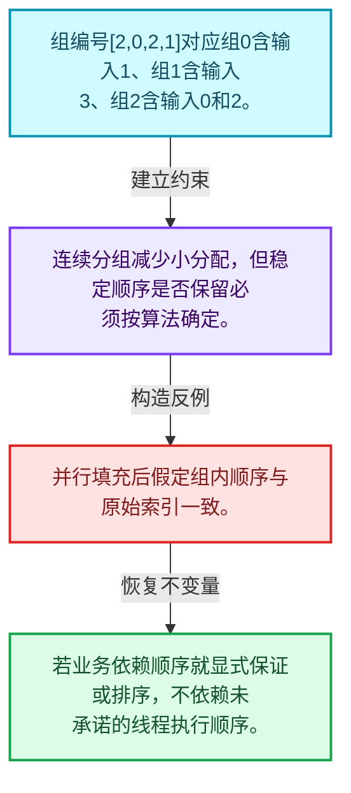
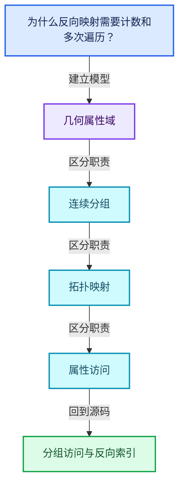
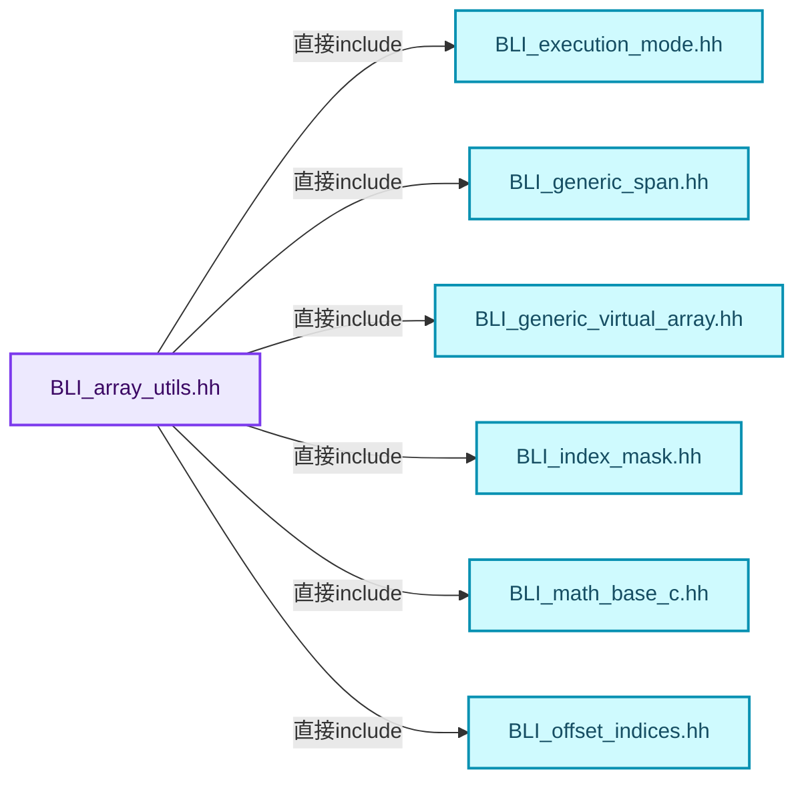
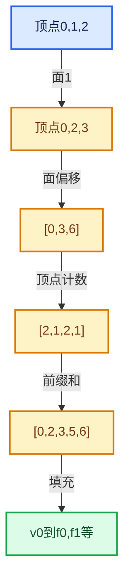

# 05-07 分组访问与反向索引

[方向导航](README.md) · [总目录](../README.md) · [覆盖索引](../%E6%BA%90%E7%A0%81%E7%89%88%E6%9C%AC%E4%B8%8E%E8%A6%86%E7%9B%96%E7%B4%A2%E5%BC%95.md)

> 阅读顺序：问题与数据模型 → 语法与类型 → 源码逐行 → 调用线索 → 历史与取舍 → 推演和练习。

- 基准 HEAD：`cbda6b96c26c0dee3c3b5cbb93960c4ac06a6b30`。
- 记录日期：2026-10-14。
- 教学示例状态：正文中的推演不是本机性能实测；已运行练习见验收报告。

## 一、从问题到设计

为什么反向映射需要计数和多次遍历？

正向映射可直接索引，反向映射可能一对多；连续分组减少逐组分配但需处理稳定顺序。

本篇把语法、数据语义和系统取舍连接起来。利用连续性和重复关系选择表示，让冗余状态尽量无法表达。

### 本篇独立模型与设计推理

组编号[2,0,2,1]对应组0含输入1、组1含输入3、组2含输入0和2。

设计取舍：连续分组减少小分配，但稳定顺序是否保留必须按算法确定。

最小反例：并行填充后假定组内顺序与原始索引一致。

推导与处理：若业务依赖顺序就显式保证或排序，不依赖未承诺的线程执行顺序。



### 源码范围与相邻篇章

| 文件 | 本篇逐行范围 | 基准SHA-256 |
|---|---|---|
| [source/blender/blenlib/BLI_array_utils.hh](../../../../../source/blender/blenlib/BLI_array_utils.hh) | L273—L537 | `4d17392df7c8d116f2c5bf8cf49c19241d58903bf94783ef1e5f5e452a011274` |

同一主讲文件可能分多篇覆盖；超出本篇范围的符号通过覆盖索引定位。空行与纯注释保留在源码摘录中，逐行表解释有效语句与语法边界；许可证头统一保留。

前篇：[拓扑映射构建](06-%E6%8B%93%E6%89%91%E6%98%A0%E5%B0%84%E6%9E%84%E5%BB%BA.md).

后篇：[AttributeAccessor接口](08-AttributeAccessor%E6%8E%A5%E5%8F%A3.md).

## 二、类型、数据与阅读地图



这是概念依赖图，边表示阅读关系，不声称是运行时调用顺序。

### 直接编译依赖



箭头只表示头文件包含关系；完整调用线索见后面的符号定位表。

## 三、关键词、语法与类型角色

### 模板 template

模板把类型或常量作为生成实现的参数。读声明时先列出类型参数、非类型参数和默认值，再看使用者实际实例化了什么。模板声明本身不意味着每种T都支持其全部成员。

具体检查：把T替换为int、string、只能移动的类型，分别检查每个被调用操作是否成立。

### 依赖名称 typename

typename既可引入类型模板参数，也可告诉编译器某个依赖名称是类型。它不创建运行时对象；解析期确认语法类别与实例化期检查具体类型是不同阶段。

具体检查：区分typename T::value_type和T::size()，前者标记类型，后者是表达式。

### 只读限定 const

const约束当前访问路径可做的修改。const指针、指向const的指针、const视图对象、const元素是不同位置的限定；其他别名可能仍可修改原对象。

具体检查：分别写T* const、const T*与const T* const，并画出不可修改的层次。

### 运行时多态 virtual

虚调用根据实际动态类型选择实现；经基类指针销毁对象时通常需要相应虚析构契约。每元素虚调用和循环外一次分派有不同开销。

具体检查：找出虚接口的实现类和调用频率，再讨论是否值得去虚拟化。

### 可选值 optional

optional把不存在与存在的T区分开，T的构造和析构跟随engaged状态变化。访问前应由has_value或条件分支证明存在。

具体检查：把空Field状态与合法常量零区分，不能用某个普通值代替不存在。

### 内部断言 assert

断言表达开发者预期成立的内部契约，发布构建可能关闭。它不能替代对不可信输入的完整错误处理，也不保证后续操作被运行时保护。

具体检查：对每条断言构造违反条件的输入，区分调用者错误与应向用户报告的错误。

### 枚举与状态模型 enum

枚举把有限状态命名；enum class避免许多隐式整数转换。状态机正确性还依赖允许的转移，不能只看有哪些枚举项。

具体检查：列出每个状态的进入条件和离开条件，检查终止状态是否仍可能被调度。

## 四、真实源码与逐行讲解

源码块保持原行内容，原始行号由小节标题及逐行表给出。表中的调用定位是静态阅读辅助；重载、模板实例化、宏展开和虚调用需结合完整声明，不能仅凭词法出现证明动态调用。

### BLI_array_utils.hh：L273—L317

<!-- source:source/blender/blenlib/BLI_array_utils.hh:273:317 -->

```cpp
{
  gather(src, indices, dst.index_range(), dst, mode);
}

template<typename T>
inline void gather_group_to_group(const OffsetIndices<int> src_offsets,
                                  const OffsetIndices<int> dst_offsets,
                                  const IndexMask &selection,
                                  const Span<T> src,
                                  MutableSpan<T> dst)
{
  selection.foreach_index(
      [&](const int64_t src_i, const int64_t dst_i) {
        dst.slice(dst_offsets[dst_i]).copy_from(src.slice(src_offsets[src_i]));
      },
      exec_mode::grain_size(512));
}

template<typename T>
inline void gather_group_to_group(const OffsetIndices<int> src_offsets,
                                  const OffsetIndices<int> dst_offsets,
                                  const Span<int> selection,
                                  const Span<T> src,
                                  MutableSpan<T> dst)
{
  threading::parallel_for(selection.index_range(), 512, [&](const IndexRange range) {
    for (const int dst_i : range) {
      dst.slice(dst_offsets[dst_i]).copy_from(src.slice(src_offsets[selection[dst_i]]));
    }
  });
}

template<typename T>
inline void gather_group_to_group(const OffsetIndices<int> src_offsets,
                                  const OffsetIndices<int> dst_offsets,
                                  const IndexMask &selection,
                                  const VArray<T> src,
                                  MutableSpan<T> dst)
{
  selection.foreach_index(
      [&](const int64_t src_i, const int64_t dst_i) {
        src.materialize_compressed(src_offsets[src_i], dst.slice(dst_offsets[dst_i]));
      },
      exec_mode::grain_size(512));
}
```

| 原始行 | 语义、约束与检查 |
|---|---|
| L273 | 连接上一行的声明或控制结构与其语句块；后续行在这个作用域中执行或声明。 |
| L274 | 出现调用或函数声明 `gather`，对应表达式为 `gather(src, indices, dst.index_range(), dst, mode);`。参数求值、返回类型与重载需结合前后完整语句；静态文本引用不能证明动态目标。 |
| L275 | 结束当前语法单元。局部自动对象在离开其作用域时按规则销毁；这不等于所有被引用的外部数据也被释放。 |
| L277 | 声明模板参数 `template<typename T>`。类型参数决定生成操作的类型，非类型参数可决定内嵌容量或编译期分支。 |
| L278 | 出现调用或函数声明 `gather_group_to_group`，对应表达式为 `inline void gather_group_to_group(const OffsetIndices<int> src_offsets,`。参数求值、返回类型与重载需结合前后完整语句；静态文本引用不能证明动态目标。 |
| L279 | 本行是连续声明或表达式的一部分：`const OffsetIndices<int> dst_offsets,`。与本段前后行合读；逗号、括号和限定符决定它属于参数、初始化列表还是实际计算。 |
| L280 | 本行是连续声明或表达式的一部分：`const IndexMask &selection,`。与本段前后行合读；逗号、括号和限定符决定它属于参数、初始化列表还是实际计算。 |
| L281 | 本行是连续声明或表达式的一部分：`const Span<T> src,`。与本段前后行合读；逗号、括号和限定符决定它属于参数、初始化列表还是实际计算。 |
| L282 | 本行是连续声明或表达式的一部分：`MutableSpan<T> dst)`。与本段前后行合读；逗号、括号和限定符决定它属于参数、初始化列表还是实际计算。 |
| L283 | 连接上一行的声明或控制结构与其语句块；后续行在这个作用域中执行或声明。 |
| L284 | 出现调用或函数声明 `foreach_index`，对应表达式为 `selection.foreach_index(`。参数求值、返回类型与重载需结合前后完整语句；静态文本引用不能证明动态目标。 |
| L285 | 本行是连续声明或表达式的一部分：`[&](const int64_t src_i, const int64_t dst_i) {`。与本段前后行合读；逗号、括号和限定符决定它属于参数、初始化列表还是实际计算。 |
| L286 | 出现调用或函数声明 `slice`，对应表达式为 `dst.slice(dst_offsets[dst_i]).copy_from(src.slice(src_offsets[src_i]));`。参数求值、返回类型与重载需结合前后完整语句；静态文本引用不能证明动态目标。 |
| L287 | 结束当前语法单元。局部自动对象在离开其作用域时按规则销毁；这不等于所有被引用的外部数据也被释放。 |
| L288 | 出现调用或函数声明 `exec_mode::grain_size`，对应表达式为 `exec_mode::grain_size(512));`。参数求值、返回类型与重载需结合前后完整语句；静态文本引用不能证明动态目标。 |
| L289 | 结束当前语法单元。局部自动对象在离开其作用域时按规则销毁；这不等于所有被引用的外部数据也被释放。 |
| L291 | 声明模板参数 `template<typename T>`。类型参数决定生成操作的类型，非类型参数可决定内嵌容量或编译期分支。 |
| L292 | 出现调用或函数声明 `gather_group_to_group`，对应表达式为 `inline void gather_group_to_group(const OffsetIndices<int> src_offsets,`。参数求值、返回类型与重载需结合前后完整语句；静态文本引用不能证明动态目标。 |
| L293 | 本行是连续声明或表达式的一部分：`const OffsetIndices<int> dst_offsets,`。与本段前后行合读；逗号、括号和限定符决定它属于参数、初始化列表还是实际计算。 |
| L294 | 本行是连续声明或表达式的一部分：`const Span<int> selection,`。与本段前后行合读；逗号、括号和限定符决定它属于参数、初始化列表还是实际计算。 |
| L295 | 本行是连续声明或表达式的一部分：`const Span<T> src,`。与本段前后行合读；逗号、括号和限定符决定它属于参数、初始化列表还是实际计算。 |
| L296 | 本行是连续声明或表达式的一部分：`MutableSpan<T> dst)`。与本段前后行合读；逗号、括号和限定符决定它属于参数、初始化列表还是实际计算。 |
| L297 | 连接上一行的声明或控制结构与其语句块；后续行在这个作用域中执行或声明。 |
| L298 | 出现调用或函数声明 `threading::parallel_for`，对应表达式为 `threading::parallel_for(selection.index_range(), 512, [&](const IndexRange range) {`。参数求值、返回类型与重载需结合前后完整语句；静态文本引用不能证明动态目标。 |
| L299 | 按 `for (const int dst_i : range)` 指定的范围或条件重复执行。对照循环变量与真实元素编号；循环内调用成本乘以实际迭代次数。 |
| L300 | 出现调用或函数声明 `slice`，对应表达式为 `dst.slice(dst_offsets[dst_i]).copy_from(src.slice(src_offsets[selection[dst_i]]));`。参数求值、返回类型与重载需结合前后完整语句；静态文本引用不能证明动态目标。 |
| L301 | 结束当前语法单元。局部自动对象在离开其作用域时按规则销毁；这不等于所有被引用的外部数据也被释放。 |
| L302 | 结束当前语法单元。局部自动对象在离开其作用域时按规则销毁；这不等于所有被引用的外部数据也被释放。 |
| L303 | 结束当前语法单元。局部自动对象在离开其作用域时按规则销毁；这不等于所有被引用的外部数据也被释放。 |
| L305 | 声明模板参数 `template<typename T>`。类型参数决定生成操作的类型，非类型参数可决定内嵌容量或编译期分支。 |
| L306 | 出现调用或函数声明 `gather_group_to_group`，对应表达式为 `inline void gather_group_to_group(const OffsetIndices<int> src_offsets,`。参数求值、返回类型与重载需结合前后完整语句；静态文本引用不能证明动态目标。 |
| L307 | 本行是连续声明或表达式的一部分：`const OffsetIndices<int> dst_offsets,`。与本段前后行合读；逗号、括号和限定符决定它属于参数、初始化列表还是实际计算。 |
| L308 | 本行是连续声明或表达式的一部分：`const IndexMask &selection,`。与本段前后行合读；逗号、括号和限定符决定它属于参数、初始化列表还是实际计算。 |
| L309 | 本行是连续声明或表达式的一部分：`const VArray<T> src,`。与本段前后行合读；逗号、括号和限定符决定它属于参数、初始化列表还是实际计算。 |
| L310 | 本行是连续声明或表达式的一部分：`MutableSpan<T> dst)`。与本段前后行合读；逗号、括号和限定符决定它属于参数、初始化列表还是实际计算。 |
| L311 | 连接上一行的声明或控制结构与其语句块；后续行在这个作用域中执行或声明。 |
| L312 | 出现调用或函数声明 `foreach_index`，对应表达式为 `selection.foreach_index(`。参数求值、返回类型与重载需结合前后完整语句；静态文本引用不能证明动态目标。 |
| L313 | 本行是连续声明或表达式的一部分：`[&](const int64_t src_i, const int64_t dst_i) {`。与本段前后行合读；逗号、括号和限定符决定它属于参数、初始化列表还是实际计算。 |
| L314 | 出现调用或函数声明 `materialize_compressed`，对应表达式为 `src.materialize_compressed(src_offsets[src_i], dst.slice(dst_offsets[dst_i]));`。参数求值、返回类型与重载需结合前后完整语句；静态文本引用不能证明动态目标。 |
| L315 | 结束当前语法单元。局部自动对象在离开其作用域时按规则销毁；这不等于所有被引用的外部数据也被释放。 |
| L316 | 出现调用或函数声明 `exec_mode::grain_size`，对应表达式为 `exec_mode::grain_size(512));`。参数求值、返回类型与重载需结合前后完整语句；静态文本引用不能证明动态目标。 |
| L317 | 结束当前语法单元。局部自动对象在离开其作用域时按规则销毁；这不等于所有被引用的外部数据也被释放。 |

### BLI_array_utils.hh：L318—L358

<!-- source:source/blender/blenlib/BLI_array_utils.hh:318:358 -->

```cpp

template<typename T>
inline void gather_to_groups(const OffsetIndices<int> dst_offsets,
                             const IndexMask &src_selection,
                             const Span<T> src,
                             MutableSpan<T> dst)
{
  src_selection.foreach_index(
      [&](const int src_i, const int dst_i) { dst.slice(dst_offsets[dst_i]).fill(src[src_i]); },
      exec_mode::grain_size(1024));
}

/**
 * Copy the \a src data from the groups defined by \a src_offsets to the groups in \a dst defined
 * by \a dst_offsets. Groups to use are masked by \a selection, and it is assumed that the
 * corresponding groups have the same size.
 */
void copy_group_to_group(OffsetIndices<int> src_offsets,
                         OffsetIndices<int> dst_offsets,
                         const IndexMask &selection,
                         GSpan src,
                         GMutableSpan dst);
template<typename T>
void copy_group_to_group(OffsetIndices<int> src_offsets,
                         OffsetIndices<int> dst_offsets,
                         const IndexMask &selection,
                         Span<T> src,
                         MutableSpan<T> dst)
{
  copy_group_to_group(src_offsets, dst_offsets, selection, GSpan(src), GMutableSpan(dst));
}

/**
 * Count the number of occurrences of each index.
 * \param indices: The indices to count.
 * \param counts: The number of occurrences of each index. Typically initialized to zero.
 * Must be large enough to contain the maximum index.
 *
 * \note The memory referenced by the two spans must not overlap.
 */
void count_indices(Span<int> indices, MutableSpan<int> counts);
```

| 原始行 | 语义、约束与检查 |
|---|---|
| L319 | 声明模板参数 `template<typename T>`。类型参数决定生成操作的类型，非类型参数可决定内嵌容量或编译期分支。 |
| L320 | 出现调用或函数声明 `gather_to_groups`，对应表达式为 `inline void gather_to_groups(const OffsetIndices<int> dst_offsets,`。参数求值、返回类型与重载需结合前后完整语句；静态文本引用不能证明动态目标。 |
| L321 | 本行是连续声明或表达式的一部分：`const IndexMask &src_selection,`。与本段前后行合读；逗号、括号和限定符决定它属于参数、初始化列表还是实际计算。 |
| L322 | 本行是连续声明或表达式的一部分：`const Span<T> src,`。与本段前后行合读；逗号、括号和限定符决定它属于参数、初始化列表还是实际计算。 |
| L323 | 本行是连续声明或表达式的一部分：`MutableSpan<T> dst)`。与本段前后行合读；逗号、括号和限定符决定它属于参数、初始化列表还是实际计算。 |
| L324 | 连接上一行的声明或控制结构与其语句块；后续行在这个作用域中执行或声明。 |
| L325 | 出现调用或函数声明 `foreach_index`，对应表达式为 `src_selection.foreach_index(`。参数求值、返回类型与重载需结合前后完整语句；静态文本引用不能证明动态目标。 |
| L326 | 出现调用或函数声明 `slice`，对应表达式为 `[&](const int src_i, const int dst_i) { dst.slice(dst_offsets[dst_i]).fill(src[src_i]); },`。参数求值、返回类型与重载需结合前后完整语句；静态文本引用不能证明动态目标。 |
| L327 | 出现调用或函数声明 `exec_mode::grain_size`，对应表达式为 `exec_mode::grain_size(1024));`。参数求值、返回类型与重载需结合前后完整语句；静态文本引用不能证明动态目标。 |
| L328 | 结束当前语法单元。局部自动对象在离开其作用域时按规则销毁；这不等于所有被引用的外部数据也被释放。 |
| L335 | 出现调用或函数声明 `copy_group_to_group`，对应表达式为 `void copy_group_to_group(OffsetIndices<int> src_offsets,`。参数求值、返回类型与重载需结合前后完整语句；静态文本引用不能证明动态目标。 |
| L336 | 本行是连续声明或表达式的一部分：`OffsetIndices<int> dst_offsets,`。与本段前后行合读；逗号、括号和限定符决定它属于参数、初始化列表还是实际计算。 |
| L337 | 本行是连续声明或表达式的一部分：`const IndexMask &selection,`。与本段前后行合读；逗号、括号和限定符决定它属于参数、初始化列表还是实际计算。 |
| L338 | 本行是连续声明或表达式的一部分：`GSpan src,`。与本段前后行合读；逗号、括号和限定符决定它属于参数、初始化列表还是实际计算。 |
| L339 | 声明成员、局部对象或完成语句 `GMutableSpan dst)`。若为指针或引用，它本身不说明拥有；若为值对象，其构造析构由所在作用域或外层对象管理。 |
| L340 | 声明模板参数 `template<typename T>`。类型参数决定生成操作的类型，非类型参数可决定内嵌容量或编译期分支。 |
| L341 | 出现调用或函数声明 `copy_group_to_group`，对应表达式为 `void copy_group_to_group(OffsetIndices<int> src_offsets,`。参数求值、返回类型与重载需结合前后完整语句；静态文本引用不能证明动态目标。 |
| L342 | 本行是连续声明或表达式的一部分：`OffsetIndices<int> dst_offsets,`。与本段前后行合读；逗号、括号和限定符决定它属于参数、初始化列表还是实际计算。 |
| L343 | 本行是连续声明或表达式的一部分：`const IndexMask &selection,`。与本段前后行合读；逗号、括号和限定符决定它属于参数、初始化列表还是实际计算。 |
| L344 | 本行是连续声明或表达式的一部分：`Span<T> src,`。与本段前后行合读；逗号、括号和限定符决定它属于参数、初始化列表还是实际计算。 |
| L345 | 本行是连续声明或表达式的一部分：`MutableSpan<T> dst)`。与本段前后行合读；逗号、括号和限定符决定它属于参数、初始化列表还是实际计算。 |
| L346 | 连接上一行的声明或控制结构与其语句块；后续行在这个作用域中执行或声明。 |
| L347 | 出现调用或函数声明 `copy_group_to_group`，对应表达式为 `copy_group_to_group(src_offsets, dst_offsets, selection, GSpan(src), GMutableSpan(dst));`。参数求值、返回类型与重载需结合前后完整语句；静态文本引用不能证明动态目标。 |
| L348 | 结束当前语法单元。局部自动对象在离开其作用域时按规则销毁；这不等于所有被引用的外部数据也被释放。 |
| L358 | 声明接口 `void count_indices(Span<int> indices, MutableSpan<int> counts)`，本行没有对应函数体；返回类型、参数限定和const/noexcept共同组成调用契约，实际行为需继续定位实现。 |

### BLI_array_utils.hh：L359—L403

<!-- source:source/blender/blenlib/BLI_array_utils.hh:359:403 -->

```cpp

/**
 * Find a compact index for every unique arbitrary ID, in the order that the IDs first appear.
 *
 * \param mask: The elements whose IDs are processed.
 * \param r_group_indices: The group index of every element, for every index in the mask.
 * \param r_first_indices: Optional. Filled with the first element with each ID, for every group,
 * which can be useful to choose a representative element for each group.
 * \return The number of groups.
 */
int group_ids_to_indices(Span<int> ids,
                         const IndexMask &mask,
                         MutableSpan<int> r_group_indices,
                         Vector<int> *r_first_indices = nullptr);

void invert_booleans(MutableSpan<bool> span);
void invert_booleans(MutableSpan<bool> span, const IndexMask &mask);

int64_t count_booleans(const VArray<bool> &varray);
int64_t count_booleans(const VArray<bool> &varray, const IndexMask &mask);

enum class BooleanMix {
  None,
  AllFalse,
  AllTrue,
  Mixed,
};
BooleanMix booleans_mix_calc(const VArray<bool> &varray, IndexRange range_to_check);
inline BooleanMix booleans_mix_calc(const VArray<bool> &varray)
{
  return booleans_mix_calc(varray, varray.index_range());
}

/** Check if the value exists in the array. */
bool contains(const VArray<bool> &varray, const IndexMask &indices_to_check, bool value);

/** Return indices in the mask that are non-negative. */
IndexMask indices_non_negative(const IndexMask &universe,
                               Span<int> values,
                               LinearAllocator<> &memory);
/** Return indices in the mask that are not negative and less than the given size. */
IndexMask indices_in_range(const IndexMask &universe,
                           Span<int> values,
                           IndexRange range,
                           LinearAllocator<> &memory);
```

| 原始行 | 语义、约束与检查 |
|---|---|
| L369 | 出现调用或函数声明 `group_ids_to_indices`，对应表达式为 `int group_ids_to_indices(Span<int> ids,`。参数求值、返回类型与重载需结合前后完整语句；静态文本引用不能证明动态目标。 |
| L370 | 本行是连续声明或表达式的一部分：`const IndexMask &mask,`。与本段前后行合读；逗号、括号和限定符决定它属于参数、初始化列表还是实际计算。 |
| L371 | 本行是连续声明或表达式的一部分：`MutableSpan<int> r_group_indices,`。与本段前后行合读；逗号、括号和限定符决定它属于参数、初始化列表还是实际计算。 |
| L372 | 把右侧 `nullptr)` 用于初始化或更新左侧 `Vector<int> *r_first_indices`。声明初始化与已有对象赋值应按上下文区分；有资源的类型会调用相应特殊成员。 |
| L374 | 声明接口 `void invert_booleans(MutableSpan<bool> span)`，本行没有对应函数体；返回类型、参数限定和const/noexcept共同组成调用契约，实际行为需继续定位实现。 |
| L375 | 声明接口 `void invert_booleans(MutableSpan<bool> span, const IndexMask &mask)`，本行没有对应函数体；返回类型、参数限定和const/noexcept共同组成调用契约，实际行为需继续定位实现。 |
| L377 | 出现调用或函数声明 `count_booleans`，对应表达式为 `int64_t count_booleans(const VArray<bool> &varray);`。参数求值、返回类型与重载需结合前后完整语句；静态文本引用不能证明动态目标。 |
| L378 | 出现调用或函数声明 `count_booleans`，对应表达式为 `int64_t count_booleans(const VArray<bool> &varray, const IndexMask &mask);`。参数求值、返回类型与重载需结合前后完整语句；静态文本引用不能证明动态目标。 |
| L380 | 声明或定义类型 `enum class BooleanMix`。结合继承、访问权限和成员布局确认接口与拥有关系；前向声明本身没有完整对象布局。 |
| L381 | 本行是连续声明或表达式的一部分：`None,`。与本段前后行合读；逗号、括号和限定符决定它属于参数、初始化列表还是实际计算。 |
| L382 | 本行是连续声明或表达式的一部分：`AllFalse,`。与本段前后行合读；逗号、括号和限定符决定它属于参数、初始化列表还是实际计算。 |
| L383 | 本行是连续声明或表达式的一部分：`AllTrue,`。与本段前后行合读；逗号、括号和限定符决定它属于参数、初始化列表还是实际计算。 |
| L384 | 本行是连续声明或表达式的一部分：`Mixed,`。与本段前后行合读；逗号、括号和限定符决定它属于参数、初始化列表还是实际计算。 |
| L385 | 结束当前语法单元。局部自动对象在离开其作用域时按规则销毁；这不等于所有被引用的外部数据也被释放。 |
| L386 | 出现调用或函数声明 `booleans_mix_calc`，对应表达式为 `BooleanMix booleans_mix_calc(const VArray<bool> &varray, IndexRange range_to_check);`。参数求值、返回类型与重载需结合前后完整语句；静态文本引用不能证明动态目标。 |
| L387 | 出现调用或函数声明 `booleans_mix_calc`，对应表达式为 `inline BooleanMix booleans_mix_calc(const VArray<bool> &varray)`。参数求值、返回类型与重载需结合前后完整语句；静态文本引用不能证明动态目标。 |
| L388 | 连接上一行的声明或控制结构与其语句块；后续行在这个作用域中执行或声明。 |
| L389 | 返回表达式 `booleans_mix_calc(varray, varray.index_range())`。 |
| L390 | 结束当前语法单元。局部自动对象在离开其作用域时按规则销毁；这不等于所有被引用的外部数据也被释放。 |
| L393 | 声明接口 `bool contains(const VArray<bool> &varray, const IndexMask &indices_to_check, bool value)`，本行没有对应函数体；返回类型、参数限定和const/noexcept共同组成调用契约，实际行为需继续定位实现。 |
| L396 | 出现调用或函数声明 `indices_non_negative`，对应表达式为 `IndexMask indices_non_negative(const IndexMask &universe,`。参数求值、返回类型与重载需结合前后完整语句；静态文本引用不能证明动态目标。 |
| L397 | 本行是连续声明或表达式的一部分：`Span<int> values,`。与本段前后行合读；逗号、括号和限定符决定它属于参数、初始化列表还是实际计算。 |
| L398 | 声明成员、局部对象或完成语句 `LinearAllocator<> &memory)`。若为指针或引用，它本身不说明拥有；若为值对象，其构造析构由所在作用域或外层对象管理。 |
| L400 | 出现调用或函数声明 `indices_in_range`，对应表达式为 `IndexMask indices_in_range(const IndexMask &universe,`。参数求值、返回类型与重载需结合前后完整语句；静态文本引用不能证明动态目标。 |
| L401 | 本行是连续声明或表达式的一部分：`Span<int> values,`。与本段前后行合读；逗号、括号和限定符决定它属于参数、初始化列表还是实际计算。 |
| L402 | 本行是连续声明或表达式的一部分：`IndexRange range,`。与本段前后行合读；逗号、括号和限定符决定它属于参数、初始化列表还是实际计算。 |
| L403 | 声明成员、局部对象或完成语句 `LinearAllocator<> &memory)`。若为指针或引用，它本身不说明拥有；若为值对象，其构造析构由所在作用域或外层对象管理。 |

### BLI_array_utils.hh：L404—L449

<!-- source:source/blender/blenlib/BLI_array_utils.hh:404:449 -->

```cpp

/**
 * Finds all the index ranges for which consecutive values in \a span equal \a value.
 */
template<typename T> inline Vector<IndexRange> find_all_ranges(const Span<T> span, const T &value)
{
  if (span.is_empty()) {
    return Vector<IndexRange>();
  }
  Vector<IndexRange> ranges;
  int64_t length = (span.first() == value) ? 1 : 0;
  for (const int64_t i : span.index_range().drop_front(1)) {
    if (span[i - 1] == value && span[i] != value) {
      ranges.append(IndexRange::from_end_size(i, length));
      length = 0;
    }
    else if (span[i] == value) {
      length++;
    }
  }
  if (length > 0) {
    ranges.append(IndexRange::from_end_size(span.size(), length));
  }
  return ranges;
}

/**
 * Fill the span with increasing indices: 0, 1, 2, ...
 * Optionally, the start value can be provided.
 */
template<typename T> inline void fill_index_range(MutableSpan<T> span, const T start = 0)
{
  std::iota(span.begin(), span.end(), start);
}

template<typename T, exec_mode::Tag Mode = exec_mode::Parallel>
inline void fill_index_range(const IndexMask &mask, MutableSpan<T> span, const Mode mode = {})
{
  mask.foreach_index_optimized<T>([&](const T index) { span[index] = index; }, mode);
}

template<typename T, exec_mode::Tag Mode = exec_mode::Parallel>
inline void fill_index_range(const IndexMask &mask,
                             MutableSpan<T> span,
                             const T start,
                             const Mode mode = {})
```

本段语义重点：

- 分支证据 `span.is_empty())`：分别推演条件成立与不成立，核对相同出口处的状态。
- 分支证据 `span[i - 1] == value && span[i] != value)`：分别推演条件成立与不成立，核对相同出口处的状态。

| 原始行 | 语义、约束与检查 |
|---|---|
| L408 | 声明模板参数 `template<typename T> inline Vector<IndexRange> find_all_ranges(const Span<T> span, const T &value)`。类型参数决定生成操作的类型，非类型参数可决定内嵌容量或编译期分支。 |
| L409 | 连接上一行的声明或控制结构与其语句块；后续行在这个作用域中执行或声明。 |
| L410 | 判断 `span.is_empty()`，成立时进入本分支，否则继续后续路径。 |
| L411 | 返回表达式 `Vector<IndexRange>()`。 |
| L412 | 结束当前语法单元。局部自动对象在离开其作用域时按规则销毁；这不等于所有被引用的外部数据也被释放。 |
| L413 | 声明成员、局部对象或完成语句 `Vector<IndexRange> ranges`。若为指针或引用，它本身不说明拥有；若为值对象，其构造析构由所在作用域或外层对象管理。 |
| L414 | 把右侧 `(span.first() == value) ? 1 : 0` 用于初始化或更新左侧 `int64_t length`。声明初始化与已有对象赋值应按上下文区分；有资源的类型会调用相应特殊成员。 |
| L415 | 按 `for (const int64_t i : span.index_range().drop_front(1))` 指定的范围或条件重复执行。对照循环变量与真实元素编号；循环内调用成本乘以实际迭代次数。 |
| L416 | 判断 `span[i - 1] == value && span[i] != value`，成立时进入本分支，否则继续后续路径。 |
| L417 | 出现调用或函数声明 `append`，对应表达式为 `ranges.append(IndexRange::from_end_size(i, length));`。参数求值、返回类型与重载需结合前后完整语句；静态文本引用不能证明动态目标。 |
| L418 | 把右侧 `0` 用于初始化或更新左侧 `length`。声明初始化与已有对象赋值应按上下文区分；有资源的类型会调用相应特殊成员。 |
| L419 | 结束当前语法单元。局部自动对象在离开其作用域时按规则销毁；这不等于所有被引用的外部数据也被释放。 |
| L420 | 判断 `span[i] == value`，成立时进入本分支，否则继续后续路径。 |
| L421 | 递增或递减现有状态：`length++;`。这改变计数或游标；检查边界、计数单位，以及并发访问是否有相应保护。 |
| L422 | 结束当前语法单元。局部自动对象在离开其作用域时按规则销毁；这不等于所有被引用的外部数据也被释放。 |
| L423 | 结束当前语法单元。局部自动对象在离开其作用域时按规则销毁；这不等于所有被引用的外部数据也被释放。 |
| L424 | 判断 `length > 0`，成立时进入本分支，否则继续后续路径。 |
| L425 | 出现调用或函数声明 `append`，对应表达式为 `ranges.append(IndexRange::from_end_size(span.size(), length));`。参数求值、返回类型与重载需结合前后完整语句；静态文本引用不能证明动态目标。 |
| L426 | 结束当前语法单元。局部自动对象在离开其作用域时按规则销毁；这不等于所有被引用的外部数据也被释放。 |
| L427 | 返回表达式 `ranges`。 |
| L428 | 结束当前语法单元。局部自动对象在离开其作用域时按规则销毁；这不等于所有被引用的外部数据也被释放。 |
| L434 | 声明模板参数 `template<typename T> inline void fill_index_range(MutableSpan<T> span, const T start = 0)`。类型参数决定生成操作的类型，非类型参数可决定内嵌容量或编译期分支。 |
| L435 | 连接上一行的声明或控制结构与其语句块；后续行在这个作用域中执行或声明。 |
| L436 | 出现调用或函数声明 `std::iota`，对应表达式为 `std::iota(span.begin(), span.end(), start);`。参数求值、返回类型与重载需结合前后完整语句；静态文本引用不能证明动态目标。 |
| L437 | 结束当前语法单元。局部自动对象在离开其作用域时按规则销毁；这不等于所有被引用的外部数据也被释放。 |
| L439 | 声明模板参数 `template<typename T, exec_mode::Tag Mode = exec_mode::Parallel>`。类型参数决定生成操作的类型，非类型参数可决定内嵌容量或编译期分支。 |
| L440 | 把右侧 `{})` 用于初始化或更新左侧 `inline void fill_index_range(const IndexMask &mask, MutableSpan<T> span, const Mode mode`。声明初始化与已有对象赋值应按上下文区分；有资源的类型会调用相应特殊成员。 |
| L441 | 连接上一行的声明或控制结构与其语句块；后续行在这个作用域中执行或声明。 |
| L442 | 把右侧 `index; }, mode)` 用于初始化或更新左侧 `mask.foreach_index_optimized<T>([&](const T index) { span[index]`。声明初始化与已有对象赋值应按上下文区分；有资源的类型会调用相应特殊成员。 |
| L443 | 结束当前语法单元。局部自动对象在离开其作用域时按规则销毁；这不等于所有被引用的外部数据也被释放。 |
| L445 | 声明模板参数 `template<typename T, exec_mode::Tag Mode = exec_mode::Parallel>`。类型参数决定生成操作的类型，非类型参数可决定内嵌容量或编译期分支。 |
| L446 | 出现调用或函数声明 `fill_index_range`，对应表达式为 `inline void fill_index_range(const IndexMask &mask,`。参数求值、返回类型与重载需结合前后完整语句；静态文本引用不能证明动态目标。 |
| L447 | 本行是连续声明或表达式的一部分：`MutableSpan<T> span,`。与本段前后行合读；逗号、括号和限定符决定它属于参数、初始化列表还是实际计算。 |
| L448 | 本行是连续声明或表达式的一部分：`const T start,`。与本段前后行合读；逗号、括号和限定符决定它属于参数、初始化列表还是实际计算。 |
| L449 | 把右侧 `{})` 用于初始化或更新左侧 `const Mode mode`。声明初始化与已有对象赋值应按上下文区分；有资源的类型会调用相应特殊成员。 |

### BLI_array_utils.hh：L450—L500

<!-- source:source/blender/blenlib/BLI_array_utils.hh:450:500 -->

```cpp
{
  if (start == 0) {
    fill_index_range(mask, span, mode);
  }
  else {
    mask.foreach_index_optimized<T>([&](const T index) { span[index] = start + index; }, mode);
  }
}

template<typename T>
bool indexed_data_equal(const Span<T> all_values, const Span<int> indices, const Span<T> values)
{
  BLI_assert(indices.size() == values.size());
  for (const int i : indices.index_range()) {
    if (all_values[indices[i]] != values[i]) {
      return false;
    }
  }
  return true;
}

bool indices_are_range(Span<int> indices, IndexRange range);

/**
 * Returns the index of the (first) maximum element in the virtual array or std::nullopt if the
 * array is empty.
 */
template<typename T>
inline std::optional<int64_t> max_element_index(const Span<T> &span,
                                                const int64_t grain_size = 8192)
{
  const T *max_it = threading::parallel_reduce(
      span.index_range(),
      grain_size,
      span.begin(),
      [&](const IndexRange range, const T *init_max) {
        const Span<T> sub_span = span.slice(range);
        const T *max_elem = std::max_element(sub_span.begin(), sub_span.end());
        if (*max_elem < *init_max) {
          return init_max;
        }
        return max_elem;
      },
      [&](const T *a, const T *b) {
        if (*a < *b) {
          return a;
        }
        return b;
      });
  return std::distance(span.begin(), max_it);
}
```

本段语义重点：

- `std::max`：取较大值，在容量计算中常用于同时满足请求量和增长策略。

| 原始行 | 语义、约束与检查 |
|---|---|
| L450 | 连接上一行的声明或控制结构与其语句块；后续行在这个作用域中执行或声明。 |
| L451 | 判断 `start == 0`，成立时进入本分支，否则继续后续路径。 |
| L452 | 出现调用或函数声明 `fill_index_range`，对应表达式为 `fill_index_range(mask, span, mode);`。参数求值、返回类型与重载需结合前后完整语句；静态文本引用不能证明动态目标。 |
| L453 | 结束当前语法单元。局部自动对象在离开其作用域时按规则销毁；这不等于所有被引用的外部数据也被释放。 |
| L454 | 处理前一条件不成立的互补路径。比较两条路径最后是否恢复同一不变量，以及是否产生不同的资源责任。 |
| L455 | 把右侧 `start + index; }, mode)` 用于初始化或更新左侧 `mask.foreach_index_optimized<T>([&](const T index) { span[index]`。声明初始化与已有对象赋值应按上下文区分；有资源的类型会调用相应特殊成员。 |
| L456 | 结束当前语法单元。局部自动对象在离开其作用域时按规则销毁；这不等于所有被引用的外部数据也被释放。 |
| L457 | 结束当前语法单元。局部自动对象在离开其作用域时按规则销毁；这不等于所有被引用的外部数据也被释放。 |
| L459 | 声明模板参数 `template<typename T>`。类型参数决定生成操作的类型，非类型参数可决定内嵌容量或编译期分支。 |
| L460 | 出现调用或函数声明 `indexed_data_equal`，对应表达式为 `bool indexed_data_equal(const Span<T> all_values, const Span<int> indices, const Span<T> values)`。参数求值、返回类型与重载需结合前后完整语句；静态文本引用不能证明动态目标。 |
| L461 | 连接上一行的声明或控制结构与其语句块；后续行在这个作用域中执行或声明。 |
| L462 | 断言约束 `BLI_assert(indices.size() == values.size());`。条件是后续访问的内部前置条件；发布构建可能不执行，不能把断言当作输入修复。 |
| L463 | 按 `for (const int i : indices.index_range())` 指定的范围或条件重复执行。对照循环变量与真实元素编号；循环内调用成本乘以实际迭代次数。 |
| L464 | 判断 `all_values[indices[i]] != values[i]`，成立时进入本分支，否则继续后续路径。 |
| L465 | 返回表达式 `false`。这是本路径的布尔结果，具体成功、存在或状态含义由函数接口规定。 |
| L466 | 结束当前语法单元。局部自动对象在离开其作用域时按规则销毁；这不等于所有被引用的外部数据也被释放。 |
| L467 | 结束当前语法单元。局部自动对象在离开其作用域时按规则销毁；这不等于所有被引用的外部数据也被释放。 |
| L468 | 返回表达式 `true`。这是本路径的布尔结果，具体成功、存在或状态含义由函数接口规定。 |
| L469 | 结束当前语法单元。局部自动对象在离开其作用域时按规则销毁；这不等于所有被引用的外部数据也被释放。 |
| L471 | 声明接口 `bool indices_are_range(Span<int> indices, IndexRange range)`，本行没有对应函数体；返回类型、参数限定和const/noexcept共同组成调用契约，实际行为需继续定位实现。 |
| L477 | 声明模板参数 `template<typename T>`。类型参数决定生成操作的类型，非类型参数可决定内嵌容量或编译期分支。 |
| L478 | 出现调用或函数声明 `max_element_index`，对应表达式为 `inline std::optional<int64_t> max_element_index(const Span<T> &span,`。参数求值、返回类型与重载需结合前后完整语句；静态文本引用不能证明动态目标。 |
| L479 | 把右侧 `8192)` 用于初始化或更新左侧 `const int64_t grain_size`。声明初始化与已有对象赋值应按上下文区分；有资源的类型会调用相应特殊成员。 |
| L480 | 连接上一行的声明或控制结构与其语句块；后续行在这个作用域中执行或声明。 |
| L481 | 把右侧 `threading::parallel_reduce(` 用于初始化或更新左侧 `const T *max_it`。声明初始化与已有对象赋值应按上下文区分；有资源的类型会调用相应特殊成员。 |
| L482 | 出现调用或函数声明 `index_range`，对应表达式为 `span.index_range(),`。参数求值、返回类型与重载需结合前后完整语句；静态文本引用不能证明动态目标。 |
| L483 | 本行是连续声明或表达式的一部分：`grain_size,`。与本段前后行合读；逗号、括号和限定符决定它属于参数、初始化列表还是实际计算。 |
| L484 | 出现调用或函数声明 `begin`，对应表达式为 `span.begin(),`。参数求值、返回类型与重载需结合前后完整语句；静态文本引用不能证明动态目标。 |
| L485 | 本行是连续声明或表达式的一部分：`[&](const IndexRange range, const T *init_max) {`。与本段前后行合读；逗号、括号和限定符决定它属于参数、初始化列表还是实际计算。 |
| L486 | 把右侧 `span.slice(range)` 用于初始化或更新左侧 `const Span<T> sub_span`。声明初始化与已有对象赋值应按上下文区分；有资源的类型会调用相应特殊成员。 |
| L487 | 把右侧 `std::max_element(sub_span.begin(), sub_span.end())` 用于初始化或更新左侧 `const T *max_elem`。声明初始化与已有对象赋值应按上下文区分；有资源的类型会调用相应特殊成员。 |
| L488 | 判断 `*max_elem < *init_max`，成立时进入本分支，否则继续后续路径。 |
| L489 | 返回表达式 `init_max`。结合函数声明检查返回值是否借用原存储，借用值不会自动延长其寿命。 |
| L490 | 结束当前语法单元。局部自动对象在离开其作用域时按规则销毁；这不等于所有被引用的外部数据也被释放。 |
| L491 | 返回表达式 `max_elem`。 |
| L492 | 结束当前语法单元。局部自动对象在离开其作用域时按规则销毁；这不等于所有被引用的外部数据也被释放。 |
| L493 | 本行是连续声明或表达式的一部分：`[&](const T *a, const T *b) {`。与本段前后行合读；逗号、括号和限定符决定它属于参数、初始化列表还是实际计算。 |
| L494 | 判断 `*a < *b`，成立时进入本分支，否则继续后续路径。 |
| L495 | 返回表达式 `a`。结合函数声明检查返回值是否借用原存储，借用值不会自动延长其寿命。 |
| L496 | 结束当前语法单元。局部自动对象在离开其作用域时按规则销毁；这不等于所有被引用的外部数据也被释放。 |
| L497 | 返回表达式 `b`。 |
| L498 | 结束当前语法单元。局部自动对象在离开其作用域时按规则销毁；这不等于所有被引用的外部数据也被释放。 |
| L499 | 返回表达式 `std::distance(span.begin(), max_it)`。 |
| L500 | 结束当前语法单元。局部自动对象在离开其作用域时按规则销毁；这不等于所有被引用的外部数据也被释放。 |

### BLI_array_utils.hh：L501—L537

<!-- source:source/blender/blenlib/BLI_array_utils.hh:501:537 -->

```cpp
template<typename T>
inline std::optional<int64_t> max_element_index(const VArray<T> &array,
                                                const int64_t grain_size = 8192)
{
  if (!array || array.is_empty()) {
    return std::nullopt;
  }
  if (array.is_single()) {
    return array.first();
  }
  if (array.is_span()) {
    return max_element_index(array.get_internal_span(), grain_size);
  }
  return threading::parallel_reduce(
      array.index_range(),
      grain_size,
      array.first(),
      [&](const IndexRange range, const int64_t init_i) {
        int64_t max_index = init_i;
        T max_elem = array[max_index];
        for (const int i : range) {
          if (max_elem < array[i]) {
            max_index = i;
            max_elem = array[i];
          }
        }
        return max_index;
      },
      [&](const int64_t index_a, const int64_t index_b) {
        if (array[index_a] < array[index_b]) {
          return index_b;
        }
        return index_a;
      });
}

}  // namespace blender::array_utils
```

本段语义重点：

- 分支证据 `!array &#124;&#124; array.is_empty())`：分别推演条件成立与不成立，核对相同出口处的状态。
- 分支证据 `array.is_single())`：分别推演条件成立与不成立，核对相同出口处的状态。

| 原始行 | 语义、约束与检查 |
|---|---|
| L501 | 声明模板参数 `template<typename T>`。类型参数决定生成操作的类型，非类型参数可决定内嵌容量或编译期分支。 |
| L502 | 出现调用或函数声明 `max_element_index`，对应表达式为 `inline std::optional<int64_t> max_element_index(const VArray<T> &array,`。参数求值、返回类型与重载需结合前后完整语句；静态文本引用不能证明动态目标。 |
| L503 | 把右侧 `8192)` 用于初始化或更新左侧 `const int64_t grain_size`。声明初始化与已有对象赋值应按上下文区分；有资源的类型会调用相应特殊成员。 |
| L504 | 连接上一行的声明或控制结构与其语句块；后续行在这个作用域中执行或声明。 |
| L505 | 判断 `!array &#124;&#124; array.is_empty()`，成立时进入本分支，否则继续后续路径。 |
| L506 | 返回表达式 `std::nullopt`。 |
| L507 | 结束当前语法单元。局部自动对象在离开其作用域时按规则销毁；这不等于所有被引用的外部数据也被释放。 |
| L508 | 判断 `array.is_single()`，成立时进入本分支，否则继续后续路径。单值表示可以避免逐元素读取，仍须保留逻辑长度。 |
| L509 | 返回表达式 `array.first()`。 |
| L510 | 结束当前语法单元。局部自动对象在离开其作用域时按规则销毁；这不等于所有被引用的外部数据也被释放。 |
| L511 | 判断 `array.is_span()`，成立时进入本分支，否则继续后续路径。 |
| L512 | 返回表达式 `max_element_index(array.get_internal_span(), grain_size)`。 |
| L513 | 结束当前语法单元。局部自动对象在离开其作用域时按规则销毁；这不等于所有被引用的外部数据也被释放。 |
| L514 | 返回表达式 `threading::parallel_reduce(`。 |
| L515 | 出现调用或函数声明 `index_range`，对应表达式为 `array.index_range(),`。参数求值、返回类型与重载需结合前后完整语句；静态文本引用不能证明动态目标。 |
| L516 | 本行是连续声明或表达式的一部分：`grain_size,`。与本段前后行合读；逗号、括号和限定符决定它属于参数、初始化列表还是实际计算。 |
| L517 | 出现调用或函数声明 `first`，对应表达式为 `array.first(),`。参数求值、返回类型与重载需结合前后完整语句；静态文本引用不能证明动态目标。 |
| L518 | 本行是连续声明或表达式的一部分：`[&](const IndexRange range, const int64_t init_i) {`。与本段前后行合读；逗号、括号和限定符决定它属于参数、初始化列表还是实际计算。 |
| L519 | 把右侧 `init_i` 用于初始化或更新左侧 `int64_t max_index`。声明初始化与已有对象赋值应按上下文区分；有资源的类型会调用相应特殊成员。 |
| L520 | 把右侧 `array[max_index]` 用于初始化或更新左侧 `T max_elem`。声明初始化与已有对象赋值应按上下文区分；有资源的类型会调用相应特殊成员。 |
| L521 | 按 `for (const int i : range)` 指定的范围或条件重复执行。对照循环变量与真实元素编号；循环内调用成本乘以实际迭代次数。 |
| L522 | 判断 `max_elem < array[i]`，成立时进入本分支，否则继续后续路径。 |
| L523 | 把右侧 `i` 用于初始化或更新左侧 `max_index`。声明初始化与已有对象赋值应按上下文区分；有资源的类型会调用相应特殊成员。 |
| L524 | 把右侧 `array[i]` 用于初始化或更新左侧 `max_elem`。声明初始化与已有对象赋值应按上下文区分；有资源的类型会调用相应特殊成员。 |
| L525 | 结束当前语法单元。局部自动对象在离开其作用域时按规则销毁；这不等于所有被引用的外部数据也被释放。 |
| L526 | 结束当前语法单元。局部自动对象在离开其作用域时按规则销毁；这不等于所有被引用的外部数据也被释放。 |
| L527 | 返回表达式 `max_index`。 |
| L528 | 结束当前语法单元。局部自动对象在离开其作用域时按规则销毁；这不等于所有被引用的外部数据也被释放。 |
| L529 | 本行是连续声明或表达式的一部分：`[&](const int64_t index_a, const int64_t index_b) {`。与本段前后行合读；逗号、括号和限定符决定它属于参数、初始化列表还是实际计算。 |
| L530 | 判断 `array[index_a] < array[index_b]`，成立时进入本分支，否则继续后续路径。 |
| L531 | 返回表达式 `index_b`。 |
| L532 | 结束当前语法单元。局部自动对象在离开其作用域时按规则销毁；这不等于所有被引用的外部数据也被释放。 |
| L533 | 返回表达式 `index_a`。 |
| L534 | 结束当前语法单元。局部自动对象在离开其作用域时按规则销毁；这不等于所有被引用的外部数据也被释放。 |
| L535 | 结束当前语法单元。局部自动对象在离开其作用域时按规则销毁；这不等于所有被引用的外部数据也被释放。 |
| L537 | 结束当前语法单元。局部自动对象在离开其作用域时按规则销毁；这不等于所有被引用的外部数据也被释放。 |

## 五、接口定位、调用线索与生命周期

### 本篇声明与实现入口

| 源码位置 | 实际声明片段 |
|---|---|
| [BLI_array_utils.hh:L278](../../../../../source/blender/blenlib/BLI_array_utils.hh#L278) | `inline void gather_group_to_group(const OffsetIndices<int> src_offsets,` |
| [BLI_array_utils.hh:L292](../../../../../source/blender/blenlib/BLI_array_utils.hh#L292) | `inline void gather_group_to_group(const OffsetIndices<int> src_offsets,` |
| [BLI_array_utils.hh:L306](../../../../../source/blender/blenlib/BLI_array_utils.hh#L306) | `inline void gather_group_to_group(const OffsetIndices<int> src_offsets,` |
| [BLI_array_utils.hh:L320](../../../../../source/blender/blenlib/BLI_array_utils.hh#L320) | `inline void gather_to_groups(const OffsetIndices<int> dst_offsets,` |
| [BLI_array_utils.hh:L335](../../../../../source/blender/blenlib/BLI_array_utils.hh#L335) | `void copy_group_to_group(OffsetIndices<int> src_offsets,` |
| [BLI_array_utils.hh:L341](../../../../../source/blender/blenlib/BLI_array_utils.hh#L341) | `void copy_group_to_group(OffsetIndices<int> src_offsets,` |
| [BLI_array_utils.hh:L358](../../../../../source/blender/blenlib/BLI_array_utils.hh#L358) | `void count_indices(Span<int> indices, MutableSpan<int> counts);` |
| [BLI_array_utils.hh:L369](../../../../../source/blender/blenlib/BLI_array_utils.hh#L369) | `int group_ids_to_indices(Span<int> ids,` |
| [BLI_array_utils.hh:L374](../../../../../source/blender/blenlib/BLI_array_utils.hh#L374) | `void invert_booleans(MutableSpan<bool> span);` |
| [BLI_array_utils.hh:L375](../../../../../source/blender/blenlib/BLI_array_utils.hh#L375) | `void invert_booleans(MutableSpan<bool> span, const IndexMask &mask);` |
| [BLI_array_utils.hh:L377](../../../../../source/blender/blenlib/BLI_array_utils.hh#L377) | `int64_t count_booleans(const VArray<bool> &varray);` |
| [BLI_array_utils.hh:L378](../../../../../source/blender/blenlib/BLI_array_utils.hh#L378) | `int64_t count_booleans(const VArray<bool> &varray, const IndexMask &mask);` |
| [BLI_array_utils.hh:L380](../../../../../source/blender/blenlib/BLI_array_utils.hh#L380) | `enum class BooleanMix` |
| [BLI_array_utils.hh:L386](../../../../../source/blender/blenlib/BLI_array_utils.hh#L386) | `BooleanMix booleans_mix_calc(const VArray<bool> &varray, IndexRange range_to_check);` |
| [BLI_array_utils.hh:L387](../../../../../source/blender/blenlib/BLI_array_utils.hh#L387) | `inline BooleanMix booleans_mix_calc(const VArray<bool> &varray)` |
| [BLI_array_utils.hh:L393](../../../../../source/blender/blenlib/BLI_array_utils.hh#L393) | `bool contains(const VArray<bool> &varray, const IndexMask &indices_to_check, bool value);` |
| [BLI_array_utils.hh:L396](../../../../../source/blender/blenlib/BLI_array_utils.hh#L396) | `IndexMask indices_non_negative(const IndexMask &universe,` |
| [BLI_array_utils.hh:L400](../../../../../source/blender/blenlib/BLI_array_utils.hh#L400) | `IndexMask indices_in_range(const IndexMask &universe,` |
| [BLI_array_utils.hh:L408](../../../../../source/blender/blenlib/BLI_array_utils.hh#L408) | `template<typename T> inline Vector<IndexRange> find_all_ranges(const Span<T> span, const T &value)` |
| [BLI_array_utils.hh:L420](../../../../../source/blender/blenlib/BLI_array_utils.hh#L420) | `else if (span[i] == value)` |
| [BLI_array_utils.hh:L434](../../../../../source/blender/blenlib/BLI_array_utils.hh#L434) | `template<typename T> inline void fill_index_range(MutableSpan<T> span, const T start = 0)` |
| [BLI_array_utils.hh:L440](../../../../../source/blender/blenlib/BLI_array_utils.hh#L440) | `inline void fill_index_range(const IndexMask &mask, MutableSpan<T> span, const Mode mode = {})` |
| [BLI_array_utils.hh:L446](../../../../../source/blender/blenlib/BLI_array_utils.hh#L446) | `inline void fill_index_range(const IndexMask &mask,` |
| [BLI_array_utils.hh:L460](../../../../../source/blender/blenlib/BLI_array_utils.hh#L460) | `bool indexed_data_equal(const Span<T> all_values, const Span<int> indices, const Span<T> values)` |
| [BLI_array_utils.hh:L471](../../../../../source/blender/blenlib/BLI_array_utils.hh#L471) | `bool indices_are_range(Span<int> indices, IndexRange range);` |
| [BLI_array_utils.hh:L478](../../../../../source/blender/blenlib/BLI_array_utils.hh#L478) | `inline std::optional<int64_t> max_element_index(const Span<T> &span,` |
| [BLI_array_utils.hh:L502](../../../../../source/blender/blenlib/BLI_array_utils.hh#L502) | `inline std::optional<int64_t> max_element_index(const VArray<T> &array,` |

### 同名符号出现位置

以下表提供跨文件阅读入口，包含声明、调用或测试使用；没有经过完整C++名称解析，不把它命名为已证明的运行时调用图。

| 符号 | 位置 | 文本证据 |
|---|---|---|
| `gather_to_groups` | [mesh_normals.cc:L485](../../../../../source/blender/blenkernel/intern/mesh_normals.cc#L485) | `array_utils::gather_to_groups(faces, faces.index_range(), face_normals, data);` |
| `count_indices` | [offset_indices.cc:L181](../../../../../source/blender/blenlib/intern/offset_indices.cc#L181) | `array_utils::count_indices(indices, offsets);` |
| `group_ids_to_indices` | [index_mask.cc:L1224](../../../../../source/blender/blenlib/intern/index_mask.cc#L1224) | `const int groups_num = array_utils::group_ids_to_indices(` |
| `booleans_mix_calc` | [mesh_normals.cc:L328](../../../../../source/blender/blenkernel/intern/mesh_normals.cc#L328) | `const array_utils::BooleanMix face_mix = array_utils::booleans_mix_calc(sharp_faces);` |
| `booleans_mix_calc` | [mesh_normals.cc:L335](../../../../../source/blender/blenkernel/intern/mesh_normals.cc#L335) | `const array_utils::BooleanMix edge_mix = array_utils::booleans_mix_calc(sharp_edges);` |
| `contains` | [BKE_attribute.hh:L525](../../../../../source/blender/blenkernel/BKE_attribute.hh#L525) | `bool contains(StringRef name) const` |
| `contains` | [BKE_attribute.hh:L777](../../../../../source/blender/blenkernel/BKE_attribute.hh#L777) | `if (this->contains(name)) {` |
| `contains` | [BKE_attribute.hh:L818](../../../../../source/blender/blenkernel/BKE_attribute.hh#L818) | `BLI_assert(this->contains(name));` |
| `indices_in_range` | [geometry_fields.cc:L658](../../../../../source/blender/blenkernel/intern/geometry_fields.cc#L658) | `const IndexMask valid_mask = array_utils::indices_in_range(` |
| `indices_in_range` | [geometry_fields.cc:L750](../../../../../source/blender/blenkernel/intern/geometry_fields.cc#L750) | `const IndexMask valid_mask = array_utils::indices_in_range(` |
| `fill_index_range` | [index_mask.cc:L535](../../../../../source/blender/blenlib/intern/index_mask.cc#L535) | `array_utils::fill_index_range(indices.slice(counter, range.size()), int16_t(range.first()));` |
| `fill_index_range` | [BLI_kdtree_test.cc:L67](../../../../../source/blender/blenlib/tests/BLI_kdtree_test.cc#L67) | `array_utils::fill_index_range(indices.as_mutable_span());` |

### 生命周期推理图


这是审查生命周期的通用模型。具体类是否拥有数据由本篇成员、构造、析构和调用者一起证明；任何箭头都不自动代表shared_ptr。

## 六、把代码放进具体数据中推演

本方向的共同数值模型如下。本篇的专门检查是：用目标组编号2、0、2、1生成分组索引。

| 步骤 | 数据或状态 | 为什么需要这一步 |
|---|---|---|
| 面0 | 顶点0,1,2 | 产生3个角点 |
| 面1 | 顶点0,2,3 | 另有3个角点 |
| 面偏移 | [0,3,6] | face0范围[0,3)，face1范围[3,6) |
| 顶点计数 | [2,1,2,1] | 分别统计相邻面数量 |
| 前缀和 | [0,2,3,5,6] | 分配6个映射条目 |
| 填充 | v0到f0,f1等 | 拓扑查询转为连续组访问 |



图是教学推演模型；精确分支与状态更新以本篇摘录及调用契约为准。

### 本篇独立练习与参考思路

用目标组编号2、0、2、1生成分组索引。

参考思路：正向映射可直接索引，反向映射可能一对多；连续分组减少逐组分配但需处理稳定顺序。

将输入、预期结果和资源责任分成三张清单。先用最直接的实现给出可核对的答案，再替换成对应源码使用的表示；比较结果不变的条件，而不是只比较接口名字。

验收依据：偏移单调不减；最终偏移与存储边界对应；每个角点引用合法顶点，每个反向映射可由正向关系验证。

## 七、复杂度、设计取舍与其他基础库

把偏移数组与vector<vector<int>>、CSR邻接表示作比较：前者集中存储，后者方便独立增长；是否稳定修改比容器名字更影响选型。

本篇的具体取舍：正向映射可直接索引，反向映射可能一对多；连续分组减少逐组分配但需处理稳定顺序。

| 观察维度 | 从源码取得证据的方法 | 本篇要避免的误判 |
|---|---|---|
| 时间 | 对循环次数、分派次数和重建频率分别计数 | 看到单次常数操作就断定整个操作序列是常数成本 |
| 内存 | 区分对象本体、容量存储、间接资源和共享控制块 | 用sizeof代替总内存 |
| 安全 | 沿构造、失败回滚、销毁与失效逐路径检查 | 把断言或非空指针当作完整安全证明 |
| 并发 | 逐字段确认锁、发布顺序和借用寿命 | 把引用计数线程安全等同数据读写线程安全 |

相关一手资料：

- [C++公开工作草案](https://eel.is/c++draft/)：持续更新的工作草案；语言与标准库语义以相应章节为准。
- [Blender依赖图设计](https://developer.blender.org/docs/features/core/depsgraph/)：包含历史设计背景，当前行为以本地源码为准。

资料用于核对契约和进一步阅读；这里没有声称外部库与Blender实现相同，也没有把上游性能数字当作本机实测。

## 八、历史提交与设计演化

本篇主要讲当前接口或辅助实现，方向导航给出相关架构演化提交；没有把不涉及本篇文件的提交硬写成该实现的引入证据。

## 九、反例、测试入口与掌握标准

仓库测试入口：

- [BLI_array_utils_test.cc](../../../../../source/blender/blenlib/tests/BLI_array_utils_test.cc)：阅读输入、断言与覆盖边界；本篇不把“存在测试”写成“本轮已运行”。

需要实际构造的反例：

- 空输入或没有结果需求：确认接口允许的空状态与不允许访问的操作。
- 边界位置和退化结构：把长度为1、末尾位置、重复值或深链代入真实分支。
- 生命周期结束或修改之后：检查保存的指针、引用、结果视图是否仍有效。
- 与本篇核心不变量相冲突的输入：用目标组编号2、0、2、1生成分组索引。

### 可运行的教学参考程序

[reference_exercises.cc](../_tools/reference_exercises.cc)包含独立于Blender的C++20参考检查：视图、简化SmallVector、异常回滚、哈希碰撞与删除、偏移数组、拓扑映射、共享缓存、表达式、惰性分支、闭包和暴力最近邻。

参考程序有意省略生产实现的完整能力。例如SmallVector禁止复制移动容器，不支持只能移动的元素，并禁止append参数别名到自身元素；TinyMap固定8槽，不提供增长。程序通过不能替代Blender实现测试。实际运行结果、编译器与命令见验收报告。

掌握标准：离开源码解释“为什么反向映射需要计数和多次遍历？”；独立完成上述练习；能指出一个会破坏几何属性域相关约束的最小反例，并用具体代码行说明检查或修复应放在哪里。
