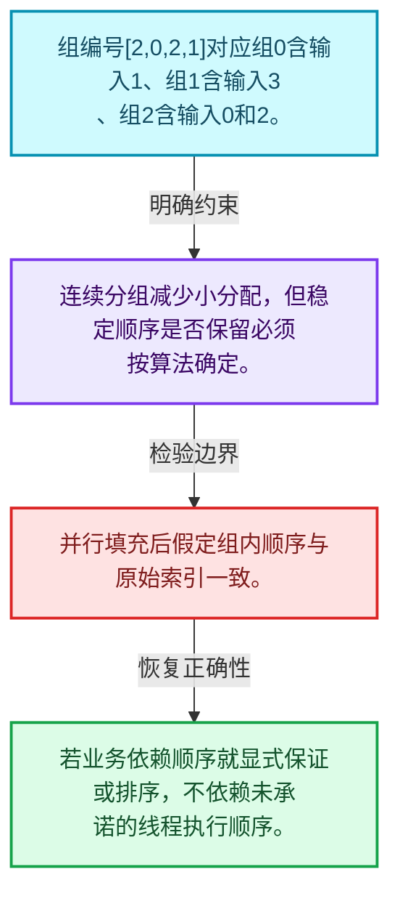
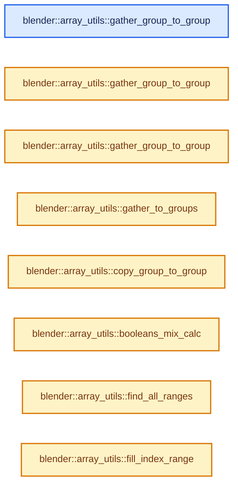
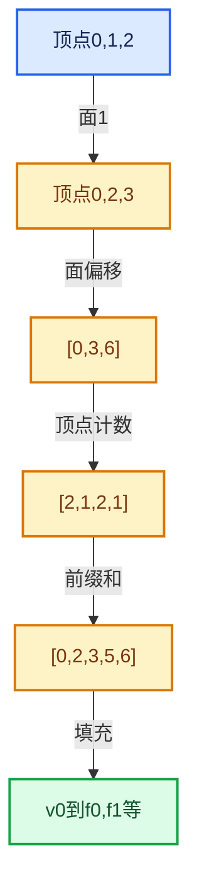

# 05-07 分组访问与反向索引

[方向导航](README.md) · [总目录](../README.md) · [实现索引](../00-课程指南/02-源码与提交索引/符号依赖与实现索引.md)

## 从问题到实现

为什么反向映射需要计数和多次遍历？

正向映射可直接索引，反向映射可能一对多；连续分组减少逐组分配但需处理稳定顺序。

**数据模型**

组编号[2,0,2,1]对应组0含输入1、组1含输入3、组2含输入0和2。

**设计取舍**

连续分组减少小分配，但稳定顺序是否保留必须按算法确定。

**最小反例**

并行填充后假定组内顺序与原始索引一致。

**推导**

若业务依赖顺序就显式保证或排序，不依赖未承诺的线程执行顺序。

## 阅读地图与执行推演








图中的数值推演是本方向的教学模型；实际函数之间的调用边与概念分析边分别标注，不能把概念关系当作运行时调度顺序。

## 完整源码单元与就地讲解

中文讲解直接放在相关代码旁，复杂机制在代码下展开。原文折叠区保留基准行号；不需要在行号表和函数之间来回查找。类布局可分段展示，函数实现不按固定行数切开。

<!-- annotated:902217bd9224d3 -->

```cpp

```

<details>
<summary>核对原始源码：source/blender/blenlib/BLI_array_utils.hh · L276—L276</summary>

<!-- original:902217bd9224d3:source/blender/blenlib/BLI_array_utils.hh:276:276 -->

```cpp

```

</details>

<a id="f-9a8d6622652e3b4f"></a>

### `blender::array_utils::gather_group_to_group`

实现位置：[source/blender/blenlib/BLI_array_utils.hh](../../../../../source/blender/blenlib/BLI_array_utils.hh) · L277—L289。

接口参数：

- `const OffsetIndices<int> src_offsets`
- `const OffsetIndices<int> dst_offsets`
- `const IndexMask &selection`
- `const Span<T> src`
- `MutableSpan<T> dst`

**教学注释版**

<!-- annotated:0ac40389ce6583 -->

```cpp
template<typename T>
inline void gather_group_to_group(const OffsetIndices<int> src_offsets,
                                  const OffsetIndices<int> dst_offsets,
                                  const IndexMask &selection,
                                  const Span<T> src,
                                  MutableSpan<T> dst)
{
  selection.foreach_index(
      [&](const int64_t src_i, const int64_t dst_i) {
        // [讲解] dst.slice：建立原连续范围的子视图。
        dst.slice(dst_offsets[dst_i]).copy_from(src.slice(src_offsets[src_i]));
      },
      exec_mode::grain_size(512));
}
```

<details>
<summary>核对原始源码：source/blender/blenlib/BLI_array_utils.hh · L277—L289</summary>

<!-- original:0ac40389ce6583:source/blender/blenlib/BLI_array_utils.hh:277:289 -->

```cpp
template<typename T>
inline void gather_group_to_group(const OffsetIndices<int> src_offsets,
                                  const OffsetIndices<int> dst_offsets,
                                  const IndexMask &selection,
                                  const Span<T> src,
                                  MutableSpan<T> dst)
{
  selection.foreach_index(
      [&](const int64_t src_i, const int64_t dst_i) {
        dst.slice(dst_offsets[dst_i]).copy_from(src.slice(src_offsets[src_i]));
      },
      exec_mode::grain_size(512));
}
```

</details>

**继续追踪实现**

- `selection.foreach_index` → [blender::index_mask::IndexMask::foreach_index · L855](../04-虚拟数组与索引选择/09-分段存储与遍历.md#f-cd6cd317e2e2812c)。
- `dst.slice(dst_offsets[dst_i]).copy_from` → [调用协议](../00-课程指南/01-路线与规范/模板宏与动态分派协议.md)：接收对象类型依赖auto、返回值或模板实例；不按同名猜测目标。调用位置L286。
- `dst.slice` → [blender::MutableSpan::slice · L579](../01-基础容器与现代CPP/06-MutableSpan可写视图.md#f-6808b4aefbf58808)；[blender::MutableSpan::slice · L587](../01-基础容器与现代CPP/06-MutableSpan可写视图.md#f-c05b010821861e4f)。同名重载需按实参类型选择。
- `src.slice` → [blender::Span::slice · L141](../01-基础容器与现代CPP/05-Span只读连续视图.md#f-380a0e8fdcbd53cc)；[blender::Span::slice · L149](../01-基础容器与现代CPP/05-Span只读连续视图.md#f-9b9c15e78dd54eec)。同名重载需按实参类型选择。
- `exec_mode::grain_size` → [blender::exec_mode::grain_size · L79](../90-实现依赖专题/01-BLI基础库/BLI_execution_mode.hh.md#f-0b4fc2f9fa6e66e7)。

<!-- annotated:72cb7749ae301b -->

```cpp

```

<details>
<summary>核对原始源码：source/blender/blenlib/BLI_array_utils.hh · L290—L290</summary>

<!-- original:72cb7749ae301b:source/blender/blenlib/BLI_array_utils.hh:290:290 -->

```cpp

```

</details>

<a id="f-330167e6d0e14cf9"></a>

### `blender::array_utils::gather_group_to_group`

实现位置：[source/blender/blenlib/BLI_array_utils.hh](../../../../../source/blender/blenlib/BLI_array_utils.hh) · L291—L303。

接口参数：

- `const OffsetIndices<int> src_offsets`
- `const OffsetIndices<int> dst_offsets`
- `const Span<int> selection`
- `const Span<T> src`
- `MutableSpan<T> dst`

**教学注释版**

<!-- annotated:a061c670e6e06f -->

```cpp
template<typename T>
inline void gather_group_to_group(const OffsetIndices<int> src_offsets,
                                  const OffsetIndices<int> dst_offsets,
                                  const Span<int> selection,
                                  const Span<T> src,
                                  MutableSpan<T> dst)
{
  // [讲解] selection.index_range：查询视图长度或生成对应有效索引区间。
  threading::parallel_for(selection.index_range(), 512, [&](const IndexRange range) {
    for (const int dst_i : range) {
      // [讲解] dst.slice：建立原连续范围的子视图。
      dst.slice(dst_offsets[dst_i]).copy_from(src.slice(src_offsets[selection[dst_i]]));
    }
  });
}
```

<details>
<summary>核对原始源码：source/blender/blenlib/BLI_array_utils.hh · L291—L303</summary>

<!-- original:a061c670e6e06f:source/blender/blenlib/BLI_array_utils.hh:291:303 -->

```cpp
template<typename T>
inline void gather_group_to_group(const OffsetIndices<int> src_offsets,
                                  const OffsetIndices<int> dst_offsets,
                                  const Span<int> selection,
                                  const Span<T> src,
                                  MutableSpan<T> dst)
{
  threading::parallel_for(selection.index_range(), 512, [&](const IndexRange range) {
    for (const int dst_i : range) {
      dst.slice(dst_offsets[dst_i]).copy_from(src.slice(src_offsets[selection[dst_i]]));
    }
  });
}
```

</details>

**继续追踪实现**

- `threading::parallel_for` → [blender::threading::parallel_for · L68](../11-Depsgraph与并行任务系统/07-任务池与TBB接入.md#f-838294754c24426c)。
- `selection.index_range` → [blender::Span::index_range · L405](../01-基础容器与现代CPP/05-Span只读连续视图.md#f-caaa9b06e13e53e0)。
- `dst.slice(dst_offsets[dst_i]).copy_from` → [调用协议](../00-课程指南/01-路线与规范/模板宏与动态分派协议.md)：接收对象类型依赖auto、返回值或模板实例；不按同名猜测目标。调用位置L300。
- `dst.slice` → [blender::MutableSpan::slice · L579](../01-基础容器与现代CPP/06-MutableSpan可写视图.md#f-6808b4aefbf58808)；[blender::MutableSpan::slice · L587](../01-基础容器与现代CPP/06-MutableSpan可写视图.md#f-c05b010821861e4f)。同名重载需按实参类型选择。
- `src.slice` → [blender::Span::slice · L141](../01-基础容器与现代CPP/05-Span只读连续视图.md#f-380a0e8fdcbd53cc)；[blender::Span::slice · L149](../01-基础容器与现代CPP/05-Span只读连续视图.md#f-9b9c15e78dd54eec)。同名重载需按实参类型选择。

<!-- annotated:fff7ce00f1ce73 -->

```cpp

```

<details>
<summary>核对原始源码：source/blender/blenlib/BLI_array_utils.hh · L304—L304</summary>

<!-- original:fff7ce00f1ce73:source/blender/blenlib/BLI_array_utils.hh:304:304 -->

```cpp

```

</details>

<a id="f-01a9cb8bd5e4abab"></a>

### `blender::array_utils::gather_group_to_group`

实现位置：[source/blender/blenlib/BLI_array_utils.hh](../../../../../source/blender/blenlib/BLI_array_utils.hh) · L305—L317。

接口参数：

- `const OffsetIndices<int> src_offsets`
- `const OffsetIndices<int> dst_offsets`
- `const IndexMask &selection`
- `const VArray<T> src`
- `MutableSpan<T> dst`

**教学注释版**

<!-- annotated:e8272d44ce437f -->

```cpp
template<typename T>
inline void gather_group_to_group(const OffsetIndices<int> src_offsets,
                                  const OffsetIndices<int> dst_offsets,
                                  const IndexMask &selection,
                                  const VArray<T> src,
                                  MutableSpan<T> dst)
{
  selection.foreach_index(
      [&](const int64_t src_i, const int64_t dst_i) {
        // [讲解] dst.slice：建立原连续范围的子视图。
        src.materialize_compressed(src_offsets[src_i], dst.slice(dst_offsets[dst_i]));
      },
      exec_mode::grain_size(512));
}
```

<details>
<summary>核对原始源码：source/blender/blenlib/BLI_array_utils.hh · L305—L317</summary>

<!-- original:e8272d44ce437f:source/blender/blenlib/BLI_array_utils.hh:305:317 -->

```cpp
template<typename T>
inline void gather_group_to_group(const OffsetIndices<int> src_offsets,
                                  const OffsetIndices<int> dst_offsets,
                                  const IndexMask &selection,
                                  const VArray<T> src,
                                  MutableSpan<T> dst)
{
  selection.foreach_index(
      [&](const int64_t src_i, const int64_t dst_i) {
        src.materialize_compressed(src_offsets[src_i], dst.slice(dst_offsets[dst_i]));
      },
      exec_mode::grain_size(512));
}
```

</details>

**继续追踪实现**

- `selection.foreach_index` → [blender::index_mask::IndexMask::foreach_index · L855](../04-虚拟数组与索引选择/09-分段存储与遍历.md#f-cd6cd317e2e2812c)。
- `src.materialize_compressed` → [调用协议](../00-课程指南/01-路线与规范/模板宏与动态分派协议.md)：由接收对象具体类型或运行时策略提供实现。调用位置L314。
- `dst.slice` → [blender::MutableSpan::slice · L579](../01-基础容器与现代CPP/06-MutableSpan可写视图.md#f-6808b4aefbf58808)；[blender::MutableSpan::slice · L587](../01-基础容器与现代CPP/06-MutableSpan可写视图.md#f-c05b010821861e4f)。同名重载需按实参类型选择。
- `exec_mode::grain_size` → [blender::exec_mode::grain_size · L79](../90-实现依赖专题/01-BLI基础库/BLI_execution_mode.hh.md#f-0b4fc2f9fa6e66e7)。

<!-- annotated:9e9cbc0c033aec -->

```cpp

```

<details>
<summary>核对原始源码：source/blender/blenlib/BLI_array_utils.hh · L318—L318</summary>

<!-- original:9e9cbc0c033aec:source/blender/blenlib/BLI_array_utils.hh:318:318 -->

```cpp

```

</details>

<a id="f-f417b7a0f21ac1c3"></a>

### `blender::array_utils::gather_to_groups`

实现位置：[source/blender/blenlib/BLI_array_utils.hh](../../../../../source/blender/blenlib/BLI_array_utils.hh) · L319—L328。

接口参数：

- `const OffsetIndices<int> dst_offsets`
- `const IndexMask &src_selection`
- `const Span<T> src`
- `MutableSpan<T> dst`

**教学注释版**

<!-- annotated:eb8b71c651e387 -->

```cpp
template<typename T>
inline void gather_to_groups(const OffsetIndices<int> dst_offsets,
                             const IndexMask &src_selection,
                             const Span<T> src,
                             MutableSpan<T> dst)
{
  src_selection.foreach_index(
      // [讲解] dst.slice：建立原连续范围的子视图。
      [&](const int src_i, const int dst_i) { dst.slice(dst_offsets[dst_i]).fill(src[src_i]); },
      exec_mode::grain_size(1024));
}
```

<details>
<summary>核对原始源码：source/blender/blenlib/BLI_array_utils.hh · L319—L328</summary>

<!-- original:eb8b71c651e387:source/blender/blenlib/BLI_array_utils.hh:319:328 -->

```cpp
template<typename T>
inline void gather_to_groups(const OffsetIndices<int> dst_offsets,
                             const IndexMask &src_selection,
                             const Span<T> src,
                             MutableSpan<T> dst)
{
  src_selection.foreach_index(
      [&](const int src_i, const int dst_i) { dst.slice(dst_offsets[dst_i]).fill(src[src_i]); },
      exec_mode::grain_size(1024));
}
```

</details>

**继续追踪实现**

- `src_selection.foreach_index` → [blender::index_mask::IndexMask::foreach_index · L855](../04-虚拟数组与索引选择/09-分段存储与遍历.md#f-cd6cd317e2e2812c)。
- `dst.slice(dst_offsets[dst_i]).fill` → [调用协议](../00-课程指南/01-路线与规范/模板宏与动态分派协议.md)：接收对象类型依赖auto、返回值或模板实例；不按同名猜测目标。调用位置L326。
- `dst.slice` → [blender::MutableSpan::slice · L579](../01-基础容器与现代CPP/06-MutableSpan可写视图.md#f-6808b4aefbf58808)；[blender::MutableSpan::slice · L587](../01-基础容器与现代CPP/06-MutableSpan可写视图.md#f-c05b010821861e4f)。同名重载需按实参类型选择。
- `exec_mode::grain_size` → [blender::exec_mode::grain_size · L79](../90-实现依赖专题/01-BLI基础库/BLI_execution_mode.hh.md#f-0b4fc2f9fa6e66e7)。

### 类型布局、声明与编译条件 · BLI_array_utils.hh L329—L339

<!-- annotated:f1f4fd85ecd852 -->

```cpp

/**
 * Copy the \a src data from the groups defined by \a src_offsets to the groups in \a dst defined
 * by \a dst_offsets. Groups to use are masked by \a selection, and it is assumed that the
 * corresponding groups have the same size.
 */
void copy_group_to_group(OffsetIndices<int> src_offsets,
                         OffsetIndices<int> dst_offsets,
                         const IndexMask &selection,
                         GSpan src,
                         GMutableSpan dst);
```

<details>
<summary>核对原始源码：source/blender/blenlib/BLI_array_utils.hh · L329—L339</summary>

<!-- original:f1f4fd85ecd852:source/blender/blenlib/BLI_array_utils.hh:329:339 -->

```cpp

/**
 * Copy the \a src data from the groups defined by \a src_offsets to the groups in \a dst defined
 * by \a dst_offsets. Groups to use are masked by \a selection, and it is assumed that the
 * corresponding groups have the same size.
 */
void copy_group_to_group(OffsetIndices<int> src_offsets,
                         OffsetIndices<int> dst_offsets,
                         const IndexMask &selection,
                         GSpan src,
                         GMutableSpan dst);
```

</details>

<a id="f-0e7685e7fb20237e"></a>

### `blender::array_utils::copy_group_to_group`

实现位置：[source/blender/blenlib/BLI_array_utils.hh](../../../../../source/blender/blenlib/BLI_array_utils.hh) · L340—L348。

接口参数：

- `OffsetIndices<int> src_offsets`
- `OffsetIndices<int> dst_offsets`
- `const IndexMask &selection`
- `Span<T> src`
- `MutableSpan<T> dst`

**教学注释版**

<!-- annotated:86fe94f53e1639 -->

```cpp
template<typename T>
void copy_group_to_group(OffsetIndices<int> src_offsets,
                         OffsetIndices<int> dst_offsets,
                         const IndexMask &selection,
                         Span<T> src,
                         MutableSpan<T> dst)
{
  copy_group_to_group(src_offsets, dst_offsets, selection, GSpan(src), GMutableSpan(dst));
}
```

<details>
<summary>核对原始源码：source/blender/blenlib/BLI_array_utils.hh · L340—L348</summary>

<!-- original:86fe94f53e1639:source/blender/blenlib/BLI_array_utils.hh:340:348 -->

```cpp
template<typename T>
void copy_group_to_group(OffsetIndices<int> src_offsets,
                         OffsetIndices<int> dst_offsets,
                         const IndexMask &selection,
                         Span<T> src,
                         MutableSpan<T> dst)
{
  copy_group_to_group(src_offsets, dst_offsets, selection, GSpan(src), GMutableSpan(dst));
}
```

</details>

**继续追踪实现**

- `copy_group_to_group` → [blender::array_utils::copy_group_to_group · L340](07-分组访问与反向索引.md#f-0e7685e7fb20237e)。
- `GSpan` → [blender::GSpan::GSpan · L26](../03-内存分配与运行时类型/11-GSpan与GArray.md#f-9d0c95702007eea6)；[blender::GSpan::GSpan · L28](../03-内存分配与运行时类型/11-GSpan与GArray.md#f-6650bd08c7eecc66)；[blender::GSpan::GSpan · L37](../03-内存分配与运行时类型/11-GSpan与GArray.md#f-bf180950832673fb)；[blender::GSpan::GSpan · L39](../03-内存分配与运行时类型/11-GSpan与GArray.md#f-cf949d5590ea9ab6)；[blender::GSpan::GSpan · L41](../03-内存分配与运行时类型/11-GSpan与GArray.md#f-a66ab52ee0842aee)；[blender::GSpan::GSpan · L43](../03-内存分配与运行时类型/11-GSpan与GArray.md#f-d9084fa10964390f)；[blender::GSpan::GSpan · L49](../03-内存分配与运行时类型/11-GSpan与GArray.md#f-76e3de3cc3d65761)。同名重载需按实参类型选择。
- `GMutableSpan` → [blender::GMutableSpan::GMutableSpan · L152](../03-内存分配与运行时类型/11-GSpan与GArray.md#f-b4ef5399177eeedd)；[blender::GMutableSpan::GMutableSpan · L154](../03-内存分配与运行时类型/11-GSpan与GArray.md#f-6439a40f33c7a2e5)；[blender::GMutableSpan::GMutableSpan · L163](../03-内存分配与运行时类型/11-GSpan与GArray.md#f-6054339faadc1405)；[blender::GMutableSpan::GMutableSpan · L167](../03-内存分配与运行时类型/11-GSpan与GArray.md#f-d1333b42c7982310)；[blender::GMutableSpan::GMutableSpan · L169](../03-内存分配与运行时类型/11-GSpan与GArray.md#f-3584f997d0fe9a96)；[blender::GMutableSpan::GMutableSpan · L171](../03-内存分配与运行时类型/11-GSpan与GArray.md#f-3074afdbe5232417)。同名重载需按实参类型选择。

### 类型布局、声明与编译条件 · BLI_array_utils.hh L349—L386

<a id="t-75fc6ac0bc0c"></a>

<!-- annotated:6b5921c088510a -->

```cpp

/**
 * Count the number of occurrences of each index.
 * \param indices: The indices to count.
 * \param counts: The number of occurrences of each index. Typically initialized to zero.
 * Must be large enough to contain the maximum index.
 *
 * \note The memory referenced by the two spans must not overlap.
 */
void count_indices(Span<int> indices, MutableSpan<int> counts);

/**
 * Find a compact index for every unique arbitrary ID, in the order that the IDs first appear.
 *
 * \param mask: The elements whose IDs are processed.
 * \param r_group_indices: The group index of every element, for every index in the mask.
 * \param r_first_indices: Optional. Filled with the first element with each ID, for every group,
 * which can be useful to choose a representative element for each group.
 * \return The number of groups.
 */
int group_ids_to_indices(Span<int> ids,
                         const IndexMask &mask,
                         MutableSpan<int> r_group_indices,
                         Vector<int> *r_first_indices = nullptr);

void invert_booleans(MutableSpan<bool> span);
void invert_booleans(MutableSpan<bool> span, const IndexMask &mask);

int64_t count_booleans(const VArray<bool> &varray);
int64_t count_booleans(const VArray<bool> &varray, const IndexMask &mask);

enum class BooleanMix {
  None,
  AllFalse,
  AllTrue,
  Mixed,
};
BooleanMix booleans_mix_calc(const VArray<bool> &varray, IndexRange range_to_check);
```

<details>
<summary>核对原始源码：source/blender/blenlib/BLI_array_utils.hh · L349—L386</summary>

<!-- original:6b5921c088510a:source/blender/blenlib/BLI_array_utils.hh:349:386 -->

```cpp

/**
 * Count the number of occurrences of each index.
 * \param indices: The indices to count.
 * \param counts: The number of occurrences of each index. Typically initialized to zero.
 * Must be large enough to contain the maximum index.
 *
 * \note The memory referenced by the two spans must not overlap.
 */
void count_indices(Span<int> indices, MutableSpan<int> counts);

/**
 * Find a compact index for every unique arbitrary ID, in the order that the IDs first appear.
 *
 * \param mask: The elements whose IDs are processed.
 * \param r_group_indices: The group index of every element, for every index in the mask.
 * \param r_first_indices: Optional. Filled with the first element with each ID, for every group,
 * which can be useful to choose a representative element for each group.
 * \return The number of groups.
 */
int group_ids_to_indices(Span<int> ids,
                         const IndexMask &mask,
                         MutableSpan<int> r_group_indices,
                         Vector<int> *r_first_indices = nullptr);

void invert_booleans(MutableSpan<bool> span);
void invert_booleans(MutableSpan<bool> span, const IndexMask &mask);

int64_t count_booleans(const VArray<bool> &varray);
int64_t count_booleans(const VArray<bool> &varray, const IndexMask &mask);

enum class BooleanMix {
  None,
  AllFalse,
  AllTrue,
  Mixed,
};
BooleanMix booleans_mix_calc(const VArray<bool> &varray, IndexRange range_to_check);
```

</details>

<a id="f-aa790c55b250b597"></a>

### `blender::array_utils::booleans_mix_calc`

实现位置：[source/blender/blenlib/BLI_array_utils.hh](../../../../../source/blender/blenlib/BLI_array_utils.hh) · L387—L390。

接口参数：

- `const VArray<bool> &varray`

**教学注释版**

<!-- annotated:439e14f31cf20f -->

```cpp
inline BooleanMix booleans_mix_calc(const VArray<bool> &varray)
{
  return booleans_mix_calc(varray, varray.index_range());
}
```

<details>
<summary>核对原始源码：source/blender/blenlib/BLI_array_utils.hh · L387—L390</summary>

<!-- original:439e14f31cf20f:source/blender/blenlib/BLI_array_utils.hh:387:390 -->

```cpp
inline BooleanMix booleans_mix_calc(const VArray<bool> &varray)
{
  return booleans_mix_calc(varray, varray.index_range());
}
```

</details>

**结果出口**

- `return booleans_mix_calc(varray, varray.index_range());`

**继续追踪实现**

- `booleans_mix_calc` → [blender::array_utils::booleans_mix_calc · L387](07-分组访问与反向索引.md#f-aa790c55b250b597)。
- `varray.index_range` → [调用协议](../00-课程指南/01-路线与规范/模板宏与动态分派协议.md)：由接收对象具体类型或运行时策略提供实现。调用位置L389。

### 类型布局、声明与编译条件 · BLI_array_utils.hh L391—L407

<!-- annotated:2ce5d362b6516c -->

```cpp

/** Check if the value exists in the array. */
bool contains(const VArray<bool> &varray, const IndexMask &indices_to_check, bool value);

/** Return indices in the mask that are non-negative. */
IndexMask indices_non_negative(const IndexMask &universe,
                               Span<int> values,
                               LinearAllocator<> &memory);
/** Return indices in the mask that are not negative and less than the given size. */
IndexMask indices_in_range(const IndexMask &universe,
                           Span<int> values,
                           IndexRange range,
                           LinearAllocator<> &memory);

/**
 * Finds all the index ranges for which consecutive values in \a span equal \a value.
 */
```

<details>
<summary>核对原始源码：source/blender/blenlib/BLI_array_utils.hh · L391—L407</summary>

<!-- original:2ce5d362b6516c:source/blender/blenlib/BLI_array_utils.hh:391:407 -->

```cpp

/** Check if the value exists in the array. */
bool contains(const VArray<bool> &varray, const IndexMask &indices_to_check, bool value);

/** Return indices in the mask that are non-negative. */
IndexMask indices_non_negative(const IndexMask &universe,
                               Span<int> values,
                               LinearAllocator<> &memory);
/** Return indices in the mask that are not negative and less than the given size. */
IndexMask indices_in_range(const IndexMask &universe,
                           Span<int> values,
                           IndexRange range,
                           LinearAllocator<> &memory);

/**
 * Finds all the index ranges for which consecutive values in \a span equal \a value.
 */
```

</details>

<a id="f-c2d9cbb49d70df09"></a>

### `blender::array_utils::find_all_ranges`

实现位置：[source/blender/blenlib/BLI_array_utils.hh](../../../../../source/blender/blenlib/BLI_array_utils.hh) · L408—L428。

接口参数：

- `const Span<T> span`
- `const T &value`

**教学注释版**

<!-- annotated:692f27b36bc57e -->

```cpp
template<typename T> inline Vector<IndexRange> find_all_ranges(const Span<T> span, const T &value)
{
  // [讲解] span.is_empty：查询视图长度或生成对应有效索引区间。
  if (span.is_empty()) {
    return Vector<IndexRange>();
  }
  Vector<IndexRange> ranges;
  // [讲解] span.first：按视图边界访问元素。
  int64_t length = (span.first() == value) ? 1 : 0;
  // [讲解] span.index_range：查询视图长度或生成对应有效索引区间。
  for (const int64_t i : span.index_range().drop_front(1)) {
    if (span[i - 1] == value && span[i] != value) {
      // [讲解] ranges.append：在尾部建立新元素，必要时先扩大存储。
      ranges.append(IndexRange::from_end_size(i, length));
      length = 0;
    }
    else if (span[i] == value) {
      length++;
    }
  }
  if (length > 0) {
    // [讲解] span.size：查询视图长度或生成对应有效索引区间。
    ranges.append(IndexRange::from_end_size(span.size(), length));
  }
  return ranges;
}
```

<details>
<summary>核对原始源码：source/blender/blenlib/BLI_array_utils.hh · L408—L428</summary>

<!-- original:692f27b36bc57e:source/blender/blenlib/BLI_array_utils.hh:408:428 -->

```cpp
template<typename T> inline Vector<IndexRange> find_all_ranges(const Span<T> span, const T &value)
{
  if (span.is_empty()) {
    return Vector<IndexRange>();
  }
  Vector<IndexRange> ranges;
  int64_t length = (span.first() == value) ? 1 : 0;
  for (const int64_t i : span.index_range().drop_front(1)) {
    if (span[i - 1] == value && span[i] != value) {
      ranges.append(IndexRange::from_end_size(i, length));
      length = 0;
    }
    else if (span[i] == value) {
      length++;
    }
  }
  if (length > 0) {
    ranges.append(IndexRange::from_end_size(span.size(), length));
  }
  return ranges;
}
```

</details>

**沿实际写入检查状态**

- `length = 0;`

**结果出口**

- `return Vector<IndexRange>();`
- `return ranges;`

**继续追踪实现**

- `span.is_empty` → [blender::Span::is_empty · L264](../01-基础容器与现代CPP/05-Span只读连续视图.md#f-8cc1d7ba8feb50e6)。
- `Vector<IndexRange>` → [KDL::Vector](../90-实现依赖专题/07-Intern运行时与平台/itasc/kdl/utilities/traits.h.md#t-3494ab227c7f)；[KDL::Vector](../90-实现依赖专题/07-Intern运行时与平台/itasc/kdl/frames.hpp.md#t-7db3cae4c06c)；[KDL::Vector](../90-实现依赖专题/07-Intern运行时与平台/itasc/kdl/frames.hpp.md#t-d9f123375f9e)；[blender::Vector](../90-实现依赖专题/01-BLI基础库/BLI_vector.hh.md#t-14451f176559)；[blender::nodes::decl::Vector](../90-实现依赖专题/04-Nodes节点系统/NOD_socket_declarations.hh.md#t-244cfac6be12)。
- `span.first` → [blender::Span::first · L319](../01-基础容器与现代CPP/05-Span只读连续视图.md#f-d8c9bcc3e9757248)。
- `span.index_range().drop_front` → [调用协议](../00-课程指南/01-路线与规范/模板宏与动态分派协议.md)：接收对象类型依赖auto、返回值或模板实例；不按同名猜测目标。调用位置L415。
- `span.index_range` → [blender::Span::index_range · L405](../01-基础容器与现代CPP/05-Span只读连续视图.md#f-caaa9b06e13e53e0)。
- `ranges.append` → [blender::Vector::append · L498](../01-基础容器与现代CPP/11-Vector插入删除与重排.md#f-5bde268a69e443ec)；[blender::Vector::append · L502](../01-基础容器与现代CPP/11-Vector插入删除与重排.md#f-591e0b15e6308532)。同名重载需按实参类型选择。
- `IndexRange::from_end_size` → [blender::IndexRange::from_end_size · L88](../01-基础容器与现代CPP/04-IndexRange连续整数区间.md#f-14a2146987e7c92d)。
- `span.size` → [blender::Span::size · L256](../01-基础容器与现代CPP/05-Span只读连续视图.md#f-5f80fa006089c998)。

### 类型布局、声明与编译条件 · BLI_array_utils.hh L429—L433

<!-- annotated:8a065bdd432c06 -->

```cpp

/**
 * Fill the span with increasing indices: 0, 1, 2, ...
 * Optionally, the start value can be provided.
 */
```

<details>
<summary>核对原始源码：source/blender/blenlib/BLI_array_utils.hh · L429—L433</summary>

<!-- original:8a065bdd432c06:source/blender/blenlib/BLI_array_utils.hh:429:433 -->

```cpp

/**
 * Fill the span with increasing indices: 0, 1, 2, ...
 * Optionally, the start value can be provided.
 */
```

</details>

<a id="f-f8128b104d76df0f"></a>

### `blender::array_utils::fill_index_range`

实现位置：[source/blender/blenlib/BLI_array_utils.hh](../../../../../source/blender/blenlib/BLI_array_utils.hh) · L434—L437。

接口参数：

- `MutableSpan<T> span`
- `const T start = 0`

**教学注释版**

<!-- annotated:425c9d3a3651e6 -->

```cpp
template<typename T> inline void fill_index_range(MutableSpan<T> span, const T start = 0)
{
  // [讲解] span.begin：返回借用范围的地址。
  std::iota(span.begin(), span.end(), start);
}
```

<details>
<summary>核对原始源码：source/blender/blenlib/BLI_array_utils.hh · L434—L437</summary>

<!-- original:425c9d3a3651e6:source/blender/blenlib/BLI_array_utils.hh:434:437 -->

```cpp
template<typename T> inline void fill_index_range(MutableSpan<T> span, const T start = 0)
{
  std::iota(span.begin(), span.end(), start);
}
```

</details>

**继续追踪实现**

- `std::iota` → [外部契约](https://eel.is/c++draft/)：这个边界按实际表达式及所属类型核对参数、返回值、寿命与失败行为。这里提供接口入口，不声称已解释该第三方版本的内部实现。
- `span.begin` → [blender::MutableSpan::begin · L550](../01-基础容器与现代CPP/06-MutableSpan可写视图.md#f-02a6b28889d59da1)。
- `span.end` → [blender::MutableSpan::end · L554](../01-基础容器与现代CPP/06-MutableSpan可写视图.md#f-4bf60034b9ddbc44)。

<!-- annotated:26b9aeaa8b6886 -->

```cpp

```

<details>
<summary>核对原始源码：source/blender/blenlib/BLI_array_utils.hh · L438—L438</summary>

<!-- original:26b9aeaa8b6886:source/blender/blenlib/BLI_array_utils.hh:438:438 -->

```cpp

```

</details>

<a id="f-95ca84458bfc7e7e"></a>

### `blender::array_utils::fill_index_range`

实现位置：[source/blender/blenlib/BLI_array_utils.hh](../../../../../source/blender/blenlib/BLI_array_utils.hh) · L439—L443。

接口参数：

- `const IndexMask &mask`
- `MutableSpan<T> span`
- `const Mode mode = {}`

**教学注释版**

<!-- annotated:e31fbcacd12340 -->

```cpp
template<typename T, exec_mode::Tag Mode = exec_mode::Parallel>
inline void fill_index_range(const IndexMask &mask, MutableSpan<T> span, const Mode mode = {})
{
  mask.foreach_index_optimized<T>([&](const T index) { span[index] = index; }, mode);
}
```

<details>
<summary>核对原始源码：source/blender/blenlib/BLI_array_utils.hh · L439—L443</summary>

<!-- original:e31fbcacd12340:source/blender/blenlib/BLI_array_utils.hh:439:443 -->

```cpp
template<typename T, exec_mode::Tag Mode = exec_mode::Parallel>
inline void fill_index_range(const IndexMask &mask, MutableSpan<T> span, const Mode mode = {})
{
  mask.foreach_index_optimized<T>([&](const T index) { span[index] = index; }, mode);
}
```

</details>

**继续追踪实现**

- `mask.foreach_index_optimized<T>` → [blender::index_mask::IndexMask::foreach_index_optimized · L937](../04-虚拟数组与索引选择/12-重构历史与基准练习.md#f-a2c3e7876407eaaf)。

<!-- annotated:2788f2fa161d7a -->

```cpp

```

<details>
<summary>核对原始源码：source/blender/blenlib/BLI_array_utils.hh · L444—L444</summary>

<!-- original:2788f2fa161d7a:source/blender/blenlib/BLI_array_utils.hh:444:444 -->

```cpp

```

</details>

<a id="f-c11b114c213cd61a"></a>

### `blender::array_utils::fill_index_range`

实现位置：[source/blender/blenlib/BLI_array_utils.hh](../../../../../source/blender/blenlib/BLI_array_utils.hh) · L445—L457。

接口参数：

- `const IndexMask &mask`
- `MutableSpan<T> span`
- `const T start`
- `const Mode mode = {}`

**教学注释版**

<!-- annotated:4334bcd4229470 -->

```cpp
template<typename T, exec_mode::Tag Mode = exec_mode::Parallel>
inline void fill_index_range(const IndexMask &mask,
                             MutableSpan<T> span,
                             const T start,
                             const Mode mode = {})
{
  if (start == 0) {
    fill_index_range(mask, span, mode);
  }
  else {
    mask.foreach_index_optimized<T>([&](const T index) { span[index] = start + index; }, mode);
  }
}
```

<details>
<summary>核对原始源码：source/blender/blenlib/BLI_array_utils.hh · L445—L457</summary>

<!-- original:4334bcd4229470:source/blender/blenlib/BLI_array_utils.hh:445:457 -->

```cpp
template<typename T, exec_mode::Tag Mode = exec_mode::Parallel>
inline void fill_index_range(const IndexMask &mask,
                             MutableSpan<T> span,
                             const T start,
                             const Mode mode = {})
{
  if (start == 0) {
    fill_index_range(mask, span, mode);
  }
  else {
    mask.foreach_index_optimized<T>([&](const T index) { span[index] = start + index; }, mode);
  }
}
```

</details>

**继续追踪实现**

- `fill_index_range` → [blender::array_utils::fill_index_range · L434](07-分组访问与反向索引.md#f-f8128b104d76df0f)；[blender::array_utils::fill_index_range · L439](07-分组访问与反向索引.md#f-95ca84458bfc7e7e)；[blender::array_utils::fill_index_range · L445](07-分组访问与反向索引.md#f-c11b114c213cd61a)。同名重载需按实参类型选择。
- `mask.foreach_index_optimized<T>` → [blender::index_mask::IndexMask::foreach_index_optimized · L937](../04-虚拟数组与索引选择/12-重构历史与基准练习.md#f-a2c3e7876407eaaf)。

<!-- annotated:c69f6c32fe7dd0 -->

```cpp

```

<details>
<summary>核对原始源码：source/blender/blenlib/BLI_array_utils.hh · L458—L458</summary>

<!-- original:c69f6c32fe7dd0:source/blender/blenlib/BLI_array_utils.hh:458:458 -->

```cpp

```

</details>

<a id="f-ecd395133ccba511"></a>

### `blender::array_utils::indexed_data_equal`

实现位置：[source/blender/blenlib/BLI_array_utils.hh](../../../../../source/blender/blenlib/BLI_array_utils.hh) · L459—L469。

接口参数：

- `const Span<T> all_values`
- `const Span<int> indices`
- `const Span<T> values`

**教学注释版**

<!-- annotated:70521ba790eb58 -->

```cpp
template<typename T>
bool indexed_data_equal(const Span<T> all_values, const Span<int> indices, const Span<T> values)
{
  // [讲解] indices.size：查询视图长度或生成对应有效索引区间。
  BLI_assert(indices.size() == values.size());
  // [讲解] indices.index_range：查询视图长度或生成对应有效索引区间。
  for (const int i : indices.index_range()) {
    if (all_values[indices[i]] != values[i]) {
      return false;
    }
  }
  return true;
}
```

<details>
<summary>核对原始源码：source/blender/blenlib/BLI_array_utils.hh · L459—L469</summary>

<!-- original:70521ba790eb58:source/blender/blenlib/BLI_array_utils.hh:459:469 -->

```cpp
template<typename T>
bool indexed_data_equal(const Span<T> all_values, const Span<int> indices, const Span<T> values)
{
  BLI_assert(indices.size() == values.size());
  for (const int i : indices.index_range()) {
    if (all_values[indices[i]] != values[i]) {
      return false;
    }
  }
  return true;
}
```

</details>

**结果出口**

- `return false;`
- `return true;`

**继续追踪实现**

- `BLI_assert` → [BLI_assert · L48](../90-实现依赖专题/01-BLI基础库/BLI_assert.hh.md#m-57a88495704d)；[BLI_assert · L63](../90-实现依赖专题/01-BLI基础库/BLI_assert.hh.md#m-d07050020cb5)。宏定义由构建条件选择。
- `indices.size` → [blender::Span::size · L256](../01-基础容器与现代CPP/05-Span只读连续视图.md#f-5f80fa006089c998)。
- `values.size` → [blender::Span::size · L256](../01-基础容器与现代CPP/05-Span只读连续视图.md#f-5f80fa006089c998)。
- `indices.index_range` → [blender::Span::index_range · L405](../01-基础容器与现代CPP/05-Span只读连续视图.md#f-caaa9b06e13e53e0)。

### 类型布局、声明与编译条件 · BLI_array_utils.hh L470—L476

<!-- annotated:154530c7efaea8 -->

```cpp

bool indices_are_range(Span<int> indices, IndexRange range);

/**
 * Returns the index of the (first) maximum element in the virtual array or std::nullopt if the
 * array is empty.
 */
```

<details>
<summary>核对原始源码：source/blender/blenlib/BLI_array_utils.hh · L470—L476</summary>

<!-- original:154530c7efaea8:source/blender/blenlib/BLI_array_utils.hh:470:476 -->

```cpp

bool indices_are_range(Span<int> indices, IndexRange range);

/**
 * Returns the index of the (first) maximum element in the virtual array or std::nullopt if the
 * array is empty.
 */
```

</details>

<a id="f-f316f6bf293c736a"></a>

### `blender::array_utils::max_element_index`

实现位置：[source/blender/blenlib/BLI_array_utils.hh](../../../../../source/blender/blenlib/BLI_array_utils.hh) · L477—L500。

接口参数：

- `const Span<T> &span`
- `const int64_t grain_size = 8192`

**教学注释版**

<!-- annotated:41bce72d27c27d -->

```cpp
template<typename T>
inline std::optional<int64_t> max_element_index(const Span<T> &span,
                                                const int64_t grain_size = 8192)
{
  const T *max_it = threading::parallel_reduce(
      // [讲解] span.index_range：查询视图长度或生成对应有效索引区间。
      span.index_range(),
      grain_size,
      // [讲解] span.begin：返回借用范围的地址。
      span.begin(),
      [&](const IndexRange range, const T *init_max) {
        // [讲解] span.slice：建立原连续范围的子视图。
        const Span<T> sub_span = span.slice(range);
        // [讲解] sub_span.end：返回借用范围的地址。
        const T *max_elem = std::max_element(sub_span.begin(), sub_span.end());
        if (*max_elem < *init_max) {
          return init_max;
        }
        return max_elem;
      },
      [&](const T *a, const T *b) {
        if (*a < *b) {
          return a;
        }
        return b;
      });
  return std::distance(span.begin(), max_it);
}
```

<details>
<summary>核对原始源码：source/blender/blenlib/BLI_array_utils.hh · L477—L500</summary>

<!-- original:41bce72d27c27d:source/blender/blenlib/BLI_array_utils.hh:477:500 -->

```cpp
template<typename T>
inline std::optional<int64_t> max_element_index(const Span<T> &span,
                                                const int64_t grain_size = 8192)
{
  const T *max_it = threading::parallel_reduce(
      span.index_range(),
      grain_size,
      span.begin(),
      [&](const IndexRange range, const T *init_max) {
        const Span<T> sub_span = span.slice(range);
        const T *max_elem = std::max_element(sub_span.begin(), sub_span.end());
        if (*max_elem < *init_max) {
          return init_max;
        }
        return max_elem;
      },
      [&](const T *a, const T *b) {
        if (*a < *b) {
          return a;
        }
        return b;
      });
  return std::distance(span.begin(), max_it);
}
```

</details>

**结果出口**

- `return init_max;`
- `return max_elem;`
- `return a;`
- `return b;`
- `return std::distance(span.begin(), max_it);`

**继续追踪实现**

- `threading::parallel_reduce` → [blender::threading::parallel_reduce · L126](../11-Depsgraph与并行任务系统/07-任务池与TBB接入.md#f-9225ddb5efb97fcc)。
- `span.index_range` → [blender::Span::index_range · L405](../01-基础容器与现代CPP/05-Span只读连续视图.md#f-caaa9b06e13e53e0)。
- `span.begin` → [blender::Span::begin · L224](../01-基础容器与现代CPP/05-Span只读连续视图.md#f-415883b512284f46)。
- `span.slice` → [blender::Span::slice · L141](../01-基础容器与现代CPP/05-Span只读连续视图.md#f-380a0e8fdcbd53cc)；[blender::Span::slice · L149](../01-基础容器与现代CPP/05-Span只读连续视图.md#f-9b9c15e78dd54eec)。同名重载需按实参类型选择。
- `std::max_element` → [外部契约](https://eel.is/c++draft/)：这个边界按实际表达式及所属类型核对参数、返回值、寿命与失败行为。这里提供接口入口，不声称已解释该第三方版本的内部实现。
- `sub_span.begin` → [blender::Span::begin · L224](../01-基础容器与现代CPP/05-Span只读连续视图.md#f-415883b512284f46)。
- `sub_span.end` → [blender::Span::end · L228](../01-基础容器与现代CPP/05-Span只读连续视图.md#f-a7d8b9e494c291a7)。
- `std::distance` → [外部契约](https://eel.is/c++draft/)：这个边界按实际表达式及所属类型核对参数、返回值、寿命与失败行为。这里提供接口入口，不声称已解释该第三方版本的内部实现。

<a id="f-8340f4a761328013"></a>

### `blender::array_utils::max_element_index`

实现位置：[source/blender/blenlib/BLI_array_utils.hh](../../../../../source/blender/blenlib/BLI_array_utils.hh) · L501—L535。

接口参数：

- `const VArray<T> &array`
- `const int64_t grain_size = 8192`

**教学注释版**

<!-- annotated:220eafc94bcdb7 -->

```cpp
template<typename T>
inline std::optional<int64_t> max_element_index(const VArray<T> &array,
                                                const int64_t grain_size = 8192)
{
  if (!array || array.is_empty()) {
    return std::nullopt;
  }
  if (array.is_single()) {
    return array.first();
  }
  if (array.is_span()) {
    return max_element_index(array.get_internal_span(), grain_size);
  }
  return threading::parallel_reduce(
      array.index_range(),
      grain_size,
      array.first(),
      [&](const IndexRange range, const int64_t init_i) {
        int64_t max_index = init_i;
        T max_elem = array[max_index];
        for (const int i : range) {
          if (max_elem < array[i]) {
            max_index = i;
            max_elem = array[i];
          }
        }
        return max_index;
      },
      [&](const int64_t index_a, const int64_t index_b) {
        if (array[index_a] < array[index_b]) {
          return index_b;
        }
        return index_a;
      });
}
```

<details>
<summary>核对原始源码：source/blender/blenlib/BLI_array_utils.hh · L501—L535</summary>

<!-- original:220eafc94bcdb7:source/blender/blenlib/BLI_array_utils.hh:501:535 -->

```cpp
template<typename T>
inline std::optional<int64_t> max_element_index(const VArray<T> &array,
                                                const int64_t grain_size = 8192)
{
  if (!array || array.is_empty()) {
    return std::nullopt;
  }
  if (array.is_single()) {
    return array.first();
  }
  if (array.is_span()) {
    return max_element_index(array.get_internal_span(), grain_size);
  }
  return threading::parallel_reduce(
      array.index_range(),
      grain_size,
      array.first(),
      [&](const IndexRange range, const int64_t init_i) {
        int64_t max_index = init_i;
        T max_elem = array[max_index];
        for (const int i : range) {
          if (max_elem < array[i]) {
            max_index = i;
            max_elem = array[i];
          }
        }
        return max_index;
      },
      [&](const int64_t index_a, const int64_t index_b) {
        if (array[index_a] < array[index_b]) {
          return index_b;
        }
        return index_a;
      });
}
```

</details>

**沿实际写入检查状态**

- `max_index = i;`
- `max_elem = array[i];`

**结果出口**

- `return std::nullopt;`
- `return array.first();`
- `return max_element_index(array.get_internal_span(), grain_size);`
- `return threading::parallel_reduce(`
- `return max_index;`
- `return index_b;`
- `return index_a;`

**继续追踪实现**

- `array.is_empty` → [调用协议](../00-课程指南/01-路线与规范/模板宏与动态分派协议.md)：由接收对象具体类型或运行时策略提供实现。调用位置L505。
- `array.is_single` → [调用协议](../00-课程指南/01-路线与规范/模板宏与动态分派协议.md)：由接收对象具体类型或运行时策略提供实现。调用位置L508。
- `array.first` → [调用协议](../00-课程指南/01-路线与规范/模板宏与动态分派协议.md)：由接收对象具体类型或运行时策略提供实现。调用位置L509。
- `array.is_span` → [调用协议](../00-课程指南/01-路线与规范/模板宏与动态分派协议.md)：由接收对象具体类型或运行时策略提供实现。调用位置L511。
- `max_element_index` → [blender::array_utils::max_element_index · L477](07-分组访问与反向索引.md#f-f316f6bf293c736a)；[blender::array_utils::max_element_index · L501](07-分组访问与反向索引.md#f-8340f4a761328013)。同名重载需按实参类型选择。
- `array.get_internal_span` → [调用协议](../00-课程指南/01-路线与规范/模板宏与动态分派协议.md)：由接收对象具体类型或运行时策略提供实现。调用位置L512。
- `threading::parallel_reduce` → [blender::threading::parallel_reduce · L126](../11-Depsgraph与并行任务系统/07-任务池与TBB接入.md#f-9225ddb5efb97fcc)。
- `array.index_range` → [调用协议](../00-课程指南/01-路线与规范/模板宏与动态分派协议.md)：由接收对象具体类型或运行时策略提供实现。调用位置L515。

### 类型布局、声明与编译条件 · BLI_array_utils.hh L536—L537

<!-- annotated:42346f1d7251a6 -->

```cpp

}  // namespace blender::array_utils
```

<details>
<summary>核对原始源码：source/blender/blenlib/BLI_array_utils.hh · L536—L537</summary>

<!-- original:42346f1d7251a6:source/blender/blenlib/BLI_array_utils.hh:536:537 -->

```cpp

}  // namespace blender::array_utils
```

</details>

## 语法与相关类型

### 模板 template

模板把类型或常量作为生成实现的参数。读声明时先列出类型参数、非类型参数和默认值，再看使用者实际实例化了什么。模板声明本身不意味着每种T都支持其全部成员。

把T替换为int、string、只能移动的类型，分别检查每个被调用操作是否成立。

### 依赖名称 typename

typename既可引入类型模板参数，也可告诉编译器某个依赖名称是类型。它不创建运行时对象；解析期确认语法类别与实例化期检查具体类型是不同阶段。

区分typename T::value_type和T::size()，前者标记类型，后者是表达式。

### 只读限定 const

const约束当前访问路径可做的修改。const指针、指向const的指针、const视图对象、const元素是不同位置的限定；其他别名可能仍可修改原对象。

分别写T* const、const T*与const T* const，并画出不可修改的层次。

### 运行时多态 virtual

虚调用根据实际动态类型选择实现；经基类指针销毁对象时通常需要相应虚析构契约。每元素虚调用和循环外一次分派有不同开销。

找出虚接口的实现类和调用频率，再讨论是否值得去虚拟化。

### 可选值 optional

optional把不存在与存在的T区分开，T的构造和析构跟随engaged状态变化。访问前应由has_value或条件分支证明存在。

把空Field状态与合法常量零区分，不能用某个普通值代替不存在。

### 内部断言 assert

断言表达开发者预期成立的内部契约，发布构建可能关闭。它不能替代对不可信输入的完整错误处理，也不保证后续操作被运行时保护。

对每条断言构造违反条件的输入，区分调用者错误与应向用户报告的错误。

### 枚举与状态模型 enum

枚举把有限状态命名；enum class避免许多隐式整数转换。状态机正确性还依赖允许的转移，不能只看有哪些枚举项。

列出每个状态的进入条件和离开条件，检查终止状态是否仍可能被调度。

## 实现练习与验证

用目标组编号2、0、2、1生成分组索引。

参考推理：若业务依赖顺序就显式保证或排序，不依赖未承诺的线程执行顺序。

偏移单调不减；最终偏移与存储边界对应；每个角点引用合法顶点，每个反向映射可由正向关系验证。

## 历史、跨库比较与证据

把偏移数组与vector<vector<int>>、CSR邻接表示作比较：前者集中存储，后者方便独立增长；是否稳定修改比容器名字更影响选型。

[历史提交索引](../00-课程指南/02-源码与提交索引/历史提交与设计演化索引.md) · [源码基准](../00-课程指南/02-源码与提交索引/源码版本与覆盖索引.md) · [验收报告](../00-课程指南/03-验收报告/验收报告.md)
