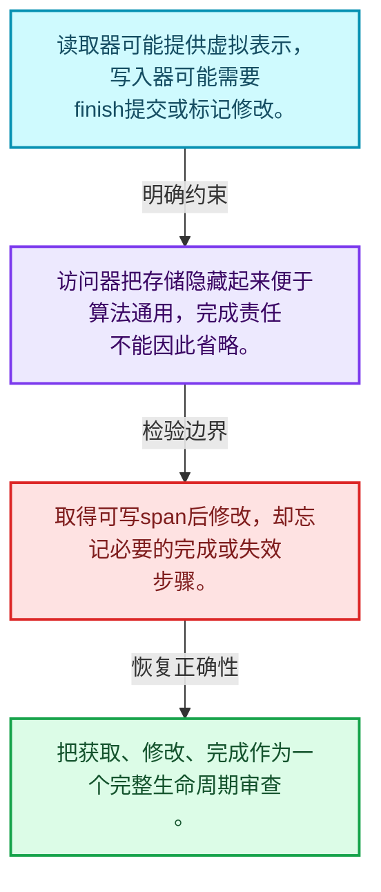
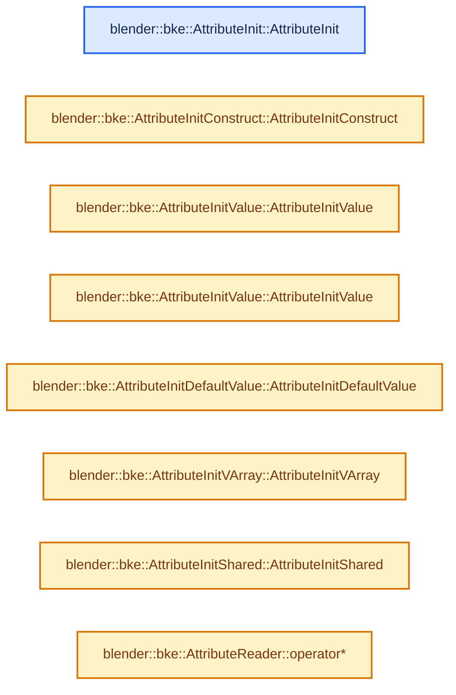
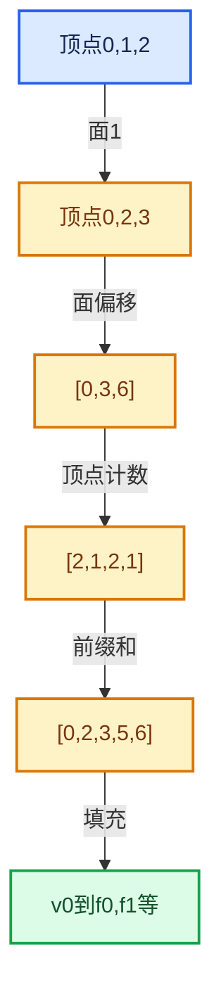

# 05-08 AttributeAccessor接口

[方向导航](README.md) · [总目录](../README.md) · [实现索引](../%E7%AC%A6%E5%8F%B7%E4%BE%9D%E8%B5%96%E4%B8%8E%E5%AE%9E%E7%8E%B0%E7%B4%A2%E5%BC%95.md)

## 从问题到实现

算法怎样不直接依赖每种几何存储？

访问器把名称、域、类型与存储获取分离；读取器和写入器不同，写入完成步骤属于契约。

**数据模型**

读取器可能提供虚拟表示，写入器可能需要finish提交或标记修改。

**设计取舍**

访问器把存储隐藏起来便于算法通用，完成责任不能因此省略。

**最小反例**

取得可写span后修改，却忘记必要的完成或失效步骤。

**推导**

把获取、修改、完成作为一个完整生命周期审查。

## 阅读地图与执行推演








图中的数值推演是本方向的教学模型；实际函数之间的调用边与概念分析边分别标注，不能把概念关系当作运行时调度顺序。

## 完整源码单元与就地讲解

中文讲解直接放在相关代码旁，复杂机制在代码下展开。原文折叠区保留基准行号；不需要在行号表和函数之间来回查找。类布局可分段展示，函数实现不按固定行数切开。

### 类型布局、声明与编译条件 · BKE_attribute.hh L1—L81

<a id="t-cc6ae0c7594c"></a>

<a id="t-0e543435e2b1"></a>

<a id="t-33fc1ff1d088"></a>

<a id="t-bd23fa6e50ad"></a>

<a id="t-c30cfb052bfc"></a>

<a id="t-984dca7e086c"></a>

<a id="t-00b2c16dfa10"></a>

<a id="t-c7224f978e18"></a>

`AttributeMetaData`在这里声明的数据成员：

- `AttrDomain domain`
- `AttrType data_type`

<a id="t-4e037ca5c4e3"></a>

`AttributeDomainAndType`在这里声明的数据成员：

- `AttrDomain domain`
- `AttrType data_type`

<a id="t-1f709b5b7f79"></a>

`AttributeInit`在这里声明的数据成员：

- `Type type`

<a id="t-a7c00c9714bd"></a>

<!-- annotated:9ac194ce34f4a8 -->

```cpp
/* SPDX-FileCopyrightText: 2023 Blender Authors
 *
 * SPDX-License-Identifier: GPL-2.0-or-later */

/** \file
 * \ingroup bke
 */

#pragma once

#include <functional>
#include <optional>

#include "BLI_function_ref.hh"
#include "BLI_generic_pointer.hh"
#include "BLI_generic_virtual_array.hh"
#include "BLI_implicit_sharing.hh"
#include "BLI_math_matrix_types.hh"
#include "BLI_offset_indices.hh"
#include "BLI_set.hh"

#include "BKE_attribute_enums.hh"
#include "BKE_attribute_filters.hh"

namespace blender {

struct ID;
struct Mesh;
struct PointCloud;
namespace fn {
namespace multi_function {
class MultiFunction;
}
class GField;
}  // namespace fn

namespace bke {

class AttributeAccessor;
class MutableAttributeAccessor;

const CPPType &attribute_type_to_cpp_type(AttrType type);
AttrType cpp_type_to_attribute_type(const CPPType &type);

/**
 * Contains information about an attribute in a geometry component.
 * More information can be added in the future. E.g. whether the attribute is builtin and how it is
 * stored (uv map, vertex group, ...).
 */
struct AttributeMetaData {
  AttrDomain domain;
  AttrType data_type;

  friend bool operator==(const AttributeMetaData &a, const AttributeMetaData &b) = default;
};

struct AttributeDomainAndType {
  AttrDomain domain;
  AttrType data_type;

  friend bool operator==(const AttributeDomainAndType &a,
                         const AttributeDomainAndType &b) = default;
};

/**
 * Base class for the attribute initializer types described below.
 */
struct AttributeInit {
  enum class Type {
    /** #AttributeInitConstruct. */
    Construct,
    /** #AttributeInitValue. */
    Value,
    /** #AttributeInitDefaultValue. */
    DefaultValue,
    /** #AttributeInitVArray. */
    VArray,
    /** #AttributeInitShared. */
    Shared,
  };
  Type type;
```

<details>
<summary>核对原始源码：source/blender/blenkernel/BKE_attribute.hh · L1—L81</summary>

<!-- original:9ac194ce34f4a8:source/blender/blenkernel/BKE_attribute.hh:1:81 -->

```cpp
/* SPDX-FileCopyrightText: 2023 Blender Authors
 *
 * SPDX-License-Identifier: GPL-2.0-or-later */

/** \file
 * \ingroup bke
 */

#pragma once

#include <functional>
#include <optional>

#include "BLI_function_ref.hh"
#include "BLI_generic_pointer.hh"
#include "BLI_generic_virtual_array.hh"
#include "BLI_implicit_sharing.hh"
#include "BLI_math_matrix_types.hh"
#include "BLI_offset_indices.hh"
#include "BLI_set.hh"

#include "BKE_attribute_enums.hh"
#include "BKE_attribute_filters.hh"

namespace blender {

struct ID;
struct Mesh;
struct PointCloud;
namespace fn {
namespace multi_function {
class MultiFunction;
}
class GField;
}  // namespace fn

namespace bke {

class AttributeAccessor;
class MutableAttributeAccessor;

const CPPType &attribute_type_to_cpp_type(AttrType type);
AttrType cpp_type_to_attribute_type(const CPPType &type);

/**
 * Contains information about an attribute in a geometry component.
 * More information can be added in the future. E.g. whether the attribute is builtin and how it is
 * stored (uv map, vertex group, ...).
 */
struct AttributeMetaData {
  AttrDomain domain;
  AttrType data_type;

  friend bool operator==(const AttributeMetaData &a, const AttributeMetaData &b) = default;
};

struct AttributeDomainAndType {
  AttrDomain domain;
  AttrType data_type;

  friend bool operator==(const AttributeDomainAndType &a,
                         const AttributeDomainAndType &b) = default;
};

/**
 * Base class for the attribute initializer types described below.
 */
struct AttributeInit {
  enum class Type {
    /** #AttributeInitConstruct. */
    Construct,
    /** #AttributeInitValue. */
    Value,
    /** #AttributeInitDefaultValue. */
    DefaultValue,
    /** #AttributeInitVArray. */
    VArray,
    /** #AttributeInitShared. */
    Shared,
  };
  Type type;
```

</details>

<a id="f-490f8f2524ba7168"></a>

### `blender::bke::AttributeInit::AttributeInit`

实现位置：[source/blender/blenkernel/BKE_attribute.hh](../../../../../source/blender/blenkernel/BKE_attribute.hh) · L82—L82。

接口参数：

- `const Type type`

**教学注释版**

<!-- annotated:22997492585950 -->

```cpp
  AttributeInit(const Type type) : type(type) {}
```

<details>
<summary>核对原始源码：source/blender/blenkernel/BKE_attribute.hh · L82—L82</summary>

<!-- original:22997492585950:source/blender/blenkernel/BKE_attribute.hh:82:82 -->

```cpp
  AttributeInit(const Type type) : type(type) {}
```

</details>

**继续追踪实现**

本实现没有需要继续展开的显式调用；检查返回表达式、对象转换和调用者前置条件。

### 类型布局、声明与编译条件 · BKE_attribute.hh L83—L89

<a id="t-40b504149d2d"></a>

<!-- annotated:5161b008cbd627 -->

```cpp
};

/**
 * Default construct new attribute values. Does nothing for trivial types. This should be used
 * if all attribute element values will be set by the caller after creating the attribute.
 */
struct AttributeInitConstruct : public AttributeInit {
```

<details>
<summary>核对原始源码：source/blender/blenkernel/BKE_attribute.hh · L83—L89</summary>

<!-- original:5161b008cbd627:source/blender/blenkernel/BKE_attribute.hh:83:89 -->

```cpp
};

/**
 * Default construct new attribute values. Does nothing for trivial types. This should be used
 * if all attribute element values will be set by the caller after creating the attribute.
 */
struct AttributeInitConstruct : public AttributeInit {
```

</details>

<a id="f-864cb8bb6c1e50b4"></a>

### `blender::bke::AttributeInitConstruct::AttributeInitConstruct`

实现位置：[source/blender/blenkernel/BKE_attribute.hh](../../../../../source/blender/blenkernel/BKE_attribute.hh) · L90—L90。

**教学注释版**

<!-- annotated:24155e31793ff0 -->

```cpp
  AttributeInitConstruct() : AttributeInit(Type::Construct) {}
```

<details>
<summary>核对原始源码：source/blender/blenkernel/BKE_attribute.hh · L90—L90</summary>

<!-- original:24155e31793ff0:source/blender/blenkernel/BKE_attribute.hh:90:90 -->

```cpp
  AttributeInitConstruct() : AttributeInit(Type::Construct) {}
```

</details>

**继续追踪实现**

本实现没有需要继续展开的显式调用；检查返回表达式、对象转换和调用者前置条件。

### 类型布局、声明与编译条件 · BKE_attribute.hh L91—L99

<a id="t-92ec75b86b00"></a>

`AttributeInitValue`在这里声明的数据成员：

- `GPointer value`

<!-- annotated:be51d935bbab5a -->

```cpp
};

/**
 * Create attribute data with the given value, which must be the same as the specified type.
 */
struct AttributeInitValue : public AttributeInit {
  GPointer value;

  /** \warning The value argument must out-live this attribute initialization operation. */
```

<details>
<summary>核对原始源码：source/blender/blenkernel/BKE_attribute.hh · L91—L99</summary>

<!-- original:be51d935bbab5a:source/blender/blenkernel/BKE_attribute.hh:91:99 -->

```cpp
};

/**
 * Create attribute data with the given value, which must be the same as the specified type.
 */
struct AttributeInitValue : public AttributeInit {
  GPointer value;

  /** \warning The value argument must out-live this attribute initialization operation. */
```

</details>

<a id="f-cd502d5742ad6d0f"></a>

### `blender::bke::AttributeInitValue::AttributeInitValue`

实现位置：[source/blender/blenkernel/BKE_attribute.hh](../../../../../source/blender/blenkernel/BKE_attribute.hh) · L100—L103。

接口参数：

- `const T &value`

**教学注释版**

<!-- annotated:76ec627d657124 -->

```cpp
  template<typename T>
  AttributeInitValue(const T &value) : AttributeInit(Type::Value), value(GPointer(&value))
  {
  }
```

<details>
<summary>核对原始源码：source/blender/blenkernel/BKE_attribute.hh · L100—L103</summary>

<!-- original:76ec627d657124:source/blender/blenkernel/BKE_attribute.hh:100:103 -->

```cpp
  template<typename T>
  AttributeInitValue(const T &value) : AttributeInit(Type::Value), value(GPointer(&value))
  {
  }
```

</details>

**继续追踪实现**

本实现没有需要继续展开的显式调用；检查返回表达式、对象转换和调用者前置条件。

<a id="f-54b1dad08bff7914"></a>

### `blender::bke::AttributeInitValue::AttributeInitValue`

实现位置：[source/blender/blenkernel/BKE_attribute.hh](../../../../../source/blender/blenkernel/BKE_attribute.hh) · L104—L104。

接口参数：

- `const GPointer value`

**教学注释版**

<!-- annotated:e500c4a44921b3 -->

```cpp
  AttributeInitValue(const GPointer value) : AttributeInit(Type::Value), value(value) {}
```

<details>
<summary>核对原始源码：source/blender/blenkernel/BKE_attribute.hh · L104—L104</summary>

<!-- original:e500c4a44921b3:source/blender/blenkernel/BKE_attribute.hh:104:104 -->

```cpp
  AttributeInitValue(const GPointer value) : AttributeInit(Type::Value), value(value) {}
```

</details>

**继续追踪实现**

本实现没有需要继续展开的显式调用；检查返回表达式、对象转换和调用者前置条件。

### 类型布局、声明与编译条件 · BKE_attribute.hh L105—L110

<a id="t-5c1dbee43b38"></a>

<!-- annotated:0bf7479644cd0c -->

```cpp
};

/**
 * Create an attribute using the default value for the data type (almost always "zero").
 */
struct AttributeInitDefaultValue : public AttributeInit {
```

<details>
<summary>核对原始源码：source/blender/blenkernel/BKE_attribute.hh · L105—L110</summary>

<!-- original:0bf7479644cd0c:source/blender/blenkernel/BKE_attribute.hh:105:110 -->

```cpp
};

/**
 * Create an attribute using the default value for the data type (almost always "zero").
 */
struct AttributeInitDefaultValue : public AttributeInit {
```

</details>

<a id="f-7601b35c9f910252"></a>

### `blender::bke::AttributeInitDefaultValue::AttributeInitDefaultValue`

实现位置：[source/blender/blenkernel/BKE_attribute.hh](../../../../../source/blender/blenkernel/BKE_attribute.hh) · L111—L111。

**教学注释版**

<!-- annotated:a8d3ae00cbe7bb -->

```cpp
  AttributeInitDefaultValue() : AttributeInit(Type::DefaultValue) {}
```

<details>
<summary>核对原始源码：source/blender/blenkernel/BKE_attribute.hh · L111—L111</summary>

<!-- original:a8d3ae00cbe7bb:source/blender/blenkernel/BKE_attribute.hh:111:111 -->

```cpp
  AttributeInitDefaultValue() : AttributeInit(Type::DefaultValue) {}
```

</details>

**继续追踪实现**

本实现没有需要继续展开的显式调用；检查返回表达式、对象转换和调用者前置条件。

### 类型布局、声明与编译条件 · BKE_attribute.hh L112—L120

<a id="t-35c9b94fc14a"></a>

`AttributeInitVArray`在这里声明的数据成员：

- `GVArray varray`

<!-- annotated:c6a55f7538b5ec -->

```cpp
};

/**
 * Create an attribute by copying data from an existing virtual array. The virtual array
 * must have the same type as the newly created attribute.
 */
struct AttributeInitVArray : public AttributeInit {
  GVArray varray;

```

<details>
<summary>核对原始源码：source/blender/blenkernel/BKE_attribute.hh · L112—L120</summary>

<!-- original:c6a55f7538b5ec:source/blender/blenkernel/BKE_attribute.hh:112:120 -->

```cpp
};

/**
 * Create an attribute by copying data from an existing virtual array. The virtual array
 * must have the same type as the newly created attribute.
 */
struct AttributeInitVArray : public AttributeInit {
  GVArray varray;

```

</details>

<a id="f-956e4152f3f1e0b2"></a>

### `blender::bke::AttributeInitVArray::AttributeInitVArray`

实现位置：[source/blender/blenkernel/BKE_attribute.hh](../../../../../source/blender/blenkernel/BKE_attribute.hh) · L121—L121。

接口参数：

- `GVArray varray`

**教学注释版**

<!-- annotated:f532bb9fc550f6 -->

```cpp
  AttributeInitVArray(GVArray varray) : AttributeInit(Type::VArray), varray(std::move(varray)) {}
```

<details>
<summary>核对原始源码：source/blender/blenkernel/BKE_attribute.hh · L121—L121</summary>

<!-- original:f532bb9fc550f6:source/blender/blenkernel/BKE_attribute.hh:121:121 -->

```cpp
  AttributeInitVArray(GVArray varray) : AttributeInit(Type::VArray), varray(std::move(varray)) {}
```

</details>

**继续追踪实现**

本实现没有需要继续展开的显式调用；检查返回表达式、对象转换和调用者前置条件。

### 类型布局、声明与编译条件 · BKE_attribute.hh L122—L131

<a id="t-e6a833a502ee"></a>

`AttributeInitShared`在这里声明的数据成员：

- `void data`
- `ImplicitSharingInfo sharing_info`

<!-- annotated:4938c2aa0bb0f1 -->

```cpp
};

/**
 * Create a shared attribute by adding a user to a shared data array.
 * The sharing info has ownership of the provided contiguous array.
 */
struct AttributeInitShared : public AttributeInit {
  const void *data = nullptr;
  const ImplicitSharingInfo *sharing_info = nullptr;

```

<details>
<summary>核对原始源码：source/blender/blenkernel/BKE_attribute.hh · L122—L131</summary>

<!-- original:4938c2aa0bb0f1:source/blender/blenkernel/BKE_attribute.hh:122:131 -->

```cpp
};

/**
 * Create a shared attribute by adding a user to a shared data array.
 * The sharing info has ownership of the provided contiguous array.
 */
struct AttributeInitShared : public AttributeInit {
  const void *data = nullptr;
  const ImplicitSharingInfo *sharing_info = nullptr;

```

</details>

<a id="f-d833f311804f775e"></a>

### `blender::bke::AttributeInitShared::AttributeInitShared`

实现位置：[source/blender/blenkernel/BKE_attribute.hh](../../../../../source/blender/blenkernel/BKE_attribute.hh) · L132—L135。

接口参数：

- `const void *data`
- `const ImplicitSharingInfo &sharing_info`

**教学注释版**

<!-- annotated:5e6a5feeb9724a -->

```cpp
  AttributeInitShared(const void *data, const ImplicitSharingInfo &sharing_info)
      : AttributeInit(Type::Shared), data(data), sharing_info(&sharing_info)
  {
  }
```

<details>
<summary>核对原始源码：source/blender/blenkernel/BKE_attribute.hh · L132—L135</summary>

<!-- original:5e6a5feeb9724a:source/blender/blenkernel/BKE_attribute.hh:132:135 -->

```cpp
  AttributeInitShared(const void *data, const ImplicitSharingInfo &sharing_info)
      : AttributeInit(Type::Shared), data(data), sharing_info(&sharing_info)
  {
  }
```

</details>

**继续追踪实现**

本实现没有需要继续展开的显式调用；检查返回表达式、对象转换和调用者前置条件。

### 类型布局、声明与编译条件 · BKE_attribute.hh L136—L161

<a id="t-acac466560ac"></a>

`AttributeReader`在这里声明的数据成员：

- `VArray<T> varray`
- `AttrDomain domain`
- `ImplicitSharingInfo sharing_info`

<!-- annotated:20fec5cc6e3e93 -->

```cpp
};

/* Returns false when the iteration should be stopped. */
using AttributeForeachCallback =
    FunctionRef<bool(StringRefNull name, const AttributeMetaData &meta_data)>;

/**
 * Result when looking up an attribute from some geometry with the intention of only reading from
 * it.
 */
template<typename T> struct AttributeReader {
  /**
   * Virtual array that provides access to the attribute data. This may be empty.
   */
  VArray<T> varray;
  /**
   * Domain where the attribute is stored. This also determines the size of the virtual array.
   */
  AttrDomain domain;

  /**
   * Information about shared ownership of the attribute array. This will only be provided
   * if the virtual array directly references the contiguous original attribute array.
   */
  const ImplicitSharingInfo *sharing_info;

```

<details>
<summary>核对原始源码：source/blender/blenkernel/BKE_attribute.hh · L136—L161</summary>

<!-- original:20fec5cc6e3e93:source/blender/blenkernel/BKE_attribute.hh:136:161 -->

```cpp
};

/* Returns false when the iteration should be stopped. */
using AttributeForeachCallback =
    FunctionRef<bool(StringRefNull name, const AttributeMetaData &meta_data)>;

/**
 * Result when looking up an attribute from some geometry with the intention of only reading from
 * it.
 */
template<typename T> struct AttributeReader {
  /**
   * Virtual array that provides access to the attribute data. This may be empty.
   */
  VArray<T> varray;
  /**
   * Domain where the attribute is stored. This also determines the size of the virtual array.
   */
  AttrDomain domain;

  /**
   * Information about shared ownership of the attribute array. This will only be provided
   * if the virtual array directly references the contiguous original attribute array.
   */
  const ImplicitSharingInfo *sharing_info;

```

</details>

<a id="f-8173b3cbe2dcadf1"></a>

### `blender::bke::AttributeReader::operator*`

实现位置：[source/blender/blenkernel/BKE_attribute.hh](../../../../../source/blender/blenkernel/BKE_attribute.hh) · L162—L165。

**教学注释版**

<!-- annotated:69f8befbb84b69 -->

```cpp
  const VArray<T> &operator*() const &
  {
    return this->varray;
  }
```

<details>
<summary>核对原始源码：source/blender/blenkernel/BKE_attribute.hh · L162—L165</summary>

<!-- original:69f8befbb84b69:source/blender/blenkernel/BKE_attribute.hh:162:165 -->

```cpp
  const VArray<T> &operator*() const &
  {
    return this->varray;
  }
```

</details>

**结果出口**

- `return this->varray;`

**继续追踪实现**

本实现没有需要继续展开的显式调用；检查返回表达式、对象转换和调用者前置条件。

<!-- annotated:e02b914ccf7b73 -->

```cpp

```

<details>
<summary>核对原始源码：source/blender/blenkernel/BKE_attribute.hh · L166—L166</summary>

<!-- original:e02b914ccf7b73:source/blender/blenkernel/BKE_attribute.hh:166:166 -->

```cpp

```

</details>

<a id="f-374c05ed7b45fc6b"></a>

### `blender::bke::AttributeReader::operator*`

实现位置：[source/blender/blenkernel/BKE_attribute.hh](../../../../../source/blender/blenkernel/BKE_attribute.hh) · L167—L170。

**教学注释版**

<!-- annotated:8c4c6c181ee04f -->

```cpp
  VArray<T> &operator*() &
  {
    return this->varray;
  }
```

<details>
<summary>核对原始源码：source/blender/blenkernel/BKE_attribute.hh · L167—L170</summary>

<!-- original:8c4c6c181ee04f:source/blender/blenkernel/BKE_attribute.hh:167:170 -->

```cpp
  VArray<T> &operator*() &
  {
    return this->varray;
  }
```

</details>

**结果出口**

- `return this->varray;`

**继续追踪实现**

本实现没有需要继续展开的显式调用；检查返回表达式、对象转换和调用者前置条件。

<!-- annotated:eb9b8365913c1d -->

```cpp

```

<details>
<summary>核对原始源码：source/blender/blenkernel/BKE_attribute.hh · L171—L171</summary>

<!-- original:eb9b8365913c1d:source/blender/blenkernel/BKE_attribute.hh:171:171 -->

```cpp

```

</details>

<a id="f-d47657e62edbdcce"></a>

### `blender::bke::AttributeReader::operator*`

实现位置：[source/blender/blenkernel/BKE_attribute.hh](../../../../../source/blender/blenkernel/BKE_attribute.hh) · L172—L175。

**教学注释版**

<!-- annotated:d41529d3b09d5a -->

```cpp
  VArray<T> operator*() &&
  {
    // [讲解] std::move：把表达式转换成可供移动重载选择的值类别；不保证真的移动，不结束源对象寿命，对const值可能选择复制。
    return std::move(this->varray);
  }
```

<details>
<summary>核对原始源码：source/blender/blenkernel/BKE_attribute.hh · L172—L175</summary>

<!-- original:d41529d3b09d5a:source/blender/blenkernel/BKE_attribute.hh:172:175 -->

```cpp
  VArray<T> operator*() &&
  {
    return std::move(this->varray);
  }
```

</details>

**结果出口**

- `return std::move(this->varray);`

**继续追踪实现**

- `std::move` → [外部契约](https://eel.is/c++draft/utility.forward)：把表达式转换成可供移动重载选择的值类别；不保证真的移动，不结束源对象寿命，对const值可能选择复制。

<!-- annotated:a57668b69b888a -->

```cpp

```

<details>
<summary>核对原始源码：source/blender/blenkernel/BKE_attribute.hh · L176—L176</summary>

<!-- original:a57668b69b888a:source/blender/blenkernel/BKE_attribute.hh:176:176 -->

```cpp

```

</details>

<a id="f-13b78dfca78342ca"></a>

### `blender::bke::AttributeReader::() const`

实现位置：[source/blender/blenkernel/BKE_attribute.hh](../../../../../source/blender/blenkernel/BKE_attribute.hh) · L177—L180。

**教学注释版**

<!-- annotated:18a2ff68f4d64e -->

```cpp
  operator bool() const
  {
    return this->varray;
  }
```

<details>
<summary>核对原始源码：source/blender/blenkernel/BKE_attribute.hh · L177—L180</summary>

<!-- original:18a2ff68f4d64e:source/blender/blenkernel/BKE_attribute.hh:177:180 -->

```cpp
  operator bool() const
  {
    return this->varray;
  }
```

</details>

**结果出口**

- `return this->varray;`

**继续追踪实现**

本实现没有需要继续展开的显式调用；检查返回表达式、对象转换和调用者前置条件。

### 类型布局、声明与编译条件 · BKE_attribute.hh L181—L193

<a id="t-59a1d0e9cc50"></a>

`AttributeValidator`在这里声明的数据成员：

- `fn::multi_function::MultiFunction function`

<!-- annotated:546027094a2615 -->

```cpp
};

/**
 * A utility to make sure attribute values are valid, for attributes like "material_index" which
 * can only be positive, or attributes that represent enum options. This is usually only necessary
 * when writing attributes from an untrusted/arbitrary user input.
 */
struct AttributeValidator {
  /**
   * Single input, single output function that corrects attribute values if necessary.
   */
  const fn::multi_function::MultiFunction *function;

```

<details>
<summary>核对原始源码：source/blender/blenkernel/BKE_attribute.hh · L181—L193</summary>

<!-- original:546027094a2615:source/blender/blenkernel/BKE_attribute.hh:181:193 -->

```cpp
};

/**
 * A utility to make sure attribute values are valid, for attributes like "material_index" which
 * can only be positive, or attributes that represent enum options. This is usually only necessary
 * when writing attributes from an untrusted/arbitrary user input.
 */
struct AttributeValidator {
  /**
   * Single input, single output function that corrects attribute values if necessary.
   */
  const fn::multi_function::MultiFunction *function;

```

</details>

<a id="f-4e5054513b76c17d"></a>

### `blender::bke::AttributeValidator::() const`

实现位置：[source/blender/blenkernel/BKE_attribute.hh](../../../../../source/blender/blenkernel/BKE_attribute.hh) · L194—L197。

**教学注释版**

<!-- annotated:8cd94324d4eaa3 -->

```cpp
  operator bool() const
  {
    return this->function != nullptr;
  }
```

<details>
<summary>核对原始源码：source/blender/blenkernel/BKE_attribute.hh · L194—L197</summary>

<!-- original:8cd94324d4eaa3:source/blender/blenkernel/BKE_attribute.hh:194:197 -->

```cpp
  operator bool() const
  {
    return this->function != nullptr;
  }
```

</details>

**结果出口**

- `return this->function != nullptr;`

**继续追踪实现**

本实现没有需要继续展开的显式调用；检查返回表达式、对象转换和调用者前置条件。

### 类型布局、声明与编译条件 · BKE_attribute.hh L198—L224

<a id="t-bb4176e56f29"></a>

`AttributeWriter`在这里声明的数据成员：

- `VMutableArray<T> varray`
- `AttrDomain domain`
- `std::function<void()> tag_modified_fn`

<!-- annotated:bcf5155badf6da -->

```cpp
  /**
   * Return a field that creates corrected attribute values.
   */
  fn::GField validate_field_if_necessary(const fn::GField &field) const;
};

/**
 * Result when looking up an attribute from some geometry with read and write access. After writing
 * to the attribute, the #finish method has to be called. This may invalidate caches based on this
 * attribute.
 */
template<typename T> struct AttributeWriter {
  /**
   * Virtual array giving read and write access to the attribute. This may be empty.
   * Consider using #SpanAttributeWriter when you want to access the virtual array as a span.
   */
  VMutableArray<T> varray;
  /**
   * Domain where the attribute is stored on the geometry. Also determines the size of the virtual
   * array.
   */
  AttrDomain domain;
  /**
   * A function that has to be called after the attribute has been edited. This may be empty.
   */
  std::function<void()> tag_modified_fn;

```

<details>
<summary>核对原始源码：source/blender/blenkernel/BKE_attribute.hh · L198—L224</summary>

<!-- original:bcf5155badf6da:source/blender/blenkernel/BKE_attribute.hh:198:224 -->

```cpp
  /**
   * Return a field that creates corrected attribute values.
   */
  fn::GField validate_field_if_necessary(const fn::GField &field) const;
};

/**
 * Result when looking up an attribute from some geometry with read and write access. After writing
 * to the attribute, the #finish method has to be called. This may invalidate caches based on this
 * attribute.
 */
template<typename T> struct AttributeWriter {
  /**
   * Virtual array giving read and write access to the attribute. This may be empty.
   * Consider using #SpanAttributeWriter when you want to access the virtual array as a span.
   */
  VMutableArray<T> varray;
  /**
   * Domain where the attribute is stored on the geometry. Also determines the size of the virtual
   * array.
   */
  AttrDomain domain;
  /**
   * A function that has to be called after the attribute has been edited. This may be empty.
   */
  std::function<void()> tag_modified_fn;

```

</details>

<a id="f-52ec74970f5fa3ff"></a>

### `blender::bke::AttributeWriter::() const`

实现位置：[source/blender/blenkernel/BKE_attribute.hh](../../../../../source/blender/blenkernel/BKE_attribute.hh) · L225—L228。

**教学注释版**

<!-- annotated:4c3ec0d2f79fa3 -->

```cpp
  operator bool() const
  {
    return this->varray;
  }
```

<details>
<summary>核对原始源码：source/blender/blenkernel/BKE_attribute.hh · L225—L228</summary>

<!-- original:4c3ec0d2f79fa3:source/blender/blenkernel/BKE_attribute.hh:225:228 -->

```cpp
  operator bool() const
  {
    return this->varray;
  }
```

</details>

**结果出口**

- `return this->varray;`

**继续追踪实现**

本实现没有需要继续展开的显式调用；检查返回表达式、对象转换和调用者前置条件。

### 类型布局、声明与编译条件 · BKE_attribute.hh L229—L232

<!-- annotated:94ad6c74be62a1 -->

```cpp

  /**
   * Has to be called after the attribute has been modified.
   */
```

<details>
<summary>核对原始源码：source/blender/blenkernel/BKE_attribute.hh · L229—L232</summary>

<!-- original:94ad6c74be62a1:source/blender/blenkernel/BKE_attribute.hh:229:232 -->

```cpp

  /**
   * Has to be called after the attribute has been modified.
   */
```

</details>

<a id="f-b6b3155626d94225"></a>

### `blender::bke::AttributeWriter::finish`

实现位置：[source/blender/blenkernel/BKE_attribute.hh](../../../../../source/blender/blenkernel/BKE_attribute.hh) · L233—L238。

**教学注释版**

<!-- annotated:2d6b21c2099f23 -->

```cpp
  void finish()
  {
    if (this->tag_modified_fn) {
      this->tag_modified_fn();
    }
  }
```

<details>
<summary>核对原始源码：source/blender/blenkernel/BKE_attribute.hh · L233—L238</summary>

<!-- original:2d6b21c2099f23:source/blender/blenkernel/BKE_attribute.hh:233:238 -->

```cpp
  void finish()
  {
    if (this->tag_modified_fn) {
      this->tag_modified_fn();
    }
  }
```

</details>

**继续追踪实现**

- `this->tag_modified_fn` → [调用协议](../%E6%A8%A1%E6%9D%BF%E5%AE%8F%E4%B8%8E%E5%8A%A8%E6%80%81%E5%88%86%E6%B4%BE%E5%8D%8F%E8%AE%AE.md)：由接收对象具体类型或运行时策略提供实现。调用位置L236。

### 类型布局、声明与编译条件 · BKE_attribute.hh L239—L259

<a id="t-f15becb46b3d"></a>

`SpanAttributeWriter`在这里声明的数据成员：

- `MutableVArraySpan<T> span`
- `AttrDomain domain`
- `std::function<void()> tag_modified_fn`

<!-- annotated:51a917a2f5449f -->

```cpp
};

/**
 * A version of #AttributeWriter for the common case when the user of the attribute wants to write
 * to a span instead of a virtual array. Since most attributes are spans internally, this can
 * result in better performance and also simplifies code.
 */
template<typename T> struct SpanAttributeWriter {
  /**
   * A span based on the virtual array that contains the attribute data. This may be empty.
   */
  MutableVArraySpan<T> span;
  /**
   * Domain of the attribute. Also determines the size of the span.
   */
  AttrDomain domain;
  /**
   * Has to be called after writing to the span.
   */
  std::function<void()> tag_modified_fn;

```

<details>
<summary>核对原始源码：source/blender/blenkernel/BKE_attribute.hh · L239—L259</summary>

<!-- original:51a917a2f5449f:source/blender/blenkernel/BKE_attribute.hh:239:259 -->

```cpp
};

/**
 * A version of #AttributeWriter for the common case when the user of the attribute wants to write
 * to a span instead of a virtual array. Since most attributes are spans internally, this can
 * result in better performance and also simplifies code.
 */
template<typename T> struct SpanAttributeWriter {
  /**
   * A span based on the virtual array that contains the attribute data. This may be empty.
   */
  MutableVArraySpan<T> span;
  /**
   * Domain of the attribute. Also determines the size of the span.
   */
  AttrDomain domain;
  /**
   * Has to be called after writing to the span.
   */
  std::function<void()> tag_modified_fn;

```

</details>

<a id="f-29446288c774db3c"></a>

### `blender::bke::SpanAttributeWriter::SpanAttributeWriter`

实现位置：[source/blender/blenkernel/BKE_attribute.hh](../../../../../source/blender/blenkernel/BKE_attribute.hh) · L260—L260。

**教学注释版**

<!-- annotated:a75ef930b2ae69 -->

```cpp
  SpanAttributeWriter() = default;
```

<details>
<summary>核对原始源码：source/blender/blenkernel/BKE_attribute.hh · L260—L260</summary>

<!-- original:a75ef930b2ae69:source/blender/blenkernel/BKE_attribute.hh:260:260 -->

```cpp
  SpanAttributeWriter() = default;
```

</details>

**继续追踪实现**

本实现没有需要继续展开的显式调用；检查返回表达式、对象转换和调用者前置条件。

<!-- annotated:86ad0245ccabc5 -->

```cpp

```

<details>
<summary>核对原始源码：source/blender/blenkernel/BKE_attribute.hh · L261—L261</summary>

<!-- original:86ad0245ccabc5:source/blender/blenkernel/BKE_attribute.hh:261:261 -->

```cpp

```

</details>

<a id="f-0639852562aacd3a"></a>

### `blender::bke::SpanAttributeWriter::SpanAttributeWriter`

实现位置：[source/blender/blenkernel/BKE_attribute.hh](../../../../../source/blender/blenkernel/BKE_attribute.hh) · L262—L267。

接口参数：

- `AttributeWriter<T> &&other`
- `const bool copy_values_to_span`

**教学注释版**

<!-- annotated:228846f3c1e354 -->

```cpp
  SpanAttributeWriter(AttributeWriter<T> &&other, const bool copy_values_to_span)
      : span(std::move(other.varray), copy_values_to_span),
        domain(other.domain),
        tag_modified_fn(std::move(other.tag_modified_fn))
  {
  }
```

<details>
<summary>核对原始源码：source/blender/blenkernel/BKE_attribute.hh · L262—L267</summary>

<!-- original:228846f3c1e354:source/blender/blenkernel/BKE_attribute.hh:262:267 -->

```cpp
  SpanAttributeWriter(AttributeWriter<T> &&other, const bool copy_values_to_span)
      : span(std::move(other.varray), copy_values_to_span),
        domain(other.domain),
        tag_modified_fn(std::move(other.tag_modified_fn))
  {
  }
```

</details>

**继续追踪实现**

本实现没有需要继续展开的显式调用；检查返回表达式、对象转换和调用者前置条件。

<!-- annotated:305598c68fb8e3 -->

```cpp

```

<details>
<summary>核对原始源码：source/blender/blenkernel/BKE_attribute.hh · L268—L268</summary>

<!-- original:305598c68fb8e3:source/blender/blenkernel/BKE_attribute.hh:268:268 -->

```cpp

```

</details>

<a id="f-e9c24112e968dd12"></a>

### `blender::bke::SpanAttributeWriter::() const`

实现位置：[source/blender/blenkernel/BKE_attribute.hh](../../../../../source/blender/blenkernel/BKE_attribute.hh) · L269—L272。

**教学注释版**

<!-- annotated:80ad62842380a2 -->

```cpp
  operator bool() const
  {
    return span.varray();
  }
```

<details>
<summary>核对原始源码：source/blender/blenkernel/BKE_attribute.hh · L269—L272</summary>

<!-- original:80ad62842380a2:source/blender/blenkernel/BKE_attribute.hh:269:272 -->

```cpp
  operator bool() const
  {
    return span.varray();
  }
```

</details>

**结果出口**

- `return span.varray();`

**继续追踪实现**

- `span.varray` → [blender::MutableVArraySpan::varray · L1095](../04-%E8%99%9A%E6%8B%9F%E6%95%B0%E7%BB%84%E4%B8%8E%E7%B4%A2%E5%BC%95%E9%80%89%E6%8B%A9/04-%E6%89%80%E6%9C%89%E6%9D%83%E4%B8%8E%E5%B0%8F%E5%AF%B9%E8%B1%A1%E4%BC%98%E5%8C%96.md#f-e31b73c039045082)。

### 类型布局、声明与编译条件 · BKE_attribute.hh L273—L278

<!-- annotated:078424ddca530b -->

```cpp

  /**
   * Has to be called when done writing to the attribute. This makes sure that the data is copied
   * to the underlying attribute if it was not stored as an array. Furthermore, this may invalidate
   * other data depending on the modified attribute.
   */
```

<details>
<summary>核对原始源码：source/blender/blenkernel/BKE_attribute.hh · L273—L278</summary>

<!-- original:078424ddca530b:source/blender/blenkernel/BKE_attribute.hh:273:278 -->

```cpp

  /**
   * Has to be called when done writing to the attribute. This makes sure that the data is copied
   * to the underlying attribute if it was not stored as an array. Furthermore, this may invalidate
   * other data depending on the modified attribute.
   */
```

</details>

<a id="f-585970a3b1bd4da4"></a>

### `blender::bke::SpanAttributeWriter::finish`

实现位置：[source/blender/blenkernel/BKE_attribute.hh](../../../../../source/blender/blenkernel/BKE_attribute.hh) · L279—L287。

**教学注释版**

<!-- annotated:12163d19f7251c -->

```cpp
  void finish()
  {
    if (this->span.varray()) {
      this->span.save();
    }
    if (this->tag_modified_fn) {
      this->tag_modified_fn();
    }
  }
```

<details>
<summary>核对原始源码：source/blender/blenkernel/BKE_attribute.hh · L279—L287</summary>

<!-- original:12163d19f7251c:source/blender/blenkernel/BKE_attribute.hh:279:287 -->

```cpp
  void finish()
  {
    if (this->span.varray()) {
      this->span.save();
    }
    if (this->tag_modified_fn) {
      this->tag_modified_fn();
    }
  }
```

</details>

**继续追踪实现**

- `this->span.varray` → [调用协议](../%E6%A8%A1%E6%9D%BF%E5%AE%8F%E4%B8%8E%E5%8A%A8%E6%80%81%E5%88%86%E6%B4%BE%E5%8D%8F%E8%AE%AE.md)：接收对象类型依赖auto、返回值或模板实例；不按同名猜测目标。调用位置L281。
- `this->span.save` → [调用协议](../%E6%A8%A1%E6%9D%BF%E5%AE%8F%E4%B8%8E%E5%8A%A8%E6%80%81%E5%88%86%E6%B4%BE%E5%8D%8F%E8%AE%AE.md)：接收对象类型依赖auto、返回值或模板实例；不按同名猜测目标。调用位置L282。
- `this->tag_modified_fn` → [调用协议](../%E6%A8%A1%E6%9D%BF%E5%AE%8F%E4%B8%8E%E5%8A%A8%E6%80%81%E5%88%86%E6%B4%BE%E5%8D%8F%E8%AE%AE.md)：由接收对象具体类型或运行时策略提供实现。调用位置L285。

### 类型布局、声明与编译条件 · BKE_attribute.hh L288—L297

<a id="t-3f1c4e1416c8"></a>

`GAttributeReader`在这里声明的数据成员：

- `GVArray varray`
- `AttrDomain domain`
- `ImplicitSharingInfo sharing_info`

<!-- annotated:46c1b7a5e78a19 -->

```cpp
};

/**
 * A generic version of #AttributeReader.
 */
struct GAttributeReader {
  GVArray varray;
  AttrDomain domain;
  const ImplicitSharingInfo *sharing_info;

```

<details>
<summary>核对原始源码：source/blender/blenkernel/BKE_attribute.hh · L288—L297</summary>

<!-- original:46c1b7a5e78a19:source/blender/blenkernel/BKE_attribute.hh:288:297 -->

```cpp
};

/**
 * A generic version of #AttributeReader.
 */
struct GAttributeReader {
  GVArray varray;
  AttrDomain domain;
  const ImplicitSharingInfo *sharing_info;

```

</details>

<a id="f-201f5abf8d301325"></a>

### `blender::bke::GAttributeReader::() const`

实现位置：[source/blender/blenkernel/BKE_attribute.hh](../../../../../source/blender/blenkernel/BKE_attribute.hh) · L298—L301。

**教学注释版**

<!-- annotated:7916a31a59e748 -->

```cpp
  operator bool() const
  {
    return this->varray;
  }
```

<details>
<summary>核对原始源码：source/blender/blenkernel/BKE_attribute.hh · L298—L301</summary>

<!-- original:7916a31a59e748:source/blender/blenkernel/BKE_attribute.hh:298:301 -->

```cpp
  operator bool() const
  {
    return this->varray;
  }
```

</details>

**结果出口**

- `return this->varray;`

**继续追踪实现**

本实现没有需要继续展开的显式调用；检查返回表达式、对象转换和调用者前置条件。

<!-- annotated:d2792229c94477 -->

```cpp

```

<details>
<summary>核对原始源码：source/blender/blenkernel/BKE_attribute.hh · L302—L302</summary>

<!-- original:d2792229c94477:source/blender/blenkernel/BKE_attribute.hh:302:302 -->

```cpp

```

</details>

<a id="f-23cd503cfe531214"></a>

### `blender::bke::GAttributeReader::operator*`

实现位置：[source/blender/blenkernel/BKE_attribute.hh](../../../../../source/blender/blenkernel/BKE_attribute.hh) · L303—L306。

**教学注释版**

<!-- annotated:5ca301f7601a7d -->

```cpp
  const GVArray &operator*() const &
  {
    return this->varray;
  }
```

<details>
<summary>核对原始源码：source/blender/blenkernel/BKE_attribute.hh · L303—L306</summary>

<!-- original:5ca301f7601a7d:source/blender/blenkernel/BKE_attribute.hh:303:306 -->

```cpp
  const GVArray &operator*() const &
  {
    return this->varray;
  }
```

</details>

**结果出口**

- `return this->varray;`

**继续追踪实现**

本实现没有需要继续展开的显式调用；检查返回表达式、对象转换和调用者前置条件。

<!-- annotated:bfc10062f785ff -->

```cpp

```

<details>
<summary>核对原始源码：source/blender/blenkernel/BKE_attribute.hh · L307—L307</summary>

<!-- original:bfc10062f785ff:source/blender/blenkernel/BKE_attribute.hh:307:307 -->

```cpp

```

</details>

<a id="f-5510ee714cee7dfa"></a>

### `blender::bke::GAttributeReader::operator*`

实现位置：[source/blender/blenkernel/BKE_attribute.hh](../../../../../source/blender/blenkernel/BKE_attribute.hh) · L308—L311。

**教学注释版**

<!-- annotated:cb008c3ef6a7b8 -->

```cpp
  GVArray &operator*() &
  {
    return this->varray;
  }
```

<details>
<summary>核对原始源码：source/blender/blenkernel/BKE_attribute.hh · L308—L311</summary>

<!-- original:cb008c3ef6a7b8:source/blender/blenkernel/BKE_attribute.hh:308:311 -->

```cpp
  GVArray &operator*() &
  {
    return this->varray;
  }
```

</details>

**结果出口**

- `return this->varray;`

**继续追踪实现**

本实现没有需要继续展开的显式调用；检查返回表达式、对象转换和调用者前置条件。

<!-- annotated:611a34e88db09f -->

```cpp

```

<details>
<summary>核对原始源码：source/blender/blenkernel/BKE_attribute.hh · L312—L312</summary>

<!-- original:611a34e88db09f:source/blender/blenkernel/BKE_attribute.hh:312:312 -->

```cpp

```

</details>

<a id="f-a55bf2aa8df2af3b"></a>

### `blender::bke::GAttributeReader::operator*`

实现位置：[source/blender/blenkernel/BKE_attribute.hh](../../../../../source/blender/blenkernel/BKE_attribute.hh) · L313—L316。

**教学注释版**

<!-- annotated:c1a4df74ed32cb -->

```cpp
  GVArray operator*() &&
  {
    // [讲解] std::move：把表达式转换成可供移动重载选择的值类别；不保证真的移动，不结束源对象寿命，对const值可能选择复制。
    return std::move(this->varray);
  }
```

<details>
<summary>核对原始源码：source/blender/blenkernel/BKE_attribute.hh · L313—L316</summary>

<!-- original:c1a4df74ed32cb:source/blender/blenkernel/BKE_attribute.hh:313:316 -->

```cpp
  GVArray operator*() &&
  {
    return std::move(this->varray);
  }
```

</details>

**结果出口**

- `return std::move(this->varray);`

**继续追踪实现**

- `std::move` → [外部契约](https://eel.is/c++draft/utility.forward)：把表达式转换成可供移动重载选择的值类别；不保证真的移动，不结束源对象寿命，对const值可能选择复制。

<!-- annotated:bbc881a60e43ad -->

```cpp

```

<details>
<summary>核对原始源码：source/blender/blenkernel/BKE_attribute.hh · L317—L317</summary>

<!-- original:bbc881a60e43ad:source/blender/blenkernel/BKE_attribute.hh:317:317 -->

```cpp

```

</details>

<a id="f-7285749d1014d792"></a>

### `blender::bke::GAttributeReader::typed`

实现位置：[source/blender/blenkernel/BKE_attribute.hh](../../../../../source/blender/blenkernel/BKE_attribute.hh) · L318—L321。

**教学注释版**

<!-- annotated:81ae1d3cb1da23 -->

```cpp
  template<typename T> AttributeReader<T> typed() const
  {
    return {varray.typed<T>(), domain, sharing_info};
  }
```

<details>
<summary>核对原始源码：source/blender/blenkernel/BKE_attribute.hh · L318—L321</summary>

<!-- original:81ae1d3cb1da23:source/blender/blenkernel/BKE_attribute.hh:318:321 -->

```cpp
  template<typename T> AttributeReader<T> typed() const
  {
    return {varray.typed<T>(), domain, sharing_info};
  }
```

</details>

**结果出口**

- `return {varray.typed<T>(), domain, sharing_info};`

**继续追踪实现**

- `varray.typed<T>` → [blender::GVArray::typed · L913](../04-%E8%99%9A%E6%8B%9F%E6%95%B0%E7%BB%84%E4%B8%8E%E7%B4%A2%E5%BC%95%E9%80%89%E6%8B%A9/05-GVArray%E8%BF%90%E8%A1%8C%E6%97%B6%E7%B1%BB%E5%9E%8B.md#f-c17d1cd75ef41a17)。

### 类型布局、声明与编译条件 · BKE_attribute.hh L322—L331

<a id="t-e1ef0708223f"></a>

`GAttributeWriter`在这里声明的数据成员：

- `GVMutableArray varray`
- `AttrDomain domain`
- `std::function<void()> tag_modified_fn`

<!-- annotated:0b4035401efac3 -->

```cpp
};

/**
 * A generic version of #AttributeWriter.
 */
struct GAttributeWriter {
  GVMutableArray varray;
  AttrDomain domain;
  std::function<void()> tag_modified_fn;

```

<details>
<summary>核对原始源码：source/blender/blenkernel/BKE_attribute.hh · L322—L331</summary>

<!-- original:0b4035401efac3:source/blender/blenkernel/BKE_attribute.hh:322:331 -->

```cpp
};

/**
 * A generic version of #AttributeWriter.
 */
struct GAttributeWriter {
  GVMutableArray varray;
  AttrDomain domain;
  std::function<void()> tag_modified_fn;

```

</details>

<a id="f-3f585757de16fefd"></a>

### `blender::bke::GAttributeWriter::() const`

实现位置：[source/blender/blenkernel/BKE_attribute.hh](../../../../../source/blender/blenkernel/BKE_attribute.hh) · L332—L335。

**教学注释版**

<!-- annotated:02c807ac5aa0cb -->

```cpp
  operator bool() const
  {
    return this->varray;
  }
```

<details>
<summary>核对原始源码：source/blender/blenkernel/BKE_attribute.hh · L332—L335</summary>

<!-- original:02c807ac5aa0cb:source/blender/blenkernel/BKE_attribute.hh:332:335 -->

```cpp
  operator bool() const
  {
    return this->varray;
  }
```

</details>

**结果出口**

- `return this->varray;`

**继续追踪实现**

本实现没有需要继续展开的显式调用；检查返回表达式、对象转换和调用者前置条件。

<!-- annotated:1dde1a1a5820f8 -->

```cpp

```

<details>
<summary>核对原始源码：source/blender/blenkernel/BKE_attribute.hh · L336—L336</summary>

<!-- original:1dde1a1a5820f8:source/blender/blenkernel/BKE_attribute.hh:336:336 -->

```cpp

```

</details>

<a id="f-4e0dccfd8696c6ac"></a>

### `blender::bke::GAttributeWriter::finish`

实现位置：[source/blender/blenkernel/BKE_attribute.hh](../../../../../source/blender/blenkernel/BKE_attribute.hh) · L337—L342。

**教学注释版**

<!-- annotated:0a4e4dacdbefbc -->

```cpp
  void finish()
  {
    if (this->tag_modified_fn) {
      this->tag_modified_fn();
    }
  }
```

<details>
<summary>核对原始源码：source/blender/blenkernel/BKE_attribute.hh · L337—L342</summary>

<!-- original:0a4e4dacdbefbc:source/blender/blenkernel/BKE_attribute.hh:337:342 -->

```cpp
  void finish()
  {
    if (this->tag_modified_fn) {
      this->tag_modified_fn();
    }
  }
```

</details>

**继续追踪实现**

- `this->tag_modified_fn` → [调用协议](../%E6%A8%A1%E6%9D%BF%E5%AE%8F%E4%B8%8E%E5%8A%A8%E6%80%81%E5%88%86%E6%B4%BE%E5%8D%8F%E8%AE%AE.md)：由接收对象具体类型或运行时策略提供实现。调用位置L340。

<!-- annotated:3d4fce6f3b1349 -->

```cpp

```

<details>
<summary>核对原始源码：source/blender/blenkernel/BKE_attribute.hh · L343—L343</summary>

<!-- original:3d4fce6f3b1349:source/blender/blenkernel/BKE_attribute.hh:343:343 -->

```cpp

```

</details>

<a id="f-f53acc019d6da8d7"></a>

### `blender::bke::GAttributeWriter::typed`

实现位置：[source/blender/blenkernel/BKE_attribute.hh](../../../../../source/blender/blenkernel/BKE_attribute.hh) · L344—L347。

**教学注释版**

<!-- annotated:c757798cf57203 -->

```cpp
  template<typename T> AttributeWriter<T> typed() const
  {
    return {varray.typed<T>(), domain, tag_modified_fn};
  }
```

<details>
<summary>核对原始源码：source/blender/blenkernel/BKE_attribute.hh · L344—L347</summary>

<!-- original:c757798cf57203:source/blender/blenkernel/BKE_attribute.hh:344:347 -->

```cpp
  template<typename T> AttributeWriter<T> typed() const
  {
    return {varray.typed<T>(), domain, tag_modified_fn};
  }
```

</details>

**结果出口**

- `return {varray.typed<T>(), domain, tag_modified_fn};`

**继续追踪实现**

- `varray.typed<T>` → [blender::GVMutableArray::typed · L974](../04-%E8%99%9A%E6%8B%9F%E6%95%B0%E7%BB%84%E4%B8%8E%E7%B4%A2%E5%BC%95%E9%80%89%E6%8B%A9/05-GVArray%E8%BF%90%E8%A1%8C%E6%97%B6%E7%B1%BB%E5%9E%8B.md#f-414a70d820eeffdc)。

### 类型布局、声明与编译条件 · BKE_attribute.hh L348—L357

<a id="t-3eab83fb9d2b"></a>

`GSpanAttributeWriter`在这里声明的数据成员：

- `GMutableVArraySpan span`
- `AttrDomain domain`
- `std::function<void()> tag_modified_fn`

<!-- annotated:7dd829e1d9bf38 -->

```cpp
};

/**
 * A generic version of #SpanAttributeWriter.
 */
struct GSpanAttributeWriter {
  GMutableVArraySpan span;
  AttrDomain domain;
  std::function<void()> tag_modified_fn;

```

<details>
<summary>核对原始源码：source/blender/blenkernel/BKE_attribute.hh · L348—L357</summary>

<!-- original:7dd829e1d9bf38:source/blender/blenkernel/BKE_attribute.hh:348:357 -->

```cpp
};

/**
 * A generic version of #SpanAttributeWriter.
 */
struct GSpanAttributeWriter {
  GMutableVArraySpan span;
  AttrDomain domain;
  std::function<void()> tag_modified_fn;

```

</details>

<a id="f-e15f50b2b8c06981"></a>

### `blender::bke::GSpanAttributeWriter::GSpanAttributeWriter`

实现位置：[source/blender/blenkernel/BKE_attribute.hh](../../../../../source/blender/blenkernel/BKE_attribute.hh) · L358—L358。

**教学注释版**

<!-- annotated:b924af18030d70 -->

```cpp
  GSpanAttributeWriter() = default;
```

<details>
<summary>核对原始源码：source/blender/blenkernel/BKE_attribute.hh · L358—L358</summary>

<!-- original:b924af18030d70:source/blender/blenkernel/BKE_attribute.hh:358:358 -->

```cpp
  GSpanAttributeWriter() = default;
```

</details>

**继续追踪实现**

本实现没有需要继续展开的显式调用；检查返回表达式、对象转换和调用者前置条件。

<!-- annotated:793eb4f71b34af -->

```cpp

```

<details>
<summary>核对原始源码：source/blender/blenkernel/BKE_attribute.hh · L359—L359</summary>

<!-- original:793eb4f71b34af:source/blender/blenkernel/BKE_attribute.hh:359:359 -->

```cpp

```

</details>

<a id="f-7c50e96c0339ffc4"></a>

### `blender::bke::GSpanAttributeWriter::GSpanAttributeWriter`

实现位置：[source/blender/blenkernel/BKE_attribute.hh](../../../../../source/blender/blenkernel/BKE_attribute.hh) · L360—L365。

接口参数：

- `GAttributeWriter &&other`
- `const bool copy_values_to_span`

**教学注释版**

<!-- annotated:3510a5ea585db5 -->

```cpp
  GSpanAttributeWriter(GAttributeWriter &&other, const bool copy_values_to_span)
      : span(std::move(other.varray), copy_values_to_span),
        domain(other.domain),
        tag_modified_fn(std::move(other.tag_modified_fn))
  {
  }
```

<details>
<summary>核对原始源码：source/blender/blenkernel/BKE_attribute.hh · L360—L365</summary>

<!-- original:3510a5ea585db5:source/blender/blenkernel/BKE_attribute.hh:360:365 -->

```cpp
  GSpanAttributeWriter(GAttributeWriter &&other, const bool copy_values_to_span)
      : span(std::move(other.varray), copy_values_to_span),
        domain(other.domain),
        tag_modified_fn(std::move(other.tag_modified_fn))
  {
  }
```

</details>

**继续追踪实现**

本实现没有需要继续展开的显式调用；检查返回表达式、对象转换和调用者前置条件。

<!-- annotated:81df7c22abded4 -->

```cpp

```

<details>
<summary>核对原始源码：source/blender/blenkernel/BKE_attribute.hh · L366—L366</summary>

<!-- original:81df7c22abded4:source/blender/blenkernel/BKE_attribute.hh:366:366 -->

```cpp

```

</details>

<a id="f-2ec7aae1c0c9bbf5"></a>

### `blender::bke::GSpanAttributeWriter::() const`

实现位置：[source/blender/blenkernel/BKE_attribute.hh](../../../../../source/blender/blenkernel/BKE_attribute.hh) · L367—L370。

**教学注释版**

<!-- annotated:78e6eeadfb3843 -->

```cpp
  operator bool() const
  {
    return span.varray();
  }
```

<details>
<summary>核对原始源码：source/blender/blenkernel/BKE_attribute.hh · L367—L370</summary>

<!-- original:78e6eeadfb3843:source/blender/blenkernel/BKE_attribute.hh:367:370 -->

```cpp
  operator bool() const
  {
    return span.varray();
  }
```

</details>

**结果出口**

- `return span.varray();`

**继续追踪实现**

- `span.varray` → [blender::GMutableVArraySpan::varray · L467](../04-%E8%99%9A%E6%8B%9F%E6%95%B0%E7%BB%84%E4%B8%8E%E7%B4%A2%E5%BC%95%E9%80%89%E6%8B%A9/05-GVArray%E8%BF%90%E8%A1%8C%E6%97%B6%E7%B1%BB%E5%9E%8B.md#f-d6ed1d26620cf41c)。

<!-- annotated:26b92a6afe6f48 -->

```cpp

```

<details>
<summary>核对原始源码：source/blender/blenkernel/BKE_attribute.hh · L371—L371</summary>

<!-- original:26b92a6afe6f48:source/blender/blenkernel/BKE_attribute.hh:371:371 -->

```cpp

```

</details>

<a id="f-6e58c9c72c82f592"></a>

### `blender::bke::GSpanAttributeWriter::finish`

实现位置：[source/blender/blenkernel/BKE_attribute.hh](../../../../../source/blender/blenkernel/BKE_attribute.hh) · L372—L380。

**教学注释版**

<!-- annotated:1f84316d5d73a8 -->

```cpp
  void finish()
  {
    if (this->span.varray()) {
      this->span.save();
    }
    if (this->tag_modified_fn) {
      this->tag_modified_fn();
    }
  }
```

<details>
<summary>核对原始源码：source/blender/blenkernel/BKE_attribute.hh · L372—L380</summary>

<!-- original:1f84316d5d73a8:source/blender/blenkernel/BKE_attribute.hh:372:380 -->

```cpp
  void finish()
  {
    if (this->span.varray()) {
      this->span.save();
    }
    if (this->tag_modified_fn) {
      this->tag_modified_fn();
    }
  }
```

</details>

**继续追踪实现**

- `this->span.varray` → [调用协议](../%E6%A8%A1%E6%9D%BF%E5%AE%8F%E4%B8%8E%E5%8A%A8%E6%80%81%E5%88%86%E6%B4%BE%E5%8D%8F%E8%AE%AE.md)：接收对象类型依赖auto、返回值或模板实例；不按同名猜测目标。调用位置L374。
- `this->span.save` → [调用协议](../%E6%A8%A1%E6%9D%BF%E5%AE%8F%E4%B8%8E%E5%8A%A8%E6%80%81%E5%88%86%E6%B4%BE%E5%8D%8F%E8%AE%AE.md)：接收对象类型依赖auto、返回值或模板实例；不按同名猜测目标。调用位置L375。
- `this->tag_modified_fn` → [调用协议](../%E6%A8%A1%E6%9D%BF%E5%AE%8F%E4%B8%8E%E5%8A%A8%E6%80%81%E5%88%86%E6%B4%BE%E5%8D%8F%E8%AE%AE.md)：由接收对象具体类型或运行时策略提供实现。调用位置L378。

### 类型布局、声明与编译条件 · BKE_attribute.hh L381—L404

<a id="t-b7be9f3ccbb1"></a>

`AttributeIter`在这里声明的数据成员：

- `StringRefNull name`
- `AttrDomain domain`
- `AttrType data_type`
- `std::optional<AttrStorageType> storage_type`
- `bool is_builtin`
- `AttributeAccessor accessor`
- `FunctionRef<GAttributeReader()> get_fn_`
- `bool stop_iteration_`

<!-- annotated:d698aa881e3374 -->

```cpp
};

/**
 * This is used when iterating over attributes, e.g. with #foreach_attribute. It contains meta-data
 * for the current attribute and provides easy access to the actual attribute data.
 */
class AttributeIter {
 public:
  StringRefNull name;
  AttrDomain domain;
  AttrType data_type;
  /**
   * If the attribute is stored with a specific storage type, this is set (it's not set, for
   * example, when an attribute is stored as a vertex group).
   */
  std::optional<AttrStorageType> storage_type;
  bool is_builtin = false;
  mutable const AttributeAccessor *accessor = nullptr;

 private:
  FunctionRef<GAttributeReader()> get_fn_;
  mutable bool stop_iteration_ = false;

 public:
```

<details>
<summary>核对原始源码：source/blender/blenkernel/BKE_attribute.hh · L381—L404</summary>

<!-- original:d698aa881e3374:source/blender/blenkernel/BKE_attribute.hh:381:404 -->

```cpp
};

/**
 * This is used when iterating over attributes, e.g. with #foreach_attribute. It contains meta-data
 * for the current attribute and provides easy access to the actual attribute data.
 */
class AttributeIter {
 public:
  StringRefNull name;
  AttrDomain domain;
  AttrType data_type;
  /**
   * If the attribute is stored with a specific storage type, this is set (it's not set, for
   * example, when an attribute is stored as a vertex group).
   */
  std::optional<AttrStorageType> storage_type;
  bool is_builtin = false;
  mutable const AttributeAccessor *accessor = nullptr;

 private:
  FunctionRef<GAttributeReader()> get_fn_;
  mutable bool stop_iteration_ = false;

 public:
```

</details>

<a id="f-8a709b00db14efba"></a>

### `blender::bke::AttributeIter::AttributeIter`

实现位置：[source/blender/blenkernel/BKE_attribute.hh](../../../../../source/blender/blenkernel/BKE_attribute.hh) · L405—L411。

接口参数：

- `const StringRefNull name`
- `const AttrDomain domain`
- `const AttrType data_type`
- `const FunctionRef<GAttributeReader()> get_fn`

**教学注释版**

<!-- annotated:bbfbe8e8ffc645 -->

```cpp
  AttributeIter(const StringRefNull name,
                const AttrDomain domain,
                const AttrType data_type,
                const FunctionRef<GAttributeReader()> get_fn)
      : name(name), domain(domain), data_type(data_type), get_fn_(get_fn)
  {
  }
```

<details>
<summary>核对原始源码：source/blender/blenkernel/BKE_attribute.hh · L405—L411</summary>

<!-- original:bbfbe8e8ffc645:source/blender/blenkernel/BKE_attribute.hh:405:411 -->

```cpp
  AttributeIter(const StringRefNull name,
                const AttrDomain domain,
                const AttrType data_type,
                const FunctionRef<GAttributeReader()> get_fn)
      : name(name), domain(domain), data_type(data_type), get_fn_(get_fn)
  {
  }
```

</details>

**继续追踪实现**

本实现没有需要继续展开的显式调用；检查返回表达式、对象转换和调用者前置条件。

### 类型布局、声明与编译条件 · BKE_attribute.hh L412—L413

<!-- annotated:860134b85eda40 -->

```cpp

  /** Stops the iteration. Remaining attributes will be skipped. */
```

<details>
<summary>核对原始源码：source/blender/blenkernel/BKE_attribute.hh · L412—L413</summary>

<!-- original:860134b85eda40:source/blender/blenkernel/BKE_attribute.hh:412:413 -->

```cpp

  /** Stops the iteration. Remaining attributes will be skipped. */
```

</details>

<a id="f-d7a4971daaf59ad1"></a>

### `blender::bke::AttributeIter::stop`

实现位置：[source/blender/blenkernel/BKE_attribute.hh](../../../../../source/blender/blenkernel/BKE_attribute.hh) · L414—L417。

**教学注释版**

<!-- annotated:f1bfba16f8a0d0 -->

```cpp
  void stop() const
  {
    stop_iteration_ = true;
  }
```

<details>
<summary>核对原始源码：source/blender/blenkernel/BKE_attribute.hh · L414—L417</summary>

<!-- original:f1bfba16f8a0d0:source/blender/blenkernel/BKE_attribute.hh:414:417 -->

```cpp
  void stop() const
  {
    stop_iteration_ = true;
  }
```

</details>

**沿实际写入检查状态**

- `stop_iteration_ = true;`

**继续追踪实现**

本实现没有需要继续展开的显式调用；检查返回表达式、对象转换和调用者前置条件。

<!-- annotated:605d3d27dd8cf8 -->

```cpp

```

<details>
<summary>核对原始源码：source/blender/blenkernel/BKE_attribute.hh · L418—L418</summary>

<!-- original:605d3d27dd8cf8:source/blender/blenkernel/BKE_attribute.hh:418:418 -->

```cpp

```

</details>

<a id="f-78d44598b8fa0c04"></a>

### `blender::bke::AttributeIter::is_stopped`

实现位置：[source/blender/blenkernel/BKE_attribute.hh](../../../../../source/blender/blenkernel/BKE_attribute.hh) · L419—L422。

**教学注释版**

<!-- annotated:ced52c27784bd4 -->

```cpp
  bool is_stopped() const
  {
    return stop_iteration_;
  }
```

<details>
<summary>核对原始源码：source/blender/blenkernel/BKE_attribute.hh · L419—L422</summary>

<!-- original:ced52c27784bd4:source/blender/blenkernel/BKE_attribute.hh:419:422 -->

```cpp
  bool is_stopped() const
  {
    return stop_iteration_;
  }
```

</details>

**结果出口**

- `return stop_iteration_;`

**继续追踪实现**

本实现没有需要继续展开的显式调用；检查返回表达式、对象转换和调用者前置条件。

### 类型布局、声明与编译条件 · BKE_attribute.hh L423—L424

<!-- annotated:cce1d48559dbca -->

```cpp

  /** Get read-only access to the current attribute. This method always succeeds. */
```

<details>
<summary>核对原始源码：source/blender/blenkernel/BKE_attribute.hh · L423—L424</summary>

<!-- original:cce1d48559dbca:source/blender/blenkernel/BKE_attribute.hh:423:424 -->

```cpp

  /** Get read-only access to the current attribute. This method always succeeds. */
```

</details>

<a id="f-96c11326ce251969"></a>

### `blender::bke::AttributeIter::get`

实现位置：[source/blender/blenkernel/BKE_attribute.hh](../../../../../source/blender/blenkernel/BKE_attribute.hh) · L425—L428。

**教学注释版**

<!-- annotated:c61d8181082960 -->

```cpp
  GAttributeReader get() const
  {
    return get_fn_();
  }
```

<details>
<summary>核对原始源码：source/blender/blenkernel/BKE_attribute.hh · L425—L428</summary>

<!-- original:c61d8181082960:source/blender/blenkernel/BKE_attribute.hh:425:428 -->

```cpp
  GAttributeReader get() const
  {
    return get_fn_();
  }
```

</details>

**结果出口**

- `return get_fn_();`

**继续追踪实现**

- `get_fn_` → [调用协议](../%E6%A8%A1%E6%9D%BF%E5%AE%8F%E4%B8%8E%E5%8A%A8%E6%80%81%E5%88%86%E6%B4%BE%E5%8D%8F%E8%AE%AE.md)：函数指针、局部可调用对象或未展开的宏；必须结合调用者环境。调用位置L427。

### 类型布局、声明与编译条件 · BKE_attribute.hh L429—L432

<!-- annotated:d04b12ba9c5d37 -->

```cpp

  /** Same as above, but may perform type and domain interpolation. This may return none. */
  GAttributeReader get(std::optional<AttrDomain> domain, std::optional<AttrType> data_type) const;

```

<details>
<summary>核对原始源码：source/blender/blenkernel/BKE_attribute.hh · L429—L432</summary>

<!-- original:d04b12ba9c5d37:source/blender/blenkernel/BKE_attribute.hh:429:432 -->

```cpp

  /** Same as above, but may perform type and domain interpolation. This may return none. */
  GAttributeReader get(std::optional<AttrDomain> domain, std::optional<AttrType> data_type) const;

```

</details>

<a id="f-cf743236e80abe49"></a>

### `blender::bke::AttributeIter::get`

实现位置：[source/blender/blenkernel/BKE_attribute.hh](../../../../../source/blender/blenkernel/BKE_attribute.hh) · L433—L436。

接口参数：

- `const AttrDomain domain`

**教学注释版**

<!-- annotated:1450aa71a71a25 -->

```cpp
  GAttributeReader get(const AttrDomain domain) const
  {
    return this->get(domain, std::nullopt);
  }
```

<details>
<summary>核对原始源码：source/blender/blenkernel/BKE_attribute.hh · L433—L436</summary>

<!-- original:1450aa71a71a25:source/blender/blenkernel/BKE_attribute.hh:433:436 -->

```cpp
  GAttributeReader get(const AttrDomain domain) const
  {
    return this->get(domain, std::nullopt);
  }
```

</details>

**结果出口**

- `return this->get(domain, std::nullopt);`

**继续追踪实现**

- `this->get` → [blender::bke::AttributeIter::get · L425](08-AttributeAccessor%E6%8E%A5%E5%8F%A3.md#f-96c11326ce251969)；[blender::bke::AttributeIter::get · L433](08-AttributeAccessor%E6%8E%A5%E5%8F%A3.md#f-cf743236e80abe49)；[blender::bke::AttributeIter::get · L438](08-AttributeAccessor%E6%8E%A5%E5%8F%A3.md#f-9aafba5d0c4d4d23)；[blender::bke::AttributeIter::get · L443](08-AttributeAccessor%E6%8E%A5%E5%8F%A3.md#f-bee09d0823c91cdb)。同名重载需按实参类型选择。

<!-- annotated:e530ec741d1031 -->

```cpp

```

<details>
<summary>核对原始源码：source/blender/blenkernel/BKE_attribute.hh · L437—L437</summary>

<!-- original:e530ec741d1031:source/blender/blenkernel/BKE_attribute.hh:437:437 -->

```cpp

```

</details>

<a id="f-9aafba5d0c4d4d23"></a>

### `blender::bke::AttributeIter::get`

实现位置：[source/blender/blenkernel/BKE_attribute.hh](../../../../../source/blender/blenkernel/BKE_attribute.hh) · L438—L441。

接口参数：

- `const AttrType data_type`

**教学注释版**

<!-- annotated:991922385529e0 -->

```cpp
  GAttributeReader get(const AttrType data_type) const
  {
    return this->get(std::nullopt, data_type);
  }
```

<details>
<summary>核对原始源码：source/blender/blenkernel/BKE_attribute.hh · L438—L441</summary>

<!-- original:991922385529e0:source/blender/blenkernel/BKE_attribute.hh:438:441 -->

```cpp
  GAttributeReader get(const AttrType data_type) const
  {
    return this->get(std::nullopt, data_type);
  }
```

</details>

**结果出口**

- `return this->get(std::nullopt, data_type);`

**继续追踪实现**

- `this->get` → [blender::bke::AttributeIter::get · L425](08-AttributeAccessor%E6%8E%A5%E5%8F%A3.md#f-96c11326ce251969)；[blender::bke::AttributeIter::get · L433](08-AttributeAccessor%E6%8E%A5%E5%8F%A3.md#f-cf743236e80abe49)；[blender::bke::AttributeIter::get · L438](08-AttributeAccessor%E6%8E%A5%E5%8F%A3.md#f-9aafba5d0c4d4d23)；[blender::bke::AttributeIter::get · L443](08-AttributeAccessor%E6%8E%A5%E5%8F%A3.md#f-bee09d0823c91cdb)。同名重载需按实参类型选择。

<!-- annotated:6b432b265e3a67 -->

```cpp

```

<details>
<summary>核对原始源码：source/blender/blenkernel/BKE_attribute.hh · L442—L442</summary>

<!-- original:6b432b265e3a67:source/blender/blenkernel/BKE_attribute.hh:442:442 -->

```cpp

```

</details>

<a id="f-bee09d0823c91cdb"></a>

### `blender::bke::AttributeIter::get`

实现位置：[source/blender/blenkernel/BKE_attribute.hh](../../../../../source/blender/blenkernel/BKE_attribute.hh) · L443—L449。

接口参数：

- `const std::optional<AttrDomain> domain = std::nullopt`

**教学注释版**

<!-- annotated:446223d99f957e -->

```cpp
  template<typename T>
  AttributeReader<T> get(const std::optional<AttrDomain> domain = std::nullopt) const
  {
    const CPPType &cpp_type = CPPType::get<T>();
    const AttrType data_type = cpp_type_to_attribute_type(cpp_type);
    return this->get(domain, data_type).typed<T>();
  }
```

<details>
<summary>核对原始源码：source/blender/blenkernel/BKE_attribute.hh · L443—L449</summary>

<!-- original:446223d99f957e:source/blender/blenkernel/BKE_attribute.hh:443:449 -->

```cpp
  template<typename T>
  AttributeReader<T> get(const std::optional<AttrDomain> domain = std::nullopt) const
  {
    const CPPType &cpp_type = CPPType::get<T>();
    const AttrType data_type = cpp_type_to_attribute_type(cpp_type);
    return this->get(domain, data_type).typed<T>();
  }
```

</details>

**结果出口**

- `return this->get(domain, data_type).typed<T>();`

**继续追踪实现**

- `CPPType::get<T>` → [blender::bke::AttributeIter::get · L425](08-AttributeAccessor%E6%8E%A5%E5%8F%A3.md#f-96c11326ce251969)；[blender::bke::AttributeIter::get · L433](08-AttributeAccessor%E6%8E%A5%E5%8F%A3.md#f-cf743236e80abe49)；[blender::bke::AttributeIter::get · L438](08-AttributeAccessor%E6%8E%A5%E5%8F%A3.md#f-9aafba5d0c4d4d23)；[blender::bke::AttributeIter::get · L443](08-AttributeAccessor%E6%8E%A5%E5%8F%A3.md#f-bee09d0823c91cdb)。同名重载需按实参类型选择。
- `cpp_type_to_attribute_type` → [blender::bke::cpp_type_to_attribute_type · L80](%E4%BE%9D%E8%B5%96-attribute_access-bceef3.md#f-6ce44c9d2f385cb5)。
- `this->get(domain, data_type).typed<T>` → [调用协议](../%E6%A8%A1%E6%9D%BF%E5%AE%8F%E4%B8%8E%E5%8A%A8%E6%80%81%E5%88%86%E6%B4%BE%E5%8D%8F%E8%AE%AE.md)：接收对象类型依赖auto、返回值或模板实例；不按同名猜测目标。调用位置L448。
- `this->get` → [blender::bke::AttributeIter::get · L425](08-AttributeAccessor%E6%8E%A5%E5%8F%A3.md#f-96c11326ce251969)；[blender::bke::AttributeIter::get · L433](08-AttributeAccessor%E6%8E%A5%E5%8F%A3.md#f-cf743236e80abe49)；[blender::bke::AttributeIter::get · L438](08-AttributeAccessor%E6%8E%A5%E5%8F%A3.md#f-9aafba5d0c4d4d23)；[blender::bke::AttributeIter::get · L443](08-AttributeAccessor%E6%8E%A5%E5%8F%A3.md#f-bee09d0823c91cdb)。同名重载需按实参类型选择。

### 类型布局、声明与编译条件 · BKE_attribute.hh L450—L511

<a id="t-ae02e7fad163"></a>

`AttributeAccessorFunctions`在这里声明的数据成员：

- `bool domain_supported`
- `int domain_size`
- `std::optional<AttributeDomainAndType> builtin_domain_and_type`
- `GPointer get_builtin_default`
- `std::optional<AttributeMetaData> lookup_meta_data`
- `GAttributeReader lookup`
- `GVArray adapt_domain`
- `void foreach_attribute`
- `AttributeValidator lookup_validator`
- `GAttributeWriter lookup_for_write`
- `bool remove`
- `bool add`
- `Set<StringRef> rename`
- `bool assign_data`

<a id="t-a68b8b23bd15"></a>

`AttributeAccessor`在这里声明的数据成员：

- `void owner_`
- `AttributeAccessorFunctions fn_`

<!-- annotated:8b0cac63a26853 -->

```cpp
};

/**
 * Core functions which make up the attribute API. They should not be called directly, but through
 * #AttributesAccessor or #MutableAttributesAccessor.
 *
 * This is similar to a virtual function table. A struct of function pointers is used instead,
 * because this way the attribute accessors can be trivial and can be passed around by value. This
 * makes it easy to return the attribute accessor for a geometry from a function.
 */
struct AttributeAccessorFunctions {
  bool (*domain_supported)(const void *owner, AttrDomain domain);
  int (*domain_size)(const void *owner, AttrDomain domain);
  std::optional<AttributeDomainAndType> (*builtin_domain_and_type)(const void *owner,
                                                                   StringRef name);
  GPointer (*get_builtin_default)(const void *owner, StringRef name);
  std::optional<AttributeMetaData> (*lookup_meta_data)(const void *owner, StringRef name);
  GAttributeReader (*lookup)(const void *owner, StringRef name);
  GVArray (*adapt_domain)(const void *owner,
                          const GVArray &varray,
                          AttrDomain from_domain,
                          AttrDomain to_domain);
  void (*foreach_attribute)(const void *owner,
                            FunctionRef<void(const AttributeIter &iter)> fn,
                            const AttributeAccessor &accessor);
  AttributeValidator (*lookup_validator)(const void *owner, StringRef name);
  GAttributeWriter (*lookup_for_write)(void *owner, StringRef name);
  bool (*remove)(void *owner, StringRef name);
  bool (*add)(void *owner,
              StringRef name,
              AttrDomain domain,
              AttrType data_type,
              const AttributeInit &initializer);
  Set<StringRef> (*rename)(void *owner, const Map<StringRef, StringRef> &map, bool overwrite);
  bool (*assign_data)(void *owner, StringRef name, const AttributeInit &initializer);
};

/**
 * Provides read-only access to the set of attributes on some geometry.
 *
 * Note, this does not own the attributes. When the owner is freed, it is invalid to access its
 * attributes.
 */
class AttributeAccessor {
 protected:
  /**
   * The data that actually owns the attributes, for example, a pointer to a #Mesh or #PointCloud
   * Most commonly this is a pointer to a #Mesh or #PointCloud.
   * Under some circumstances this can be null. In that case most methods can't be used. Allowed
   * methods are #domain_size, #foreach_attribute and #is_builtin. We could potentially make these
   * methods accessible without #AttributeAccessor and then #owner_ could always be non-null.
   *
   * \note This class cannot modify the owner's attributes, but the pointer is still non-const, so
   * this class can be a base class for the mutable version.
   */
  void *owner_;
  /**
   * Functions that know how to access the attributes stored in the owner above.
   */
  const AttributeAccessorFunctions *fn_;

 public:
```

<details>
<summary>核对原始源码：source/blender/blenkernel/BKE_attribute.hh · L450—L511</summary>

<!-- original:8b0cac63a26853:source/blender/blenkernel/BKE_attribute.hh:450:511 -->

```cpp
};

/**
 * Core functions which make up the attribute API. They should not be called directly, but through
 * #AttributesAccessor or #MutableAttributesAccessor.
 *
 * This is similar to a virtual function table. A struct of function pointers is used instead,
 * because this way the attribute accessors can be trivial and can be passed around by value. This
 * makes it easy to return the attribute accessor for a geometry from a function.
 */
struct AttributeAccessorFunctions {
  bool (*domain_supported)(const void *owner, AttrDomain domain);
  int (*domain_size)(const void *owner, AttrDomain domain);
  std::optional<AttributeDomainAndType> (*builtin_domain_and_type)(const void *owner,
                                                                   StringRef name);
  GPointer (*get_builtin_default)(const void *owner, StringRef name);
  std::optional<AttributeMetaData> (*lookup_meta_data)(const void *owner, StringRef name);
  GAttributeReader (*lookup)(const void *owner, StringRef name);
  GVArray (*adapt_domain)(const void *owner,
                          const GVArray &varray,
                          AttrDomain from_domain,
                          AttrDomain to_domain);
  void (*foreach_attribute)(const void *owner,
                            FunctionRef<void(const AttributeIter &iter)> fn,
                            const AttributeAccessor &accessor);
  AttributeValidator (*lookup_validator)(const void *owner, StringRef name);
  GAttributeWriter (*lookup_for_write)(void *owner, StringRef name);
  bool (*remove)(void *owner, StringRef name);
  bool (*add)(void *owner,
              StringRef name,
              AttrDomain domain,
              AttrType data_type,
              const AttributeInit &initializer);
  Set<StringRef> (*rename)(void *owner, const Map<StringRef, StringRef> &map, bool overwrite);
  bool (*assign_data)(void *owner, StringRef name, const AttributeInit &initializer);
};

/**
 * Provides read-only access to the set of attributes on some geometry.
 *
 * Note, this does not own the attributes. When the owner is freed, it is invalid to access its
 * attributes.
 */
class AttributeAccessor {
 protected:
  /**
   * The data that actually owns the attributes, for example, a pointer to a #Mesh or #PointCloud
   * Most commonly this is a pointer to a #Mesh or #PointCloud.
   * Under some circumstances this can be null. In that case most methods can't be used. Allowed
   * methods are #domain_size, #foreach_attribute and #is_builtin. We could potentially make these
   * methods accessible without #AttributeAccessor and then #owner_ could always be non-null.
   *
   * \note This class cannot modify the owner's attributes, but the pointer is still non-const, so
   * this class can be a base class for the mutable version.
   */
  void *owner_;
  /**
   * Functions that know how to access the attributes stored in the owner above.
   */
  const AttributeAccessorFunctions *fn_;

 public:
```

</details>

<a id="f-9d1f53e927223cec"></a>

### `blender::bke::AttributeAccessor::AttributeAccessor`

实现位置：[source/blender/blenkernel/BKE_attribute.hh](../../../../../source/blender/blenkernel/BKE_attribute.hh) · L512—L515。

接口参数：

- `const void *owner`
- `const AttributeAccessorFunctions &fn`

**教学注释版**

<!-- annotated:2ab774e27d20c5 -->

```cpp
  AttributeAccessor(const void *owner, const AttributeAccessorFunctions &fn)
      : owner_(const_cast<void *>(owner)), fn_(&fn)
  {
  }
```

<details>
<summary>核对原始源码：source/blender/blenkernel/BKE_attribute.hh · L512—L515</summary>

<!-- original:2ab774e27d20c5:source/blender/blenkernel/BKE_attribute.hh:512:515 -->

```cpp
  AttributeAccessor(const void *owner, const AttributeAccessorFunctions &fn)
      : owner_(const_cast<void *>(owner)), fn_(&fn)
  {
  }
```

</details>

**继续追踪实现**

本实现没有需要继续展开的显式调用；检查返回表达式、对象转换和调用者前置条件。

### 类型布局、声明与编译条件 · BKE_attribute.hh L516—L524

<!-- annotated:6805d9eefdfdf1 -->

```cpp

  /**
   * Construct an #AttributeAccessor from an ID.
   */
  static std::optional<AttributeAccessor> from_id(const ID &id);

  /**
   * \return True, when the attribute is available.
   */
```

<details>
<summary>核对原始源码：source/blender/blenkernel/BKE_attribute.hh · L516—L524</summary>

<!-- original:6805d9eefdfdf1:source/blender/blenkernel/BKE_attribute.hh:516:524 -->

```cpp

  /**
   * Construct an #AttributeAccessor from an ID.
   */
  static std::optional<AttributeAccessor> from_id(const ID &id);

  /**
   * \return True, when the attribute is available.
   */
```

</details>

<a id="f-b0f1620f38a5372d"></a>

### `blender::bke::AttributeAccessor::contains`

实现位置：[source/blender/blenkernel/BKE_attribute.hh](../../../../../source/blender/blenkernel/BKE_attribute.hh) · L525—L528。

接口参数：

- `StringRef name`

**教学注释版**

<!-- annotated:1af27e2266c65e -->

```cpp
  bool contains(StringRef name) const
  {
    return this->lookup_meta_data(name).has_value();
  }
```

<details>
<summary>核对原始源码：source/blender/blenkernel/BKE_attribute.hh · L525—L528</summary>

<!-- original:1af27e2266c65e:source/blender/blenkernel/BKE_attribute.hh:525:528 -->

```cpp
  bool contains(StringRef name) const
  {
    return this->lookup_meta_data(name).has_value();
  }
```

</details>

**结果出口**

- `return this->lookup_meta_data(name).has_value();`

**继续追踪实现**

- `this->lookup_meta_data(name).has_value` → [调用协议](../%E6%A8%A1%E6%9D%BF%E5%AE%8F%E4%B8%8E%E5%8A%A8%E6%80%81%E5%88%86%E6%B4%BE%E5%8D%8F%E8%AE%AE.md)：接收对象类型依赖auto、返回值或模板实例；不按同名猜测目标。调用位置L527。
- `this->lookup_meta_data` → [blender::bke::AttributeAccessor::lookup_meta_data · L533](08-AttributeAccessor%E6%8E%A5%E5%8F%A3.md#f-8e846cee4b51f075)。

### 类型布局、声明与编译条件 · BKE_attribute.hh L529—L532

<!-- annotated:7418b24783f0f7 -->

```cpp

  /**
   * \return Information about the attribute if it exists.
   */
```

<details>
<summary>核对原始源码：source/blender/blenkernel/BKE_attribute.hh · L529—L532</summary>

<!-- original:7418b24783f0f7:source/blender/blenkernel/BKE_attribute.hh:529:532 -->

```cpp

  /**
   * \return Information about the attribute if it exists.
   */
```

</details>

<a id="f-8e846cee4b51f075"></a>

### `blender::bke::AttributeAccessor::lookup_meta_data`

实现位置：[source/blender/blenkernel/BKE_attribute.hh](../../../../../source/blender/blenkernel/BKE_attribute.hh) · L533—L536。

接口参数：

- `StringRef name`

**教学注释版**

<!-- annotated:bc4c0641ed2432 -->

```cpp
  std::optional<AttributeMetaData> lookup_meta_data(StringRef name) const
  {
    return fn_->lookup_meta_data(owner_, name);
  }
```

<details>
<summary>核对原始源码：source/blender/blenkernel/BKE_attribute.hh · L533—L536</summary>

<!-- original:bc4c0641ed2432:source/blender/blenkernel/BKE_attribute.hh:533:536 -->

```cpp
  std::optional<AttributeMetaData> lookup_meta_data(StringRef name) const
  {
    return fn_->lookup_meta_data(owner_, name);
  }
```

</details>

**结果出口**

- `return fn_->lookup_meta_data(owner_, name);`

**继续追踪实现**

- `fn_->lookup_meta_data` → [blender::bke::AttributeAccessor::lookup_meta_data · L533](08-AttributeAccessor%E6%8E%A5%E5%8F%A3.md#f-8e846cee4b51f075)。

### 类型布局、声明与编译条件 · BKE_attribute.hh L537—L540

<!-- annotated:384e9cf781cb5f -->

```cpp

  /**
   * \return True, when attributes can exist on that domain.
   */
```

<details>
<summary>核对原始源码：source/blender/blenkernel/BKE_attribute.hh · L537—L540</summary>

<!-- original:384e9cf781cb5f:source/blender/blenkernel/BKE_attribute.hh:537:540 -->

```cpp

  /**
   * \return True, when attributes can exist on that domain.
   */
```

</details>

<a id="f-a8e8d81497065bbd"></a>

### `blender::bke::AttributeAccessor::domain_supported`

实现位置：[source/blender/blenkernel/BKE_attribute.hh](../../../../../source/blender/blenkernel/BKE_attribute.hh) · L541—L544。

接口参数：

- `const AttrDomain domain`

**教学注释版**

<!-- annotated:bbff02c9946510 -->

```cpp
  bool domain_supported(const AttrDomain domain) const
  {
    return fn_->domain_supported(owner_, domain);
  }
```

<details>
<summary>核对原始源码：source/blender/blenkernel/BKE_attribute.hh · L541—L544</summary>

<!-- original:bbff02c9946510:source/blender/blenkernel/BKE_attribute.hh:541:544 -->

```cpp
  bool domain_supported(const AttrDomain domain) const
  {
    return fn_->domain_supported(owner_, domain);
  }
```

</details>

**结果出口**

- `return fn_->domain_supported(owner_, domain);`

**继续追踪实现**

- `fn_->domain_supported` → [blender::bke::AttributeAccessor::domain_supported · L541](08-AttributeAccessor%E6%8E%A5%E5%8F%A3.md#f-a8e8d81497065bbd)。

### 类型布局、声明与编译条件 · BKE_attribute.hh L545—L548

<!-- annotated:976d8c68f4a2d9 -->

```cpp

  /**
   * \return Number of elements in the given domain.
   */
```

<details>
<summary>核对原始源码：source/blender/blenkernel/BKE_attribute.hh · L545—L548</summary>

<!-- original:976d8c68f4a2d9:source/blender/blenkernel/BKE_attribute.hh:545:548 -->

```cpp

  /**
   * \return Number of elements in the given domain.
   */
```

</details>

<a id="f-ef6a71571070a259"></a>

### `blender::bke::AttributeAccessor::domain_size`

实现位置：[source/blender/blenkernel/BKE_attribute.hh](../../../../../source/blender/blenkernel/BKE_attribute.hh) · L549—L552。

接口参数：

- `const AttrDomain domain`

**教学注释版**

<!-- annotated:cc48c3b7a71de3 -->

```cpp
  int domain_size(const AttrDomain domain) const
  {
    return fn_->domain_size(owner_, domain);
  }
```

<details>
<summary>核对原始源码：source/blender/blenkernel/BKE_attribute.hh · L549—L552</summary>

<!-- original:cc48c3b7a71de3:source/blender/blenkernel/BKE_attribute.hh:549:552 -->

```cpp
  int domain_size(const AttrDomain domain) const
  {
    return fn_->domain_size(owner_, domain);
  }
```

</details>

**结果出口**

- `return fn_->domain_size(owner_, domain);`

**继续追踪实现**

- `fn_->domain_size` → [blender::bke::AttributeAccessor::domain_size · L549](08-AttributeAccessor%E6%8E%A5%E5%8F%A3.md#f-ef6a71571070a259)。

### 类型布局、声明与编译条件 · BKE_attribute.hh L553—L557

<!-- annotated:cc0a18999c7b89 -->

```cpp

  /**
   * \return True, when the attribute has a special meaning for Blender and can't be used for
   * arbitrary things.
   */
```

<details>
<summary>核对原始源码：source/blender/blenkernel/BKE_attribute.hh · L553—L557</summary>

<!-- original:cc0a18999c7b89:source/blender/blenkernel/BKE_attribute.hh:553:557 -->

```cpp

  /**
   * \return True, when the attribute has a special meaning for Blender and can't be used for
   * arbitrary things.
   */
```

</details>

<a id="f-a2dbcba450acd997"></a>

### `blender::bke::AttributeAccessor::is_builtin`

实现位置：[source/blender/blenkernel/BKE_attribute.hh](../../../../../source/blender/blenkernel/BKE_attribute.hh) · L558—L561。

接口参数：

- `const StringRef name`

**教学注释版**

<!-- annotated:1216de34ae8e18 -->

```cpp
  bool is_builtin(const StringRef name) const
  {
    return fn_->builtin_domain_and_type(owner_, name).has_value();
  }
```

<details>
<summary>核对原始源码：source/blender/blenkernel/BKE_attribute.hh · L558—L561</summary>

<!-- original:1216de34ae8e18:source/blender/blenkernel/BKE_attribute.hh:558:561 -->

```cpp
  bool is_builtin(const StringRef name) const
  {
    return fn_->builtin_domain_and_type(owner_, name).has_value();
  }
```

</details>

**结果出口**

- `return fn_->builtin_domain_and_type(owner_, name).has_value();`

**继续追踪实现**

- `fn_->builtin_domain_and_type(owner_, name).has_value` → [调用协议](../%E6%A8%A1%E6%9D%BF%E5%AE%8F%E4%B8%8E%E5%8A%A8%E6%80%81%E5%88%86%E6%B4%BE%E5%8D%8F%E8%AE%AE.md)：接收对象类型依赖auto、返回值或模板实例；不按同名猜测目标。调用位置L560。
- `fn_->builtin_domain_and_type` → [调用协议](../%E6%A8%A1%E6%9D%BF%E5%AE%8F%E4%B8%8E%E5%8A%A8%E6%80%81%E5%88%86%E6%B4%BE%E5%8D%8F%E8%AE%AE.md)：由接收对象具体类型或运行时策略提供实现。调用位置L560。

### 类型布局、声明与编译条件 · BKE_attribute.hh L562—L565

<!-- annotated:2f6211f15fcdf0 -->

```cpp

  /**
   * \return The required domain and type for the attribute, if it is builtin.
   */
```

<details>
<summary>核对原始源码：source/blender/blenkernel/BKE_attribute.hh · L562—L565</summary>

<!-- original:2f6211f15fcdf0:source/blender/blenkernel/BKE_attribute.hh:562:565 -->

```cpp

  /**
   * \return The required domain and type for the attribute, if it is builtin.
   */
```

</details>

<a id="f-a96d2a8736a8e586"></a>

### `blender::bke::AttributeAccessor::get_builtin_domain_and_type`

实现位置：[source/blender/blenkernel/BKE_attribute.hh](../../../../../source/blender/blenkernel/BKE_attribute.hh) · L566—L569。

接口参数：

- `const StringRef name`

**教学注释版**

<!-- annotated:8afefda454ca00 -->

```cpp
  std::optional<AttributeDomainAndType> get_builtin_domain_and_type(const StringRef name) const
  {
    return fn_->builtin_domain_and_type(owner_, name);
  }
```

<details>
<summary>核对原始源码：source/blender/blenkernel/BKE_attribute.hh · L566—L569</summary>

<!-- original:8afefda454ca00:source/blender/blenkernel/BKE_attribute.hh:566:569 -->

```cpp
  std::optional<AttributeDomainAndType> get_builtin_domain_and_type(const StringRef name) const
  {
    return fn_->builtin_domain_and_type(owner_, name);
  }
```

</details>

**结果出口**

- `return fn_->builtin_domain_and_type(owner_, name);`

**继续追踪实现**

- `fn_->builtin_domain_and_type` → [调用协议](../%E6%A8%A1%E6%9D%BF%E5%AE%8F%E4%B8%8E%E5%8A%A8%E6%80%81%E5%88%86%E6%B4%BE%E5%8D%8F%E8%AE%AE.md)：由接收对象具体类型或运行时策略提供实现。调用位置L568。

### 类型布局、声明与编译条件 · BKE_attribute.hh L570—L574

<!-- annotated:0b66807de826f8 -->

```cpp

  /**
   * \return The default value defined by the `#BuiltinAttributeProvider`. The provided
   * name must refer to a builtin attribute.
   */
```

<details>
<summary>核对原始源码：source/blender/blenkernel/BKE_attribute.hh · L570—L574</summary>

<!-- original:0b66807de826f8:source/blender/blenkernel/BKE_attribute.hh:570:574 -->

```cpp

  /**
   * \return The default value defined by the `#BuiltinAttributeProvider`. The provided
   * name must refer to a builtin attribute.
   */
```

</details>

<a id="f-b332b7ba40482768"></a>

### `blender::bke::AttributeAccessor::get_builtin_default`

实现位置：[source/blender/blenkernel/BKE_attribute.hh](../../../../../source/blender/blenkernel/BKE_attribute.hh) · L575—L579。

接口参数：

- `const StringRef name`

**教学注释版**

<!-- annotated:80253e315fd45c -->

```cpp
  GPointer get_builtin_default(const StringRef name) const
  {
    BLI_assert(this->is_builtin(name));
    return fn_->get_builtin_default(owner_, name);
  }
```

<details>
<summary>核对原始源码：source/blender/blenkernel/BKE_attribute.hh · L575—L579</summary>

<!-- original:80253e315fd45c:source/blender/blenkernel/BKE_attribute.hh:575:579 -->

```cpp
  GPointer get_builtin_default(const StringRef name) const
  {
    BLI_assert(this->is_builtin(name));
    return fn_->get_builtin_default(owner_, name);
  }
```

</details>

**结果出口**

- `return fn_->get_builtin_default(owner_, name);`

**继续追踪实现**

- `BLI_assert` → [BLI_assert · L48](../01-%E5%9F%BA%E7%A1%80%E5%AE%B9%E5%99%A8%E4%B8%8E%E7%8E%B0%E4%BB%A3CPP/%E4%BE%9D%E8%B5%96-BLI_assert-cc98e8.md#m-57a88495704d)；[BLI_assert · L63](../01-%E5%9F%BA%E7%A1%80%E5%AE%B9%E5%99%A8%E4%B8%8E%E7%8E%B0%E4%BB%A3CPP/%E4%BE%9D%E8%B5%96-BLI_assert-cc98e8.md#m-d07050020cb5)。宏定义由构建条件选择。
- `this->is_builtin` → [blender::bke::AttributeAccessor::is_builtin · L558](08-AttributeAccessor%E6%8E%A5%E5%8F%A3.md#f-a2dbcba450acd997)。
- `fn_->get_builtin_default` → [blender::bke::AttributeAccessor::get_builtin_default · L575](08-AttributeAccessor%E6%8E%A5%E5%8F%A3.md#f-b332b7ba40482768)。

### 类型布局、声明与编译条件 · BKE_attribute.hh L580—L584

<!-- annotated:626564aa3e37ef -->

```cpp

  /**
   * Get read-only access to the attribute. If the attribute does not exist, the return value is
   * empty.
   */
```

<details>
<summary>核对原始源码：source/blender/blenkernel/BKE_attribute.hh · L580—L584</summary>

<!-- original:626564aa3e37ef:source/blender/blenkernel/BKE_attribute.hh:580:584 -->

```cpp

  /**
   * Get read-only access to the attribute. If the attribute does not exist, the return value is
   * empty.
   */
```

</details>

<a id="f-432b90c796a80893"></a>

### `blender::bke::AttributeAccessor::lookup`

实现位置：[source/blender/blenkernel/BKE_attribute.hh](../../../../../source/blender/blenkernel/BKE_attribute.hh) · L585—L588。

接口参数：

- `const StringRef name`

**教学注释版**

<!-- annotated:df96e88b47484a -->

```cpp
  GAttributeReader lookup(const StringRef name) const
  {
    return fn_->lookup(owner_, name);
  }
```

<details>
<summary>核对原始源码：source/blender/blenkernel/BKE_attribute.hh · L585—L588</summary>

<!-- original:df96e88b47484a:source/blender/blenkernel/BKE_attribute.hh:585:588 -->

```cpp
  GAttributeReader lookup(const StringRef name) const
  {
    return fn_->lookup(owner_, name);
  }
```

</details>

**结果出口**

- `return fn_->lookup(owner_, name);`

**继续追踪实现**

- `fn_->lookup` → [blender::bke::AttributeAccessor::lookup · L585](08-AttributeAccessor%E6%8E%A5%E5%8F%A3.md#f-432b90c796a80893)；[blender::bke::AttributeAccessor::lookup · L602](08-AttributeAccessor%E6%8E%A5%E5%8F%A3.md#f-a60c1a45b85155d9)；[blender::bke::AttributeAccessor::lookup · L611](08-AttributeAccessor%E6%8E%A5%E5%8F%A3.md#f-16ca459803fc30a6)；[blender::bke::AttributeAccessor::lookup · L620](08-AttributeAccessor%E6%8E%A5%E5%8F%A3.md#f-403fd8a9d1a16c6d)。同名重载需按实参类型选择。

### 类型布局、声明与编译条件 · BKE_attribute.hh L589—L601

<!-- annotated:99cbcc95f325aa -->

```cpp

  /**
   * Get read-only access to the attribute. If necessary, the attribute is interpolated to the
   * given domain, and converted to the given type, in that order.  The result may be empty.
   */
  GAttributeReader lookup(StringRef name,
                          std::optional<AttrDomain> domain,
                          std::optional<AttrType> data_type) const;

  /**
   * Get read-only access to the attribute whereby the attribute is interpolated to the given
   * domain. The result may be empty.
   */
```

<details>
<summary>核对原始源码：source/blender/blenkernel/BKE_attribute.hh · L589—L601</summary>

<!-- original:99cbcc95f325aa:source/blender/blenkernel/BKE_attribute.hh:589:601 -->

```cpp

  /**
   * Get read-only access to the attribute. If necessary, the attribute is interpolated to the
   * given domain, and converted to the given type, in that order.  The result may be empty.
   */
  GAttributeReader lookup(StringRef name,
                          std::optional<AttrDomain> domain,
                          std::optional<AttrType> data_type) const;

  /**
   * Get read-only access to the attribute whereby the attribute is interpolated to the given
   * domain. The result may be empty.
   */
```

</details>

<a id="f-a60c1a45b85155d9"></a>

### `blender::bke::AttributeAccessor::lookup`

实现位置：[source/blender/blenkernel/BKE_attribute.hh](../../../../../source/blender/blenkernel/BKE_attribute.hh) · L602—L605。

接口参数：

- `const StringRef name`
- `const AttrDomain domain`

**教学注释版**

<!-- annotated:758e8d1c3f4662 -->

```cpp
  GAttributeReader lookup(const StringRef name, const AttrDomain domain) const
  {
    return this->lookup(name, domain, std::nullopt);
  }
```

<details>
<summary>核对原始源码：source/blender/blenkernel/BKE_attribute.hh · L602—L605</summary>

<!-- original:758e8d1c3f4662:source/blender/blenkernel/BKE_attribute.hh:602:605 -->

```cpp
  GAttributeReader lookup(const StringRef name, const AttrDomain domain) const
  {
    return this->lookup(name, domain, std::nullopt);
  }
```

</details>

**结果出口**

- `return this->lookup(name, domain, std::nullopt);`

**继续追踪实现**

- `this->lookup` → [blender::bke::AttributeAccessor::lookup · L585](08-AttributeAccessor%E6%8E%A5%E5%8F%A3.md#f-432b90c796a80893)；[blender::bke::AttributeAccessor::lookup · L602](08-AttributeAccessor%E6%8E%A5%E5%8F%A3.md#f-a60c1a45b85155d9)；[blender::bke::AttributeAccessor::lookup · L611](08-AttributeAccessor%E6%8E%A5%E5%8F%A3.md#f-16ca459803fc30a6)；[blender::bke::AttributeAccessor::lookup · L620](08-AttributeAccessor%E6%8E%A5%E5%8F%A3.md#f-403fd8a9d1a16c6d)。同名重载需按实参类型选择。

### 类型布局、声明与编译条件 · BKE_attribute.hh L606—L610

<!-- annotated:45c49f936493c7 -->

```cpp

  /**
   * Get read-only access to the attribute whereby the attribute is converted to the given type.
   * The result may be empty.
   */
```

<details>
<summary>核对原始源码：source/blender/blenkernel/BKE_attribute.hh · L606—L610</summary>

<!-- original:45c49f936493c7:source/blender/blenkernel/BKE_attribute.hh:606:610 -->

```cpp

  /**
   * Get read-only access to the attribute whereby the attribute is converted to the given type.
   * The result may be empty.
   */
```

</details>

<a id="f-16ca459803fc30a6"></a>

### `blender::bke::AttributeAccessor::lookup`

实现位置：[source/blender/blenkernel/BKE_attribute.hh](../../../../../source/blender/blenkernel/BKE_attribute.hh) · L611—L614。

接口参数：

- `const StringRef name`
- `const AttrType data_type`

**教学注释版**

<!-- annotated:b3daba65800710 -->

```cpp
  GAttributeReader lookup(const StringRef name, const AttrType data_type) const
  {
    return this->lookup(name, std::nullopt, data_type);
  }
```

<details>
<summary>核对原始源码：source/blender/blenkernel/BKE_attribute.hh · L611—L614</summary>

<!-- original:b3daba65800710:source/blender/blenkernel/BKE_attribute.hh:611:614 -->

```cpp
  GAttributeReader lookup(const StringRef name, const AttrType data_type) const
  {
    return this->lookup(name, std::nullopt, data_type);
  }
```

</details>

**结果出口**

- `return this->lookup(name, std::nullopt, data_type);`

**继续追踪实现**

- `this->lookup` → [blender::bke::AttributeAccessor::lookup · L585](08-AttributeAccessor%E6%8E%A5%E5%8F%A3.md#f-432b90c796a80893)；[blender::bke::AttributeAccessor::lookup · L602](08-AttributeAccessor%E6%8E%A5%E5%8F%A3.md#f-a60c1a45b85155d9)；[blender::bke::AttributeAccessor::lookup · L611](08-AttributeAccessor%E6%8E%A5%E5%8F%A3.md#f-16ca459803fc30a6)；[blender::bke::AttributeAccessor::lookup · L620](08-AttributeAccessor%E6%8E%A5%E5%8F%A3.md#f-403fd8a9d1a16c6d)。同名重载需按实参类型选择。

### 类型布局、声明与编译条件 · BKE_attribute.hh L615—L619

<!-- annotated:500285d41f2854 -->

```cpp

  /**
   * Get read-only access to the attribute. If necessary, the attribute is interpolated to the
   * given domain and then converted to the given type, in that order. The result may be empty.
   */
```

<details>
<summary>核对原始源码：source/blender/blenkernel/BKE_attribute.hh · L615—L619</summary>

<!-- original:500285d41f2854:source/blender/blenkernel/BKE_attribute.hh:615:619 -->

```cpp

  /**
   * Get read-only access to the attribute. If necessary, the attribute is interpolated to the
   * given domain and then converted to the given type, in that order. The result may be empty.
   */
```

</details>

<a id="f-403fd8a9d1a16c6d"></a>

### `blender::bke::AttributeAccessor::lookup`

实现位置：[source/blender/blenkernel/BKE_attribute.hh](../../../../../source/blender/blenkernel/BKE_attribute.hh) · L620—L627。

接口参数：

- `const StringRef name`
- `const std::optional<AttrDomain> domain = std::nullopt`

**教学注释版**

<!-- annotated:b004cdbce6ed23 -->

```cpp
  template<typename T>
  AttributeReader<T> lookup(const StringRef name,
                            const std::optional<AttrDomain> domain = std::nullopt) const
  {
    const CPPType &cpp_type = CPPType::get<T>();
    const AttrType data_type = cpp_type_to_attribute_type(cpp_type);
    return this->lookup(name, domain, data_type).typed<T>();
  }
```

<details>
<summary>核对原始源码：source/blender/blenkernel/BKE_attribute.hh · L620—L627</summary>

<!-- original:b004cdbce6ed23:source/blender/blenkernel/BKE_attribute.hh:620:627 -->

```cpp
  template<typename T>
  AttributeReader<T> lookup(const StringRef name,
                            const std::optional<AttrDomain> domain = std::nullopt) const
  {
    const CPPType &cpp_type = CPPType::get<T>();
    const AttrType data_type = cpp_type_to_attribute_type(cpp_type);
    return this->lookup(name, domain, data_type).typed<T>();
  }
```

</details>

**结果出口**

- `return this->lookup(name, domain, data_type).typed<T>();`

**继续追踪实现**

- `CPPType::get<T>` → [blender::bke::AttributeIter::get · L425](08-AttributeAccessor%E6%8E%A5%E5%8F%A3.md#f-96c11326ce251969)；[blender::bke::AttributeIter::get · L433](08-AttributeAccessor%E6%8E%A5%E5%8F%A3.md#f-cf743236e80abe49)；[blender::bke::AttributeIter::get · L438](08-AttributeAccessor%E6%8E%A5%E5%8F%A3.md#f-9aafba5d0c4d4d23)；[blender::bke::AttributeIter::get · L443](08-AttributeAccessor%E6%8E%A5%E5%8F%A3.md#f-bee09d0823c91cdb)。同名重载需按实参类型选择。
- `cpp_type_to_attribute_type` → [blender::bke::cpp_type_to_attribute_type · L80](%E4%BE%9D%E8%B5%96-attribute_access-bceef3.md#f-6ce44c9d2f385cb5)。
- `this->lookup(name, domain, data_type).typed<T>` → [调用协议](../%E6%A8%A1%E6%9D%BF%E5%AE%8F%E4%B8%8E%E5%8A%A8%E6%80%81%E5%88%86%E6%B4%BE%E5%8D%8F%E8%AE%AE.md)：接收对象类型依赖auto、返回值或模板实例；不按同名猜测目标。调用位置L626。
- `this->lookup` → [blender::bke::AttributeAccessor::lookup · L585](08-AttributeAccessor%E6%8E%A5%E5%8F%A3.md#f-432b90c796a80893)；[blender::bke::AttributeAccessor::lookup · L602](08-AttributeAccessor%E6%8E%A5%E5%8F%A3.md#f-a60c1a45b85155d9)；[blender::bke::AttributeAccessor::lookup · L611](08-AttributeAccessor%E6%8E%A5%E5%8F%A3.md#f-16ca459803fc30a6)；[blender::bke::AttributeAccessor::lookup · L620](08-AttributeAccessor%E6%8E%A5%E5%8F%A3.md#f-403fd8a9d1a16c6d)。同名重载需按实参类型选择。

### 类型布局、声明与编译条件 · BKE_attribute.hh L628—L642

<!-- annotated:955d9e78f8503e -->

```cpp

  /**
   * Get read-only access to the attribute. If necessary, the attribute is interpolated to the
   * given domain and then converted to the given data type, in that order.
   * If the attribute does not exist, a virtual array with the given default value is returned.
   * If the passed in default value is null, the default value of the type is used (generally 0).
   */
  GAttributeReader lookup_or_default(StringRef name,
                                     AttrDomain domain,
                                     AttrType data_type,
                                     const void *default_value = nullptr) const;

  /**
   * Same as the generic version above, but should be used when the type is known at compile time.
   */
```

<details>
<summary>核对原始源码：source/blender/blenkernel/BKE_attribute.hh · L628—L642</summary>

<!-- original:955d9e78f8503e:source/blender/blenkernel/BKE_attribute.hh:628:642 -->

```cpp

  /**
   * Get read-only access to the attribute. If necessary, the attribute is interpolated to the
   * given domain and then converted to the given data type, in that order.
   * If the attribute does not exist, a virtual array with the given default value is returned.
   * If the passed in default value is null, the default value of the type is used (generally 0).
   */
  GAttributeReader lookup_or_default(StringRef name,
                                     AttrDomain domain,
                                     AttrType data_type,
                                     const void *default_value = nullptr) const;

  /**
   * Same as the generic version above, but should be used when the type is known at compile time.
   */
```

</details>

<a id="f-e3d2ed81ebe0af61"></a>

### `blender::bke::AttributeAccessor::lookup_or_default`

实现位置：[source/blender/blenkernel/BKE_attribute.hh](../../../../../source/blender/blenkernel/BKE_attribute.hh) · L643—L652。

接口参数：

- `const StringRef name`
- `const AttrDomain domain`
- `const T &default_value`

**教学注释版**

<!-- annotated:67f6d002a1b176 -->

```cpp
  template<typename T>
  AttributeReader<T> lookup_or_default(const StringRef name,
                                       const AttrDomain domain,
                                       const T &default_value) const
  {
    if (AttributeReader<T> varray = this->lookup<T>(name, domain)) {
      return varray;
    }
    return {VArray<T>::from_single(default_value, this->domain_size(domain)), domain};
  }
```

<details>
<summary>核对原始源码：source/blender/blenkernel/BKE_attribute.hh · L643—L652</summary>

<!-- original:67f6d002a1b176:source/blender/blenkernel/BKE_attribute.hh:643:652 -->

```cpp
  template<typename T>
  AttributeReader<T> lookup_or_default(const StringRef name,
                                       const AttrDomain domain,
                                       const T &default_value) const
  {
    if (AttributeReader<T> varray = this->lookup<T>(name, domain)) {
      return varray;
    }
    return {VArray<T>::from_single(default_value, this->domain_size(domain)), domain};
  }
```

</details>

**结果出口**

- `return varray;`
- `return {VArray<T>::from_single(default_value, this->domain_size(domain)), domain};`

**继续追踪实现**

- `this->lookup<T>` → [blender::bke::AttributeAccessor::lookup · L585](08-AttributeAccessor%E6%8E%A5%E5%8F%A3.md#f-432b90c796a80893)；[blender::bke::AttributeAccessor::lookup · L602](08-AttributeAccessor%E6%8E%A5%E5%8F%A3.md#f-a60c1a45b85155d9)；[blender::bke::AttributeAccessor::lookup · L611](08-AttributeAccessor%E6%8E%A5%E5%8F%A3.md#f-16ca459803fc30a6)；[blender::bke::AttributeAccessor::lookup · L620](08-AttributeAccessor%E6%8E%A5%E5%8F%A3.md#f-403fd8a9d1a16c6d)。同名重载需按实参类型选择。
- `VArray<T>::from_single` → [blender::GVArray::from_single · L880](../04-%E8%99%9A%E6%8B%9F%E6%95%B0%E7%BB%84%E4%B8%8E%E7%B4%A2%E5%BC%95%E9%80%89%E6%8B%A9/05-GVArray%E8%BF%90%E8%A1%8C%E6%97%B6%E7%B1%BB%E5%9E%8B.md#f-1c85e09520e47c5a)；[blender::VArray::from_single · L759](../04-%E8%99%9A%E6%8B%9F%E6%95%B0%E7%BB%84%E4%B8%8E%E7%B4%A2%E5%BC%95%E9%80%89%E6%8B%A9/03-%E5%8D%95%E5%80%BC%E4%B8%8ESpan%E8%A1%A8%E7%A4%BA.md#f-ea0b7b864c7f4785)。同名重载需按实参类型选择。
- `this->domain_size` → [blender::bke::AttributeAccessor::domain_size · L549](08-AttributeAccessor%E6%8E%A5%E5%8F%A3.md#f-ef6a71571070a259)。

### 类型布局、声明与编译条件 · BKE_attribute.hh L653—L656

<!-- annotated:7a896ed2e5bdfa -->

```cpp

  /**
   * Same as the generic version above, but should be used when the type is known at compile time.
   */
```

<details>
<summary>核对原始源码：source/blender/blenkernel/BKE_attribute.hh · L653—L656</summary>

<!-- original:7a896ed2e5bdfa:source/blender/blenkernel/BKE_attribute.hh:653:656 -->

```cpp

  /**
   * Same as the generic version above, but should be used when the type is known at compile time.
   */
```

</details>

<a id="f-157191d13b91c8be"></a>

### `blender::bke::AttributeAccessor::lookup_validator`

实现位置：[source/blender/blenkernel/BKE_attribute.hh](../../../../../source/blender/blenkernel/BKE_attribute.hh) · L657—L660。

接口参数：

- `const StringRef name`

**教学注释版**

<!-- annotated:4b1e6f4c9a8737 -->

```cpp
  AttributeValidator lookup_validator(const StringRef name) const
  {
    return fn_->lookup_validator(owner_, name);
  }
```

<details>
<summary>核对原始源码：source/blender/blenkernel/BKE_attribute.hh · L657—L660</summary>

<!-- original:4b1e6f4c9a8737:source/blender/blenkernel/BKE_attribute.hh:657:660 -->

```cpp
  AttributeValidator lookup_validator(const StringRef name) const
  {
    return fn_->lookup_validator(owner_, name);
  }
```

</details>

**结果出口**

- `return fn_->lookup_validator(owner_, name);`

**继续追踪实现**

- `fn_->lookup_validator` → [blender::bke::AttributeAccessor::lookup_validator · L657](08-AttributeAccessor%E6%8E%A5%E5%8F%A3.md#f-157191d13b91c8be)。

### 类型布局、声明与编译条件 · BKE_attribute.hh L661—L664

<!-- annotated:a2f5b5ff2190b2 -->

```cpp

  /**
   * Interpolate data from one domain to another.
   */
```

<details>
<summary>核对原始源码：source/blender/blenkernel/BKE_attribute.hh · L661—L664</summary>

<!-- original:a2f5b5ff2190b2:source/blender/blenkernel/BKE_attribute.hh:661:664 -->

```cpp

  /**
   * Interpolate data from one domain to another.
   */
```

</details>

<a id="f-305741960874253d"></a>

### `blender::bke::AttributeAccessor::adapt_domain`

实现位置：[source/blender/blenkernel/BKE_attribute.hh](../../../../../source/blender/blenkernel/BKE_attribute.hh) · L665—L670。

接口参数：

- `const GVArray &varray`
- `const AttrDomain from_domain`
- `const AttrDomain to_domain`

**教学注释版**

<!-- annotated:b34fb8755fea21 -->

```cpp
  GVArray adapt_domain(const GVArray &varray,
                       const AttrDomain from_domain,
                       const AttrDomain to_domain) const
  {
    return fn_->adapt_domain(owner_, varray, from_domain, to_domain);
  }
```

<details>
<summary>核对原始源码：source/blender/blenkernel/BKE_attribute.hh · L665—L670</summary>

<!-- original:b34fb8755fea21:source/blender/blenkernel/BKE_attribute.hh:665:670 -->

```cpp
  GVArray adapt_domain(const GVArray &varray,
                       const AttrDomain from_domain,
                       const AttrDomain to_domain) const
  {
    return fn_->adapt_domain(owner_, varray, from_domain, to_domain);
  }
```

</details>

**结果出口**

- `return fn_->adapt_domain(owner_, varray, from_domain, to_domain);`

**继续追踪实现**

- `fn_->adapt_domain` → [blender::bke::AttributeAccessor::adapt_domain · L665](08-AttributeAccessor%E6%8E%A5%E5%8F%A3.md#f-305741960874253d)；[blender::bke::AttributeAccessor::adapt_domain · L675](08-AttributeAccessor%E6%8E%A5%E5%8F%A3.md#f-4a5f3c263af68b9c)。同名重载需按实参类型选择。

### 类型布局、声明与编译条件 · BKE_attribute.hh L671—L674

<!-- annotated:c9836bd3acace1 -->

```cpp

  /**
   * Interpolate data from one domain to another.
   */
```

<details>
<summary>核对原始源码：source/blender/blenkernel/BKE_attribute.hh · L671—L674</summary>

<!-- original:c9836bd3acace1:source/blender/blenkernel/BKE_attribute.hh:671:674 -->

```cpp

  /**
   * Interpolate data from one domain to another.
   */
```

</details>

<a id="f-4a5f3c263af68b9c"></a>

### `blender::bke::AttributeAccessor::adapt_domain`

实现位置：[source/blender/blenkernel/BKE_attribute.hh](../../../../../source/blender/blenkernel/BKE_attribute.hh) · L675—L681。

接口参数：

- `const VArray<T> &varray`
- `const AttrDomain from_domain`
- `const AttrDomain to_domain`

**教学注释版**

<!-- annotated:f9af7bd0d9e24b -->

```cpp
  template<typename T>
  VArray<T> adapt_domain(const VArray<T> &varray,
                         const AttrDomain from_domain,
                         const AttrDomain to_domain) const
  {
    return this->adapt_domain(GVArray(varray), from_domain, to_domain).typed<T>();
  }
```

<details>
<summary>核对原始源码：source/blender/blenkernel/BKE_attribute.hh · L675—L681</summary>

<!-- original:f9af7bd0d9e24b:source/blender/blenkernel/BKE_attribute.hh:675:681 -->

```cpp
  template<typename T>
  VArray<T> adapt_domain(const VArray<T> &varray,
                         const AttrDomain from_domain,
                         const AttrDomain to_domain) const
  {
    return this->adapt_domain(GVArray(varray), from_domain, to_domain).typed<T>();
  }
```

</details>

**结果出口**

- `return this->adapt_domain(GVArray(varray), from_domain, to_domain).typed<T>();`

**继续追踪实现**

- `this->adapt_domain(GVArray(varray), from_domain, to_domain).typed<T>` → [调用协议](../%E6%A8%A1%E6%9D%BF%E5%AE%8F%E4%B8%8E%E5%8A%A8%E6%80%81%E5%88%86%E6%B4%BE%E5%8D%8F%E8%AE%AE.md)：接收对象类型依赖auto、返回值或模板实例；不按同名猜测目标。调用位置L680。
- `this->adapt_domain` → [blender::bke::AttributeAccessor::adapt_domain · L665](08-AttributeAccessor%E6%8E%A5%E5%8F%A3.md#f-305741960874253d)；[blender::bke::AttributeAccessor::adapt_domain · L675](08-AttributeAccessor%E6%8E%A5%E5%8F%A3.md#f-4a5f3c263af68b9c)。同名重载需按实参类型选择。
- `GVArray` → [blender::GVArray::GVArray · L163](../04-%E8%99%9A%E6%8B%9F%E6%95%B0%E7%BB%84%E4%B8%8E%E7%B4%A2%E5%BC%95%E9%80%89%E6%8B%A9/05-GVArray%E8%BF%90%E8%A1%8C%E6%97%B6%E7%B1%BB%E5%9E%8B.md#f-64f7cbf5d9f0e955)；[blender::GVArray::GVArray · L800](../04-%E8%99%9A%E6%8B%9F%E6%95%B0%E7%BB%84%E4%B8%8E%E7%B4%A2%E5%BC%95%E9%80%89%E6%8B%A9/05-GVArray%E8%BF%90%E8%A1%8C%E6%97%B6%E7%B1%BB%E5%9E%8B.md#f-92ab30090a1a4c9d)；[blender::GVArray::GVArray · L808](../04-%E8%99%9A%E6%8B%9F%E6%95%B0%E7%BB%84%E4%B8%8E%E7%B4%A2%E5%BC%95%E9%80%89%E6%8B%A9/05-GVArray%E8%BF%90%E8%A1%8C%E6%97%B6%E7%B1%BB%E5%9E%8B.md#f-ffdfb9685892d387)；[blender::GVArray::GVArray · L848](../04-%E8%99%9A%E6%8B%9F%E6%95%B0%E7%BB%84%E4%B8%8E%E7%B4%A2%E5%BC%95%E9%80%89%E6%8B%A9/05-GVArray%E8%BF%90%E8%A1%8C%E6%97%B6%E7%B1%BB%E5%9E%8B.md#f-9750722bb98b7336)；[blender::GVArray::GVArray · L852](../04-%E8%99%9A%E6%8B%9F%E6%95%B0%E7%BB%84%E4%B8%8E%E7%B4%A2%E5%BC%95%E9%80%89%E6%8B%A9/05-GVArray%E8%BF%90%E8%A1%8C%E6%97%B6%E7%B1%BB%E5%9E%8B.md#f-570ef42684f1d635)；[blender::GVArray::GVArray · L874](../04-%E8%99%9A%E6%8B%9F%E6%95%B0%E7%BB%84%E4%B8%8E%E7%B4%A2%E5%BC%95%E9%80%89%E6%8B%A9/05-GVArray%E8%BF%90%E8%A1%8C%E6%97%B6%E7%B1%BB%E5%9E%8B.md#f-ae91aa8c66a4a0d1)；[blender::GVArray::GVArray · L876](../04-%E8%99%9A%E6%8B%9F%E6%95%B0%E7%BB%84%E4%B8%8E%E7%B4%A2%E5%BC%95%E9%80%89%E6%8B%A9/05-GVArray%E8%BF%90%E8%A1%8C%E6%97%B6%E7%B1%BB%E5%9E%8B.md#f-3397bbb4ba5e7ea4)；[blender::GVArray::GVArray · L626](../04-%E8%99%9A%E6%8B%9F%E6%95%B0%E7%BB%84%E4%B8%8E%E7%B4%A2%E5%BC%95%E9%80%89%E6%8B%A9/05-GVArray%E8%BF%90%E8%A1%8C%E6%97%B6%E7%B1%BB%E5%9E%8B.md#f-fac576444532110b)。同名重载需按实参类型选择。

### 类型布局、声明与编译条件 · BKE_attribute.hh L682—L686

<!-- annotated:64c1d8067199ec -->

```cpp

  /**
   * Run the provided function for every attribute.
   * Attributes should not be removed or added during iteration.
   */
```

<details>
<summary>核对原始源码：source/blender/blenkernel/BKE_attribute.hh · L682—L686</summary>

<!-- original:64c1d8067199ec:source/blender/blenkernel/BKE_attribute.hh:682:686 -->

```cpp

  /**
   * Run the provided function for every attribute.
   * Attributes should not be removed or added during iteration.
   */
```

</details>

<a id="f-44723ac57e0d1fa4"></a>

### `blender::bke::AttributeAccessor::foreach_attribute`

实现位置：[source/blender/blenkernel/BKE_attribute.hh](../../../../../source/blender/blenkernel/BKE_attribute.hh) · L687—L692。

接口参数：

- `const FunctionRef<void(const AttributeIter &)> fn`
- `const AttributeIter &`

**教学注释版**

<!-- annotated:3dc70d5e98b968 -->

```cpp
  void foreach_attribute(const FunctionRef<void(const AttributeIter &)> fn) const
  {
    if (owner_ != nullptr) {
      fn_->foreach_attribute(owner_, fn, *this);
    }
  }
```

<details>
<summary>核对原始源码：source/blender/blenkernel/BKE_attribute.hh · L687—L692</summary>

<!-- original:3dc70d5e98b968:source/blender/blenkernel/BKE_attribute.hh:687:692 -->

```cpp
  void foreach_attribute(const FunctionRef<void(const AttributeIter &)> fn) const
  {
    if (owner_ != nullptr) {
      fn_->foreach_attribute(owner_, fn, *this);
    }
  }
```

</details>

**继续追踪实现**

- `fn_->foreach_attribute` → [blender::bke::AttributeAccessor::foreach_attribute · L687](08-AttributeAccessor%E6%8E%A5%E5%8F%A3.md#f-44723ac57e0d1fa4)。

### 类型布局、声明与编译条件 · BKE_attribute.hh L693—L708

<a id="t-b04f1542a252"></a>

<!-- annotated:34261f5eaa2a8b -->

```cpp

  /**
   * Get a set of all attributes.
   */
  Set<StringRefNull> all_names() const;

  /** True if there are any anonymous attributes. */
  bool has_anonymous() const;
};

/**
 * Extends #AttributeAccessor with methods that allow modifying individual attributes as well as
 * the set of attributes.
 */
class MutableAttributeAccessor : public AttributeAccessor {
 public:
```

<details>
<summary>核对原始源码：source/blender/blenkernel/BKE_attribute.hh · L693—L708</summary>

<!-- original:34261f5eaa2a8b:source/blender/blenkernel/BKE_attribute.hh:693:708 -->

```cpp

  /**
   * Get a set of all attributes.
   */
  Set<StringRefNull> all_names() const;

  /** True if there are any anonymous attributes. */
  bool has_anonymous() const;
};

/**
 * Extends #AttributeAccessor with methods that allow modifying individual attributes as well as
 * the set of attributes.
 */
class MutableAttributeAccessor : public AttributeAccessor {
 public:
```

</details>

<a id="f-22c329b6ae0e6946"></a>

### `blender::bke::MutableAttributeAccessor::MutableAttributeAccessor`

实现位置：[source/blender/blenkernel/BKE_attribute.hh](../../../../../source/blender/blenkernel/BKE_attribute.hh) · L709—L712。

接口参数：

- `void *owner`
- `const AttributeAccessorFunctions &fn`

**教学注释版**

<!-- annotated:7c9dbf1a5ec337 -->

```cpp
  MutableAttributeAccessor(void *owner, const AttributeAccessorFunctions &fn)
      : AttributeAccessor(owner, fn)
  {
  }
```

<details>
<summary>核对原始源码：source/blender/blenkernel/BKE_attribute.hh · L709—L712</summary>

<!-- original:7c9dbf1a5ec337:source/blender/blenkernel/BKE_attribute.hh:709:712 -->

```cpp
  MutableAttributeAccessor(void *owner, const AttributeAccessorFunctions &fn)
      : AttributeAccessor(owner, fn)
  {
  }
```

</details>

**继续追踪实现**

本实现没有需要继续展开的显式调用；检查返回表达式、对象转换和调用者前置条件。

### 类型布局、声明与编译条件 · BKE_attribute.hh L713—L728

<!-- annotated:34acc56b346f16 -->

```cpp

  /**
   * Get a writable attribute or none if it does not exist.
   * Make sure to call #finish after changes are done.
   */
  GAttributeWriter lookup_for_write(StringRef name);

  /**
   * Same as above, but returns a type that makes it easier to work with the attribute as a span.
   */
  GSpanAttributeWriter lookup_for_write_span(StringRef name);

  /**
   * Get a writable attribute or non if it does not exist.
   * Make sure to call #finish after changes are done.
   */
```

<details>
<summary>核对原始源码：source/blender/blenkernel/BKE_attribute.hh · L713—L728</summary>

<!-- original:34acc56b346f16:source/blender/blenkernel/BKE_attribute.hh:713:728 -->

```cpp

  /**
   * Get a writable attribute or none if it does not exist.
   * Make sure to call #finish after changes are done.
   */
  GAttributeWriter lookup_for_write(StringRef name);

  /**
   * Same as above, but returns a type that makes it easier to work with the attribute as a span.
   */
  GSpanAttributeWriter lookup_for_write_span(StringRef name);

  /**
   * Get a writable attribute or non if it does not exist.
   * Make sure to call #finish after changes are done.
   */
```

</details>

<a id="f-c0a1a0bb3df935f1"></a>

### `blender::bke::MutableAttributeAccessor::lookup_for_write`

实现位置：[source/blender/blenkernel/BKE_attribute.hh](../../../../../source/blender/blenkernel/BKE_attribute.hh) · L729—L739。

接口参数：

- `const StringRef name`

**教学注释版**

<!-- annotated:5ddb490540d527 -->

```cpp
  template<typename T> AttributeWriter<T> lookup_for_write(const StringRef name)
  {
    GAttributeWriter attribute = this->lookup_for_write(name);
    if (!attribute) {
      return {};
    }
    if (!attribute.varray.type().is<T>()) {
      return {};
    }
    return attribute.typed<T>();
  }
```

<details>
<summary>核对原始源码：source/blender/blenkernel/BKE_attribute.hh · L729—L739</summary>

<!-- original:5ddb490540d527:source/blender/blenkernel/BKE_attribute.hh:729:739 -->

```cpp
  template<typename T> AttributeWriter<T> lookup_for_write(const StringRef name)
  {
    GAttributeWriter attribute = this->lookup_for_write(name);
    if (!attribute) {
      return {};
    }
    if (!attribute.varray.type().is<T>()) {
      return {};
    }
    return attribute.typed<T>();
  }
```

</details>

**结果出口**

- `return {};`
- `return attribute.typed<T>();`

**继续追踪实现**

- `this->lookup_for_write` → [blender::bke::MutableAttributeAccessor::lookup_for_write · L729](08-AttributeAccessor%E6%8E%A5%E5%8F%A3.md#f-c0a1a0bb3df935f1)。
- `attribute.varray.type().is<T>` → [调用协议](../%E6%A8%A1%E6%9D%BF%E5%AE%8F%E4%B8%8E%E5%8A%A8%E6%80%81%E5%88%86%E6%B4%BE%E5%8D%8F%E8%AE%AE.md)：接收对象类型依赖auto、返回值或模板实例；不按同名猜测目标。调用位置L735。
- `attribute.varray.type` → [调用协议](../%E6%A8%A1%E6%9D%BF%E5%AE%8F%E4%B8%8E%E5%8A%A8%E6%80%81%E5%88%86%E6%B4%BE%E5%8D%8F%E8%AE%AE.md)：接收对象类型依赖auto、返回值或模板实例；不按同名猜测目标。调用位置L735。
- `attribute.typed<T>` → [blender::bke::GAttributeWriter::typed · L344](08-AttributeAccessor%E6%8E%A5%E5%8F%A3.md#f-f53acc019d6da8d7)。

### 类型布局、声明与编译条件 · BKE_attribute.hh L740—L743

<!-- annotated:0f959467aa0886 -->

```cpp

  /**
   * Same as above, but returns a type that makes it easier to work with the attribute as a span.
   */
```

<details>
<summary>核对原始源码：source/blender/blenkernel/BKE_attribute.hh · L740—L743</summary>

<!-- original:0f959467aa0886:source/blender/blenkernel/BKE_attribute.hh:740:743 -->

```cpp

  /**
   * Same as above, but returns a type that makes it easier to work with the attribute as a span.
   */
```

</details>

<a id="f-4ace458d74222bb4"></a>

### `blender::bke::MutableAttributeAccessor::lookup_for_write_span`

实现位置：[source/blender/blenkernel/BKE_attribute.hh](../../../../../source/blender/blenkernel/BKE_attribute.hh) · L744—L751。

接口参数：

- `const StringRef name`

**教学注释版**

<!-- annotated:b73c0d34eca6d4 -->

```cpp
  template<typename T> SpanAttributeWriter<T> lookup_for_write_span(const StringRef name)
  {
    AttributeWriter<T> attribute = this->lookup_for_write<T>(name);
    if (attribute) {
      // [讲解] std::move：把表达式转换成可供移动重载选择的值类别；不保证真的移动，不结束源对象寿命，对const值可能选择复制。
      return SpanAttributeWriter<T>{std::move(attribute), true};
    }
    return {};
  }
```

<details>
<summary>核对原始源码：source/blender/blenkernel/BKE_attribute.hh · L744—L751</summary>

<!-- original:b73c0d34eca6d4:source/blender/blenkernel/BKE_attribute.hh:744:751 -->

```cpp
  template<typename T> SpanAttributeWriter<T> lookup_for_write_span(const StringRef name)
  {
    AttributeWriter<T> attribute = this->lookup_for_write<T>(name);
    if (attribute) {
      return SpanAttributeWriter<T>{std::move(attribute), true};
    }
    return {};
  }
```

</details>

**结果出口**

- `return SpanAttributeWriter<T>{std::move(attribute), true};`
- `return {};`

**继续追踪实现**

- `this->lookup_for_write<T>` → [blender::bke::MutableAttributeAccessor::lookup_for_write · L729](08-AttributeAccessor%E6%8E%A5%E5%8F%A3.md#f-c0a1a0bb3df935f1)。
- `std::move` → [外部契约](https://eel.is/c++draft/utility.forward)：把表达式转换成可供移动重载选择的值类别；不保证真的移动，不结束源对象寿命，对const值可能选择复制。

### 类型布局、声明与编译条件 · BKE_attribute.hh L752—L768

<!-- annotated:b265cc31695688 -->

```cpp

  /**
   * Replace the name of an attribute, optionally replacing existing use of the new name.
   * \return True if the rename was successful.
   */
  bool rename(StringRef old_name, StringRef new_name, bool overwrite = false);
  /**
   * Replace the names of attributes, optionally replacing existing use of the new names.
   * \return A set of failed renames.
   */
  Set<StringRef> rename(const Map<StringRef, StringRef> &map, bool overwrite = false);

  /**
   * Create a new attribute.
   * \return True, when a new attribute has been created. False, when it's not possible to create
   * this attribute or there is already an attribute with that id.
   */
```

<details>
<summary>核对原始源码：source/blender/blenkernel/BKE_attribute.hh · L752—L768</summary>

<!-- original:b265cc31695688:source/blender/blenkernel/BKE_attribute.hh:752:768 -->

```cpp

  /**
   * Replace the name of an attribute, optionally replacing existing use of the new name.
   * \return True if the rename was successful.
   */
  bool rename(StringRef old_name, StringRef new_name, bool overwrite = false);
  /**
   * Replace the names of attributes, optionally replacing existing use of the new names.
   * \return A set of failed renames.
   */
  Set<StringRef> rename(const Map<StringRef, StringRef> &map, bool overwrite = false);

  /**
   * Create a new attribute.
   * \return True, when a new attribute has been created. False, when it's not possible to create
   * this attribute or there is already an attribute with that id.
   */
```

</details>

<a id="f-5fa7f06d7e22891a"></a>

### `blender::bke::MutableAttributeAccessor::add`

实现位置：[source/blender/blenkernel/BKE_attribute.hh](../../../../../source/blender/blenkernel/BKE_attribute.hh) · L769—L784。

接口参数：

- `const StringRef name`
- `const AttrDomain domain`
- `const AttrType data_type`
- `const AttributeInit &initializer`

**教学注释版**

<!-- annotated:bbf817b39eea24 -->

```cpp
  bool add(const StringRef name,
           const AttrDomain domain,
           const AttrType data_type,
           const AttributeInit &initializer)
  {
    if (!this->domain_supported(domain)) {
      return false;
    }
    if (this->contains(name)) {
      return false;
    }
    if (name.is_empty()) {
      return false;
    }
    return fn_->add(owner_, name, domain, data_type, initializer);
  }
```

<details>
<summary>核对原始源码：source/blender/blenkernel/BKE_attribute.hh · L769—L784</summary>

<!-- original:bbf817b39eea24:source/blender/blenkernel/BKE_attribute.hh:769:784 -->

```cpp
  bool add(const StringRef name,
           const AttrDomain domain,
           const AttrType data_type,
           const AttributeInit &initializer)
  {
    if (!this->domain_supported(domain)) {
      return false;
    }
    if (this->contains(name)) {
      return false;
    }
    if (name.is_empty()) {
      return false;
    }
    return fn_->add(owner_, name, domain, data_type, initializer);
  }
```

</details>

**结果出口**

- `return false;`
- `return fn_->add(owner_, name, domain, data_type, initializer);`

**继续追踪实现**

- `this->domain_supported` → [blender::bke::AttributeAccessor::domain_supported · L541](08-AttributeAccessor%E6%8E%A5%E5%8F%A3.md#f-a8e8d81497065bbd)。
- `this->contains` → [blender::bke::AttributeAccessor::contains · L525](08-AttributeAccessor%E6%8E%A5%E5%8F%A3.md#f-b0f1620f38a5372d)。
- `name.is_empty` → [调用协议](../%E6%A8%A1%E6%9D%BF%E5%AE%8F%E4%B8%8E%E5%8A%A8%E6%80%81%E5%88%86%E6%B4%BE%E5%8D%8F%E8%AE%AE.md)：由接收对象具体类型或运行时策略提供实现。调用位置L780。
- `fn_->add` → [调用协议](../%E6%A8%A1%E6%9D%BF%E5%AE%8F%E4%B8%8E%E5%8A%A8%E6%80%81%E5%88%86%E6%B4%BE%E5%8D%8F%E8%AE%AE.md)：接收对象类型依赖auto、返回值或模板实例；不按同名猜测目标。调用位置L783。

<a id="f-42998ceb23ada8cc"></a>

### `blender::bke::MutableAttributeAccessor::add`

实现位置：[source/blender/blenkernel/BKE_attribute.hh](../../../../../source/blender/blenkernel/BKE_attribute.hh) · L785—L791。

接口参数：

- `const StringRef name`
- `const AttrDomain domain`
- `const AttributeInit &initializer`

**教学注释版**

<!-- annotated:5d959edf551bda -->

```cpp
  template<typename T>
  bool add(const StringRef name, const AttrDomain domain, const AttributeInit &initializer)
  {
    const CPPType &cpp_type = CPPType::get<T>();
    const AttrType data_type = cpp_type_to_attribute_type(cpp_type);
    return this->add(name, domain, data_type, initializer);
  }
```

<details>
<summary>核对原始源码：source/blender/blenkernel/BKE_attribute.hh · L785—L791</summary>

<!-- original:5d959edf551bda:source/blender/blenkernel/BKE_attribute.hh:785:791 -->

```cpp
  template<typename T>
  bool add(const StringRef name, const AttrDomain domain, const AttributeInit &initializer)
  {
    const CPPType &cpp_type = CPPType::get<T>();
    const AttrType data_type = cpp_type_to_attribute_type(cpp_type);
    return this->add(name, domain, data_type, initializer);
  }
```

</details>

**结果出口**

- `return this->add(name, domain, data_type, initializer);`

**继续追踪实现**

- `CPPType::get<T>` → [blender::bke::AttributeIter::get · L425](08-AttributeAccessor%E6%8E%A5%E5%8F%A3.md#f-96c11326ce251969)；[blender::bke::AttributeIter::get · L433](08-AttributeAccessor%E6%8E%A5%E5%8F%A3.md#f-cf743236e80abe49)；[blender::bke::AttributeIter::get · L438](08-AttributeAccessor%E6%8E%A5%E5%8F%A3.md#f-9aafba5d0c4d4d23)；[blender::bke::AttributeIter::get · L443](08-AttributeAccessor%E6%8E%A5%E5%8F%A3.md#f-bee09d0823c91cdb)。同名重载需按实参类型选择。
- `cpp_type_to_attribute_type` → [blender::bke::cpp_type_to_attribute_type · L80](%E4%BE%9D%E8%B5%96-attribute_access-bceef3.md#f-6ce44c9d2f385cb5)。
- `this->add` → [blender::bke::MutableAttributeAccessor::add · L769](08-AttributeAccessor%E6%8E%A5%E5%8F%A3.md#f-5fa7f06d7e22891a)；[blender::bke::MutableAttributeAccessor::add · L785](08-AttributeAccessor%E6%8E%A5%E5%8F%A3.md#f-42998ceb23ada8cc)。同名重载需按实参类型选择。

<!-- annotated:7f4fdb608af4ae -->

```cpp

```

<details>
<summary>核对原始源码：source/blender/blenkernel/BKE_attribute.hh · L792—L792</summary>

<!-- original:7f4fdb608af4ae:source/blender/blenkernel/BKE_attribute.hh:792:792 -->

```cpp

```

</details>

<a id="f-534f5c942f0c96e5"></a>

### `blender::bke::MutableAttributeAccessor::add_override`

实现位置：[source/blender/blenkernel/BKE_attribute.hh](../../../../../source/blender/blenkernel/BKE_attribute.hh) · L793—L814。

接口参数：

- `const StringRef name`
- `const AttrDomain domain`
- `const AttrType data_type`
- `const AttributeInit &initializer`

**教学注释版**

<!-- annotated:90e226cdaaa66d -->

```cpp
  bool add_override(const StringRef name,
                    const AttrDomain domain,
                    const AttrType data_type,
                    const AttributeInit &initializer)
  {
    if (name.is_empty()) {
      return false;
    }
    if (!this->domain_supported(domain)) {
      return false;
    }
    const std::optional<AttributeMetaData> old_meta = this->lookup_meta_data(name);
    if (old_meta.has_value()) {
      if (old_meta->domain == domain && old_meta->data_type == data_type) {
        return this->assign_data(name, initializer);
      }
      if (!this->remove(name)) {
        return false;
      }
    }
    return this->add(name, domain, data_type, initializer);
  }
```

<details>
<summary>核对原始源码：source/blender/blenkernel/BKE_attribute.hh · L793—L814</summary>

<!-- original:90e226cdaaa66d:source/blender/blenkernel/BKE_attribute.hh:793:814 -->

```cpp
  bool add_override(const StringRef name,
                    const AttrDomain domain,
                    const AttrType data_type,
                    const AttributeInit &initializer)
  {
    if (name.is_empty()) {
      return false;
    }
    if (!this->domain_supported(domain)) {
      return false;
    }
    const std::optional<AttributeMetaData> old_meta = this->lookup_meta_data(name);
    if (old_meta.has_value()) {
      if (old_meta->domain == domain && old_meta->data_type == data_type) {
        return this->assign_data(name, initializer);
      }
      if (!this->remove(name)) {
        return false;
      }
    }
    return this->add(name, domain, data_type, initializer);
  }
```

</details>

**结果出口**

- `return false;`
- `return this->assign_data(name, initializer);`
- `return this->add(name, domain, data_type, initializer);`

**继续追踪实现**

- `name.is_empty` → [调用协议](../%E6%A8%A1%E6%9D%BF%E5%AE%8F%E4%B8%8E%E5%8A%A8%E6%80%81%E5%88%86%E6%B4%BE%E5%8D%8F%E8%AE%AE.md)：由接收对象具体类型或运行时策略提供实现。调用位置L798。
- `this->domain_supported` → [blender::bke::AttributeAccessor::domain_supported · L541](08-AttributeAccessor%E6%8E%A5%E5%8F%A3.md#f-a8e8d81497065bbd)。
- `this->lookup_meta_data` → [blender::bke::AttributeAccessor::lookup_meta_data · L533](08-AttributeAccessor%E6%8E%A5%E5%8F%A3.md#f-8e846cee4b51f075)。
- `old_meta.has_value` → [外部契约](https://eel.is/c++draft/)：这个边界按实际表达式及所属类型核对参数、返回值、寿命与失败行为。这里提供接口入口，不声称已解释该第三方版本的内部实现。
- `this->assign_data` → [blender::bke::MutableAttributeAccessor::assign_data · L816](08-AttributeAccessor%E6%8E%A5%E5%8F%A3.md#f-a3b636639737383c)。
- `this->remove` → [blender::bke::MutableAttributeAccessor::remove · L1007](08-AttributeAccessor%E6%8E%A5%E5%8F%A3.md#f-70cc562b046f24be)。
- `this->add` → [blender::bke::MutableAttributeAccessor::add · L769](08-AttributeAccessor%E6%8E%A5%E5%8F%A3.md#f-5fa7f06d7e22891a)；[blender::bke::MutableAttributeAccessor::add · L785](08-AttributeAccessor%E6%8E%A5%E5%8F%A3.md#f-42998ceb23ada8cc)。同名重载需按实参类型选择。

<!-- annotated:a013e0f0d4c65f -->

```cpp

```

<details>
<summary>核对原始源码：source/blender/blenkernel/BKE_attribute.hh · L815—L815</summary>

<!-- original:a013e0f0d4c65f:source/blender/blenkernel/BKE_attribute.hh:815:815 -->

```cpp

```

</details>

<a id="f-a3b636639737383c"></a>

### `blender::bke::MutableAttributeAccessor::assign_data`

实现位置：[source/blender/blenkernel/BKE_attribute.hh](../../../../../source/blender/blenkernel/BKE_attribute.hh) · L816—L820。

接口参数：

- `const StringRef name`
- `const AttributeInit &initializer`

**教学注释版**

<!-- annotated:25e56a5bfca235 -->

```cpp
  bool assign_data(const StringRef name, const AttributeInit &initializer)
  {
    BLI_assert(this->contains(name));
    return fn_->assign_data(owner_, name, initializer);
  }
```

<details>
<summary>核对原始源码：source/blender/blenkernel/BKE_attribute.hh · L816—L820</summary>

<!-- original:25e56a5bfca235:source/blender/blenkernel/BKE_attribute.hh:816:820 -->

```cpp
  bool assign_data(const StringRef name, const AttributeInit &initializer)
  {
    BLI_assert(this->contains(name));
    return fn_->assign_data(owner_, name, initializer);
  }
```

</details>

**结果出口**

- `return fn_->assign_data(owner_, name, initializer);`

**继续追踪实现**

- `BLI_assert` → [BLI_assert · L48](../01-%E5%9F%BA%E7%A1%80%E5%AE%B9%E5%99%A8%E4%B8%8E%E7%8E%B0%E4%BB%A3CPP/%E4%BE%9D%E8%B5%96-BLI_assert-cc98e8.md#m-57a88495704d)；[BLI_assert · L63](../01-%E5%9F%BA%E7%A1%80%E5%AE%B9%E5%99%A8%E4%B8%8E%E7%8E%B0%E4%BB%A3CPP/%E4%BE%9D%E8%B5%96-BLI_assert-cc98e8.md#m-d07050020cb5)。宏定义由构建条件选择。
- `this->contains` → [blender::bke::AttributeAccessor::contains · L525](08-AttributeAccessor%E6%8E%A5%E5%8F%A3.md#f-b0f1620f38a5372d)。
- `fn_->assign_data` → [调用协议](../%E6%A8%A1%E6%9D%BF%E5%AE%8F%E4%B8%8E%E5%8A%A8%E6%80%81%E5%88%86%E6%B4%BE%E5%8D%8F%E8%AE%AE.md)：接收对象类型依赖auto、返回值或模板实例；不按同名猜测目标。调用位置L819。

### 类型布局、声明与编译条件 · BKE_attribute.hh L821—L846

<!-- annotated:b8c191e0f4fadb -->

```cpp

  /**
   * Find an attribute with the given id, domain and data type. If it does not exist, create a new
   * attribute. If the attribute does not exist and can't be created (e.g. because it already
   * exists on a different domain or with a different type), none is returned.
   */
  GAttributeWriter lookup_or_add_for_write(
      StringRef name,
      AttrDomain domain,
      AttrType data_type,
      const AttributeInit &initializer = AttributeInitDefaultValue());

  /**
   * Same as above, but returns a type that makes it easier to work with the attribute as a span.
   * If the caller newly initializes the attribute, it's better to use
   * #lookup_or_add_for_write_only_span.
   */
  GSpanAttributeWriter lookup_or_add_for_write_span(
      StringRef name,
      AttrDomain domain,
      AttrType data_type,
      const AttributeInit &initializer = AttributeInitDefaultValue());

  /**
   * Same as above, but should be used when the type is known at compile time.
   */
```

<details>
<summary>核对原始源码：source/blender/blenkernel/BKE_attribute.hh · L821—L846</summary>

<!-- original:b8c191e0f4fadb:source/blender/blenkernel/BKE_attribute.hh:821:846 -->

```cpp

  /**
   * Find an attribute with the given id, domain and data type. If it does not exist, create a new
   * attribute. If the attribute does not exist and can't be created (e.g. because it already
   * exists on a different domain or with a different type), none is returned.
   */
  GAttributeWriter lookup_or_add_for_write(
      StringRef name,
      AttrDomain domain,
      AttrType data_type,
      const AttributeInit &initializer = AttributeInitDefaultValue());

  /**
   * Same as above, but returns a type that makes it easier to work with the attribute as a span.
   * If the caller newly initializes the attribute, it's better to use
   * #lookup_or_add_for_write_only_span.
   */
  GSpanAttributeWriter lookup_or_add_for_write_span(
      StringRef name,
      AttrDomain domain,
      AttrType data_type,
      const AttributeInit &initializer = AttributeInitDefaultValue());

  /**
   * Same as above, but should be used when the type is known at compile time.
   */
```

</details>

<a id="f-ef75b392eb6cc78b"></a>

### `blender::bke::MutableAttributeAccessor::lookup_or_add_for_write`

实现位置：[source/blender/blenkernel/BKE_attribute.hh](../../../../../source/blender/blenkernel/BKE_attribute.hh) · L847—L856。

接口参数：

- `const StringRef name`
- `const AttrDomain domain`
- `const AttributeInit &initializer = AttributeInitDefaultValue()`

**教学注释版**

<!-- annotated:dcc17668de728c -->

```cpp
  template<typename T>
  AttributeWriter<T> lookup_or_add_for_write(
      const StringRef name,
      const AttrDomain domain,
      const AttributeInit &initializer = AttributeInitDefaultValue())
  {
    const CPPType &cpp_type = CPPType::get<T>();
    const AttrType data_type = cpp_type_to_attribute_type(cpp_type);
    return this->lookup_or_add_for_write(name, domain, data_type, initializer).typed<T>();
  }
```

<details>
<summary>核对原始源码：source/blender/blenkernel/BKE_attribute.hh · L847—L856</summary>

<!-- original:dcc17668de728c:source/blender/blenkernel/BKE_attribute.hh:847:856 -->

```cpp
  template<typename T>
  AttributeWriter<T> lookup_or_add_for_write(
      const StringRef name,
      const AttrDomain domain,
      const AttributeInit &initializer = AttributeInitDefaultValue())
  {
    const CPPType &cpp_type = CPPType::get<T>();
    const AttrType data_type = cpp_type_to_attribute_type(cpp_type);
    return this->lookup_or_add_for_write(name, domain, data_type, initializer).typed<T>();
  }
```

</details>

**结果出口**

- `return this->lookup_or_add_for_write(name, domain, data_type, initializer).typed<T>();`

**继续追踪实现**

- `CPPType::get<T>` → [blender::bke::AttributeIter::get · L425](08-AttributeAccessor%E6%8E%A5%E5%8F%A3.md#f-96c11326ce251969)；[blender::bke::AttributeIter::get · L433](08-AttributeAccessor%E6%8E%A5%E5%8F%A3.md#f-cf743236e80abe49)；[blender::bke::AttributeIter::get · L438](08-AttributeAccessor%E6%8E%A5%E5%8F%A3.md#f-9aafba5d0c4d4d23)；[blender::bke::AttributeIter::get · L443](08-AttributeAccessor%E6%8E%A5%E5%8F%A3.md#f-bee09d0823c91cdb)。同名重载需按实参类型选择。
- `cpp_type_to_attribute_type` → [blender::bke::cpp_type_to_attribute_type · L80](%E4%BE%9D%E8%B5%96-attribute_access-bceef3.md#f-6ce44c9d2f385cb5)。
- `this->lookup_or_add_for_write(name, domain, data_type, initializer).typed<T>` → [调用协议](../%E6%A8%A1%E6%9D%BF%E5%AE%8F%E4%B8%8E%E5%8A%A8%E6%80%81%E5%88%86%E6%B4%BE%E5%8D%8F%E8%AE%AE.md)：接收对象类型依赖auto、返回值或模板实例；不按同名猜测目标。调用位置L855。
- `this->lookup_or_add_for_write` → [blender::bke::MutableAttributeAccessor::lookup_or_add_for_write · L847](08-AttributeAccessor%E6%8E%A5%E5%8F%A3.md#f-ef75b392eb6cc78b)。

### 类型布局、声明与编译条件 · BKE_attribute.hh L857—L860

<!-- annotated:1f3a26134472b3 -->

```cpp

  /**
   * Same as above, but should be used when the type is known at compile time.
   */
```

<details>
<summary>核对原始源码：source/blender/blenkernel/BKE_attribute.hh · L857—L860</summary>

<!-- original:1f3a26134472b3:source/blender/blenkernel/BKE_attribute.hh:857:860 -->

```cpp

  /**
   * Same as above, but should be used when the type is known at compile time.
   */
```

</details>

<a id="f-aa4c0d5a61437381"></a>

### `blender::bke::MutableAttributeAccessor::lookup_or_add_for_write_span`

实现位置：[source/blender/blenkernel/BKE_attribute.hh](../../../../../source/blender/blenkernel/BKE_attribute.hh) · L861—L872。

接口参数：

- `const StringRef name`
- `const AttrDomain domain`
- `const AttributeInit &initializer = AttributeInitDefaultValue()`

**教学注释版**

<!-- annotated:40d3cf3d885937 -->

```cpp
  template<typename T>
  SpanAttributeWriter<T> lookup_or_add_for_write_span(
      const StringRef name,
      const AttrDomain domain,
      const AttributeInit &initializer = AttributeInitDefaultValue())
  {
    AttributeWriter<T> attribute = this->lookup_or_add_for_write<T>(name, domain, initializer);
    if (attribute) {
      // [讲解] std::move：把表达式转换成可供移动重载选择的值类别；不保证真的移动，不结束源对象寿命，对const值可能选择复制。
      return SpanAttributeWriter<T>{std::move(attribute), true};
    }
    return {};
  }
```

<details>
<summary>核对原始源码：source/blender/blenkernel/BKE_attribute.hh · L861—L872</summary>

<!-- original:40d3cf3d885937:source/blender/blenkernel/BKE_attribute.hh:861:872 -->

```cpp
  template<typename T>
  SpanAttributeWriter<T> lookup_or_add_for_write_span(
      const StringRef name,
      const AttrDomain domain,
      const AttributeInit &initializer = AttributeInitDefaultValue())
  {
    AttributeWriter<T> attribute = this->lookup_or_add_for_write<T>(name, domain, initializer);
    if (attribute) {
      return SpanAttributeWriter<T>{std::move(attribute), true};
    }
    return {};
  }
```

</details>

**结果出口**

- `return SpanAttributeWriter<T>{std::move(attribute), true};`
- `return {};`

**继续追踪实现**

- `this->lookup_or_add_for_write<T>` → [blender::bke::MutableAttributeAccessor::lookup_or_add_for_write · L847](08-AttributeAccessor%E6%8E%A5%E5%8F%A3.md#f-ef75b392eb6cc78b)。
- `std::move` → [外部契约](https://eel.is/c++draft/utility.forward)：把表达式转换成可供移动重载选择的值类别；不保证真的移动，不结束源对象寿命，对const值可能选择复制。

### 类型布局、声明与编译条件 · BKE_attribute.hh L873—L890

<!-- annotated:0c7f9bafb9bb6d -->

```cpp

  /**
   * Find an attribute with the given id, domain and data type. If it does not exist, create a new
   * attribute. If the attribute does not exist and can't be created, none is returned.
   *
   * The "only" in the name indicates that the caller should not read existing values from the
   * span. If the attribute is not stored as span internally, the existing values won't be copied
   * over to the span.
   *
   * For trivial types, the values in a newly created attribute will not be initialized.
   */
  GSpanAttributeWriter lookup_or_add_for_write_only_span(StringRef name,
                                                         AttrDomain domain,
                                                         AttrType data_type);

  /**
   * Same as above, but should be used when the type is known at compile time.
   */
```

<details>
<summary>核对原始源码：source/blender/blenkernel/BKE_attribute.hh · L873—L890</summary>

<!-- original:0c7f9bafb9bb6d:source/blender/blenkernel/BKE_attribute.hh:873:890 -->

```cpp

  /**
   * Find an attribute with the given id, domain and data type. If it does not exist, create a new
   * attribute. If the attribute does not exist and can't be created, none is returned.
   *
   * The "only" in the name indicates that the caller should not read existing values from the
   * span. If the attribute is not stored as span internally, the existing values won't be copied
   * over to the span.
   *
   * For trivial types, the values in a newly created attribute will not be initialized.
   */
  GSpanAttributeWriter lookup_or_add_for_write_only_span(StringRef name,
                                                         AttrDomain domain,
                                                         AttrType data_type);

  /**
   * Same as above, but should be used when the type is known at compile time.
   */
```

</details>

<a id="f-ee8d09f75408ac4f"></a>

### `blender::bke::MutableAttributeAccessor::lookup_or_add_for_write_only_span`

实现位置：[source/blender/blenkernel/BKE_attribute.hh](../../../../../source/blender/blenkernel/BKE_attribute.hh) · L891—L902。

接口参数：

- `const StringRef name`
- `const AttrDomain domain`

**教学注释版**

<!-- annotated:43c3e592d82c39 -->

```cpp
  template<typename T>
  SpanAttributeWriter<T> lookup_or_add_for_write_only_span(const StringRef name,
                                                           const AttrDomain domain)
  {
    AttributeWriter<T> attribute = this->lookup_or_add_for_write<T>(
        name, domain, AttributeInitConstruct());

    if (attribute) {
      // [讲解] std::move：把表达式转换成可供移动重载选择的值类别；不保证真的移动，不结束源对象寿命，对const值可能选择复制。
      return SpanAttributeWriter<T>{std::move(attribute), false};
    }
    return {};
  }
```

<details>
<summary>核对原始源码：source/blender/blenkernel/BKE_attribute.hh · L891—L902</summary>

<!-- original:43c3e592d82c39:source/blender/blenkernel/BKE_attribute.hh:891:902 -->

```cpp
  template<typename T>
  SpanAttributeWriter<T> lookup_or_add_for_write_only_span(const StringRef name,
                                                           const AttrDomain domain)
  {
    AttributeWriter<T> attribute = this->lookup_or_add_for_write<T>(
        name, domain, AttributeInitConstruct());

    if (attribute) {
      return SpanAttributeWriter<T>{std::move(attribute), false};
    }
    return {};
  }
```

</details>

**结果出口**

- `return SpanAttributeWriter<T>{std::move(attribute), false};`
- `return {};`

**继续追踪实现**

- `this->lookup_or_add_for_write<T>` → [blender::bke::MutableAttributeAccessor::lookup_or_add_for_write · L847](08-AttributeAccessor%E6%8E%A5%E5%8F%A3.md#f-ef75b392eb6cc78b)。
- `AttributeInitConstruct` → [blender::bke::AttributeInitConstruct::AttributeInitConstruct · L90](08-AttributeAccessor%E6%8E%A5%E5%8F%A3.md#f-864cb8bb6c1e50b4)。
- `std::move` → [外部契约](https://eel.is/c++draft/utility.forward)：把表达式转换成可供移动重载选择的值类别；不保证真的移动，不结束源对象寿命，对const值可能选择复制。

### 类型布局、声明与编译条件 · BKE_attribute.hh L903—L943

<!-- annotated:a46d4b00129136 -->

```cpp

  /**
   * Find an attribute with the given id->name, domain and data type. If it does not exist, create
   * a new attribute. If the attribute with the same name but a different type or domain already
   * exists the attribute will be converted to match the type and domain and then returned. This
   * can only fail for certain built-in attributes, so when you are sure you are not handling one
   * of those you don't need to check if the accessor is valid.
   */
  GAttributeWriter convert_or_add_for_write(
      StringRef name,
      AttrDomain domain,
      AttrType data_type,
      const AttributeInit &initializer = AttributeInitDefaultValue());

  /**
   * Find an attribute with the given id, domain and data type. If it does not exist, create a new
   * attribute. If the attribute with the same name but a different type or domain already exists
   * the attribute will be converted to match the type and domain and then returned. The existing
   * data will not be converted, as the write_only indicates the attribute will be rewritten.
   * Also see the note on built-in attributes above.
   */
  GAttributeWriter convert_or_add_for_write_only(StringRef name,
                                                 AttrDomain domain,
                                                 AttrType data_type);

  /**
   * Same as above, but returns a type that makes it easier to work with the attribute as a span.
   * If the caller newly initializes the attribute, it's better to use
   * #convert_or_add_for_write_only_span.
   * Also see the note on built-in attributes above.
   */
  GSpanAttributeWriter convert_or_add_for_write_span(
      StringRef name,
      AttrDomain domain,
      AttrType data_type,
      const AttributeInit &initializer = AttributeInitDefaultValue());

  /**
   * Same as above, but should be used when the type is known at compile time.
   * Also see the note on built-in attributes above.
   */
```

<details>
<summary>核对原始源码：source/blender/blenkernel/BKE_attribute.hh · L903—L943</summary>

<!-- original:a46d4b00129136:source/blender/blenkernel/BKE_attribute.hh:903:943 -->

```cpp

  /**
   * Find an attribute with the given id->name, domain and data type. If it does not exist, create
   * a new attribute. If the attribute with the same name but a different type or domain already
   * exists the attribute will be converted to match the type and domain and then returned. This
   * can only fail for certain built-in attributes, so when you are sure you are not handling one
   * of those you don't need to check if the accessor is valid.
   */
  GAttributeWriter convert_or_add_for_write(
      StringRef name,
      AttrDomain domain,
      AttrType data_type,
      const AttributeInit &initializer = AttributeInitDefaultValue());

  /**
   * Find an attribute with the given id, domain and data type. If it does not exist, create a new
   * attribute. If the attribute with the same name but a different type or domain already exists
   * the attribute will be converted to match the type and domain and then returned. The existing
   * data will not be converted, as the write_only indicates the attribute will be rewritten.
   * Also see the note on built-in attributes above.
   */
  GAttributeWriter convert_or_add_for_write_only(StringRef name,
                                                 AttrDomain domain,
                                                 AttrType data_type);

  /**
   * Same as above, but returns a type that makes it easier to work with the attribute as a span.
   * If the caller newly initializes the attribute, it's better to use
   * #convert_or_add_for_write_only_span.
   * Also see the note on built-in attributes above.
   */
  GSpanAttributeWriter convert_or_add_for_write_span(
      StringRef name,
      AttrDomain domain,
      AttrType data_type,
      const AttributeInit &initializer = AttributeInitDefaultValue());

  /**
   * Same as above, but should be used when the type is known at compile time.
   * Also see the note on built-in attributes above.
   */
```

</details>

<a id="f-e42b4b3dca28557b"></a>

### `blender::bke::MutableAttributeAccessor::convert_or_add_for_write`

实现位置：[source/blender/blenkernel/BKE_attribute.hh](../../../../../source/blender/blenkernel/BKE_attribute.hh) · L944—L953。

接口参数：

- `const StringRef name`
- `const AttrDomain domain`
- `const AttributeInit &initializer = AttributeInitDefaultValue()`

**教学注释版**

<!-- annotated:8f5600754f4d68 -->

```cpp
  template<typename T>
  AttributeWriter<T> convert_or_add_for_write(
      const StringRef name,
      const AttrDomain domain,
      const AttributeInit &initializer = AttributeInitDefaultValue())
  {
    const CPPType &cpp_type = CPPType::get<T>();
    const AttrType data_type = cpp_type_to_attribute_type(cpp_type);
    return this->convert_or_add_for_write(name, domain, data_type, initializer).typed<T>();
  }
```

<details>
<summary>核对原始源码：source/blender/blenkernel/BKE_attribute.hh · L944—L953</summary>

<!-- original:8f5600754f4d68:source/blender/blenkernel/BKE_attribute.hh:944:953 -->

```cpp
  template<typename T>
  AttributeWriter<T> convert_or_add_for_write(
      const StringRef name,
      const AttrDomain domain,
      const AttributeInit &initializer = AttributeInitDefaultValue())
  {
    const CPPType &cpp_type = CPPType::get<T>();
    const AttrType data_type = cpp_type_to_attribute_type(cpp_type);
    return this->convert_or_add_for_write(name, domain, data_type, initializer).typed<T>();
  }
```

</details>

**结果出口**

- `return this->convert_or_add_for_write(name, domain, data_type, initializer).typed<T>();`

**继续追踪实现**

- `CPPType::get<T>` → [blender::bke::AttributeIter::get · L425](08-AttributeAccessor%E6%8E%A5%E5%8F%A3.md#f-96c11326ce251969)；[blender::bke::AttributeIter::get · L433](08-AttributeAccessor%E6%8E%A5%E5%8F%A3.md#f-cf743236e80abe49)；[blender::bke::AttributeIter::get · L438](08-AttributeAccessor%E6%8E%A5%E5%8F%A3.md#f-9aafba5d0c4d4d23)；[blender::bke::AttributeIter::get · L443](08-AttributeAccessor%E6%8E%A5%E5%8F%A3.md#f-bee09d0823c91cdb)。同名重载需按实参类型选择。
- `cpp_type_to_attribute_type` → [blender::bke::cpp_type_to_attribute_type · L80](%E4%BE%9D%E8%B5%96-attribute_access-bceef3.md#f-6ce44c9d2f385cb5)。
- `this->convert_or_add_for_write(name, domain, data_type, initializer).typed<T>` → [调用协议](../%E6%A8%A1%E6%9D%BF%E5%AE%8F%E4%B8%8E%E5%8A%A8%E6%80%81%E5%88%86%E6%B4%BE%E5%8D%8F%E8%AE%AE.md)：接收对象类型依赖auto、返回值或模板实例；不按同名猜测目标。调用位置L952。
- `this->convert_or_add_for_write` → [blender::bke::MutableAttributeAccessor::convert_or_add_for_write · L944](08-AttributeAccessor%E6%8E%A5%E5%8F%A3.md#f-e42b4b3dca28557b)。

### 类型布局、声明与编译条件 · BKE_attribute.hh L954—L958

<!-- annotated:e28d5859afad2f -->

```cpp

  /**
   * Same as above, but should be used when the type is known at compile time.
   * Also see the note on built-in attributes above.
   */
```

<details>
<summary>核对原始源码：source/blender/blenkernel/BKE_attribute.hh · L954—L958</summary>

<!-- original:e28d5859afad2f:source/blender/blenkernel/BKE_attribute.hh:954:958 -->

```cpp

  /**
   * Same as above, but should be used when the type is known at compile time.
   * Also see the note on built-in attributes above.
   */
```

</details>

<a id="f-841bfd3d266ac810"></a>

### `blender::bke::MutableAttributeAccessor::convert_or_add_for_write_span`

实现位置：[source/blender/blenkernel/BKE_attribute.hh](../../../../../source/blender/blenkernel/BKE_attribute.hh) · L959—L968。

接口参数：

- `const StringRef name`
- `const AttrDomain domain`
- `const AttributeInit &initializer = AttributeInitDefaultValue()`

**教学注释版**

<!-- annotated:9e1325991aef54 -->

```cpp
  template<typename T>
  SpanAttributeWriter<T> convert_or_add_for_write_span(
      const StringRef name,
      const AttrDomain domain,
      const AttributeInit &initializer = AttributeInitDefaultValue())
  {
    AttributeWriter<T> attribute = this->convert_or_add_for_write<T>(name, domain, initializer);
    BLI_assert(attribute);
    // [讲解] std::move：把表达式转换成可供移动重载选择的值类别；不保证真的移动，不结束源对象寿命，对const值可能选择复制。
    return SpanAttributeWriter<T>{std::move(attribute), true};
  }
```

<details>
<summary>核对原始源码：source/blender/blenkernel/BKE_attribute.hh · L959—L968</summary>

<!-- original:9e1325991aef54:source/blender/blenkernel/BKE_attribute.hh:959:968 -->

```cpp
  template<typename T>
  SpanAttributeWriter<T> convert_or_add_for_write_span(
      const StringRef name,
      const AttrDomain domain,
      const AttributeInit &initializer = AttributeInitDefaultValue())
  {
    AttributeWriter<T> attribute = this->convert_or_add_for_write<T>(name, domain, initializer);
    BLI_assert(attribute);
    return SpanAttributeWriter<T>{std::move(attribute), true};
  }
```

</details>

**结果出口**

- `return SpanAttributeWriter<T>{std::move(attribute), true};`

**继续追踪实现**

- `this->convert_or_add_for_write<T>` → [blender::bke::MutableAttributeAccessor::convert_or_add_for_write · L944](08-AttributeAccessor%E6%8E%A5%E5%8F%A3.md#f-e42b4b3dca28557b)。
- `BLI_assert` → [BLI_assert · L48](../01-%E5%9F%BA%E7%A1%80%E5%AE%B9%E5%99%A8%E4%B8%8E%E7%8E%B0%E4%BB%A3CPP/%E4%BE%9D%E8%B5%96-BLI_assert-cc98e8.md#m-57a88495704d)；[BLI_assert · L63](../01-%E5%9F%BA%E7%A1%80%E5%AE%B9%E5%99%A8%E4%B8%8E%E7%8E%B0%E4%BB%A3CPP/%E4%BE%9D%E8%B5%96-BLI_assert-cc98e8.md#m-d07050020cb5)。宏定义由构建条件选择。
- `std::move` → [外部契约](https://eel.is/c++draft/utility.forward)：把表达式转换成可供移动重载选择的值类别；不保证真的移动，不结束源对象寿命，对const值可能选择复制。

### 类型布局、声明与编译条件 · BKE_attribute.hh L969—L988

<!-- annotated:41ad311bfce30a -->

```cpp

  /**
   * Find an attribute with the given id, domain and data type. If it does not exist, create a new
   * attribute. If an attribute with the same name but a differing domain/type already exists
   * the attribute will be converted to the new domain/type.
   *
   * The "only" in the name indicates that the caller should not read existing values from the
   * span. If the attribute is not stored as span internally, the existing values won't be copied
   * over to the span.
   *
   * For trivial types, the values in a newly created attribute will not be initialized.
   * Also see the note on built-in attributes above.
   */
  GSpanAttributeWriter convert_or_add_for_write_only_span(StringRef name,
                                                          AttrDomain domain,
                                                          AttrType data_type);

  /**
   * Same as above, but should be used when the type is known at compile time.
   */
```

<details>
<summary>核对原始源码：source/blender/blenkernel/BKE_attribute.hh · L969—L988</summary>

<!-- original:41ad311bfce30a:source/blender/blenkernel/BKE_attribute.hh:969:988 -->

```cpp

  /**
   * Find an attribute with the given id, domain and data type. If it does not exist, create a new
   * attribute. If an attribute with the same name but a differing domain/type already exists
   * the attribute will be converted to the new domain/type.
   *
   * The "only" in the name indicates that the caller should not read existing values from the
   * span. If the attribute is not stored as span internally, the existing values won't be copied
   * over to the span.
   *
   * For trivial types, the values in a newly created attribute will not be initialized.
   * Also see the note on built-in attributes above.
   */
  GSpanAttributeWriter convert_or_add_for_write_only_span(StringRef name,
                                                          AttrDomain domain,
                                                          AttrType data_type);

  /**
   * Same as above, but should be used when the type is known at compile time.
   */
```

</details>

<a id="f-131ff595b326b9f9"></a>

### `blender::bke::MutableAttributeAccessor::convert_or_add_for_write_only_span`

实现位置：[source/blender/blenkernel/BKE_attribute.hh](../../../../../source/blender/blenkernel/BKE_attribute.hh) · L989—L1000。

接口参数：

- `const StringRef name`
- `const AttrDomain domain`

**教学注释版**

<!-- annotated:1852ee916065fa -->

```cpp
  template<typename T>
  SpanAttributeWriter<T> convert_or_add_for_write_only_span(const StringRef name,
                                                            const AttrDomain domain)
  {
    AttributeWriter<T> attribute = this->convert_or_add_for_write<T>(
        name, domain, AttributeInitConstruct());

    if (attribute) {
      // [讲解] std::move：把表达式转换成可供移动重载选择的值类别；不保证真的移动，不结束源对象寿命，对const值可能选择复制。
      return SpanAttributeWriter<T>{std::move(attribute), false};
    }
    return {};
  }
```

<details>
<summary>核对原始源码：source/blender/blenkernel/BKE_attribute.hh · L989—L1000</summary>

<!-- original:1852ee916065fa:source/blender/blenkernel/BKE_attribute.hh:989:1000 -->

```cpp
  template<typename T>
  SpanAttributeWriter<T> convert_or_add_for_write_only_span(const StringRef name,
                                                            const AttrDomain domain)
  {
    AttributeWriter<T> attribute = this->convert_or_add_for_write<T>(
        name, domain, AttributeInitConstruct());

    if (attribute) {
      return SpanAttributeWriter<T>{std::move(attribute), false};
    }
    return {};
  }
```

</details>

**结果出口**

- `return SpanAttributeWriter<T>{std::move(attribute), false};`
- `return {};`

**继续追踪实现**

- `this->convert_or_add_for_write<T>` → [blender::bke::MutableAttributeAccessor::convert_or_add_for_write · L944](08-AttributeAccessor%E6%8E%A5%E5%8F%A3.md#f-e42b4b3dca28557b)。
- `AttributeInitConstruct` → [blender::bke::AttributeInitConstruct::AttributeInitConstruct · L90](08-AttributeAccessor%E6%8E%A5%E5%8F%A3.md#f-864cb8bb6c1e50b4)。
- `std::move` → [外部契约](https://eel.is/c++draft/utility.forward)：把表达式转换成可供移动重载选择的值类别；不保证真的移动，不结束源对象寿命，对const值可能选择复制。

### 类型布局、声明与编译条件 · BKE_attribute.hh L1001—L1006

<!-- annotated:974cb8a4943485 -->

```cpp

  /**
   * Remove an attribute.
   * \return True, when the attribute has been deleted. False, when it's not possible to delete
   * this attribute or if there is no attribute with that id.
   */
```

<details>
<summary>核对原始源码：source/blender/blenkernel/BKE_attribute.hh · L1001—L1006</summary>

<!-- original:974cb8a4943485:source/blender/blenkernel/BKE_attribute.hh:1001:1006 -->

```cpp

  /**
   * Remove an attribute.
   * \return True, when the attribute has been deleted. False, when it's not possible to delete
   * this attribute or if there is no attribute with that id.
   */
```

</details>

<a id="f-70cc562b046f24be"></a>

### `blender::bke::MutableAttributeAccessor::remove`

实现位置：[source/blender/blenkernel/BKE_attribute.hh](../../../../../source/blender/blenkernel/BKE_attribute.hh) · L1007—L1010。

接口参数：

- `const StringRef name`

**教学注释版**

<!-- annotated:5a4d5de4cc6470 -->

```cpp
  bool remove(const StringRef name)
  {
    return fn_->remove(owner_, name);
  }
```

<details>
<summary>核对原始源码：source/blender/blenkernel/BKE_attribute.hh · L1007—L1010</summary>

<!-- original:5a4d5de4cc6470:source/blender/blenkernel/BKE_attribute.hh:1007:1010 -->

```cpp
  bool remove(const StringRef name)
  {
    return fn_->remove(owner_, name);
  }
```

</details>

**结果出口**

- `return fn_->remove(owner_, name);`

**继续追踪实现**

- `fn_->remove` → [调用协议](../%E6%A8%A1%E6%9D%BF%E5%AE%8F%E4%B8%8E%E5%8A%A8%E6%80%81%E5%88%86%E6%B4%BE%E5%8D%8F%E8%AE%AE.md)：接收对象类型依赖auto、返回值或模板实例；不按同名猜测目标。调用位置L1009。

### 类型布局、声明与编译条件 · BKE_attribute.hh L1011—L1113

<a id="t-7cecc5ef7d79"></a>

`AttributeTransferData`在这里声明的数据成员：

- `GVArraySpan src`
- `StringRef name`
- `AttributeMetaData meta_data`
- `GSpanAttributeWriter dst`

<!-- annotated:23bc9ee448368b -->

```cpp

  /**
   * Remove all anonymous attributes.
   */
  void remove_anonymous();
};

struct AttributeTransferData {
  /* Expect that if an attribute exists, it is stored as a contiguous array internally anyway. */
  GVArraySpan src;
  StringRef name;
  AttributeMetaData meta_data;
  GSpanAttributeWriter dst;
};
/**
 * Retrieve attribute arrays and writers for attributes that should be transferred between
 * data-blocks of the same type.
 * \note Attributes stored as single values are immediately added to the result attributes and are
 * not included as array references in the return value.
 */
Vector<AttributeTransferData> retrieve_attributes_for_transfer(
    const AttributeAccessor src_attributes,
    MutableAttributeAccessor dst_attributes,
    Span<AttrDomain> domains,
    const AttributeFilter &attribute_filter = {});

bool allow_procedural_attribute_access(StringRef attribute_name);
extern const char *no_procedural_access_message;

AttrType attribute_data_type_highest_complexity(Span<AttrType> data_types);
/**
 * Domains with a higher "information density" have a higher priority,
 * in order to choose a domain that will not lose data through domain conversion.
 */
AttrDomain attribute_domain_highest_priority(Span<AttrDomain> domains);

void gather_attributes(AttributeAccessor src_attributes,
                       AttrDomain src_domain,
                       AttrDomain dst_domain,
                       const AttributeFilter &attribute_filter,
                       const IndexMask &selection,
                       MutableAttributeAccessor dst_attributes);

/**
 * Fill the destination attribute by gathering indexed values from src attributes.
 */
void gather_attributes(AttributeAccessor src_attributes,
                       AttrDomain src_domain,
                       AttrDomain dst_domain,
                       const AttributeFilter &attribute_filter,
                       Span<int> indices,
                       MutableAttributeAccessor dst_attributes);

/**
 * Copy attribute values from groups defined by \a src_offsets to groups defined by \a
 * dst_offsets. The group indices are gathered to the result by \a selection. The size of each
 * source and result group must be the same.
 */
void gather_attributes_group_to_group(AttributeAccessor src_attributes,
                                      AttrDomain src_domain,
                                      AttrDomain dst_domain,
                                      const AttributeFilter &attribute_filter,
                                      OffsetIndices<int> src_offsets,
                                      OffsetIndices<int> dst_offsets,
                                      const IndexMask &selection,
                                      MutableAttributeAccessor dst_attributes);

void gather_attributes_to_groups(AttributeAccessor src_attributes,
                                 AttrDomain src_domain,
                                 AttrDomain dst_domain,
                                 const AttributeFilter &attribute_filter,
                                 OffsetIndices<int> dst_offsets,
                                 const IndexMask &src_selection,
                                 MutableAttributeAccessor dst_attributes);

void copy_attributes(const AttributeAccessor src_attributes,
                     AttrDomain src_domain,
                     AttrDomain dst_domain,
                     const AttributeFilter &attribute_filter,
                     MutableAttributeAccessor dst_attributes);

void copy_attributes_group_to_group(AttributeAccessor src_attributes,
                                    AttrDomain src_domain,
                                    AttrDomain dst_domain,
                                    const AttributeFilter &attribute_filter,
                                    OffsetIndices<int> src_offsets,
                                    OffsetIndices<int> dst_offsets,
                                    const IndexMask &selection,
                                    MutableAttributeAccessor dst_attributes);

void fill_attribute_range_default(MutableAttributeAccessor dst_attributes,
                                  AttrDomain domain,
                                  const AttributeFilter &attribute_filter,
                                  IndexRange range);

/**
 * Apply a transform to the "custom_normal" attribute.
 */
void transform_custom_normal_attribute(const float4x4 &transform,
                                       MutableAttributeAccessor &attributes);

}  // namespace bke
}  // namespace blender
```

<details>
<summary>核对原始源码：source/blender/blenkernel/BKE_attribute.hh · L1011—L1113</summary>

<!-- original:23bc9ee448368b:source/blender/blenkernel/BKE_attribute.hh:1011:1113 -->

```cpp

  /**
   * Remove all anonymous attributes.
   */
  void remove_anonymous();
};

struct AttributeTransferData {
  /* Expect that if an attribute exists, it is stored as a contiguous array internally anyway. */
  GVArraySpan src;
  StringRef name;
  AttributeMetaData meta_data;
  GSpanAttributeWriter dst;
};
/**
 * Retrieve attribute arrays and writers for attributes that should be transferred between
 * data-blocks of the same type.
 * \note Attributes stored as single values are immediately added to the result attributes and are
 * not included as array references in the return value.
 */
Vector<AttributeTransferData> retrieve_attributes_for_transfer(
    const AttributeAccessor src_attributes,
    MutableAttributeAccessor dst_attributes,
    Span<AttrDomain> domains,
    const AttributeFilter &attribute_filter = {});

bool allow_procedural_attribute_access(StringRef attribute_name);
extern const char *no_procedural_access_message;

AttrType attribute_data_type_highest_complexity(Span<AttrType> data_types);
/**
 * Domains with a higher "information density" have a higher priority,
 * in order to choose a domain that will not lose data through domain conversion.
 */
AttrDomain attribute_domain_highest_priority(Span<AttrDomain> domains);

void gather_attributes(AttributeAccessor src_attributes,
                       AttrDomain src_domain,
                       AttrDomain dst_domain,
                       const AttributeFilter &attribute_filter,
                       const IndexMask &selection,
                       MutableAttributeAccessor dst_attributes);

/**
 * Fill the destination attribute by gathering indexed values from src attributes.
 */
void gather_attributes(AttributeAccessor src_attributes,
                       AttrDomain src_domain,
                       AttrDomain dst_domain,
                       const AttributeFilter &attribute_filter,
                       Span<int> indices,
                       MutableAttributeAccessor dst_attributes);

/**
 * Copy attribute values from groups defined by \a src_offsets to groups defined by \a
 * dst_offsets. The group indices are gathered to the result by \a selection. The size of each
 * source and result group must be the same.
 */
void gather_attributes_group_to_group(AttributeAccessor src_attributes,
                                      AttrDomain src_domain,
                                      AttrDomain dst_domain,
                                      const AttributeFilter &attribute_filter,
                                      OffsetIndices<int> src_offsets,
                                      OffsetIndices<int> dst_offsets,
                                      const IndexMask &selection,
                                      MutableAttributeAccessor dst_attributes);

void gather_attributes_to_groups(AttributeAccessor src_attributes,
                                 AttrDomain src_domain,
                                 AttrDomain dst_domain,
                                 const AttributeFilter &attribute_filter,
                                 OffsetIndices<int> dst_offsets,
                                 const IndexMask &src_selection,
                                 MutableAttributeAccessor dst_attributes);

void copy_attributes(const AttributeAccessor src_attributes,
                     AttrDomain src_domain,
                     AttrDomain dst_domain,
                     const AttributeFilter &attribute_filter,
                     MutableAttributeAccessor dst_attributes);

void copy_attributes_group_to_group(AttributeAccessor src_attributes,
                                    AttrDomain src_domain,
                                    AttrDomain dst_domain,
                                    const AttributeFilter &attribute_filter,
                                    OffsetIndices<int> src_offsets,
                                    OffsetIndices<int> dst_offsets,
                                    const IndexMask &selection,
                                    MutableAttributeAccessor dst_attributes);

void fill_attribute_range_default(MutableAttributeAccessor dst_attributes,
                                  AttrDomain domain,
                                  const AttributeFilter &attribute_filter,
                                  IndexRange range);

/**
 * Apply a transform to the "custom_normal" attribute.
 */
void transform_custom_normal_attribute(const float4x4 &transform,
                                       MutableAttributeAccessor &attributes);

}  // namespace bke
}  // namespace blender
```

</details>

## 语法与相关类型

### 模板 template

模板把类型或常量作为生成实现的参数。读声明时先列出类型参数、非类型参数和默认值，再看使用者实际实例化了什么。模板声明本身不意味着每种T都支持其全部成员。

把T替换为int、string、只能移动的类型，分别检查每个被调用操作是否成立。

### 依赖名称 typename

typename既可引入类型模板参数，也可告诉编译器某个依赖名称是类型。它不创建运行时对象；解析期确认语法类别与实例化期检查具体类型是不同阶段。

区分typename T::value_type和T::size()，前者标记类型，后者是表达式。

### 只读限定 const

const约束当前访问路径可做的修改。const指针、指向const的指针、const视图对象、const元素是不同位置的限定；其他别名可能仍可修改原对象。

分别写T* const、const T*与const T* const，并画出不可修改的层次。

### 移动转换 std::move

std::move把表达式转换为可供移动重载选择的值类别，实际资源转移发生在被选中的构造或赋值中。对const对象move可能仍调用复制，对视图move也不会获得底层数据所有权。

记录移动构造调用次数，不用变量名或std::move的出现次数替代测量。

### 异常边界 try与catch

try定义异常传播的局部边界。失败路径需要销毁已经成功构造的部分并释放相应存储；未构造的对象不能被析构。

在第k次构造失败，列出已经存在的对象集合与待释放缓冲。

### 限定转换 const_cast

const_cast可以改变访问路径的限定，但不能让本来就是const的对象合法可写。常用于复用只读实现时，仍需检查底层对象是否实际可变。

对非const对象的const引用与真正const对象分别分析修改是否合法。

### 运行时多态 virtual

虚调用根据实际动态类型选择实现；经基类指针销毁对象时通常需要相应虚析构契约。每元素虚调用和循环外一次分派有不同开销。

找出虚接口的实现类和调用频率，再讨论是否值得去虚拟化。

### 覆写检查 override

override要求函数确实覆盖基类虚函数，可捕获参数类型和const限定不匹配。它不改变基类规定的生命周期或线程约束。

故意改变一个参数或const，观察编译器如何拒绝误写的新函数。

### 可选值 optional

optional把不存在与存在的T区分开，T的构造和析构跟随engaged状态变化。访问前应由has_value或条件分支证明存在。

把空Field状态与合法常量零区分，不能用某个普通值代替不存在。

### 构造与new表达式

普通new可能分配并构造；placement new在给定地址构造，存储由其他机制提供。失败回滚应区分两类责任。

追踪地址来自哪里、构造何时成功、由谁析构、由谁释放。

### 内部断言 assert

断言表达开发者预期成立的内部契约，发布构建可能关闭。它不能替代对不可信输入的完整错误处理，也不保证后续操作被运行时保护。

对每条断言构造违反条件的输入，区分调用者错误与应向用户报告的错误。

### 受控访问 friend

friend授予指定函数或类访问非公开成员的权限，并不意味着继承，也不自动扩展到友元的派生类。

解释执行器为何需要访问包装器的内部映射，同时检查边界是否仍清楚。

### 类型别名 using

类型别名为已有类型建立名字，不创建运行期对象。它常把模板内部使用的类型统一暴露给泛型调用者。

展开别名直到基础类型，区分类型别名和变量声明。

### 枚举与状态模型 enum

枚举把有限状态命名；enum class避免许多隐式整数转换。状态机正确性还依赖允许的转移，不能只看有哪些枚举项。

列出每个状态的进入条件和离开条件，检查终止状态是否仍可能被调度。

### 拥有型可调用包装 function

std::function保存可调用目标并提供统一调用接口，复制能力与目标要求有关；FunctionRef仅借用，二者不能无条件互换。

比较同步回调与长期保存任务对拥有关系的不同要求。

## 实现练习与验证

读取一个属性，再写入另一个属性，记录返回对象和完成责任。

参考推理：把获取、修改、完成作为一个完整生命周期审查。

偏移单调不减；最终偏移与存储边界对应；每个角点引用合法顶点，每个反向映射可由正向关系验证。

## 历史、跨库比较与证据

把偏移数组与vector<vector<int>>、CSR邻接表示作比较：前者集中存储，后者方便独立增长；是否稳定修改比容器名字更影响选型。

[历史提交索引](../%E5%8E%86%E5%8F%B2%E6%8F%90%E4%BA%A4%E4%B8%8E%E8%AE%BE%E8%AE%A1%E6%BC%94%E5%8C%96%E7%B4%A2%E5%BC%95.md) · [源码基准](../%E6%BA%90%E7%A0%81%E7%89%88%E6%9C%AC%E4%B8%8E%E8%A6%86%E7%9B%96%E7%B4%A2%E5%BC%95.md) · [验收报告](../%E9%AA%8C%E6%94%B6%E6%8A%A5%E5%91%8A.md)
