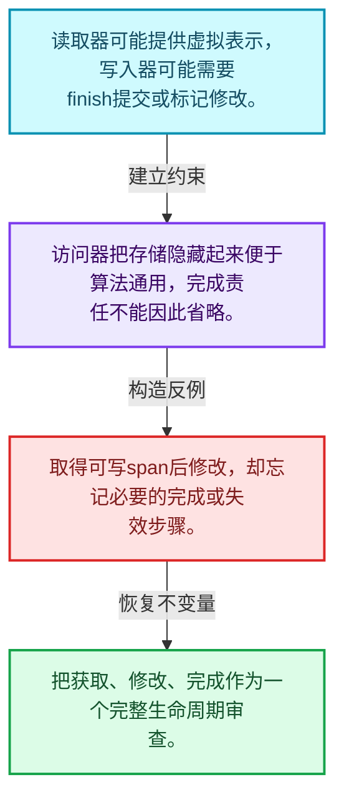
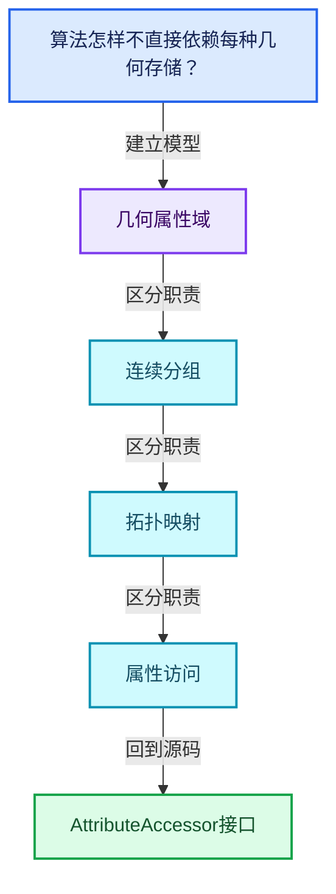
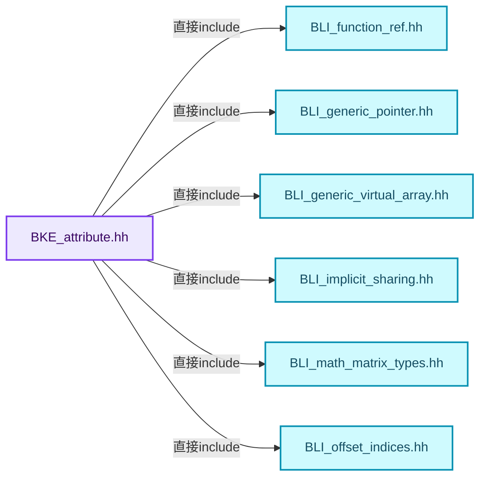
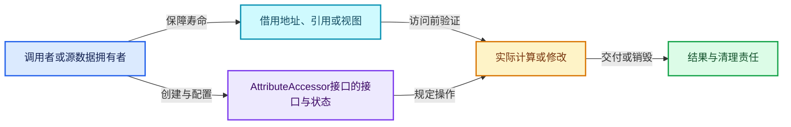
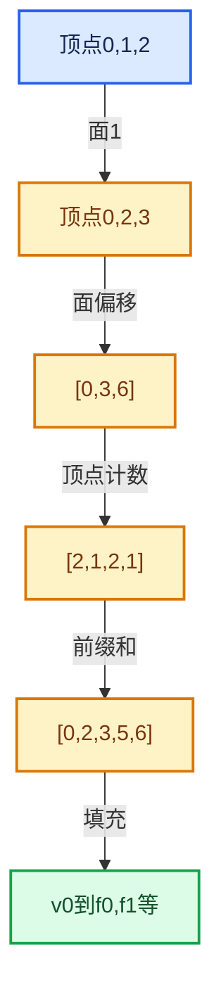

# 05-08 AttributeAccessor接口

[方向导航](README.md) · [总目录](../README.md) · [覆盖索引](../%E6%BA%90%E7%A0%81%E7%89%88%E6%9C%AC%E4%B8%8E%E8%A6%86%E7%9B%96%E7%B4%A2%E5%BC%95.md)

> 阅读顺序：问题与数据模型 → 语法与类型 → 源码逐行 → 调用线索 → 历史与取舍 → 推演和练习。

- 基准 HEAD：`cbda6b96c26c0dee3c3b5cbb93960c4ac06a6b30`。
- 记录日期：2026-10-14。
- 教学示例状态：正文中的推演不是本机性能实测；已运行练习见验收报告。

## 一、从问题到设计

算法怎样不直接依赖每种几何存储？

访问器把名称、域、类型与存储获取分离；读取器和写入器不同，写入完成步骤属于契约。

本篇把语法、数据语义和系统取舍连接起来。利用连续性和重复关系选择表示，让冗余状态尽量无法表达。

### 本篇独立模型与设计推理

读取器可能提供虚拟表示，写入器可能需要finish提交或标记修改。

设计取舍：访问器把存储隐藏起来便于算法通用，完成责任不能因此省略。

最小反例：取得可写span后修改，却忘记必要的完成或失效步骤。

推导与处理：把获取、修改、完成作为一个完整生命周期审查。



### 源码范围与相邻篇章

| 文件 | 本篇逐行范围 | 基准SHA-256 |
|---|---|---|
| [source/blender/blenkernel/BKE_attribute.hh](../../../../../source/blender/blenkernel/BKE_attribute.hh) | L1—L1113 | `9b356718a60a43862176cff8eeaafffa20d48ae38c38a3573d4eb1a6ba60fd5f` |

同一主讲文件可能分多篇覆盖；超出本篇范围的符号通过覆盖索引定位。空行与纯注释保留在源码摘录中，逐行表解释有效语句与语法边界；许可证头统一保留。

前篇：[分组访问与反向索引](07-%E5%88%86%E7%BB%84%E8%AE%BF%E9%97%AE%E4%B8%8E%E5%8F%8D%E5%90%91%E7%B4%A2%E5%BC%95.md).

后篇：[属性域与转换](09-%E5%B1%9E%E6%80%A7%E5%9F%9F%E4%B8%8E%E8%BD%AC%E6%8D%A2.md).

## 二、类型、数据与阅读地图



这是概念依赖图，边表示阅读关系，不声称是运行时调用顺序。

### 直接编译依赖



箭头只表示头文件包含关系；完整调用线索见后面的符号定位表。

## 三、关键词、语法与类型角色

### 模板 template

模板把类型或常量作为生成实现的参数。读声明时先列出类型参数、非类型参数和默认值，再看使用者实际实例化了什么。模板声明本身不意味着每种T都支持其全部成员。

具体检查：把T替换为int、string、只能移动的类型，分别检查每个被调用操作是否成立。

### 依赖名称 typename

typename既可引入类型模板参数，也可告诉编译器某个依赖名称是类型。它不创建运行时对象；解析期确认语法类别与实例化期检查具体类型是不同阶段。

具体检查：区分typename T::value_type和T::size()，前者标记类型，后者是表达式。

### 只读限定 const

const约束当前访问路径可做的修改。const指针、指向const的指针、const视图对象、const元素是不同位置的限定；其他别名可能仍可修改原对象。

具体检查：分别写T* const、const T*与const T* const，并画出不可修改的层次。

### 移动转换 std::move

std::move把表达式转换为可供移动重载选择的值类别，实际资源转移发生在被选中的构造或赋值中。对const对象move可能仍调用复制，对视图move也不会获得底层数据所有权。

具体检查：记录移动构造调用次数，不用变量名或std::move的出现次数替代测量。

### 异常边界 try与catch

try定义异常传播的局部边界。失败路径需要销毁已经成功构造的部分并释放相应存储；未构造的对象不能被析构。

具体检查：在第k次构造失败，列出已经存在的对象集合与待释放缓冲。

### 限定转换 const_cast

const_cast可以改变访问路径的限定，但不能让本来就是const的对象合法可写。常用于复用只读实现时，仍需检查底层对象是否实际可变。

具体检查：对非const对象的const引用与真正const对象分别分析修改是否合法。

### 运行时多态 virtual

虚调用根据实际动态类型选择实现；经基类指针销毁对象时通常需要相应虚析构契约。每元素虚调用和循环外一次分派有不同开销。

具体检查：找出虚接口的实现类和调用频率，再讨论是否值得去虚拟化。

### 覆写检查 override

override要求函数确实覆盖基类虚函数，可捕获参数类型和const限定不匹配。它不改变基类规定的生命周期或线程约束。

具体检查：故意改变一个参数或const，观察编译器如何拒绝误写的新函数。

### 可选值 optional

optional把不存在与存在的T区分开，T的构造和析构跟随engaged状态变化。访问前应由has_value或条件分支证明存在。

具体检查：把空Field状态与合法常量零区分，不能用某个普通值代替不存在。

### 构造与new表达式

普通new可能分配并构造；placement new在给定地址构造，存储由其他机制提供。失败回滚应区分两类责任。

具体检查：追踪地址来自哪里、构造何时成功、由谁析构、由谁释放。

### 内部断言 assert

断言表达开发者预期成立的内部契约，发布构建可能关闭。它不能替代对不可信输入的完整错误处理，也不保证后续操作被运行时保护。

具体检查：对每条断言构造违反条件的输入，区分调用者错误与应向用户报告的错误。

### 受控访问 friend

friend授予指定函数或类访问非公开成员的权限，并不意味着继承，也不自动扩展到友元的派生类。

具体检查：解释执行器为何需要访问包装器的内部映射，同时检查边界是否仍清楚。

### 类型别名 using

类型别名为已有类型建立名字，不创建运行期对象。它常把模板内部使用的类型统一暴露给泛型调用者。

具体检查：展开别名直到基础类型，区分类型别名和变量声明。

### 枚举与状态模型 enum

枚举把有限状态命名；enum class避免许多隐式整数转换。状态机正确性还依赖允许的转移，不能只看有哪些枚举项。

具体检查：列出每个状态的进入条件和离开条件，检查终止状态是否仍可能被调度。

### 拥有型可调用包装 function

std::function保存可调用目标并提供统一调用接口，复制能力与目标要求有关；FunctionRef仅借用，二者不能无条件互换。

具体检查：比较同步回调与长期保存任务对拥有关系的不同要求。

## 四、真实源码与逐行讲解

源码块保持原行内容，原始行号由小节标题及逐行表给出。表中的调用定位是静态阅读辅助；重载、模板实例化、宏展开和虚调用需结合完整声明，不能仅凭词法出现证明动态调用。

### BKE_attribute.hh：L1—L51

<!-- source:source/blender/blenkernel/BKE_attribute.hh:1:51 -->

```cpp
/* SPDX-FileCopyrightText: 2023 Blender Authors
 *
 * SPDX-License-Identifier: GPL-2.0-or-later */

/** \file
 * \ingroup bke
 */

#pragma once

#include <functional>
#include <optional>

#include "BLI_function_ref.hh"
#include "BLI_generic_pointer.hh"
#include "BLI_generic_virtual_array.hh"
#include "BLI_implicit_sharing.hh"
#include "BLI_math_matrix_types.hh"
#include "BLI_offset_indices.hh"
#include "BLI_set.hh"

#include "BKE_attribute_enums.hh"
#include "BKE_attribute_filters.hh"

namespace blender {

struct ID;
struct Mesh;
struct PointCloud;
namespace fn {
namespace multi_function {
class MultiFunction;
}
class GField;
}  // namespace fn

namespace bke {

class AttributeAccessor;
class MutableAttributeAccessor;

const CPPType &attribute_type_to_cpp_type(AttrType type);
AttrType cpp_type_to_attribute_type(const CPPType &type);

/**
 * Contains information about an attribute in a geometry component.
 * More information can be added in the future. E.g. whether the attribute is builtin and how it is
 * stored (uv map, vertex group, ...).
 */
struct AttributeMetaData {
  AttrDomain domain;
```

| 原始行 | 语义、约束与检查 |
|---|---|
| L9 | 防止同一头文件在一个翻译单元中重复展开；不控制多个源文件之间的链接或对象寿命。 |
| L11 | 引入编译依赖 <functional>；这是声明可见性关系，不表示运行时一定调用该文件的所有接口。 |
| L12 | 引入编译依赖 <optional>；这是声明可见性关系，不表示运行时一定调用该文件的所有接口。 |
| L14 | 引入编译依赖 "BLI_function_ref.hh"；这是声明可见性关系，不表示运行时一定调用该文件的所有接口。 |
| L15 | 引入编译依赖 "BLI_generic_pointer.hh"；这是声明可见性关系，不表示运行时一定调用该文件的所有接口。 |
| L16 | 引入编译依赖 "BLI_generic_virtual_array.hh"；这是声明可见性关系，不表示运行时一定调用该文件的所有接口。 |
| L17 | 引入编译依赖 "BLI_implicit_sharing.hh"；这是声明可见性关系，不表示运行时一定调用该文件的所有接口。 |
| L18 | 引入编译依赖 "BLI_math_matrix_types.hh"；这是声明可见性关系，不表示运行时一定调用该文件的所有接口。 |
| L19 | 引入编译依赖 "BLI_offset_indices.hh"；这是声明可见性关系，不表示运行时一定调用该文件的所有接口。 |
| L20 | 引入编译依赖 "BLI_set.hh"；这是声明可见性关系，不表示运行时一定调用该文件的所有接口。 |
| L22 | 引入编译依赖 "BKE_attribute_enums.hh"；这是声明可见性关系，不表示运行时一定调用该文件的所有接口。 |
| L23 | 引入编译依赖 "BKE_attribute_filters.hh"；这是声明可见性关系，不表示运行时一定调用该文件的所有接口。 |
| L25 | 把后续声明放入 blender 命名空间，影响名称查找和符号归属，不创建运行时对象。 |
| L27 | 声明或定义类型 `struct ID`。结合继承、访问权限和成员布局确认接口与拥有关系；前向声明本身没有完整对象布局。 |
| L28 | 声明或定义类型 `struct Mesh`。结合继承、访问权限和成员布局确认接口与拥有关系；前向声明本身没有完整对象布局。 |
| L29 | 声明或定义类型 `struct PointCloud`。结合继承、访问权限和成员布局确认接口与拥有关系；前向声明本身没有完整对象布局。 |
| L30 | 把后续声明放入 fn 命名空间，影响名称查找和符号归属，不创建运行时对象。 |
| L31 | 把后续声明放入 multi_function 命名空间，影响名称查找和符号归属，不创建运行时对象。 |
| L32 | 声明或定义类型 `class MultiFunction`。结合继承、访问权限和成员布局确认接口与拥有关系；前向声明本身没有完整对象布局。 |
| L33 | 结束当前语法单元。局部自动对象在离开其作用域时按规则销毁；这不等于所有被引用的外部数据也被释放。 |
| L34 | 声明或定义类型 `class GField`。结合继承、访问权限和成员布局确认接口与拥有关系；前向声明本身没有完整对象布局。 |
| L35 | 结束当前语法单元。局部自动对象在离开其作用域时按规则销毁；这不等于所有被引用的外部数据也被释放。 |
| L37 | 把后续声明放入 bke 命名空间，影响名称查找和符号归属，不创建运行时对象。 |
| L39 | 声明或定义类型 `class AttributeAccessor`。结合继承、访问权限和成员布局确认接口与拥有关系；前向声明本身没有完整对象布局。 |
| L40 | 声明或定义类型 `class MutableAttributeAccessor`。结合继承、访问权限和成员布局确认接口与拥有关系；前向声明本身没有完整对象布局。 |
| L42 | 声明接口 `const CPPType &attribute_type_to_cpp_type(AttrType type)`，本行没有对应函数体；返回类型、参数限定和const/noexcept共同组成调用契约，实际行为需继续定位实现。 |
| L43 | 出现调用或函数声明 `cpp_type_to_attribute_type`，对应表达式为 `AttrType cpp_type_to_attribute_type(const CPPType &type);`。参数求值、返回类型与重载需结合前后完整语句；静态文本引用不能证明动态目标。 |
| L50 | 声明或定义类型 `struct AttributeMetaData`。结合继承、访问权限和成员布局确认接口与拥有关系；前向声明本身没有完整对象布局。 |
| L51 | 声明成员、局部对象或完成语句 `AttrDomain domain`。若为指针或引用，它本身不说明拥有；若为值对象，其构造析构由所在作用域或外层对象管理。 |

### BKE_attribute.hh：L52—L97

<!-- source:source/blender/blenkernel/BKE_attribute.hh:52:97 -->

```cpp
  AttrType data_type;

  friend bool operator==(const AttributeMetaData &a, const AttributeMetaData &b) = default;
};

struct AttributeDomainAndType {
  AttrDomain domain;
  AttrType data_type;

  friend bool operator==(const AttributeDomainAndType &a,
                         const AttributeDomainAndType &b) = default;
};

/**
 * Base class for the attribute initializer types described below.
 */
struct AttributeInit {
  enum class Type {
    /** #AttributeInitConstruct. */
    Construct,
    /** #AttributeInitValue. */
    Value,
    /** #AttributeInitDefaultValue. */
    DefaultValue,
    /** #AttributeInitVArray. */
    VArray,
    /** #AttributeInitShared. */
    Shared,
  };
  Type type;
  AttributeInit(const Type type) : type(type) {}
};

/**
 * Default construct new attribute values. Does nothing for trivial types. This should be used
 * if all attribute element values will be set by the caller after creating the attribute.
 */
struct AttributeInitConstruct : public AttributeInit {
  AttributeInitConstruct() : AttributeInit(Type::Construct) {}
};

/**
 * Create attribute data with the given value, which must be the same as the specified type.
 */
struct AttributeInitValue : public AttributeInit {
  GPointer value;
```

| 原始行 | 语义、约束与检查 |
|---|---|
| L52 | 声明成员、局部对象或完成语句 `AttrType data_type`。若为指针或引用，它本身不说明拥有；若为值对象，其构造析构由所在作用域或外层对象管理。 |
| L54 | 显式采用编译器生成的特殊成员行为：`friend bool operator==(const AttributeMetaData &a, const AttributeMetaData &b) = default;`。成员和基类的性质决定该操作是否可用、是否被删除及异常约定，不表示运行时给对象赋值为default。 |
| L55 | 结束当前语法单元。局部自动对象在离开其作用域时按规则销毁；这不等于所有被引用的外部数据也被释放。 |
| L57 | 声明或定义类型 `struct AttributeDomainAndType`。结合继承、访问权限和成员布局确认接口与拥有关系；前向声明本身没有完整对象布局。 |
| L58 | 声明成员、局部对象或完成语句 `AttrDomain domain`。若为指针或引用，它本身不说明拥有；若为值对象，其构造析构由所在作用域或外层对象管理。 |
| L59 | 声明成员、局部对象或完成语句 `AttrType data_type`。若为指针或引用，它本身不说明拥有；若为值对象，其构造析构由所在作用域或外层对象管理。 |
| L61 | 运算符重载声明、定义或显式调用：`friend bool operator==(const AttributeDomainAndType &a,`。结合参数和返回类型判断是赋值、索引、比较还是转换；operator=声明中的等号不是在给名为operator的变量赋值。 |
| L62 | 显式采用编译器生成的特殊成员行为：`const AttributeDomainAndType &b) = default;`。成员和基类的性质决定该操作是否可用、是否被删除及异常约定，不表示运行时给对象赋值为default。 |
| L63 | 结束当前语法单元。局部自动对象在离开其作用域时按规则销毁；这不等于所有被引用的外部数据也被释放。 |
| L68 | 声明或定义类型 `struct AttributeInit`。结合继承、访问权限和成员布局确认接口与拥有关系；前向声明本身没有完整对象布局。 |
| L69 | 声明或定义类型 `enum class Type`。结合继承、访问权限和成员布局确认接口与拥有关系；前向声明本身没有完整对象布局。 |
| L71 | 本行是连续声明或表达式的一部分：`Construct,`。与本段前后行合读；逗号、括号和限定符决定它属于参数、初始化列表还是实际计算。 |
| L73 | 本行是连续声明或表达式的一部分：`Value,`。与本段前后行合读；逗号、括号和限定符决定它属于参数、初始化列表还是实际计算。 |
| L75 | 本行是连续声明或表达式的一部分：`DefaultValue,`。与本段前后行合读；逗号、括号和限定符决定它属于参数、初始化列表还是实际计算。 |
| L77 | 本行是连续声明或表达式的一部分：`VArray,`。与本段前后行合读；逗号、括号和限定符决定它属于参数、初始化列表还是实际计算。 |
| L79 | 本行是连续声明或表达式的一部分：`Shared,`。与本段前后行合读；逗号、括号和限定符决定它属于参数、初始化列表还是实际计算。 |
| L80 | 结束当前语法单元。局部自动对象在离开其作用域时按规则销毁；这不等于所有被引用的外部数据也被释放。 |
| L81 | 声明成员、局部对象或完成语句 `Type type`。若为指针或引用，它本身不说明拥有；若为值对象，其构造析构由所在作用域或外层对象管理。 |
| L82 | 出现调用或函数声明 `AttributeInit`，对应表达式为 `AttributeInit(const Type type) : type(type) {}`。参数求值、返回类型与重载需结合前后完整语句；静态文本引用不能证明动态目标。 |
| L83 | 结束当前语法单元。局部自动对象在离开其作用域时按规则销毁；这不等于所有被引用的外部数据也被释放。 |
| L89 | 声明或定义类型 `struct AttributeInitConstruct : public AttributeInit`。结合继承、访问权限和成员布局确认接口与拥有关系；前向声明本身没有完整对象布局。 |
| L90 | 出现调用或函数声明 `AttributeInitConstruct`，对应表达式为 `AttributeInitConstruct() : AttributeInit(Type::Construct) {}`。参数求值、返回类型与重载需结合前后完整语句；静态文本引用不能证明动态目标。 |
| L91 | 结束当前语法单元。局部自动对象在离开其作用域时按规则销毁；这不等于所有被引用的外部数据也被释放。 |
| L96 | 声明或定义类型 `struct AttributeInitValue : public AttributeInit`。结合继承、访问权限和成员布局确认接口与拥有关系；前向声明本身没有完整对象布局。 |
| L97 | 声明成员、局部对象或完成语句 `GPointer value`。若为指针或引用，它本身不说明拥有；若为值对象，其构造析构由所在作用域或外层对象管理。 |

### BKE_attribute.hh：L98—L140

<!-- source:source/blender/blenkernel/BKE_attribute.hh:98:140 -->

```cpp

  /** \warning The value argument must out-live this attribute initialization operation. */
  template<typename T>
  AttributeInitValue(const T &value) : AttributeInit(Type::Value), value(GPointer(&value))
  {
  }
  AttributeInitValue(const GPointer value) : AttributeInit(Type::Value), value(value) {}
};

/**
 * Create an attribute using the default value for the data type (almost always "zero").
 */
struct AttributeInitDefaultValue : public AttributeInit {
  AttributeInitDefaultValue() : AttributeInit(Type::DefaultValue) {}
};

/**
 * Create an attribute by copying data from an existing virtual array. The virtual array
 * must have the same type as the newly created attribute.
 */
struct AttributeInitVArray : public AttributeInit {
  GVArray varray;

  AttributeInitVArray(GVArray varray) : AttributeInit(Type::VArray), varray(std::move(varray)) {}
};

/**
 * Create a shared attribute by adding a user to a shared data array.
 * The sharing info has ownership of the provided contiguous array.
 */
struct AttributeInitShared : public AttributeInit {
  const void *data = nullptr;
  const ImplicitSharingInfo *sharing_info = nullptr;

  AttributeInitShared(const void *data, const ImplicitSharingInfo &sharing_info)
      : AttributeInit(Type::Shared), data(data), sharing_info(&sharing_info)
  {
  }
};

/* Returns false when the iteration should be stopped. */
using AttributeForeachCallback =
    FunctionRef<bool(StringRefNull name, const AttributeMetaData &meta_data)>;
```

| 原始行 | 语义、约束与检查 |
|---|---|
| L100 | 声明模板参数 `template<typename T>`。类型参数决定生成操作的类型，非类型参数可决定内嵌容量或编译期分支。 |
| L101 | 出现调用或函数声明 `AttributeInitValue`，对应表达式为 `AttributeInitValue(const T &value) : AttributeInit(Type::Value), value(GPointer(&value))`。参数求值、返回类型与重载需结合前后完整语句；静态文本引用不能证明动态目标。 |
| L102 | 连接上一行的声明或控制结构与其语句块；后续行在这个作用域中执行或声明。 |
| L103 | 结束当前语法单元。局部自动对象在离开其作用域时按规则销毁；这不等于所有被引用的外部数据也被释放。 |
| L104 | 出现调用或函数声明 `AttributeInitValue`，对应表达式为 `AttributeInitValue(const GPointer value) : AttributeInit(Type::Value), value(value) {}`。参数求值、返回类型与重载需结合前后完整语句；静态文本引用不能证明动态目标。 |
| L105 | 结束当前语法单元。局部自动对象在离开其作用域时按规则销毁；这不等于所有被引用的外部数据也被释放。 |
| L110 | 声明或定义类型 `struct AttributeInitDefaultValue : public AttributeInit`。结合继承、访问权限和成员布局确认接口与拥有关系；前向声明本身没有完整对象布局。 |
| L111 | 出现调用或函数声明 `AttributeInitDefaultValue`，对应表达式为 `AttributeInitDefaultValue() : AttributeInit(Type::DefaultValue) {}`。参数求值、返回类型与重载需结合前后完整语句；静态文本引用不能证明动态目标。 |
| L112 | 结束当前语法单元。局部自动对象在离开其作用域时按规则销毁；这不等于所有被引用的外部数据也被释放。 |
| L118 | 声明或定义类型 `struct AttributeInitVArray : public AttributeInit`。结合继承、访问权限和成员布局确认接口与拥有关系；前向声明本身没有完整对象布局。 |
| L119 | 声明成员、局部对象或完成语句 `GVArray varray`。若为指针或引用，它本身不说明拥有；若为值对象，其构造析构由所在作用域或外层对象管理。 |
| L121 | 出现调用或函数声明 `AttributeInitVArray`，对应表达式为 `AttributeInitVArray(GVArray varray) : AttributeInit(Type::VArray), varray(std::move(varray)) {}`。参数求值、返回类型与重载需结合前后完整语句；静态文本引用不能证明动态目标。 |
| L122 | 结束当前语法单元。局部自动对象在离开其作用域时按规则销毁；这不等于所有被引用的外部数据也被释放。 |
| L128 | 声明或定义类型 `struct AttributeInitShared : public AttributeInit`。结合继承、访问权限和成员布局确认接口与拥有关系；前向声明本身没有完整对象布局。 |
| L129 | 把右侧 `nullptr` 用于初始化或更新左侧 `const void *data`。声明初始化与已有对象赋值应按上下文区分；有资源的类型会调用相应特殊成员。 |
| L130 | 把右侧 `nullptr` 用于初始化或更新左侧 `const ImplicitSharingInfo *sharing_info`。声明初始化与已有对象赋值应按上下文区分；有资源的类型会调用相应特殊成员。 |
| L132 | 出现调用或函数声明 `AttributeInitShared`，对应表达式为 `AttributeInitShared(const void *data, const ImplicitSharingInfo &sharing_info)`。参数求值、返回类型与重载需结合前后完整语句；静态文本引用不能证明动态目标。 |
| L133 | 出现调用或函数声明 `AttributeInit`，对应表达式为 `: AttributeInit(Type::Shared), data(data), sharing_info(&sharing_info)`。参数求值、返回类型与重载需结合前后完整语句；静态文本引用不能证明动态目标。 |
| L134 | 连接上一行的声明或控制结构与其语句块；后续行在这个作用域中执行或声明。 |
| L135 | 结束当前语法单元。局部自动对象在离开其作用域时按规则销毁；这不等于所有被引用的外部数据也被释放。 |
| L136 | 结束当前语法单元。局部自动对象在离开其作用域时按规则销毁；这不等于所有被引用的外部数据也被释放。 |
| L139 | 定义类型别名 `using AttributeForeachCallback =`，为模板接口或内部实现统一命名；本行不分配该类型对象。 |
| L140 | 出现调用或函数声明 `bool`，对应表达式为 `FunctionRef<bool(StringRefNull name, const AttributeMetaData &meta_data)>;`。参数求值、返回类型与重载需结合前后完整语句；静态文本引用不能证明动态目标。 |

### BKE_attribute.hh：L141—L192

<!-- source:source/blender/blenkernel/BKE_attribute.hh:141:192 -->

```cpp

/**
 * Result when looking up an attribute from some geometry with the intention of only reading from
 * it.
 */
template<typename T> struct AttributeReader {
  /**
   * Virtual array that provides access to the attribute data. This may be empty.
   */
  VArray<T> varray;
  /**
   * Domain where the attribute is stored. This also determines the size of the virtual array.
   */
  AttrDomain domain;

  /**
   * Information about shared ownership of the attribute array. This will only be provided
   * if the virtual array directly references the contiguous original attribute array.
   */
  const ImplicitSharingInfo *sharing_info;

  const VArray<T> &operator*() const &
  {
    return this->varray;
  }

  VArray<T> &operator*() &
  {
    return this->varray;
  }

  VArray<T> operator*() &&
  {
    return std::move(this->varray);
  }

  operator bool() const
  {
    return this->varray;
  }
};

/**
 * A utility to make sure attribute values are valid, for attributes like "material_index" which
 * can only be positive, or attributes that represent enum options. This is usually only necessary
 * when writing attributes from an untrusted/arbitrary user input.
 */
struct AttributeValidator {
  /**
   * Single input, single output function that corrects attribute values if necessary.
   */
  const fn::multi_function::MultiFunction *function;
```

| 原始行 | 语义、约束与检查 |
|---|---|
| L146 | 声明模板参数 `template<typename T> struct AttributeReader {`。类型参数决定生成操作的类型，非类型参数可决定内嵌容量或编译期分支。 |
| L150 | 声明成员、局部对象或完成语句 `VArray<T> varray`。若为指针或引用，它本身不说明拥有；若为值对象，其构造析构由所在作用域或外层对象管理。 |
| L154 | 声明成员、局部对象或完成语句 `AttrDomain domain`。若为指针或引用，它本身不说明拥有；若为值对象，其构造析构由所在作用域或外层对象管理。 |
| L160 | 声明成员、局部对象或完成语句 `const ImplicitSharingInfo *sharing_info`。若为指针或引用，它本身不说明拥有；若为值对象，其构造析构由所在作用域或外层对象管理。 |
| L162 | 运算符重载声明、定义或显式调用：`const VArray<T> &operator*() const &`。结合参数和返回类型判断是赋值、索引、比较还是转换；operator=声明中的等号不是在给名为operator的变量赋值。 |
| L163 | 连接上一行的声明或控制结构与其语句块；后续行在这个作用域中执行或声明。 |
| L164 | 返回表达式 `this->varray`。 |
| L165 | 结束当前语法单元。局部自动对象在离开其作用域时按规则销毁；这不等于所有被引用的外部数据也被释放。 |
| L167 | 运算符重载声明、定义或显式调用：`VArray<T> &operator*() &`。结合参数和返回类型判断是赋值、索引、比较还是转换；operator=声明中的等号不是在给名为operator的变量赋值。 |
| L168 | 连接上一行的声明或控制结构与其语句块；后续行在这个作用域中执行或声明。 |
| L169 | 返回表达式 `this->varray`。 |
| L170 | 结束当前语法单元。局部自动对象在离开其作用域时按规则销毁；这不等于所有被引用的外部数据也被释放。 |
| L172 | 运算符重载声明、定义或显式调用：`VArray<T> operator*() &&`。结合参数和返回类型判断是赋值、索引、比较还是转换；operator=声明中的等号不是在给名为operator的变量赋值。 |
| L173 | 连接上一行的声明或控制结构与其语句块；后续行在这个作用域中执行或声明。 |
| L174 | 返回表达式 `std::move(this->varray)`。 |
| L175 | 结束当前语法单元。局部自动对象在离开其作用域时按规则销毁；这不等于所有被引用的外部数据也被释放。 |
| L177 | 运算符重载声明、定义或显式调用：`operator bool() const`。结合参数和返回类型判断是赋值、索引、比较还是转换；operator=声明中的等号不是在给名为operator的变量赋值。 |
| L178 | 连接上一行的声明或控制结构与其语句块；后续行在这个作用域中执行或声明。 |
| L179 | 返回表达式 `this->varray`。 |
| L180 | 结束当前语法单元。局部自动对象在离开其作用域时按规则销毁；这不等于所有被引用的外部数据也被释放。 |
| L181 | 结束当前语法单元。局部自动对象在离开其作用域时按规则销毁；这不等于所有被引用的外部数据也被释放。 |
| L188 | 声明或定义类型 `struct AttributeValidator`。结合继承、访问权限和成员布局确认接口与拥有关系；前向声明本身没有完整对象布局。 |
| L192 | 声明成员、局部对象或完成语句 `const fn::multi_function::MultiFunction *function`。若为指针或引用，它本身不说明拥有；若为值对象，其构造析构由所在作用域或外层对象管理。 |

### BKE_attribute.hh：L193—L239

<!-- source:source/blender/blenkernel/BKE_attribute.hh:193:239 -->

```cpp

  operator bool() const
  {
    return this->function != nullptr;
  }
  /**
   * Return a field that creates corrected attribute values.
   */
  fn::GField validate_field_if_necessary(const fn::GField &field) const;
};

/**
 * Result when looking up an attribute from some geometry with read and write access. After writing
 * to the attribute, the #finish method has to be called. This may invalidate caches based on this
 * attribute.
 */
template<typename T> struct AttributeWriter {
  /**
   * Virtual array giving read and write access to the attribute. This may be empty.
   * Consider using #SpanAttributeWriter when you want to access the virtual array as a span.
   */
  VMutableArray<T> varray;
  /**
   * Domain where the attribute is stored on the geometry. Also determines the size of the virtual
   * array.
   */
  AttrDomain domain;
  /**
   * A function that has to be called after the attribute has been edited. This may be empty.
   */
  std::function<void()> tag_modified_fn;

  operator bool() const
  {
    return this->varray;
  }

  /**
   * Has to be called after the attribute has been modified.
   */
  void finish()
  {
    if (this->tag_modified_fn) {
      this->tag_modified_fn();
    }
  }
};
```

本段语义重点：

- 分支证据 `this->tag_modified_fn)`：分别推演条件成立与不成立，核对相同出口处的状态。

| 原始行 | 语义、约束与检查 |
|---|---|
| L194 | 运算符重载声明、定义或显式调用：`operator bool() const`。结合参数和返回类型判断是赋值、索引、比较还是转换；operator=声明中的等号不是在给名为operator的变量赋值。 |
| L195 | 连接上一行的声明或控制结构与其语句块；后续行在这个作用域中执行或声明。 |
| L196 | 返回表达式 `this->function != nullptr`。 |
| L197 | 结束当前语法单元。局部自动对象在离开其作用域时按规则销毁；这不等于所有被引用的外部数据也被释放。 |
| L201 | 声明接口 `fn::GField validate_field_if_necessary(const fn::GField &field) const`，本行没有对应函数体；返回类型、参数限定和const/noexcept共同组成调用契约，实际行为需继续定位实现。 |
| L202 | 结束当前语法单元。局部自动对象在离开其作用域时按规则销毁；这不等于所有被引用的外部数据也被释放。 |
| L209 | 声明模板参数 `template<typename T> struct AttributeWriter {`。类型参数决定生成操作的类型，非类型参数可决定内嵌容量或编译期分支。 |
| L214 | 声明成员、局部对象或完成语句 `VMutableArray<T> varray`。若为指针或引用，它本身不说明拥有；若为值对象，其构造析构由所在作用域或外层对象管理。 |
| L219 | 声明成员、局部对象或完成语句 `AttrDomain domain`。若为指针或引用，它本身不说明拥有；若为值对象，其构造析构由所在作用域或外层对象管理。 |
| L223 | 出现调用或函数声明 `void`，对应表达式为 `std::function<void()> tag_modified_fn;`。参数求值、返回类型与重载需结合前后完整语句；静态文本引用不能证明动态目标。 |
| L225 | 运算符重载声明、定义或显式调用：`operator bool() const`。结合参数和返回类型判断是赋值、索引、比较还是转换；operator=声明中的等号不是在给名为operator的变量赋值。 |
| L226 | 连接上一行的声明或控制结构与其语句块；后续行在这个作用域中执行或声明。 |
| L227 | 返回表达式 `this->varray`。 |
| L228 | 结束当前语法单元。局部自动对象在离开其作用域时按规则销毁；这不等于所有被引用的外部数据也被释放。 |
| L233 | 出现调用或函数声明 `finish`，对应表达式为 `void finish()`。参数求值、返回类型与重载需结合前后完整语句；静态文本引用不能证明动态目标。 |
| L234 | 连接上一行的声明或控制结构与其语句块；后续行在这个作用域中执行或声明。 |
| L235 | 判断 `this->tag_modified_fn`，成立时进入本分支，否则继续后续路径。 |
| L236 | 出现调用或函数声明 `tag_modified_fn`，对应表达式为 `this->tag_modified_fn();`。参数求值、返回类型与重载需结合前后完整语句；静态文本引用不能证明动态目标。 |
| L237 | 结束当前语法单元。局部自动对象在离开其作用域时按规则销毁；这不等于所有被引用的外部数据也被释放。 |
| L238 | 结束当前语法单元。局部自动对象在离开其作用域时按规则销毁；这不等于所有被引用的外部数据也被释放。 |
| L239 | 结束当前语法单元。局部自动对象在离开其作用域时按规则销毁；这不等于所有被引用的外部数据也被释放。 |

### BKE_attribute.hh：L240—L287

<!-- source:source/blender/blenkernel/BKE_attribute.hh:240:287 -->

```cpp

/**
 * A version of #AttributeWriter for the common case when the user of the attribute wants to write
 * to a span instead of a virtual array. Since most attributes are spans internally, this can
 * result in better performance and also simplifies code.
 */
template<typename T> struct SpanAttributeWriter {
  /**
   * A span based on the virtual array that contains the attribute data. This may be empty.
   */
  MutableVArraySpan<T> span;
  /**
   * Domain of the attribute. Also determines the size of the span.
   */
  AttrDomain domain;
  /**
   * Has to be called after writing to the span.
   */
  std::function<void()> tag_modified_fn;

  SpanAttributeWriter() = default;

  SpanAttributeWriter(AttributeWriter<T> &&other, const bool copy_values_to_span)
      : span(std::move(other.varray), copy_values_to_span),
        domain(other.domain),
        tag_modified_fn(std::move(other.tag_modified_fn))
  {
  }

  operator bool() const
  {
    return span.varray();
  }

  /**
   * Has to be called when done writing to the attribute. This makes sure that the data is copied
   * to the underlying attribute if it was not stored as an array. Furthermore, this may invalidate
   * other data depending on the modified attribute.
   */
  void finish()
  {
    if (this->span.varray()) {
      this->span.save();
    }
    if (this->tag_modified_fn) {
      this->tag_modified_fn();
    }
  }
```

本段语义重点：

- 分支证据 `this->span.varray())`：分别推演条件成立与不成立，核对相同出口处的状态。
- 分支证据 `this->tag_modified_fn)`：分别推演条件成立与不成立，核对相同出口处的状态。

| 原始行 | 语义、约束与检查 |
|---|---|
| L246 | 声明模板参数 `template<typename T> struct SpanAttributeWriter {`。类型参数决定生成操作的类型，非类型参数可决定内嵌容量或编译期分支。 |
| L250 | 声明成员、局部对象或完成语句 `MutableVArraySpan<T> span`。若为指针或引用，它本身不说明拥有；若为值对象，其构造析构由所在作用域或外层对象管理。 |
| L254 | 声明成员、局部对象或完成语句 `AttrDomain domain`。若为指针或引用，它本身不说明拥有；若为值对象，其构造析构由所在作用域或外层对象管理。 |
| L258 | 出现调用或函数声明 `void`，对应表达式为 `std::function<void()> tag_modified_fn;`。参数求值、返回类型与重载需结合前后完整语句；静态文本引用不能证明动态目标。 |
| L260 | 显式采用编译器生成的特殊成员行为：`SpanAttributeWriter() = default;`。成员和基类的性质决定该操作是否可用、是否被删除及异常约定，不表示运行时给对象赋值为default。 |
| L262 | 出现调用或函数声明 `SpanAttributeWriter`，对应表达式为 `SpanAttributeWriter(AttributeWriter<T> &&other, const bool copy_values_to_span)`。参数求值、返回类型与重载需结合前后完整语句；静态文本引用不能证明动态目标。 |
| L263 | 出现调用或函数声明 `span`，对应表达式为 `: span(std::move(other.varray), copy_values_to_span),`。参数求值、返回类型与重载需结合前后完整语句；静态文本引用不能证明动态目标。 |
| L264 | 出现调用或函数声明 `domain`，对应表达式为 `domain(other.domain),`。参数求值、返回类型与重载需结合前后完整语句；静态文本引用不能证明动态目标。 |
| L265 | 出现调用或函数声明 `tag_modified_fn`，对应表达式为 `tag_modified_fn(std::move(other.tag_modified_fn))`。参数求值、返回类型与重载需结合前后完整语句；静态文本引用不能证明动态目标。 |
| L266 | 连接上一行的声明或控制结构与其语句块；后续行在这个作用域中执行或声明。 |
| L267 | 结束当前语法单元。局部自动对象在离开其作用域时按规则销毁；这不等于所有被引用的外部数据也被释放。 |
| L269 | 运算符重载声明、定义或显式调用：`operator bool() const`。结合参数和返回类型判断是赋值、索引、比较还是转换；operator=声明中的等号不是在给名为operator的变量赋值。 |
| L270 | 连接上一行的声明或控制结构与其语句块；后续行在这个作用域中执行或声明。 |
| L271 | 返回表达式 `span.varray()`。 |
| L272 | 结束当前语法单元。局部自动对象在离开其作用域时按规则销毁；这不等于所有被引用的外部数据也被释放。 |
| L279 | 出现调用或函数声明 `finish`，对应表达式为 `void finish()`。参数求值、返回类型与重载需结合前后完整语句；静态文本引用不能证明动态目标。 |
| L280 | 连接上一行的声明或控制结构与其语句块；后续行在这个作用域中执行或声明。 |
| L281 | 判断 `this->span.varray()`，成立时进入本分支，否则继续后续路径。 |
| L282 | 出现调用或函数声明 `save`，对应表达式为 `this->span.save();`。参数求值、返回类型与重载需结合前后完整语句；静态文本引用不能证明动态目标。 |
| L283 | 结束当前语法单元。局部自动对象在离开其作用域时按规则销毁；这不等于所有被引用的外部数据也被释放。 |
| L284 | 判断 `this->tag_modified_fn`，成立时进入本分支，否则继续后续路径。 |
| L285 | 出现调用或函数声明 `tag_modified_fn`，对应表达式为 `this->tag_modified_fn();`。参数求值、返回类型与重载需结合前后完整语句；静态文本引用不能证明动态目标。 |
| L286 | 结束当前语法单元。局部自动对象在离开其作用域时按规则销毁；这不等于所有被引用的外部数据也被释放。 |
| L287 | 结束当前语法单元。局部自动对象在离开其作用域时按规则销毁；这不等于所有被引用的外部数据也被释放。 |

### BKE_attribute.hh：L288—L335

<!-- source:source/blender/blenkernel/BKE_attribute.hh:288:335 -->

```cpp
};

/**
 * A generic version of #AttributeReader.
 */
struct GAttributeReader {
  GVArray varray;
  AttrDomain domain;
  const ImplicitSharingInfo *sharing_info;

  operator bool() const
  {
    return this->varray;
  }

  const GVArray &operator*() const &
  {
    return this->varray;
  }

  GVArray &operator*() &
  {
    return this->varray;
  }

  GVArray operator*() &&
  {
    return std::move(this->varray);
  }

  template<typename T> AttributeReader<T> typed() const
  {
    return {varray.typed<T>(), domain, sharing_info};
  }
};

/**
 * A generic version of #AttributeWriter.
 */
struct GAttributeWriter {
  GVMutableArray varray;
  AttrDomain domain;
  std::function<void()> tag_modified_fn;

  operator bool() const
  {
    return this->varray;
  }
```

| 原始行 | 语义、约束与检查 |
|---|---|
| L288 | 结束当前语法单元。局部自动对象在离开其作用域时按规则销毁；这不等于所有被引用的外部数据也被释放。 |
| L293 | 声明或定义类型 `struct GAttributeReader`。结合继承、访问权限和成员布局确认接口与拥有关系；前向声明本身没有完整对象布局。 |
| L294 | 声明成员、局部对象或完成语句 `GVArray varray`。若为指针或引用，它本身不说明拥有；若为值对象，其构造析构由所在作用域或外层对象管理。 |
| L295 | 声明成员、局部对象或完成语句 `AttrDomain domain`。若为指针或引用，它本身不说明拥有；若为值对象，其构造析构由所在作用域或外层对象管理。 |
| L296 | 声明成员、局部对象或完成语句 `const ImplicitSharingInfo *sharing_info`。若为指针或引用，它本身不说明拥有；若为值对象，其构造析构由所在作用域或外层对象管理。 |
| L298 | 运算符重载声明、定义或显式调用：`operator bool() const`。结合参数和返回类型判断是赋值、索引、比较还是转换；operator=声明中的等号不是在给名为operator的变量赋值。 |
| L299 | 连接上一行的声明或控制结构与其语句块；后续行在这个作用域中执行或声明。 |
| L300 | 返回表达式 `this->varray`。 |
| L301 | 结束当前语法单元。局部自动对象在离开其作用域时按规则销毁；这不等于所有被引用的外部数据也被释放。 |
| L303 | 运算符重载声明、定义或显式调用：`const GVArray &operator*() const &`。结合参数和返回类型判断是赋值、索引、比较还是转换；operator=声明中的等号不是在给名为operator的变量赋值。 |
| L304 | 连接上一行的声明或控制结构与其语句块；后续行在这个作用域中执行或声明。 |
| L305 | 返回表达式 `this->varray`。 |
| L306 | 结束当前语法单元。局部自动对象在离开其作用域时按规则销毁；这不等于所有被引用的外部数据也被释放。 |
| L308 | 运算符重载声明、定义或显式调用：`GVArray &operator*() &`。结合参数和返回类型判断是赋值、索引、比较还是转换；operator=声明中的等号不是在给名为operator的变量赋值。 |
| L309 | 连接上一行的声明或控制结构与其语句块；后续行在这个作用域中执行或声明。 |
| L310 | 返回表达式 `this->varray`。 |
| L311 | 结束当前语法单元。局部自动对象在离开其作用域时按规则销毁；这不等于所有被引用的外部数据也被释放。 |
| L313 | 运算符重载声明、定义或显式调用：`GVArray operator*() &&`。结合参数和返回类型判断是赋值、索引、比较还是转换；operator=声明中的等号不是在给名为operator的变量赋值。 |
| L314 | 连接上一行的声明或控制结构与其语句块；后续行在这个作用域中执行或声明。 |
| L315 | 返回表达式 `std::move(this->varray)`。 |
| L316 | 结束当前语法单元。局部自动对象在离开其作用域时按规则销毁；这不等于所有被引用的外部数据也被释放。 |
| L318 | 声明模板参数 `template<typename T> AttributeReader<T> typed() const`。类型参数决定生成操作的类型，非类型参数可决定内嵌容量或编译期分支。 |
| L319 | 连接上一行的声明或控制结构与其语句块；后续行在这个作用域中执行或声明。 |
| L320 | 返回表达式 `{varray.typed<T>(), domain, sharing_info}`。 |
| L321 | 结束当前语法单元。局部自动对象在离开其作用域时按规则销毁；这不等于所有被引用的外部数据也被释放。 |
| L322 | 结束当前语法单元。局部自动对象在离开其作用域时按规则销毁；这不等于所有被引用的外部数据也被释放。 |
| L327 | 声明或定义类型 `struct GAttributeWriter`。结合继承、访问权限和成员布局确认接口与拥有关系；前向声明本身没有完整对象布局。 |
| L328 | 声明成员、局部对象或完成语句 `GVMutableArray varray`。若为指针或引用，它本身不说明拥有；若为值对象，其构造析构由所在作用域或外层对象管理。 |
| L329 | 声明成员、局部对象或完成语句 `AttrDomain domain`。若为指针或引用，它本身不说明拥有；若为值对象，其构造析构由所在作用域或外层对象管理。 |
| L330 | 出现调用或函数声明 `void`，对应表达式为 `std::function<void()> tag_modified_fn;`。参数求值、返回类型与重载需结合前后完整语句；静态文本引用不能证明动态目标。 |
| L332 | 运算符重载声明、定义或显式调用：`operator bool() const`。结合参数和返回类型判断是赋值、索引、比较还是转换；operator=声明中的等号不是在给名为operator的变量赋值。 |
| L333 | 连接上一行的声明或控制结构与其语句块；后续行在这个作用域中执行或声明。 |
| L334 | 返回表达式 `this->varray`。 |
| L335 | 结束当前语法单元。局部自动对象在离开其作用域时按规则销毁；这不等于所有被引用的外部数据也被释放。 |

### BKE_attribute.hh：L336—L381

<!-- source:source/blender/blenkernel/BKE_attribute.hh:336:381 -->

```cpp

  void finish()
  {
    if (this->tag_modified_fn) {
      this->tag_modified_fn();
    }
  }

  template<typename T> AttributeWriter<T> typed() const
  {
    return {varray.typed<T>(), domain, tag_modified_fn};
  }
};

/**
 * A generic version of #SpanAttributeWriter.
 */
struct GSpanAttributeWriter {
  GMutableVArraySpan span;
  AttrDomain domain;
  std::function<void()> tag_modified_fn;

  GSpanAttributeWriter() = default;

  GSpanAttributeWriter(GAttributeWriter &&other, const bool copy_values_to_span)
      : span(std::move(other.varray), copy_values_to_span),
        domain(other.domain),
        tag_modified_fn(std::move(other.tag_modified_fn))
  {
  }

  operator bool() const
  {
    return span.varray();
  }

  void finish()
  {
    if (this->span.varray()) {
      this->span.save();
    }
    if (this->tag_modified_fn) {
      this->tag_modified_fn();
    }
  }
};
```

本段语义重点：

- 分支证据 `this->tag_modified_fn)`：分别推演条件成立与不成立，核对相同出口处的状态。
- 分支证据 `this->span.varray())`：分别推演条件成立与不成立，核对相同出口处的状态。

| 原始行 | 语义、约束与检查 |
|---|---|
| L337 | 出现调用或函数声明 `finish`，对应表达式为 `void finish()`。参数求值、返回类型与重载需结合前后完整语句；静态文本引用不能证明动态目标。 |
| L338 | 连接上一行的声明或控制结构与其语句块；后续行在这个作用域中执行或声明。 |
| L339 | 判断 `this->tag_modified_fn`，成立时进入本分支，否则继续后续路径。 |
| L340 | 出现调用或函数声明 `tag_modified_fn`，对应表达式为 `this->tag_modified_fn();`。参数求值、返回类型与重载需结合前后完整语句；静态文本引用不能证明动态目标。 |
| L341 | 结束当前语法单元。局部自动对象在离开其作用域时按规则销毁；这不等于所有被引用的外部数据也被释放。 |
| L342 | 结束当前语法单元。局部自动对象在离开其作用域时按规则销毁；这不等于所有被引用的外部数据也被释放。 |
| L344 | 声明模板参数 `template<typename T> AttributeWriter<T> typed() const`。类型参数决定生成操作的类型，非类型参数可决定内嵌容量或编译期分支。 |
| L345 | 连接上一行的声明或控制结构与其语句块；后续行在这个作用域中执行或声明。 |
| L346 | 返回表达式 `{varray.typed<T>(), domain, tag_modified_fn}`。 |
| L347 | 结束当前语法单元。局部自动对象在离开其作用域时按规则销毁；这不等于所有被引用的外部数据也被释放。 |
| L348 | 结束当前语法单元。局部自动对象在离开其作用域时按规则销毁；这不等于所有被引用的外部数据也被释放。 |
| L353 | 声明或定义类型 `struct GSpanAttributeWriter`。结合继承、访问权限和成员布局确认接口与拥有关系；前向声明本身没有完整对象布局。 |
| L354 | 声明成员、局部对象或完成语句 `GMutableVArraySpan span`。若为指针或引用，它本身不说明拥有；若为值对象，其构造析构由所在作用域或外层对象管理。 |
| L355 | 声明成员、局部对象或完成语句 `AttrDomain domain`。若为指针或引用，它本身不说明拥有；若为值对象，其构造析构由所在作用域或外层对象管理。 |
| L356 | 出现调用或函数声明 `void`，对应表达式为 `std::function<void()> tag_modified_fn;`。参数求值、返回类型与重载需结合前后完整语句；静态文本引用不能证明动态目标。 |
| L358 | 显式采用编译器生成的特殊成员行为：`GSpanAttributeWriter() = default;`。成员和基类的性质决定该操作是否可用、是否被删除及异常约定，不表示运行时给对象赋值为default。 |
| L360 | 出现调用或函数声明 `GSpanAttributeWriter`，对应表达式为 `GSpanAttributeWriter(GAttributeWriter &&other, const bool copy_values_to_span)`。参数求值、返回类型与重载需结合前后完整语句；静态文本引用不能证明动态目标。 |
| L361 | 出现调用或函数声明 `span`，对应表达式为 `: span(std::move(other.varray), copy_values_to_span),`。参数求值、返回类型与重载需结合前后完整语句；静态文本引用不能证明动态目标。 |
| L362 | 出现调用或函数声明 `domain`，对应表达式为 `domain(other.domain),`。参数求值、返回类型与重载需结合前后完整语句；静态文本引用不能证明动态目标。 |
| L363 | 出现调用或函数声明 `tag_modified_fn`，对应表达式为 `tag_modified_fn(std::move(other.tag_modified_fn))`。参数求值、返回类型与重载需结合前后完整语句；静态文本引用不能证明动态目标。 |
| L364 | 连接上一行的声明或控制结构与其语句块；后续行在这个作用域中执行或声明。 |
| L365 | 结束当前语法单元。局部自动对象在离开其作用域时按规则销毁；这不等于所有被引用的外部数据也被释放。 |
| L367 | 运算符重载声明、定义或显式调用：`operator bool() const`。结合参数和返回类型判断是赋值、索引、比较还是转换；operator=声明中的等号不是在给名为operator的变量赋值。 |
| L368 | 连接上一行的声明或控制结构与其语句块；后续行在这个作用域中执行或声明。 |
| L369 | 返回表达式 `span.varray()`。 |
| L370 | 结束当前语法单元。局部自动对象在离开其作用域时按规则销毁；这不等于所有被引用的外部数据也被释放。 |
| L372 | 出现调用或函数声明 `finish`，对应表达式为 `void finish()`。参数求值、返回类型与重载需结合前后完整语句；静态文本引用不能证明动态目标。 |
| L373 | 连接上一行的声明或控制结构与其语句块；后续行在这个作用域中执行或声明。 |
| L374 | 判断 `this->span.varray()`，成立时进入本分支，否则继续后续路径。 |
| L375 | 出现调用或函数声明 `save`，对应表达式为 `this->span.save();`。参数求值、返回类型与重载需结合前后完整语句；静态文本引用不能证明动态目标。 |
| L376 | 结束当前语法单元。局部自动对象在离开其作用域时按规则销毁；这不等于所有被引用的外部数据也被释放。 |
| L377 | 判断 `this->tag_modified_fn`，成立时进入本分支，否则继续后续路径。 |
| L378 | 出现调用或函数声明 `tag_modified_fn`，对应表达式为 `this->tag_modified_fn();`。参数求值、返回类型与重载需结合前后完整语句；静态文本引用不能证明动态目标。 |
| L379 | 结束当前语法单元。局部自动对象在离开其作用域时按规则销毁；这不等于所有被引用的外部数据也被释放。 |
| L380 | 结束当前语法单元。局部自动对象在离开其作用域时按规则销毁；这不等于所有被引用的外部数据也被释放。 |
| L381 | 结束当前语法单元。局部自动对象在离开其作用域时按规则销毁；这不等于所有被引用的外部数据也被释放。 |

### BKE_attribute.hh：L382—L428

<!-- source:source/blender/blenkernel/BKE_attribute.hh:382:428 -->

```cpp

/**
 * This is used when iterating over attributes, e.g. with #foreach_attribute. It contains meta-data
 * for the current attribute and provides easy access to the actual attribute data.
 */
class AttributeIter {
 public:
  StringRefNull name;
  AttrDomain domain;
  AttrType data_type;
  /**
   * If the attribute is stored with a specific storage type, this is set (it's not set, for
   * example, when an attribute is stored as a vertex group).
   */
  std::optional<AttrStorageType> storage_type;
  bool is_builtin = false;
  mutable const AttributeAccessor *accessor = nullptr;

 private:
  FunctionRef<GAttributeReader()> get_fn_;
  mutable bool stop_iteration_ = false;

 public:
  AttributeIter(const StringRefNull name,
                const AttrDomain domain,
                const AttrType data_type,
                const FunctionRef<GAttributeReader()> get_fn)
      : name(name), domain(domain), data_type(data_type), get_fn_(get_fn)
  {
  }

  /** Stops the iteration. Remaining attributes will be skipped. */
  void stop() const
  {
    stop_iteration_ = true;
  }

  bool is_stopped() const
  {
    return stop_iteration_;
  }

  /** Get read-only access to the current attribute. This method always succeeds. */
  GAttributeReader get() const
  {
    return get_fn_();
  }
```

| 原始行 | 语义、约束与检查 |
|---|---|
| L387 | 声明或定义类型 `class AttributeIter`。结合继承、访问权限和成员布局确认接口与拥有关系；前向声明本身没有完整对象布局。 |
| L388 | 切换成员访问权限为 public；它是编译期接口边界，不是线程同步或内存保护。 |
| L389 | 声明成员、局部对象或完成语句 `StringRefNull name`。若为指针或引用，它本身不说明拥有；若为值对象，其构造析构由所在作用域或外层对象管理。 |
| L390 | 声明成员、局部对象或完成语句 `AttrDomain domain`。若为指针或引用，它本身不说明拥有；若为值对象，其构造析构由所在作用域或外层对象管理。 |
| L391 | 声明成员、局部对象或完成语句 `AttrType data_type`。若为指针或引用，它本身不说明拥有；若为值对象，其构造析构由所在作用域或外层对象管理。 |
| L396 | 声明成员、局部对象或完成语句 `std::optional<AttrStorageType> storage_type`。若为指针或引用，它本身不说明拥有；若为值对象，其构造析构由所在作用域或外层对象管理。 |
| L397 | 把右侧 `false` 用于初始化或更新左侧 `bool is_builtin`。声明初始化与已有对象赋值应按上下文区分；有资源的类型会调用相应特殊成员。 |
| L398 | 把右侧 `nullptr` 用于初始化或更新左侧 `mutable const AttributeAccessor *accessor`。声明初始化与已有对象赋值应按上下文区分；有资源的类型会调用相应特殊成员。 |
| L400 | 切换成员访问权限为 private；它是编译期接口边界，不是线程同步或内存保护。 |
| L401 | 出现调用或函数声明 `GAttributeReader`，对应表达式为 `FunctionRef<GAttributeReader()> get_fn_;`。参数求值、返回类型与重载需结合前后完整语句；静态文本引用不能证明动态目标。 |
| L402 | 把右侧 `false` 用于初始化或更新左侧 `mutable bool stop_iteration_`。声明初始化与已有对象赋值应按上下文区分；有资源的类型会调用相应特殊成员。 |
| L404 | 切换成员访问权限为 public；它是编译期接口边界，不是线程同步或内存保护。 |
| L405 | 出现调用或函数声明 `AttributeIter`，对应表达式为 `AttributeIter(const StringRefNull name,`。参数求值、返回类型与重载需结合前后完整语句；静态文本引用不能证明动态目标。 |
| L406 | 本行是连续声明或表达式的一部分：`const AttrDomain domain,`。与本段前后行合读；逗号、括号和限定符决定它属于参数、初始化列表还是实际计算。 |
| L407 | 本行是连续声明或表达式的一部分：`const AttrType data_type,`。与本段前后行合读；逗号、括号和限定符决定它属于参数、初始化列表还是实际计算。 |
| L408 | 出现调用或函数声明 `GAttributeReader`，对应表达式为 `const FunctionRef<GAttributeReader()> get_fn)`。参数求值、返回类型与重载需结合前后完整语句；静态文本引用不能证明动态目标。 |
| L409 | 出现调用或函数声明 `name`，对应表达式为 `: name(name), domain(domain), data_type(data_type), get_fn_(get_fn)`。参数求值、返回类型与重载需结合前后完整语句；静态文本引用不能证明动态目标。 |
| L410 | 连接上一行的声明或控制结构与其语句块；后续行在这个作用域中执行或声明。 |
| L411 | 结束当前语法单元。局部自动对象在离开其作用域时按规则销毁；这不等于所有被引用的外部数据也被释放。 |
| L414 | 出现调用或函数声明 `stop`，对应表达式为 `void stop() const`。参数求值、返回类型与重载需结合前后完整语句；静态文本引用不能证明动态目标。 |
| L415 | 连接上一行的声明或控制结构与其语句块；后续行在这个作用域中执行或声明。 |
| L416 | 把右侧 `true` 用于初始化或更新左侧 `stop_iteration_`。声明初始化与已有对象赋值应按上下文区分；有资源的类型会调用相应特殊成员。 |
| L417 | 结束当前语法单元。局部自动对象在离开其作用域时按规则销毁；这不等于所有被引用的外部数据也被释放。 |
| L419 | 出现调用或函数声明 `is_stopped`，对应表达式为 `bool is_stopped() const`。参数求值、返回类型与重载需结合前后完整语句；静态文本引用不能证明动态目标。 |
| L420 | 连接上一行的声明或控制结构与其语句块；后续行在这个作用域中执行或声明。 |
| L421 | 返回表达式 `stop_iteration_`。 |
| L422 | 结束当前语法单元。局部自动对象在离开其作用域时按规则销毁；这不等于所有被引用的外部数据也被释放。 |
| L425 | 出现调用或函数声明 `get`，对应表达式为 `GAttributeReader get() const`。参数求值、返回类型与重载需结合前后完整语句；静态文本引用不能证明动态目标。 |
| L426 | 连接上一行的声明或控制结构与其语句块；后续行在这个作用域中执行或声明。 |
| L427 | 返回表达式 `get_fn_()`。 |
| L428 | 结束当前语法单元。局部自动对象在离开其作用域时按规则销毁；这不等于所有被引用的外部数据也被释放。 |

### BKE_attribute.hh：L429—L476

<!-- source:source/blender/blenkernel/BKE_attribute.hh:429:476 -->

```cpp

  /** Same as above, but may perform type and domain interpolation. This may return none. */
  GAttributeReader get(std::optional<AttrDomain> domain, std::optional<AttrType> data_type) const;

  GAttributeReader get(const AttrDomain domain) const
  {
    return this->get(domain, std::nullopt);
  }

  GAttributeReader get(const AttrType data_type) const
  {
    return this->get(std::nullopt, data_type);
  }

  template<typename T>
  AttributeReader<T> get(const std::optional<AttrDomain> domain = std::nullopt) const
  {
    const CPPType &cpp_type = CPPType::get<T>();
    const AttrType data_type = cpp_type_to_attribute_type(cpp_type);
    return this->get(domain, data_type).typed<T>();
  }
};

/**
 * Core functions which make up the attribute API. They should not be called directly, but through
 * #AttributesAccessor or #MutableAttributesAccessor.
 *
 * This is similar to a virtual function table. A struct of function pointers is used instead,
 * because this way the attribute accessors can be trivial and can be passed around by value. This
 * makes it easy to return the attribute accessor for a geometry from a function.
 */
struct AttributeAccessorFunctions {
  bool (*domain_supported)(const void *owner, AttrDomain domain);
  int (*domain_size)(const void *owner, AttrDomain domain);
  std::optional<AttributeDomainAndType> (*builtin_domain_and_type)(const void *owner,
                                                                   StringRef name);
  GPointer (*get_builtin_default)(const void *owner, StringRef name);
  std::optional<AttributeMetaData> (*lookup_meta_data)(const void *owner, StringRef name);
  GAttributeReader (*lookup)(const void *owner, StringRef name);
  GVArray (*adapt_domain)(const void *owner,
                          const GVArray &varray,
                          AttrDomain from_domain,
                          AttrDomain to_domain);
  void (*foreach_attribute)(const void *owner,
                            FunctionRef<void(const AttributeIter &iter)> fn,
                            const AttributeAccessor &accessor);
  AttributeValidator (*lookup_validator)(const void *owner, StringRef name);
  GAttributeWriter (*lookup_for_write)(void *owner, StringRef name);
```

| 原始行 | 语义、约束与检查 |
|---|---|
| L431 | 声明接口 `GAttributeReader get(std::optional<AttrDomain> domain, std::optional<AttrType> data_type) const`，本行没有对应函数体；返回类型、参数限定和const/noexcept共同组成调用契约，实际行为需继续定位实现。 |
| L433 | 出现调用或函数声明 `get`，对应表达式为 `GAttributeReader get(const AttrDomain domain) const`。参数求值、返回类型与重载需结合前后完整语句；静态文本引用不能证明动态目标。 |
| L434 | 连接上一行的声明或控制结构与其语句块；后续行在这个作用域中执行或声明。 |
| L435 | 返回表达式 `this->get(domain, std::nullopt)`。 |
| L436 | 结束当前语法单元。局部自动对象在离开其作用域时按规则销毁；这不等于所有被引用的外部数据也被释放。 |
| L438 | 出现调用或函数声明 `get`，对应表达式为 `GAttributeReader get(const AttrType data_type) const`。参数求值、返回类型与重载需结合前后完整语句；静态文本引用不能证明动态目标。 |
| L439 | 连接上一行的声明或控制结构与其语句块；后续行在这个作用域中执行或声明。 |
| L440 | 返回表达式 `this->get(std::nullopt, data_type)`。 |
| L441 | 结束当前语法单元。局部自动对象在离开其作用域时按规则销毁；这不等于所有被引用的外部数据也被释放。 |
| L443 | 声明模板参数 `template<typename T>`。类型参数决定生成操作的类型，非类型参数可决定内嵌容量或编译期分支。 |
| L444 | 把右侧 `std::nullopt) const` 用于初始化或更新左侧 `AttributeReader<T> get(const std::optional<AttrDomain> domain`。声明初始化与已有对象赋值应按上下文区分；有资源的类型会调用相应特殊成员。 |
| L445 | 连接上一行的声明或控制结构与其语句块；后续行在这个作用域中执行或声明。 |
| L446 | 把右侧 `CPPType::get<T>()` 用于初始化或更新左侧 `const CPPType &cpp_type`。声明初始化与已有对象赋值应按上下文区分；有资源的类型会调用相应特殊成员。 |
| L447 | 把右侧 `cpp_type_to_attribute_type(cpp_type)` 用于初始化或更新左侧 `const AttrType data_type`。声明初始化与已有对象赋值应按上下文区分；有资源的类型会调用相应特殊成员。 |
| L448 | 返回表达式 `this->get(domain, data_type).typed<T>()`。 |
| L449 | 结束当前语法单元。局部自动对象在离开其作用域时按规则销毁；这不等于所有被引用的外部数据也被释放。 |
| L450 | 结束当前语法单元。局部自动对象在离开其作用域时按规则销毁；这不等于所有被引用的外部数据也被释放。 |
| L460 | 声明或定义类型 `struct AttributeAccessorFunctions`。结合继承、访问权限和成员布局确认接口与拥有关系；前向声明本身没有完整对象布局。 |
| L461 | 声明接口 `bool (*domain_supported)(const void *owner, AttrDomain domain)`，本行没有对应函数体；返回类型、参数限定和const/noexcept共同组成调用契约，实际行为需继续定位实现。 |
| L462 | 声明接口 `int (*domain_size)(const void *owner, AttrDomain domain)`，本行没有对应函数体；返回类型、参数限定和const/noexcept共同组成调用契约，实际行为需继续定位实现。 |
| L463 | 出现调用或函数声明 `std::optional`，对应表达式为 `std::optional<AttributeDomainAndType> (*builtin_domain_and_type)(const void *owner,`。参数求值、返回类型与重载需结合前后完整语句；静态文本引用不能证明动态目标。 |
| L464 | 声明成员、局部对象或完成语句 `StringRef name)`。若为指针或引用，它本身不说明拥有；若为值对象，其构造析构由所在作用域或外层对象管理。 |
| L465 | 出现调用或函数声明 `GPointer`，对应表达式为 `GPointer (*get_builtin_default)(const void *owner, StringRef name);`。参数求值、返回类型与重载需结合前后完整语句；静态文本引用不能证明动态目标。 |
| L466 | 出现调用或函数声明 `std::optional`，对应表达式为 `std::optional<AttributeMetaData> (*lookup_meta_data)(const void *owner, StringRef name);`。参数求值、返回类型与重载需结合前后完整语句；静态文本引用不能证明动态目标。 |
| L467 | 出现调用或函数声明 `GAttributeReader`，对应表达式为 `GAttributeReader (*lookup)(const void *owner, StringRef name);`。参数求值、返回类型与重载需结合前后完整语句；静态文本引用不能证明动态目标。 |
| L468 | 出现调用或函数声明 `GVArray`，对应表达式为 `GVArray (*adapt_domain)(const void *owner,`。参数求值、返回类型与重载需结合前后完整语句；静态文本引用不能证明动态目标。 |
| L469 | 本行是连续声明或表达式的一部分：`const GVArray &varray,`。与本段前后行合读；逗号、括号和限定符决定它属于参数、初始化列表还是实际计算。 |
| L470 | 本行是连续声明或表达式的一部分：`AttrDomain from_domain,`。与本段前后行合读；逗号、括号和限定符决定它属于参数、初始化列表还是实际计算。 |
| L471 | 声明成员、局部对象或完成语句 `AttrDomain to_domain)`。若为指针或引用，它本身不说明拥有；若为值对象，其构造析构由所在作用域或外层对象管理。 |
| L472 | 出现调用或函数声明 `void`，对应表达式为 `void (*foreach_attribute)(const void *owner,`。参数求值、返回类型与重载需结合前后完整语句；静态文本引用不能证明动态目标。 |
| L473 | 出现调用或函数声明 `void`，对应表达式为 `FunctionRef<void(const AttributeIter &iter)> fn,`。参数求值、返回类型与重载需结合前后完整语句；静态文本引用不能证明动态目标。 |
| L474 | 声明成员、局部对象或完成语句 `const AttributeAccessor &accessor)`。若为指针或引用，它本身不说明拥有；若为值对象，其构造析构由所在作用域或外层对象管理。 |
| L475 | 出现调用或函数声明 `AttributeValidator`，对应表达式为 `AttributeValidator (*lookup_validator)(const void *owner, StringRef name);`。参数求值、返回类型与重载需结合前后完整语句；静态文本引用不能证明动态目标。 |
| L476 | 出现调用或函数声明 `GAttributeWriter`，对应表达式为 `GAttributeWriter (*lookup_for_write)(void *owner, StringRef name);`。参数求值、返回类型与重载需结合前后完整语句；静态文本引用不能证明动态目标。 |

### BKE_attribute.hh：L477—L520

<!-- source:source/blender/blenkernel/BKE_attribute.hh:477:520 -->

```cpp
  bool (*remove)(void *owner, StringRef name);
  bool (*add)(void *owner,
              StringRef name,
              AttrDomain domain,
              AttrType data_type,
              const AttributeInit &initializer);
  Set<StringRef> (*rename)(void *owner, const Map<StringRef, StringRef> &map, bool overwrite);
  bool (*assign_data)(void *owner, StringRef name, const AttributeInit &initializer);
};

/**
 * Provides read-only access to the set of attributes on some geometry.
 *
 * Note, this does not own the attributes. When the owner is freed, it is invalid to access its
 * attributes.
 */
class AttributeAccessor {
 protected:
  /**
   * The data that actually owns the attributes, for example, a pointer to a #Mesh or #PointCloud
   * Most commonly this is a pointer to a #Mesh or #PointCloud.
   * Under some circumstances this can be null. In that case most methods can't be used. Allowed
   * methods are #domain_size, #foreach_attribute and #is_builtin. We could potentially make these
   * methods accessible without #AttributeAccessor and then #owner_ could always be non-null.
   *
   * \note This class cannot modify the owner's attributes, but the pointer is still non-const, so
   * this class can be a base class for the mutable version.
   */
  void *owner_;
  /**
   * Functions that know how to access the attributes stored in the owner above.
   */
  const AttributeAccessorFunctions *fn_;

 public:
  AttributeAccessor(const void *owner, const AttributeAccessorFunctions &fn)
      : owner_(const_cast<void *>(owner)), fn_(&fn)
  {
  }

  /**
   * Construct an #AttributeAccessor from an ID.
   */
  static std::optional<AttributeAccessor> from_id(const ID &id);
```

| 原始行 | 语义、约束与检查 |
|---|---|
| L477 | 声明接口 `bool (*remove)(void *owner, StringRef name)`，本行没有对应函数体；返回类型、参数限定和const/noexcept共同组成调用契约，实际行为需继续定位实现。 |
| L478 | 出现调用或函数声明 `bool`，对应表达式为 `bool (*add)(void *owner,`。参数求值、返回类型与重载需结合前后完整语句；静态文本引用不能证明动态目标。 |
| L479 | 本行是连续声明或表达式的一部分：`StringRef name,`。与本段前后行合读；逗号、括号和限定符决定它属于参数、初始化列表还是实际计算。 |
| L480 | 本行是连续声明或表达式的一部分：`AttrDomain domain,`。与本段前后行合读；逗号、括号和限定符决定它属于参数、初始化列表还是实际计算。 |
| L481 | 本行是连续声明或表达式的一部分：`AttrType data_type,`。与本段前后行合读；逗号、括号和限定符决定它属于参数、初始化列表还是实际计算。 |
| L482 | 声明成员、局部对象或完成语句 `const AttributeInit &initializer)`。若为指针或引用，它本身不说明拥有；若为值对象，其构造析构由所在作用域或外层对象管理。 |
| L483 | 出现调用或函数声明 `Set`，对应表达式为 `Set<StringRef> (*rename)(void *owner, const Map<StringRef, StringRef> &map, bool overwrite);`。参数求值、返回类型与重载需结合前后完整语句；静态文本引用不能证明动态目标。 |
| L484 | 声明接口 `bool (*assign_data)(void *owner, StringRef name, const AttributeInit &initializer)`，本行没有对应函数体；返回类型、参数限定和const/noexcept共同组成调用契约，实际行为需继续定位实现。 |
| L485 | 结束当前语法单元。局部自动对象在离开其作用域时按规则销毁；这不等于所有被引用的外部数据也被释放。 |
| L493 | 声明或定义类型 `class AttributeAccessor`。结合继承、访问权限和成员布局确认接口与拥有关系；前向声明本身没有完整对象布局。 |
| L494 | 切换成员访问权限为 protected；它是编译期接口边界，不是线程同步或内存保护。 |
| L505 | 声明成员、局部对象或完成语句 `void *owner_`。若为指针或引用，它本身不说明拥有；若为值对象，其构造析构由所在作用域或外层对象管理。 |
| L509 | 声明成员、局部对象或完成语句 `const AttributeAccessorFunctions *fn_`。若为指针或引用，它本身不说明拥有；若为值对象，其构造析构由所在作用域或外层对象管理。 |
| L511 | 切换成员访问权限为 public；它是编译期接口边界，不是线程同步或内存保护。 |
| L512 | 出现调用或函数声明 `AttributeAccessor`，对应表达式为 `AttributeAccessor(const void *owner, const AttributeAccessorFunctions &fn)`。参数求值、返回类型与重载需结合前后完整语句；静态文本引用不能证明动态目标。 |
| L513 | 出现调用或函数声明 `owner_`，对应表达式为 `: owner_(const_cast<void *>(owner)), fn_(&fn)`。参数求值、返回类型与重载需结合前后完整语句；静态文本引用不能证明动态目标。 |
| L514 | 连接上一行的声明或控制结构与其语句块；后续行在这个作用域中执行或声明。 |
| L515 | 结束当前语法单元。局部自动对象在离开其作用域时按规则销毁；这不等于所有被引用的外部数据也被释放。 |
| L520 | 声明接口 `static std::optional<AttributeAccessor> from_id(const ID &id)`，本行没有对应函数体；返回类型、参数限定和const/noexcept共同组成调用契约，实际行为需继续定位实现。 |

### BKE_attribute.hh：L521—L569

<!-- source:source/blender/blenkernel/BKE_attribute.hh:521:569 -->

```cpp

  /**
   * \return True, when the attribute is available.
   */
  bool contains(StringRef name) const
  {
    return this->lookup_meta_data(name).has_value();
  }

  /**
   * \return Information about the attribute if it exists.
   */
  std::optional<AttributeMetaData> lookup_meta_data(StringRef name) const
  {
    return fn_->lookup_meta_data(owner_, name);
  }

  /**
   * \return True, when attributes can exist on that domain.
   */
  bool domain_supported(const AttrDomain domain) const
  {
    return fn_->domain_supported(owner_, domain);
  }

  /**
   * \return Number of elements in the given domain.
   */
  int domain_size(const AttrDomain domain) const
  {
    return fn_->domain_size(owner_, domain);
  }

  /**
   * \return True, when the attribute has a special meaning for Blender and can't be used for
   * arbitrary things.
   */
  bool is_builtin(const StringRef name) const
  {
    return fn_->builtin_domain_and_type(owner_, name).has_value();
  }

  /**
   * \return The required domain and type for the attribute, if it is builtin.
   */
  std::optional<AttributeDomainAndType> get_builtin_domain_and_type(const StringRef name) const
  {
    return fn_->builtin_domain_and_type(owner_, name);
  }
```

| 原始行 | 语义、约束与检查 |
|---|---|
| L525 | 出现调用或函数声明 `contains`，对应表达式为 `bool contains(StringRef name) const`。参数求值、返回类型与重载需结合前后完整语句；静态文本引用不能证明动态目标。 |
| L526 | 连接上一行的声明或控制结构与其语句块；后续行在这个作用域中执行或声明。 |
| L527 | 返回表达式 `this->lookup_meta_data(name).has_value()`。 |
| L528 | 结束当前语法单元。局部自动对象在离开其作用域时按规则销毁；这不等于所有被引用的外部数据也被释放。 |
| L533 | 出现调用或函数声明 `lookup_meta_data`，对应表达式为 `std::optional<AttributeMetaData> lookup_meta_data(StringRef name) const`。参数求值、返回类型与重载需结合前后完整语句；静态文本引用不能证明动态目标。 |
| L534 | 连接上一行的声明或控制结构与其语句块；后续行在这个作用域中执行或声明。 |
| L535 | 返回表达式 `fn_->lookup_meta_data(owner_, name)`。 |
| L536 | 结束当前语法单元。局部自动对象在离开其作用域时按规则销毁；这不等于所有被引用的外部数据也被释放。 |
| L541 | 出现调用或函数声明 `domain_supported`，对应表达式为 `bool domain_supported(const AttrDomain domain) const`。参数求值、返回类型与重载需结合前后完整语句；静态文本引用不能证明动态目标。 |
| L542 | 连接上一行的声明或控制结构与其语句块；后续行在这个作用域中执行或声明。 |
| L543 | 返回表达式 `fn_->domain_supported(owner_, domain)`。 |
| L544 | 结束当前语法单元。局部自动对象在离开其作用域时按规则销毁；这不等于所有被引用的外部数据也被释放。 |
| L549 | 出现调用或函数声明 `domain_size`，对应表达式为 `int domain_size(const AttrDomain domain) const`。参数求值、返回类型与重载需结合前后完整语句；静态文本引用不能证明动态目标。 |
| L550 | 连接上一行的声明或控制结构与其语句块；后续行在这个作用域中执行或声明。 |
| L551 | 返回表达式 `fn_->domain_size(owner_, domain)`。 |
| L552 | 结束当前语法单元。局部自动对象在离开其作用域时按规则销毁；这不等于所有被引用的外部数据也被释放。 |
| L558 | 出现调用或函数声明 `is_builtin`，对应表达式为 `bool is_builtin(const StringRef name) const`。参数求值、返回类型与重载需结合前后完整语句；静态文本引用不能证明动态目标。 |
| L559 | 连接上一行的声明或控制结构与其语句块；后续行在这个作用域中执行或声明。 |
| L560 | 返回表达式 `fn_->builtin_domain_and_type(owner_, name).has_value()`。 |
| L561 | 结束当前语法单元。局部自动对象在离开其作用域时按规则销毁；这不等于所有被引用的外部数据也被释放。 |
| L566 | 出现调用或函数声明 `get_builtin_domain_and_type`，对应表达式为 `std::optional<AttributeDomainAndType> get_builtin_domain_and_type(const StringRef name) const`。参数求值、返回类型与重载需结合前后完整语句；静态文本引用不能证明动态目标。 |
| L567 | 连接上一行的声明或控制结构与其语句块；后续行在这个作用域中执行或声明。 |
| L568 | 返回表达式 `fn_->builtin_domain_and_type(owner_, name)`。 |
| L569 | 结束当前语法单元。局部自动对象在离开其作用域时按规则销毁；这不等于所有被引用的外部数据也被释放。 |

### BKE_attribute.hh：L570—L614

<!-- source:source/blender/blenkernel/BKE_attribute.hh:570:614 -->

```cpp

  /**
   * \return The default value defined by the `#BuiltinAttributeProvider`. The provided
   * name must refer to a builtin attribute.
   */
  GPointer get_builtin_default(const StringRef name) const
  {
    BLI_assert(this->is_builtin(name));
    return fn_->get_builtin_default(owner_, name);
  }

  /**
   * Get read-only access to the attribute. If the attribute does not exist, the return value is
   * empty.
   */
  GAttributeReader lookup(const StringRef name) const
  {
    return fn_->lookup(owner_, name);
  }

  /**
   * Get read-only access to the attribute. If necessary, the attribute is interpolated to the
   * given domain, and converted to the given type, in that order.  The result may be empty.
   */
  GAttributeReader lookup(StringRef name,
                          std::optional<AttrDomain> domain,
                          std::optional<AttrType> data_type) const;

  /**
   * Get read-only access to the attribute whereby the attribute is interpolated to the given
   * domain. The result may be empty.
   */
  GAttributeReader lookup(const StringRef name, const AttrDomain domain) const
  {
    return this->lookup(name, domain, std::nullopt);
  }

  /**
   * Get read-only access to the attribute whereby the attribute is converted to the given type.
   * The result may be empty.
   */
  GAttributeReader lookup(const StringRef name, const AttrType data_type) const
  {
    return this->lookup(name, std::nullopt, data_type);
  }
```

| 原始行 | 语义、约束与检查 |
|---|---|
| L575 | 出现调用或函数声明 `get_builtin_default`，对应表达式为 `GPointer get_builtin_default(const StringRef name) const`。参数求值、返回类型与重载需结合前后完整语句；静态文本引用不能证明动态目标。 |
| L576 | 连接上一行的声明或控制结构与其语句块；后续行在这个作用域中执行或声明。 |
| L577 | 断言约束 `BLI_assert(this->is_builtin(name));`。条件是后续访问的内部前置条件；发布构建可能不执行，不能把断言当作输入修复。 |
| L578 | 返回表达式 `fn_->get_builtin_default(owner_, name)`。 |
| L579 | 结束当前语法单元。局部自动对象在离开其作用域时按规则销毁；这不等于所有被引用的外部数据也被释放。 |
| L585 | 出现调用或函数声明 `lookup`，对应表达式为 `GAttributeReader lookup(const StringRef name) const`。参数求值、返回类型与重载需结合前后完整语句；静态文本引用不能证明动态目标。 |
| L586 | 连接上一行的声明或控制结构与其语句块；后续行在这个作用域中执行或声明。 |
| L587 | 返回表达式 `fn_->lookup(owner_, name)`。 |
| L588 | 结束当前语法单元。局部自动对象在离开其作用域时按规则销毁；这不等于所有被引用的外部数据也被释放。 |
| L594 | 出现调用或函数声明 `lookup`，对应表达式为 `GAttributeReader lookup(StringRef name,`。参数求值、返回类型与重载需结合前后完整语句；静态文本引用不能证明动态目标。 |
| L595 | 本行是连续声明或表达式的一部分：`std::optional<AttrDomain> domain,`。与本段前后行合读；逗号、括号和限定符决定它属于参数、初始化列表还是实际计算。 |
| L596 | 声明成员、局部对象或完成语句 `std::optional<AttrType> data_type) const`。若为指针或引用，它本身不说明拥有；若为值对象，其构造析构由所在作用域或外层对象管理。 |
| L602 | 出现调用或函数声明 `lookup`，对应表达式为 `GAttributeReader lookup(const StringRef name, const AttrDomain domain) const`。参数求值、返回类型与重载需结合前后完整语句；静态文本引用不能证明动态目标。 |
| L603 | 连接上一行的声明或控制结构与其语句块；后续行在这个作用域中执行或声明。 |
| L604 | 返回表达式 `this->lookup(name, domain, std::nullopt)`。 |
| L605 | 结束当前语法单元。局部自动对象在离开其作用域时按规则销毁；这不等于所有被引用的外部数据也被释放。 |
| L611 | 出现调用或函数声明 `lookup`，对应表达式为 `GAttributeReader lookup(const StringRef name, const AttrType data_type) const`。参数求值、返回类型与重载需结合前后完整语句；静态文本引用不能证明动态目标。 |
| L612 | 连接上一行的声明或控制结构与其语句块；后续行在这个作用域中执行或声明。 |
| L613 | 返回表达式 `this->lookup(name, std::nullopt, data_type)`。 |
| L614 | 结束当前语法单元。局部自动对象在离开其作用域时按规则销毁；这不等于所有被引用的外部数据也被释放。 |

### BKE_attribute.hh：L615—L660

<!-- source:source/blender/blenkernel/BKE_attribute.hh:615:660 -->

```cpp

  /**
   * Get read-only access to the attribute. If necessary, the attribute is interpolated to the
   * given domain and then converted to the given type, in that order. The result may be empty.
   */
  template<typename T>
  AttributeReader<T> lookup(const StringRef name,
                            const std::optional<AttrDomain> domain = std::nullopt) const
  {
    const CPPType &cpp_type = CPPType::get<T>();
    const AttrType data_type = cpp_type_to_attribute_type(cpp_type);
    return this->lookup(name, domain, data_type).typed<T>();
  }

  /**
   * Get read-only access to the attribute. If necessary, the attribute is interpolated to the
   * given domain and then converted to the given data type, in that order.
   * If the attribute does not exist, a virtual array with the given default value is returned.
   * If the passed in default value is null, the default value of the type is used (generally 0).
   */
  GAttributeReader lookup_or_default(StringRef name,
                                     AttrDomain domain,
                                     AttrType data_type,
                                     const void *default_value = nullptr) const;

  /**
   * Same as the generic version above, but should be used when the type is known at compile time.
   */
  template<typename T>
  AttributeReader<T> lookup_or_default(const StringRef name,
                                       const AttrDomain domain,
                                       const T &default_value) const
  {
    if (AttributeReader<T> varray = this->lookup<T>(name, domain)) {
      return varray;
    }
    return {VArray<T>::from_single(default_value, this->domain_size(domain)), domain};
  }

  /**
   * Same as the generic version above, but should be used when the type is known at compile time.
   */
  AttributeValidator lookup_validator(const StringRef name) const
  {
    return fn_->lookup_validator(owner_, name);
  }
```

本段语义重点：

- 分支证据 `AttributeReader<T> varray = this->lookup<T>(name, domain))`：分别推演条件成立与不成立，核对相同出口处的状态。

| 原始行 | 语义、约束与检查 |
|---|---|
| L620 | 声明模板参数 `template<typename T>`。类型参数决定生成操作的类型，非类型参数可决定内嵌容量或编译期分支。 |
| L621 | 出现调用或函数声明 `lookup`，对应表达式为 `AttributeReader<T> lookup(const StringRef name,`。参数求值、返回类型与重载需结合前后完整语句；静态文本引用不能证明动态目标。 |
| L622 | 把右侧 `std::nullopt) const` 用于初始化或更新左侧 `const std::optional<AttrDomain> domain`。声明初始化与已有对象赋值应按上下文区分；有资源的类型会调用相应特殊成员。 |
| L623 | 连接上一行的声明或控制结构与其语句块；后续行在这个作用域中执行或声明。 |
| L624 | 把右侧 `CPPType::get<T>()` 用于初始化或更新左侧 `const CPPType &cpp_type`。声明初始化与已有对象赋值应按上下文区分；有资源的类型会调用相应特殊成员。 |
| L625 | 把右侧 `cpp_type_to_attribute_type(cpp_type)` 用于初始化或更新左侧 `const AttrType data_type`。声明初始化与已有对象赋值应按上下文区分；有资源的类型会调用相应特殊成员。 |
| L626 | 返回表达式 `this->lookup(name, domain, data_type).typed<T>()`。 |
| L627 | 结束当前语法单元。局部自动对象在离开其作用域时按规则销毁；这不等于所有被引用的外部数据也被释放。 |
| L635 | 出现调用或函数声明 `lookup_or_default`，对应表达式为 `GAttributeReader lookup_or_default(StringRef name,`。参数求值、返回类型与重载需结合前后完整语句；静态文本引用不能证明动态目标。 |
| L636 | 本行是连续声明或表达式的一部分：`AttrDomain domain,`。与本段前后行合读；逗号、括号和限定符决定它属于参数、初始化列表还是实际计算。 |
| L637 | 本行是连续声明或表达式的一部分：`AttrType data_type,`。与本段前后行合读；逗号、括号和限定符决定它属于参数、初始化列表还是实际计算。 |
| L638 | 把右侧 `nullptr) const` 用于初始化或更新左侧 `const void *default_value`。声明初始化与已有对象赋值应按上下文区分；有资源的类型会调用相应特殊成员。 |
| L643 | 声明模板参数 `template<typename T>`。类型参数决定生成操作的类型，非类型参数可决定内嵌容量或编译期分支。 |
| L644 | 出现调用或函数声明 `lookup_or_default`，对应表达式为 `AttributeReader<T> lookup_or_default(const StringRef name,`。参数求值、返回类型与重载需结合前后完整语句；静态文本引用不能证明动态目标。 |
| L645 | 本行是连续声明或表达式的一部分：`const AttrDomain domain,`。与本段前后行合读；逗号、括号和限定符决定它属于参数、初始化列表还是实际计算。 |
| L646 | 本行是连续声明或表达式的一部分：`const T &default_value) const`。与本段前后行合读；逗号、括号和限定符决定它属于参数、初始化列表还是实际计算。 |
| L647 | 连接上一行的声明或控制结构与其语句块；后续行在这个作用域中执行或声明。 |
| L648 | 判断 `AttributeReader<T> varray = this->lookup<T>(name, domain)`，成立时进入本分支，否则继续后续路径。 |
| L649 | 返回表达式 `varray`。 |
| L650 | 结束当前语法单元。局部自动对象在离开其作用域时按规则销毁；这不等于所有被引用的外部数据也被释放。 |
| L651 | 返回表达式 `{VArray<T>::from_single(default_value, this->domain_size(domain)), domain}`。 |
| L652 | 结束当前语法单元。局部自动对象在离开其作用域时按规则销毁；这不等于所有被引用的外部数据也被释放。 |
| L657 | 出现调用或函数声明 `lookup_validator`，对应表达式为 `AttributeValidator lookup_validator(const StringRef name) const`。参数求值、返回类型与重载需结合前后完整语句；静态文本引用不能证明动态目标。 |
| L658 | 连接上一行的声明或控制结构与其语句块；后续行在这个作用域中执行或声明。 |
| L659 | 返回表达式 `fn_->lookup_validator(owner_, name)`。 |
| L660 | 结束当前语法单元。局部自动对象在离开其作用域时按规则销毁；这不等于所有被引用的外部数据也被释放。 |

### BKE_attribute.hh：L661—L708

<!-- source:source/blender/blenkernel/BKE_attribute.hh:661:708 -->

```cpp

  /**
   * Interpolate data from one domain to another.
   */
  GVArray adapt_domain(const GVArray &varray,
                       const AttrDomain from_domain,
                       const AttrDomain to_domain) const
  {
    return fn_->adapt_domain(owner_, varray, from_domain, to_domain);
  }

  /**
   * Interpolate data from one domain to another.
   */
  template<typename T>
  VArray<T> adapt_domain(const VArray<T> &varray,
                         const AttrDomain from_domain,
                         const AttrDomain to_domain) const
  {
    return this->adapt_domain(GVArray(varray), from_domain, to_domain).typed<T>();
  }

  /**
   * Run the provided function for every attribute.
   * Attributes should not be removed or added during iteration.
   */
  void foreach_attribute(const FunctionRef<void(const AttributeIter &)> fn) const
  {
    if (owner_ != nullptr) {
      fn_->foreach_attribute(owner_, fn, *this);
    }
  }

  /**
   * Get a set of all attributes.
   */
  Set<StringRefNull> all_names() const;

  /** True if there are any anonymous attributes. */
  bool has_anonymous() const;
};

/**
 * Extends #AttributeAccessor with methods that allow modifying individual attributes as well as
 * the set of attributes.
 */
class MutableAttributeAccessor : public AttributeAccessor {
 public:
```

本段语义重点：

- 分支证据 `owner_ != nullptr)`：分别推演条件成立与不成立，核对相同出口处的状态。

| 原始行 | 语义、约束与检查 |
|---|---|
| L665 | 出现调用或函数声明 `adapt_domain`，对应表达式为 `GVArray adapt_domain(const GVArray &varray,`。参数求值、返回类型与重载需结合前后完整语句；静态文本引用不能证明动态目标。 |
| L666 | 本行是连续声明或表达式的一部分：`const AttrDomain from_domain,`。与本段前后行合读；逗号、括号和限定符决定它属于参数、初始化列表还是实际计算。 |
| L667 | 本行是连续声明或表达式的一部分：`const AttrDomain to_domain) const`。与本段前后行合读；逗号、括号和限定符决定它属于参数、初始化列表还是实际计算。 |
| L668 | 连接上一行的声明或控制结构与其语句块；后续行在这个作用域中执行或声明。 |
| L669 | 返回表达式 `fn_->adapt_domain(owner_, varray, from_domain, to_domain)`。 |
| L670 | 结束当前语法单元。局部自动对象在离开其作用域时按规则销毁；这不等于所有被引用的外部数据也被释放。 |
| L675 | 声明模板参数 `template<typename T>`。类型参数决定生成操作的类型，非类型参数可决定内嵌容量或编译期分支。 |
| L676 | 出现调用或函数声明 `adapt_domain`，对应表达式为 `VArray<T> adapt_domain(const VArray<T> &varray,`。参数求值、返回类型与重载需结合前后完整语句；静态文本引用不能证明动态目标。 |
| L677 | 本行是连续声明或表达式的一部分：`const AttrDomain from_domain,`。与本段前后行合读；逗号、括号和限定符决定它属于参数、初始化列表还是实际计算。 |
| L678 | 本行是连续声明或表达式的一部分：`const AttrDomain to_domain) const`。与本段前后行合读；逗号、括号和限定符决定它属于参数、初始化列表还是实际计算。 |
| L679 | 连接上一行的声明或控制结构与其语句块；后续行在这个作用域中执行或声明。 |
| L680 | 返回表达式 `this->adapt_domain(GVArray(varray), from_domain, to_domain).typed<T>()`。 |
| L681 | 结束当前语法单元。局部自动对象在离开其作用域时按规则销毁；这不等于所有被引用的外部数据也被释放。 |
| L687 | 出现调用或函数声明 `foreach_attribute`，对应表达式为 `void foreach_attribute(const FunctionRef<void(const AttributeIter &)> fn) const`。参数求值、返回类型与重载需结合前后完整语句；静态文本引用不能证明动态目标。 |
| L688 | 连接上一行的声明或控制结构与其语句块；后续行在这个作用域中执行或声明。 |
| L689 | 判断 `owner_ != nullptr`，成立时进入本分支，否则继续后续路径。这里区分空地址与可用地址，但非空本身仍不能证明对象存活。 |
| L690 | 出现调用或函数声明 `foreach_attribute`，对应表达式为 `fn_->foreach_attribute(owner_, fn, *this);`。参数求值、返回类型与重载需结合前后完整语句；静态文本引用不能证明动态目标。 |
| L691 | 结束当前语法单元。局部自动对象在离开其作用域时按规则销毁；这不等于所有被引用的外部数据也被释放。 |
| L692 | 结束当前语法单元。局部自动对象在离开其作用域时按规则销毁；这不等于所有被引用的外部数据也被释放。 |
| L697 | 声明接口 `Set<StringRefNull> all_names() const`，本行没有对应函数体；返回类型、参数限定和const/noexcept共同组成调用契约，实际行为需继续定位实现。 |
| L700 | 声明接口 `bool has_anonymous() const`，本行没有对应函数体；返回类型、参数限定和const/noexcept共同组成调用契约，实际行为需继续定位实现。 |
| L701 | 结束当前语法单元。局部自动对象在离开其作用域时按规则销毁；这不等于所有被引用的外部数据也被释放。 |
| L707 | 声明或定义类型 `class MutableAttributeAccessor : public AttributeAccessor`。结合继承、访问权限和成员布局确认接口与拥有关系；前向声明本身没有完整对象布局。 |
| L708 | 切换成员访问权限为 public；它是编译期接口边界，不是线程同步或内存保护。 |

### BKE_attribute.hh：L709—L757

<!-- source:source/blender/blenkernel/BKE_attribute.hh:709:757 -->

```cpp
  MutableAttributeAccessor(void *owner, const AttributeAccessorFunctions &fn)
      : AttributeAccessor(owner, fn)
  {
  }

  /**
   * Get a writable attribute or none if it does not exist.
   * Make sure to call #finish after changes are done.
   */
  GAttributeWriter lookup_for_write(StringRef name);

  /**
   * Same as above, but returns a type that makes it easier to work with the attribute as a span.
   */
  GSpanAttributeWriter lookup_for_write_span(StringRef name);

  /**
   * Get a writable attribute or non if it does not exist.
   * Make sure to call #finish after changes are done.
   */
  template<typename T> AttributeWriter<T> lookup_for_write(const StringRef name)
  {
    GAttributeWriter attribute = this->lookup_for_write(name);
    if (!attribute) {
      return {};
    }
    if (!attribute.varray.type().is<T>()) {
      return {};
    }
    return attribute.typed<T>();
  }

  /**
   * Same as above, but returns a type that makes it easier to work with the attribute as a span.
   */
  template<typename T> SpanAttributeWriter<T> lookup_for_write_span(const StringRef name)
  {
    AttributeWriter<T> attribute = this->lookup_for_write<T>(name);
    if (attribute) {
      return SpanAttributeWriter<T>{std::move(attribute), true};
    }
    return {};
  }

  /**
   * Replace the name of an attribute, optionally replacing existing use of the new name.
   * \return True if the rename was successful.
   */
  bool rename(StringRef old_name, StringRef new_name, bool overwrite = false);
```

本段语义重点：

- 分支证据 `!attribute)`：分别推演条件成立与不成立，核对相同出口处的状态。
- 分支证据 `!attribute.varray.type().is<T>())`：分别推演条件成立与不成立，核对相同出口处的状态。

| 原始行 | 语义、约束与检查 |
|---|---|
| L709 | 出现调用或函数声明 `MutableAttributeAccessor`，对应表达式为 `MutableAttributeAccessor(void *owner, const AttributeAccessorFunctions &fn)`。参数求值、返回类型与重载需结合前后完整语句；静态文本引用不能证明动态目标。 |
| L710 | 出现调用或函数声明 `AttributeAccessor`，对应表达式为 `: AttributeAccessor(owner, fn)`。参数求值、返回类型与重载需结合前后完整语句；静态文本引用不能证明动态目标。 |
| L711 | 连接上一行的声明或控制结构与其语句块；后续行在这个作用域中执行或声明。 |
| L712 | 结束当前语法单元。局部自动对象在离开其作用域时按规则销毁；这不等于所有被引用的外部数据也被释放。 |
| L718 | 出现调用或函数声明 `lookup_for_write`，对应表达式为 `GAttributeWriter lookup_for_write(StringRef name);`。参数求值、返回类型与重载需结合前后完整语句；静态文本引用不能证明动态目标。 |
| L723 | 出现调用或函数声明 `lookup_for_write_span`，对应表达式为 `GSpanAttributeWriter lookup_for_write_span(StringRef name);`。参数求值、返回类型与重载需结合前后完整语句；静态文本引用不能证明动态目标。 |
| L729 | 声明模板参数 `template<typename T> AttributeWriter<T> lookup_for_write(const StringRef name)`。类型参数决定生成操作的类型，非类型参数可决定内嵌容量或编译期分支。 |
| L730 | 连接上一行的声明或控制结构与其语句块；后续行在这个作用域中执行或声明。 |
| L731 | 把右侧 `this->lookup_for_write(name)` 用于初始化或更新左侧 `GAttributeWriter attribute`。声明初始化与已有对象赋值应按上下文区分；有资源的类型会调用相应特殊成员。 |
| L732 | 判断 `!attribute`，成立时进入本分支，否则继续后续路径。 |
| L733 | 返回表达式 `{}`。 |
| L734 | 结束当前语法单元。局部自动对象在离开其作用域时按规则销毁；这不等于所有被引用的外部数据也被释放。 |
| L735 | 判断 `!attribute.varray.type().is<T>()`，成立时进入本分支，否则继续后续路径。 |
| L736 | 返回表达式 `{}`。 |
| L737 | 结束当前语法单元。局部自动对象在离开其作用域时按规则销毁；这不等于所有被引用的外部数据也被释放。 |
| L738 | 返回表达式 `attribute.typed<T>()`。 |
| L739 | 结束当前语法单元。局部自动对象在离开其作用域时按规则销毁；这不等于所有被引用的外部数据也被释放。 |
| L744 | 声明模板参数 `template<typename T> SpanAttributeWriter<T> lookup_for_write_span(const StringRef name)`。类型参数决定生成操作的类型，非类型参数可决定内嵌容量或编译期分支。 |
| L745 | 连接上一行的声明或控制结构与其语句块；后续行在这个作用域中执行或声明。 |
| L746 | 把右侧 `this->lookup_for_write<T>(name)` 用于初始化或更新左侧 `AttributeWriter<T> attribute`。声明初始化与已有对象赋值应按上下文区分；有资源的类型会调用相应特殊成员。 |
| L747 | 判断 `attribute`，成立时进入本分支，否则继续后续路径。 |
| L748 | 返回表达式 `SpanAttributeWriter<T>{std::move(attribute), true}`。 |
| L749 | 结束当前语法单元。局部自动对象在离开其作用域时按规则销毁；这不等于所有被引用的外部数据也被释放。 |
| L750 | 返回表达式 `{}`。 |
| L751 | 结束当前语法单元。局部自动对象在离开其作用域时按规则销毁；这不等于所有被引用的外部数据也被释放。 |
| L757 | 把右侧 `false)` 用于初始化或更新左侧 `bool rename(StringRef old_name, StringRef new_name, bool overwrite`。声明初始化与已有对象赋值应按上下文区分；有资源的类型会调用相应特殊成员。 |

### BKE_attribute.hh：L758—L814

<!-- source:source/blender/blenkernel/BKE_attribute.hh:758:814 -->

```cpp
  /**
   * Replace the names of attributes, optionally replacing existing use of the new names.
   * \return A set of failed renames.
   */
  Set<StringRef> rename(const Map<StringRef, StringRef> &map, bool overwrite = false);

  /**
   * Create a new attribute.
   * \return True, when a new attribute has been created. False, when it's not possible to create
   * this attribute or there is already an attribute with that id.
   */
  bool add(const StringRef name,
           const AttrDomain domain,
           const AttrType data_type,
           const AttributeInit &initializer)
  {
    if (!this->domain_supported(domain)) {
      return false;
    }
    if (this->contains(name)) {
      return false;
    }
    if (name.is_empty()) {
      return false;
    }
    return fn_->add(owner_, name, domain, data_type, initializer);
  }
  template<typename T>
  bool add(const StringRef name, const AttrDomain domain, const AttributeInit &initializer)
  {
    const CPPType &cpp_type = CPPType::get<T>();
    const AttrType data_type = cpp_type_to_attribute_type(cpp_type);
    return this->add(name, domain, data_type, initializer);
  }

  bool add_override(const StringRef name,
                    const AttrDomain domain,
                    const AttrType data_type,
                    const AttributeInit &initializer)
  {
    if (name.is_empty()) {
      return false;
    }
    if (!this->domain_supported(domain)) {
      return false;
    }
    const std::optional<AttributeMetaData> old_meta = this->lookup_meta_data(name);
    if (old_meta.has_value()) {
      if (old_meta->domain == domain && old_meta->data_type == data_type) {
        return this->assign_data(name, initializer);
      }
      if (!this->remove(name)) {
        return false;
      }
    }
    return this->add(name, domain, data_type, initializer);
  }
```

本段语义重点：

- 分支证据 `!this->domain_supported(domain))`：分别推演条件成立与不成立，核对相同出口处的状态。
- 分支证据 `this->contains(name))`：分别推演条件成立与不成立，核对相同出口处的状态。

| 原始行 | 语义、约束与检查 |
|---|---|
| L762 | 把右侧 `false)` 用于初始化或更新左侧 `Set<StringRef> rename(const Map<StringRef, StringRef> &map, bool overwrite`。声明初始化与已有对象赋值应按上下文区分；有资源的类型会调用相应特殊成员。 |
| L769 | 出现调用或函数声明 `add`，对应表达式为 `bool add(const StringRef name,`。参数求值、返回类型与重载需结合前后完整语句；静态文本引用不能证明动态目标。 |
| L770 | 本行是连续声明或表达式的一部分：`const AttrDomain domain,`。与本段前后行合读；逗号、括号和限定符决定它属于参数、初始化列表还是实际计算。 |
| L771 | 本行是连续声明或表达式的一部分：`const AttrType data_type,`。与本段前后行合读；逗号、括号和限定符决定它属于参数、初始化列表还是实际计算。 |
| L772 | 本行是连续声明或表达式的一部分：`const AttributeInit &initializer)`。与本段前后行合读；逗号、括号和限定符决定它属于参数、初始化列表还是实际计算。 |
| L773 | 连接上一行的声明或控制结构与其语句块；后续行在这个作用域中执行或声明。 |
| L774 | 判断 `!this->domain_supported(domain)`，成立时进入本分支，否则继续后续路径。 |
| L775 | 返回表达式 `false`。这是本路径的布尔结果，具体成功、存在或状态含义由函数接口规定。 |
| L776 | 结束当前语法单元。局部自动对象在离开其作用域时按规则销毁；这不等于所有被引用的外部数据也被释放。 |
| L777 | 判断 `this->contains(name)`，成立时进入本分支，否则继续后续路径。 |
| L778 | 返回表达式 `false`。这是本路径的布尔结果，具体成功、存在或状态含义由函数接口规定。 |
| L779 | 结束当前语法单元。局部自动对象在离开其作用域时按规则销毁；这不等于所有被引用的外部数据也被释放。 |
| L780 | 判断 `name.is_empty()`，成立时进入本分支，否则继续后续路径。 |
| L781 | 返回表达式 `false`。这是本路径的布尔结果，具体成功、存在或状态含义由函数接口规定。 |
| L782 | 结束当前语法单元。局部自动对象在离开其作用域时按规则销毁；这不等于所有被引用的外部数据也被释放。 |
| L783 | 返回表达式 `fn_->add(owner_, name, domain, data_type, initializer)`。 |
| L784 | 结束当前语法单元。局部自动对象在离开其作用域时按规则销毁；这不等于所有被引用的外部数据也被释放。 |
| L785 | 声明模板参数 `template<typename T>`。类型参数决定生成操作的类型，非类型参数可决定内嵌容量或编译期分支。 |
| L786 | 出现调用或函数声明 `add`，对应表达式为 `bool add(const StringRef name, const AttrDomain domain, const AttributeInit &initializer)`。参数求值、返回类型与重载需结合前后完整语句；静态文本引用不能证明动态目标。 |
| L787 | 连接上一行的声明或控制结构与其语句块；后续行在这个作用域中执行或声明。 |
| L788 | 把右侧 `CPPType::get<T>()` 用于初始化或更新左侧 `const CPPType &cpp_type`。声明初始化与已有对象赋值应按上下文区分；有资源的类型会调用相应特殊成员。 |
| L789 | 把右侧 `cpp_type_to_attribute_type(cpp_type)` 用于初始化或更新左侧 `const AttrType data_type`。声明初始化与已有对象赋值应按上下文区分；有资源的类型会调用相应特殊成员。 |
| L790 | 返回表达式 `this->add(name, domain, data_type, initializer)`。 |
| L791 | 结束当前语法单元。局部自动对象在离开其作用域时按规则销毁；这不等于所有被引用的外部数据也被释放。 |
| L793 | 出现调用或函数声明 `add_override`，对应表达式为 `bool add_override(const StringRef name,`。参数求值、返回类型与重载需结合前后完整语句；静态文本引用不能证明动态目标。 |
| L794 | 本行是连续声明或表达式的一部分：`const AttrDomain domain,`。与本段前后行合读；逗号、括号和限定符决定它属于参数、初始化列表还是实际计算。 |
| L795 | 本行是连续声明或表达式的一部分：`const AttrType data_type,`。与本段前后行合读；逗号、括号和限定符决定它属于参数、初始化列表还是实际计算。 |
| L796 | 本行是连续声明或表达式的一部分：`const AttributeInit &initializer)`。与本段前后行合读；逗号、括号和限定符决定它属于参数、初始化列表还是实际计算。 |
| L797 | 连接上一行的声明或控制结构与其语句块；后续行在这个作用域中执行或声明。 |
| L798 | 判断 `name.is_empty()`，成立时进入本分支，否则继续后续路径。 |
| L799 | 返回表达式 `false`。这是本路径的布尔结果，具体成功、存在或状态含义由函数接口规定。 |
| L800 | 结束当前语法单元。局部自动对象在离开其作用域时按规则销毁；这不等于所有被引用的外部数据也被释放。 |
| L801 | 判断 `!this->domain_supported(domain)`，成立时进入本分支，否则继续后续路径。 |
| L802 | 返回表达式 `false`。这是本路径的布尔结果，具体成功、存在或状态含义由函数接口规定。 |
| L803 | 结束当前语法单元。局部自动对象在离开其作用域时按规则销毁；这不等于所有被引用的外部数据也被释放。 |
| L804 | 把右侧 `this->lookup_meta_data(name)` 用于初始化或更新左侧 `const std::optional<AttributeMetaData> old_meta`。声明初始化与已有对象赋值应按上下文区分；有资源的类型会调用相应特殊成员。 |
| L805 | 判断 `old_meta.has_value()`，成立时进入本分支，否则继续后续路径。 |
| L806 | 判断 `old_meta->domain == domain && old_meta->data_type == data_type`，成立时进入本分支，否则继续后续路径。 |
| L807 | 返回表达式 `this->assign_data(name, initializer)`。结合函数声明检查返回值是否借用原存储，借用值不会自动延长其寿命。 |
| L808 | 结束当前语法单元。局部自动对象在离开其作用域时按规则销毁；这不等于所有被引用的外部数据也被释放。 |
| L809 | 判断 `!this->remove(name)`，成立时进入本分支，否则继续后续路径。 |
| L810 | 返回表达式 `false`。这是本路径的布尔结果，具体成功、存在或状态含义由函数接口规定。 |
| L811 | 结束当前语法单元。局部自动对象在离开其作用域时按规则销毁；这不等于所有被引用的外部数据也被释放。 |
| L812 | 结束当前语法单元。局部自动对象在离开其作用域时按规则销毁；这不等于所有被引用的外部数据也被释放。 |
| L813 | 返回表达式 `this->add(name, domain, data_type, initializer)`。 |
| L814 | 结束当前语法单元。局部自动对象在离开其作用域时按规则销毁；这不等于所有被引用的外部数据也被释放。 |

### BKE_attribute.hh：L815—L856

<!-- source:source/blender/blenkernel/BKE_attribute.hh:815:856 -->

```cpp

  bool assign_data(const StringRef name, const AttributeInit &initializer)
  {
    BLI_assert(this->contains(name));
    return fn_->assign_data(owner_, name, initializer);
  }

  /**
   * Find an attribute with the given id, domain and data type. If it does not exist, create a new
   * attribute. If the attribute does not exist and can't be created (e.g. because it already
   * exists on a different domain or with a different type), none is returned.
   */
  GAttributeWriter lookup_or_add_for_write(
      StringRef name,
      AttrDomain domain,
      AttrType data_type,
      const AttributeInit &initializer = AttributeInitDefaultValue());

  /**
   * Same as above, but returns a type that makes it easier to work with the attribute as a span.
   * If the caller newly initializes the attribute, it's better to use
   * #lookup_or_add_for_write_only_span.
   */
  GSpanAttributeWriter lookup_or_add_for_write_span(
      StringRef name,
      AttrDomain domain,
      AttrType data_type,
      const AttributeInit &initializer = AttributeInitDefaultValue());

  /**
   * Same as above, but should be used when the type is known at compile time.
   */
  template<typename T>
  AttributeWriter<T> lookup_or_add_for_write(
      const StringRef name,
      const AttrDomain domain,
      const AttributeInit &initializer = AttributeInitDefaultValue())
  {
    const CPPType &cpp_type = CPPType::get<T>();
    const AttrType data_type = cpp_type_to_attribute_type(cpp_type);
    return this->lookup_or_add_for_write(name, domain, data_type, initializer).typed<T>();
  }
```

| 原始行 | 语义、约束与检查 |
|---|---|
| L816 | 出现调用或函数声明 `assign_data`，对应表达式为 `bool assign_data(const StringRef name, const AttributeInit &initializer)`。参数求值、返回类型与重载需结合前后完整语句；静态文本引用不能证明动态目标。 |
| L817 | 连接上一行的声明或控制结构与其语句块；后续行在这个作用域中执行或声明。 |
| L818 | 断言约束 `BLI_assert(this->contains(name));`。条件是后续访问的内部前置条件；发布构建可能不执行，不能把断言当作输入修复。 |
| L819 | 返回表达式 `fn_->assign_data(owner_, name, initializer)`。 |
| L820 | 结束当前语法单元。局部自动对象在离开其作用域时按规则销毁；这不等于所有被引用的外部数据也被释放。 |
| L827 | 出现调用或函数声明 `lookup_or_add_for_write`，对应表达式为 `GAttributeWriter lookup_or_add_for_write(`。参数求值、返回类型与重载需结合前后完整语句；静态文本引用不能证明动态目标。 |
| L828 | 本行是连续声明或表达式的一部分：`StringRef name,`。与本段前后行合读；逗号、括号和限定符决定它属于参数、初始化列表还是实际计算。 |
| L829 | 本行是连续声明或表达式的一部分：`AttrDomain domain,`。与本段前后行合读；逗号、括号和限定符决定它属于参数、初始化列表还是实际计算。 |
| L830 | 本行是连续声明或表达式的一部分：`AttrType data_type,`。与本段前后行合读；逗号、括号和限定符决定它属于参数、初始化列表还是实际计算。 |
| L831 | 把右侧 `AttributeInitDefaultValue())` 用于初始化或更新左侧 `const AttributeInit &initializer`。声明初始化与已有对象赋值应按上下文区分；有资源的类型会调用相应特殊成员。 |
| L838 | 出现调用或函数声明 `lookup_or_add_for_write_span`，对应表达式为 `GSpanAttributeWriter lookup_or_add_for_write_span(`。参数求值、返回类型与重载需结合前后完整语句；静态文本引用不能证明动态目标。 |
| L839 | 本行是连续声明或表达式的一部分：`StringRef name,`。与本段前后行合读；逗号、括号和限定符决定它属于参数、初始化列表还是实际计算。 |
| L840 | 本行是连续声明或表达式的一部分：`AttrDomain domain,`。与本段前后行合读；逗号、括号和限定符决定它属于参数、初始化列表还是实际计算。 |
| L841 | 本行是连续声明或表达式的一部分：`AttrType data_type,`。与本段前后行合读；逗号、括号和限定符决定它属于参数、初始化列表还是实际计算。 |
| L842 | 把右侧 `AttributeInitDefaultValue())` 用于初始化或更新左侧 `const AttributeInit &initializer`。声明初始化与已有对象赋值应按上下文区分；有资源的类型会调用相应特殊成员。 |
| L847 | 声明模板参数 `template<typename T>`。类型参数决定生成操作的类型，非类型参数可决定内嵌容量或编译期分支。 |
| L848 | 出现调用或函数声明 `lookup_or_add_for_write`，对应表达式为 `AttributeWriter<T> lookup_or_add_for_write(`。参数求值、返回类型与重载需结合前后完整语句；静态文本引用不能证明动态目标。 |
| L849 | 本行是连续声明或表达式的一部分：`const StringRef name,`。与本段前后行合读；逗号、括号和限定符决定它属于参数、初始化列表还是实际计算。 |
| L850 | 本行是连续声明或表达式的一部分：`const AttrDomain domain,`。与本段前后行合读；逗号、括号和限定符决定它属于参数、初始化列表还是实际计算。 |
| L851 | 把右侧 `AttributeInitDefaultValue())` 用于初始化或更新左侧 `const AttributeInit &initializer`。声明初始化与已有对象赋值应按上下文区分；有资源的类型会调用相应特殊成员。 |
| L852 | 连接上一行的声明或控制结构与其语句块；后续行在这个作用域中执行或声明。 |
| L853 | 把右侧 `CPPType::get<T>()` 用于初始化或更新左侧 `const CPPType &cpp_type`。声明初始化与已有对象赋值应按上下文区分；有资源的类型会调用相应特殊成员。 |
| L854 | 把右侧 `cpp_type_to_attribute_type(cpp_type)` 用于初始化或更新左侧 `const AttrType data_type`。声明初始化与已有对象赋值应按上下文区分；有资源的类型会调用相应特殊成员。 |
| L855 | 返回表达式 `this->lookup_or_add_for_write(name, domain, data_type, initializer).typed<T>()`。 |
| L856 | 结束当前语法单元。局部自动对象在离开其作用域时按规则销毁；这不等于所有被引用的外部数据也被释放。 |

### BKE_attribute.hh：L857—L902

<!-- source:source/blender/blenkernel/BKE_attribute.hh:857:902 -->

```cpp

  /**
   * Same as above, but should be used when the type is known at compile time.
   */
  template<typename T>
  SpanAttributeWriter<T> lookup_or_add_for_write_span(
      const StringRef name,
      const AttrDomain domain,
      const AttributeInit &initializer = AttributeInitDefaultValue())
  {
    AttributeWriter<T> attribute = this->lookup_or_add_for_write<T>(name, domain, initializer);
    if (attribute) {
      return SpanAttributeWriter<T>{std::move(attribute), true};
    }
    return {};
  }

  /**
   * Find an attribute with the given id, domain and data type. If it does not exist, create a new
   * attribute. If the attribute does not exist and can't be created, none is returned.
   *
   * The "only" in the name indicates that the caller should not read existing values from the
   * span. If the attribute is not stored as span internally, the existing values won't be copied
   * over to the span.
   *
   * For trivial types, the values in a newly created attribute will not be initialized.
   */
  GSpanAttributeWriter lookup_or_add_for_write_only_span(StringRef name,
                                                         AttrDomain domain,
                                                         AttrType data_type);

  /**
   * Same as above, but should be used when the type is known at compile time.
   */
  template<typename T>
  SpanAttributeWriter<T> lookup_or_add_for_write_only_span(const StringRef name,
                                                           const AttrDomain domain)
  {
    AttributeWriter<T> attribute = this->lookup_or_add_for_write<T>(
        name, domain, AttributeInitConstruct());

    if (attribute) {
      return SpanAttributeWriter<T>{std::move(attribute), false};
    }
    return {};
  }
```

本段语义重点：

- 分支证据 `attribute)`：分别推演条件成立与不成立，核对相同出口处的状态。
- 分支证据 `attribute)`：分别推演条件成立与不成立，核对相同出口处的状态。

| 原始行 | 语义、约束与检查 |
|---|---|
| L861 | 声明模板参数 `template<typename T>`。类型参数决定生成操作的类型，非类型参数可决定内嵌容量或编译期分支。 |
| L862 | 出现调用或函数声明 `lookup_or_add_for_write_span`，对应表达式为 `SpanAttributeWriter<T> lookup_or_add_for_write_span(`。参数求值、返回类型与重载需结合前后完整语句；静态文本引用不能证明动态目标。 |
| L863 | 本行是连续声明或表达式的一部分：`const StringRef name,`。与本段前后行合读；逗号、括号和限定符决定它属于参数、初始化列表还是实际计算。 |
| L864 | 本行是连续声明或表达式的一部分：`const AttrDomain domain,`。与本段前后行合读；逗号、括号和限定符决定它属于参数、初始化列表还是实际计算。 |
| L865 | 把右侧 `AttributeInitDefaultValue())` 用于初始化或更新左侧 `const AttributeInit &initializer`。声明初始化与已有对象赋值应按上下文区分；有资源的类型会调用相应特殊成员。 |
| L866 | 连接上一行的声明或控制结构与其语句块；后续行在这个作用域中执行或声明。 |
| L867 | 把右侧 `this->lookup_or_add_for_write<T>(name, domain, initializer)` 用于初始化或更新左侧 `AttributeWriter<T> attribute`。声明初始化与已有对象赋值应按上下文区分；有资源的类型会调用相应特殊成员。 |
| L868 | 判断 `attribute`，成立时进入本分支，否则继续后续路径。 |
| L869 | 返回表达式 `SpanAttributeWriter<T>{std::move(attribute), true}`。 |
| L870 | 结束当前语法单元。局部自动对象在离开其作用域时按规则销毁；这不等于所有被引用的外部数据也被释放。 |
| L871 | 返回表达式 `{}`。 |
| L872 | 结束当前语法单元。局部自动对象在离开其作用域时按规则销毁；这不等于所有被引用的外部数据也被释放。 |
| L884 | 出现调用或函数声明 `lookup_or_add_for_write_only_span`，对应表达式为 `GSpanAttributeWriter lookup_or_add_for_write_only_span(StringRef name,`。参数求值、返回类型与重载需结合前后完整语句；静态文本引用不能证明动态目标。 |
| L885 | 本行是连续声明或表达式的一部分：`AttrDomain domain,`。与本段前后行合读；逗号、括号和限定符决定它属于参数、初始化列表还是实际计算。 |
| L886 | 声明成员、局部对象或完成语句 `AttrType data_type)`。若为指针或引用，它本身不说明拥有；若为值对象，其构造析构由所在作用域或外层对象管理。 |
| L891 | 声明模板参数 `template<typename T>`。类型参数决定生成操作的类型，非类型参数可决定内嵌容量或编译期分支。 |
| L892 | 出现调用或函数声明 `lookup_or_add_for_write_only_span`，对应表达式为 `SpanAttributeWriter<T> lookup_or_add_for_write_only_span(const StringRef name,`。参数求值、返回类型与重载需结合前后完整语句；静态文本引用不能证明动态目标。 |
| L893 | 本行是连续声明或表达式的一部分：`const AttrDomain domain)`。与本段前后行合读；逗号、括号和限定符决定它属于参数、初始化列表还是实际计算。 |
| L894 | 连接上一行的声明或控制结构与其语句块；后续行在这个作用域中执行或声明。 |
| L895 | 把右侧 `this->lookup_or_add_for_write<T>(` 用于初始化或更新左侧 `AttributeWriter<T> attribute`。声明初始化与已有对象赋值应按上下文区分；有资源的类型会调用相应特殊成员。 |
| L896 | 出现调用或函数声明 `AttributeInitConstruct`，对应表达式为 `name, domain, AttributeInitConstruct());`。参数求值、返回类型与重载需结合前后完整语句；静态文本引用不能证明动态目标。 |
| L898 | 判断 `attribute`，成立时进入本分支，否则继续后续路径。 |
| L899 | 返回表达式 `SpanAttributeWriter<T>{std::move(attribute), false}`。 |
| L900 | 结束当前语法单元。局部自动对象在离开其作用域时按规则销毁；这不等于所有被引用的外部数据也被释放。 |
| L901 | 返回表达式 `{}`。 |
| L902 | 结束当前语法单元。局部自动对象在离开其作用域时按规则销毁；这不等于所有被引用的外部数据也被释放。 |

### BKE_attribute.hh：L903—L953

<!-- source:source/blender/blenkernel/BKE_attribute.hh:903:953 -->

```cpp

  /**
   * Find an attribute with the given id->name, domain and data type. If it does not exist, create
   * a new attribute. If the attribute with the same name but a different type or domain already
   * exists the attribute will be converted to match the type and domain and then returned. This
   * can only fail for certain built-in attributes, so when you are sure you are not handling one
   * of those you don't need to check if the accessor is valid.
   */
  GAttributeWriter convert_or_add_for_write(
      StringRef name,
      AttrDomain domain,
      AttrType data_type,
      const AttributeInit &initializer = AttributeInitDefaultValue());

  /**
   * Find an attribute with the given id, domain and data type. If it does not exist, create a new
   * attribute. If the attribute with the same name but a different type or domain already exists
   * the attribute will be converted to match the type and domain and then returned. The existing
   * data will not be converted, as the write_only indicates the attribute will be rewritten.
   * Also see the note on built-in attributes above.
   */
  GAttributeWriter convert_or_add_for_write_only(StringRef name,
                                                 AttrDomain domain,
                                                 AttrType data_type);

  /**
   * Same as above, but returns a type that makes it easier to work with the attribute as a span.
   * If the caller newly initializes the attribute, it's better to use
   * #convert_or_add_for_write_only_span.
   * Also see the note on built-in attributes above.
   */
  GSpanAttributeWriter convert_or_add_for_write_span(
      StringRef name,
      AttrDomain domain,
      AttrType data_type,
      const AttributeInit &initializer = AttributeInitDefaultValue());

  /**
   * Same as above, but should be used when the type is known at compile time.
   * Also see the note on built-in attributes above.
   */
  template<typename T>
  AttributeWriter<T> convert_or_add_for_write(
      const StringRef name,
      const AttrDomain domain,
      const AttributeInit &initializer = AttributeInitDefaultValue())
  {
    const CPPType &cpp_type = CPPType::get<T>();
    const AttrType data_type = cpp_type_to_attribute_type(cpp_type);
    return this->convert_or_add_for_write(name, domain, data_type, initializer).typed<T>();
  }
```

| 原始行 | 语义、约束与检查 |
|---|---|
| L911 | 出现调用或函数声明 `convert_or_add_for_write`，对应表达式为 `GAttributeWriter convert_or_add_for_write(`。参数求值、返回类型与重载需结合前后完整语句；静态文本引用不能证明动态目标。 |
| L912 | 本行是连续声明或表达式的一部分：`StringRef name,`。与本段前后行合读；逗号、括号和限定符决定它属于参数、初始化列表还是实际计算。 |
| L913 | 本行是连续声明或表达式的一部分：`AttrDomain domain,`。与本段前后行合读；逗号、括号和限定符决定它属于参数、初始化列表还是实际计算。 |
| L914 | 本行是连续声明或表达式的一部分：`AttrType data_type,`。与本段前后行合读；逗号、括号和限定符决定它属于参数、初始化列表还是实际计算。 |
| L915 | 把右侧 `AttributeInitDefaultValue())` 用于初始化或更新左侧 `const AttributeInit &initializer`。声明初始化与已有对象赋值应按上下文区分；有资源的类型会调用相应特殊成员。 |
| L924 | 出现调用或函数声明 `convert_or_add_for_write_only`，对应表达式为 `GAttributeWriter convert_or_add_for_write_only(StringRef name,`。参数求值、返回类型与重载需结合前后完整语句；静态文本引用不能证明动态目标。 |
| L925 | 本行是连续声明或表达式的一部分：`AttrDomain domain,`。与本段前后行合读；逗号、括号和限定符决定它属于参数、初始化列表还是实际计算。 |
| L926 | 声明成员、局部对象或完成语句 `AttrType data_type)`。若为指针或引用，它本身不说明拥有；若为值对象，其构造析构由所在作用域或外层对象管理。 |
| L934 | 出现调用或函数声明 `convert_or_add_for_write_span`，对应表达式为 `GSpanAttributeWriter convert_or_add_for_write_span(`。参数求值、返回类型与重载需结合前后完整语句；静态文本引用不能证明动态目标。 |
| L935 | 本行是连续声明或表达式的一部分：`StringRef name,`。与本段前后行合读；逗号、括号和限定符决定它属于参数、初始化列表还是实际计算。 |
| L936 | 本行是连续声明或表达式的一部分：`AttrDomain domain,`。与本段前后行合读；逗号、括号和限定符决定它属于参数、初始化列表还是实际计算。 |
| L937 | 本行是连续声明或表达式的一部分：`AttrType data_type,`。与本段前后行合读；逗号、括号和限定符决定它属于参数、初始化列表还是实际计算。 |
| L938 | 把右侧 `AttributeInitDefaultValue())` 用于初始化或更新左侧 `const AttributeInit &initializer`。声明初始化与已有对象赋值应按上下文区分；有资源的类型会调用相应特殊成员。 |
| L944 | 声明模板参数 `template<typename T>`。类型参数决定生成操作的类型，非类型参数可决定内嵌容量或编译期分支。 |
| L945 | 出现调用或函数声明 `convert_or_add_for_write`，对应表达式为 `AttributeWriter<T> convert_or_add_for_write(`。参数求值、返回类型与重载需结合前后完整语句；静态文本引用不能证明动态目标。 |
| L946 | 本行是连续声明或表达式的一部分：`const StringRef name,`。与本段前后行合读；逗号、括号和限定符决定它属于参数、初始化列表还是实际计算。 |
| L947 | 本行是连续声明或表达式的一部分：`const AttrDomain domain,`。与本段前后行合读；逗号、括号和限定符决定它属于参数、初始化列表还是实际计算。 |
| L948 | 把右侧 `AttributeInitDefaultValue())` 用于初始化或更新左侧 `const AttributeInit &initializer`。声明初始化与已有对象赋值应按上下文区分；有资源的类型会调用相应特殊成员。 |
| L949 | 连接上一行的声明或控制结构与其语句块；后续行在这个作用域中执行或声明。 |
| L950 | 把右侧 `CPPType::get<T>()` 用于初始化或更新左侧 `const CPPType &cpp_type`。声明初始化与已有对象赋值应按上下文区分；有资源的类型会调用相应特殊成员。 |
| L951 | 把右侧 `cpp_type_to_attribute_type(cpp_type)` 用于初始化或更新左侧 `const AttrType data_type`。声明初始化与已有对象赋值应按上下文区分；有资源的类型会调用相应特殊成员。 |
| L952 | 返回表达式 `this->convert_or_add_for_write(name, domain, data_type, initializer).typed<T>()`。 |
| L953 | 结束当前语法单元。局部自动对象在离开其作用域时按规则销毁；这不等于所有被引用的外部数据也被释放。 |

### BKE_attribute.hh：L954—L1000

<!-- source:source/blender/blenkernel/BKE_attribute.hh:954:1000 -->

```cpp

  /**
   * Same as above, but should be used when the type is known at compile time.
   * Also see the note on built-in attributes above.
   */
  template<typename T>
  SpanAttributeWriter<T> convert_or_add_for_write_span(
      const StringRef name,
      const AttrDomain domain,
      const AttributeInit &initializer = AttributeInitDefaultValue())
  {
    AttributeWriter<T> attribute = this->convert_or_add_for_write<T>(name, domain, initializer);
    BLI_assert(attribute);
    return SpanAttributeWriter<T>{std::move(attribute), true};
  }

  /**
   * Find an attribute with the given id, domain and data type. If it does not exist, create a new
   * attribute. If an attribute with the same name but a differing domain/type already exists
   * the attribute will be converted to the new domain/type.
   *
   * The "only" in the name indicates that the caller should not read existing values from the
   * span. If the attribute is not stored as span internally, the existing values won't be copied
   * over to the span.
   *
   * For trivial types, the values in a newly created attribute will not be initialized.
   * Also see the note on built-in attributes above.
   */
  GSpanAttributeWriter convert_or_add_for_write_only_span(StringRef name,
                                                          AttrDomain domain,
                                                          AttrType data_type);

  /**
   * Same as above, but should be used when the type is known at compile time.
   */
  template<typename T>
  SpanAttributeWriter<T> convert_or_add_for_write_only_span(const StringRef name,
                                                            const AttrDomain domain)
  {
    AttributeWriter<T> attribute = this->convert_or_add_for_write<T>(
        name, domain, AttributeInitConstruct());

    if (attribute) {
      return SpanAttributeWriter<T>{std::move(attribute), false};
    }
    return {};
  }
```

本段语义重点：

- 分支证据 `attribute)`：分别推演条件成立与不成立，核对相同出口处的状态。

| 原始行 | 语义、约束与检查 |
|---|---|
| L959 | 声明模板参数 `template<typename T>`。类型参数决定生成操作的类型，非类型参数可决定内嵌容量或编译期分支。 |
| L960 | 出现调用或函数声明 `convert_or_add_for_write_span`，对应表达式为 `SpanAttributeWriter<T> convert_or_add_for_write_span(`。参数求值、返回类型与重载需结合前后完整语句；静态文本引用不能证明动态目标。 |
| L961 | 本行是连续声明或表达式的一部分：`const StringRef name,`。与本段前后行合读；逗号、括号和限定符决定它属于参数、初始化列表还是实际计算。 |
| L962 | 本行是连续声明或表达式的一部分：`const AttrDomain domain,`。与本段前后行合读；逗号、括号和限定符决定它属于参数、初始化列表还是实际计算。 |
| L963 | 把右侧 `AttributeInitDefaultValue())` 用于初始化或更新左侧 `const AttributeInit &initializer`。声明初始化与已有对象赋值应按上下文区分；有资源的类型会调用相应特殊成员。 |
| L964 | 连接上一行的声明或控制结构与其语句块；后续行在这个作用域中执行或声明。 |
| L965 | 把右侧 `this->convert_or_add_for_write<T>(name, domain, initializer)` 用于初始化或更新左侧 `AttributeWriter<T> attribute`。声明初始化与已有对象赋值应按上下文区分；有资源的类型会调用相应特殊成员。 |
| L966 | 断言约束 `BLI_assert(attribute);`。条件是后续访问的内部前置条件；发布构建可能不执行，不能把断言当作输入修复。 |
| L967 | 返回表达式 `SpanAttributeWriter<T>{std::move(attribute), true}`。 |
| L968 | 结束当前语法单元。局部自动对象在离开其作用域时按规则销毁；这不等于所有被引用的外部数据也被释放。 |
| L982 | 出现调用或函数声明 `convert_or_add_for_write_only_span`，对应表达式为 `GSpanAttributeWriter convert_or_add_for_write_only_span(StringRef name,`。参数求值、返回类型与重载需结合前后完整语句；静态文本引用不能证明动态目标。 |
| L983 | 本行是连续声明或表达式的一部分：`AttrDomain domain,`。与本段前后行合读；逗号、括号和限定符决定它属于参数、初始化列表还是实际计算。 |
| L984 | 声明成员、局部对象或完成语句 `AttrType data_type)`。若为指针或引用，它本身不说明拥有；若为值对象，其构造析构由所在作用域或外层对象管理。 |
| L989 | 声明模板参数 `template<typename T>`。类型参数决定生成操作的类型，非类型参数可决定内嵌容量或编译期分支。 |
| L990 | 出现调用或函数声明 `convert_or_add_for_write_only_span`，对应表达式为 `SpanAttributeWriter<T> convert_or_add_for_write_only_span(const StringRef name,`。参数求值、返回类型与重载需结合前后完整语句；静态文本引用不能证明动态目标。 |
| L991 | 本行是连续声明或表达式的一部分：`const AttrDomain domain)`。与本段前后行合读；逗号、括号和限定符决定它属于参数、初始化列表还是实际计算。 |
| L992 | 连接上一行的声明或控制结构与其语句块；后续行在这个作用域中执行或声明。 |
| L993 | 把右侧 `this->convert_or_add_for_write<T>(` 用于初始化或更新左侧 `AttributeWriter<T> attribute`。声明初始化与已有对象赋值应按上下文区分；有资源的类型会调用相应特殊成员。 |
| L994 | 出现调用或函数声明 `AttributeInitConstruct`，对应表达式为 `name, domain, AttributeInitConstruct());`。参数求值、返回类型与重载需结合前后完整语句；静态文本引用不能证明动态目标。 |
| L996 | 判断 `attribute`，成立时进入本分支，否则继续后续路径。 |
| L997 | 返回表达式 `SpanAttributeWriter<T>{std::move(attribute), false}`。 |
| L998 | 结束当前语法单元。局部自动对象在离开其作用域时按规则销毁；这不等于所有被引用的外部数据也被释放。 |
| L999 | 返回表达式 `{}`。 |
| L1000 | 结束当前语法单元。局部自动对象在离开其作用域时按规则销毁；这不等于所有被引用的外部数据也被释放。 |

### BKE_attribute.hh：L1001—L1045

<!-- source:source/blender/blenkernel/BKE_attribute.hh:1001:1045 -->

```cpp

  /**
   * Remove an attribute.
   * \return True, when the attribute has been deleted. False, when it's not possible to delete
   * this attribute or if there is no attribute with that id.
   */
  bool remove(const StringRef name)
  {
    return fn_->remove(owner_, name);
  }

  /**
   * Remove all anonymous attributes.
   */
  void remove_anonymous();
};

struct AttributeTransferData {
  /* Expect that if an attribute exists, it is stored as a contiguous array internally anyway. */
  GVArraySpan src;
  StringRef name;
  AttributeMetaData meta_data;
  GSpanAttributeWriter dst;
};
/**
 * Retrieve attribute arrays and writers for attributes that should be transferred between
 * data-blocks of the same type.
 * \note Attributes stored as single values are immediately added to the result attributes and are
 * not included as array references in the return value.
 */
Vector<AttributeTransferData> retrieve_attributes_for_transfer(
    const AttributeAccessor src_attributes,
    MutableAttributeAccessor dst_attributes,
    Span<AttrDomain> domains,
    const AttributeFilter &attribute_filter = {});

bool allow_procedural_attribute_access(StringRef attribute_name);
extern const char *no_procedural_access_message;

AttrType attribute_data_type_highest_complexity(Span<AttrType> data_types);
/**
 * Domains with a higher "information density" have a higher priority,
 * in order to choose a domain that will not lose data through domain conversion.
 */
AttrDomain attribute_domain_highest_priority(Span<AttrDomain> domains);
```

| 原始行 | 语义、约束与检查 |
|---|---|
| L1007 | 出现调用或函数声明 `remove`，对应表达式为 `bool remove(const StringRef name)`。参数求值、返回类型与重载需结合前后完整语句；静态文本引用不能证明动态目标。 |
| L1008 | 连接上一行的声明或控制结构与其语句块；后续行在这个作用域中执行或声明。 |
| L1009 | 返回表达式 `fn_->remove(owner_, name)`。 |
| L1010 | 结束当前语法单元。局部自动对象在离开其作用域时按规则销毁；这不等于所有被引用的外部数据也被释放。 |
| L1015 | 声明接口 `void remove_anonymous()`，本行没有对应函数体；返回类型、参数限定和const/noexcept共同组成调用契约，实际行为需继续定位实现。 |
| L1016 | 结束当前语法单元。局部自动对象在离开其作用域时按规则销毁；这不等于所有被引用的外部数据也被释放。 |
| L1018 | 声明或定义类型 `struct AttributeTransferData`。结合继承、访问权限和成员布局确认接口与拥有关系；前向声明本身没有完整对象布局。 |
| L1020 | 声明成员、局部对象或完成语句 `GVArraySpan src`。若为指针或引用，它本身不说明拥有；若为值对象，其构造析构由所在作用域或外层对象管理。 |
| L1021 | 声明成员、局部对象或完成语句 `StringRef name`。若为指针或引用，它本身不说明拥有；若为值对象，其构造析构由所在作用域或外层对象管理。 |
| L1022 | 声明成员、局部对象或完成语句 `AttributeMetaData meta_data`。若为指针或引用，它本身不说明拥有；若为值对象，其构造析构由所在作用域或外层对象管理。 |
| L1023 | 声明成员、局部对象或完成语句 `GSpanAttributeWriter dst`。若为指针或引用，它本身不说明拥有；若为值对象，其构造析构由所在作用域或外层对象管理。 |
| L1024 | 结束当前语法单元。局部自动对象在离开其作用域时按规则销毁；这不等于所有被引用的外部数据也被释放。 |
| L1031 | 出现调用或函数声明 `retrieve_attributes_for_transfer`，对应表达式为 `Vector<AttributeTransferData> retrieve_attributes_for_transfer(`。参数求值、返回类型与重载需结合前后完整语句；静态文本引用不能证明动态目标。 |
| L1032 | 本行是连续声明或表达式的一部分：`const AttributeAccessor src_attributes,`。与本段前后行合读；逗号、括号和限定符决定它属于参数、初始化列表还是实际计算。 |
| L1033 | 本行是连续声明或表达式的一部分：`MutableAttributeAccessor dst_attributes,`。与本段前后行合读；逗号、括号和限定符决定它属于参数、初始化列表还是实际计算。 |
| L1034 | 本行是连续声明或表达式的一部分：`Span<AttrDomain> domains,`。与本段前后行合读；逗号、括号和限定符决定它属于参数、初始化列表还是实际计算。 |
| L1035 | 把右侧 `{})` 用于初始化或更新左侧 `const AttributeFilter &attribute_filter`。声明初始化与已有对象赋值应按上下文区分；有资源的类型会调用相应特殊成员。 |
| L1037 | 声明接口 `bool allow_procedural_attribute_access(StringRef attribute_name)`，本行没有对应函数体；返回类型、参数限定和const/noexcept共同组成调用契约，实际行为需继续定位实现。 |
| L1038 | 声明成员、局部对象或完成语句 `extern const char *no_procedural_access_message`。若为指针或引用，它本身不说明拥有；若为值对象，其构造析构由所在作用域或外层对象管理。 |
| L1040 | 出现调用或函数声明 `attribute_data_type_highest_complexity`，对应表达式为 `AttrType attribute_data_type_highest_complexity(Span<AttrType> data_types);`。参数求值、返回类型与重载需结合前后完整语句；静态文本引用不能证明动态目标。 |
| L1045 | 出现调用或函数声明 `attribute_domain_highest_priority`，对应表达式为 `AttrDomain attribute_domain_highest_priority(Span<AttrDomain> domains);`。参数求值、返回类型与重载需结合前后完整语句；静态文本引用不能证明动态目标。 |

### BKE_attribute.hh：L1046—L1090

<!-- source:source/blender/blenkernel/BKE_attribute.hh:1046:1090 -->

```cpp

void gather_attributes(AttributeAccessor src_attributes,
                       AttrDomain src_domain,
                       AttrDomain dst_domain,
                       const AttributeFilter &attribute_filter,
                       const IndexMask &selection,
                       MutableAttributeAccessor dst_attributes);

/**
 * Fill the destination attribute by gathering indexed values from src attributes.
 */
void gather_attributes(AttributeAccessor src_attributes,
                       AttrDomain src_domain,
                       AttrDomain dst_domain,
                       const AttributeFilter &attribute_filter,
                       Span<int> indices,
                       MutableAttributeAccessor dst_attributes);

/**
 * Copy attribute values from groups defined by \a src_offsets to groups defined by \a
 * dst_offsets. The group indices are gathered to the result by \a selection. The size of each
 * source and result group must be the same.
 */
void gather_attributes_group_to_group(AttributeAccessor src_attributes,
                                      AttrDomain src_domain,
                                      AttrDomain dst_domain,
                                      const AttributeFilter &attribute_filter,
                                      OffsetIndices<int> src_offsets,
                                      OffsetIndices<int> dst_offsets,
                                      const IndexMask &selection,
                                      MutableAttributeAccessor dst_attributes);

void gather_attributes_to_groups(AttributeAccessor src_attributes,
                                 AttrDomain src_domain,
                                 AttrDomain dst_domain,
                                 const AttributeFilter &attribute_filter,
                                 OffsetIndices<int> dst_offsets,
                                 const IndexMask &src_selection,
                                 MutableAttributeAccessor dst_attributes);

void copy_attributes(const AttributeAccessor src_attributes,
                     AttrDomain src_domain,
                     AttrDomain dst_domain,
                     const AttributeFilter &attribute_filter,
                     MutableAttributeAccessor dst_attributes);
```

| 原始行 | 语义、约束与检查 |
|---|---|
| L1047 | 出现调用或函数声明 `gather_attributes`，对应表达式为 `void gather_attributes(AttributeAccessor src_attributes,`。参数求值、返回类型与重载需结合前后完整语句；静态文本引用不能证明动态目标。 |
| L1048 | 本行是连续声明或表达式的一部分：`AttrDomain src_domain,`。与本段前后行合读；逗号、括号和限定符决定它属于参数、初始化列表还是实际计算。 |
| L1049 | 本行是连续声明或表达式的一部分：`AttrDomain dst_domain,`。与本段前后行合读；逗号、括号和限定符决定它属于参数、初始化列表还是实际计算。 |
| L1050 | 本行是连续声明或表达式的一部分：`const AttributeFilter &attribute_filter,`。与本段前后行合读；逗号、括号和限定符决定它属于参数、初始化列表还是实际计算。 |
| L1051 | 本行是连续声明或表达式的一部分：`const IndexMask &selection,`。与本段前后行合读；逗号、括号和限定符决定它属于参数、初始化列表还是实际计算。 |
| L1052 | 声明成员、局部对象或完成语句 `MutableAttributeAccessor dst_attributes)`。若为指针或引用，它本身不说明拥有；若为值对象，其构造析构由所在作用域或外层对象管理。 |
| L1057 | 出现调用或函数声明 `gather_attributes`，对应表达式为 `void gather_attributes(AttributeAccessor src_attributes,`。参数求值、返回类型与重载需结合前后完整语句；静态文本引用不能证明动态目标。 |
| L1058 | 本行是连续声明或表达式的一部分：`AttrDomain src_domain,`。与本段前后行合读；逗号、括号和限定符决定它属于参数、初始化列表还是实际计算。 |
| L1059 | 本行是连续声明或表达式的一部分：`AttrDomain dst_domain,`。与本段前后行合读；逗号、括号和限定符决定它属于参数、初始化列表还是实际计算。 |
| L1060 | 本行是连续声明或表达式的一部分：`const AttributeFilter &attribute_filter,`。与本段前后行合读；逗号、括号和限定符决定它属于参数、初始化列表还是实际计算。 |
| L1061 | 本行是连续声明或表达式的一部分：`Span<int> indices,`。与本段前后行合读；逗号、括号和限定符决定它属于参数、初始化列表还是实际计算。 |
| L1062 | 声明成员、局部对象或完成语句 `MutableAttributeAccessor dst_attributes)`。若为指针或引用，它本身不说明拥有；若为值对象，其构造析构由所在作用域或外层对象管理。 |
| L1069 | 出现调用或函数声明 `gather_attributes_group_to_group`，对应表达式为 `void gather_attributes_group_to_group(AttributeAccessor src_attributes,`。参数求值、返回类型与重载需结合前后完整语句；静态文本引用不能证明动态目标。 |
| L1070 | 本行是连续声明或表达式的一部分：`AttrDomain src_domain,`。与本段前后行合读；逗号、括号和限定符决定它属于参数、初始化列表还是实际计算。 |
| L1071 | 本行是连续声明或表达式的一部分：`AttrDomain dst_domain,`。与本段前后行合读；逗号、括号和限定符决定它属于参数、初始化列表还是实际计算。 |
| L1072 | 本行是连续声明或表达式的一部分：`const AttributeFilter &attribute_filter,`。与本段前后行合读；逗号、括号和限定符决定它属于参数、初始化列表还是实际计算。 |
| L1073 | 本行是连续声明或表达式的一部分：`OffsetIndices<int> src_offsets,`。与本段前后行合读；逗号、括号和限定符决定它属于参数、初始化列表还是实际计算。 |
| L1074 | 本行是连续声明或表达式的一部分：`OffsetIndices<int> dst_offsets,`。与本段前后行合读；逗号、括号和限定符决定它属于参数、初始化列表还是实际计算。 |
| L1075 | 本行是连续声明或表达式的一部分：`const IndexMask &selection,`。与本段前后行合读；逗号、括号和限定符决定它属于参数、初始化列表还是实际计算。 |
| L1076 | 声明成员、局部对象或完成语句 `MutableAttributeAccessor dst_attributes)`。若为指针或引用，它本身不说明拥有；若为值对象，其构造析构由所在作用域或外层对象管理。 |
| L1078 | 出现调用或函数声明 `gather_attributes_to_groups`，对应表达式为 `void gather_attributes_to_groups(AttributeAccessor src_attributes,`。参数求值、返回类型与重载需结合前后完整语句；静态文本引用不能证明动态目标。 |
| L1079 | 本行是连续声明或表达式的一部分：`AttrDomain src_domain,`。与本段前后行合读；逗号、括号和限定符决定它属于参数、初始化列表还是实际计算。 |
| L1080 | 本行是连续声明或表达式的一部分：`AttrDomain dst_domain,`。与本段前后行合读；逗号、括号和限定符决定它属于参数、初始化列表还是实际计算。 |
| L1081 | 本行是连续声明或表达式的一部分：`const AttributeFilter &attribute_filter,`。与本段前后行合读；逗号、括号和限定符决定它属于参数、初始化列表还是实际计算。 |
| L1082 | 本行是连续声明或表达式的一部分：`OffsetIndices<int> dst_offsets,`。与本段前后行合读；逗号、括号和限定符决定它属于参数、初始化列表还是实际计算。 |
| L1083 | 本行是连续声明或表达式的一部分：`const IndexMask &src_selection,`。与本段前后行合读；逗号、括号和限定符决定它属于参数、初始化列表还是实际计算。 |
| L1084 | 声明成员、局部对象或完成语句 `MutableAttributeAccessor dst_attributes)`。若为指针或引用，它本身不说明拥有；若为值对象，其构造析构由所在作用域或外层对象管理。 |
| L1086 | 出现调用或函数声明 `copy_attributes`，对应表达式为 `void copy_attributes(const AttributeAccessor src_attributes,`。参数求值、返回类型与重载需结合前后完整语句；静态文本引用不能证明动态目标。 |
| L1087 | 本行是连续声明或表达式的一部分：`AttrDomain src_domain,`。与本段前后行合读；逗号、括号和限定符决定它属于参数、初始化列表还是实际计算。 |
| L1088 | 本行是连续声明或表达式的一部分：`AttrDomain dst_domain,`。与本段前后行合读；逗号、括号和限定符决定它属于参数、初始化列表还是实际计算。 |
| L1089 | 本行是连续声明或表达式的一部分：`const AttributeFilter &attribute_filter,`。与本段前后行合读；逗号、括号和限定符决定它属于参数、初始化列表还是实际计算。 |
| L1090 | 声明成员、局部对象或完成语句 `MutableAttributeAccessor dst_attributes)`。若为指针或引用，它本身不说明拥有；若为值对象，其构造析构由所在作用域或外层对象管理。 |

### BKE_attribute.hh：L1091—L1113

<!-- source:source/blender/blenkernel/BKE_attribute.hh:1091:1113 -->

```cpp

void copy_attributes_group_to_group(AttributeAccessor src_attributes,
                                    AttrDomain src_domain,
                                    AttrDomain dst_domain,
                                    const AttributeFilter &attribute_filter,
                                    OffsetIndices<int> src_offsets,
                                    OffsetIndices<int> dst_offsets,
                                    const IndexMask &selection,
                                    MutableAttributeAccessor dst_attributes);

void fill_attribute_range_default(MutableAttributeAccessor dst_attributes,
                                  AttrDomain domain,
                                  const AttributeFilter &attribute_filter,
                                  IndexRange range);

/**
 * Apply a transform to the "custom_normal" attribute.
 */
void transform_custom_normal_attribute(const float4x4 &transform,
                                       MutableAttributeAccessor &attributes);

}  // namespace bke
}  // namespace blender
```

| 原始行 | 语义、约束与检查 |
|---|---|
| L1092 | 出现调用或函数声明 `copy_attributes_group_to_group`，对应表达式为 `void copy_attributes_group_to_group(AttributeAccessor src_attributes,`。参数求值、返回类型与重载需结合前后完整语句；静态文本引用不能证明动态目标。 |
| L1093 | 本行是连续声明或表达式的一部分：`AttrDomain src_domain,`。与本段前后行合读；逗号、括号和限定符决定它属于参数、初始化列表还是实际计算。 |
| L1094 | 本行是连续声明或表达式的一部分：`AttrDomain dst_domain,`。与本段前后行合读；逗号、括号和限定符决定它属于参数、初始化列表还是实际计算。 |
| L1095 | 本行是连续声明或表达式的一部分：`const AttributeFilter &attribute_filter,`。与本段前后行合读；逗号、括号和限定符决定它属于参数、初始化列表还是实际计算。 |
| L1096 | 本行是连续声明或表达式的一部分：`OffsetIndices<int> src_offsets,`。与本段前后行合读；逗号、括号和限定符决定它属于参数、初始化列表还是实际计算。 |
| L1097 | 本行是连续声明或表达式的一部分：`OffsetIndices<int> dst_offsets,`。与本段前后行合读；逗号、括号和限定符决定它属于参数、初始化列表还是实际计算。 |
| L1098 | 本行是连续声明或表达式的一部分：`const IndexMask &selection,`。与本段前后行合读；逗号、括号和限定符决定它属于参数、初始化列表还是实际计算。 |
| L1099 | 声明成员、局部对象或完成语句 `MutableAttributeAccessor dst_attributes)`。若为指针或引用，它本身不说明拥有；若为值对象，其构造析构由所在作用域或外层对象管理。 |
| L1101 | 出现调用或函数声明 `fill_attribute_range_default`，对应表达式为 `void fill_attribute_range_default(MutableAttributeAccessor dst_attributes,`。参数求值、返回类型与重载需结合前后完整语句；静态文本引用不能证明动态目标。 |
| L1102 | 本行是连续声明或表达式的一部分：`AttrDomain domain,`。与本段前后行合读；逗号、括号和限定符决定它属于参数、初始化列表还是实际计算。 |
| L1103 | 本行是连续声明或表达式的一部分：`const AttributeFilter &attribute_filter,`。与本段前后行合读；逗号、括号和限定符决定它属于参数、初始化列表还是实际计算。 |
| L1104 | 声明成员、局部对象或完成语句 `IndexRange range)`。若为指针或引用，它本身不说明拥有；若为值对象，其构造析构由所在作用域或外层对象管理。 |
| L1109 | 出现调用或函数声明 `transform_custom_normal_attribute`，对应表达式为 `void transform_custom_normal_attribute(const float4x4 &transform,`。参数求值、返回类型与重载需结合前后完整语句；静态文本引用不能证明动态目标。 |
| L1110 | 声明成员、局部对象或完成语句 `MutableAttributeAccessor &attributes)`。若为指针或引用，它本身不说明拥有；若为值对象，其构造析构由所在作用域或外层对象管理。 |
| L1112 | 结束当前语法单元。局部自动对象在离开其作用域时按规则销毁；这不等于所有被引用的外部数据也被释放。 |
| L1113 | 结束当前语法单元。局部自动对象在离开其作用域时按规则销毁；这不等于所有被引用的外部数据也被释放。 |

## 五、接口定位、调用线索与生命周期

### 本篇声明与实现入口

| 源码位置 | 实际声明片段 |
|---|---|
| [BKE_attribute.hh:L27](../../../../../source/blender/blenkernel/BKE_attribute.hh#L27) | `struct ID;` |
| [BKE_attribute.hh:L28](../../../../../source/blender/blenkernel/BKE_attribute.hh#L28) | `struct Mesh;` |
| [BKE_attribute.hh:L29](../../../../../source/blender/blenkernel/BKE_attribute.hh#L29) | `struct PointCloud;` |
| [BKE_attribute.hh:L32](../../../../../source/blender/blenkernel/BKE_attribute.hh#L32) | `class MultiFunction;` |
| [BKE_attribute.hh:L34](../../../../../source/blender/blenkernel/BKE_attribute.hh#L34) | `class GField;` |
| [BKE_attribute.hh:L39](../../../../../source/blender/blenkernel/BKE_attribute.hh#L39) | `class AttributeAccessor;` |
| [BKE_attribute.hh:L40](../../../../../source/blender/blenkernel/BKE_attribute.hh#L40) | `class MutableAttributeAccessor;` |
| [BKE_attribute.hh:L42](../../../../../source/blender/blenkernel/BKE_attribute.hh#L42) | `const CPPType &attribute_type_to_cpp_type(AttrType type);` |
| [BKE_attribute.hh:L43](../../../../../source/blender/blenkernel/BKE_attribute.hh#L43) | `AttrType cpp_type_to_attribute_type(const CPPType &type);` |
| [BKE_attribute.hh:L50](../../../../../source/blender/blenkernel/BKE_attribute.hh#L50) | `struct AttributeMetaData` |
| [BKE_attribute.hh:L57](../../../../../source/blender/blenkernel/BKE_attribute.hh#L57) | `struct AttributeDomainAndType` |
| [BKE_attribute.hh:L68](../../../../../source/blender/blenkernel/BKE_attribute.hh#L68) | `struct AttributeInit` |
| [BKE_attribute.hh:L69](../../../../../source/blender/blenkernel/BKE_attribute.hh#L69) | `enum class Type` |
| [BKE_attribute.hh:L82](../../../../../source/blender/blenkernel/BKE_attribute.hh#L82) | `AttributeInit(const Type type) : type(type) {}` |
| [BKE_attribute.hh:L89](../../../../../source/blender/blenkernel/BKE_attribute.hh#L89) | `struct AttributeInitConstruct : public AttributeInit` |
| [BKE_attribute.hh:L90](../../../../../source/blender/blenkernel/BKE_attribute.hh#L90) | `AttributeInitConstruct() : AttributeInit(Type::Construct) {}` |
| [BKE_attribute.hh:L96](../../../../../source/blender/blenkernel/BKE_attribute.hh#L96) | `struct AttributeInitValue : public AttributeInit` |
| [BKE_attribute.hh:L101](../../../../../source/blender/blenkernel/BKE_attribute.hh#L101) | `AttributeInitValue(const T &value) : AttributeInit(Type::Value), value(GPointer(&value))` |
| [BKE_attribute.hh:L104](../../../../../source/blender/blenkernel/BKE_attribute.hh#L104) | `AttributeInitValue(const GPointer value) : AttributeInit(Type::Value), value(value) {}` |
| [BKE_attribute.hh:L110](../../../../../source/blender/blenkernel/BKE_attribute.hh#L110) | `struct AttributeInitDefaultValue : public AttributeInit` |
| [BKE_attribute.hh:L111](../../../../../source/blender/blenkernel/BKE_attribute.hh#L111) | `AttributeInitDefaultValue() : AttributeInit(Type::DefaultValue) {}` |
| [BKE_attribute.hh:L118](../../../../../source/blender/blenkernel/BKE_attribute.hh#L118) | `struct AttributeInitVArray : public AttributeInit` |
| [BKE_attribute.hh:L121](../../../../../source/blender/blenkernel/BKE_attribute.hh#L121) | `AttributeInitVArray(GVArray varray) : AttributeInit(Type::VArray), varray(std::move(varray)) {}` |
| [BKE_attribute.hh:L128](../../../../../source/blender/blenkernel/BKE_attribute.hh#L128) | `struct AttributeInitShared : public AttributeInit` |
| [BKE_attribute.hh:L132](../../../../../source/blender/blenkernel/BKE_attribute.hh#L132) | `AttributeInitShared(const void *data, const ImplicitSharingInfo &sharing_info)` |
| [BKE_attribute.hh:L133](../../../../../source/blender/blenkernel/BKE_attribute.hh#L133) | `: AttributeInit(Type::Shared), data(data), sharing_info(&sharing_info)` |
| [BKE_attribute.hh:L146](../../../../../source/blender/blenkernel/BKE_attribute.hh#L146) | `template<typename T> struct AttributeReader` |
| [BKE_attribute.hh:L177](../../../../../source/blender/blenkernel/BKE_attribute.hh#L177) | `operator bool() const` |
| [BKE_attribute.hh:L188](../../../../../source/blender/blenkernel/BKE_attribute.hh#L188) | `struct AttributeValidator` |
| [BKE_attribute.hh:L194](../../../../../source/blender/blenkernel/BKE_attribute.hh#L194) | `operator bool() const` |
| [BKE_attribute.hh:L201](../../../../../source/blender/blenkernel/BKE_attribute.hh#L201) | `fn::GField validate_field_if_necessary(const fn::GField &field) const;` |
| [BKE_attribute.hh:L209](../../../../../source/blender/blenkernel/BKE_attribute.hh#L209) | `template<typename T> struct AttributeWriter` |
| [BKE_attribute.hh:L225](../../../../../source/blender/blenkernel/BKE_attribute.hh#L225) | `operator bool() const` |
| [BKE_attribute.hh:L233](../../../../../source/blender/blenkernel/BKE_attribute.hh#L233) | `void finish()` |
| [BKE_attribute.hh:L246](../../../../../source/blender/blenkernel/BKE_attribute.hh#L246) | `template<typename T> struct SpanAttributeWriter` |
| [BKE_attribute.hh:L260](../../../../../source/blender/blenkernel/BKE_attribute.hh#L260) | `SpanAttributeWriter() = default;` |
| [BKE_attribute.hh:L262](../../../../../source/blender/blenkernel/BKE_attribute.hh#L262) | `SpanAttributeWriter(AttributeWriter<T> &&other, const bool copy_values_to_span)` |
| [BKE_attribute.hh:L263](../../../../../source/blender/blenkernel/BKE_attribute.hh#L263) | `: span(std::move(other.varray), copy_values_to_span),` |
| [BKE_attribute.hh:L269](../../../../../source/blender/blenkernel/BKE_attribute.hh#L269) | `operator bool() const` |
| [BKE_attribute.hh:L279](../../../../../source/blender/blenkernel/BKE_attribute.hh#L279) | `void finish()` |
| [BKE_attribute.hh:L293](../../../../../source/blender/blenkernel/BKE_attribute.hh#L293) | `struct GAttributeReader` |
| [BKE_attribute.hh:L298](../../../../../source/blender/blenkernel/BKE_attribute.hh#L298) | `operator bool() const` |
| [BKE_attribute.hh:L318](../../../../../source/blender/blenkernel/BKE_attribute.hh#L318) | `template<typename T> AttributeReader<T> typed() const` |
| [BKE_attribute.hh:L327](../../../../../source/blender/blenkernel/BKE_attribute.hh#L327) | `struct GAttributeWriter` |
| [BKE_attribute.hh:L332](../../../../../source/blender/blenkernel/BKE_attribute.hh#L332) | `operator bool() const` |
| [BKE_attribute.hh:L337](../../../../../source/blender/blenkernel/BKE_attribute.hh#L337) | `void finish()` |
| [BKE_attribute.hh:L344](../../../../../source/blender/blenkernel/BKE_attribute.hh#L344) | `template<typename T> AttributeWriter<T> typed() const` |
| [BKE_attribute.hh:L353](../../../../../source/blender/blenkernel/BKE_attribute.hh#L353) | `struct GSpanAttributeWriter` |
| [BKE_attribute.hh:L358](../../../../../source/blender/blenkernel/BKE_attribute.hh#L358) | `GSpanAttributeWriter() = default;` |
| [BKE_attribute.hh:L360](../../../../../source/blender/blenkernel/BKE_attribute.hh#L360) | `GSpanAttributeWriter(GAttributeWriter &&other, const bool copy_values_to_span)` |
| [BKE_attribute.hh:L361](../../../../../source/blender/blenkernel/BKE_attribute.hh#L361) | `: span(std::move(other.varray), copy_values_to_span),` |
| [BKE_attribute.hh:L367](../../../../../source/blender/blenkernel/BKE_attribute.hh#L367) | `operator bool() const` |
| [BKE_attribute.hh:L372](../../../../../source/blender/blenkernel/BKE_attribute.hh#L372) | `void finish()` |
| [BKE_attribute.hh:L387](../../../../../source/blender/blenkernel/BKE_attribute.hh#L387) | `class AttributeIter` |
| [BKE_attribute.hh:L405](../../../../../source/blender/blenkernel/BKE_attribute.hh#L405) | `AttributeIter(const StringRefNull name,` |
| [BKE_attribute.hh:L409](../../../../../source/blender/blenkernel/BKE_attribute.hh#L409) | `: name(name), domain(domain), data_type(data_type), get_fn_(get_fn)` |
| [BKE_attribute.hh:L414](../../../../../source/blender/blenkernel/BKE_attribute.hh#L414) | `void stop() const` |
| [BKE_attribute.hh:L419](../../../../../source/blender/blenkernel/BKE_attribute.hh#L419) | `bool is_stopped() const` |
| [BKE_attribute.hh:L425](../../../../../source/blender/blenkernel/BKE_attribute.hh#L425) | `GAttributeReader get() const` |
| [BKE_attribute.hh:L431](../../../../../source/blender/blenkernel/BKE_attribute.hh#L431) | `GAttributeReader get(std::optional<AttrDomain> domain, std::optional<AttrType> data_type) const;` |
| [BKE_attribute.hh:L433](../../../../../source/blender/blenkernel/BKE_attribute.hh#L433) | `GAttributeReader get(const AttrDomain domain) const` |
| [BKE_attribute.hh:L438](../../../../../source/blender/blenkernel/BKE_attribute.hh#L438) | `GAttributeReader get(const AttrType data_type) const` |
| [BKE_attribute.hh:L444](../../../../../source/blender/blenkernel/BKE_attribute.hh#L444) | `AttributeReader<T> get(const std::optional<AttrDomain> domain = std::nullopt) const` |
| [BKE_attribute.hh:L460](../../../../../source/blender/blenkernel/BKE_attribute.hh#L460) | `struct AttributeAccessorFunctions` |
| [BKE_attribute.hh:L465](../../../../../source/blender/blenkernel/BKE_attribute.hh#L465) | `GPointer (*get_builtin_default)(const void *owner, StringRef name);` |
| [BKE_attribute.hh:L467](../../../../../source/blender/blenkernel/BKE_attribute.hh#L467) | `GAttributeReader (*lookup)(const void *owner, StringRef name);` |
| [BKE_attribute.hh:L468](../../../../../source/blender/blenkernel/BKE_attribute.hh#L468) | `GVArray (*adapt_domain)(const void *owner,` |
| [BKE_attribute.hh:L475](../../../../../source/blender/blenkernel/BKE_attribute.hh#L475) | `AttributeValidator (*lookup_validator)(const void *owner, StringRef name);` |
| [BKE_attribute.hh:L476](../../../../../source/blender/blenkernel/BKE_attribute.hh#L476) | `GAttributeWriter (*lookup_for_write)(void *owner, StringRef name);` |
| [BKE_attribute.hh:L493](../../../../../source/blender/blenkernel/BKE_attribute.hh#L493) | `class AttributeAccessor` |
| [BKE_attribute.hh:L512](../../../../../source/blender/blenkernel/BKE_attribute.hh#L512) | `AttributeAccessor(const void *owner, const AttributeAccessorFunctions &fn)` |
| [BKE_attribute.hh:L513](../../../../../source/blender/blenkernel/BKE_attribute.hh#L513) | `: owner_(const_cast<void *>(owner)), fn_(&fn)` |
| [BKE_attribute.hh:L520](../../../../../source/blender/blenkernel/BKE_attribute.hh#L520) | `static std::optional<AttributeAccessor> from_id(const ID &id);` |
| [BKE_attribute.hh:L525](../../../../../source/blender/blenkernel/BKE_attribute.hh#L525) | `bool contains(StringRef name) const` |
| [BKE_attribute.hh:L533](../../../../../source/blender/blenkernel/BKE_attribute.hh#L533) | `std::optional<AttributeMetaData> lookup_meta_data(StringRef name) const` |
| [BKE_attribute.hh:L541](../../../../../source/blender/blenkernel/BKE_attribute.hh#L541) | `bool domain_supported(const AttrDomain domain) const` |
| [BKE_attribute.hh:L549](../../../../../source/blender/blenkernel/BKE_attribute.hh#L549) | `int domain_size(const AttrDomain domain) const` |
| [BKE_attribute.hh:L558](../../../../../source/blender/blenkernel/BKE_attribute.hh#L558) | `bool is_builtin(const StringRef name) const` |
| [BKE_attribute.hh:L566](../../../../../source/blender/blenkernel/BKE_attribute.hh#L566) | `std::optional<AttributeDomainAndType> get_builtin_domain_and_type(const StringRef name) const` |
| [BKE_attribute.hh:L575](../../../../../source/blender/blenkernel/BKE_attribute.hh#L575) | `GPointer get_builtin_default(const StringRef name) const` |
| [BKE_attribute.hh:L585](../../../../../source/blender/blenkernel/BKE_attribute.hh#L585) | `GAttributeReader lookup(const StringRef name) const` |
| [BKE_attribute.hh:L594](../../../../../source/blender/blenkernel/BKE_attribute.hh#L594) | `GAttributeReader lookup(StringRef name,` |
| [BKE_attribute.hh:L602](../../../../../source/blender/blenkernel/BKE_attribute.hh#L602) | `GAttributeReader lookup(const StringRef name, const AttrDomain domain) const` |
| [BKE_attribute.hh:L611](../../../../../source/blender/blenkernel/BKE_attribute.hh#L611) | `GAttributeReader lookup(const StringRef name, const AttrType data_type) const` |
| [BKE_attribute.hh:L621](../../../../../source/blender/blenkernel/BKE_attribute.hh#L621) | `AttributeReader<T> lookup(const StringRef name,` |
| [BKE_attribute.hh:L635](../../../../../source/blender/blenkernel/BKE_attribute.hh#L635) | `GAttributeReader lookup_or_default(StringRef name,` |
| [BKE_attribute.hh:L644](../../../../../source/blender/blenkernel/BKE_attribute.hh#L644) | `AttributeReader<T> lookup_or_default(const StringRef name,` |
| [BKE_attribute.hh:L657](../../../../../source/blender/blenkernel/BKE_attribute.hh#L657) | `AttributeValidator lookup_validator(const StringRef name) const` |
| [BKE_attribute.hh:L665](../../../../../source/blender/blenkernel/BKE_attribute.hh#L665) | `GVArray adapt_domain(const GVArray &varray,` |
| [BKE_attribute.hh:L676](../../../../../source/blender/blenkernel/BKE_attribute.hh#L676) | `VArray<T> adapt_domain(const VArray<T> &varray,` |
| [BKE_attribute.hh:L687](../../../../../source/blender/blenkernel/BKE_attribute.hh#L687) | `void foreach_attribute(const FunctionRef<void(const AttributeIter &)> fn) const` |
| [BKE_attribute.hh:L697](../../../../../source/blender/blenkernel/BKE_attribute.hh#L697) | `Set<StringRefNull> all_names() const;` |
| [BKE_attribute.hh:L700](../../../../../source/blender/blenkernel/BKE_attribute.hh#L700) | `bool has_anonymous() const;` |
| [BKE_attribute.hh:L707](../../../../../source/blender/blenkernel/BKE_attribute.hh#L707) | `class MutableAttributeAccessor : public AttributeAccessor` |
| [BKE_attribute.hh:L709](../../../../../source/blender/blenkernel/BKE_attribute.hh#L709) | `MutableAttributeAccessor(void *owner, const AttributeAccessorFunctions &fn)` |
| [BKE_attribute.hh:L710](../../../../../source/blender/blenkernel/BKE_attribute.hh#L710) | `: AttributeAccessor(owner, fn)` |
| [BKE_attribute.hh:L718](../../../../../source/blender/blenkernel/BKE_attribute.hh#L718) | `GAttributeWriter lookup_for_write(StringRef name);` |
| [BKE_attribute.hh:L723](../../../../../source/blender/blenkernel/BKE_attribute.hh#L723) | `GSpanAttributeWriter lookup_for_write_span(StringRef name);` |
| [BKE_attribute.hh:L729](../../../../../source/blender/blenkernel/BKE_attribute.hh#L729) | `template<typename T> AttributeWriter<T> lookup_for_write(const StringRef name)` |
| [BKE_attribute.hh:L744](../../../../../source/blender/blenkernel/BKE_attribute.hh#L744) | `template<typename T> SpanAttributeWriter<T> lookup_for_write_span(const StringRef name)` |
| [BKE_attribute.hh:L757](../../../../../source/blender/blenkernel/BKE_attribute.hh#L757) | `bool rename(StringRef old_name, StringRef new_name, bool overwrite = false);` |
| [BKE_attribute.hh:L762](../../../../../source/blender/blenkernel/BKE_attribute.hh#L762) | `Set<StringRef> rename(const Map<StringRef, StringRef> &map, bool overwrite = false);` |
| [BKE_attribute.hh:L769](../../../../../source/blender/blenkernel/BKE_attribute.hh#L769) | `bool add(const StringRef name,` |
| [BKE_attribute.hh:L786](../../../../../source/blender/blenkernel/BKE_attribute.hh#L786) | `bool add(const StringRef name, const AttrDomain domain, const AttributeInit &initializer)` |
| [BKE_attribute.hh:L793](../../../../../source/blender/blenkernel/BKE_attribute.hh#L793) | `bool add_override(const StringRef name,` |
| [BKE_attribute.hh:L816](../../../../../source/blender/blenkernel/BKE_attribute.hh#L816) | `bool assign_data(const StringRef name, const AttributeInit &initializer)` |
| [BKE_attribute.hh:L827](../../../../../source/blender/blenkernel/BKE_attribute.hh#L827) | `GAttributeWriter lookup_or_add_for_write(` |
| [BKE_attribute.hh:L838](../../../../../source/blender/blenkernel/BKE_attribute.hh#L838) | `GSpanAttributeWriter lookup_or_add_for_write_span(` |
| [BKE_attribute.hh:L848](../../../../../source/blender/blenkernel/BKE_attribute.hh#L848) | `AttributeWriter<T> lookup_or_add_for_write(` |
| [BKE_attribute.hh:L862](../../../../../source/blender/blenkernel/BKE_attribute.hh#L862) | `SpanAttributeWriter<T> lookup_or_add_for_write_span(` |
| [BKE_attribute.hh:L884](../../../../../source/blender/blenkernel/BKE_attribute.hh#L884) | `GSpanAttributeWriter lookup_or_add_for_write_only_span(StringRef name,` |
| [BKE_attribute.hh:L892](../../../../../source/blender/blenkernel/BKE_attribute.hh#L892) | `SpanAttributeWriter<T> lookup_or_add_for_write_only_span(const StringRef name,` |
| [BKE_attribute.hh:L911](../../../../../source/blender/blenkernel/BKE_attribute.hh#L911) | `GAttributeWriter convert_or_add_for_write(` |
| [BKE_attribute.hh:L924](../../../../../source/blender/blenkernel/BKE_attribute.hh#L924) | `GAttributeWriter convert_or_add_for_write_only(StringRef name,` |
| [BKE_attribute.hh:L934](../../../../../source/blender/blenkernel/BKE_attribute.hh#L934) | `GSpanAttributeWriter convert_or_add_for_write_span(` |
| [BKE_attribute.hh:L945](../../../../../source/blender/blenkernel/BKE_attribute.hh#L945) | `AttributeWriter<T> convert_or_add_for_write(` |
| [BKE_attribute.hh:L960](../../../../../source/blender/blenkernel/BKE_attribute.hh#L960) | `SpanAttributeWriter<T> convert_or_add_for_write_span(` |
| [BKE_attribute.hh:L982](../../../../../source/blender/blenkernel/BKE_attribute.hh#L982) | `GSpanAttributeWriter convert_or_add_for_write_only_span(StringRef name,` |
| [BKE_attribute.hh:L990](../../../../../source/blender/blenkernel/BKE_attribute.hh#L990) | `SpanAttributeWriter<T> convert_or_add_for_write_only_span(const StringRef name,` |
| [BKE_attribute.hh:L1007](../../../../../source/blender/blenkernel/BKE_attribute.hh#L1007) | `bool remove(const StringRef name)` |
| [BKE_attribute.hh:L1015](../../../../../source/blender/blenkernel/BKE_attribute.hh#L1015) | `void remove_anonymous();` |
| [BKE_attribute.hh:L1018](../../../../../source/blender/blenkernel/BKE_attribute.hh#L1018) | `struct AttributeTransferData` |
| [BKE_attribute.hh:L1031](../../../../../source/blender/blenkernel/BKE_attribute.hh#L1031) | `Vector<AttributeTransferData> retrieve_attributes_for_transfer(` |
| [BKE_attribute.hh:L1037](../../../../../source/blender/blenkernel/BKE_attribute.hh#L1037) | `bool allow_procedural_attribute_access(StringRef attribute_name);` |
| [BKE_attribute.hh:L1040](../../../../../source/blender/blenkernel/BKE_attribute.hh#L1040) | `AttrType attribute_data_type_highest_complexity(Span<AttrType> data_types);` |
| [BKE_attribute.hh:L1045](../../../../../source/blender/blenkernel/BKE_attribute.hh#L1045) | `AttrDomain attribute_domain_highest_priority(Span<AttrDomain> domains);` |
| [BKE_attribute.hh:L1047](../../../../../source/blender/blenkernel/BKE_attribute.hh#L1047) | `void gather_attributes(AttributeAccessor src_attributes,` |
| [BKE_attribute.hh:L1057](../../../../../source/blender/blenkernel/BKE_attribute.hh#L1057) | `void gather_attributes(AttributeAccessor src_attributes,` |
| [BKE_attribute.hh:L1069](../../../../../source/blender/blenkernel/BKE_attribute.hh#L1069) | `void gather_attributes_group_to_group(AttributeAccessor src_attributes,` |
| [BKE_attribute.hh:L1078](../../../../../source/blender/blenkernel/BKE_attribute.hh#L1078) | `void gather_attributes_to_groups(AttributeAccessor src_attributes,` |
| [BKE_attribute.hh:L1086](../../../../../source/blender/blenkernel/BKE_attribute.hh#L1086) | `void copy_attributes(const AttributeAccessor src_attributes,` |
| [BKE_attribute.hh:L1092](../../../../../source/blender/blenkernel/BKE_attribute.hh#L1092) | `void copy_attributes_group_to_group(AttributeAccessor src_attributes,` |
| [BKE_attribute.hh:L1101](../../../../../source/blender/blenkernel/BKE_attribute.hh#L1101) | `void fill_attribute_range_default(MutableAttributeAccessor dst_attributes,` |
| [BKE_attribute.hh:L1109](../../../../../source/blender/blenkernel/BKE_attribute.hh#L1109) | `void transform_custom_normal_attribute(const float4x4 &transform,` |

### 同名符号出现位置

以下表提供跨文件阅读入口，包含声明、调用或测试使用；没有经过完整C++名称解析，不把它命名为已证明的运行时调用图。

| 符号 | 位置 | 文本证据 |
|---|---|---|
| `cpp_type_to_attribute_type` | [geometry_fields.cc:L423](../../../../../source/blender/blenkernel/intern/geometry_fields.cc#L423) | `const bke::AttrType data_type = cpp_type_to_attribute_type(*type_);` |
| `cpp_type_to_attribute_type` | [geometry_fields.cc:L939](../../../../../source/blender/blenkernel/intern/geometry_fields.cc#L939) | `const bke::AttrType data_type = bke::cpp_type_to_attribute_type(field.cpp_type());` |
| `cpp_type_to_attribute_type` | [geometry_fields.cc:L1010](../../../../../source/blender/blenkernel/intern/geometry_fields.cc#L1010) | `const bke::AttrType data_type = bke::cpp_type_to_attribute_type(fields[i].cpp_type());` |
| `AttributeInitValue` | [geometry_fields.cc:L970](../../../../../source/blender/blenkernel/intern/geometry_fields.cc#L970) | `return attributes.assign_data(name, AttributeInitValue(value));` |
| `AttributeInitValue` | [mesh.cc:L575](../../../../../source/blender/blenkernel/intern/mesh.cc#L575) | `"skin_modifier_radius", AttrDomain::Point, AttributeInitValue(float2(0.25f)));` |
| `AttributeInitValue` | [mesh.cc:L1908](../../../../../source/blender/blenkernel/intern/mesh.cc#L1908) | `attributes.add<bool>("sharp_face", AttrDomain::Face, AttributeInitValue(true));` |
| `AttributeInitDefaultValue` | [mesh.cc:L576](../../../../../source/blender/blenkernel/intern/mesh.cc#L576) | `if (attributes.add<bool>("skin_modifier_root", AttrDomain::Point, AttributeInitDefaultValue()))` |
| `AttributeInitDefaultValue` | [mesh.cc:L1561](../../../../../source/blender/blenkernel/intern/mesh.cc#L1561) | `dst_attrs.add(attr.name(), attr.domain(), attr.data_type(), bke::AttributeInitDefaultValue());` |
| `AttributeInitShared` | [geometry_fields.cc:L1126](../../../../../source/blender/blenkernel/intern/geometry_fields.cc#L1126) | `if (!attributes.add(name, domain, data_type, AttributeInitShared(data.data.data(), data))) {` |
| `bool` | [BKE_mesh_mapping.hh:L194](../../../../../source/blender/blenkernel/BKE_mesh_mapping.hh#L194) | `using MeshRemapIslandsCalc = bool (*)(Span<float3> vert_positions,` |
| `bool` | [mesh_mapping.cc:L363](../../../../../source/blender/blenkernel/intern/mesh_mapping.cc#L363) | `using MeshRemap_CheckIslandBoundary = FunctionRef<bool(int face_index,` |
| `bool` | [BLI_any.hh:L265](../../../../../source/blender/blenlib/BLI_any.hh#L265) | `operator bool() const` |
| `validate_field_if_necessary` | [geometry_fields.cc:L1060](../../../../../source/blender/blenkernel/intern/geometry_fields.cc#L1060) | `const fn::GField field = validator.validate_field_if_necessary(fields[input_index]);` |
| `finish` | [geometry_fields.cc:L1115](../../../../../source/blender/blenkernel/intern/geometry_fields.cc#L1115) | `dst_mut.finish();` |
| `finish` | [mesh.cc:L582](../../../../../source/blender/blenkernel/intern/mesh.cc#L582) | `root.finish();` |
| `finish` | [mesh.cc:L1010](../../../../../source/blender/blenkernel/intern/mesh.cc#L1010) | `attribute.finish();` |
| `span` | [BLI_array_utils.hh:L254](../../../../../source/blender/blenlib/BLI_array_utils.hh#L254) | `const Span span(static_cast<const T *>(info.data), src.size());` |
| `span` | [BLI_bounds.hh:L224](../../../../../source/blender/blenlib/BLI_bounds.hh#L224) | `const Span<T> span(static_cast<const T *>(info.data), varray.size());` |
| `span` | [index_mask.cc:L658](../../../../../source/blender/blenlib/intern/index_mask.cc#L658) | `const Span<bool> span(static_cast<const bool *>(info.data), bools.size());` |
| `typed` | [BLI_generic_span.hh:L92](../../../../../source/blender/blenlib/BLI_generic_span.hh#L92) | `template<typename T> Span<T> typed() const` |
| `typed` | [BLI_generic_span.hh:L220](../../../../../source/blender/blenlib/BLI_generic_span.hh#L220) | `template<typename T> MutableSpan<T> typed() const` |
| `typed` | [BLI_generic_virtual_array.hh:L174](../../../../../source/blender/blenlib/BLI_generic_virtual_array.hh#L174) | `template<typename T> VArray<T> typed() const;` |
| `name` | [BKE_attribute_storage.hh:L91](../../../../../source/blender/blenkernel/BKE_attribute_storage.hh#L91) | `StringRefNull name() const;` |
| `name` | [BKE_attribute_storage.hh:L129](../../../../../source/blender/blenkernel/BKE_attribute_storage.hh#L129) | `return value->name();` |
| `name` | [BKE_attribute_storage.hh:L281](../../../../../source/blender/blenkernel/BKE_attribute_storage.hh#L281) | `inline StringRefNull Attribute::name() const` |
| `stop` | [mesh.cc:L651](../../../../../source/blender/blenkernel/intern/mesh.cc#L651) | `iter.stop();` |
| `get` | [BKE_geometry_set.hh:L473](../../../../../source/blender/blenkernel/BKE_geometry_set.hh#L473) | `return get_default_hash(Span(components_), name_, bundle_.get());` |
| `get` | [BKE_geometry_set.hh:L522](../../../../../source/blender/blenkernel/BKE_geometry_set.hh#L522) | `const Mesh *get() const;` |
| `get` | [BKE_geometry_set.hh:L582](../../../../../source/blender/blenkernel/BKE_geometry_set.hh#L582) | `const PointCloud *get() const;` |
| `GPointer` | [geometry_fields.cc:L1106](../../../../../source/blender/blenkernel/intern/geometry_fields.cc#L1106) | `if (try_assign_single_value(attributes, name, GPointer(result_data.type(), info.data))) {` |
| `GPointer` | [geometry_fields.cc:L1134](../../../../../source/blender/blenkernel/intern/geometry_fields.cc#L1134) | `const AttributeInitValue init(GPointer(type, value.value));` |
| `GPointer` | [BLI_generic_pointer.hh:L93](../../../../../source/blender/blenlib/BLI_generic_pointer.hh#L93) | `GPointer() = default;` |

### 生命周期推理图



这是审查生命周期的通用模型。具体类是否拥有数据由本篇成员、构造、析构和调用者一起证明；任何箭头都不自动代表shared_ptr。

## 六、把代码放进具体数据中推演

本方向的共同数值模型如下。本篇的专门检查是：读取一个属性，再写入另一个属性，记录返回对象和完成责任。

| 步骤 | 数据或状态 | 为什么需要这一步 |
|---|---|---|
| 面0 | 顶点0,1,2 | 产生3个角点 |
| 面1 | 顶点0,2,3 | 另有3个角点 |
| 面偏移 | [0,3,6] | face0范围[0,3)，face1范围[3,6) |
| 顶点计数 | [2,1,2,1] | 分别统计相邻面数量 |
| 前缀和 | [0,2,3,5,6] | 分配6个映射条目 |
| 填充 | v0到f0,f1等 | 拓扑查询转为连续组访问 |



图是教学推演模型；精确分支与状态更新以本篇摘录及调用契约为准。

### 本篇独立练习与参考思路

读取一个属性，再写入另一个属性，记录返回对象和完成责任。

参考思路：访问器把名称、域、类型与存储获取分离；读取器和写入器不同，写入完成步骤属于契约。

将输入、预期结果和资源责任分成三张清单。先用最直接的实现给出可核对的答案，再替换成对应源码使用的表示；比较结果不变的条件，而不是只比较接口名字。

验收依据：偏移单调不减；最终偏移与存储边界对应；每个角点引用合法顶点，每个反向映射可由正向关系验证。

## 七、复杂度、设计取舍与其他基础库

把偏移数组与vector<vector<int>>、CSR邻接表示作比较：前者集中存储，后者方便独立增长；是否稳定修改比容器名字更影响选型。

本篇的具体取舍：访问器把名称、域、类型与存储获取分离；读取器和写入器不同，写入完成步骤属于契约。

| 观察维度 | 从源码取得证据的方法 | 本篇要避免的误判 |
|---|---|---|
| 时间 | 对循环次数、分派次数和重建频率分别计数 | 看到单次常数操作就断定整个操作序列是常数成本 |
| 内存 | 区分对象本体、容量存储、间接资源和共享控制块 | 用sizeof代替总内存 |
| 安全 | 沿构造、失败回滚、销毁与失效逐路径检查 | 把断言或非空指针当作完整安全证明 |
| 并发 | 逐字段确认锁、发布顺序和借用寿命 | 把引用计数线程安全等同数据读写线程安全 |

相关一手资料：

- [C++公开工作草案](https://eel.is/c++draft/)：持续更新的工作草案；语言与标准库语义以相应章节为准。
- [Blender依赖图设计](https://developer.blender.org/docs/features/core/depsgraph/)：包含历史设计背景，当前行为以本地源码为准。

资料用于核对契约和进一步阅读；这里没有声称外部库与Blender实现相同，也没有把上游性能数字当作本机实测。

## 八、历史提交与设计演化

本篇主要讲当前接口或辅助实现，方向导航给出相关架构演化提交；没有把不涉及本篇文件的提交硬写成该实现的引入证据。

## 九、反例、测试入口与掌握标准

需要实际构造的反例：

- 空输入或没有结果需求：确认接口允许的空状态与不允许访问的操作。
- 边界位置和退化结构：把长度为1、末尾位置、重复值或深链代入真实分支。
- 生命周期结束或修改之后：检查保存的指针、引用、结果视图是否仍有效。
- 与本篇核心不变量相冲突的输入：读取一个属性，再写入另一个属性，记录返回对象和完成责任。

### 可运行的教学参考程序

[reference_exercises.cc](../_tools/reference_exercises.cc)包含独立于Blender的C++20参考检查：视图、简化SmallVector、异常回滚、哈希碰撞与删除、偏移数组、拓扑映射、共享缓存、表达式、惰性分支、闭包和暴力最近邻。

参考程序有意省略生产实现的完整能力。例如SmallVector禁止复制移动容器，不支持只能移动的元素，并禁止append参数别名到自身元素；TinyMap固定8槽，不提供增长。程序通过不能替代Blender实现测试。实际运行结果、编译器与命令见验收报告。

掌握标准：离开源码解释“算法怎样不直接依赖每种几何存储？”；独立完成上述练习；能指出一个会破坏几何属性域相关约束的最小反例，并用具体代码行说明检查或修复应放在哪里。
