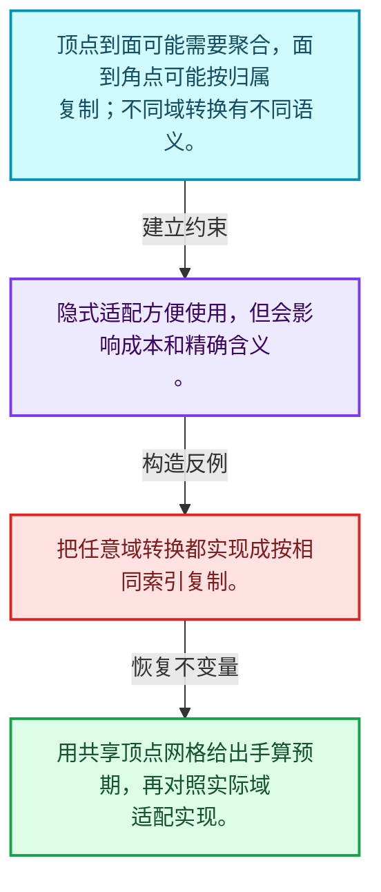
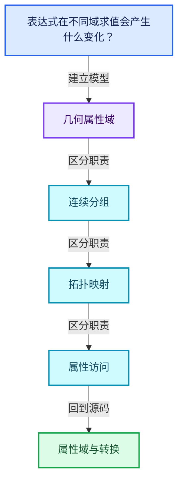
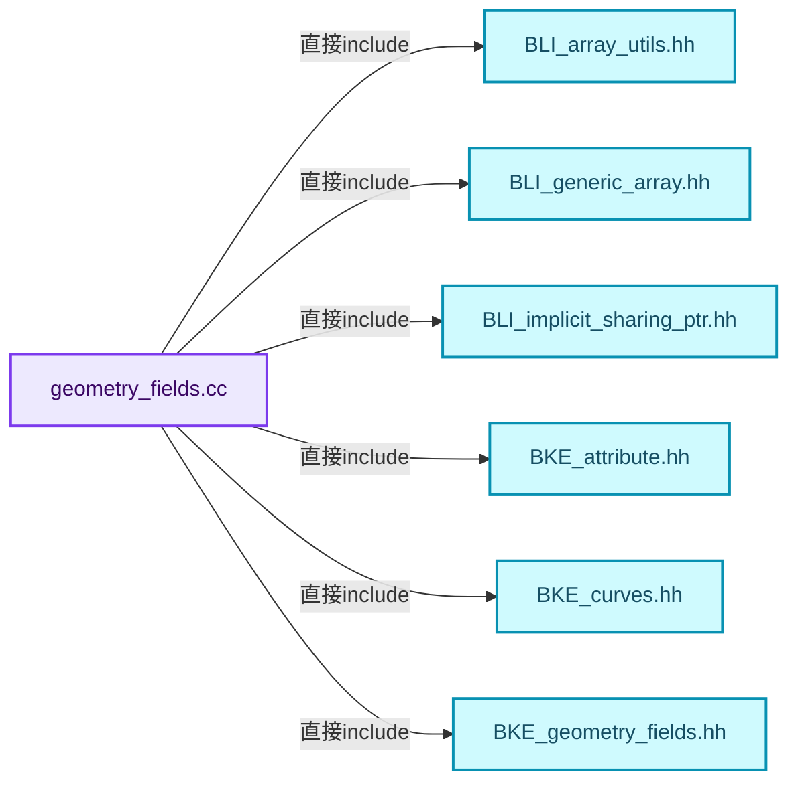
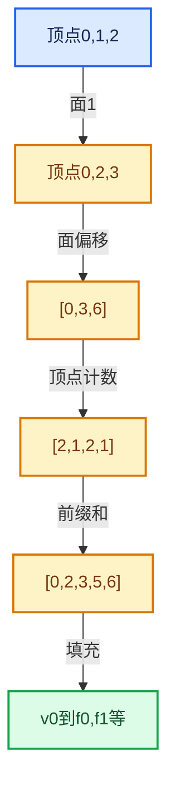

# 05-09 属性域与转换

[方向导航](README.md) · [总目录](../README.md) · [覆盖索引](../%E6%BA%90%E7%A0%81%E7%89%88%E6%9C%AC%E4%B8%8E%E8%A6%86%E7%9B%96%E7%B4%A2%E5%BC%95.md)

> 阅读顺序：问题与数据模型 → 语法与类型 → 源码逐行 → 调用线索 → 历史与取舍 → 推演和练习。

- 基准 HEAD：`cbda6b96c26c0dee3c3b5cbb93960c4ac06a6b30`。
- 记录日期：2026-10-14。
- 教学示例状态：正文中的推演不是本机性能实测；已运行练习见验收报告。

## 一、从问题到设计

表达式在不同域求值会产生什么变化？

上下文规定元素集合与域，域适配可能涉及插值或聚合，不能一律当作简单索引重命名。

本篇把语法、数据语义和系统取舍连接起来。利用连续性和重复关系选择表示，让冗余状态尽量无法表达。

### 本篇独立模型与设计推理

顶点到面可能需要聚合，面到角点可能按归属复制；不同域转换有不同语义。

设计取舍：隐式适配方便使用，但会影响成本和精确含义。

最小反例：把任意域转换都实现成按相同索引复制。

推导与处理：用共享顶点网格给出手算预期，再对照实际域适配实现。



### 源码范围与相邻篇章

| 文件 | 本篇逐行范围 | 基准SHA-256 |
|---|---|---|
| [source/blender/blenkernel/intern/geometry_fields.cc](../../../../../source/blender/blenkernel/intern/geometry_fields.cc) | L1—L1330 | `1ffff11dcabb89e48fd4baebf750464816fa6476cc81bf6694ddb971bcf88114` |
| [source/blender/blenkernel/BKE_geometry_fields.hh](../../../../../source/blender/blenkernel/BKE_geometry_fields.hh) | L1—L291 | `23e2b6a146f5da9d01a534b36122fcd0b339265a3896ff8b03d15cad5891fc44` |

同一主讲文件可能分多篇覆盖；超出本篇范围的符号通过覆盖索引定位。空行与纯注释保留在源码摘录中，逐行表解释有效语句与语法边界；许可证头统一保留。

前篇：[AttributeAccessor接口](08-AttributeAccessor%E6%8E%A5%E5%8F%A3.md).

后篇：[布局兼容与几何实战](10-%E5%B8%83%E5%B1%80%E5%85%BC%E5%AE%B9%E4%B8%8E%E5%87%A0%E4%BD%95%E5%AE%9E%E6%88%98.md).

## 二、类型、数据与阅读地图



这是概念依赖图，边表示阅读关系，不声称是运行时调用顺序。

### 直接编译依赖



箭头只表示头文件包含关系；完整调用线索见后面的符号定位表。

## 三、关键词、语法与类型角色

### 常量求值 constexpr

constexpr声明允许相应实体参与常量求值，但constexpr函数仍可以在运行时执行。是否常量求值由调用场景和表达式合法性共同决定。

具体检查：比较constexpr变量初始化和从运行时输入调用同一函数。

### 只读限定 const

const约束当前访问路径可做的修改。const指针、指向const的指针、const视图对象、const元素是不同位置的限定；其他别名可能仍可修改原对象。

具体检查：分别写T* const、const T*与const T* const，并画出不可修改的层次。

### 移动转换 std::move

std::move把表达式转换为可供移动重载选择的值类别，实际资源转移发生在被选中的构造或赋值中。对const对象move可能仍调用复制，对视图move也不会获得底层数据所有权。

具体检查：记录移动构造调用次数，不用变量名或std::move的出现次数替代测量。

### 异常边界 try与catch

try定义异常传播的局部边界。失败路径需要销毁已经成功构造的部分并释放相应存储；未构造的对象不能被析构。

具体检查：在第k次构造失败，列出已经存在的对象集合与待释放缓冲。

### 显式静态转换 static_cast

static_cast表达编译期允许的转换，不会自动验证运行时真实类型、指针寿命或索引边界。由void指针恢复T指针时，调用者仍须保证实际存储中确有合法T对象。

具体检查：标出转换前后的类型以及正确性依据来自哪里。

### 运行时多态 virtual

虚调用根据实际动态类型选择实现；经基类指针销毁对象时通常需要相应虚析构契约。每元素虚调用和循环外一次分派有不同开销。

具体检查：找出虚接口的实现类和调用频率，再讨论是否值得去虚拟化。

### 覆写检查 override

override要求函数确实覆盖基类虚函数，可捕获参数类型和const限定不匹配。它不改变基类规定的生命周期或线程约束。

具体检查：故意改变一个参数或const，观察编译器如何拒绝误写的新函数。

### 可选值 optional

optional把不存在与存在的T区分开，T的构造和析构跟随engaged状态变化。访问前应由has_value或条件分支证明存在。

具体检查：把空Field状态与合法常量零区分，不能用某个普通值代替不存在。

### 判别联合 variant

variant在若干候选类型中保存一个活动值，通过判别信息选择操作。它能把不同表示集中在值类型中，但各分支的复制移动成本不同。

具体检查：列出活动分支及每种分支实际拥有或借用的数据。

### 构造与new表达式

普通new可能分配并构造；placement new在给定地址构造，存储由其他机制提供。失败回滚应区分两类责任。

具体检查：追踪地址来自哪里、构造何时成功、由谁析构、由谁释放。

### 内部断言 assert

断言表达开发者预期成立的内部契约，发布构建可能关闭。它不能替代对不可信输入的完整错误处理，也不保证后续操作被运行时保护。

具体检查：对每条断言构造违反条件的输入，区分调用者错误与应向用户报告的错误。

### 受控访问 friend

friend授予指定函数或类访问非公开成员的权限，并不意味着继承，也不自动扩展到友元的派生类。

具体检查：解释执行器为何需要访问包装器的内部映射，同时检查边界是否仍清楚。

### 类型别名 using

类型别名为已有类型建立名字，不创建运行期对象。它常把模板内部使用的类型统一暴露给泛型调用者。

具体检查：展开别名直到基础类型，区分类型别名和变量声明。

## 四、真实源码与逐行讲解

源码块保持原行内容，原始行号由小节标题及逐行表给出。表中的调用定位是静态阅读辅助；重载、模板实例化、宏展开和虚调用需结合完整声明，不能仅凭词法出现证明动态调用。

### geometry_fields.cc：L1—L48

<!-- source:source/blender/blenkernel/intern/geometry_fields.cc:1:48 -->

```cpp
/* SPDX-FileCopyrightText: 2023 Blender Authors
 *
 * SPDX-License-Identifier: GPL-2.0-or-later */

/** \file
 * \ingroup bke
 */

#include "BLI_array_utils.hh"
#include "BLI_generic_array.hh"
#include "BLI_implicit_sharing_ptr.hh"

#include "BKE_attribute.hh"
#include "BKE_curves.hh"
#include "BKE_geometry_fields.hh"
#include "BKE_geometry_set.hh"
#include "BKE_grease_pencil.hh"
#include "BKE_instances.hh"
#include "BKE_mesh.hh"

#include "DNA_mesh_types.h"
#include "DNA_pointcloud_types.h"

#include "BLT_translation.hh"

#include <fmt/format.h>

namespace blender {

namespace bke {

MeshFieldContext::MeshFieldContext(const Mesh &mesh, const AttrDomain domain)
    : mesh_(mesh), domain_(domain)
{
  BLI_assert(mesh.attributes().domain_supported(domain_));
}

CurvesFieldContext::CurvesFieldContext(const CurvesGeometry &curves, const AttrDomain domain)
    : curves_(curves), domain_(domain)
{
  BLI_assert(curves.attributes().domain_supported(domain));
}

CurvesFieldContext::CurvesFieldContext(const Curves &curves_id, const AttrDomain domain)
    : CurvesFieldContext(curves_id.geometry.wrap(), domain)
{
  curves_id_ = &curves_id;
}
```

| 原始行 | 语义、约束与检查 |
|---|---|
| L9 | 引入编译依赖 "BLI_array_utils.hh"；这是声明可见性关系，不表示运行时一定调用该文件的所有接口。 |
| L10 | 引入编译依赖 "BLI_generic_array.hh"；这是声明可见性关系，不表示运行时一定调用该文件的所有接口。 |
| L11 | 引入编译依赖 "BLI_implicit_sharing_ptr.hh"；这是声明可见性关系，不表示运行时一定调用该文件的所有接口。 |
| L13 | 引入编译依赖 "BKE_attribute.hh"；这是声明可见性关系，不表示运行时一定调用该文件的所有接口。 |
| L14 | 引入编译依赖 "BKE_curves.hh"；这是声明可见性关系，不表示运行时一定调用该文件的所有接口。 |
| L15 | 引入编译依赖 "BKE_geometry_fields.hh"；这是声明可见性关系，不表示运行时一定调用该文件的所有接口。 |
| L16 | 引入编译依赖 "BKE_geometry_set.hh"；这是声明可见性关系，不表示运行时一定调用该文件的所有接口。 |
| L17 | 引入编译依赖 "BKE_grease_pencil.hh"；这是声明可见性关系，不表示运行时一定调用该文件的所有接口。 |
| L18 | 引入编译依赖 "BKE_instances.hh"；这是声明可见性关系，不表示运行时一定调用该文件的所有接口。 |
| L19 | 引入编译依赖 "BKE_mesh.hh"；这是声明可见性关系，不表示运行时一定调用该文件的所有接口。 |
| L21 | 引入编译依赖 "DNA_mesh_types.h"；这是声明可见性关系，不表示运行时一定调用该文件的所有接口。 |
| L22 | 引入编译依赖 "DNA_pointcloud_types.h"；这是声明可见性关系，不表示运行时一定调用该文件的所有接口。 |
| L24 | 引入编译依赖 "BLT_translation.hh"；这是声明可见性关系，不表示运行时一定调用该文件的所有接口。 |
| L26 | 引入编译依赖 <fmt/format.h>；这是声明可见性关系，不表示运行时一定调用该文件的所有接口。 |
| L28 | 把后续声明放入 blender 命名空间，影响名称查找和符号归属，不创建运行时对象。 |
| L30 | 把后续声明放入 bke 命名空间，影响名称查找和符号归属，不创建运行时对象。 |
| L32 | 出现调用或函数声明 `MeshFieldContext::MeshFieldContext`，对应表达式为 `MeshFieldContext::MeshFieldContext(const Mesh &mesh, const AttrDomain domain)`。参数求值、返回类型与重载需结合前后完整语句；静态文本引用不能证明动态目标。 |
| L33 | 出现调用或函数声明 `mesh_`，对应表达式为 `: mesh_(mesh), domain_(domain)`。参数求值、返回类型与重载需结合前后完整语句；静态文本引用不能证明动态目标。 |
| L34 | 连接上一行的声明或控制结构与其语句块；后续行在这个作用域中执行或声明。 |
| L35 | 断言约束 `BLI_assert(mesh.attributes().domain_supported(domain_));`。条件是后续访问的内部前置条件；发布构建可能不执行，不能把断言当作输入修复。 |
| L36 | 结束当前语法单元。局部自动对象在离开其作用域时按规则销毁；这不等于所有被引用的外部数据也被释放。 |
| L38 | 出现调用或函数声明 `CurvesFieldContext::CurvesFieldContext`，对应表达式为 `CurvesFieldContext::CurvesFieldContext(const CurvesGeometry &curves, const AttrDomain domain)`。参数求值、返回类型与重载需结合前后完整语句；静态文本引用不能证明动态目标。 |
| L39 | 出现调用或函数声明 `curves_`，对应表达式为 `: curves_(curves), domain_(domain)`。参数求值、返回类型与重载需结合前后完整语句；静态文本引用不能证明动态目标。 |
| L40 | 连接上一行的声明或控制结构与其语句块；后续行在这个作用域中执行或声明。 |
| L41 | 断言约束 `BLI_assert(curves.attributes().domain_supported(domain));`。条件是后续访问的内部前置条件；发布构建可能不执行，不能把断言当作输入修复。 |
| L42 | 结束当前语法单元。局部自动对象在离开其作用域时按规则销毁；这不等于所有被引用的外部数据也被释放。 |
| L44 | 出现调用或函数声明 `CurvesFieldContext::CurvesFieldContext`，对应表达式为 `CurvesFieldContext::CurvesFieldContext(const Curves &curves_id, const AttrDomain domain)`。参数求值、返回类型与重载需结合前后完整语句；静态文本引用不能证明动态目标。 |
| L45 | 出现调用或函数声明 `CurvesFieldContext`，对应表达式为 `: CurvesFieldContext(curves_id.geometry.wrap(), domain)`。参数求值、返回类型与重载需结合前后完整语句；静态文本引用不能证明动态目标。 |
| L46 | 连接上一行的声明或控制结构与其语句块；后续行在这个作用域中执行或声明。 |
| L47 | 把右侧 `&curves_id` 用于初始化或更新左侧 `curves_id_`。声明初始化与已有对象赋值应按上下文区分；有资源的类型会调用相应特殊成员。 |
| L48 | 结束当前语法单元。局部自动对象在离开其作用域时按规则销毁；这不等于所有被引用的外部数据也被释放。 |

### geometry_fields.cc：L49—L95

<!-- source:source/blender/blenkernel/intern/geometry_fields.cc:49:95 -->

```cpp

GVArray GreasePencilLayerFieldContext::get_varray_for_input(const fn::FieldInput &field_input,
                                                            const IndexMask &mask,
                                                            ResourceScope &scope) const
{
  if (const CurvesFieldInput *curves_field_input = dynamic_cast<const CurvesFieldInput *>(
          &field_input))
  {
    if (const bke::greasepencil::Drawing *drawing = this->grease_pencil().get_eval_drawing(
            this->grease_pencil().layer(this->layer_index())))
    {
      if (drawing->strokes().attributes().domain_supported(this->domain())) {
        const CurvesFieldContext context{drawing->strokes(), this->domain()};
        return curves_field_input->get_varray_for_context(context, mask, scope);
      }
    }
    return {};
  }
  return field_input.get_varray_for_context(*this, mask, scope);
}

GeometryFieldContext::GeometryFieldContext(const GeometryFieldContext &other,
                                           const AttrDomain domain)
    : geometry_(other.geometry_),
      type_(other.type_),
      domain_(domain),
      curves_id_(other.curves_id_),
      grease_pencil_layer_index_(other.grease_pencil_layer_index_)
{
}

GeometryFieldContext::GeometryFieldContext(const void *geometry,
                                           const GeometryComponent::Type type,
                                           const AttrDomain domain,
                                           const int grease_pencil_layer_index)
    : geometry_(geometry),
      type_(type),
      domain_(domain),
      grease_pencil_layer_index_(grease_pencil_layer_index)
{
  BLI_assert(ELEM(type,
                  GeometryComponent::Type::Mesh,
                  GeometryComponent::Type::Curve,
                  GeometryComponent::Type::PointCloud,
                  GeometryComponent::Type::GreasePencil,
                  GeometryComponent::Type::Instance));
}
```

本段语义重点：

- 分支证据 `const CurvesFieldInput *curves_field_input = dynamic_cast<const CurvesFieldInput *>(`：分别推演条件成立与不成立，核对相同出口处的状态。
- 分支证据 `const bke::greasepencil::Drawing *drawing = this->grease_pencil().get_eval_drawing(`：分别推演条件成立与不成立，核对相同出口处的状态。

| 原始行 | 语义、约束与检查 |
|---|---|
| L50 | 出现调用或函数声明 `GreasePencilLayerFieldContext::get_varray_for_input`，对应表达式为 `GVArray GreasePencilLayerFieldContext::get_varray_for_input(const fn::FieldInput &field_input,`。参数求值、返回类型与重载需结合前后完整语句；静态文本引用不能证明动态目标。 |
| L51 | 本行是连续声明或表达式的一部分：`const IndexMask &mask,`。与本段前后行合读；逗号、括号和限定符决定它属于参数、初始化列表还是实际计算。 |
| L52 | 本行是连续声明或表达式的一部分：`ResourceScope &scope) const`。与本段前后行合读；逗号、括号和限定符决定它属于参数、初始化列表还是实际计算。 |
| L53 | 连接上一行的声明或控制结构与其语句块；后续行在这个作用域中执行或声明。 |
| L54 | 判断 `const CurvesFieldInput *curves_field_input = dynamic_cast<const CurvesFieldInput *>(`，成立时进入本分支，否则继续后续路径。 |
| L55 | 本行是连续声明或表达式的一部分：`&field_input))`。与本段前后行合读；逗号、括号和限定符决定它属于参数、初始化列表还是实际计算。 |
| L56 | 连接上一行的声明或控制结构与其语句块；后续行在这个作用域中执行或声明。 |
| L57 | 判断 `const bke::greasepencil::Drawing *drawing = this->grease_pencil(`，成立时进入本分支，否则继续后续路径。 |
| L58 | 出现调用或函数声明 `grease_pencil`，对应表达式为 `this->grease_pencil().layer(this->layer_index())))`。参数求值、返回类型与重载需结合前后完整语句；静态文本引用不能证明动态目标。 |
| L59 | 连接上一行的声明或控制结构与其语句块；后续行在这个作用域中执行或声明。 |
| L60 | 判断 `drawing->strokes().attributes().domain_supported(this->domain())`，成立时进入本分支，否则继续后续路径。 |
| L61 | 声明接口 `const CurvesFieldContext context{drawing->strokes(), this->domain()}`，本行没有对应函数体；返回类型、参数限定和const/noexcept共同组成调用契约，实际行为需继续定位实现。 |
| L62 | 返回表达式 `curves_field_input->get_varray_for_context(context, mask, scope)`。 |
| L63 | 结束当前语法单元。局部自动对象在离开其作用域时按规则销毁；这不等于所有被引用的外部数据也被释放。 |
| L64 | 结束当前语法单元。局部自动对象在离开其作用域时按规则销毁；这不等于所有被引用的外部数据也被释放。 |
| L65 | 返回表达式 `{}`。 |
| L66 | 结束当前语法单元。局部自动对象在离开其作用域时按规则销毁；这不等于所有被引用的外部数据也被释放。 |
| L67 | 返回表达式 `field_input.get_varray_for_context(*this, mask, scope)`。 |
| L68 | 结束当前语法单元。局部自动对象在离开其作用域时按规则销毁；这不等于所有被引用的外部数据也被释放。 |
| L70 | 出现调用或函数声明 `GeometryFieldContext::GeometryFieldContext`，对应表达式为 `GeometryFieldContext::GeometryFieldContext(const GeometryFieldContext &other,`。参数求值、返回类型与重载需结合前后完整语句；静态文本引用不能证明动态目标。 |
| L71 | 本行是连续声明或表达式的一部分：`const AttrDomain domain)`。与本段前后行合读；逗号、括号和限定符决定它属于参数、初始化列表还是实际计算。 |
| L72 | 出现调用或函数声明 `geometry_`，对应表达式为 `: geometry_(other.geometry_),`。参数求值、返回类型与重载需结合前后完整语句；静态文本引用不能证明动态目标。 |
| L73 | 出现调用或函数声明 `type_`，对应表达式为 `type_(other.type_),`。参数求值、返回类型与重载需结合前后完整语句；静态文本引用不能证明动态目标。 |
| L74 | 出现调用或函数声明 `domain_`，对应表达式为 `domain_(domain),`。参数求值、返回类型与重载需结合前后完整语句；静态文本引用不能证明动态目标。 |
| L75 | 出现调用或函数声明 `curves_id_`，对应表达式为 `curves_id_(other.curves_id_),`。参数求值、返回类型与重载需结合前后完整语句；静态文本引用不能证明动态目标。 |
| L76 | 出现调用或函数声明 `grease_pencil_layer_index_`，对应表达式为 `grease_pencil_layer_index_(other.grease_pencil_layer_index_)`。参数求值、返回类型与重载需结合前后完整语句；静态文本引用不能证明动态目标。 |
| L77 | 连接上一行的声明或控制结构与其语句块；后续行在这个作用域中执行或声明。 |
| L78 | 结束当前语法单元。局部自动对象在离开其作用域时按规则销毁；这不等于所有被引用的外部数据也被释放。 |
| L80 | 出现调用或函数声明 `GeometryFieldContext::GeometryFieldContext`，对应表达式为 `GeometryFieldContext::GeometryFieldContext(const void *geometry,`。参数求值、返回类型与重载需结合前后完整语句；静态文本引用不能证明动态目标。 |
| L81 | 本行是连续声明或表达式的一部分：`const GeometryComponent::Type type,`。与本段前后行合读；逗号、括号和限定符决定它属于参数、初始化列表还是实际计算。 |
| L82 | 本行是连续声明或表达式的一部分：`const AttrDomain domain,`。与本段前后行合读；逗号、括号和限定符决定它属于参数、初始化列表还是实际计算。 |
| L83 | 本行是连续声明或表达式的一部分：`const int grease_pencil_layer_index)`。与本段前后行合读；逗号、括号和限定符决定它属于参数、初始化列表还是实际计算。 |
| L84 | 出现调用或函数声明 `geometry_`，对应表达式为 `: geometry_(geometry),`。参数求值、返回类型与重载需结合前后完整语句；静态文本引用不能证明动态目标。 |
| L85 | 出现调用或函数声明 `type_`，对应表达式为 `type_(type),`。参数求值、返回类型与重载需结合前后完整语句；静态文本引用不能证明动态目标。 |
| L86 | 出现调用或函数声明 `domain_`，对应表达式为 `domain_(domain),`。参数求值、返回类型与重载需结合前后完整语句；静态文本引用不能证明动态目标。 |
| L87 | 出现调用或函数声明 `grease_pencil_layer_index_`，对应表达式为 `grease_pencil_layer_index_(grease_pencil_layer_index)`。参数求值、返回类型与重载需结合前后完整语句；静态文本引用不能证明动态目标。 |
| L88 | 连接上一行的声明或控制结构与其语句块；后续行在这个作用域中执行或声明。 |
| L89 | 断言约束 `BLI_assert(ELEM(type,`。条件是后续访问的内部前置条件；发布构建可能不执行，不能把断言当作输入修复。 |
| L90 | 本行是连续声明或表达式的一部分：`GeometryComponent::Type::Mesh,`。与本段前后行合读；逗号、括号和限定符决定它属于参数、初始化列表还是实际计算。 |
| L91 | 本行是连续声明或表达式的一部分：`GeometryComponent::Type::Curve,`。与本段前后行合读；逗号、括号和限定符决定它属于参数、初始化列表还是实际计算。 |
| L92 | 本行是连续声明或表达式的一部分：`GeometryComponent::Type::PointCloud,`。与本段前后行合读；逗号、括号和限定符决定它属于参数、初始化列表还是实际计算。 |
| L93 | 本行是连续声明或表达式的一部分：`GeometryComponent::Type::GreasePencil,`。与本段前后行合读；逗号、括号和限定符决定它属于参数、初始化列表还是实际计算。 |
| L94 | 声明成员、局部对象或完成语句 `GeometryComponent::Type::Instance))`。若为指针或引用，它本身不说明拥有；若为值对象，其构造析构由所在作用域或外层对象管理。 |
| L95 | 结束当前语法单元。局部自动对象在离开其作用域时按规则销毁；这不等于所有被引用的外部数据也被释放。 |

### geometry_fields.cc：L96—L144

<!-- source:source/blender/blenkernel/intern/geometry_fields.cc:96:144 -->

```cpp

GeometryFieldContext::GeometryFieldContext(const GeometryComponent &component,
                                           const AttrDomain domain)
    : type_(component.type()), domain_(domain)
{
  switch (component.type()) {
    case GeometryComponent::Type::Mesh: {
      const MeshComponent &mesh_component = static_cast<const MeshComponent &>(component);
      geometry_ = mesh_component.get();
      break;
    }
    case GeometryComponent::Type::Curve: {
      const CurveComponent &curve_component = static_cast<const CurveComponent &>(component);
      const Curves *curves = curve_component.get();
      geometry_ = curves ? &curves->geometry.wrap() : nullptr;
      curves_id_ = curve_component.get();
      break;
    }
    case GeometryComponent::Type::PointCloud: {
      const PointCloudComponent &pointcloud_component = static_cast<const PointCloudComponent &>(
          component);
      geometry_ = pointcloud_component.get();
      break;
    }
    case GeometryComponent::Type::GreasePencil: {
      const GreasePencilComponent &grease_pencil_component =
          static_cast<const GreasePencilComponent &>(component);
      geometry_ = grease_pencil_component.get();
      /* Need to use another constructor for other domains. */
      BLI_assert(domain == AttrDomain::Layer);
      break;
    }
    case GeometryComponent::Type::Instance: {
      const InstancesComponent &instances_component = static_cast<const InstancesComponent &>(
          component);
      geometry_ = instances_component.get();
      break;
    }
    case GeometryComponent::Type::Volume:
    case GeometryComponent::Type::Edit:
      BLI_assert_unreachable();
      break;
  }
}

GeometryFieldContext::GeometryFieldContext(const Mesh &mesh, AttrDomain domain)
    : geometry_(&mesh), type_(GeometryComponent::Type::Mesh), domain_(domain)
{
}
```

| 原始行 | 语义、约束与检查 |
|---|---|
| L97 | 出现调用或函数声明 `GeometryFieldContext::GeometryFieldContext`，对应表达式为 `GeometryFieldContext::GeometryFieldContext(const GeometryComponent &component,`。参数求值、返回类型与重载需结合前后完整语句；静态文本引用不能证明动态目标。 |
| L98 | 本行是连续声明或表达式的一部分：`const AttrDomain domain)`。与本段前后行合读；逗号、括号和限定符决定它属于参数、初始化列表还是实际计算。 |
| L99 | 出现调用或函数声明 `type_`，对应表达式为 `: type_(component.type()), domain_(domain)`。参数求值、返回类型与重载需结合前后完整语句；静态文本引用不能证明动态目标。 |
| L100 | 连接上一行的声明或控制结构与其语句块；后续行在这个作用域中执行或声明。 |
| L101 | 按 switch (component.type()) 选择状态处理路径；每个case的break、return或贯穿行为决定下一步。 |
| L102 | 进入枚举或判别值对应分支 case GeometryComponent::Type::Mesh: {；结合状态定义和后续更新判断允许的转移。 |
| L103 | 把右侧 `static_cast<const MeshComponent &>(component)` 用于初始化或更新左侧 `const MeshComponent &mesh_component`。声明初始化与已有对象赋值应按上下文区分；有资源的类型会调用相应特殊成员。 |
| L104 | 把右侧 `mesh_component.get()` 用于初始化或更新左侧 `geometry_`。声明初始化与已有对象赋值应按上下文区分；有资源的类型会调用相应特殊成员。 |
| L105 | 离开最近的循环或switch；不是离开整个函数，后续清理和提交代码可能仍会执行。 |
| L106 | 结束当前语法单元。局部自动对象在离开其作用域时按规则销毁；这不等于所有被引用的外部数据也被释放。 |
| L107 | 进入枚举或判别值对应分支 case GeometryComponent::Type::Curve: {；结合状态定义和后续更新判断允许的转移。 |
| L108 | 把右侧 `static_cast<const CurveComponent &>(component)` 用于初始化或更新左侧 `const CurveComponent &curve_component`。声明初始化与已有对象赋值应按上下文区分；有资源的类型会调用相应特殊成员。 |
| L109 | 把右侧 `curve_component.get()` 用于初始化或更新左侧 `const Curves *curves`。声明初始化与已有对象赋值应按上下文区分；有资源的类型会调用相应特殊成员。 |
| L110 | 把右侧 `curves ? &curves->geometry.wrap() : nullptr` 用于初始化或更新左侧 `geometry_`。声明初始化与已有对象赋值应按上下文区分；有资源的类型会调用相应特殊成员。 |
| L111 | 把右侧 `curve_component.get()` 用于初始化或更新左侧 `curves_id_`。声明初始化与已有对象赋值应按上下文区分；有资源的类型会调用相应特殊成员。 |
| L112 | 离开最近的循环或switch；不是离开整个函数，后续清理和提交代码可能仍会执行。 |
| L113 | 结束当前语法单元。局部自动对象在离开其作用域时按规则销毁；这不等于所有被引用的外部数据也被释放。 |
| L114 | 进入枚举或判别值对应分支 case GeometryComponent::Type::PointCloud: {；结合状态定义和后续更新判断允许的转移。 |
| L115 | 把右侧 `static_cast<const PointCloudComponent &>(` 用于初始化或更新左侧 `const PointCloudComponent &pointcloud_component`。声明初始化与已有对象赋值应按上下文区分；有资源的类型会调用相应特殊成员。 |
| L116 | 声明成员、局部对象或完成语句 `component)`。若为指针或引用，它本身不说明拥有；若为值对象，其构造析构由所在作用域或外层对象管理。 |
| L117 | 把右侧 `pointcloud_component.get()` 用于初始化或更新左侧 `geometry_`。声明初始化与已有对象赋值应按上下文区分；有资源的类型会调用相应特殊成员。 |
| L118 | 离开最近的循环或switch；不是离开整个函数，后续清理和提交代码可能仍会执行。 |
| L119 | 结束当前语法单元。局部自动对象在离开其作用域时按规则销毁；这不等于所有被引用的外部数据也被释放。 |
| L120 | 进入枚举或判别值对应分支 case GeometryComponent::Type::GreasePencil: {；结合状态定义和后续更新判断允许的转移。 |
| L121 | 把右侧 `` 用于初始化或更新左侧 `const GreasePencilComponent &grease_pencil_component`。声明初始化与已有对象赋值应按上下文区分；有资源的类型会调用相应特殊成员。 |
| L122 | 出现调用或函数声明 `static_cast`，对应表达式为 `static_cast<const GreasePencilComponent &>(component);`。参数求值、返回类型与重载需结合前后完整语句；静态文本引用不能证明动态目标。 |
| L123 | 把右侧 `grease_pencil_component.get()` 用于初始化或更新左侧 `geometry_`。声明初始化与已有对象赋值应按上下文区分；有资源的类型会调用相应特殊成员。 |
| L125 | 断言约束 `BLI_assert(domain == AttrDomain::Layer);`。条件是后续访问的内部前置条件；发布构建可能不执行，不能把断言当作输入修复。 |
| L126 | 离开最近的循环或switch；不是离开整个函数，后续清理和提交代码可能仍会执行。 |
| L127 | 结束当前语法单元。局部自动对象在离开其作用域时按规则销毁；这不等于所有被引用的外部数据也被释放。 |
| L128 | 进入枚举或判别值对应分支 case GeometryComponent::Type::Instance: {；结合状态定义和后续更新判断允许的转移。 |
| L129 | 把右侧 `static_cast<const InstancesComponent &>(` 用于初始化或更新左侧 `const InstancesComponent &instances_component`。声明初始化与已有对象赋值应按上下文区分；有资源的类型会调用相应特殊成员。 |
| L130 | 声明成员、局部对象或完成语句 `component)`。若为指针或引用，它本身不说明拥有；若为值对象，其构造析构由所在作用域或外层对象管理。 |
| L131 | 把右侧 `instances_component.get()` 用于初始化或更新左侧 `geometry_`。声明初始化与已有对象赋值应按上下文区分；有资源的类型会调用相应特殊成员。 |
| L132 | 离开最近的循环或switch；不是离开整个函数，后续清理和提交代码可能仍会执行。 |
| L133 | 结束当前语法单元。局部自动对象在离开其作用域时按规则销毁；这不等于所有被引用的外部数据也被释放。 |
| L134 | 进入枚举或判别值对应分支 case GeometryComponent::Type::Volume:；结合状态定义和后续更新判断允许的转移。 |
| L135 | 进入枚举或判别值对应分支 case GeometryComponent::Type::Edit:；结合状态定义和后续更新判断允许的转移。 |
| L136 | 断言约束 `BLI_assert_unreachable();`。条件是后续访问的内部前置条件；发布构建可能不执行，不能把断言当作输入修复。 |
| L137 | 离开最近的循环或switch；不是离开整个函数，后续清理和提交代码可能仍会执行。 |
| L138 | 结束当前语法单元。局部自动对象在离开其作用域时按规则销毁；这不等于所有被引用的外部数据也被释放。 |
| L139 | 结束当前语法单元。局部自动对象在离开其作用域时按规则销毁；这不等于所有被引用的外部数据也被释放。 |
| L141 | 出现调用或函数声明 `GeometryFieldContext::GeometryFieldContext`，对应表达式为 `GeometryFieldContext::GeometryFieldContext(const Mesh &mesh, AttrDomain domain)`。参数求值、返回类型与重载需结合前后完整语句；静态文本引用不能证明动态目标。 |
| L142 | 出现调用或函数声明 `geometry_`，对应表达式为 `: geometry_(&mesh), type_(GeometryComponent::Type::Mesh), domain_(domain)`。参数求值、返回类型与重载需结合前后完整语句；静态文本引用不能证明动态目标。 |
| L143 | 连接上一行的声明或控制结构与其语句块；后续行在这个作用域中执行或声明。 |
| L144 | 结束当前语法单元。局部自动对象在离开其作用域时按规则销毁；这不等于所有被引用的外部数据也被释放。 |

### geometry_fields.cc：L145—L180

<!-- source:source/blender/blenkernel/intern/geometry_fields.cc:145:180 -->

```cpp
GeometryFieldContext::GeometryFieldContext(const CurvesGeometry &curves, AttrDomain domain)
    : geometry_(&curves), type_(GeometryComponent::Type::Curve), domain_(domain)
{
}
GeometryFieldContext::GeometryFieldContext(const Curves &curves_id, AttrDomain domain)
    : geometry_(&curves_id.geometry.wrap()),
      type_(GeometryComponent::Type::Curve),
      domain_(domain),
      curves_id_(&curves_id)
{
}
GeometryFieldContext::GeometryFieldContext(const PointCloud &points)
    : geometry_(&points), type_(GeometryComponent::Type::PointCloud), domain_(AttrDomain::Point)
{
}
GeometryFieldContext::GeometryFieldContext(const GreasePencil &grease_pencil)
    : geometry_(&grease_pencil),
      type_(GeometryComponent::Type::GreasePencil),
      domain_(AttrDomain::Layer)
{
}
GeometryFieldContext::GeometryFieldContext(const GreasePencil &grease_pencil,
                                           const AttrDomain domain,
                                           const int layer_index)
    : geometry_(&grease_pencil),
      type_(GeometryComponent::Type::GreasePencil),
      domain_(domain),
      grease_pencil_layer_index_(layer_index)
{
}
GeometryFieldContext::GeometryFieldContext(const Instances &instances)
    : geometry_(&instances),
      type_(GeometryComponent::Type::Instance),
      domain_(AttrDomain::Instance)
{
}
```

| 原始行 | 语义、约束与检查 |
|---|---|
| L145 | 出现调用或函数声明 `GeometryFieldContext::GeometryFieldContext`，对应表达式为 `GeometryFieldContext::GeometryFieldContext(const CurvesGeometry &curves, AttrDomain domain)`。参数求值、返回类型与重载需结合前后完整语句；静态文本引用不能证明动态目标。 |
| L146 | 出现调用或函数声明 `geometry_`，对应表达式为 `: geometry_(&curves), type_(GeometryComponent::Type::Curve), domain_(domain)`。参数求值、返回类型与重载需结合前后完整语句；静态文本引用不能证明动态目标。 |
| L147 | 连接上一行的声明或控制结构与其语句块；后续行在这个作用域中执行或声明。 |
| L148 | 结束当前语法单元。局部自动对象在离开其作用域时按规则销毁；这不等于所有被引用的外部数据也被释放。 |
| L149 | 出现调用或函数声明 `GeometryFieldContext::GeometryFieldContext`，对应表达式为 `GeometryFieldContext::GeometryFieldContext(const Curves &curves_id, AttrDomain domain)`。参数求值、返回类型与重载需结合前后完整语句；静态文本引用不能证明动态目标。 |
| L150 | 出现调用或函数声明 `geometry_`，对应表达式为 `: geometry_(&curves_id.geometry.wrap()),`。参数求值、返回类型与重载需结合前后完整语句；静态文本引用不能证明动态目标。 |
| L151 | 出现调用或函数声明 `type_`，对应表达式为 `type_(GeometryComponent::Type::Curve),`。参数求值、返回类型与重载需结合前后完整语句；静态文本引用不能证明动态目标。 |
| L152 | 出现调用或函数声明 `domain_`，对应表达式为 `domain_(domain),`。参数求值、返回类型与重载需结合前后完整语句；静态文本引用不能证明动态目标。 |
| L153 | 出现调用或函数声明 `curves_id_`，对应表达式为 `curves_id_(&curves_id)`。参数求值、返回类型与重载需结合前后完整语句；静态文本引用不能证明动态目标。 |
| L154 | 连接上一行的声明或控制结构与其语句块；后续行在这个作用域中执行或声明。 |
| L155 | 结束当前语法单元。局部自动对象在离开其作用域时按规则销毁；这不等于所有被引用的外部数据也被释放。 |
| L156 | 出现调用或函数声明 `GeometryFieldContext::GeometryFieldContext`，对应表达式为 `GeometryFieldContext::GeometryFieldContext(const PointCloud &points)`。参数求值、返回类型与重载需结合前后完整语句；静态文本引用不能证明动态目标。 |
| L157 | 出现调用或函数声明 `geometry_`，对应表达式为 `: geometry_(&points), type_(GeometryComponent::Type::PointCloud), domain_(AttrDomain::Point)`。参数求值、返回类型与重载需结合前后完整语句；静态文本引用不能证明动态目标。 |
| L158 | 连接上一行的声明或控制结构与其语句块；后续行在这个作用域中执行或声明。 |
| L159 | 结束当前语法单元。局部自动对象在离开其作用域时按规则销毁；这不等于所有被引用的外部数据也被释放。 |
| L160 | 出现调用或函数声明 `GeometryFieldContext::GeometryFieldContext`，对应表达式为 `GeometryFieldContext::GeometryFieldContext(const GreasePencil &grease_pencil)`。参数求值、返回类型与重载需结合前后完整语句；静态文本引用不能证明动态目标。 |
| L161 | 出现调用或函数声明 `geometry_`，对应表达式为 `: geometry_(&grease_pencil),`。参数求值、返回类型与重载需结合前后完整语句；静态文本引用不能证明动态目标。 |
| L162 | 出现调用或函数声明 `type_`，对应表达式为 `type_(GeometryComponent::Type::GreasePencil),`。参数求值、返回类型与重载需结合前后完整语句；静态文本引用不能证明动态目标。 |
| L163 | 出现调用或函数声明 `domain_`，对应表达式为 `domain_(AttrDomain::Layer)`。参数求值、返回类型与重载需结合前后完整语句；静态文本引用不能证明动态目标。 |
| L164 | 连接上一行的声明或控制结构与其语句块；后续行在这个作用域中执行或声明。 |
| L165 | 结束当前语法单元。局部自动对象在离开其作用域时按规则销毁；这不等于所有被引用的外部数据也被释放。 |
| L166 | 出现调用或函数声明 `GeometryFieldContext::GeometryFieldContext`，对应表达式为 `GeometryFieldContext::GeometryFieldContext(const GreasePencil &grease_pencil,`。参数求值、返回类型与重载需结合前后完整语句；静态文本引用不能证明动态目标。 |
| L167 | 本行是连续声明或表达式的一部分：`const AttrDomain domain,`。与本段前后行合读；逗号、括号和限定符决定它属于参数、初始化列表还是实际计算。 |
| L168 | 本行是连续声明或表达式的一部分：`const int layer_index)`。与本段前后行合读；逗号、括号和限定符决定它属于参数、初始化列表还是实际计算。 |
| L169 | 出现调用或函数声明 `geometry_`，对应表达式为 `: geometry_(&grease_pencil),`。参数求值、返回类型与重载需结合前后完整语句；静态文本引用不能证明动态目标。 |
| L170 | 出现调用或函数声明 `type_`，对应表达式为 `type_(GeometryComponent::Type::GreasePencil),`。参数求值、返回类型与重载需结合前后完整语句；静态文本引用不能证明动态目标。 |
| L171 | 出现调用或函数声明 `domain_`，对应表达式为 `domain_(domain),`。参数求值、返回类型与重载需结合前后完整语句；静态文本引用不能证明动态目标。 |
| L172 | 出现调用或函数声明 `grease_pencil_layer_index_`，对应表达式为 `grease_pencil_layer_index_(layer_index)`。参数求值、返回类型与重载需结合前后完整语句；静态文本引用不能证明动态目标。 |
| L173 | 连接上一行的声明或控制结构与其语句块；后续行在这个作用域中执行或声明。 |
| L174 | 结束当前语法单元。局部自动对象在离开其作用域时按规则销毁；这不等于所有被引用的外部数据也被释放。 |
| L175 | 出现调用或函数声明 `GeometryFieldContext::GeometryFieldContext`，对应表达式为 `GeometryFieldContext::GeometryFieldContext(const Instances &instances)`。参数求值、返回类型与重载需结合前后完整语句；静态文本引用不能证明动态目标。 |
| L176 | 出现调用或函数声明 `geometry_`，对应表达式为 `: geometry_(&instances),`。参数求值、返回类型与重载需结合前后完整语句；静态文本引用不能证明动态目标。 |
| L177 | 出现调用或函数声明 `type_`，对应表达式为 `type_(GeometryComponent::Type::Instance),`。参数求值、返回类型与重载需结合前后完整语句；静态文本引用不能证明动态目标。 |
| L178 | 出现调用或函数声明 `domain_`，对应表达式为 `domain_(AttrDomain::Instance)`。参数求值、返回类型与重载需结合前后完整语句；静态文本引用不能证明动态目标。 |
| L179 | 连接上一行的声明或控制结构与其语句块；后续行在这个作用域中执行或声明。 |
| L180 | 结束当前语法单元。局部自动对象在离开其作用域时按规则销毁；这不等于所有被引用的外部数据也被释放。 |

### geometry_fields.cc：L181—L225

<!-- source:source/blender/blenkernel/intern/geometry_fields.cc:181:225 -->

```cpp

std::optional<AttributeAccessor> GeometryFieldContext::attributes() const
{
  if (const Mesh *mesh = this->mesh()) {
    return mesh->attributes();
  }
  if (const CurvesGeometry *curves = this->curves()) {
    return curves->attributes();
  }
  if (const PointCloud *pointcloud = this->pointcloud()) {
    return pointcloud->attributes();
  }
  if (const GreasePencil *grease_pencil = this->grease_pencil()) {
    if (domain_ == AttrDomain::Layer) {
      return grease_pencil->attributes();
    }
    if (const greasepencil::Drawing *drawing = grease_pencil->get_eval_drawing(
            grease_pencil->layer(grease_pencil_layer_index_)))
    {
      return drawing->strokes().attributes();
    }
  }
  if (const Instances *instances = this->instances()) {
    return instances->attributes();
  }
  return {};
}

const Mesh *GeometryFieldContext::mesh() const
{
  return this->type() == GeometryComponent::Type::Mesh ? static_cast<const Mesh *>(geometry_) :
                                                         nullptr;
}
const CurvesGeometry *GeometryFieldContext::curves() const
{
  return this->type() == GeometryComponent::Type::Curve ?
             static_cast<const CurvesGeometry *>(geometry_) :
             nullptr;
}
const PointCloud *GeometryFieldContext::pointcloud() const
{
  return this->type() == GeometryComponent::Type::PointCloud ?
             static_cast<const PointCloud *>(geometry_) :
             nullptr;
}
```

本段语义重点：

- 分支证据 `const Mesh *mesh = this->mesh())`：分别推演条件成立与不成立，核对相同出口处的状态。
- 分支证据 `const CurvesGeometry *curves = this->curves())`：分别推演条件成立与不成立，核对相同出口处的状态。

| 原始行 | 语义、约束与检查 |
|---|---|
| L182 | 出现调用或函数声明 `GeometryFieldContext::attributes`，对应表达式为 `std::optional<AttributeAccessor> GeometryFieldContext::attributes() const`。参数求值、返回类型与重载需结合前后完整语句；静态文本引用不能证明动态目标。 |
| L183 | 连接上一行的声明或控制结构与其语句块；后续行在这个作用域中执行或声明。 |
| L184 | 判断 `const Mesh *mesh = this->mesh()`，成立时进入本分支，否则继续后续路径。 |
| L185 | 返回表达式 `mesh->attributes()`。结合函数声明检查返回值是否借用原存储，借用值不会自动延长其寿命。 |
| L186 | 结束当前语法单元。局部自动对象在离开其作用域时按规则销毁；这不等于所有被引用的外部数据也被释放。 |
| L187 | 判断 `const CurvesGeometry *curves = this->curves()`，成立时进入本分支，否则继续后续路径。 |
| L188 | 返回表达式 `curves->attributes()`。结合函数声明检查返回值是否借用原存储，借用值不会自动延长其寿命。 |
| L189 | 结束当前语法单元。局部自动对象在离开其作用域时按规则销毁；这不等于所有被引用的外部数据也被释放。 |
| L190 | 判断 `const PointCloud *pointcloud = this->pointcloud()`，成立时进入本分支，否则继续后续路径。 |
| L191 | 返回表达式 `pointcloud->attributes()`。结合函数声明检查返回值是否借用原存储，借用值不会自动延长其寿命。 |
| L192 | 结束当前语法单元。局部自动对象在离开其作用域时按规则销毁；这不等于所有被引用的外部数据也被释放。 |
| L193 | 判断 `const GreasePencil *grease_pencil = this->grease_pencil()`，成立时进入本分支，否则继续后续路径。 |
| L194 | 判断 `domain_ == AttrDomain::Layer`，成立时进入本分支，否则继续后续路径。 |
| L195 | 返回表达式 `grease_pencil->attributes()`。 |
| L196 | 结束当前语法单元。局部自动对象在离开其作用域时按规则销毁；这不等于所有被引用的外部数据也被释放。 |
| L197 | 判断 `const greasepencil::Drawing *drawing = grease_pencil->get_eval_drawing(`，成立时进入本分支，否则继续后续路径。 |
| L198 | 出现调用或函数声明 `layer`，对应表达式为 `grease_pencil->layer(grease_pencil_layer_index_)))`。参数求值、返回类型与重载需结合前后完整语句；静态文本引用不能证明动态目标。 |
| L199 | 连接上一行的声明或控制结构与其语句块；后续行在这个作用域中执行或声明。 |
| L200 | 返回表达式 `drawing->strokes().attributes()`。 |
| L201 | 结束当前语法单元。局部自动对象在离开其作用域时按规则销毁；这不等于所有被引用的外部数据也被释放。 |
| L202 | 结束当前语法单元。局部自动对象在离开其作用域时按规则销毁；这不等于所有被引用的外部数据也被释放。 |
| L203 | 判断 `const Instances *instances = this->instances()`，成立时进入本分支，否则继续后续路径。 |
| L204 | 返回表达式 `instances->attributes()`。结合函数声明检查返回值是否借用原存储，借用值不会自动延长其寿命。 |
| L205 | 结束当前语法单元。局部自动对象在离开其作用域时按规则销毁；这不等于所有被引用的外部数据也被释放。 |
| L206 | 返回表达式 `{}`。 |
| L207 | 结束当前语法单元。局部自动对象在离开其作用域时按规则销毁；这不等于所有被引用的外部数据也被释放。 |
| L209 | 出现调用或函数声明 `GeometryFieldContext::mesh`，对应表达式为 `const Mesh *GeometryFieldContext::mesh() const`。参数求值、返回类型与重载需结合前后完整语句；静态文本引用不能证明动态目标。 |
| L210 | 连接上一行的声明或控制结构与其语句块；后续行在这个作用域中执行或声明。 |
| L211 | 返回表达式 `this->type() == GeometryComponent::Type::Mesh ? static_cast<const Mesh *>(geometry_) :`。 |
| L212 | 声明成员、局部对象或完成语句 `nullptr`。若为指针或引用，它本身不说明拥有；若为值对象，其构造析构由所在作用域或外层对象管理。 |
| L213 | 结束当前语法单元。局部自动对象在离开其作用域时按规则销毁；这不等于所有被引用的外部数据也被释放。 |
| L214 | 出现调用或函数声明 `GeometryFieldContext::curves`，对应表达式为 `const CurvesGeometry *GeometryFieldContext::curves() const`。参数求值、返回类型与重载需结合前后完整语句；静态文本引用不能证明动态目标。 |
| L215 | 连接上一行的声明或控制结构与其语句块；后续行在这个作用域中执行或声明。 |
| L216 | 返回表达式 `this->type() == GeometryComponent::Type::Curve ?`。 |
| L217 | 出现调用或函数声明 `static_cast`，对应表达式为 `static_cast<const CurvesGeometry *>(geometry_) :`。参数求值、返回类型与重载需结合前后完整语句；静态文本引用不能证明动态目标。 |
| L218 | 声明成员、局部对象或完成语句 `nullptr`。若为指针或引用，它本身不说明拥有；若为值对象，其构造析构由所在作用域或外层对象管理。 |
| L219 | 结束当前语法单元。局部自动对象在离开其作用域时按规则销毁；这不等于所有被引用的外部数据也被释放。 |
| L220 | 出现调用或函数声明 `GeometryFieldContext::pointcloud`，对应表达式为 `const PointCloud *GeometryFieldContext::pointcloud() const`。参数求值、返回类型与重载需结合前后完整语句；静态文本引用不能证明动态目标。 |
| L221 | 连接上一行的声明或控制结构与其语句块；后续行在这个作用域中执行或声明。 |
| L222 | 返回表达式 `this->type() == GeometryComponent::Type::PointCloud ?`。 |
| L223 | 出现调用或函数声明 `static_cast`，对应表达式为 `static_cast<const PointCloud *>(geometry_) :`。参数求值、返回类型与重载需结合前后完整语句；静态文本引用不能证明动态目标。 |
| L224 | 声明成员、局部对象或完成语句 `nullptr`。若为指针或引用，它本身不说明拥有；若为值对象，其构造析构由所在作用域或外层对象管理。 |
| L225 | 结束当前语法单元。局部自动对象在离开其作用域时按规则销毁；这不等于所有被引用的外部数据也被释放。 |

### geometry_fields.cc：L226—L261

<!-- source:source/blender/blenkernel/intern/geometry_fields.cc:226:261 -->

```cpp
const GreasePencil *GeometryFieldContext::grease_pencil() const
{
  return this->type() == GeometryComponent::Type::GreasePencil ?
             static_cast<const GreasePencil *>(geometry_) :
             nullptr;
}
const greasepencil::Drawing *GeometryFieldContext::grease_pencil_layer_drawing() const
{
  if (!(this->type() == GeometryComponent::Type::GreasePencil) ||
      !ELEM(domain_, AttrDomain::Curve, AttrDomain::Point))
  {
    return nullptr;
  }
  return this->grease_pencil()->get_eval_drawing(
      this->grease_pencil()->layer(this->grease_pencil_layer_index_));
}
const CurvesGeometry *GeometryFieldContext::curves_or_strokes() const
{
  if (const CurvesGeometry *curves = this->curves()) {
    return curves;
  }
  if (const greasepencil::Drawing *drawing = this->grease_pencil_layer_drawing()) {
    return &drawing->strokes();
  }
  return nullptr;
}
const Curves *GeometryFieldContext::curves_id() const
{
  return curves_id_;
}
const Instances *GeometryFieldContext::instances() const
{
  return this->type() == GeometryComponent::Type::Instance ?
             static_cast<const Instances *>(geometry_) :
             nullptr;
}
```

本段语义重点：

- 分支证据 `!(this->type() == GeometryComponent::Type::GreasePencil) &#124;&#124;`：分别推演条件成立与不成立，核对相同出口处的状态。
- 分支证据 `const CurvesGeometry *curves = this->curves())`：分别推演条件成立与不成立，核对相同出口处的状态。

| 原始行 | 语义、约束与检查 |
|---|---|
| L226 | 出现调用或函数声明 `GeometryFieldContext::grease_pencil`，对应表达式为 `const GreasePencil *GeometryFieldContext::grease_pencil() const`。参数求值、返回类型与重载需结合前后完整语句；静态文本引用不能证明动态目标。 |
| L227 | 连接上一行的声明或控制结构与其语句块；后续行在这个作用域中执行或声明。 |
| L228 | 返回表达式 `this->type() == GeometryComponent::Type::GreasePencil ?`。 |
| L229 | 出现调用或函数声明 `static_cast`，对应表达式为 `static_cast<const GreasePencil *>(geometry_) :`。参数求值、返回类型与重载需结合前后完整语句；静态文本引用不能证明动态目标。 |
| L230 | 声明成员、局部对象或完成语句 `nullptr`。若为指针或引用，它本身不说明拥有；若为值对象，其构造析构由所在作用域或外层对象管理。 |
| L231 | 结束当前语法单元。局部自动对象在离开其作用域时按规则销毁；这不等于所有被引用的外部数据也被释放。 |
| L232 | 出现调用或函数声明 `GeometryFieldContext::grease_pencil_layer_drawing`，对应表达式为 `const greasepencil::Drawing *GeometryFieldContext::grease_pencil_layer_drawing() const`。参数求值、返回类型与重载需结合前后完整语句；静态文本引用不能证明动态目标。 |
| L233 | 连接上一行的声明或控制结构与其语句块；后续行在这个作用域中执行或声明。 |
| L234 | 判断 `!(this->type() == GeometryComponent::Type::GreasePencil`，成立时进入本分支，否则继续后续路径。 |
| L235 | 出现调用或函数声明 `ELEM`，对应表达式为 `!ELEM(domain_, AttrDomain::Curve, AttrDomain::Point))`。参数求值、返回类型与重载需结合前后完整语句；静态文本引用不能证明动态目标。 |
| L236 | 连接上一行的声明或控制结构与其语句块；后续行在这个作用域中执行或声明。 |
| L237 | 返回表达式 `nullptr`。 |
| L238 | 结束当前语法单元。局部自动对象在离开其作用域时按规则销毁；这不等于所有被引用的外部数据也被释放。 |
| L239 | 返回表达式 `this->grease_pencil()->get_eval_drawing(`。 |
| L240 | 出现调用或函数声明 `grease_pencil`，对应表达式为 `this->grease_pencil()->layer(this->grease_pencil_layer_index_));`。参数求值、返回类型与重载需结合前后完整语句；静态文本引用不能证明动态目标。 |
| L241 | 结束当前语法单元。局部自动对象在离开其作用域时按规则销毁；这不等于所有被引用的外部数据也被释放。 |
| L242 | 出现调用或函数声明 `GeometryFieldContext::curves_or_strokes`，对应表达式为 `const CurvesGeometry *GeometryFieldContext::curves_or_strokes() const`。参数求值、返回类型与重载需结合前后完整语句；静态文本引用不能证明动态目标。 |
| L243 | 连接上一行的声明或控制结构与其语句块；后续行在这个作用域中执行或声明。 |
| L244 | 判断 `const CurvesGeometry *curves = this->curves()`，成立时进入本分支，否则继续后续路径。 |
| L245 | 返回表达式 `curves`。结合函数声明检查返回值是否借用原存储，借用值不会自动延长其寿命。 |
| L246 | 结束当前语法单元。局部自动对象在离开其作用域时按规则销毁；这不等于所有被引用的外部数据也被释放。 |
| L247 | 判断 `const greasepencil::Drawing *drawing = this->grease_pencil_layer_drawing()`，成立时进入本分支，否则继续后续路径。 |
| L248 | 返回表达式 `&drawing->strokes()`。结合函数声明检查返回值是否借用原存储，借用值不会自动延长其寿命。 |
| L249 | 结束当前语法单元。局部自动对象在离开其作用域时按规则销毁；这不等于所有被引用的外部数据也被释放。 |
| L250 | 返回表达式 `nullptr`。 |
| L251 | 结束当前语法单元。局部自动对象在离开其作用域时按规则销毁；这不等于所有被引用的外部数据也被释放。 |
| L252 | 出现调用或函数声明 `GeometryFieldContext::curves_id`，对应表达式为 `const Curves *GeometryFieldContext::curves_id() const`。参数求值、返回类型与重载需结合前后完整语句；静态文本引用不能证明动态目标。 |
| L253 | 连接上一行的声明或控制结构与其语句块；后续行在这个作用域中执行或声明。 |
| L254 | 返回表达式 `curves_id_`。 |
| L255 | 结束当前语法单元。局部自动对象在离开其作用域时按规则销毁；这不等于所有被引用的外部数据也被释放。 |
| L256 | 出现调用或函数声明 `GeometryFieldContext::instances`，对应表达式为 `const Instances *GeometryFieldContext::instances() const`。参数求值、返回类型与重载需结合前后完整语句；静态文本引用不能证明动态目标。 |
| L257 | 连接上一行的声明或控制结构与其语句块；后续行在这个作用域中执行或声明。 |
| L258 | 返回表达式 `this->type() == GeometryComponent::Type::Instance ?`。 |
| L259 | 出现调用或函数声明 `static_cast`，对应表达式为 `static_cast<const Instances *>(geometry_) :`。参数求值、返回类型与重载需结合前后完整语句；静态文本引用不能证明动态目标。 |
| L260 | 声明成员、局部对象或完成语句 `nullptr`。若为指针或引用，它本身不说明拥有；若为值对象，其构造析构由所在作用域或外层对象管理。 |
| L261 | 结束当前语法单元。局部自动对象在离开其作用域时按规则销毁；这不等于所有被引用的外部数据也被释放。 |

### geometry_fields.cc：L262—L304

<!-- source:source/blender/blenkernel/intern/geometry_fields.cc:262:304 -->

```cpp

static std::optional<GeometryFieldContext> try_get_geometry_field_context(
    const fn::FieldContext &context)
{
  if (const GeometryFieldContext *geometry_context = dynamic_cast<const GeometryFieldContext *>(
          &context))
  {
    return *geometry_context;
  }
  if (const MeshFieldContext *mesh_context = dynamic_cast<const MeshFieldContext *>(&context)) {
    return GeometryFieldContext(mesh_context->mesh(), mesh_context->domain());
  }
  if (const CurvesFieldContext *curve_context = dynamic_cast<const CurvesFieldContext *>(&context))
  {
    if (const Curves *curves_id = curve_context->curves_id()) {
      return GeometryFieldContext(*curves_id, curve_context->domain());
    }
    return GeometryFieldContext(curve_context->curves(), curve_context->domain());
  }
  if (const PointCloudFieldContext *point_context = dynamic_cast<const PointCloudFieldContext *>(
          &context))
  {
    return GeometryFieldContext(point_context->pointcloud());
  }
  if (const GreasePencilFieldContext *grease_pencil_context =
          dynamic_cast<const GreasePencilFieldContext *>(&context))
  {
    return GeometryFieldContext(grease_pencil_context->grease_pencil());
  }
  if (const GreasePencilLayerFieldContext *grease_pencil_context =
          dynamic_cast<const GreasePencilLayerFieldContext *>(&context))
  {
    return GeometryFieldContext(grease_pencil_context->grease_pencil(),
                                grease_pencil_context->domain(),
                                grease_pencil_context->layer_index());
  }
  if (const InstancesFieldContext *instances_context = dynamic_cast<const InstancesFieldContext *>(
          &context))
  {
    return GeometryFieldContext(instances_context->instances());
  }
  return std::nullopt;
}
```

本段语义重点：

- 分支证据 `const GeometryFieldContext *geometry_context = dynamic_cast<const GeometryFieldContext *>(`：分别推演条件成立与不成立，核对相同出口处的状态。
- 分支证据 `const MeshFieldContext *mesh_context = dynamic_cast<const MeshFieldContext *>(&context))`：分别推演条件成立与不成立，核对相同出口处的状态。

| 原始行 | 语义、约束与检查 |
|---|---|
| L263 | 出现调用或函数声明 `try_get_geometry_field_context`，对应表达式为 `static std::optional<GeometryFieldContext> try_get_geometry_field_context(`。参数求值、返回类型与重载需结合前后完整语句；静态文本引用不能证明动态目标。 |
| L264 | 本行是连续声明或表达式的一部分：`const fn::FieldContext &context)`。与本段前后行合读；逗号、括号和限定符决定它属于参数、初始化列表还是实际计算。 |
| L265 | 连接上一行的声明或控制结构与其语句块；后续行在这个作用域中执行或声明。 |
| L266 | 判断 `const GeometryFieldContext *geometry_context = dynamic_cast<const GeometryFieldContext *>(`，成立时进入本分支，否则继续后续路径。 |
| L267 | 本行是连续声明或表达式的一部分：`&context))`。与本段前后行合读；逗号、括号和限定符决定它属于参数、初始化列表还是实际计算。 |
| L268 | 连接上一行的声明或控制结构与其语句块；后续行在这个作用域中执行或声明。 |
| L269 | 返回表达式 `*geometry_context`。 |
| L270 | 结束当前语法单元。局部自动对象在离开其作用域时按规则销毁；这不等于所有被引用的外部数据也被释放。 |
| L271 | 判断 `const MeshFieldContext *mesh_context = dynamic_cast<const MeshFieldContext *>(&context)`，成立时进入本分支，否则继续后续路径。 |
| L272 | 返回表达式 `GeometryFieldContext(mesh_context->mesh(), mesh_context->domain())`。结合函数声明检查返回值是否借用原存储，借用值不会自动延长其寿命。 |
| L273 | 结束当前语法单元。局部自动对象在离开其作用域时按规则销毁；这不等于所有被引用的外部数据也被释放。 |
| L274 | 判断 `const CurvesFieldContext *curve_context = dynamic_cast<const CurvesFieldContext *>(&context)`，成立时进入本分支，否则继续后续路径。 |
| L275 | 连接上一行的声明或控制结构与其语句块；后续行在这个作用域中执行或声明。 |
| L276 | 判断 `const Curves *curves_id = curve_context->curves_id()`，成立时进入本分支，否则继续后续路径。 |
| L277 | 返回表达式 `GeometryFieldContext(*curves_id, curve_context->domain())`。结合函数声明检查返回值是否借用原存储，借用值不会自动延长其寿命。 |
| L278 | 结束当前语法单元。局部自动对象在离开其作用域时按规则销毁；这不等于所有被引用的外部数据也被释放。 |
| L279 | 返回表达式 `GeometryFieldContext(curve_context->curves(), curve_context->domain())`。 |
| L280 | 结束当前语法单元。局部自动对象在离开其作用域时按规则销毁；这不等于所有被引用的外部数据也被释放。 |
| L281 | 判断 `const PointCloudFieldContext *point_context = dynamic_cast<const PointCloudFieldContext *>(`，成立时进入本分支，否则继续后续路径。 |
| L282 | 本行是连续声明或表达式的一部分：`&context))`。与本段前后行合读；逗号、括号和限定符决定它属于参数、初始化列表还是实际计算。 |
| L283 | 连接上一行的声明或控制结构与其语句块；后续行在这个作用域中执行或声明。 |
| L284 | 返回表达式 `GeometryFieldContext(point_context->pointcloud())`。 |
| L285 | 结束当前语法单元。局部自动对象在离开其作用域时按规则销毁；这不等于所有被引用的外部数据也被释放。 |
| L286 | 判断 `const GreasePencilFieldContext *grease_pencil_context =`，成立时进入本分支，否则继续后续路径。 |
| L287 | 出现调用或函数声明 `dynamic_cast`，对应表达式为 `dynamic_cast<const GreasePencilFieldContext *>(&context))`。参数求值、返回类型与重载需结合前后完整语句；静态文本引用不能证明动态目标。 |
| L288 | 连接上一行的声明或控制结构与其语句块；后续行在这个作用域中执行或声明。 |
| L289 | 返回表达式 `GeometryFieldContext(grease_pencil_context->grease_pencil())`。 |
| L290 | 结束当前语法单元。局部自动对象在离开其作用域时按规则销毁；这不等于所有被引用的外部数据也被释放。 |
| L291 | 判断 `const GreasePencilLayerFieldContext *grease_pencil_context =`，成立时进入本分支，否则继续后续路径。 |
| L292 | 出现调用或函数声明 `dynamic_cast`，对应表达式为 `dynamic_cast<const GreasePencilLayerFieldContext *>(&context))`。参数求值、返回类型与重载需结合前后完整语句；静态文本引用不能证明动态目标。 |
| L293 | 连接上一行的声明或控制结构与其语句块；后续行在这个作用域中执行或声明。 |
| L294 | 返回表达式 `GeometryFieldContext(grease_pencil_context->grease_pencil(),`。 |
| L295 | 出现调用或函数声明 `domain`，对应表达式为 `grease_pencil_context->domain(),`。参数求值、返回类型与重载需结合前后完整语句；静态文本引用不能证明动态目标。 |
| L296 | 出现调用或函数声明 `layer_index`，对应表达式为 `grease_pencil_context->layer_index());`。参数求值、返回类型与重载需结合前后完整语句；静态文本引用不能证明动态目标。 |
| L297 | 结束当前语法单元。局部自动对象在离开其作用域时按规则销毁；这不等于所有被引用的外部数据也被释放。 |
| L298 | 判断 `const InstancesFieldContext *instances_context = dynamic_cast<const InstancesFieldContext *>(`，成立时进入本分支，否则继续后续路径。 |
| L299 | 本行是连续声明或表达式的一部分：`&context))`。与本段前后行合读；逗号、括号和限定符决定它属于参数、初始化列表还是实际计算。 |
| L300 | 连接上一行的声明或控制结构与其语句块；后续行在这个作用域中执行或声明。 |
| L301 | 返回表达式 `GeometryFieldContext(instances_context->instances())`。 |
| L302 | 结束当前语法单元。局部自动对象在离开其作用域时按规则销毁；这不等于所有被引用的外部数据也被释放。 |
| L303 | 返回表达式 `std::nullopt`。 |
| L304 | 结束当前语法单元。局部自动对象在离开其作用域时按规则销毁；这不等于所有被引用的外部数据也被释放。 |

### geometry_fields.cc：L305—L350

<!-- source:source/blender/blenkernel/intern/geometry_fields.cc:305:350 -->

```cpp

GVArray GeometryFieldInput::get_varray_for_context(const fn::FieldContext &context,
                                                   const IndexMask &mask,
                                                   ResourceScope & /*scope*/) const
{
  if (const std::optional<GeometryFieldContext> geometry_context = try_get_geometry_field_context(
          context))
  {
    return this->get_varray_for_context(*geometry_context, mask);
  }
  return {};
}

std::optional<AttrDomain> GeometryFieldInput::preferred_domain(
    const GeometryComponent & /*component*/) const
{
  return std::nullopt;
}

NativeFieldDomain GeometryFieldInput::native_domain_info(
    const GeometryComponent & /*component*/) const
{
  return NativeFieldDomain::None();
}

GVArray MeshFieldInput::get_varray_for_context(const fn::FieldContext &context,
                                               const IndexMask &mask,
                                               ResourceScope & /*scope*/) const
{
  if (const GeometryFieldContext *geometry_context = dynamic_cast<const GeometryFieldContext *>(
          &context))
  {
    if (const Mesh *mesh = geometry_context->mesh()) {
      return this->get_varray_for_context(*mesh, geometry_context->domain(), mask);
    }
  }
  if (const MeshFieldContext *mesh_context = dynamic_cast<const MeshFieldContext *>(&context)) {
    return this->get_varray_for_context(mesh_context->mesh(), mesh_context->domain(), mask);
  }
  return {};
}

std::optional<AttrDomain> MeshFieldInput::preferred_domain(const Mesh & /*mesh*/) const
{
  return std::nullopt;
}
```

本段语义重点：

- 分支证据 `const std::optional<GeometryFieldContext> geometry_context = try_get_geometry_field_context(`：分别推演条件成立与不成立，核对相同出口处的状态。
- 分支证据 `const GeometryFieldContext *geometry_context = dynamic_cast<const GeometryFieldContext *>(`：分别推演条件成立与不成立，核对相同出口处的状态。

| 原始行 | 语义、约束与检查 |
|---|---|
| L306 | 出现调用或函数声明 `GeometryFieldInput::get_varray_for_context`，对应表达式为 `GVArray GeometryFieldInput::get_varray_for_context(const fn::FieldContext &context,`。参数求值、返回类型与重载需结合前后完整语句；静态文本引用不能证明动态目标。 |
| L307 | 本行是连续声明或表达式的一部分：`const IndexMask &mask,`。与本段前后行合读；逗号、括号和限定符决定它属于参数、初始化列表还是实际计算。 |
| L308 | 本行是连续声明或表达式的一部分：`ResourceScope & ) const`。与本段前后行合读；逗号、括号和限定符决定它属于参数、初始化列表还是实际计算。 |
| L309 | 连接上一行的声明或控制结构与其语句块；后续行在这个作用域中执行或声明。 |
| L310 | 判断 `const std::optional<GeometryFieldContext> geometry_context = try_get_geometry_field_context(`，成立时进入本分支，否则继续后续路径。 |
| L311 | 本行是连续声明或表达式的一部分：`context))`。与本段前后行合读；逗号、括号和限定符决定它属于参数、初始化列表还是实际计算。 |
| L312 | 连接上一行的声明或控制结构与其语句块；后续行在这个作用域中执行或声明。 |
| L313 | 返回表达式 `this->get_varray_for_context(*geometry_context, mask)`。 |
| L314 | 结束当前语法单元。局部自动对象在离开其作用域时按规则销毁；这不等于所有被引用的外部数据也被释放。 |
| L315 | 返回表达式 `{}`。 |
| L316 | 结束当前语法单元。局部自动对象在离开其作用域时按规则销毁；这不等于所有被引用的外部数据也被释放。 |
| L318 | 出现调用或函数声明 `GeometryFieldInput::preferred_domain`，对应表达式为 `std::optional<AttrDomain> GeometryFieldInput::preferred_domain(`。参数求值、返回类型与重载需结合前后完整语句；静态文本引用不能证明动态目标。 |
| L319 | 本行是连续声明或表达式的一部分：`const GeometryComponent & ) const`。与本段前后行合读；逗号、括号和限定符决定它属于参数、初始化列表还是实际计算。 |
| L320 | 连接上一行的声明或控制结构与其语句块；后续行在这个作用域中执行或声明。 |
| L321 | 返回表达式 `std::nullopt`。 |
| L322 | 结束当前语法单元。局部自动对象在离开其作用域时按规则销毁；这不等于所有被引用的外部数据也被释放。 |
| L324 | 出现调用或函数声明 `GeometryFieldInput::native_domain_info`，对应表达式为 `NativeFieldDomain GeometryFieldInput::native_domain_info(`。参数求值、返回类型与重载需结合前后完整语句；静态文本引用不能证明动态目标。 |
| L325 | 本行是连续声明或表达式的一部分：`const GeometryComponent & ) const`。与本段前后行合读；逗号、括号和限定符决定它属于参数、初始化列表还是实际计算。 |
| L326 | 连接上一行的声明或控制结构与其语句块；后续行在这个作用域中执行或声明。 |
| L327 | 返回表达式 `NativeFieldDomain::None()`。 |
| L328 | 结束当前语法单元。局部自动对象在离开其作用域时按规则销毁；这不等于所有被引用的外部数据也被释放。 |
| L330 | 出现调用或函数声明 `MeshFieldInput::get_varray_for_context`，对应表达式为 `GVArray MeshFieldInput::get_varray_for_context(const fn::FieldContext &context,`。参数求值、返回类型与重载需结合前后完整语句；静态文本引用不能证明动态目标。 |
| L331 | 本行是连续声明或表达式的一部分：`const IndexMask &mask,`。与本段前后行合读；逗号、括号和限定符决定它属于参数、初始化列表还是实际计算。 |
| L332 | 本行是连续声明或表达式的一部分：`ResourceScope & ) const`。与本段前后行合读；逗号、括号和限定符决定它属于参数、初始化列表还是实际计算。 |
| L333 | 连接上一行的声明或控制结构与其语句块；后续行在这个作用域中执行或声明。 |
| L334 | 判断 `const GeometryFieldContext *geometry_context = dynamic_cast<const GeometryFieldContext *>(`，成立时进入本分支，否则继续后续路径。 |
| L335 | 本行是连续声明或表达式的一部分：`&context))`。与本段前后行合读；逗号、括号和限定符决定它属于参数、初始化列表还是实际计算。 |
| L336 | 连接上一行的声明或控制结构与其语句块；后续行在这个作用域中执行或声明。 |
| L337 | 判断 `const Mesh *mesh = geometry_context->mesh()`，成立时进入本分支，否则继续后续路径。 |
| L338 | 返回表达式 `this->get_varray_for_context(*mesh, geometry_context->domain(), mask)`。结合函数声明检查返回值是否借用原存储，借用值不会自动延长其寿命。 |
| L339 | 结束当前语法单元。局部自动对象在离开其作用域时按规则销毁；这不等于所有被引用的外部数据也被释放。 |
| L340 | 结束当前语法单元。局部自动对象在离开其作用域时按规则销毁；这不等于所有被引用的外部数据也被释放。 |
| L341 | 判断 `const MeshFieldContext *mesh_context = dynamic_cast<const MeshFieldContext *>(&context)`，成立时进入本分支，否则继续后续路径。 |
| L342 | 返回表达式 `this->get_varray_for_context(mesh_context->mesh(), mesh_context->domain(), mask)`。结合函数声明检查返回值是否借用原存储，借用值不会自动延长其寿命。 |
| L343 | 结束当前语法单元。局部自动对象在离开其作用域时按规则销毁；这不等于所有被引用的外部数据也被释放。 |
| L344 | 返回表达式 `{}`。 |
| L345 | 结束当前语法单元。局部自动对象在离开其作用域时按规则销毁；这不等于所有被引用的外部数据也被释放。 |
| L347 | 出现调用或函数声明 `MeshFieldInput::preferred_domain`，对应表达式为 `std::optional<AttrDomain> MeshFieldInput::preferred_domain(const Mesh & ) const`。参数求值、返回类型与重载需结合前后完整语句；静态文本引用不能证明动态目标。 |
| L348 | 连接上一行的声明或控制结构与其语句块；后续行在这个作用域中执行或声明。 |
| L349 | 返回表达式 `std::nullopt`。 |
| L350 | 结束当前语法单元。局部自动对象在离开其作用域时按规则销毁；这不等于所有被引用的外部数据也被释放。 |

### geometry_fields.cc：L351—L399

<!-- source:source/blender/blenkernel/intern/geometry_fields.cc:351:399 -->

```cpp

NativeFieldDomain MeshFieldInput::native_domain_info(const Mesh & /*mesh*/) const
{
  return NativeFieldDomain::None();
}

GVArray CurvesFieldInput::get_varray_for_context(const fn::FieldContext &context,
                                                 const IndexMask &mask,
                                                 ResourceScope & /*scope*/) const
{
  if (const GeometryFieldContext *geometry_context = dynamic_cast<const GeometryFieldContext *>(
          &context))
  {
    if (const CurvesGeometry *curves = geometry_context->curves_or_strokes()) {
      return this->get_varray_for_context(*curves, geometry_context->domain(), mask);
    }
  }
  if (const CurvesFieldContext *curves_context = dynamic_cast<const CurvesFieldContext *>(
          &context))
  {
    return this->get_varray_for_context(curves_context->curves(), curves_context->domain(), mask);
  }
  return {};
}

std::optional<AttrDomain> CurvesFieldInput::preferred_domain(
    const CurvesGeometry & /*curves*/) const
{
  return std::nullopt;
}

GVArray PointCloudFieldInput::get_varray_for_context(const fn::FieldContext &context,
                                                     const IndexMask &mask,
                                                     ResourceScope & /*scope*/) const
{
  if (const GeometryFieldContext *geometry_context = dynamic_cast<const GeometryFieldContext *>(
          &context))
  {
    if (const PointCloud *pointcloud = geometry_context->pointcloud()) {
      return this->get_varray_for_context(*pointcloud, mask);
    }
  }
  if (const PointCloudFieldContext *point_context = dynamic_cast<const PointCloudFieldContext *>(
          &context))
  {
    return this->get_varray_for_context(point_context->pointcloud(), mask);
  }
  return {};
}
```

本段语义重点：

- 分支证据 `const GeometryFieldContext *geometry_context = dynamic_cast<const GeometryFieldContext *>(`：分别推演条件成立与不成立，核对相同出口处的状态。
- 分支证据 `const CurvesGeometry *curves = geometry_context->curves_or_strokes())`：分别推演条件成立与不成立，核对相同出口处的状态。

| 原始行 | 语义、约束与检查 |
|---|---|
| L352 | 出现调用或函数声明 `MeshFieldInput::native_domain_info`，对应表达式为 `NativeFieldDomain MeshFieldInput::native_domain_info(const Mesh & ) const`。参数求值、返回类型与重载需结合前后完整语句；静态文本引用不能证明动态目标。 |
| L353 | 连接上一行的声明或控制结构与其语句块；后续行在这个作用域中执行或声明。 |
| L354 | 返回表达式 `NativeFieldDomain::None()`。 |
| L355 | 结束当前语法单元。局部自动对象在离开其作用域时按规则销毁；这不等于所有被引用的外部数据也被释放。 |
| L357 | 出现调用或函数声明 `CurvesFieldInput::get_varray_for_context`，对应表达式为 `GVArray CurvesFieldInput::get_varray_for_context(const fn::FieldContext &context,`。参数求值、返回类型与重载需结合前后完整语句；静态文本引用不能证明动态目标。 |
| L358 | 本行是连续声明或表达式的一部分：`const IndexMask &mask,`。与本段前后行合读；逗号、括号和限定符决定它属于参数、初始化列表还是实际计算。 |
| L359 | 本行是连续声明或表达式的一部分：`ResourceScope & ) const`。与本段前后行合读；逗号、括号和限定符决定它属于参数、初始化列表还是实际计算。 |
| L360 | 连接上一行的声明或控制结构与其语句块；后续行在这个作用域中执行或声明。 |
| L361 | 判断 `const GeometryFieldContext *geometry_context = dynamic_cast<const GeometryFieldContext *>(`，成立时进入本分支，否则继续后续路径。 |
| L362 | 本行是连续声明或表达式的一部分：`&context))`。与本段前后行合读；逗号、括号和限定符决定它属于参数、初始化列表还是实际计算。 |
| L363 | 连接上一行的声明或控制结构与其语句块；后续行在这个作用域中执行或声明。 |
| L364 | 判断 `const CurvesGeometry *curves = geometry_context->curves_or_strokes()`，成立时进入本分支，否则继续后续路径。 |
| L365 | 返回表达式 `this->get_varray_for_context(*curves, geometry_context->domain(), mask)`。结合函数声明检查返回值是否借用原存储，借用值不会自动延长其寿命。 |
| L366 | 结束当前语法单元。局部自动对象在离开其作用域时按规则销毁；这不等于所有被引用的外部数据也被释放。 |
| L367 | 结束当前语法单元。局部自动对象在离开其作用域时按规则销毁；这不等于所有被引用的外部数据也被释放。 |
| L368 | 判断 `const CurvesFieldContext *curves_context = dynamic_cast<const CurvesFieldContext *>(`，成立时进入本分支，否则继续后续路径。 |
| L369 | 本行是连续声明或表达式的一部分：`&context))`。与本段前后行合读；逗号、括号和限定符决定它属于参数、初始化列表还是实际计算。 |
| L370 | 连接上一行的声明或控制结构与其语句块；后续行在这个作用域中执行或声明。 |
| L371 | 返回表达式 `this->get_varray_for_context(curves_context->curves(), curves_context->domain(), mask)`。 |
| L372 | 结束当前语法单元。局部自动对象在离开其作用域时按规则销毁；这不等于所有被引用的外部数据也被释放。 |
| L373 | 返回表达式 `{}`。 |
| L374 | 结束当前语法单元。局部自动对象在离开其作用域时按规则销毁；这不等于所有被引用的外部数据也被释放。 |
| L376 | 出现调用或函数声明 `CurvesFieldInput::preferred_domain`，对应表达式为 `std::optional<AttrDomain> CurvesFieldInput::preferred_domain(`。参数求值、返回类型与重载需结合前后完整语句；静态文本引用不能证明动态目标。 |
| L377 | 本行是连续声明或表达式的一部分：`const CurvesGeometry & ) const`。与本段前后行合读；逗号、括号和限定符决定它属于参数、初始化列表还是实际计算。 |
| L378 | 连接上一行的声明或控制结构与其语句块；后续行在这个作用域中执行或声明。 |
| L379 | 返回表达式 `std::nullopt`。 |
| L380 | 结束当前语法单元。局部自动对象在离开其作用域时按规则销毁；这不等于所有被引用的外部数据也被释放。 |
| L382 | 出现调用或函数声明 `PointCloudFieldInput::get_varray_for_context`，对应表达式为 `GVArray PointCloudFieldInput::get_varray_for_context(const fn::FieldContext &context,`。参数求值、返回类型与重载需结合前后完整语句；静态文本引用不能证明动态目标。 |
| L383 | 本行是连续声明或表达式的一部分：`const IndexMask &mask,`。与本段前后行合读；逗号、括号和限定符决定它属于参数、初始化列表还是实际计算。 |
| L384 | 本行是连续声明或表达式的一部分：`ResourceScope & ) const`。与本段前后行合读；逗号、括号和限定符决定它属于参数、初始化列表还是实际计算。 |
| L385 | 连接上一行的声明或控制结构与其语句块；后续行在这个作用域中执行或声明。 |
| L386 | 判断 `const GeometryFieldContext *geometry_context = dynamic_cast<const GeometryFieldContext *>(`，成立时进入本分支，否则继续后续路径。 |
| L387 | 本行是连续声明或表达式的一部分：`&context))`。与本段前后行合读；逗号、括号和限定符决定它属于参数、初始化列表还是实际计算。 |
| L388 | 连接上一行的声明或控制结构与其语句块；后续行在这个作用域中执行或声明。 |
| L389 | 判断 `const PointCloud *pointcloud = geometry_context->pointcloud()`，成立时进入本分支，否则继续后续路径。 |
| L390 | 返回表达式 `this->get_varray_for_context(*pointcloud, mask)`。结合函数声明检查返回值是否借用原存储，借用值不会自动延长其寿命。 |
| L391 | 结束当前语法单元。局部自动对象在离开其作用域时按规则销毁；这不等于所有被引用的外部数据也被释放。 |
| L392 | 结束当前语法单元。局部自动对象在离开其作用域时按规则销毁；这不等于所有被引用的外部数据也被释放。 |
| L393 | 判断 `const PointCloudFieldContext *point_context = dynamic_cast<const PointCloudFieldContext *>(`，成立时进入本分支，否则继续后续路径。 |
| L394 | 本行是连续声明或表达式的一部分：`&context))`。与本段前后行合读；逗号、括号和限定符决定它属于参数、初始化列表还是实际计算。 |
| L395 | 连接上一行的声明或控制结构与其语句块；后续行在这个作用域中执行或声明。 |
| L396 | 返回表达式 `this->get_varray_for_context(point_context->pointcloud(), mask)`。 |
| L397 | 结束当前语法单元。局部自动对象在离开其作用域时按规则销毁；这不等于所有被引用的外部数据也被释放。 |
| L398 | 返回表达式 `{}`。 |
| L399 | 结束当前语法单元。局部自动对象在离开其作用域时按规则销毁；这不等于所有被引用的外部数据也被释放。 |

### geometry_fields.cc：L400—L456

<!-- source:source/blender/blenkernel/intern/geometry_fields.cc:400:456 -->

```cpp

GVArray InstancesFieldInput::get_varray_for_context(const fn::FieldContext &context,
                                                    const IndexMask &mask,
                                                    ResourceScope & /*scope*/) const
{
  if (const GeometryFieldContext *geometry_context = dynamic_cast<const GeometryFieldContext *>(
          &context))
  {
    if (const Instances *instances = geometry_context->instances()) {
      return this->get_varray_for_context(*instances, mask);
    }
  }
  if (const InstancesFieldContext *instances_context = dynamic_cast<const InstancesFieldContext *>(
          &context))
  {
    return this->get_varray_for_context(instances_context->instances(), mask);
  }
  return {};
}

GVArray AttributeFieldInput::get_varray_for_context(const GeometryFieldContext &context,
                                                    const IndexMask & /*mask*/) const
{
  const bke::AttrType data_type = cpp_type_to_attribute_type(*type_);
  const AttrDomain domain = context.domain();
  if (const GreasePencil *grease_pencil = context.grease_pencil()) {
    const AttributeAccessor layer_attributes = grease_pencil->attributes();
    if (domain == AttrDomain::Layer) {
      return *layer_attributes.lookup(name_, data_type);
    }
    if (ELEM(domain, AttrDomain::Point, AttrDomain::Curve)) {
      const int layer_index = context.grease_pencil_layer_index();
      const AttributeAccessor curves_attributes = *context.attributes();
      if (const GAttributeReader reader = curves_attributes.lookup(name_, domain, data_type)) {
        return *reader;
      }
      /* Lookup attribute on the layer domain if it does not exist on points or curves. */
      if (const GAttributeReader reader = layer_attributes.lookup(name_)) {
        const CPPType &cpp_type = reader.varray.type();
        BUFFER_FOR_CPP_TYPE_VALUE(cpp_type, value);
        BLI_SCOPED_DEFER([&]() { cpp_type.destruct(value); });
        reader.varray.get_to_uninitialized(layer_index, value);
        const int domain_size = curves_attributes.domain_size(domain);
        return GVArray::from_single(cpp_type, domain_size, value);
      }
    }
  }
  else if (context.domain() == bke::AttrDomain::Instance && name_ == "position") {
    /* Special case for "position" which is no longer an attribute on instances. */
    return bke::instance_position_varray(*context.instances());
  }
  else if (auto attributes = context.attributes()) {
    return *attributes->lookup(name_, domain, data_type);
  }

  return {};
}
```

本段语义重点：

- 分支证据 `const GeometryFieldContext *geometry_context = dynamic_cast<const GeometryFieldContext *>(`：分别推演条件成立与不成立，核对相同出口处的状态。
- 分支证据 `const Instances *instances = geometry_context->instances())`：分别推演条件成立与不成立，核对相同出口处的状态。

| 原始行 | 语义、约束与检查 |
|---|---|
| L401 | 出现调用或函数声明 `InstancesFieldInput::get_varray_for_context`，对应表达式为 `GVArray InstancesFieldInput::get_varray_for_context(const fn::FieldContext &context,`。参数求值、返回类型与重载需结合前后完整语句；静态文本引用不能证明动态目标。 |
| L402 | 本行是连续声明或表达式的一部分：`const IndexMask &mask,`。与本段前后行合读；逗号、括号和限定符决定它属于参数、初始化列表还是实际计算。 |
| L403 | 本行是连续声明或表达式的一部分：`ResourceScope & ) const`。与本段前后行合读；逗号、括号和限定符决定它属于参数、初始化列表还是实际计算。 |
| L404 | 连接上一行的声明或控制结构与其语句块；后续行在这个作用域中执行或声明。 |
| L405 | 判断 `const GeometryFieldContext *geometry_context = dynamic_cast<const GeometryFieldContext *>(`，成立时进入本分支，否则继续后续路径。 |
| L406 | 本行是连续声明或表达式的一部分：`&context))`。与本段前后行合读；逗号、括号和限定符决定它属于参数、初始化列表还是实际计算。 |
| L407 | 连接上一行的声明或控制结构与其语句块；后续行在这个作用域中执行或声明。 |
| L408 | 判断 `const Instances *instances = geometry_context->instances()`，成立时进入本分支，否则继续后续路径。 |
| L409 | 返回表达式 `this->get_varray_for_context(*instances, mask)`。结合函数声明检查返回值是否借用原存储，借用值不会自动延长其寿命。 |
| L410 | 结束当前语法单元。局部自动对象在离开其作用域时按规则销毁；这不等于所有被引用的外部数据也被释放。 |
| L411 | 结束当前语法单元。局部自动对象在离开其作用域时按规则销毁；这不等于所有被引用的外部数据也被释放。 |
| L412 | 判断 `const InstancesFieldContext *instances_context = dynamic_cast<const InstancesFieldContext *>(`，成立时进入本分支，否则继续后续路径。 |
| L413 | 本行是连续声明或表达式的一部分：`&context))`。与本段前后行合读；逗号、括号和限定符决定它属于参数、初始化列表还是实际计算。 |
| L414 | 连接上一行的声明或控制结构与其语句块；后续行在这个作用域中执行或声明。 |
| L415 | 返回表达式 `this->get_varray_for_context(instances_context->instances(), mask)`。 |
| L416 | 结束当前语法单元。局部自动对象在离开其作用域时按规则销毁；这不等于所有被引用的外部数据也被释放。 |
| L417 | 返回表达式 `{}`。 |
| L418 | 结束当前语法单元。局部自动对象在离开其作用域时按规则销毁；这不等于所有被引用的外部数据也被释放。 |
| L420 | 出现调用或函数声明 `AttributeFieldInput::get_varray_for_context`，对应表达式为 `GVArray AttributeFieldInput::get_varray_for_context(const GeometryFieldContext &context,`。参数求值、返回类型与重载需结合前后完整语句；静态文本引用不能证明动态目标。 |
| L421 | 本行是连续声明或表达式的一部分：`const IndexMask & ) const`。与本段前后行合读；逗号、括号和限定符决定它属于参数、初始化列表还是实际计算。 |
| L422 | 连接上一行的声明或控制结构与其语句块；后续行在这个作用域中执行或声明。 |
| L423 | 把右侧 `cpp_type_to_attribute_type(*type_)` 用于初始化或更新左侧 `const bke::AttrType data_type`。声明初始化与已有对象赋值应按上下文区分；有资源的类型会调用相应特殊成员。 |
| L424 | 把右侧 `context.domain()` 用于初始化或更新左侧 `const AttrDomain domain`。声明初始化与已有对象赋值应按上下文区分；有资源的类型会调用相应特殊成员。 |
| L425 | 判断 `const GreasePencil *grease_pencil = context.grease_pencil()`，成立时进入本分支，否则继续后续路径。 |
| L426 | 把右侧 `grease_pencil->attributes()` 用于初始化或更新左侧 `const AttributeAccessor layer_attributes`。声明初始化与已有对象赋值应按上下文区分；有资源的类型会调用相应特殊成员。 |
| L427 | 判断 `domain == AttrDomain::Layer`，成立时进入本分支，否则继续后续路径。 |
| L428 | 返回表达式 `*layer_attributes.lookup(name_, data_type)`。 |
| L429 | 结束当前语法单元。局部自动对象在离开其作用域时按规则销毁；这不等于所有被引用的外部数据也被释放。 |
| L430 | 判断 `ELEM(domain, AttrDomain::Point, AttrDomain::Curve)`，成立时进入本分支，否则继续后续路径。 |
| L431 | 把右侧 `context.grease_pencil_layer_index()` 用于初始化或更新左侧 `const int layer_index`。声明初始化与已有对象赋值应按上下文区分；有资源的类型会调用相应特殊成员。 |
| L432 | 把右侧 `*context.attributes()` 用于初始化或更新左侧 `const AttributeAccessor curves_attributes`。声明初始化与已有对象赋值应按上下文区分；有资源的类型会调用相应特殊成员。 |
| L433 | 判断 `const GAttributeReader reader = curves_attributes.lookup(name_, domain, data_type)`，成立时进入本分支，否则继续后续路径。 |
| L434 | 返回表达式 `*reader`。 |
| L435 | 结束当前语法单元。局部自动对象在离开其作用域时按规则销毁；这不等于所有被引用的外部数据也被释放。 |
| L437 | 判断 `const GAttributeReader reader = layer_attributes.lookup(name_)`，成立时进入本分支，否则继续后续路径。 |
| L438 | 把右侧 `reader.varray.type()` 用于初始化或更新左侧 `const CPPType &cpp_type`。声明初始化与已有对象赋值应按上下文区分；有资源的类型会调用相应特殊成员。 |
| L439 | 出现调用或函数声明 `BUFFER_FOR_CPP_TYPE_VALUE`，对应表达式为 `BUFFER_FOR_CPP_TYPE_VALUE(cpp_type, value);`。参数求值、返回类型与重载需结合前后完整语句；静态文本引用不能证明动态目标。 |
| L440 | 出现调用或函数声明 `BLI_SCOPED_DEFER`，对应表达式为 `BLI_SCOPED_DEFER([&]() { cpp_type.destruct(value); });`。参数求值、返回类型与重载需结合前后完整语句；静态文本引用不能证明动态目标。 |
| L441 | 出现调用或函数声明 `get_to_uninitialized`，对应表达式为 `reader.varray.get_to_uninitialized(layer_index, value);`。参数求值、返回类型与重载需结合前后完整语句；静态文本引用不能证明动态目标。 |
| L442 | 把右侧 `curves_attributes.domain_size(domain)` 用于初始化或更新左侧 `const int domain_size`。声明初始化与已有对象赋值应按上下文区分；有资源的类型会调用相应特殊成员。 |
| L443 | 返回表达式 `GVArray::from_single(cpp_type, domain_size, value)`。 |
| L444 | 结束当前语法单元。局部自动对象在离开其作用域时按规则销毁；这不等于所有被引用的外部数据也被释放。 |
| L445 | 结束当前语法单元。局部自动对象在离开其作用域时按规则销毁；这不等于所有被引用的外部数据也被释放。 |
| L446 | 结束当前语法单元。局部自动对象在离开其作用域时按规则销毁；这不等于所有被引用的外部数据也被释放。 |
| L447 | 判断 `context.domain() == bke::AttrDomain::Instance && name_ == "position"`，成立时进入本分支，否则继续后续路径。 |
| L449 | 返回表达式 `bke::instance_position_varray(*context.instances())`。 |
| L450 | 结束当前语法单元。局部自动对象在离开其作用域时按规则销毁；这不等于所有被引用的外部数据也被释放。 |
| L451 | 判断 `auto attributes = context.attributes()`，成立时进入本分支，否则继续后续路径。 |
| L452 | 返回表达式 `*attributes->lookup(name_, domain, data_type)`。 |
| L453 | 结束当前语法单元。局部自动对象在离开其作用域时按规则销毁；这不等于所有被引用的外部数据也被释放。 |
| L455 | 返回表达式 `{}`。 |
| L456 | 结束当前语法单元。局部自动对象在离开其作用域时按规则销毁；这不等于所有被引用的外部数据也被释放。 |

### geometry_fields.cc：L457—L507

<!-- source:source/blender/blenkernel/intern/geometry_fields.cc:457:507 -->

```cpp

GVArray AttributeExistsFieldInput::get_varray_for_context(const bke::GeometryFieldContext &context,
                                                          const IndexMask & /*mask*/) const
{
  const AttrDomain domain = context.domain();
  if (context.type() == GeometryComponent::Type::GreasePencil) {
    const AttributeAccessor layer_attributes = context.grease_pencil()->attributes();
    if (context.domain() == AttrDomain::Layer) {
      const bool exists = layer_attributes.contains(name_);
      const int domain_size = layer_attributes.domain_size(AttrDomain::Layer);
      return VArray<bool>::from_single(exists, domain_size);
    }
    const greasepencil::Drawing *drawing = context.grease_pencil_layer_drawing();
    const AttributeAccessor curve_attributes = drawing->strokes().attributes();
    const bool exists = layer_attributes.contains(name_) || curve_attributes.contains(name_);
    const int domain_size = curve_attributes.domain_size(domain);
    return VArray<bool>::from_single(exists, domain_size);
  }
  const bool exists = context.attributes()->contains(name_);
  const int domain_size = context.attributes()->domain_size(domain);
  return VArray<bool>::from_single(exists, domain_size);
}

void AttributeExistsFieldInput::hash_unique(UniqueHashBytes &hash,
                                            fn::FieldHashDeep & /*deep_hash_cache*/) const
{
  static constexpr int8_t id = 0;
  hash.add(&id);
  hash.data.extend(Span(name_.data(), name_.size()).cast<std::byte>());
}

NativeFieldDomain AttributeExistsFieldInput::native_domain_info(
    const GeometryComponent & /*component*/) const
{
  return NativeFieldDomain::Constant();
}

std::string AttributeFieldInput::socket_inspection_name() const
{
  if (socket_inspection_name_) {
    return *socket_inspection_name_;
  }
  return fmt::format(fmt::runtime(TIP_("\"{}\" attribute from geometry")), name_);
}

void AttributeFieldInput::hash_unique(UniqueHashBytes &hash,
                                      fn::FieldHashDeep & /*deep_hash_cache*/) const
{
  hash.data.extend(Span(name_.data(), name_.size()).cast<std::byte>());
  hash.add(type_);
}
```

本段语义重点：

- 分支证据 `context.type() == GeometryComponent::Type::GreasePencil)`：分别推演条件成立与不成立，核对相同出口处的状态。
- 分支证据 `context.domain() == AttrDomain::Layer)`：分别推演条件成立与不成立，核对相同出口处的状态。

| 原始行 | 语义、约束与检查 |
|---|---|
| L458 | 出现调用或函数声明 `AttributeExistsFieldInput::get_varray_for_context`，对应表达式为 `GVArray AttributeExistsFieldInput::get_varray_for_context(const bke::GeometryFieldContext &context,`。参数求值、返回类型与重载需结合前后完整语句；静态文本引用不能证明动态目标。 |
| L459 | 本行是连续声明或表达式的一部分：`const IndexMask & ) const`。与本段前后行合读；逗号、括号和限定符决定它属于参数、初始化列表还是实际计算。 |
| L460 | 连接上一行的声明或控制结构与其语句块；后续行在这个作用域中执行或声明。 |
| L461 | 把右侧 `context.domain()` 用于初始化或更新左侧 `const AttrDomain domain`。声明初始化与已有对象赋值应按上下文区分；有资源的类型会调用相应特殊成员。 |
| L462 | 判断 `context.type() == GeometryComponent::Type::GreasePencil`，成立时进入本分支，否则继续后续路径。 |
| L463 | 把右侧 `context.grease_pencil()->attributes()` 用于初始化或更新左侧 `const AttributeAccessor layer_attributes`。声明初始化与已有对象赋值应按上下文区分；有资源的类型会调用相应特殊成员。 |
| L464 | 判断 `context.domain() == AttrDomain::Layer`，成立时进入本分支，否则继续后续路径。 |
| L465 | 把右侧 `layer_attributes.contains(name_)` 用于初始化或更新左侧 `const bool exists`。声明初始化与已有对象赋值应按上下文区分；有资源的类型会调用相应特殊成员。 |
| L466 | 把右侧 `layer_attributes.domain_size(AttrDomain::Layer)` 用于初始化或更新左侧 `const int domain_size`。声明初始化与已有对象赋值应按上下文区分；有资源的类型会调用相应特殊成员。 |
| L467 | 返回表达式 `VArray<bool>::from_single(exists, domain_size)`。 |
| L468 | 结束当前语法单元。局部自动对象在离开其作用域时按规则销毁；这不等于所有被引用的外部数据也被释放。 |
| L469 | 把右侧 `context.grease_pencil_layer_drawing()` 用于初始化或更新左侧 `const greasepencil::Drawing *drawing`。声明初始化与已有对象赋值应按上下文区分；有资源的类型会调用相应特殊成员。 |
| L470 | 把右侧 `drawing->strokes().attributes()` 用于初始化或更新左侧 `const AttributeAccessor curve_attributes`。声明初始化与已有对象赋值应按上下文区分；有资源的类型会调用相应特殊成员。 |
| L471 | 把右侧 `layer_attributes.contains(name_) &#124;&#124; curve_attributes.contains(name_)` 用于初始化或更新左侧 `const bool exists`。声明初始化与已有对象赋值应按上下文区分；有资源的类型会调用相应特殊成员。 |
| L472 | 把右侧 `curve_attributes.domain_size(domain)` 用于初始化或更新左侧 `const int domain_size`。声明初始化与已有对象赋值应按上下文区分；有资源的类型会调用相应特殊成员。 |
| L473 | 返回表达式 `VArray<bool>::from_single(exists, domain_size)`。 |
| L474 | 结束当前语法单元。局部自动对象在离开其作用域时按规则销毁；这不等于所有被引用的外部数据也被释放。 |
| L475 | 把右侧 `context.attributes()->contains(name_)` 用于初始化或更新左侧 `const bool exists`。声明初始化与已有对象赋值应按上下文区分；有资源的类型会调用相应特殊成员。 |
| L476 | 把右侧 `context.attributes()->domain_size(domain)` 用于初始化或更新左侧 `const int domain_size`。声明初始化与已有对象赋值应按上下文区分；有资源的类型会调用相应特殊成员。 |
| L477 | 返回表达式 `VArray<bool>::from_single(exists, domain_size)`。 |
| L478 | 结束当前语法单元。局部自动对象在离开其作用域时按规则销毁；这不等于所有被引用的外部数据也被释放。 |
| L480 | 出现调用或函数声明 `AttributeExistsFieldInput::hash_unique`，对应表达式为 `void AttributeExistsFieldInput::hash_unique(UniqueHashBytes &hash,`。参数求值、返回类型与重载需结合前后完整语句；静态文本引用不能证明动态目标。 |
| L481 | 本行是连续声明或表达式的一部分：`fn::FieldHashDeep & ) const`。与本段前后行合读；逗号、括号和限定符决定它属于参数、初始化列表还是实际计算。 |
| L482 | 连接上一行的声明或控制结构与其语句块；后续行在这个作用域中执行或声明。 |
| L483 | 把右侧 `0` 用于初始化或更新左侧 `static constexpr int8_t id`。声明初始化与已有对象赋值应按上下文区分；有资源的类型会调用相应特殊成员。 |
| L484 | 出现调用或函数声明 `add`，对应表达式为 `hash.add(&id);`。参数求值、返回类型与重载需结合前后完整语句；静态文本引用不能证明动态目标。 |
| L485 | 出现调用或函数声明 `extend`，对应表达式为 `hash.data.extend(Span(name_.data(), name_.size()).cast<std::byte>());`。参数求值、返回类型与重载需结合前后完整语句；静态文本引用不能证明动态目标。 |
| L486 | 结束当前语法单元。局部自动对象在离开其作用域时按规则销毁；这不等于所有被引用的外部数据也被释放。 |
| L488 | 出现调用或函数声明 `AttributeExistsFieldInput::native_domain_info`，对应表达式为 `NativeFieldDomain AttributeExistsFieldInput::native_domain_info(`。参数求值、返回类型与重载需结合前后完整语句；静态文本引用不能证明动态目标。 |
| L489 | 本行是连续声明或表达式的一部分：`const GeometryComponent & ) const`。与本段前后行合读；逗号、括号和限定符决定它属于参数、初始化列表还是实际计算。 |
| L490 | 连接上一行的声明或控制结构与其语句块；后续行在这个作用域中执行或声明。 |
| L491 | 返回表达式 `NativeFieldDomain::Constant()`。 |
| L492 | 结束当前语法单元。局部自动对象在离开其作用域时按规则销毁；这不等于所有被引用的外部数据也被释放。 |
| L494 | 出现调用或函数声明 `AttributeFieldInput::socket_inspection_name`，对应表达式为 `std::string AttributeFieldInput::socket_inspection_name() const`。参数求值、返回类型与重载需结合前后完整语句；静态文本引用不能证明动态目标。 |
| L495 | 连接上一行的声明或控制结构与其语句块；后续行在这个作用域中执行或声明。 |
| L496 | 判断 `socket_inspection_name_`，成立时进入本分支，否则继续后续路径。 |
| L497 | 返回表达式 `*socket_inspection_name_`。 |
| L498 | 结束当前语法单元。局部自动对象在离开其作用域时按规则销毁；这不等于所有被引用的外部数据也被释放。 |
| L499 | 返回表达式 `fmt::format(fmt::runtime(TIP_("\"{}\" attribute from geometry")), name_)`。 |
| L500 | 结束当前语法单元。局部自动对象在离开其作用域时按规则销毁；这不等于所有被引用的外部数据也被释放。 |
| L502 | 出现调用或函数声明 `AttributeFieldInput::hash_unique`，对应表达式为 `void AttributeFieldInput::hash_unique(UniqueHashBytes &hash,`。参数求值、返回类型与重载需结合前后完整语句；静态文本引用不能证明动态目标。 |
| L503 | 本行是连续声明或表达式的一部分：`fn::FieldHashDeep & ) const`。与本段前后行合读；逗号、括号和限定符决定它属于参数、初始化列表还是实际计算。 |
| L504 | 连接上一行的声明或控制结构与其语句块；后续行在这个作用域中执行或声明。 |
| L505 | 出现调用或函数声明 `extend`，对应表达式为 `hash.data.extend(Span(name_.data(), name_.size()).cast<std::byte>());`。参数求值、返回类型与重载需结合前后完整语句；静态文本引用不能证明动态目标。 |
| L506 | 出现调用或函数声明 `add`，对应表达式为 `hash.add(type_);`。参数求值、返回类型与重载需结合前后完整语句；静态文本引用不能证明动态目标。 |
| L507 | 结束当前语法单元。局部自动对象在离开其作用域时按规则销毁；这不等于所有被引用的外部数据也被释放。 |

### geometry_fields.cc：L508—L560

<!-- source:source/blender/blenkernel/intern/geometry_fields.cc:508:560 -->

```cpp

std::optional<AttrDomain> AttributeFieldInput::preferred_domain(
    const GeometryComponent &component) const
{
  const std::optional<AttributeAccessor> attributes = component.attributes();
  if (!attributes.has_value()) {
    return std::nullopt;
  }
  const std::optional<AttributeMetaData> meta_data = attributes->lookup_meta_data(name_);
  if (!meta_data.has_value()) {
    return std::nullopt;
  }
  return meta_data->domain;
}

NativeFieldDomain AttributeFieldInput::native_domain_info(const GeometryComponent &component) const
{
  const std::optional<AttributeAccessor> attributes = component.attributes();
  if (!attributes.has_value()) {
    return NativeFieldDomain::Constant();
  }
  const std::optional<AttributeMetaData> meta_data = attributes->lookup_meta_data(name_);
  if (!meta_data.has_value()) {
    return NativeFieldDomain::Constant();
  }
  return NativeFieldDomain(NativeFieldDomain::Domain{meta_data->domain});
}

static StringRef get_random_id_attribute_name(const AttrDomain domain)
{
  switch (domain) {
    case AttrDomain::Point:
    case AttrDomain::Instance:
      return "id";
    default:
      return "";
  }
}

GVArray IDAttributeFieldInput::get_varray_for_context(const GeometryFieldContext &context,
                                                      const IndexMask &mask) const
{

  const StringRef name = get_random_id_attribute_name(context.domain());
  if (auto attributes = context.attributes()) {
    if (GVArray attribute = *attributes->lookup<int>(name, context.domain())) {
      return attribute;
    }
  }

  /* Use the index as the fallback if no random ID attribute exists. */
  return fn::IndexFieldInput::get_index_varray(mask);
}
```

本段语义重点：

- 分支证据 `!attributes.has_value())`：分别推演条件成立与不成立，核对相同出口处的状态。
- 分支证据 `!meta_data.has_value())`：分别推演条件成立与不成立，核对相同出口处的状态。

| 原始行 | 语义、约束与检查 |
|---|---|
| L509 | 出现调用或函数声明 `AttributeFieldInput::preferred_domain`，对应表达式为 `std::optional<AttrDomain> AttributeFieldInput::preferred_domain(`。参数求值、返回类型与重载需结合前后完整语句；静态文本引用不能证明动态目标。 |
| L510 | 本行是连续声明或表达式的一部分：`const GeometryComponent &component) const`。与本段前后行合读；逗号、括号和限定符决定它属于参数、初始化列表还是实际计算。 |
| L511 | 连接上一行的声明或控制结构与其语句块；后续行在这个作用域中执行或声明。 |
| L512 | 把右侧 `component.attributes()` 用于初始化或更新左侧 `const std::optional<AttributeAccessor> attributes`。声明初始化与已有对象赋值应按上下文区分；有资源的类型会调用相应特殊成员。 |
| L513 | 判断 `!attributes.has_value()`，成立时进入本分支，否则继续后续路径。 |
| L514 | 返回表达式 `std::nullopt`。 |
| L515 | 结束当前语法单元。局部自动对象在离开其作用域时按规则销毁；这不等于所有被引用的外部数据也被释放。 |
| L516 | 把右侧 `attributes->lookup_meta_data(name_)` 用于初始化或更新左侧 `const std::optional<AttributeMetaData> meta_data`。声明初始化与已有对象赋值应按上下文区分；有资源的类型会调用相应特殊成员。 |
| L517 | 判断 `!meta_data.has_value()`，成立时进入本分支，否则继续后续路径。 |
| L518 | 返回表达式 `std::nullopt`。 |
| L519 | 结束当前语法单元。局部自动对象在离开其作用域时按规则销毁；这不等于所有被引用的外部数据也被释放。 |
| L520 | 返回表达式 `meta_data->domain`。 |
| L521 | 结束当前语法单元。局部自动对象在离开其作用域时按规则销毁；这不等于所有被引用的外部数据也被释放。 |
| L523 | 出现调用或函数声明 `AttributeFieldInput::native_domain_info`，对应表达式为 `NativeFieldDomain AttributeFieldInput::native_domain_info(const GeometryComponent &component) const`。参数求值、返回类型与重载需结合前后完整语句；静态文本引用不能证明动态目标。 |
| L524 | 连接上一行的声明或控制结构与其语句块；后续行在这个作用域中执行或声明。 |
| L525 | 把右侧 `component.attributes()` 用于初始化或更新左侧 `const std::optional<AttributeAccessor> attributes`。声明初始化与已有对象赋值应按上下文区分；有资源的类型会调用相应特殊成员。 |
| L526 | 判断 `!attributes.has_value()`，成立时进入本分支，否则继续后续路径。 |
| L527 | 返回表达式 `NativeFieldDomain::Constant()`。 |
| L528 | 结束当前语法单元。局部自动对象在离开其作用域时按规则销毁；这不等于所有被引用的外部数据也被释放。 |
| L529 | 把右侧 `attributes->lookup_meta_data(name_)` 用于初始化或更新左侧 `const std::optional<AttributeMetaData> meta_data`。声明初始化与已有对象赋值应按上下文区分；有资源的类型会调用相应特殊成员。 |
| L530 | 判断 `!meta_data.has_value()`，成立时进入本分支，否则继续后续路径。 |
| L531 | 返回表达式 `NativeFieldDomain::Constant()`。 |
| L532 | 结束当前语法单元。局部自动对象在离开其作用域时按规则销毁；这不等于所有被引用的外部数据也被释放。 |
| L533 | 返回表达式 `NativeFieldDomain(NativeFieldDomain::Domain{meta_data->domain})`。 |
| L534 | 结束当前语法单元。局部自动对象在离开其作用域时按规则销毁；这不等于所有被引用的外部数据也被释放。 |
| L536 | 出现调用或函数声明 `get_random_id_attribute_name`，对应表达式为 `static StringRef get_random_id_attribute_name(const AttrDomain domain)`。参数求值、返回类型与重载需结合前后完整语句；静态文本引用不能证明动态目标。 |
| L537 | 连接上一行的声明或控制结构与其语句块；后续行在这个作用域中执行或声明。 |
| L538 | 按 switch (domain) 选择状态处理路径；每个case的break、return或贯穿行为决定下一步。 |
| L539 | 进入枚举或判别值对应分支 case AttrDomain::Point:；结合状态定义和后续更新判断允许的转移。 |
| L540 | 进入枚举或判别值对应分支 case AttrDomain::Instance:；结合状态定义和后续更新判断允许的转移。 |
| L541 | 返回表达式 `"id"`。 |
| L542 | 进入枚举或判别值对应分支 default:；结合状态定义和后续更新判断允许的转移。 |
| L543 | 返回表达式 `""`。 |
| L544 | 结束当前语法单元。局部自动对象在离开其作用域时按规则销毁；这不等于所有被引用的外部数据也被释放。 |
| L545 | 结束当前语法单元。局部自动对象在离开其作用域时按规则销毁；这不等于所有被引用的外部数据也被释放。 |
| L547 | 出现调用或函数声明 `IDAttributeFieldInput::get_varray_for_context`，对应表达式为 `GVArray IDAttributeFieldInput::get_varray_for_context(const GeometryFieldContext &context,`。参数求值、返回类型与重载需结合前后完整语句；静态文本引用不能证明动态目标。 |
| L548 | 本行是连续声明或表达式的一部分：`const IndexMask &mask) const`。与本段前后行合读；逗号、括号和限定符决定它属于参数、初始化列表还是实际计算。 |
| L549 | 连接上一行的声明或控制结构与其语句块；后续行在这个作用域中执行或声明。 |
| L551 | 把右侧 `get_random_id_attribute_name(context.domain())` 用于初始化或更新左侧 `const StringRef name`。声明初始化与已有对象赋值应按上下文区分；有资源的类型会调用相应特殊成员。 |
| L552 | 判断 `auto attributes = context.attributes()`，成立时进入本分支，否则继续后续路径。 |
| L553 | 判断 `GVArray attribute = *attributes->lookup<int>(name, context.domain())`，成立时进入本分支，否则继续后续路径。 |
| L554 | 返回表达式 `attribute`。结合函数声明检查返回值是否借用原存储，借用值不会自动延长其寿命。 |
| L555 | 结束当前语法单元。局部自动对象在离开其作用域时按规则销毁；这不等于所有被引用的外部数据也被释放。 |
| L556 | 结束当前语法单元。局部自动对象在离开其作用域时按规则销毁；这不等于所有被引用的外部数据也被释放。 |
| L559 | 返回表达式 `fn::IndexFieldInput::get_index_varray(mask)`。 |
| L560 | 结束当前语法单元。局部自动对象在离开其作用域时按规则销毁；这不等于所有被引用的外部数据也被释放。 |

### geometry_fields.cc：L561—L612

<!-- source:source/blender/blenkernel/intern/geometry_fields.cc:561:612 -->

```cpp

std::string IDAttributeFieldInput::socket_inspection_name() const
{
  return TIP_("ID / Index");
}

void IDAttributeFieldInput::hash_unique(UniqueHashBytes &hash,
                                        fn::FieldHashDeep & /*deep_hash_cache*/) const
{
  static constexpr int8_t id = 0;
  hash.add(&id);
}

const fn::Field<int> &IDAttributeFieldInput::get_field()
{
  static const fn::Field<int> field = fn::Field<int>::from_input<IDAttributeFieldInput>();
  static const fn::Field<int> field_ref = fn::Field<int>::from_non_owning_ref(field);
  return field_ref;
}

GVArray NamedLayerSelectionFieldInput::get_varray_for_context(
    const bke::GeometryFieldContext &context, const IndexMask &mask) const
{
  using namespace bke::greasepencil;
  const AttrDomain domain = context.domain();
  if (!ELEM(domain, AttrDomain::Point, AttrDomain::Curve, AttrDomain::Layer)) {
    return {};
  }

  const GreasePencil &grease_pencil = *context.grease_pencil();
  if (!context.grease_pencil()) {
    return {};
  }

  auto layer_is_selected = [selection_name = StringRef(layer_name_),
                            &grease_pencil,
                            size = mask.min_array_size()](const int layer_i) {
    if (layer_i < 0 || layer_i >= grease_pencil.layers().size()) {
      return false;
    }
    const Layer &layer = grease_pencil.layer(layer_i);
    return layer.name() == selection_name;
  };

  if (ELEM(domain, AttrDomain::Point, AttrDomain::Curve)) {
    const int layer_i = context.grease_pencil_layer_index();
    const bool selected = layer_is_selected(layer_i);
    return VArray<bool>::from_single(selected, mask.min_array_size());
  }

  return VArray<bool>::from_func(mask.min_array_size(), layer_is_selected);
}
```

本段语义重点：

- 分支证据 `!ELEM(domain, AttrDomain::Point, AttrDomain::Curve, AttrDomain::Layer))`：分别推演条件成立与不成立，核对相同出口处的状态。
- 分支证据 `!context.grease_pencil())`：分别推演条件成立与不成立，核对相同出口处的状态。

| 原始行 | 语义、约束与检查 |
|---|---|
| L562 | 出现调用或函数声明 `IDAttributeFieldInput::socket_inspection_name`，对应表达式为 `std::string IDAttributeFieldInput::socket_inspection_name() const`。参数求值、返回类型与重载需结合前后完整语句；静态文本引用不能证明动态目标。 |
| L563 | 连接上一行的声明或控制结构与其语句块；后续行在这个作用域中执行或声明。 |
| L564 | 返回表达式 `TIP_("ID / Index")`。 |
| L565 | 结束当前语法单元。局部自动对象在离开其作用域时按规则销毁；这不等于所有被引用的外部数据也被释放。 |
| L567 | 出现调用或函数声明 `IDAttributeFieldInput::hash_unique`，对应表达式为 `void IDAttributeFieldInput::hash_unique(UniqueHashBytes &hash,`。参数求值、返回类型与重载需结合前后完整语句；静态文本引用不能证明动态目标。 |
| L568 | 本行是连续声明或表达式的一部分：`fn::FieldHashDeep & ) const`。与本段前后行合读；逗号、括号和限定符决定它属于参数、初始化列表还是实际计算。 |
| L569 | 连接上一行的声明或控制结构与其语句块；后续行在这个作用域中执行或声明。 |
| L570 | 把右侧 `0` 用于初始化或更新左侧 `static constexpr int8_t id`。声明初始化与已有对象赋值应按上下文区分；有资源的类型会调用相应特殊成员。 |
| L571 | 出现调用或函数声明 `add`，对应表达式为 `hash.add(&id);`。参数求值、返回类型与重载需结合前后完整语句；静态文本引用不能证明动态目标。 |
| L572 | 结束当前语法单元。局部自动对象在离开其作用域时按规则销毁；这不等于所有被引用的外部数据也被释放。 |
| L574 | 出现调用或函数声明 `IDAttributeFieldInput::get_field`，对应表达式为 `const fn::Field<int> &IDAttributeFieldInput::get_field()`。参数求值、返回类型与重载需结合前后完整语句；静态文本引用不能证明动态目标。 |
| L575 | 连接上一行的声明或控制结构与其语句块；后续行在这个作用域中执行或声明。 |
| L576 | 把右侧 `fn::Field<int>::from_input<IDAttributeFieldInput>()` 用于初始化或更新左侧 `static const fn::Field<int> field`。声明初始化与已有对象赋值应按上下文区分；有资源的类型会调用相应特殊成员。 |
| L577 | 把右侧 `fn::Field<int>::from_non_owning_ref(field)` 用于初始化或更新左侧 `static const fn::Field<int> field_ref`。声明初始化与已有对象赋值应按上下文区分；有资源的类型会调用相应特殊成员。 |
| L578 | 返回表达式 `field_ref`。 |
| L579 | 结束当前语法单元。局部自动对象在离开其作用域时按规则销毁；这不等于所有被引用的外部数据也被释放。 |
| L581 | 出现调用或函数声明 `NamedLayerSelectionFieldInput::get_varray_for_context`，对应表达式为 `GVArray NamedLayerSelectionFieldInput::get_varray_for_context(`。参数求值、返回类型与重载需结合前后完整语句；静态文本引用不能证明动态目标。 |
| L582 | 本行是连续声明或表达式的一部分：`const bke::GeometryFieldContext &context, const IndexMask &mask) const`。与本段前后行合读；逗号、括号和限定符决定它属于参数、初始化列表还是实际计算。 |
| L583 | 连接上一行的声明或控制结构与其语句块；后续行在这个作用域中执行或声明。 |
| L584 | 定义类型别名 `using namespace bke::greasepencil`，为模板接口或内部实现统一命名；本行不分配该类型对象。 |
| L585 | 把右侧 `context.domain()` 用于初始化或更新左侧 `const AttrDomain domain`。声明初始化与已有对象赋值应按上下文区分；有资源的类型会调用相应特殊成员。 |
| L586 | 判断 `!ELEM(domain, AttrDomain::Point, AttrDomain::Curve, AttrDomain::Layer)`，成立时进入本分支，否则继续后续路径。 |
| L587 | 返回表达式 `{}`。 |
| L588 | 结束当前语法单元。局部自动对象在离开其作用域时按规则销毁；这不等于所有被引用的外部数据也被释放。 |
| L590 | 把右侧 `*context.grease_pencil()` 用于初始化或更新左侧 `const GreasePencil &grease_pencil`。声明初始化与已有对象赋值应按上下文区分；有资源的类型会调用相应特殊成员。 |
| L591 | 判断 `!context.grease_pencil()`，成立时进入本分支，否则继续后续路径。 |
| L592 | 返回表达式 `{}`。 |
| L593 | 结束当前语法单元。局部自动对象在离开其作用域时按规则销毁；这不等于所有被引用的外部数据也被释放。 |
| L595 | 把右侧 `[selection_name = StringRef(layer_name_),` 用于初始化或更新左侧 `auto layer_is_selected`。声明初始化与已有对象赋值应按上下文区分；有资源的类型会调用相应特殊成员。 |
| L596 | 本行是连续声明或表达式的一部分：`&grease_pencil,`。与本段前后行合读；逗号、括号和限定符决定它属于参数、初始化列表还是实际计算。 |
| L597 | 把右侧 `mask.min_array_size()](const int layer_i) {` 用于初始化或更新左侧 `size`。声明初始化与已有对象赋值应按上下文区分；有资源的类型会调用相应特殊成员。 |
| L598 | 判断 `layer_i < 0 &#124;&#124; layer_i >= grease_pencil.layers().size()`，成立时进入本分支，否则继续后续路径。该边界影响可访问元素或可用容量，两者要按各变量的定义区分。 |
| L599 | 返回表达式 `false`。这是本路径的布尔结果，具体成功、存在或状态含义由函数接口规定。 |
| L600 | 结束当前语法单元。局部自动对象在离开其作用域时按规则销毁；这不等于所有被引用的外部数据也被释放。 |
| L601 | 把右侧 `grease_pencil.layer(layer_i)` 用于初始化或更新左侧 `const Layer &layer`。声明初始化与已有对象赋值应按上下文区分；有资源的类型会调用相应特殊成员。 |
| L602 | 返回表达式 `layer.name() == selection_name`。结合函数声明检查返回值是否借用原存储，借用值不会自动延长其寿命。 |
| L603 | 结束当前语法单元。局部自动对象在离开其作用域时按规则销毁；这不等于所有被引用的外部数据也被释放。 |
| L605 | 判断 `ELEM(domain, AttrDomain::Point, AttrDomain::Curve)`，成立时进入本分支，否则继续后续路径。 |
| L606 | 把右侧 `context.grease_pencil_layer_index()` 用于初始化或更新左侧 `const int layer_i`。声明初始化与已有对象赋值应按上下文区分；有资源的类型会调用相应特殊成员。 |
| L607 | 把右侧 `layer_is_selected(layer_i)` 用于初始化或更新左侧 `const bool selected`。声明初始化与已有对象赋值应按上下文区分；有资源的类型会调用相应特殊成员。 |
| L608 | 返回表达式 `VArray<bool>::from_single(selected, mask.min_array_size())`。 |
| L609 | 结束当前语法单元。局部自动对象在离开其作用域时按规则销毁；这不等于所有被引用的外部数据也被释放。 |
| L611 | 返回表达式 `VArray<bool>::from_func(mask.min_array_size(), layer_is_selected)`。 |
| L612 | 结束当前语法单元。局部自动对象在离开其作用域时按规则销毁；这不等于所有被引用的外部数据也被释放。 |

### geometry_fields.cc：L613—L663

<!-- source:source/blender/blenkernel/intern/geometry_fields.cc:613:663 -->

```cpp

void NamedLayerSelectionFieldInput::hash_unique(UniqueHashBytes &hash,
                                                fn::FieldHashDeep & /*deep_hash_cache*/) const
{
  hash.data.extend(Span(layer_name_.data(), layer_name_.size()).cast<std::byte>());
  hash.add(type_);
}

std::optional<AttrDomain> NamedLayerSelectionFieldInput::preferred_domain(
    const bke::GeometryComponent & /*component*/) const
{
  return AttrDomain::Layer;
}

EvaluateAtIndexInput::EvaluateAtIndexInput(fn::Field<int> index_field,
                                           fn::GField value_field,
                                           AttrDomain value_field_domain)
    : bke::GeometryFieldInput(value_field.cpp_type(), "Evaluate at Index"),
      index_field_(std::move(index_field)),
      value_field_(std::move(value_field)),
      value_field_domain_(value_field_domain)
{
}

GVArray EvaluateAtIndexInput::get_varray_for_context(const bke::GeometryFieldContext &context,
                                                     const IndexMask &mask) const
{
  const std::optional<AttributeAccessor> attributes = context.attributes();
  if (!attributes) {
    return {};
  }

  const bke::GeometryFieldContext value_context{context, value_field_domain_};
  fn::FieldEvaluator value_evaluator{value_context, attributes->domain_size(value_field_domain_)};
  value_evaluator.add(value_field_);
  value_evaluator.evaluate();
  const GVArray &values = value_evaluator.get_evaluated(0);

  fn::FieldEvaluator index_evaluator{context, &mask};
  index_evaluator.add(index_field_);
  index_evaluator.evaluate();
  const VArraySpan<int> indices = index_evaluator.get_evaluated<int>(0);

  GArray<> dst_array(values.type(), mask.min_array_size());
  IndexMaskMemory memory;
  const IndexMask valid_mask = array_utils::indices_in_range(
      mask, indices, values.index_range(), memory);
  bke::attribute_math::gather(values, indices, valid_mask, dst_array);
  dst_array.type().value_initialize_indices(dst_array.data(), valid_mask.complement(mask, memory));
  return GVArray::from_garray(std::move(dst_array));
}
```

本段语义重点：

- 分支证据 `!attributes)`：分别推演条件成立与不成立，核对相同出口处的状态。

| 原始行 | 语义、约束与检查 |
|---|---|
| L614 | 出现调用或函数声明 `NamedLayerSelectionFieldInput::hash_unique`，对应表达式为 `void NamedLayerSelectionFieldInput::hash_unique(UniqueHashBytes &hash,`。参数求值、返回类型与重载需结合前后完整语句；静态文本引用不能证明动态目标。 |
| L615 | 本行是连续声明或表达式的一部分：`fn::FieldHashDeep & ) const`。与本段前后行合读；逗号、括号和限定符决定它属于参数、初始化列表还是实际计算。 |
| L616 | 连接上一行的声明或控制结构与其语句块；后续行在这个作用域中执行或声明。 |
| L617 | 出现调用或函数声明 `extend`，对应表达式为 `hash.data.extend(Span(layer_name_.data(), layer_name_.size()).cast<std::byte>());`。参数求值、返回类型与重载需结合前后完整语句；静态文本引用不能证明动态目标。 |
| L618 | 出现调用或函数声明 `add`，对应表达式为 `hash.add(type_);`。参数求值、返回类型与重载需结合前后完整语句；静态文本引用不能证明动态目标。 |
| L619 | 结束当前语法单元。局部自动对象在离开其作用域时按规则销毁；这不等于所有被引用的外部数据也被释放。 |
| L621 | 出现调用或函数声明 `NamedLayerSelectionFieldInput::preferred_domain`，对应表达式为 `std::optional<AttrDomain> NamedLayerSelectionFieldInput::preferred_domain(`。参数求值、返回类型与重载需结合前后完整语句；静态文本引用不能证明动态目标。 |
| L622 | 本行是连续声明或表达式的一部分：`const bke::GeometryComponent & ) const`。与本段前后行合读；逗号、括号和限定符决定它属于参数、初始化列表还是实际计算。 |
| L623 | 连接上一行的声明或控制结构与其语句块；后续行在这个作用域中执行或声明。 |
| L624 | 返回表达式 `AttrDomain::Layer`。 |
| L625 | 结束当前语法单元。局部自动对象在离开其作用域时按规则销毁；这不等于所有被引用的外部数据也被释放。 |
| L627 | 出现调用或函数声明 `EvaluateAtIndexInput::EvaluateAtIndexInput`，对应表达式为 `EvaluateAtIndexInput::EvaluateAtIndexInput(fn::Field<int> index_field,`。参数求值、返回类型与重载需结合前后完整语句；静态文本引用不能证明动态目标。 |
| L628 | 本行是连续声明或表达式的一部分：`fn::GField value_field,`。与本段前后行合读；逗号、括号和限定符决定它属于参数、初始化列表还是实际计算。 |
| L629 | 本行是连续声明或表达式的一部分：`AttrDomain value_field_domain)`。与本段前后行合读；逗号、括号和限定符决定它属于参数、初始化列表还是实际计算。 |
| L630 | 出现调用或函数声明 `bke::GeometryFieldInput`，对应表达式为 `: bke::GeometryFieldInput(value_field.cpp_type(), "Evaluate at Index"),`。参数求值、返回类型与重载需结合前后完整语句；静态文本引用不能证明动态目标。 |
| L631 | 出现调用或函数声明 `index_field_`，对应表达式为 `index_field_(std::move(index_field)),`。参数求值、返回类型与重载需结合前后完整语句；静态文本引用不能证明动态目标。 |
| L632 | 出现调用或函数声明 `value_field_`，对应表达式为 `value_field_(std::move(value_field)),`。参数求值、返回类型与重载需结合前后完整语句；静态文本引用不能证明动态目标。 |
| L633 | 出现调用或函数声明 `value_field_domain_`，对应表达式为 `value_field_domain_(value_field_domain)`。参数求值、返回类型与重载需结合前后完整语句；静态文本引用不能证明动态目标。 |
| L634 | 连接上一行的声明或控制结构与其语句块；后续行在这个作用域中执行或声明。 |
| L635 | 结束当前语法单元。局部自动对象在离开其作用域时按规则销毁；这不等于所有被引用的外部数据也被释放。 |
| L637 | 出现调用或函数声明 `EvaluateAtIndexInput::get_varray_for_context`，对应表达式为 `GVArray EvaluateAtIndexInput::get_varray_for_context(const bke::GeometryFieldContext &context,`。参数求值、返回类型与重载需结合前后完整语句；静态文本引用不能证明动态目标。 |
| L638 | 本行是连续声明或表达式的一部分：`const IndexMask &mask) const`。与本段前后行合读；逗号、括号和限定符决定它属于参数、初始化列表还是实际计算。 |
| L639 | 连接上一行的声明或控制结构与其语句块；后续行在这个作用域中执行或声明。 |
| L640 | 把右侧 `context.attributes()` 用于初始化或更新左侧 `const std::optional<AttributeAccessor> attributes`。声明初始化与已有对象赋值应按上下文区分；有资源的类型会调用相应特殊成员。 |
| L641 | 判断 `!attributes`，成立时进入本分支，否则继续后续路径。 |
| L642 | 返回表达式 `{}`。 |
| L643 | 结束当前语法单元。局部自动对象在离开其作用域时按规则销毁；这不等于所有被引用的外部数据也被释放。 |
| L645 | 声明成员、局部对象或完成语句 `const bke::GeometryFieldContext value_context{context, value_field_domain_}`。若为指针或引用，它本身不说明拥有；若为值对象，其构造析构由所在作用域或外层对象管理。 |
| L646 | 出现调用或函数声明 `domain_size`，对应表达式为 `fn::FieldEvaluator value_evaluator{value_context, attributes->domain_size(value_field_domain_)};`。参数求值、返回类型与重载需结合前后完整语句；静态文本引用不能证明动态目标。 |
| L647 | 出现调用或函数声明 `add`，对应表达式为 `value_evaluator.add(value_field_);`。参数求值、返回类型与重载需结合前后完整语句；静态文本引用不能证明动态目标。 |
| L648 | 出现调用或函数声明 `evaluate`，对应表达式为 `value_evaluator.evaluate();`。参数求值、返回类型与重载需结合前后完整语句；静态文本引用不能证明动态目标。 |
| L649 | 把右侧 `value_evaluator.get_evaluated(0)` 用于初始化或更新左侧 `const GVArray &values`。声明初始化与已有对象赋值应按上下文区分；有资源的类型会调用相应特殊成员。 |
| L651 | 声明成员、局部对象或完成语句 `fn::FieldEvaluator index_evaluator{context, &mask}`。若为指针或引用，它本身不说明拥有；若为值对象，其构造析构由所在作用域或外层对象管理。 |
| L652 | 出现调用或函数声明 `add`，对应表达式为 `index_evaluator.add(index_field_);`。参数求值、返回类型与重载需结合前后完整语句；静态文本引用不能证明动态目标。 |
| L653 | 出现调用或函数声明 `evaluate`，对应表达式为 `index_evaluator.evaluate();`。参数求值、返回类型与重载需结合前后完整语句；静态文本引用不能证明动态目标。 |
| L654 | 把右侧 `index_evaluator.get_evaluated<int>(0)` 用于初始化或更新左侧 `const VArraySpan<int> indices`。声明初始化与已有对象赋值应按上下文区分；有资源的类型会调用相应特殊成员。 |
| L656 | 出现调用或函数声明 `dst_array`，对应表达式为 `GArray<> dst_array(values.type(), mask.min_array_size());`。参数求值、返回类型与重载需结合前后完整语句；静态文本引用不能证明动态目标。 |
| L657 | 声明成员、局部对象或完成语句 `IndexMaskMemory memory`。若为指针或引用，它本身不说明拥有；若为值对象，其构造析构由所在作用域或外层对象管理。 |
| L658 | 把右侧 `array_utils::indices_in_range(` 用于初始化或更新左侧 `const IndexMask valid_mask`。声明初始化与已有对象赋值应按上下文区分；有资源的类型会调用相应特殊成员。 |
| L659 | 出现调用或函数声明 `index_range`，对应表达式为 `mask, indices, values.index_range(), memory);`。参数求值、返回类型与重载需结合前后完整语句；静态文本引用不能证明动态目标。 |
| L660 | 出现调用或函数声明 `bke::attribute_math::gather`，对应表达式为 `bke::attribute_math::gather(values, indices, valid_mask, dst_array);`。参数求值、返回类型与重载需结合前后完整语句；静态文本引用不能证明动态目标。 |
| L661 | 出现调用或函数声明 `type`，对应表达式为 `dst_array.type().value_initialize_indices(dst_array.data(), valid_mask.complement(mask, memory));`。参数求值、返回类型与重载需结合前后完整语句；静态文本引用不能证明动态目标。 |
| L662 | 返回表达式 `GVArray::from_garray(std::move(dst_array))`。 |
| L663 | 结束当前语法单元。局部自动对象在离开其作用域时按规则销毁；这不等于所有被引用的外部数据也被释放。 |

### geometry_fields.cc：L664—L705

<!-- source:source/blender/blenkernel/intern/geometry_fields.cc:664:705 -->

```cpp

void EvaluateAtIndexInput::hash_unique(UniqueHashBytes &hash,
                                       fn::FieldHashDeep &deep_hash_cache) const
{
  static constexpr int8_t id = 0;
  hash.add(&id);
  hash.add(type_);
  hash.add(deep_hash_cache.ensure(index_field_));
  hash.add(deep_hash_cache.ensure(value_field_));
  hash.add(value_field_domain_);
}

static bool component_is_available(const GeometrySet &geometry,
                                   const GeometryComponent::Type type,
                                   const AttrDomain domain)
{
  if (!geometry.has(type)) {
    return false;
  }
  const GeometryComponent &component = *geometry.get_component(type);
  return component.attribute_domain_size(domain) != 0;
}

const GeometryComponent *SampleIndexFunction::find_source_component(const GeometrySet &geometry,
                                                                    const AttrDomain domain)
{
  /* Choose the other component based on a consistent order, rather than some more complicated
   * heuristic. This is the same order visible in the spreadsheet and used in the ray-cast node. */
  static const Array<GeometryComponent::Type> supported_types = {
      GeometryComponent::Type::Mesh,
      GeometryComponent::Type::PointCloud,
      GeometryComponent::Type::Curve,
      GeometryComponent::Type::Instance,
      GeometryComponent::Type::GreasePencil};
  for (const GeometryComponent::Type src_type : supported_types) {
    if (component_is_available(geometry, src_type, domain)) {
      return geometry.get_component(src_type);
    }
  }

  return nullptr;
}
```

本段语义重点：

- 分支证据 `!geometry.has(type))`：分别推演条件成立与不成立，核对相同出口处的状态。
- 分支证据 `component_is_available(geometry, src_type, domain))`：分别推演条件成立与不成立，核对相同出口处的状态。

| 原始行 | 语义、约束与检查 |
|---|---|
| L665 | 出现调用或函数声明 `EvaluateAtIndexInput::hash_unique`，对应表达式为 `void EvaluateAtIndexInput::hash_unique(UniqueHashBytes &hash,`。参数求值、返回类型与重载需结合前后完整语句；静态文本引用不能证明动态目标。 |
| L666 | 本行是连续声明或表达式的一部分：`fn::FieldHashDeep &deep_hash_cache) const`。与本段前后行合读；逗号、括号和限定符决定它属于参数、初始化列表还是实际计算。 |
| L667 | 连接上一行的声明或控制结构与其语句块；后续行在这个作用域中执行或声明。 |
| L668 | 把右侧 `0` 用于初始化或更新左侧 `static constexpr int8_t id`。声明初始化与已有对象赋值应按上下文区分；有资源的类型会调用相应特殊成员。 |
| L669 | 出现调用或函数声明 `add`，对应表达式为 `hash.add(&id);`。参数求值、返回类型与重载需结合前后完整语句；静态文本引用不能证明动态目标。 |
| L670 | 出现调用或函数声明 `add`，对应表达式为 `hash.add(type_);`。参数求值、返回类型与重载需结合前后完整语句；静态文本引用不能证明动态目标。 |
| L671 | 出现调用或函数声明 `add`，对应表达式为 `hash.add(deep_hash_cache.ensure(index_field_));`。参数求值、返回类型与重载需结合前后完整语句；静态文本引用不能证明动态目标。 |
| L672 | 出现调用或函数声明 `add`，对应表达式为 `hash.add(deep_hash_cache.ensure(value_field_));`。参数求值、返回类型与重载需结合前后完整语句；静态文本引用不能证明动态目标。 |
| L673 | 出现调用或函数声明 `add`，对应表达式为 `hash.add(value_field_domain_);`。参数求值、返回类型与重载需结合前后完整语句；静态文本引用不能证明动态目标。 |
| L674 | 结束当前语法单元。局部自动对象在离开其作用域时按规则销毁；这不等于所有被引用的外部数据也被释放。 |
| L676 | 出现调用或函数声明 `component_is_available`，对应表达式为 `static bool component_is_available(const GeometrySet &geometry,`。参数求值、返回类型与重载需结合前后完整语句；静态文本引用不能证明动态目标。 |
| L677 | 本行是连续声明或表达式的一部分：`const GeometryComponent::Type type,`。与本段前后行合读；逗号、括号和限定符决定它属于参数、初始化列表还是实际计算。 |
| L678 | 本行是连续声明或表达式的一部分：`const AttrDomain domain)`。与本段前后行合读；逗号、括号和限定符决定它属于参数、初始化列表还是实际计算。 |
| L679 | 连接上一行的声明或控制结构与其语句块；后续行在这个作用域中执行或声明。 |
| L680 | 判断 `!geometry.has(type)`，成立时进入本分支，否则继续后续路径。 |
| L681 | 返回表达式 `false`。这是本路径的布尔结果，具体成功、存在或状态含义由函数接口规定。 |
| L682 | 结束当前语法单元。局部自动对象在离开其作用域时按规则销毁；这不等于所有被引用的外部数据也被释放。 |
| L683 | 把右侧 `*geometry.get_component(type)` 用于初始化或更新左侧 `const GeometryComponent &component`。声明初始化与已有对象赋值应按上下文区分；有资源的类型会调用相应特殊成员。 |
| L684 | 纯虚接口声明：`return component.attribute_domain_size(domain) != 0;`。等号零标记抽象接口，需要按继承约定提供覆写；不表示执行函数并把结果设为零。 |
| L685 | 结束当前语法单元。局部自动对象在离开其作用域时按规则销毁；这不等于所有被引用的外部数据也被释放。 |
| L687 | 出现调用或函数声明 `SampleIndexFunction::find_source_component`，对应表达式为 `const GeometryComponent *SampleIndexFunction::find_source_component(const GeometrySet &geometry,`。参数求值、返回类型与重载需结合前后完整语句；静态文本引用不能证明动态目标。 |
| L688 | 本行是连续声明或表达式的一部分：`const AttrDomain domain)`。与本段前后行合读；逗号、括号和限定符决定它属于参数、初始化列表还是实际计算。 |
| L689 | 连接上一行的声明或控制结构与其语句块；后续行在这个作用域中执行或声明。 |
| L692 | 把右侧 `{` 用于初始化或更新左侧 `static const Array<GeometryComponent::Type> supported_types`。声明初始化与已有对象赋值应按上下文区分；有资源的类型会调用相应特殊成员。 |
| L693 | 本行是连续声明或表达式的一部分：`GeometryComponent::Type::Mesh,`。与本段前后行合读；逗号、括号和限定符决定它属于参数、初始化列表还是实际计算。 |
| L694 | 本行是连续声明或表达式的一部分：`GeometryComponent::Type::PointCloud,`。与本段前后行合读；逗号、括号和限定符决定它属于参数、初始化列表还是实际计算。 |
| L695 | 本行是连续声明或表达式的一部分：`GeometryComponent::Type::Curve,`。与本段前后行合读；逗号、括号和限定符决定它属于参数、初始化列表还是实际计算。 |
| L696 | 本行是连续声明或表达式的一部分：`GeometryComponent::Type::Instance,`。与本段前后行合读；逗号、括号和限定符决定它属于参数、初始化列表还是实际计算。 |
| L697 | 声明成员、局部对象或完成语句 `GeometryComponent::Type::GreasePencil}`。若为指针或引用，它本身不说明拥有；若为值对象，其构造析构由所在作用域或外层对象管理。 |
| L698 | 按 `for (const GeometryComponent::Type src_type : supported_types)` 指定的范围或条件重复执行。对照循环变量与真实元素编号；循环内调用成本乘以实际迭代次数。 |
| L699 | 判断 `component_is_available(geometry, src_type, domain)`，成立时进入本分支，否则继续后续路径。 |
| L700 | 返回表达式 `geometry.get_component(src_type)`。 |
| L701 | 结束当前语法单元。局部自动对象在离开其作用域时按规则销毁；这不等于所有被引用的外部数据也被释放。 |
| L702 | 结束当前语法单元。局部自动对象在离开其作用域时按规则销毁；这不等于所有被引用的外部数据也被释放。 |
| L704 | 返回表达式 `nullptr`。 |
| L705 | 结束当前语法单元。局部自动对象在离开其作用域时按规则销毁；这不等于所有被引用的外部数据也被释放。 |

### geometry_fields.cc：L706—L754

<!-- source:source/blender/blenkernel/intern/geometry_fields.cc:706:754 -->

```cpp

SampleIndexFunction::SampleIndexFunction(GeometrySet geometry,
                                         fn::GField src_field,
                                         const AttrDomain domain)
    : src_geometry_(std::move(geometry)), src_field_(std::move(src_field)), domain_(domain)
{
  src_geometry_.ensure_owns_direct_data();

  mf::SignatureBuilder builder{"Sample Index", signature_};
  builder.single_input<int>("Index");
  builder.single_output("Value", src_field_.cpp_type());
  this->set_signature(&signature_);
}

void SampleIndexFunction::prepare_for_execution() const
{
  mutex_.ensure([&]() {
    const GeometryComponent *component = find_source_component(src_geometry_, domain_);
    if (component == nullptr) {
      return;
    }
    const int domain_num = component->attribute_domain_size(domain_);
    geometry_context_.emplace(GeometryFieldContext(*component, domain_));
    evaluator_ = std::make_unique<fn::FieldEvaluator>(*geometry_context_, domain_num);
    evaluator_->add(src_field_);
    evaluator_->evaluate();
    src_data_ = &evaluator_->get_evaluated(0);
  });
}

void SampleIndexFunction::call(const IndexMask &mask,
                               mf::Params params,
                               mf::Context /*context*/) const
{
  const VArraySpan<int> indices = params.readonly_single_input<int>(0, "Index");
  GMutableSpan dst = params.uninitialized_single_output(1, "Value");

  const CPPType &type = dst.type();
  if (src_data_ == nullptr) {
    type.value_initialize_indices(dst.data(), mask);
    return;
  }

  IndexMaskMemory memory;
  const IndexMask valid_mask = array_utils::indices_in_range(
      mask, indices, src_data_->index_range(), memory);
  bke::attribute_math::gather(*src_data_, indices, valid_mask, dst);
  dst.type().value_initialize_indices(dst.data(), valid_mask.complement(mask, memory));
}
```

本段语义重点：

- 分支证据 `component == nullptr)`：分别推演条件成立与不成立，核对相同出口处的状态。
- 分支证据 `src_data_ == nullptr)`：分别推演条件成立与不成立，核对相同出口处的状态。

| 原始行 | 语义、约束与检查 |
|---|---|
| L707 | 出现调用或函数声明 `SampleIndexFunction::SampleIndexFunction`，对应表达式为 `SampleIndexFunction::SampleIndexFunction(GeometrySet geometry,`。参数求值、返回类型与重载需结合前后完整语句；静态文本引用不能证明动态目标。 |
| L708 | 本行是连续声明或表达式的一部分：`fn::GField src_field,`。与本段前后行合读；逗号、括号和限定符决定它属于参数、初始化列表还是实际计算。 |
| L709 | 本行是连续声明或表达式的一部分：`const AttrDomain domain)`。与本段前后行合读；逗号、括号和限定符决定它属于参数、初始化列表还是实际计算。 |
| L710 | 出现调用或函数声明 `src_geometry_`，对应表达式为 `: src_geometry_(std::move(geometry)), src_field_(std::move(src_field)), domain_(domain)`。参数求值、返回类型与重载需结合前后完整语句；静态文本引用不能证明动态目标。 |
| L711 | 连接上一行的声明或控制结构与其语句块；后续行在这个作用域中执行或声明。 |
| L712 | 出现调用或函数声明 `ensure_owns_direct_data`，对应表达式为 `src_geometry_.ensure_owns_direct_data();`。参数求值、返回类型与重载需结合前后完整语句；静态文本引用不能证明动态目标。 |
| L714 | 声明成员、局部对象或完成语句 `mf::SignatureBuilder builder{"Sample Index", signature_}`。若为指针或引用，它本身不说明拥有；若为值对象，其构造析构由所在作用域或外层对象管理。 |
| L715 | 出现调用或函数声明 `single_input`，对应表达式为 `builder.single_input<int>("Index");`。参数求值、返回类型与重载需结合前后完整语句；静态文本引用不能证明动态目标。 |
| L716 | 出现调用或函数声明 `single_output`，对应表达式为 `builder.single_output("Value", src_field_.cpp_type());`。参数求值、返回类型与重载需结合前后完整语句；静态文本引用不能证明动态目标。 |
| L717 | 出现调用或函数声明 `set_signature`，对应表达式为 `this->set_signature(&signature_);`。参数求值、返回类型与重载需结合前后完整语句；静态文本引用不能证明动态目标。 |
| L718 | 结束当前语法单元。局部自动对象在离开其作用域时按规则销毁；这不等于所有被引用的外部数据也被释放。 |
| L720 | 出现调用或函数声明 `SampleIndexFunction::prepare_for_execution`，对应表达式为 `void SampleIndexFunction::prepare_for_execution() const`。参数求值、返回类型与重载需结合前后完整语句；静态文本引用不能证明动态目标。 |
| L721 | 连接上一行的声明或控制结构与其语句块；后续行在这个作用域中执行或声明。 |
| L722 | 出现调用或函数声明 `ensure`，对应表达式为 `mutex_.ensure([&]() {`。参数求值、返回类型与重载需结合前后完整语句；静态文本引用不能证明动态目标。 |
| L723 | 把右侧 `find_source_component(src_geometry_, domain_)` 用于初始化或更新左侧 `const GeometryComponent *component`。声明初始化与已有对象赋值应按上下文区分；有资源的类型会调用相应特殊成员。 |
| L724 | 判断 `component == nullptr`，成立时进入本分支，否则继续后续路径。这里区分空地址与可用地址，但非空本身仍不能证明对象存活。 |
| L725 | 结束当前函数，本路径不再执行后续语句；局部对象按作用域规则清理。 |
| L726 | 结束当前语法单元。局部自动对象在离开其作用域时按规则销毁；这不等于所有被引用的外部数据也被释放。 |
| L727 | 把右侧 `component->attribute_domain_size(domain_)` 用于初始化或更新左侧 `const int domain_num`。声明初始化与已有对象赋值应按上下文区分；有资源的类型会调用相应特殊成员。 |
| L728 | 出现调用或函数声明 `emplace`，对应表达式为 `geometry_context_.emplace(GeometryFieldContext(*component, domain_));`。参数求值、返回类型与重载需结合前后完整语句；静态文本引用不能证明动态目标。 |
| L729 | 把右侧 `std::make_unique<fn::FieldEvaluator>(*geometry_context_, domain_num)` 用于初始化或更新左侧 `evaluator_`。声明初始化与已有对象赋值应按上下文区分；有资源的类型会调用相应特殊成员。 |
| L730 | 出现调用或函数声明 `add`，对应表达式为 `evaluator_->add(src_field_);`。参数求值、返回类型与重载需结合前后完整语句；静态文本引用不能证明动态目标。 |
| L731 | 出现调用或函数声明 `evaluate`，对应表达式为 `evaluator_->evaluate();`。参数求值、返回类型与重载需结合前后完整语句；静态文本引用不能证明动态目标。 |
| L732 | 把右侧 `&evaluator_->get_evaluated(0)` 用于初始化或更新左侧 `src_data_`。声明初始化与已有对象赋值应按上下文区分；有资源的类型会调用相应特殊成员。 |
| L733 | 结束当前语法单元。局部自动对象在离开其作用域时按规则销毁；这不等于所有被引用的外部数据也被释放。 |
| L734 | 结束当前语法单元。局部自动对象在离开其作用域时按规则销毁；这不等于所有被引用的外部数据也被释放。 |
| L736 | 出现调用或函数声明 `SampleIndexFunction::call`，对应表达式为 `void SampleIndexFunction::call(const IndexMask &mask,`。参数求值、返回类型与重载需结合前后完整语句；静态文本引用不能证明动态目标。 |
| L737 | 本行是连续声明或表达式的一部分：`mf::Params params,`。与本段前后行合读；逗号、括号和限定符决定它属于参数、初始化列表还是实际计算。 |
| L738 | 本行是连续声明或表达式的一部分：`mf::Context ) const`。与本段前后行合读；逗号、括号和限定符决定它属于参数、初始化列表还是实际计算。 |
| L739 | 连接上一行的声明或控制结构与其语句块；后续行在这个作用域中执行或声明。 |
| L740 | 把右侧 `params.readonly_single_input<int>(0, "Index")` 用于初始化或更新左侧 `const VArraySpan<int> indices`。声明初始化与已有对象赋值应按上下文区分；有资源的类型会调用相应特殊成员。 |
| L741 | 把右侧 `params.uninitialized_single_output(1, "Value")` 用于初始化或更新左侧 `GMutableSpan dst`。声明初始化与已有对象赋值应按上下文区分；有资源的类型会调用相应特殊成员。 |
| L743 | 把右侧 `dst.type()` 用于初始化或更新左侧 `const CPPType &type`。声明初始化与已有对象赋值应按上下文区分；有资源的类型会调用相应特殊成员。 |
| L744 | 判断 `src_data_ == nullptr`，成立时进入本分支，否则继续后续路径。这里区分空地址与可用地址，但非空本身仍不能证明对象存活。 |
| L745 | 出现调用或函数声明 `value_initialize_indices`，对应表达式为 `type.value_initialize_indices(dst.data(), mask);`。参数求值、返回类型与重载需结合前后完整语句；静态文本引用不能证明动态目标。 |
| L746 | 结束当前函数，本路径不再执行后续语句；局部对象按作用域规则清理。 |
| L747 | 结束当前语法单元。局部自动对象在离开其作用域时按规则销毁；这不等于所有被引用的外部数据也被释放。 |
| L749 | 声明成员、局部对象或完成语句 `IndexMaskMemory memory`。若为指针或引用，它本身不说明拥有；若为值对象，其构造析构由所在作用域或外层对象管理。 |
| L750 | 把右侧 `array_utils::indices_in_range(` 用于初始化或更新左侧 `const IndexMask valid_mask`。声明初始化与已有对象赋值应按上下文区分；有资源的类型会调用相应特殊成员。 |
| L751 | 出现调用或函数声明 `index_range`，对应表达式为 `mask, indices, src_data_->index_range(), memory);`。参数求值、返回类型与重载需结合前后完整语句；静态文本引用不能证明动态目标。 |
| L752 | 出现调用或函数声明 `bke::attribute_math::gather`，对应表达式为 `bke::attribute_math::gather(*src_data_, indices, valid_mask, dst);`。参数求值、返回类型与重载需结合前后完整语句；静态文本引用不能证明动态目标。 |
| L753 | 出现调用或函数声明 `type`，对应表达式为 `dst.type().value_initialize_indices(dst.data(), valid_mask.complement(mask, memory));`。参数求值、返回类型与重载需结合前后完整语句；静态文本引用不能证明动态目标。 |
| L754 | 结束当前语法单元。局部自动对象在离开其作用域时按规则销毁；这不等于所有被引用的外部数据也被释放。 |

### geometry_fields.cc：L755—L813

<!-- source:source/blender/blenkernel/intern/geometry_fields.cc:755:813 -->

```cpp

void SampleIndexFunction::hash_unique(UniqueHashBytes &hash) const
{
  static constexpr int8_t id = 0;
  hash.add(&id);
  hash.add(find_source_component(src_geometry_, domain_));
  hash.add(domain_);
  fn::FieldHashDeep field_hash;
  hash.add(field_hash.ensure(src_field_));
}

EvaluateOnDomainInput::EvaluateOnDomainInput(fn::GField field, AttrDomain domain)
    : bke::GeometryFieldInput(field.cpp_type(), "Evaluate on Domain"),
      src_field_(std::move(field)),
      src_domain_(domain)
{
}

GVArray EvaluateOnDomainInput::get_varray_for_context(const bke::GeometryFieldContext &context,
                                                      const IndexMask & /*mask*/) const
{
  const AttrDomain dst_domain = context.domain();
  const int dst_domain_size = context.attributes()->domain_size(dst_domain);
  const CPPType &cpp_type = src_field_.cpp_type();

  if (context.type() == GeometryComponent::Type::GreasePencil &&
      (src_domain_ == AttrDomain::Layer) != (dst_domain == AttrDomain::Layer))
  {
    /* Evaluate field just for the current layer. */
    if (src_domain_ == AttrDomain::Layer) {
      const bke::GeometryFieldContext src_domain_context{context, AttrDomain::Layer};
      const int layer_index = context.grease_pencil_layer_index();

      const IndexMask single_layer_mask = IndexRange(layer_index, 1);
      fn::FieldEvaluator value_evaluator{src_domain_context, &single_layer_mask};
      value_evaluator.add(src_field_);
      value_evaluator.evaluate();

      const GVArray &values = value_evaluator.get_evaluated(0);

      BUFFER_FOR_CPP_TYPE_VALUE(cpp_type, value);
      BLI_SCOPED_DEFER([&]() { cpp_type.destruct(value); });
      values.get_to_uninitialized(layer_index, value);
      return GVArray::from_single(cpp_type, dst_domain_size, value);
    }
    /* We don't adapt from curve to layer domain currently. */
    return GVArray::from_single_default(cpp_type, dst_domain_size);
  }

  const bke::AttributeAccessor attributes = *context.attributes();

  const bke::GeometryFieldContext other_domain_context{context, src_domain_};
  const int64_t src_domain_size = attributes.domain_size(src_domain_);
  GArray<> values(cpp_type, src_domain_size);
  fn::FieldEvaluator value_evaluator{other_domain_context, src_domain_size};
  value_evaluator.add_with_destination(src_field_, values.as_mutable_span());
  value_evaluator.evaluate();
  return attributes.adapt_domain(GVArray::from_garray(std::move(values)), src_domain_, dst_domain);
}
```

本段语义重点：

- 分支证据 `context.type() == GeometryComponent::Type::GreasePencil &&`：分别推演条件成立与不成立，核对相同出口处的状态。
- 分支证据 `src_domain_ == AttrDomain::Layer)`：分别推演条件成立与不成立，核对相同出口处的状态。

| 原始行 | 语义、约束与检查 |
|---|---|
| L756 | 出现调用或函数声明 `SampleIndexFunction::hash_unique`，对应表达式为 `void SampleIndexFunction::hash_unique(UniqueHashBytes &hash) const`。参数求值、返回类型与重载需结合前后完整语句；静态文本引用不能证明动态目标。 |
| L757 | 连接上一行的声明或控制结构与其语句块；后续行在这个作用域中执行或声明。 |
| L758 | 把右侧 `0` 用于初始化或更新左侧 `static constexpr int8_t id`。声明初始化与已有对象赋值应按上下文区分；有资源的类型会调用相应特殊成员。 |
| L759 | 出现调用或函数声明 `add`，对应表达式为 `hash.add(&id);`。参数求值、返回类型与重载需结合前后完整语句；静态文本引用不能证明动态目标。 |
| L760 | 出现调用或函数声明 `add`，对应表达式为 `hash.add(find_source_component(src_geometry_, domain_));`。参数求值、返回类型与重载需结合前后完整语句；静态文本引用不能证明动态目标。 |
| L761 | 出现调用或函数声明 `add`，对应表达式为 `hash.add(domain_);`。参数求值、返回类型与重载需结合前后完整语句；静态文本引用不能证明动态目标。 |
| L762 | 声明成员、局部对象或完成语句 `fn::FieldHashDeep field_hash`。若为指针或引用，它本身不说明拥有；若为值对象，其构造析构由所在作用域或外层对象管理。 |
| L763 | 出现调用或函数声明 `add`，对应表达式为 `hash.add(field_hash.ensure(src_field_));`。参数求值、返回类型与重载需结合前后完整语句；静态文本引用不能证明动态目标。 |
| L764 | 结束当前语法单元。局部自动对象在离开其作用域时按规则销毁；这不等于所有被引用的外部数据也被释放。 |
| L766 | 出现调用或函数声明 `EvaluateOnDomainInput::EvaluateOnDomainInput`，对应表达式为 `EvaluateOnDomainInput::EvaluateOnDomainInput(fn::GField field, AttrDomain domain)`。参数求值、返回类型与重载需结合前后完整语句；静态文本引用不能证明动态目标。 |
| L767 | 出现调用或函数声明 `bke::GeometryFieldInput`，对应表达式为 `: bke::GeometryFieldInput(field.cpp_type(), "Evaluate on Domain"),`。参数求值、返回类型与重载需结合前后完整语句；静态文本引用不能证明动态目标。 |
| L768 | 出现调用或函数声明 `src_field_`，对应表达式为 `src_field_(std::move(field)),`。参数求值、返回类型与重载需结合前后完整语句；静态文本引用不能证明动态目标。 |
| L769 | 出现调用或函数声明 `src_domain_`，对应表达式为 `src_domain_(domain)`。参数求值、返回类型与重载需结合前后完整语句；静态文本引用不能证明动态目标。 |
| L770 | 连接上一行的声明或控制结构与其语句块；后续行在这个作用域中执行或声明。 |
| L771 | 结束当前语法单元。局部自动对象在离开其作用域时按规则销毁；这不等于所有被引用的外部数据也被释放。 |
| L773 | 出现调用或函数声明 `EvaluateOnDomainInput::get_varray_for_context`，对应表达式为 `GVArray EvaluateOnDomainInput::get_varray_for_context(const bke::GeometryFieldContext &context,`。参数求值、返回类型与重载需结合前后完整语句；静态文本引用不能证明动态目标。 |
| L774 | 本行是连续声明或表达式的一部分：`const IndexMask & ) const`。与本段前后行合读；逗号、括号和限定符决定它属于参数、初始化列表还是实际计算。 |
| L775 | 连接上一行的声明或控制结构与其语句块；后续行在这个作用域中执行或声明。 |
| L776 | 把右侧 `context.domain()` 用于初始化或更新左侧 `const AttrDomain dst_domain`。声明初始化与已有对象赋值应按上下文区分；有资源的类型会调用相应特殊成员。 |
| L777 | 把右侧 `context.attributes()->domain_size(dst_domain)` 用于初始化或更新左侧 `const int dst_domain_size`。声明初始化与已有对象赋值应按上下文区分；有资源的类型会调用相应特殊成员。 |
| L778 | 把右侧 `src_field_.cpp_type()` 用于初始化或更新左侧 `const CPPType &cpp_type`。声明初始化与已有对象赋值应按上下文区分；有资源的类型会调用相应特殊成员。 |
| L780 | 判断 `context.type(`，成立时进入本分支，否则继续后续路径。 |
| L781 | 本行是连续声明或表达式的一部分：`(src_domain_ == AttrDomain::Layer) != (dst_domain == AttrDomain::Layer))`。与本段前后行合读；逗号、括号和限定符决定它属于参数、初始化列表还是实际计算。 |
| L782 | 连接上一行的声明或控制结构与其语句块；后续行在这个作用域中执行或声明。 |
| L784 | 判断 `src_domain_ == AttrDomain::Layer`，成立时进入本分支，否则继续后续路径。 |
| L785 | 声明成员、局部对象或完成语句 `const bke::GeometryFieldContext src_domain_context{context, AttrDomain::Layer}`。若为指针或引用，它本身不说明拥有；若为值对象，其构造析构由所在作用域或外层对象管理。 |
| L786 | 把右侧 `context.grease_pencil_layer_index()` 用于初始化或更新左侧 `const int layer_index`。声明初始化与已有对象赋值应按上下文区分；有资源的类型会调用相应特殊成员。 |
| L788 | 把右侧 `IndexRange(layer_index, 1)` 用于初始化或更新左侧 `const IndexMask single_layer_mask`。声明初始化与已有对象赋值应按上下文区分；有资源的类型会调用相应特殊成员。 |
| L789 | 声明成员、局部对象或完成语句 `fn::FieldEvaluator value_evaluator{src_domain_context, &single_layer_mask}`。若为指针或引用，它本身不说明拥有；若为值对象，其构造析构由所在作用域或外层对象管理。 |
| L790 | 出现调用或函数声明 `add`，对应表达式为 `value_evaluator.add(src_field_);`。参数求值、返回类型与重载需结合前后完整语句；静态文本引用不能证明动态目标。 |
| L791 | 出现调用或函数声明 `evaluate`，对应表达式为 `value_evaluator.evaluate();`。参数求值、返回类型与重载需结合前后完整语句；静态文本引用不能证明动态目标。 |
| L793 | 把右侧 `value_evaluator.get_evaluated(0)` 用于初始化或更新左侧 `const GVArray &values`。声明初始化与已有对象赋值应按上下文区分；有资源的类型会调用相应特殊成员。 |
| L795 | 出现调用或函数声明 `BUFFER_FOR_CPP_TYPE_VALUE`，对应表达式为 `BUFFER_FOR_CPP_TYPE_VALUE(cpp_type, value);`。参数求值、返回类型与重载需结合前后完整语句；静态文本引用不能证明动态目标。 |
| L796 | 出现调用或函数声明 `BLI_SCOPED_DEFER`，对应表达式为 `BLI_SCOPED_DEFER([&]() { cpp_type.destruct(value); });`。参数求值、返回类型与重载需结合前后完整语句；静态文本引用不能证明动态目标。 |
| L797 | 出现调用或函数声明 `get_to_uninitialized`，对应表达式为 `values.get_to_uninitialized(layer_index, value);`。参数求值、返回类型与重载需结合前后完整语句；静态文本引用不能证明动态目标。 |
| L798 | 返回表达式 `GVArray::from_single(cpp_type, dst_domain_size, value)`。 |
| L799 | 结束当前语法单元。局部自动对象在离开其作用域时按规则销毁；这不等于所有被引用的外部数据也被释放。 |
| L801 | 返回表达式 `GVArray::from_single_default(cpp_type, dst_domain_size)`。 |
| L802 | 结束当前语法单元。局部自动对象在离开其作用域时按规则销毁；这不等于所有被引用的外部数据也被释放。 |
| L804 | 把右侧 `*context.attributes()` 用于初始化或更新左侧 `const bke::AttributeAccessor attributes`。声明初始化与已有对象赋值应按上下文区分；有资源的类型会调用相应特殊成员。 |
| L806 | 声明成员、局部对象或完成语句 `const bke::GeometryFieldContext other_domain_context{context, src_domain_}`。若为指针或引用，它本身不说明拥有；若为值对象，其构造析构由所在作用域或外层对象管理。 |
| L807 | 把右侧 `attributes.domain_size(src_domain_)` 用于初始化或更新左侧 `const int64_t src_domain_size`。声明初始化与已有对象赋值应按上下文区分；有资源的类型会调用相应特殊成员。 |
| L808 | 出现调用或函数声明 `values`，对应表达式为 `GArray<> values(cpp_type, src_domain_size);`。参数求值、返回类型与重载需结合前后完整语句；静态文本引用不能证明动态目标。 |
| L809 | 声明成员、局部对象或完成语句 `fn::FieldEvaluator value_evaluator{other_domain_context, src_domain_size}`。若为指针或引用，它本身不说明拥有；若为值对象，其构造析构由所在作用域或外层对象管理。 |
| L810 | 出现调用或函数声明 `add_with_destination`，对应表达式为 `value_evaluator.add_with_destination(src_field_, values.as_mutable_span());`。参数求值、返回类型与重载需结合前后完整语句；静态文本引用不能证明动态目标。 |
| L811 | 出现调用或函数声明 `evaluate`，对应表达式为 `value_evaluator.evaluate();`。参数求值、返回类型与重载需结合前后完整语句；静态文本引用不能证明动态目标。 |
| L812 | 返回表达式 `attributes.adapt_domain(GVArray::from_garray(std::move(values)), src_domain_, dst_domain)`。 |
| L813 | 结束当前语法单元。局部自动对象在离开其作用域时按规则销毁；这不等于所有被引用的外部数据也被释放。 |

### geometry_fields.cc：L814—L860

<!-- source:source/blender/blenkernel/intern/geometry_fields.cc:814:860 -->

```cpp

void EvaluateOnDomainInput::hash_unique(UniqueHashBytes &hash,
                                        fn::FieldHashDeep &deep_hash_cache) const
{
  static constexpr int8_t id = 0;
  hash.add(&id);
  hash.add(deep_hash_cache.ensure(src_field_));
  hash.add(src_domain_);
}

void EvaluateOnDomainInput::foreach_recursive_field(FunctionRef<void(const fn::GField &)> fn) const
{
  fn(src_field_);
}

std::optional<AttrDomain> EvaluateOnDomainInput::preferred_domain(
    const GeometryComponent & /*component*/) const
{
  return src_domain_;
}

NativeFieldDomain EvaluateOnDomainInput::native_domain_info(
    const GeometryComponent & /*component*/) const
{
  return bke::NativeFieldDomain::Domain{src_domain_};
}

}  // namespace bke

/* -------------------------------------------------------------------- */
/** \name Mesh and Curve Normals Field Input
 * \{ */

namespace bke {

GVArray NormalFieldInput::get_varray_for_context(const GeometryFieldContext &context,
                                                 const IndexMask &mask) const
{
  if (const Mesh *mesh = context.mesh()) {
    return mesh_normals_varray(
        *mesh, mask, context.domain(), legacy_corner_normals_, true_normals_);
  }
  if (const CurvesGeometry *curves = context.curves_or_strokes()) {
    return curve_normals_varray(*curves, context.domain());
  }
  return {};
}
```

本段语义重点：

- 分支证据 `const Mesh *mesh = context.mesh())`：分别推演条件成立与不成立，核对相同出口处的状态。
- 分支证据 `const CurvesGeometry *curves = context.curves_or_strokes())`：分别推演条件成立与不成立，核对相同出口处的状态。

| 原始行 | 语义、约束与检查 |
|---|---|
| L815 | 出现调用或函数声明 `EvaluateOnDomainInput::hash_unique`，对应表达式为 `void EvaluateOnDomainInput::hash_unique(UniqueHashBytes &hash,`。参数求值、返回类型与重载需结合前后完整语句；静态文本引用不能证明动态目标。 |
| L816 | 本行是连续声明或表达式的一部分：`fn::FieldHashDeep &deep_hash_cache) const`。与本段前后行合读；逗号、括号和限定符决定它属于参数、初始化列表还是实际计算。 |
| L817 | 连接上一行的声明或控制结构与其语句块；后续行在这个作用域中执行或声明。 |
| L818 | 把右侧 `0` 用于初始化或更新左侧 `static constexpr int8_t id`。声明初始化与已有对象赋值应按上下文区分；有资源的类型会调用相应特殊成员。 |
| L819 | 出现调用或函数声明 `add`，对应表达式为 `hash.add(&id);`。参数求值、返回类型与重载需结合前后完整语句；静态文本引用不能证明动态目标。 |
| L820 | 出现调用或函数声明 `add`，对应表达式为 `hash.add(deep_hash_cache.ensure(src_field_));`。参数求值、返回类型与重载需结合前后完整语句；静态文本引用不能证明动态目标。 |
| L821 | 出现调用或函数声明 `add`，对应表达式为 `hash.add(src_domain_);`。参数求值、返回类型与重载需结合前后完整语句；静态文本引用不能证明动态目标。 |
| L822 | 结束当前语法单元。局部自动对象在离开其作用域时按规则销毁；这不等于所有被引用的外部数据也被释放。 |
| L824 | 出现调用或函数声明 `EvaluateOnDomainInput::foreach_recursive_field`，对应表达式为 `void EvaluateOnDomainInput::foreach_recursive_field(FunctionRef<void(const fn::GField &)> fn) const`。参数求值、返回类型与重载需结合前后完整语句；静态文本引用不能证明动态目标。 |
| L825 | 连接上一行的声明或控制结构与其语句块；后续行在这个作用域中执行或声明。 |
| L826 | 出现调用或函数声明 `fn`，对应表达式为 `fn(src_field_);`。参数求值、返回类型与重载需结合前后完整语句；静态文本引用不能证明动态目标。 |
| L827 | 结束当前语法单元。局部自动对象在离开其作用域时按规则销毁；这不等于所有被引用的外部数据也被释放。 |
| L829 | 出现调用或函数声明 `EvaluateOnDomainInput::preferred_domain`，对应表达式为 `std::optional<AttrDomain> EvaluateOnDomainInput::preferred_domain(`。参数求值、返回类型与重载需结合前后完整语句；静态文本引用不能证明动态目标。 |
| L830 | 本行是连续声明或表达式的一部分：`const GeometryComponent & ) const`。与本段前后行合读；逗号、括号和限定符决定它属于参数、初始化列表还是实际计算。 |
| L831 | 连接上一行的声明或控制结构与其语句块；后续行在这个作用域中执行或声明。 |
| L832 | 返回表达式 `src_domain_`。 |
| L833 | 结束当前语法单元。局部自动对象在离开其作用域时按规则销毁；这不等于所有被引用的外部数据也被释放。 |
| L835 | 出现调用或函数声明 `EvaluateOnDomainInput::native_domain_info`，对应表达式为 `NativeFieldDomain EvaluateOnDomainInput::native_domain_info(`。参数求值、返回类型与重载需结合前后完整语句；静态文本引用不能证明动态目标。 |
| L836 | 本行是连续声明或表达式的一部分：`const GeometryComponent & ) const`。与本段前后行合读；逗号、括号和限定符决定它属于参数、初始化列表还是实际计算。 |
| L837 | 连接上一行的声明或控制结构与其语句块；后续行在这个作用域中执行或声明。 |
| L838 | 返回表达式 `bke::NativeFieldDomain::Domain{src_domain_}`。 |
| L839 | 结束当前语法单元。局部自动对象在离开其作用域时按规则销毁；这不等于所有被引用的外部数据也被释放。 |
| L841 | 结束当前语法单元。局部自动对象在离开其作用域时按规则销毁；这不等于所有被引用的外部数据也被释放。 |
| L847 | 把后续声明放入 bke 命名空间，影响名称查找和符号归属，不创建运行时对象。 |
| L849 | 出现调用或函数声明 `NormalFieldInput::get_varray_for_context`，对应表达式为 `GVArray NormalFieldInput::get_varray_for_context(const GeometryFieldContext &context,`。参数求值、返回类型与重载需结合前后完整语句；静态文本引用不能证明动态目标。 |
| L850 | 本行是连续声明或表达式的一部分：`const IndexMask &mask) const`。与本段前后行合读；逗号、括号和限定符决定它属于参数、初始化列表还是实际计算。 |
| L851 | 连接上一行的声明或控制结构与其语句块；后续行在这个作用域中执行或声明。 |
| L852 | 判断 `const Mesh *mesh = context.mesh()`，成立时进入本分支，否则继续后续路径。 |
| L853 | 返回表达式 `mesh_normals_varray(`。结合函数声明检查返回值是否借用原存储，借用值不会自动延长其寿命。 |
| L854 | 出现调用或函数声明 `domain`，对应表达式为 `*mesh, mask, context.domain(), legacy_corner_normals_, true_normals_);`。参数求值、返回类型与重载需结合前后完整语句；静态文本引用不能证明动态目标。 |
| L855 | 结束当前语法单元。局部自动对象在离开其作用域时按规则销毁；这不等于所有被引用的外部数据也被释放。 |
| L856 | 判断 `const CurvesGeometry *curves = context.curves_or_strokes()`，成立时进入本分支，否则继续后续路径。 |
| L857 | 返回表达式 `curve_normals_varray(*curves, context.domain())`。结合函数声明检查返回值是否借用原存储，借用值不会自动延长其寿命。 |
| L858 | 结束当前语法单元。局部自动对象在离开其作用域时按规则销毁；这不等于所有被引用的外部数据也被释放。 |
| L859 | 返回表达式 `{}`。 |
| L860 | 结束当前语法单元。局部自动对象在离开其作用域时按规则销毁；这不等于所有被引用的外部数据也被释放。 |

### geometry_fields.cc：L861—L905

<!-- source:source/blender/blenkernel/intern/geometry_fields.cc:861:905 -->

```cpp

std::string NormalFieldInput::socket_inspection_name() const
{
  return true_normals_ ? TIP_("True Normal") : TIP_("Normal");
}

void NormalFieldInput::hash_unique(UniqueHashBytes &hash,
                                   fn::FieldHashDeep & /*deep_hash_cache*/) const
{
  static constexpr int8_t id = 0;
  hash.add(&id);
  hash.add(legacy_corner_normals_);
  hash.add(true_normals_);
}

NativeFieldDomain NormalFieldInput::native_domain_info(const GeometryComponent &component) const
{
  switch (component.type()) {
    case GeometryComponent::Type::Mesh: {
      if (const Mesh *mesh = static_cast<const MeshComponent &>(component).get()) {
        switch (mesh->normals_domain()) {
          case MeshNormalDomain::Face:
            return bke::NativeFieldDomain::Domain{AttrDomain::Face};
          case MeshNormalDomain::Point:
            return bke::NativeFieldDomain::Domain{AttrDomain::Point};
          case MeshNormalDomain::Corner:
            return bke::NativeFieldDomain::Domain{AttrDomain::Corner};
        }
      }
      break;
    }
    case GeometryComponent::Type::Curve:
      return bke::NativeFieldDomain::Domain{AttrDomain::Point};
    default:
      return bke::NativeFieldDomain::Constant();
  }
  return bke::NativeFieldDomain::Constant();
}

const fn::Field<float3> &NormalFieldInput::get_field()
{
  static const fn::Field<float3> field = fn::Field<float3>::from_input<NormalFieldInput>();
  static const fn::Field<float3> field_ref = fn::Field<float3>::from_non_owning_ref(field);
  return field_ref;
}
```

本段语义重点：

- 分支证据 `const Mesh *mesh = static_cast<const MeshComponent &>(component).get())`：分别推演条件成立与不成立，核对相同出口处的状态。

| 原始行 | 语义、约束与检查 |
|---|---|
| L862 | 出现调用或函数声明 `NormalFieldInput::socket_inspection_name`，对应表达式为 `std::string NormalFieldInput::socket_inspection_name() const`。参数求值、返回类型与重载需结合前后完整语句；静态文本引用不能证明动态目标。 |
| L863 | 连接上一行的声明或控制结构与其语句块；后续行在这个作用域中执行或声明。 |
| L864 | 返回表达式 `true_normals_ ? TIP_("True Normal") : TIP_("Normal")`。 |
| L865 | 结束当前语法单元。局部自动对象在离开其作用域时按规则销毁；这不等于所有被引用的外部数据也被释放。 |
| L867 | 出现调用或函数声明 `NormalFieldInput::hash_unique`，对应表达式为 `void NormalFieldInput::hash_unique(UniqueHashBytes &hash,`。参数求值、返回类型与重载需结合前后完整语句；静态文本引用不能证明动态目标。 |
| L868 | 本行是连续声明或表达式的一部分：`fn::FieldHashDeep & ) const`。与本段前后行合读；逗号、括号和限定符决定它属于参数、初始化列表还是实际计算。 |
| L869 | 连接上一行的声明或控制结构与其语句块；后续行在这个作用域中执行或声明。 |
| L870 | 把右侧 `0` 用于初始化或更新左侧 `static constexpr int8_t id`。声明初始化与已有对象赋值应按上下文区分；有资源的类型会调用相应特殊成员。 |
| L871 | 出现调用或函数声明 `add`，对应表达式为 `hash.add(&id);`。参数求值、返回类型与重载需结合前后完整语句；静态文本引用不能证明动态目标。 |
| L872 | 出现调用或函数声明 `add`，对应表达式为 `hash.add(legacy_corner_normals_);`。参数求值、返回类型与重载需结合前后完整语句；静态文本引用不能证明动态目标。 |
| L873 | 出现调用或函数声明 `add`，对应表达式为 `hash.add(true_normals_);`。参数求值、返回类型与重载需结合前后完整语句；静态文本引用不能证明动态目标。 |
| L874 | 结束当前语法单元。局部自动对象在离开其作用域时按规则销毁；这不等于所有被引用的外部数据也被释放。 |
| L876 | 出现调用或函数声明 `NormalFieldInput::native_domain_info`，对应表达式为 `NativeFieldDomain NormalFieldInput::native_domain_info(const GeometryComponent &component) const`。参数求值、返回类型与重载需结合前后完整语句；静态文本引用不能证明动态目标。 |
| L877 | 连接上一行的声明或控制结构与其语句块；后续行在这个作用域中执行或声明。 |
| L878 | 按 switch (component.type()) 选择状态处理路径；每个case的break、return或贯穿行为决定下一步。 |
| L879 | 进入枚举或判别值对应分支 case GeometryComponent::Type::Mesh: {；结合状态定义和后续更新判断允许的转移。 |
| L880 | 判断 `const Mesh *mesh = static_cast<const MeshComponent &>(component).get()`，成立时进入本分支，否则继续后续路径。 |
| L881 | 按 switch (mesh->normals_domain()) 选择状态处理路径；每个case的break、return或贯穿行为决定下一步。 |
| L882 | 进入枚举或判别值对应分支 case MeshNormalDomain::Face:；结合状态定义和后续更新判断允许的转移。 |
| L883 | 返回表达式 `bke::NativeFieldDomain::Domain{AttrDomain::Face}`。 |
| L884 | 进入枚举或判别值对应分支 case MeshNormalDomain::Point:；结合状态定义和后续更新判断允许的转移。 |
| L885 | 返回表达式 `bke::NativeFieldDomain::Domain{AttrDomain::Point}`。 |
| L886 | 进入枚举或判别值对应分支 case MeshNormalDomain::Corner:；结合状态定义和后续更新判断允许的转移。 |
| L887 | 返回表达式 `bke::NativeFieldDomain::Domain{AttrDomain::Corner}`。 |
| L888 | 结束当前语法单元。局部自动对象在离开其作用域时按规则销毁；这不等于所有被引用的外部数据也被释放。 |
| L889 | 结束当前语法单元。局部自动对象在离开其作用域时按规则销毁；这不等于所有被引用的外部数据也被释放。 |
| L890 | 离开最近的循环或switch；不是离开整个函数，后续清理和提交代码可能仍会执行。 |
| L891 | 结束当前语法单元。局部自动对象在离开其作用域时按规则销毁；这不等于所有被引用的外部数据也被释放。 |
| L892 | 进入枚举或判别值对应分支 case GeometryComponent::Type::Curve:；结合状态定义和后续更新判断允许的转移。 |
| L893 | 返回表达式 `bke::NativeFieldDomain::Domain{AttrDomain::Point}`。 |
| L894 | 进入枚举或判别值对应分支 default:；结合状态定义和后续更新判断允许的转移。 |
| L895 | 返回表达式 `bke::NativeFieldDomain::Constant()`。 |
| L896 | 结束当前语法单元。局部自动对象在离开其作用域时按规则销毁；这不等于所有被引用的外部数据也被释放。 |
| L897 | 返回表达式 `bke::NativeFieldDomain::Constant()`。 |
| L898 | 结束当前语法单元。局部自动对象在离开其作用域时按规则销毁；这不等于所有被引用的外部数据也被释放。 |
| L900 | 出现调用或函数声明 `NormalFieldInput::get_field`，对应表达式为 `const fn::Field<float3> &NormalFieldInput::get_field()`。参数求值、返回类型与重载需结合前后完整语句；静态文本引用不能证明动态目标。 |
| L901 | 连接上一行的声明或控制结构与其语句块；后续行在这个作用域中执行或声明。 |
| L902 | 把右侧 `fn::Field<float3>::from_input<NormalFieldInput>()` 用于初始化或更新左侧 `static const fn::Field<float3> field`。声明初始化与已有对象赋值应按上下文区分；有资源的类型会调用相应特殊成员。 |
| L903 | 把右侧 `fn::Field<float3>::from_non_owning_ref(field)` 用于初始化或更新左侧 `static const fn::Field<float3> field_ref`。声明初始化与已有对象赋值应按上下文区分；有资源的类型会调用相应特殊成员。 |
| L904 | 返回表达式 `field_ref`。 |
| L905 | 结束当前语法单元。局部自动对象在离开其作用域时按规则销毁；这不等于所有被引用的外部数据也被释放。 |

### geometry_fields.cc：L906—L951

<!-- source:source/blender/blenkernel/intern/geometry_fields.cc:906:951 -->

```cpp

static std::optional<StringRefNull> try_get_field_direct_attribute_id(const fn::GField &any_field)
{
  if (const auto *attribute_input = any_field.get_input_if<AttributeFieldInput>()) {
    return attribute_input->attribute_name();
  }
  return {};
}

static bool attribute_kind_matches(const AttributeMetaData meta_data,
                                   const AttrDomain domain,
                                   const bke::AttrType data_type)
{
  return meta_data.domain == domain && meta_data.data_type == data_type;
}

/**
 * Some fields reference attributes directly. When the referenced attribute has the requested type
 * and domain, use implicit sharing to avoid duplication when creating the captured attribute.
 */
static bool try_add_shared_field_attribute(MutableAttributeAccessor attributes,
                                           const StringRef id_to_create,
                                           const AttrDomain domain,
                                           const fn::GField &field)
{
  const std::optional<StringRef> field_id = try_get_field_direct_attribute_id(field);
  if (!field_id) {
    return false;
  }
  const std::optional<AttributeMetaData> meta_data = attributes.lookup_meta_data(*field_id);
  if (!meta_data) {
    return false;
  }
  const bke::AttrType data_type = bke::cpp_type_to_attribute_type(field.cpp_type());
  if (!attribute_kind_matches(*meta_data, domain, data_type)) {
    /* Avoid costly domain and type interpolation, which would make sharing impossible. */
    return false;
  }
  const GAttributeReader attribute = attributes.lookup(*field_id, domain, data_type);
  if (!attribute.sharing_info || !attribute.varray.is_span()) {
    return false;
  }
  const AttributeInitShared init(attribute.varray.get_internal_span().data(),
                                 *attribute.sharing_info);
  return attributes.add_override(id_to_create, domain, data_type, init);
}
```

本段语义重点：

- 分支证据 `const auto *attribute_input = any_field.get_input_if<AttributeFieldInput>())`：分别推演条件成立与不成立，核对相同出口处的状态。
- 分支证据 `!field_id)`：分别推演条件成立与不成立，核对相同出口处的状态。

| 原始行 | 语义、约束与检查 |
|---|---|
| L907 | 出现调用或函数声明 `try_get_field_direct_attribute_id`，对应表达式为 `static std::optional<StringRefNull> try_get_field_direct_attribute_id(const fn::GField &any_field)`。参数求值、返回类型与重载需结合前后完整语句；静态文本引用不能证明动态目标。 |
| L908 | 连接上一行的声明或控制结构与其语句块；后续行在这个作用域中执行或声明。 |
| L909 | 判断 `const auto *attribute_input = any_field.get_input_if<AttributeFieldInput>()`，成立时进入本分支，否则继续后续路径。 |
| L910 | 返回表达式 `attribute_input->attribute_name()`。结合函数声明检查返回值是否借用原存储，借用值不会自动延长其寿命。 |
| L911 | 结束当前语法单元。局部自动对象在离开其作用域时按规则销毁；这不等于所有被引用的外部数据也被释放。 |
| L912 | 返回表达式 `{}`。 |
| L913 | 结束当前语法单元。局部自动对象在离开其作用域时按规则销毁；这不等于所有被引用的外部数据也被释放。 |
| L915 | 出现调用或函数声明 `attribute_kind_matches`，对应表达式为 `static bool attribute_kind_matches(const AttributeMetaData meta_data,`。参数求值、返回类型与重载需结合前后完整语句；静态文本引用不能证明动态目标。 |
| L916 | 本行是连续声明或表达式的一部分：`const AttrDomain domain,`。与本段前后行合读；逗号、括号和限定符决定它属于参数、初始化列表还是实际计算。 |
| L917 | 本行是连续声明或表达式的一部分：`const bke::AttrType data_type)`。与本段前后行合读；逗号、括号和限定符决定它属于参数、初始化列表还是实际计算。 |
| L918 | 连接上一行的声明或控制结构与其语句块；后续行在这个作用域中执行或声明。 |
| L919 | 返回表达式 `meta_data.domain == domain && meta_data.data_type == data_type`。 |
| L920 | 结束当前语法单元。局部自动对象在离开其作用域时按规则销毁；这不等于所有被引用的外部数据也被释放。 |
| L926 | 出现调用或函数声明 `try_add_shared_field_attribute`，对应表达式为 `static bool try_add_shared_field_attribute(MutableAttributeAccessor attributes,`。参数求值、返回类型与重载需结合前后完整语句；静态文本引用不能证明动态目标。 |
| L927 | 本行是连续声明或表达式的一部分：`const StringRef id_to_create,`。与本段前后行合读；逗号、括号和限定符决定它属于参数、初始化列表还是实际计算。 |
| L928 | 本行是连续声明或表达式的一部分：`const AttrDomain domain,`。与本段前后行合读；逗号、括号和限定符决定它属于参数、初始化列表还是实际计算。 |
| L929 | 本行是连续声明或表达式的一部分：`const fn::GField &field)`。与本段前后行合读；逗号、括号和限定符决定它属于参数、初始化列表还是实际计算。 |
| L930 | 连接上一行的声明或控制结构与其语句块；后续行在这个作用域中执行或声明。 |
| L931 | 把右侧 `try_get_field_direct_attribute_id(field)` 用于初始化或更新左侧 `const std::optional<StringRef> field_id`。声明初始化与已有对象赋值应按上下文区分；有资源的类型会调用相应特殊成员。 |
| L932 | 判断 `!field_id`，成立时进入本分支，否则继续后续路径。 |
| L933 | 返回表达式 `false`。这是本路径的布尔结果，具体成功、存在或状态含义由函数接口规定。 |
| L934 | 结束当前语法单元。局部自动对象在离开其作用域时按规则销毁；这不等于所有被引用的外部数据也被释放。 |
| L935 | 把右侧 `attributes.lookup_meta_data(*field_id)` 用于初始化或更新左侧 `const std::optional<AttributeMetaData> meta_data`。声明初始化与已有对象赋值应按上下文区分；有资源的类型会调用相应特殊成员。 |
| L936 | 判断 `!meta_data`，成立时进入本分支，否则继续后续路径。 |
| L937 | 返回表达式 `false`。这是本路径的布尔结果，具体成功、存在或状态含义由函数接口规定。 |
| L938 | 结束当前语法单元。局部自动对象在离开其作用域时按规则销毁；这不等于所有被引用的外部数据也被释放。 |
| L939 | 把右侧 `bke::cpp_type_to_attribute_type(field.cpp_type())` 用于初始化或更新左侧 `const bke::AttrType data_type`。声明初始化与已有对象赋值应按上下文区分；有资源的类型会调用相应特殊成员。 |
| L940 | 判断 `!attribute_kind_matches(*meta_data, domain, data_type)`，成立时进入本分支，否则继续后续路径。 |
| L942 | 返回表达式 `false`。这是本路径的布尔结果，具体成功、存在或状态含义由函数接口规定。 |
| L943 | 结束当前语法单元。局部自动对象在离开其作用域时按规则销毁；这不等于所有被引用的外部数据也被释放。 |
| L944 | 把右侧 `attributes.lookup(*field_id, domain, data_type)` 用于初始化或更新左侧 `const GAttributeReader attribute`。声明初始化与已有对象赋值应按上下文区分；有资源的类型会调用相应特殊成员。 |
| L945 | 判断 `!attribute.sharing_info &#124;&#124; !attribute.varray.is_span()`，成立时进入本分支，否则继续后续路径。 |
| L946 | 返回表达式 `false`。这是本路径的布尔结果，具体成功、存在或状态含义由函数接口规定。 |
| L947 | 结束当前语法单元。局部自动对象在离开其作用域时按规则销毁；这不等于所有被引用的外部数据也被释放。 |
| L948 | 出现调用或函数声明 `init`，对应表达式为 `const AttributeInitShared init(attribute.varray.get_internal_span().data(),`。参数求值、返回类型与重载需结合前后完整语句；静态文本引用不能证明动态目标。 |
| L949 | 声明成员、局部对象或完成语句 `*attribute.sharing_info)`。若为指针或引用，它本身不说明拥有；若为值对象，其构造析构由所在作用域或外层对象管理。 |
| L950 | 返回表达式 `attributes.add_override(id_to_create, domain, data_type, init)`。结合函数声明检查返回值是否借用原存储，借用值不会自动延长其寿命。 |
| L951 | 结束当前语法单元。局部自动对象在离开其作用域时按规则销毁；这不等于所有被引用的外部数据也被释放。 |

### geometry_fields.cc：L952—L996

<!-- source:source/blender/blenkernel/intern/geometry_fields.cc:952:996 -->

```cpp

static bool attribute_data_matches_varray(const GAttributeReader &attribute,
                                          const CommonVArrayInfo &varray_info)
{
  if (varray_info.type != CommonVArrayInfo::Type::Span) {
    return false;
  }
  const CommonVArrayInfo attribute_info = attribute.varray.common_info();
  if (attribute_info.type != CommonVArrayInfo::Type::Span) {
    return false;
  }
  return varray_info.data == attribute_info.data;
}

static bool try_assign_single_value(MutableAttributeAccessor &attributes,
                                    const StringRef name,
                                    const GPointer value)
{
  return attributes.assign_data(name, AttributeInitValue(value));
}

static void initialize_new_data(MutableAttributeAccessor &attributes,
                                const AttrDomain domain,
                                const int domain_size,
                                const StringRef name,
                                const CPPType &type,
                                const bke::AttrType data_type,
                                void *buffer)
{
  /* NOTE: It's unnecessary to fill the values for elements that will be selected and also set
   * during field evaluation. A future optimization could evaluate the selection separately and use
   * its inverse here. */

  if (attributes.is_builtin(name)) {
    if (const GPointer value = attributes.get_builtin_default(name)) {
      type.fill_construct_n(value.get(), buffer, domain_size);
      return;
    }
  }
  if (const GAttributeReader old_attribute = attributes.lookup(name, domain, data_type)) {
    old_attribute.varray.materialize(buffer);
    return;
  }
  type.fill_construct_n(type.default_value(), buffer, domain_size);
}
```

本段语义重点：

- 分支证据 `varray_info.type != CommonVArrayInfo::Type::Span)`：分别推演条件成立与不成立，核对相同出口处的状态。
- 分支证据 `attribute_info.type != CommonVArrayInfo::Type::Span)`：分别推演条件成立与不成立，核对相同出口处的状态。

| 原始行 | 语义、约束与检查 |
|---|---|
| L953 | 出现调用或函数声明 `attribute_data_matches_varray`，对应表达式为 `static bool attribute_data_matches_varray(const GAttributeReader &attribute,`。参数求值、返回类型与重载需结合前后完整语句；静态文本引用不能证明动态目标。 |
| L954 | 本行是连续声明或表达式的一部分：`const CommonVArrayInfo &varray_info)`。与本段前后行合读；逗号、括号和限定符决定它属于参数、初始化列表还是实际计算。 |
| L955 | 连接上一行的声明或控制结构与其语句块；后续行在这个作用域中执行或声明。 |
| L956 | 判断 `varray_info.type != CommonVArrayInfo::Type::Span`，成立时进入本分支，否则继续后续路径。 |
| L957 | 返回表达式 `false`。这是本路径的布尔结果，具体成功、存在或状态含义由函数接口规定。 |
| L958 | 结束当前语法单元。局部自动对象在离开其作用域时按规则销毁；这不等于所有被引用的外部数据也被释放。 |
| L959 | 把右侧 `attribute.varray.common_info()` 用于初始化或更新左侧 `const CommonVArrayInfo attribute_info`。声明初始化与已有对象赋值应按上下文区分；有资源的类型会调用相应特殊成员。 |
| L960 | 判断 `attribute_info.type != CommonVArrayInfo::Type::Span`，成立时进入本分支，否则继续后续路径。 |
| L961 | 返回表达式 `false`。这是本路径的布尔结果，具体成功、存在或状态含义由函数接口规定。 |
| L962 | 结束当前语法单元。局部自动对象在离开其作用域时按规则销毁；这不等于所有被引用的外部数据也被释放。 |
| L963 | 返回表达式 `varray_info.data == attribute_info.data`。 |
| L964 | 结束当前语法单元。局部自动对象在离开其作用域时按规则销毁；这不等于所有被引用的外部数据也被释放。 |
| L966 | 出现调用或函数声明 `try_assign_single_value`，对应表达式为 `static bool try_assign_single_value(MutableAttributeAccessor &attributes,`。参数求值、返回类型与重载需结合前后完整语句；静态文本引用不能证明动态目标。 |
| L967 | 本行是连续声明或表达式的一部分：`const StringRef name,`。与本段前后行合读；逗号、括号和限定符决定它属于参数、初始化列表还是实际计算。 |
| L968 | 本行是连续声明或表达式的一部分：`const GPointer value)`。与本段前后行合读；逗号、括号和限定符决定它属于参数、初始化列表还是实际计算。 |
| L969 | 连接上一行的声明或控制结构与其语句块；后续行在这个作用域中执行或声明。 |
| L970 | 返回表达式 `attributes.assign_data(name, AttributeInitValue(value))`。 |
| L971 | 结束当前语法单元。局部自动对象在离开其作用域时按规则销毁；这不等于所有被引用的外部数据也被释放。 |
| L973 | 出现调用或函数声明 `initialize_new_data`，对应表达式为 `static void initialize_new_data(MutableAttributeAccessor &attributes,`。参数求值、返回类型与重载需结合前后完整语句；静态文本引用不能证明动态目标。 |
| L974 | 本行是连续声明或表达式的一部分：`const AttrDomain domain,`。与本段前后行合读；逗号、括号和限定符决定它属于参数、初始化列表还是实际计算。 |
| L975 | 本行是连续声明或表达式的一部分：`const int domain_size,`。与本段前后行合读；逗号、括号和限定符决定它属于参数、初始化列表还是实际计算。 |
| L976 | 本行是连续声明或表达式的一部分：`const StringRef name,`。与本段前后行合读；逗号、括号和限定符决定它属于参数、初始化列表还是实际计算。 |
| L977 | 本行是连续声明或表达式的一部分：`const CPPType &type,`。与本段前后行合读；逗号、括号和限定符决定它属于参数、初始化列表还是实际计算。 |
| L978 | 本行是连续声明或表达式的一部分：`const bke::AttrType data_type,`。与本段前后行合读；逗号、括号和限定符决定它属于参数、初始化列表还是实际计算。 |
| L979 | 本行是连续声明或表达式的一部分：`void *buffer)`。与本段前后行合读；逗号、括号和限定符决定它属于参数、初始化列表还是实际计算。 |
| L980 | 连接上一行的声明或控制结构与其语句块；后续行在这个作用域中执行或声明。 |
| L985 | 判断 `attributes.is_builtin(name)`，成立时进入本分支，否则继续后续路径。 |
| L986 | 判断 `const GPointer value = attributes.get_builtin_default(name)`，成立时进入本分支，否则继续后续路径。 |
| L987 | 出现调用或函数声明 `fill_construct_n`，对应表达式为 `type.fill_construct_n(value.get(), buffer, domain_size);`。参数求值、返回类型与重载需结合前后完整语句；静态文本引用不能证明动态目标。 |
| L988 | 结束当前函数，本路径不再执行后续语句；局部对象按作用域规则清理。 |
| L989 | 结束当前语法单元。局部自动对象在离开其作用域时按规则销毁；这不等于所有被引用的外部数据也被释放。 |
| L990 | 结束当前语法单元。局部自动对象在离开其作用域时按规则销毁；这不等于所有被引用的外部数据也被释放。 |
| L991 | 判断 `const GAttributeReader old_attribute = attributes.lookup(name, domain, data_type)`，成立时进入本分支，否则继续后续路径。 |
| L992 | 出现调用或函数声明 `materialize`，对应表达式为 `old_attribute.varray.materialize(buffer);`。参数求值、返回类型与重载需结合前后完整语句；静态文本引用不能证明动态目标。 |
| L993 | 结束当前函数，本路径不再执行后续语句；局部对象按作用域规则清理。 |
| L994 | 结束当前语法单元。局部自动对象在离开其作用域时按规则销毁；这不等于所有被引用的外部数据也被释放。 |
| L995 | 出现调用或函数声明 `fill_construct_n`，对应表达式为 `type.fill_construct_n(type.default_value(), buffer, domain_size);`。参数求值、返回类型与重载需结合前后完整语句；静态文本引用不能证明动态目标。 |
| L996 | 结束当前语法单元。局部自动对象在离开其作用域时按规则销毁；这不等于所有被引用的外部数据也被释放。 |

### geometry_fields.cc：L997—L1142

<!-- source:source/blender/blenkernel/intern/geometry_fields.cc:997:1142 -->

```cpp

bool try_capture_fields_on_geometry(MutableAttributeAccessor attributes,
                                    const fn::FieldContext &field_context,
                                    const Span<StringRef> names,
                                    const AttrDomain domain,
                                    const fn::Field<bool> &selection,
                                    const Span<fn::GField> fields)
{
  BLI_assert(names.size() == fields.size());
  const int domain_size = attributes.domain_size(domain);
  if (domain_size == 0) {
    bool all_added = true;
    for (const int i : names.index_range()) {
      const bke::AttrType data_type = bke::cpp_type_to_attribute_type(fields[i].cpp_type());
      all_added &= attributes.add(names[i], domain, data_type, AttributeInitConstruct{});
    }
    return all_added;
  }

  fn::FieldEvaluator evaluator{field_context, domain_size};
  evaluator.set_selection(selection);

  const bool selection_is_full = !selection.depends_on_input() &&
                                 fn::evaluate_constant_field(selection);

  struct StoreResult {
    int input_index;
    int evaluator_index;
  };
  Vector<StoreResult> results_to_store;

  ResourceScope scope;

  struct AddResult {
    int input_index;
    struct Single {
      void *value;
    };
    struct Array {
      ImplicitSharingPtr<ImplicitSharedValue<GArray<>>> data;
    };
    std::variant<Single, Array> new_data;
  };
  Vector<AddResult> results_to_add;

  bool success = true;

  for (const int input_index : names.index_range()) {
    const StringRef name = names[input_index];
    const CPPType &type = fields[input_index].cpp_type();
    const bke::AttrType data_type = bke::cpp_type_to_attribute_type(type);

    /* Avoid adding or writing to builtin attributes with an incorrect type or domain. */
    if (const std::optional<AttributeDomainAndType> meta_data =
            attributes.get_builtin_domain_and_type(name))
    {
      if (*meta_data != AttributeDomainAndType{domain, data_type}) {
        success = false;
        continue;
      }
    }

    const AttributeValidator validator = attributes.lookup_validator(name);
    const fn::GField field = validator.validate_field_if_necessary(fields[input_index]);

    if (!validator && selection_is_full) {
      if (try_add_shared_field_attribute(attributes, name, domain, field)) {
        continue;
      }
    }

    /* We are writing to an attribute that exists already with the correct domain and type. */
    if (const GAttributeReader dst = attributes.lookup(name)) {
      if (dst.domain == domain && dst.varray.type() == field.cpp_type()) {
        const int evaluator_index = evaluator.add(field);
        results_to_store.append({input_index, evaluator_index});
        continue;
      }
    }

    if (field.depends_on_input() || !selection_is_full) {
      /* Could avoid allocating a new buffer if:
       * - The field does not depend on that attribute (we can't easily check for that yet). */
      auto *data = new ImplicitSharedValue<GArray<>>(type, domain_size, NoInitialization());
      void *buffer = data->data.data();
      if (!selection_is_full) {
        initialize_new_data(attributes, domain, domain_size, name, type, data_type, buffer);
      }

      GMutableSpan dst(type, buffer, domain_size);
      evaluator.add_with_destination(field, dst);
      results_to_add.append({input_index, AddResult::Array{ImplicitSharingPtr(data)}});
    }
    else {
      void *value = scope.allocate_owned(field.cpp_type());
      fn::evaluate_constant_field(field, value);
      results_to_add.append({input_index, AddResult::Single{value}});
    }
  }

  evaluator.evaluate();
  const IndexMask &mask = evaluator.get_evaluated_selection_as_mask();

  for (const StoreResult &result : results_to_store) {
    const StringRef name = names[result.input_index];
    const GVArray &result_data = evaluator.get_evaluated(result.evaluator_index);
    const CommonVArrayInfo info = result_data.common_info();
    if (selection_is_full) {
      if (info.type == CommonVArrayInfo::Type::Single) {
        if (try_assign_single_value(attributes, name, GPointer(result_data.type(), info.data))) {
          continue;
        }
      }
    }
    const GAttributeReader dst = attributes.lookup(name);
    if (!attribute_data_matches_varray(dst, info)) {
      GSpanAttributeWriter dst_mut = attributes.lookup_for_write_span(name);
      array_utils::copy(result_data, mask, dst_mut.span);
      dst_mut.finish();
    }
  }

  for (AddResult &result : results_to_add) {
    const StringRef name = names[result.input_index];
    attributes.remove(name);
    const CPPType &type = fields[result.input_index].cpp_type();
    const bke::AttrType data_type = bke::cpp_type_to_attribute_type(type);
    if (auto *array = std::get_if<AddResult::Array>(&result.new_data)) {
      const ImplicitSharedValue<GArray<>> &data = *array->data;
      if (!attributes.add(name, domain, data_type, AttributeInitShared(data.data.data(), data))) {
        /* If the name corresponds to a builtin attribute, removing the attribute might fail if
         * it's required, adding the attribute might fail if the domain or type is incorrect. */
        success = false;
      }
    }
    else {
      const auto value = std::get<AddResult::Single>(result.new_data);
      const AttributeInitValue init(GPointer(type, value.value));
      if (!attributes.add(name, domain, data_type, init)) {
        success = false;
      }
    }
  }

  return success;
}
```

本段语义重点：

- 分支证据 `domain_size == 0)`：分别推演条件成立与不成立，核对相同出口处的状态。
- 分支证据 `const std::optional<AttributeDomainAndType> meta_data =`：分别推演条件成立与不成立，核对相同出口处的状态。

| 原始行 | 语义、约束与检查 |
|---|---|
| L998 | 出现调用或函数声明 `try_capture_fields_on_geometry`，对应表达式为 `bool try_capture_fields_on_geometry(MutableAttributeAccessor attributes,`。参数求值、返回类型与重载需结合前后完整语句；静态文本引用不能证明动态目标。 |
| L999 | 本行是连续声明或表达式的一部分：`const fn::FieldContext &field_context,`。与本段前后行合读；逗号、括号和限定符决定它属于参数、初始化列表还是实际计算。 |
| L1000 | 本行是连续声明或表达式的一部分：`const Span<StringRef> names,`。与本段前后行合读；逗号、括号和限定符决定它属于参数、初始化列表还是实际计算。 |
| L1001 | 本行是连续声明或表达式的一部分：`const AttrDomain domain,`。与本段前后行合读；逗号、括号和限定符决定它属于参数、初始化列表还是实际计算。 |
| L1002 | 本行是连续声明或表达式的一部分：`const fn::Field<bool> &selection,`。与本段前后行合读；逗号、括号和限定符决定它属于参数、初始化列表还是实际计算。 |
| L1003 | 本行是连续声明或表达式的一部分：`const Span<fn::GField> fields)`。与本段前后行合读；逗号、括号和限定符决定它属于参数、初始化列表还是实际计算。 |
| L1004 | 连接上一行的声明或控制结构与其语句块；后续行在这个作用域中执行或声明。 |
| L1005 | 断言约束 `BLI_assert(names.size() == fields.size());`。条件是后续访问的内部前置条件；发布构建可能不执行，不能把断言当作输入修复。 |
| L1006 | 把右侧 `attributes.domain_size(domain)` 用于初始化或更新左侧 `const int domain_size`。声明初始化与已有对象赋值应按上下文区分；有资源的类型会调用相应特殊成员。 |
| L1007 | 判断 `domain_size == 0`，成立时进入本分支，否则继续后续路径。该边界影响可访问元素或可用容量，两者要按各变量的定义区分。 |
| L1008 | 把右侧 `true` 用于初始化或更新左侧 `bool all_added`。声明初始化与已有对象赋值应按上下文区分；有资源的类型会调用相应特殊成员。 |
| L1009 | 按 `for (const int i : names.index_range())` 指定的范围或条件重复执行。对照循环变量与真实元素编号；循环内调用成本乘以实际迭代次数。 |
| L1010 | 把右侧 `bke::cpp_type_to_attribute_type(fields[i].cpp_type())` 用于初始化或更新左侧 `const bke::AttrType data_type`。声明初始化与已有对象赋值应按上下文区分；有资源的类型会调用相应特殊成员。 |
| L1011 | 复合更新 `all_added &= attributes.add(names[i], domain, data_type, AttributeInitConstruct{})`：读取左侧现有值，与右侧按`&=`对应操作组合后写回。检查数值边界、位掩码或共享状态保护；它不是新对象的构造。 |
| L1012 | 结束当前语法单元。局部自动对象在离开其作用域时按规则销毁；这不等于所有被引用的外部数据也被释放。 |
| L1013 | 返回表达式 `all_added`。 |
| L1014 | 结束当前语法单元。局部自动对象在离开其作用域时按规则销毁；这不等于所有被引用的外部数据也被释放。 |
| L1016 | 声明成员、局部对象或完成语句 `fn::FieldEvaluator evaluator{field_context, domain_size}`。若为指针或引用，它本身不说明拥有；若为值对象，其构造析构由所在作用域或外层对象管理。 |
| L1017 | 出现调用或函数声明 `set_selection`，对应表达式为 `evaluator.set_selection(selection);`。参数求值、返回类型与重载需结合前后完整语句；静态文本引用不能证明动态目标。 |
| L1019 | 把右侧 `!selection.depends_on_input() &&` 用于初始化或更新左侧 `const bool selection_is_full`。声明初始化与已有对象赋值应按上下文区分；有资源的类型会调用相应特殊成员。 |
| L1020 | 出现调用或函数声明 `fn::evaluate_constant_field`，对应表达式为 `fn::evaluate_constant_field(selection);`。参数求值、返回类型与重载需结合前后完整语句；静态文本引用不能证明动态目标。 |
| L1022 | 声明或定义类型 `struct StoreResult`。结合继承、访问权限和成员布局确认接口与拥有关系；前向声明本身没有完整对象布局。 |
| L1023 | 声明成员、局部对象或完成语句 `int input_index`。若为指针或引用，它本身不说明拥有；若为值对象，其构造析构由所在作用域或外层对象管理。 |
| L1024 | 声明成员、局部对象或完成语句 `int evaluator_index`。若为指针或引用，它本身不说明拥有；若为值对象，其构造析构由所在作用域或外层对象管理。 |
| L1025 | 结束当前语法单元。局部自动对象在离开其作用域时按规则销毁；这不等于所有被引用的外部数据也被释放。 |
| L1026 | 声明成员、局部对象或完成语句 `Vector<StoreResult> results_to_store`。若为指针或引用，它本身不说明拥有；若为值对象，其构造析构由所在作用域或外层对象管理。 |
| L1028 | 声明成员、局部对象或完成语句 `ResourceScope scope`。若为指针或引用，它本身不说明拥有；若为值对象，其构造析构由所在作用域或外层对象管理。 |
| L1030 | 声明或定义类型 `struct AddResult`。结合继承、访问权限和成员布局确认接口与拥有关系；前向声明本身没有完整对象布局。 |
| L1031 | 声明成员、局部对象或完成语句 `int input_index`。若为指针或引用，它本身不说明拥有；若为值对象，其构造析构由所在作用域或外层对象管理。 |
| L1032 | 声明或定义类型 `struct Single`。结合继承、访问权限和成员布局确认接口与拥有关系；前向声明本身没有完整对象布局。 |
| L1033 | 声明成员、局部对象或完成语句 `void *value`。若为指针或引用，它本身不说明拥有；若为值对象，其构造析构由所在作用域或外层对象管理。 |
| L1034 | 结束当前语法单元。局部自动对象在离开其作用域时按规则销毁；这不等于所有被引用的外部数据也被释放。 |
| L1035 | 声明或定义类型 `struct Array`。结合继承、访问权限和成员布局确认接口与拥有关系；前向声明本身没有完整对象布局。 |
| L1036 | 声明成员、局部对象或完成语句 `ImplicitSharingPtr<ImplicitSharedValue<GArray<>>> data`。若为指针或引用，它本身不说明拥有；若为值对象，其构造析构由所在作用域或外层对象管理。 |
| L1037 | 结束当前语法单元。局部自动对象在离开其作用域时按规则销毁；这不等于所有被引用的外部数据也被释放。 |
| L1038 | 声明成员、局部对象或完成语句 `std::variant<Single, Array> new_data`。若为指针或引用，它本身不说明拥有；若为值对象，其构造析构由所在作用域或外层对象管理。 |
| L1039 | 结束当前语法单元。局部自动对象在离开其作用域时按规则销毁；这不等于所有被引用的外部数据也被释放。 |
| L1040 | 声明成员、局部对象或完成语句 `Vector<AddResult> results_to_add`。若为指针或引用，它本身不说明拥有；若为值对象，其构造析构由所在作用域或外层对象管理。 |
| L1042 | 把右侧 `true` 用于初始化或更新左侧 `bool success`。声明初始化与已有对象赋值应按上下文区分；有资源的类型会调用相应特殊成员。 |
| L1044 | 按 `for (const int input_index : names.index_range())` 指定的范围或条件重复执行。对照循环变量与真实元素编号；循环内调用成本乘以实际迭代次数。 |
| L1045 | 把右侧 `names[input_index]` 用于初始化或更新左侧 `const StringRef name`。声明初始化与已有对象赋值应按上下文区分；有资源的类型会调用相应特殊成员。 |
| L1046 | 把右侧 `fields[input_index].cpp_type()` 用于初始化或更新左侧 `const CPPType &type`。声明初始化与已有对象赋值应按上下文区分；有资源的类型会调用相应特殊成员。 |
| L1047 | 把右侧 `bke::cpp_type_to_attribute_type(type)` 用于初始化或更新左侧 `const bke::AttrType data_type`。声明初始化与已有对象赋值应按上下文区分；有资源的类型会调用相应特殊成员。 |
| L1050 | 判断 `const std::optional<AttributeDomainAndType> meta_data =`，成立时进入本分支，否则继续后续路径。 |
| L1051 | 出现调用或函数声明 `get_builtin_domain_and_type`，对应表达式为 `attributes.get_builtin_domain_and_type(name))`。参数求值、返回类型与重载需结合前后完整语句；静态文本引用不能证明动态目标。 |
| L1052 | 连接上一行的声明或控制结构与其语句块；后续行在这个作用域中执行或声明。 |
| L1053 | 判断 `*meta_data != AttributeDomainAndType{domain, data_type}`，成立时进入本分支，否则继续后续路径。 |
| L1054 | 把右侧 `false` 用于初始化或更新左侧 `success`。声明初始化与已有对象赋值应按上下文区分；有资源的类型会调用相应特殊成员。 |
| L1055 | 结束本轮循环并进入下一轮；核对本轮已经取得的资源是否由作用域或显式代码清理。 |
| L1056 | 结束当前语法单元。局部自动对象在离开其作用域时按规则销毁；这不等于所有被引用的外部数据也被释放。 |
| L1057 | 结束当前语法单元。局部自动对象在离开其作用域时按规则销毁；这不等于所有被引用的外部数据也被释放。 |
| L1059 | 把右侧 `attributes.lookup_validator(name)` 用于初始化或更新左侧 `const AttributeValidator validator`。声明初始化与已有对象赋值应按上下文区分；有资源的类型会调用相应特殊成员。 |
| L1060 | 把右侧 `validator.validate_field_if_necessary(fields[input_index])` 用于初始化或更新左侧 `const fn::GField field`。声明初始化与已有对象赋值应按上下文区分；有资源的类型会调用相应特殊成员。 |
| L1062 | 判断 `!validator && selection_is_full`，成立时进入本分支，否则继续后续路径。 |
| L1063 | 判断 `try_add_shared_field_attribute(attributes, name, domain, field)`，成立时进入本分支，否则继续后续路径。 |
| L1064 | 结束本轮循环并进入下一轮；核对本轮已经取得的资源是否由作用域或显式代码清理。 |
| L1065 | 结束当前语法单元。局部自动对象在离开其作用域时按规则销毁；这不等于所有被引用的外部数据也被释放。 |
| L1066 | 结束当前语法单元。局部自动对象在离开其作用域时按规则销毁；这不等于所有被引用的外部数据也被释放。 |
| L1069 | 判断 `const GAttributeReader dst = attributes.lookup(name)`，成立时进入本分支，否则继续后续路径。 |
| L1070 | 判断 `dst.domain == domain && dst.varray.type() == field.cpp_type()`，成立时进入本分支，否则继续后续路径。 |
| L1071 | 把右侧 `evaluator.add(field)` 用于初始化或更新左侧 `const int evaluator_index`。声明初始化与已有对象赋值应按上下文区分；有资源的类型会调用相应特殊成员。 |
| L1072 | 出现调用或函数声明 `append`，对应表达式为 `results_to_store.append({input_index, evaluator_index});`。参数求值、返回类型与重载需结合前后完整语句；静态文本引用不能证明动态目标。 |
| L1073 | 结束本轮循环并进入下一轮；核对本轮已经取得的资源是否由作用域或显式代码清理。 |
| L1074 | 结束当前语法单元。局部自动对象在离开其作用域时按规则销毁；这不等于所有被引用的外部数据也被释放。 |
| L1075 | 结束当前语法单元。局部自动对象在离开其作用域时按规则销毁；这不等于所有被引用的外部数据也被释放。 |
| L1077 | 判断 `field.depends_on_input() &#124;&#124; !selection_is_full`，成立时进入本分支，否则继续后续路径。 |
| L1080 | 把右侧 `new ImplicitSharedValue<GArray<>>(type, domain_size, NoInitialization())` 用于初始化或更新左侧 `auto *data`。声明初始化与已有对象赋值应按上下文区分；有资源的类型会调用相应特殊成员。 |
| L1081 | 把右侧 `data->data.data()` 用于初始化或更新左侧 `void *buffer`。声明初始化与已有对象赋值应按上下文区分；有资源的类型会调用相应特殊成员。 |
| L1082 | 判断 `!selection_is_full`，成立时进入本分支，否则继续后续路径。 |
| L1083 | 出现调用或函数声明 `initialize_new_data`，对应表达式为 `initialize_new_data(attributes, domain, domain_size, name, type, data_type, buffer);`。参数求值、返回类型与重载需结合前后完整语句；静态文本引用不能证明动态目标。 |
| L1084 | 结束当前语法单元。局部自动对象在离开其作用域时按规则销毁；这不等于所有被引用的外部数据也被释放。 |
| L1086 | 出现调用或函数声明 `dst`，对应表达式为 `GMutableSpan dst(type, buffer, domain_size);`。参数求值、返回类型与重载需结合前后完整语句；静态文本引用不能证明动态目标。 |
| L1087 | 出现调用或函数声明 `add_with_destination`，对应表达式为 `evaluator.add_with_destination(field, dst);`。参数求值、返回类型与重载需结合前后完整语句；静态文本引用不能证明动态目标。 |
| L1088 | 出现调用或函数声明 `append`，对应表达式为 `results_to_add.append({input_index, AddResult::Array{ImplicitSharingPtr(data)}});`。参数求值、返回类型与重载需结合前后完整语句；静态文本引用不能证明动态目标。 |
| L1089 | 结束当前语法单元。局部自动对象在离开其作用域时按规则销毁；这不等于所有被引用的外部数据也被释放。 |
| L1090 | 处理前一条件不成立的互补路径。比较两条路径最后是否恢复同一不变量，以及是否产生不同的资源责任。 |
| L1091 | 把右侧 `scope.allocate_owned(field.cpp_type())` 用于初始化或更新左侧 `void *value`。声明初始化与已有对象赋值应按上下文区分；有资源的类型会调用相应特殊成员。 |
| L1092 | 出现调用或函数声明 `fn::evaluate_constant_field`，对应表达式为 `fn::evaluate_constant_field(field, value);`。参数求值、返回类型与重载需结合前后完整语句；静态文本引用不能证明动态目标。 |
| L1093 | 出现调用或函数声明 `append`，对应表达式为 `results_to_add.append({input_index, AddResult::Single{value}});`。参数求值、返回类型与重载需结合前后完整语句；静态文本引用不能证明动态目标。 |
| L1094 | 结束当前语法单元。局部自动对象在离开其作用域时按规则销毁；这不等于所有被引用的外部数据也被释放。 |
| L1095 | 结束当前语法单元。局部自动对象在离开其作用域时按规则销毁；这不等于所有被引用的外部数据也被释放。 |
| L1097 | 出现调用或函数声明 `evaluate`，对应表达式为 `evaluator.evaluate();`。参数求值、返回类型与重载需结合前后完整语句；静态文本引用不能证明动态目标。 |
| L1098 | 把右侧 `evaluator.get_evaluated_selection_as_mask()` 用于初始化或更新左侧 `const IndexMask &mask`。声明初始化与已有对象赋值应按上下文区分；有资源的类型会调用相应特殊成员。 |
| L1100 | 按 `for (const StoreResult &result : results_to_store)` 指定的范围或条件重复执行。对照循环变量与真实元素编号；循环内调用成本乘以实际迭代次数。 |
| L1101 | 把右侧 `names[result.input_index]` 用于初始化或更新左侧 `const StringRef name`。声明初始化与已有对象赋值应按上下文区分；有资源的类型会调用相应特殊成员。 |
| L1102 | 把右侧 `evaluator.get_evaluated(result.evaluator_index)` 用于初始化或更新左侧 `const GVArray &result_data`。声明初始化与已有对象赋值应按上下文区分；有资源的类型会调用相应特殊成员。 |
| L1103 | 把右侧 `result_data.common_info()` 用于初始化或更新左侧 `const CommonVArrayInfo info`。声明初始化与已有对象赋值应按上下文区分；有资源的类型会调用相应特殊成员。 |
| L1104 | 判断 `selection_is_full`，成立时进入本分支，否则继续后续路径。 |
| L1105 | 判断 `info.type == CommonVArrayInfo::Type::Single`，成立时进入本分支，否则继续后续路径。 |
| L1106 | 判断 `try_assign_single_value(attributes, name, GPointer(result_data.type(), info.data))`，成立时进入本分支，否则继续后续路径。 |
| L1107 | 结束本轮循环并进入下一轮；核对本轮已经取得的资源是否由作用域或显式代码清理。 |
| L1108 | 结束当前语法单元。局部自动对象在离开其作用域时按规则销毁；这不等于所有被引用的外部数据也被释放。 |
| L1109 | 结束当前语法单元。局部自动对象在离开其作用域时按规则销毁；这不等于所有被引用的外部数据也被释放。 |
| L1110 | 结束当前语法单元。局部自动对象在离开其作用域时按规则销毁；这不等于所有被引用的外部数据也被释放。 |
| L1111 | 把右侧 `attributes.lookup(name)` 用于初始化或更新左侧 `const GAttributeReader dst`。声明初始化与已有对象赋值应按上下文区分；有资源的类型会调用相应特殊成员。 |
| L1112 | 判断 `!attribute_data_matches_varray(dst, info)`，成立时进入本分支，否则继续后续路径。 |
| L1113 | 把右侧 `attributes.lookup_for_write_span(name)` 用于初始化或更新左侧 `GSpanAttributeWriter dst_mut`。声明初始化与已有对象赋值应按上下文区分；有资源的类型会调用相应特殊成员。 |
| L1114 | 出现调用或函数声明 `array_utils::copy`，对应表达式为 `array_utils::copy(result_data, mask, dst_mut.span);`。参数求值、返回类型与重载需结合前后完整语句；静态文本引用不能证明动态目标。 |
| L1115 | 出现调用或函数声明 `finish`，对应表达式为 `dst_mut.finish();`。参数求值、返回类型与重载需结合前后完整语句；静态文本引用不能证明动态目标。 |
| L1116 | 结束当前语法单元。局部自动对象在离开其作用域时按规则销毁；这不等于所有被引用的外部数据也被释放。 |
| L1117 | 结束当前语法单元。局部自动对象在离开其作用域时按规则销毁；这不等于所有被引用的外部数据也被释放。 |
| L1119 | 按 `for (AddResult &result : results_to_add)` 指定的范围或条件重复执行。对照循环变量与真实元素编号；循环内调用成本乘以实际迭代次数。 |
| L1120 | 把右侧 `names[result.input_index]` 用于初始化或更新左侧 `const StringRef name`。声明初始化与已有对象赋值应按上下文区分；有资源的类型会调用相应特殊成员。 |
| L1121 | 出现调用或函数声明 `remove`，对应表达式为 `attributes.remove(name);`。参数求值、返回类型与重载需结合前后完整语句；静态文本引用不能证明动态目标。 |
| L1122 | 把右侧 `fields[result.input_index].cpp_type()` 用于初始化或更新左侧 `const CPPType &type`。声明初始化与已有对象赋值应按上下文区分；有资源的类型会调用相应特殊成员。 |
| L1123 | 把右侧 `bke::cpp_type_to_attribute_type(type)` 用于初始化或更新左侧 `const bke::AttrType data_type`。声明初始化与已有对象赋值应按上下文区分；有资源的类型会调用相应特殊成员。 |
| L1124 | 判断 `auto *array = std::get_if<AddResult::Array>(&result.new_data)`，成立时进入本分支，否则继续后续路径。 |
| L1125 | 把右侧 `*array->data` 用于初始化或更新左侧 `const ImplicitSharedValue<GArray<>> &data`。声明初始化与已有对象赋值应按上下文区分；有资源的类型会调用相应特殊成员。 |
| L1126 | 判断 `!attributes.add(name, domain, data_type, AttributeInitShared(data.data.data(), data))`，成立时进入本分支，否则继续后续路径。 |
| L1129 | 把右侧 `false` 用于初始化或更新左侧 `success`。声明初始化与已有对象赋值应按上下文区分；有资源的类型会调用相应特殊成员。 |
| L1130 | 结束当前语法单元。局部自动对象在离开其作用域时按规则销毁；这不等于所有被引用的外部数据也被释放。 |
| L1131 | 结束当前语法单元。局部自动对象在离开其作用域时按规则销毁；这不等于所有被引用的外部数据也被释放。 |
| L1132 | 处理前一条件不成立的互补路径。比较两条路径最后是否恢复同一不变量，以及是否产生不同的资源责任。 |
| L1133 | 把右侧 `std::get<AddResult::Single>(result.new_data)` 用于初始化或更新左侧 `const auto value`。声明初始化与已有对象赋值应按上下文区分；有资源的类型会调用相应特殊成员。 |
| L1134 | 声明接口 `const AttributeInitValue init(GPointer(type, value.value))`，本行没有对应函数体；返回类型、参数限定和const/noexcept共同组成调用契约，实际行为需继续定位实现。 |
| L1135 | 判断 `!attributes.add(name, domain, data_type, init)`，成立时进入本分支，否则继续后续路径。 |
| L1136 | 把右侧 `false` 用于初始化或更新左侧 `success`。声明初始化与已有对象赋值应按上下文区分；有资源的类型会调用相应特殊成员。 |
| L1137 | 结束当前语法单元。局部自动对象在离开其作用域时按规则销毁；这不等于所有被引用的外部数据也被释放。 |
| L1138 | 结束当前语法单元。局部自动对象在离开其作用域时按规则销毁；这不等于所有被引用的外部数据也被释放。 |
| L1139 | 结束当前语法单元。局部自动对象在离开其作用域时按规则销毁；这不等于所有被引用的外部数据也被释放。 |
| L1141 | 返回表达式 `success`。 |
| L1142 | 结束当前语法单元。局部自动对象在离开其作用域时按规则销毁；这不等于所有被引用的外部数据也被释放。 |

### geometry_fields.cc：L1143—L1191

<!-- source:source/blender/blenkernel/intern/geometry_fields.cc:1143:1191 -->

```cpp

bool try_capture_fields_on_geometry(GeometryComponent &component,
                                    const Span<StringRef> names,
                                    const AttrDomain domain,
                                    const fn::Field<bool> &selection,
                                    const Span<fn::GField> fields)
{
  const GeometryComponent::Type component_type = component.type();
  if (component_type == GeometryComponent::Type::GreasePencil &&
      ELEM(domain, AttrDomain::Point, AttrDomain::Curve))
  {
    /* Capture the field on every layer individually. */
    auto &grease_pencil_component = static_cast<GreasePencilComponent &>(component);
    GreasePencil *grease_pencil = grease_pencil_component.get_for_write();
    if (grease_pencil == nullptr) {
      return false;
    }
    bool any_success = false;
    threading::parallel_for(grease_pencil->layers().index_range(), 8, [&](const IndexRange range) {
      for (const int layer_index : range) {
        if (greasepencil::Drawing *drawing = grease_pencil->get_eval_drawing(
                grease_pencil->layer(layer_index)))
        {
          const GeometryFieldContext field_context{*grease_pencil, domain, layer_index};
          const bool success = try_capture_fields_on_geometry(
              drawing->strokes_for_write().attributes_for_write(),
              field_context,
              names,
              domain,
              selection,
              fields);
          if (success & !any_success) {
            any_success = true;
          }
        }
      }
    });
    return any_success;
  }
  if (component_type == GeometryComponent::Type::GreasePencil && domain != AttrDomain::Layer) {
    /* The remaining code only handles the layer domain for grease pencil geometries. */
    return false;
  }

  MutableAttributeAccessor attributes = *component.attributes_for_write();
  const GeometryFieldContext field_context{component, domain};
  return try_capture_fields_on_geometry(
      attributes, field_context, names, domain, selection, fields);
}
```

本段语义重点：

- `get_for_write`：进入可变访问边界，需落实共享数据分离；不要通过读取接口强转绕过。

| 原始行 | 语义、约束与检查 |
|---|---|
| L1144 | 出现调用或函数声明 `try_capture_fields_on_geometry`，对应表达式为 `bool try_capture_fields_on_geometry(GeometryComponent &component,`。参数求值、返回类型与重载需结合前后完整语句；静态文本引用不能证明动态目标。 |
| L1145 | 本行是连续声明或表达式的一部分：`const Span<StringRef> names,`。与本段前后行合读；逗号、括号和限定符决定它属于参数、初始化列表还是实际计算。 |
| L1146 | 本行是连续声明或表达式的一部分：`const AttrDomain domain,`。与本段前后行合读；逗号、括号和限定符决定它属于参数、初始化列表还是实际计算。 |
| L1147 | 本行是连续声明或表达式的一部分：`const fn::Field<bool> &selection,`。与本段前后行合读；逗号、括号和限定符决定它属于参数、初始化列表还是实际计算。 |
| L1148 | 本行是连续声明或表达式的一部分：`const Span<fn::GField> fields)`。与本段前后行合读；逗号、括号和限定符决定它属于参数、初始化列表还是实际计算。 |
| L1149 | 连接上一行的声明或控制结构与其语句块；后续行在这个作用域中执行或声明。 |
| L1150 | 把右侧 `component.type()` 用于初始化或更新左侧 `const GeometryComponent::Type component_type`。声明初始化与已有对象赋值应按上下文区分；有资源的类型会调用相应特殊成员。 |
| L1151 | 判断 `component_type == GeometryComponent::Type::GreasePencil &&`，成立时进入本分支，否则继续后续路径。 |
| L1152 | 出现调用或函数声明 `ELEM`，对应表达式为 `ELEM(domain, AttrDomain::Point, AttrDomain::Curve))`。参数求值、返回类型与重载需结合前后完整语句；静态文本引用不能证明动态目标。 |
| L1153 | 连接上一行的声明或控制结构与其语句块；后续行在这个作用域中执行或声明。 |
| L1155 | 把右侧 `static_cast<GreasePencilComponent &>(component)` 用于初始化或更新左侧 `auto &grease_pencil_component`。声明初始化与已有对象赋值应按上下文区分；有资源的类型会调用相应特殊成员。 |
| L1156 | 本行使用 `get_for_write`：进入可变访问边界，需落实共享数据分离；不要通过读取接口强转绕过。 |
| L1157 | 判断 `grease_pencil == nullptr`，成立时进入本分支，否则继续后续路径。这里区分空地址与可用地址，但非空本身仍不能证明对象存活。 |
| L1158 | 返回表达式 `false`。这是本路径的布尔结果，具体成功、存在或状态含义由函数接口规定。 |
| L1159 | 结束当前语法单元。局部自动对象在离开其作用域时按规则销毁；这不等于所有被引用的外部数据也被释放。 |
| L1160 | 把右侧 `false` 用于初始化或更新左侧 `bool any_success`。声明初始化与已有对象赋值应按上下文区分；有资源的类型会调用相应特殊成员。 |
| L1161 | 出现调用或函数声明 `threading::parallel_for`，对应表达式为 `threading::parallel_for(grease_pencil->layers().index_range(), 8, [&](const IndexRange range) {`。参数求值、返回类型与重载需结合前后完整语句；静态文本引用不能证明动态目标。 |
| L1162 | 按 `for (const int layer_index : range)` 指定的范围或条件重复执行。对照循环变量与真实元素编号；循环内调用成本乘以实际迭代次数。 |
| L1163 | 判断 `greasepencil::Drawing *drawing = grease_pencil->get_eval_drawing(`，成立时进入本分支，否则继续后续路径。 |
| L1164 | 出现调用或函数声明 `layer`，对应表达式为 `grease_pencil->layer(layer_index)))`。参数求值、返回类型与重载需结合前后完整语句；静态文本引用不能证明动态目标。 |
| L1165 | 连接上一行的声明或控制结构与其语句块；后续行在这个作用域中执行或声明。 |
| L1166 | 声明成员、局部对象或完成语句 `const GeometryFieldContext field_context{*grease_pencil, domain, layer_index}`。若为指针或引用，它本身不说明拥有；若为值对象，其构造析构由所在作用域或外层对象管理。 |
| L1167 | 把右侧 `try_capture_fields_on_geometry(` 用于初始化或更新左侧 `const bool success`。声明初始化与已有对象赋值应按上下文区分；有资源的类型会调用相应特殊成员。 |
| L1168 | 出现调用或函数声明 `strokes_for_write`，对应表达式为 `drawing->strokes_for_write().attributes_for_write(),`。参数求值、返回类型与重载需结合前后完整语句；静态文本引用不能证明动态目标。 |
| L1169 | 本行是连续声明或表达式的一部分：`field_context,`。与本段前后行合读；逗号、括号和限定符决定它属于参数、初始化列表还是实际计算。 |
| L1170 | 本行是连续声明或表达式的一部分：`names,`。与本段前后行合读；逗号、括号和限定符决定它属于参数、初始化列表还是实际计算。 |
| L1171 | 本行是连续声明或表达式的一部分：`domain,`。与本段前后行合读；逗号、括号和限定符决定它属于参数、初始化列表还是实际计算。 |
| L1172 | 本行是连续声明或表达式的一部分：`selection,`。与本段前后行合读；逗号、括号和限定符决定它属于参数、初始化列表还是实际计算。 |
| L1173 | 声明成员、局部对象或完成语句 `fields)`。若为指针或引用，它本身不说明拥有；若为值对象，其构造析构由所在作用域或外层对象管理。 |
| L1174 | 判断 `success & !any_success`，成立时进入本分支，否则继续后续路径。 |
| L1175 | 把右侧 `true` 用于初始化或更新左侧 `any_success`。声明初始化与已有对象赋值应按上下文区分；有资源的类型会调用相应特殊成员。 |
| L1176 | 结束当前语法单元。局部自动对象在离开其作用域时按规则销毁；这不等于所有被引用的外部数据也被释放。 |
| L1177 | 结束当前语法单元。局部自动对象在离开其作用域时按规则销毁；这不等于所有被引用的外部数据也被释放。 |
| L1178 | 结束当前语法单元。局部自动对象在离开其作用域时按规则销毁；这不等于所有被引用的外部数据也被释放。 |
| L1179 | 结束当前语法单元。局部自动对象在离开其作用域时按规则销毁；这不等于所有被引用的外部数据也被释放。 |
| L1180 | 返回表达式 `any_success`。 |
| L1181 | 结束当前语法单元。局部自动对象在离开其作用域时按规则销毁；这不等于所有被引用的外部数据也被释放。 |
| L1182 | 判断 `component_type == GeometryComponent::Type::GreasePencil && domain != AttrDomain::Layer`，成立时进入本分支，否则继续后续路径。 |
| L1184 | 返回表达式 `false`。这是本路径的布尔结果，具体成功、存在或状态含义由函数接口规定。 |
| L1185 | 结束当前语法单元。局部自动对象在离开其作用域时按规则销毁；这不等于所有被引用的外部数据也被释放。 |
| L1187 | 把右侧 `*component.attributes_for_write()` 用于初始化或更新左侧 `MutableAttributeAccessor attributes`。声明初始化与已有对象赋值应按上下文区分；有资源的类型会调用相应特殊成员。 |
| L1188 | 声明成员、局部对象或完成语句 `const GeometryFieldContext field_context{component, domain}`。若为指针或引用，它本身不说明拥有；若为值对象，其构造析构由所在作用域或外层对象管理。 |
| L1189 | 返回表达式 `try_capture_fields_on_geometry(`。 |
| L1190 | 声明成员、局部对象或完成语句 `attributes, field_context, names, domain, selection, fields)`。若为指针或引用，它本身不说明拥有；若为值对象，其构造析构由所在作用域或外层对象管理。 |
| L1191 | 结束当前语法单元。局部自动对象在离开其作用域时按规则销毁；这不等于所有被引用的外部数据也被释放。 |

### geometry_fields.cc：L1192—L1240

<!-- source:source/blender/blenkernel/intern/geometry_fields.cc:1192:1240 -->

```cpp

bool try_capture_fields_on_geometry(GeometryComponent &component,
                                    const Span<StringRef> names,
                                    const AttrDomain domain,
                                    const Span<fn::GField> fields)
{
  const fn::Field<bool> selection = fn::Field<bool>(true);
  return try_capture_fields_on_geometry(component, names, domain, selection, fields);
}

std::optional<AttrDomain> try_detect_native_field_domain(const GeometryComponent &component,
                                                         const fn::GField &field)
{
  const fn::FieldInputsPtr &field_inputs = field.field_inputs();
  if (!field_inputs) {
    return std::nullopt;
  }
  VectorSet<AttrDomain, 8> domains;
  for (const fn::FieldInput &field_input : field_inputs->inputs) {
    if (const auto *input = dynamic_cast<const GeometryFieldInput *>(&field_input)) {
      const NativeFieldDomain domain_info = input->native_domain_info(component);
      if (std::holds_alternative<NativeFieldDomain::None>(domain_info.variant)) {
        return std::nullopt;
      }
      if (const auto *value = std::get_if<NativeFieldDomain::Domain>(&domain_info.variant)) {
        domains.add(value->domain);
      }
    }
    if (component.type() == GeometryComponent::Type::Mesh) {
      if (const Mesh *mesh = static_cast<const MeshComponent &>(component).get()) {
        if (const auto *input = dynamic_cast<const MeshFieldInput *>(&field_input)) {
          const NativeFieldDomain domain_info = input->native_domain_info(*mesh);
          if (std::holds_alternative<NativeFieldDomain::None>(domain_info.variant)) {
            return std::nullopt;
          }
          if (const auto *value = std::get_if<NativeFieldDomain::Domain>(&domain_info.variant)) {
            domains.add(value->domain);
          }
        }
      }
    }
    return std::nullopt;
  }
  if (domains.size() != 1) {
    /* Any combination of domains means there is no particular native domain. */
    return std::nullopt;
  }
  return domains[0];
}
```

本段语义重点：

- 分支证据 `!field_inputs)`：分别推演条件成立与不成立，核对相同出口处的状态。
- 分支证据 `const auto *input = dynamic_cast<const GeometryFieldInput *>(&field_input))`：分别推演条件成立与不成立，核对相同出口处的状态。

| 原始行 | 语义、约束与检查 |
|---|---|
| L1193 | 出现调用或函数声明 `try_capture_fields_on_geometry`，对应表达式为 `bool try_capture_fields_on_geometry(GeometryComponent &component,`。参数求值、返回类型与重载需结合前后完整语句；静态文本引用不能证明动态目标。 |
| L1194 | 本行是连续声明或表达式的一部分：`const Span<StringRef> names,`。与本段前后行合读；逗号、括号和限定符决定它属于参数、初始化列表还是实际计算。 |
| L1195 | 本行是连续声明或表达式的一部分：`const AttrDomain domain,`。与本段前后行合读；逗号、括号和限定符决定它属于参数、初始化列表还是实际计算。 |
| L1196 | 本行是连续声明或表达式的一部分：`const Span<fn::GField> fields)`。与本段前后行合读；逗号、括号和限定符决定它属于参数、初始化列表还是实际计算。 |
| L1197 | 连接上一行的声明或控制结构与其语句块；后续行在这个作用域中执行或声明。 |
| L1198 | 把右侧 `fn::Field<bool>(true)` 用于初始化或更新左侧 `const fn::Field<bool> selection`。声明初始化与已有对象赋值应按上下文区分；有资源的类型会调用相应特殊成员。 |
| L1199 | 返回表达式 `try_capture_fields_on_geometry(component, names, domain, selection, fields)`。 |
| L1200 | 结束当前语法单元。局部自动对象在离开其作用域时按规则销毁；这不等于所有被引用的外部数据也被释放。 |
| L1202 | 出现调用或函数声明 `try_detect_native_field_domain`，对应表达式为 `std::optional<AttrDomain> try_detect_native_field_domain(const GeometryComponent &component,`。参数求值、返回类型与重载需结合前后完整语句；静态文本引用不能证明动态目标。 |
| L1203 | 本行是连续声明或表达式的一部分：`const fn::GField &field)`。与本段前后行合读；逗号、括号和限定符决定它属于参数、初始化列表还是实际计算。 |
| L1204 | 连接上一行的声明或控制结构与其语句块；后续行在这个作用域中执行或声明。 |
| L1205 | 把右侧 `field.field_inputs()` 用于初始化或更新左侧 `const fn::FieldInputsPtr &field_inputs`。声明初始化与已有对象赋值应按上下文区分；有资源的类型会调用相应特殊成员。 |
| L1206 | 判断 `!field_inputs`，成立时进入本分支，否则继续后续路径。 |
| L1207 | 返回表达式 `std::nullopt`。 |
| L1208 | 结束当前语法单元。局部自动对象在离开其作用域时按规则销毁；这不等于所有被引用的外部数据也被释放。 |
| L1209 | 声明成员、局部对象或完成语句 `VectorSet<AttrDomain, 8> domains`。若为指针或引用，它本身不说明拥有；若为值对象，其构造析构由所在作用域或外层对象管理。 |
| L1210 | 按 `for (const fn::FieldInput &field_input : field_inputs->inputs)` 指定的范围或条件重复执行。对照循环变量与真实元素编号；循环内调用成本乘以实际迭代次数。 |
| L1211 | 判断 `const auto *input = dynamic_cast<const GeometryFieldInput *>(&field_input)`，成立时进入本分支，否则继续后续路径。 |
| L1212 | 把右侧 `input->native_domain_info(component)` 用于初始化或更新左侧 `const NativeFieldDomain domain_info`。声明初始化与已有对象赋值应按上下文区分；有资源的类型会调用相应特殊成员。 |
| L1213 | 判断 `std::holds_alternative<NativeFieldDomain::None>(domain_info.variant)`，成立时进入本分支，否则继续后续路径。 |
| L1214 | 返回表达式 `std::nullopt`。 |
| L1215 | 结束当前语法单元。局部自动对象在离开其作用域时按规则销毁；这不等于所有被引用的外部数据也被释放。 |
| L1216 | 判断 `const auto *value = std::get_if<NativeFieldDomain::Domain>(&domain_info.variant)`，成立时进入本分支，否则继续后续路径。 |
| L1217 | 出现调用或函数声明 `add`，对应表达式为 `domains.add(value->domain);`。参数求值、返回类型与重载需结合前后完整语句；静态文本引用不能证明动态目标。 |
| L1218 | 结束当前语法单元。局部自动对象在离开其作用域时按规则销毁；这不等于所有被引用的外部数据也被释放。 |
| L1219 | 结束当前语法单元。局部自动对象在离开其作用域时按规则销毁；这不等于所有被引用的外部数据也被释放。 |
| L1220 | 判断 `component.type() == GeometryComponent::Type::Mesh`，成立时进入本分支，否则继续后续路径。 |
| L1221 | 判断 `const Mesh *mesh = static_cast<const MeshComponent &>(component).get()`，成立时进入本分支，否则继续后续路径。 |
| L1222 | 判断 `const auto *input = dynamic_cast<const MeshFieldInput *>(&field_input)`，成立时进入本分支，否则继续后续路径。 |
| L1223 | 把右侧 `input->native_domain_info(*mesh)` 用于初始化或更新左侧 `const NativeFieldDomain domain_info`。声明初始化与已有对象赋值应按上下文区分；有资源的类型会调用相应特殊成员。 |
| L1224 | 判断 `std::holds_alternative<NativeFieldDomain::None>(domain_info.variant)`，成立时进入本分支，否则继续后续路径。 |
| L1225 | 返回表达式 `std::nullopt`。 |
| L1226 | 结束当前语法单元。局部自动对象在离开其作用域时按规则销毁；这不等于所有被引用的外部数据也被释放。 |
| L1227 | 判断 `const auto *value = std::get_if<NativeFieldDomain::Domain>(&domain_info.variant)`，成立时进入本分支，否则继续后续路径。 |
| L1228 | 出现调用或函数声明 `add`，对应表达式为 `domains.add(value->domain);`。参数求值、返回类型与重载需结合前后完整语句；静态文本引用不能证明动态目标。 |
| L1229 | 结束当前语法单元。局部自动对象在离开其作用域时按规则销毁；这不等于所有被引用的外部数据也被释放。 |
| L1230 | 结束当前语法单元。局部自动对象在离开其作用域时按规则销毁；这不等于所有被引用的外部数据也被释放。 |
| L1231 | 结束当前语法单元。局部自动对象在离开其作用域时按规则销毁；这不等于所有被引用的外部数据也被释放。 |
| L1232 | 结束当前语法单元。局部自动对象在离开其作用域时按规则销毁；这不等于所有被引用的外部数据也被释放。 |
| L1233 | 返回表达式 `std::nullopt`。 |
| L1234 | 结束当前语法单元。局部自动对象在离开其作用域时按规则销毁；这不等于所有被引用的外部数据也被释放。 |
| L1235 | 判断 `domains.size() != 1`，成立时进入本分支，否则继续后续路径。该边界影响可访问元素或可用容量，两者要按各变量的定义区分。 |
| L1237 | 返回表达式 `std::nullopt`。 |
| L1238 | 结束当前语法单元。局部自动对象在离开其作用域时按规则销毁；这不等于所有被引用的外部数据也被释放。 |
| L1239 | 返回表达式 `domains[0]`。 |
| L1240 | 结束当前语法单元。局部自动对象在离开其作用域时按规则销毁；这不等于所有被引用的外部数据也被释放。 |

### geometry_fields.cc：L1241—L1324

<!-- source:source/blender/blenkernel/intern/geometry_fields.cc:1241:1324 -->

```cpp

std::optional<AttrDomain> try_detect_field_domain(const GeometryComponent &component,
                                                  const fn::GField &field)
{
  const GeometryComponent::Type component_type = component.type();
  if (component_type == GeometryComponent::Type::PointCloud) {
    return AttrDomain::Point;
  }
  if (component_type == GeometryComponent::Type::GreasePencil) {
    return AttrDomain::Layer;
  }
  if (component_type == GeometryComponent::Type::Instance) {
    return AttrDomain::Instance;
  }
  const fn::FieldInputsPtr &field_inputs = field.field_inputs();
  if (!field_inputs) {
    return std::nullopt;
  }
  std::optional<AttrDomain> output_domain;
  auto handle_domain = [&](const std::optional<AttrDomain> domain) {
    if (!domain.has_value()) {
      return false;
    }
    if (output_domain.has_value()) {
      if (*output_domain != *domain) {
        return false;
      }
      return true;
    }
    output_domain = domain;
    return true;
  };
  if (component_type == GeometryComponent::Type::Mesh) {
    const MeshComponent &mesh_component = static_cast<const MeshComponent &>(component);
    const Mesh *mesh = mesh_component.get();
    if (mesh == nullptr) {
      return std::nullopt;
    }
    for (const fn::FieldInput &field_input : field_inputs->inputs) {
      if (const auto *geometry_field_input = dynamic_cast<const GeometryFieldInput *>(
              &field_input))
      {
        if (!handle_domain(geometry_field_input->preferred_domain(component))) {
          return std::nullopt;
        }
      }
      else if (const auto *mesh_field_input = dynamic_cast<const MeshFieldInput *>(&field_input)) {
        if (!handle_domain(mesh_field_input->preferred_domain(*mesh))) {
          return std::nullopt;
        }
      }
      else {
        return std::nullopt;
      }
    }
  }
  if (component_type == GeometryComponent::Type::Curve) {
    const CurveComponent &curve_component = static_cast<const CurveComponent &>(component);
    const Curves *curves = curve_component.get();
    if (curves == nullptr) {
      return std::nullopt;
    }
    for (const fn::FieldInput &field_input : field_inputs->inputs) {
      if (const auto *geometry_field_input = dynamic_cast<const GeometryFieldInput *>(
              &field_input))
      {
        if (!handle_domain(geometry_field_input->preferred_domain(component))) {
          return std::nullopt;
        }
      }
      else if (const auto *curves_field_input = dynamic_cast<const CurvesFieldInput *>(
                   &field_input))
      {
        if (!handle_domain(curves_field_input->preferred_domain(curves->geometry.wrap()))) {
          return std::nullopt;
        }
      }
      else {
        return std::nullopt;
      }
    }
  }
  return output_domain;
}
```

本段语义重点：

- 分支证据 `component_type == GeometryComponent::Type::PointCloud)`：分别推演条件成立与不成立，核对相同出口处的状态。
- 分支证据 `component_type == GeometryComponent::Type::GreasePencil)`：分别推演条件成立与不成立，核对相同出口处的状态。

| 原始行 | 语义、约束与检查 |
|---|---|
| L1242 | 出现调用或函数声明 `try_detect_field_domain`，对应表达式为 `std::optional<AttrDomain> try_detect_field_domain(const GeometryComponent &component,`。参数求值、返回类型与重载需结合前后完整语句；静态文本引用不能证明动态目标。 |
| L1243 | 本行是连续声明或表达式的一部分：`const fn::GField &field)`。与本段前后行合读；逗号、括号和限定符决定它属于参数、初始化列表还是实际计算。 |
| L1244 | 连接上一行的声明或控制结构与其语句块；后续行在这个作用域中执行或声明。 |
| L1245 | 把右侧 `component.type()` 用于初始化或更新左侧 `const GeometryComponent::Type component_type`。声明初始化与已有对象赋值应按上下文区分；有资源的类型会调用相应特殊成员。 |
| L1246 | 判断 `component_type == GeometryComponent::Type::PointCloud`，成立时进入本分支，否则继续后续路径。 |
| L1247 | 返回表达式 `AttrDomain::Point`。 |
| L1248 | 结束当前语法单元。局部自动对象在离开其作用域时按规则销毁；这不等于所有被引用的外部数据也被释放。 |
| L1249 | 判断 `component_type == GeometryComponent::Type::GreasePencil`，成立时进入本分支，否则继续后续路径。 |
| L1250 | 返回表达式 `AttrDomain::Layer`。 |
| L1251 | 结束当前语法单元。局部自动对象在离开其作用域时按规则销毁；这不等于所有被引用的外部数据也被释放。 |
| L1252 | 判断 `component_type == GeometryComponent::Type::Instance`，成立时进入本分支，否则继续后续路径。 |
| L1253 | 返回表达式 `AttrDomain::Instance`。 |
| L1254 | 结束当前语法单元。局部自动对象在离开其作用域时按规则销毁；这不等于所有被引用的外部数据也被释放。 |
| L1255 | 把右侧 `field.field_inputs()` 用于初始化或更新左侧 `const fn::FieldInputsPtr &field_inputs`。声明初始化与已有对象赋值应按上下文区分；有资源的类型会调用相应特殊成员。 |
| L1256 | 判断 `!field_inputs`，成立时进入本分支，否则继续后续路径。 |
| L1257 | 返回表达式 `std::nullopt`。 |
| L1258 | 结束当前语法单元。局部自动对象在离开其作用域时按规则销毁；这不等于所有被引用的外部数据也被释放。 |
| L1259 | 声明成员、局部对象或完成语句 `std::optional<AttrDomain> output_domain`。若为指针或引用，它本身不说明拥有；若为值对象，其构造析构由所在作用域或外层对象管理。 |
| L1260 | 把右侧 `[&](const std::optional<AttrDomain> domain) {` 用于初始化或更新左侧 `auto handle_domain`。声明初始化与已有对象赋值应按上下文区分；有资源的类型会调用相应特殊成员。 |
| L1261 | 判断 `!domain.has_value()`，成立时进入本分支，否则继续后续路径。 |
| L1262 | 返回表达式 `false`。这是本路径的布尔结果，具体成功、存在或状态含义由函数接口规定。 |
| L1263 | 结束当前语法单元。局部自动对象在离开其作用域时按规则销毁；这不等于所有被引用的外部数据也被释放。 |
| L1264 | 判断 `output_domain.has_value()`，成立时进入本分支，否则继续后续路径。 |
| L1265 | 判断 `*output_domain != *domain`，成立时进入本分支，否则继续后续路径。 |
| L1266 | 返回表达式 `false`。这是本路径的布尔结果，具体成功、存在或状态含义由函数接口规定。 |
| L1267 | 结束当前语法单元。局部自动对象在离开其作用域时按规则销毁；这不等于所有被引用的外部数据也被释放。 |
| L1268 | 返回表达式 `true`。这是本路径的布尔结果，具体成功、存在或状态含义由函数接口规定。 |
| L1269 | 结束当前语法单元。局部自动对象在离开其作用域时按规则销毁；这不等于所有被引用的外部数据也被释放。 |
| L1270 | 把右侧 `domain` 用于初始化或更新左侧 `output_domain`。声明初始化与已有对象赋值应按上下文区分；有资源的类型会调用相应特殊成员。 |
| L1271 | 返回表达式 `true`。这是本路径的布尔结果，具体成功、存在或状态含义由函数接口规定。 |
| L1272 | 结束当前语法单元。局部自动对象在离开其作用域时按规则销毁；这不等于所有被引用的外部数据也被释放。 |
| L1273 | 判断 `component_type == GeometryComponent::Type::Mesh`，成立时进入本分支，否则继续后续路径。 |
| L1274 | 把右侧 `static_cast<const MeshComponent &>(component)` 用于初始化或更新左侧 `const MeshComponent &mesh_component`。声明初始化与已有对象赋值应按上下文区分；有资源的类型会调用相应特殊成员。 |
| L1275 | 把右侧 `mesh_component.get()` 用于初始化或更新左侧 `const Mesh *mesh`。声明初始化与已有对象赋值应按上下文区分；有资源的类型会调用相应特殊成员。 |
| L1276 | 判断 `mesh == nullptr`，成立时进入本分支，否则继续后续路径。这里区分空地址与可用地址，但非空本身仍不能证明对象存活。 |
| L1277 | 返回表达式 `std::nullopt`。 |
| L1278 | 结束当前语法单元。局部自动对象在离开其作用域时按规则销毁；这不等于所有被引用的外部数据也被释放。 |
| L1279 | 按 `for (const fn::FieldInput &field_input : field_inputs->inputs)` 指定的范围或条件重复执行。对照循环变量与真实元素编号；循环内调用成本乘以实际迭代次数。 |
| L1280 | 判断 `const auto *geometry_field_input = dynamic_cast<const GeometryFieldInput *>(`，成立时进入本分支，否则继续后续路径。 |
| L1281 | 本行是连续声明或表达式的一部分：`&field_input))`。与本段前后行合读；逗号、括号和限定符决定它属于参数、初始化列表还是实际计算。 |
| L1282 | 连接上一行的声明或控制结构与其语句块；后续行在这个作用域中执行或声明。 |
| L1283 | 判断 `!handle_domain(geometry_field_input->preferred_domain(component))`，成立时进入本分支，否则继续后续路径。 |
| L1284 | 返回表达式 `std::nullopt`。 |
| L1285 | 结束当前语法单元。局部自动对象在离开其作用域时按规则销毁；这不等于所有被引用的外部数据也被释放。 |
| L1286 | 结束当前语法单元。局部自动对象在离开其作用域时按规则销毁；这不等于所有被引用的外部数据也被释放。 |
| L1287 | 判断 `const auto *mesh_field_input = dynamic_cast<const MeshFieldInput *>(&field_input)`，成立时进入本分支，否则继续后续路径。 |
| L1288 | 判断 `!handle_domain(mesh_field_input->preferred_domain(*mesh))`，成立时进入本分支，否则继续后续路径。 |
| L1289 | 返回表达式 `std::nullopt`。结合函数声明检查返回值是否借用原存储，借用值不会自动延长其寿命。 |
| L1290 | 结束当前语法单元。局部自动对象在离开其作用域时按规则销毁；这不等于所有被引用的外部数据也被释放。 |
| L1291 | 结束当前语法单元。局部自动对象在离开其作用域时按规则销毁；这不等于所有被引用的外部数据也被释放。 |
| L1292 | 处理前一条件不成立的互补路径。比较两条路径最后是否恢复同一不变量，以及是否产生不同的资源责任。 |
| L1293 | 返回表达式 `std::nullopt`。 |
| L1294 | 结束当前语法单元。局部自动对象在离开其作用域时按规则销毁；这不等于所有被引用的外部数据也被释放。 |
| L1295 | 结束当前语法单元。局部自动对象在离开其作用域时按规则销毁；这不等于所有被引用的外部数据也被释放。 |
| L1296 | 结束当前语法单元。局部自动对象在离开其作用域时按规则销毁；这不等于所有被引用的外部数据也被释放。 |
| L1297 | 判断 `component_type == GeometryComponent::Type::Curve`，成立时进入本分支，否则继续后续路径。 |
| L1298 | 把右侧 `static_cast<const CurveComponent &>(component)` 用于初始化或更新左侧 `const CurveComponent &curve_component`。声明初始化与已有对象赋值应按上下文区分；有资源的类型会调用相应特殊成员。 |
| L1299 | 把右侧 `curve_component.get()` 用于初始化或更新左侧 `const Curves *curves`。声明初始化与已有对象赋值应按上下文区分；有资源的类型会调用相应特殊成员。 |
| L1300 | 判断 `curves == nullptr`，成立时进入本分支，否则继续后续路径。这里区分空地址与可用地址，但非空本身仍不能证明对象存活。 |
| L1301 | 返回表达式 `std::nullopt`。 |
| L1302 | 结束当前语法单元。局部自动对象在离开其作用域时按规则销毁；这不等于所有被引用的外部数据也被释放。 |
| L1303 | 按 `for (const fn::FieldInput &field_input : field_inputs->inputs)` 指定的范围或条件重复执行。对照循环变量与真实元素编号；循环内调用成本乘以实际迭代次数。 |
| L1304 | 判断 `const auto *geometry_field_input = dynamic_cast<const GeometryFieldInput *>(`，成立时进入本分支，否则继续后续路径。 |
| L1305 | 本行是连续声明或表达式的一部分：`&field_input))`。与本段前后行合读；逗号、括号和限定符决定它属于参数、初始化列表还是实际计算。 |
| L1306 | 连接上一行的声明或控制结构与其语句块；后续行在这个作用域中执行或声明。 |
| L1307 | 判断 `!handle_domain(geometry_field_input->preferred_domain(component))`，成立时进入本分支，否则继续后续路径。 |
| L1308 | 返回表达式 `std::nullopt`。 |
| L1309 | 结束当前语法单元。局部自动对象在离开其作用域时按规则销毁；这不等于所有被引用的外部数据也被释放。 |
| L1310 | 结束当前语法单元。局部自动对象在离开其作用域时按规则销毁；这不等于所有被引用的外部数据也被释放。 |
| L1311 | 判断 `const auto *curves_field_input = dynamic_cast<const CurvesFieldInput *>(`，成立时进入本分支，否则继续后续路径。 |
| L1312 | 本行是连续声明或表达式的一部分：`&field_input))`。与本段前后行合读；逗号、括号和限定符决定它属于参数、初始化列表还是实际计算。 |
| L1313 | 连接上一行的声明或控制结构与其语句块；后续行在这个作用域中执行或声明。 |
| L1314 | 判断 `!handle_domain(curves_field_input->preferred_domain(curves->geometry.wrap()))`，成立时进入本分支，否则继续后续路径。 |
| L1315 | 返回表达式 `std::nullopt`。 |
| L1316 | 结束当前语法单元。局部自动对象在离开其作用域时按规则销毁；这不等于所有被引用的外部数据也被释放。 |
| L1317 | 结束当前语法单元。局部自动对象在离开其作用域时按规则销毁；这不等于所有被引用的外部数据也被释放。 |
| L1318 | 处理前一条件不成立的互补路径。比较两条路径最后是否恢复同一不变量，以及是否产生不同的资源责任。 |
| L1319 | 返回表达式 `std::nullopt`。 |
| L1320 | 结束当前语法单元。局部自动对象在离开其作用域时按规则销毁；这不等于所有被引用的外部数据也被释放。 |
| L1321 | 结束当前语法单元。局部自动对象在离开其作用域时按规则销毁；这不等于所有被引用的外部数据也被释放。 |
| L1322 | 结束当前语法单元。局部自动对象在离开其作用域时按规则销毁；这不等于所有被引用的外部数据也被释放。 |
| L1323 | 返回表达式 `output_domain`。 |
| L1324 | 结束当前语法单元。局部自动对象在离开其作用域时按规则销毁；这不等于所有被引用的外部数据也被释放。 |

### geometry_fields.cc：L1325—L1330

<!-- source:source/blender/blenkernel/intern/geometry_fields.cc:1325:1330 -->

```cpp

}  // namespace bke

/** \} */

}  // namespace blender
```

| 原始行 | 语义、约束与检查 |
|---|---|
| L1326 | 结束当前语法单元。局部自动对象在离开其作用域时按规则销毁；这不等于所有被引用的外部数据也被释放。 |
| L1330 | 结束当前语法单元。局部自动对象在离开其作用域时按规则销毁；这不等于所有被引用的外部数据也被释放。 |

### BKE_geometry_fields.hh：L1—L48

<!-- source:source/blender/blenkernel/BKE_geometry_fields.hh:1:48 -->

```cpp
/* SPDX-FileCopyrightText: 2023 Blender Authors
 *
 * SPDX-License-Identifier: GPL-2.0-or-later */

#pragma once

/** \file
 * \ingroup bke
 *
 * Common field utilities and field definitions for geometry components.
 */

#include "BKE_anonymous_attribute_id.hh"
#include "BKE_geometry_set.hh"

#include "BLI_fixed_string.hh"

#include "FN_field_evaluation.hh"

namespace blender {

struct Mesh;
struct PointCloud;

namespace bke {

class CurvesGeometry;
class GeometryFieldInput;
namespace greasepencil {
class Drawing;
}

class MeshFieldContext : public fn::FieldContext {
 private:
  const Mesh &mesh_;
  AttrDomain domain_;

 public:
  MeshFieldContext(const Mesh &mesh, AttrDomain domain);
  const Mesh &mesh() const
  {
    return mesh_;
  }

  AttrDomain domain() const
  {
    return domain_;
  }
```

| 原始行 | 语义、约束与检查 |
|---|---|
| L5 | 防止同一头文件在一个翻译单元中重复展开；不控制多个源文件之间的链接或对象寿命。 |
| L13 | 引入编译依赖 "BKE_anonymous_attribute_id.hh"；这是声明可见性关系，不表示运行时一定调用该文件的所有接口。 |
| L14 | 引入编译依赖 "BKE_geometry_set.hh"；这是声明可见性关系，不表示运行时一定调用该文件的所有接口。 |
| L16 | 引入编译依赖 "BLI_fixed_string.hh"；这是声明可见性关系，不表示运行时一定调用该文件的所有接口。 |
| L18 | 引入编译依赖 "FN_field_evaluation.hh"；这是声明可见性关系，不表示运行时一定调用该文件的所有接口。 |
| L20 | 把后续声明放入 blender 命名空间，影响名称查找和符号归属，不创建运行时对象。 |
| L22 | 声明或定义类型 `struct Mesh`。结合继承、访问权限和成员布局确认接口与拥有关系；前向声明本身没有完整对象布局。 |
| L23 | 声明或定义类型 `struct PointCloud`。结合继承、访问权限和成员布局确认接口与拥有关系；前向声明本身没有完整对象布局。 |
| L25 | 把后续声明放入 bke 命名空间，影响名称查找和符号归属，不创建运行时对象。 |
| L27 | 声明或定义类型 `class CurvesGeometry`。结合继承、访问权限和成员布局确认接口与拥有关系；前向声明本身没有完整对象布局。 |
| L28 | 声明或定义类型 `class GeometryFieldInput`。结合继承、访问权限和成员布局确认接口与拥有关系；前向声明本身没有完整对象布局。 |
| L29 | 把后续声明放入 greasepencil 命名空间，影响名称查找和符号归属，不创建运行时对象。 |
| L30 | 声明或定义类型 `class Drawing`。结合继承、访问权限和成员布局确认接口与拥有关系；前向声明本身没有完整对象布局。 |
| L31 | 结束当前语法单元。局部自动对象在离开其作用域时按规则销毁；这不等于所有被引用的外部数据也被释放。 |
| L33 | 声明或定义类型 `class MeshFieldContext : public fn::FieldContext`。结合继承、访问权限和成员布局确认接口与拥有关系；前向声明本身没有完整对象布局。 |
| L34 | 切换成员访问权限为 private；它是编译期接口边界，不是线程同步或内存保护。 |
| L35 | 声明成员、局部对象或完成语句 `const Mesh &mesh_`。若为指针或引用，它本身不说明拥有；若为值对象，其构造析构由所在作用域或外层对象管理。 |
| L36 | 声明成员、局部对象或完成语句 `AttrDomain domain_`。若为指针或引用，它本身不说明拥有；若为值对象，其构造析构由所在作用域或外层对象管理。 |
| L38 | 切换成员访问权限为 public；它是编译期接口边界，不是线程同步或内存保护。 |
| L39 | 出现调用或函数声明 `MeshFieldContext`，对应表达式为 `MeshFieldContext(const Mesh &mesh, AttrDomain domain);`。参数求值、返回类型与重载需结合前后完整语句；静态文本引用不能证明动态目标。 |
| L40 | 出现调用或函数声明 `mesh`，对应表达式为 `const Mesh &mesh() const`。参数求值、返回类型与重载需结合前后完整语句；静态文本引用不能证明动态目标。 |
| L41 | 连接上一行的声明或控制结构与其语句块；后续行在这个作用域中执行或声明。 |
| L42 | 返回表达式 `mesh_`。 |
| L43 | 结束当前语法单元。局部自动对象在离开其作用域时按规则销毁；这不等于所有被引用的外部数据也被释放。 |
| L45 | 出现调用或函数声明 `domain`，对应表达式为 `AttrDomain domain() const`。参数求值、返回类型与重载需结合前后完整语句；静态文本引用不能证明动态目标。 |
| L46 | 连接上一行的声明或控制结构与其语句块；后续行在这个作用域中执行或声明。 |
| L47 | 返回表达式 `domain_`。 |
| L48 | 结束当前语法单元。局部自动对象在离开其作用域时按规则销毁；这不等于所有被引用的外部数据也被释放。 |

### BKE_geometry_fields.hh：L49—L95

<!-- source:source/blender/blenkernel/BKE_geometry_fields.hh:49:95 -->

```cpp
};

class CurvesFieldContext : public fn::FieldContext {
 private:
  const CurvesGeometry &curves_;
  AttrDomain domain_;
  const Curves *curves_id_ = nullptr;

 public:
  CurvesFieldContext(const CurvesGeometry &curves, AttrDomain domain);
  CurvesFieldContext(const Curves &curves_id, AttrDomain domain);

  const CurvesGeometry &curves() const
  {
    return curves_;
  }

  const Curves *curves_id() const
  {
    return curves_id_;
  }

  AttrDomain domain() const
  {
    return domain_;
  }
};

class PointCloudFieldContext : public fn::FieldContext {
 private:
  const PointCloud &pointcloud_;

 public:
  PointCloudFieldContext(const PointCloud &pointcloud) : pointcloud_(pointcloud) {}

  const PointCloud &pointcloud() const
  {
    return pointcloud_;
  }
};

class GreasePencilFieldContext : public fn::FieldContext {
 private:
  const GreasePencil &grease_pencil_;

 public:
  GreasePencilFieldContext(const GreasePencil &grease_pencil) : grease_pencil_(grease_pencil) {}
```

| 原始行 | 语义、约束与检查 |
|---|---|
| L49 | 结束当前语法单元。局部自动对象在离开其作用域时按规则销毁；这不等于所有被引用的外部数据也被释放。 |
| L51 | 声明或定义类型 `class CurvesFieldContext : public fn::FieldContext`。结合继承、访问权限和成员布局确认接口与拥有关系；前向声明本身没有完整对象布局。 |
| L52 | 切换成员访问权限为 private；它是编译期接口边界，不是线程同步或内存保护。 |
| L53 | 声明成员、局部对象或完成语句 `const CurvesGeometry &curves_`。若为指针或引用，它本身不说明拥有；若为值对象，其构造析构由所在作用域或外层对象管理。 |
| L54 | 声明成员、局部对象或完成语句 `AttrDomain domain_`。若为指针或引用，它本身不说明拥有；若为值对象，其构造析构由所在作用域或外层对象管理。 |
| L55 | 把右侧 `nullptr` 用于初始化或更新左侧 `const Curves *curves_id_`。声明初始化与已有对象赋值应按上下文区分；有资源的类型会调用相应特殊成员。 |
| L57 | 切换成员访问权限为 public；它是编译期接口边界，不是线程同步或内存保护。 |
| L58 | 出现调用或函数声明 `CurvesFieldContext`，对应表达式为 `CurvesFieldContext(const CurvesGeometry &curves, AttrDomain domain);`。参数求值、返回类型与重载需结合前后完整语句；静态文本引用不能证明动态目标。 |
| L59 | 出现调用或函数声明 `CurvesFieldContext`，对应表达式为 `CurvesFieldContext(const Curves &curves_id, AttrDomain domain);`。参数求值、返回类型与重载需结合前后完整语句；静态文本引用不能证明动态目标。 |
| L61 | 出现调用或函数声明 `curves`，对应表达式为 `const CurvesGeometry &curves() const`。参数求值、返回类型与重载需结合前后完整语句；静态文本引用不能证明动态目标。 |
| L62 | 连接上一行的声明或控制结构与其语句块；后续行在这个作用域中执行或声明。 |
| L63 | 返回表达式 `curves_`。 |
| L64 | 结束当前语法单元。局部自动对象在离开其作用域时按规则销毁；这不等于所有被引用的外部数据也被释放。 |
| L66 | 出现调用或函数声明 `curves_id`，对应表达式为 `const Curves *curves_id() const`。参数求值、返回类型与重载需结合前后完整语句；静态文本引用不能证明动态目标。 |
| L67 | 连接上一行的声明或控制结构与其语句块；后续行在这个作用域中执行或声明。 |
| L68 | 返回表达式 `curves_id_`。 |
| L69 | 结束当前语法单元。局部自动对象在离开其作用域时按规则销毁；这不等于所有被引用的外部数据也被释放。 |
| L71 | 出现调用或函数声明 `domain`，对应表达式为 `AttrDomain domain() const`。参数求值、返回类型与重载需结合前后完整语句；静态文本引用不能证明动态目标。 |
| L72 | 连接上一行的声明或控制结构与其语句块；后续行在这个作用域中执行或声明。 |
| L73 | 返回表达式 `domain_`。 |
| L74 | 结束当前语法单元。局部自动对象在离开其作用域时按规则销毁；这不等于所有被引用的外部数据也被释放。 |
| L75 | 结束当前语法单元。局部自动对象在离开其作用域时按规则销毁；这不等于所有被引用的外部数据也被释放。 |
| L77 | 声明或定义类型 `class PointCloudFieldContext : public fn::FieldContext`。结合继承、访问权限和成员布局确认接口与拥有关系；前向声明本身没有完整对象布局。 |
| L78 | 切换成员访问权限为 private；它是编译期接口边界，不是线程同步或内存保护。 |
| L79 | 声明成员、局部对象或完成语句 `const PointCloud &pointcloud_`。若为指针或引用，它本身不说明拥有；若为值对象，其构造析构由所在作用域或外层对象管理。 |
| L81 | 切换成员访问权限为 public；它是编译期接口边界，不是线程同步或内存保护。 |
| L82 | 出现调用或函数声明 `PointCloudFieldContext`，对应表达式为 `PointCloudFieldContext(const PointCloud &pointcloud) : pointcloud_(pointcloud) {}`。参数求值、返回类型与重载需结合前后完整语句；静态文本引用不能证明动态目标。 |
| L84 | 出现调用或函数声明 `pointcloud`，对应表达式为 `const PointCloud &pointcloud() const`。参数求值、返回类型与重载需结合前后完整语句；静态文本引用不能证明动态目标。 |
| L85 | 连接上一行的声明或控制结构与其语句块；后续行在这个作用域中执行或声明。 |
| L86 | 返回表达式 `pointcloud_`。 |
| L87 | 结束当前语法单元。局部自动对象在离开其作用域时按规则销毁；这不等于所有被引用的外部数据也被释放。 |
| L88 | 结束当前语法单元。局部自动对象在离开其作用域时按规则销毁；这不等于所有被引用的外部数据也被释放。 |
| L90 | 声明或定义类型 `class GreasePencilFieldContext : public fn::FieldContext`。结合继承、访问权限和成员布局确认接口与拥有关系；前向声明本身没有完整对象布局。 |
| L91 | 切换成员访问权限为 private；它是编译期接口边界，不是线程同步或内存保护。 |
| L92 | 声明成员、局部对象或完成语句 `const GreasePencil &grease_pencil_`。若为指针或引用，它本身不说明拥有；若为值对象，其构造析构由所在作用域或外层对象管理。 |
| L94 | 切换成员访问权限为 public；它是编译期接口边界，不是线程同步或内存保护。 |
| L95 | 出现调用或函数声明 `GreasePencilFieldContext`，对应表达式为 `GreasePencilFieldContext(const GreasePencil &grease_pencil) : grease_pencil_(grease_pencil) {}`。参数求值、返回类型与重载需结合前后完整语句；静态文本引用不能证明动态目标。 |

### BKE_geometry_fields.hh：L96—L142

<!-- source:source/blender/blenkernel/BKE_geometry_fields.hh:96:142 -->

```cpp

  const GreasePencil &grease_pencil() const
  {
    return grease_pencil_;
  }
};

class GreasePencilLayerFieldContext : public fn::FieldContext {
 private:
  const GreasePencil &grease_pencil_;
  AttrDomain domain_;
  int layer_index_;

 public:
  GreasePencilLayerFieldContext(const GreasePencil &grease_pencil,
                                AttrDomain domain,
                                int layer_index)
      : grease_pencil_(grease_pencil), domain_(domain), layer_index_(layer_index)
  {
  }

  const GreasePencil &grease_pencil() const
  {
    return grease_pencil_;
  }

  AttrDomain domain() const
  {
    return domain_;
  }

  int layer_index() const
  {
    return layer_index_;
  }

  GVArray get_varray_for_input(const fn::FieldInput &field_input,
                               const IndexMask &mask,
                               ResourceScope &scope) const override;
};

class InstancesFieldContext : public fn::FieldContext {
 private:
  const Instances &instances_;

 public:
  InstancesFieldContext(const Instances &instances) : instances_(instances) {}
```

| 原始行 | 语义、约束与检查 |
|---|---|
| L97 | 出现调用或函数声明 `grease_pencil`，对应表达式为 `const GreasePencil &grease_pencil() const`。参数求值、返回类型与重载需结合前后完整语句；静态文本引用不能证明动态目标。 |
| L98 | 连接上一行的声明或控制结构与其语句块；后续行在这个作用域中执行或声明。 |
| L99 | 返回表达式 `grease_pencil_`。 |
| L100 | 结束当前语法单元。局部自动对象在离开其作用域时按规则销毁；这不等于所有被引用的外部数据也被释放。 |
| L101 | 结束当前语法单元。局部自动对象在离开其作用域时按规则销毁；这不等于所有被引用的外部数据也被释放。 |
| L103 | 声明或定义类型 `class GreasePencilLayerFieldContext : public fn::FieldContext`。结合继承、访问权限和成员布局确认接口与拥有关系；前向声明本身没有完整对象布局。 |
| L104 | 切换成员访问权限为 private；它是编译期接口边界，不是线程同步或内存保护。 |
| L105 | 声明成员、局部对象或完成语句 `const GreasePencil &grease_pencil_`。若为指针或引用，它本身不说明拥有；若为值对象，其构造析构由所在作用域或外层对象管理。 |
| L106 | 声明成员、局部对象或完成语句 `AttrDomain domain_`。若为指针或引用，它本身不说明拥有；若为值对象，其构造析构由所在作用域或外层对象管理。 |
| L107 | 声明成员、局部对象或完成语句 `int layer_index_`。若为指针或引用，它本身不说明拥有；若为值对象，其构造析构由所在作用域或外层对象管理。 |
| L109 | 切换成员访问权限为 public；它是编译期接口边界，不是线程同步或内存保护。 |
| L110 | 出现调用或函数声明 `GreasePencilLayerFieldContext`，对应表达式为 `GreasePencilLayerFieldContext(const GreasePencil &grease_pencil,`。参数求值、返回类型与重载需结合前后完整语句；静态文本引用不能证明动态目标。 |
| L111 | 本行是连续声明或表达式的一部分：`AttrDomain domain,`。与本段前后行合读；逗号、括号和限定符决定它属于参数、初始化列表还是实际计算。 |
| L112 | 本行是连续声明或表达式的一部分：`int layer_index)`。与本段前后行合读；逗号、括号和限定符决定它属于参数、初始化列表还是实际计算。 |
| L113 | 出现调用或函数声明 `grease_pencil_`，对应表达式为 `: grease_pencil_(grease_pencil), domain_(domain), layer_index_(layer_index)`。参数求值、返回类型与重载需结合前后完整语句；静态文本引用不能证明动态目标。 |
| L114 | 连接上一行的声明或控制结构与其语句块；后续行在这个作用域中执行或声明。 |
| L115 | 结束当前语法单元。局部自动对象在离开其作用域时按规则销毁；这不等于所有被引用的外部数据也被释放。 |
| L117 | 出现调用或函数声明 `grease_pencil`，对应表达式为 `const GreasePencil &grease_pencil() const`。参数求值、返回类型与重载需结合前后完整语句；静态文本引用不能证明动态目标。 |
| L118 | 连接上一行的声明或控制结构与其语句块；后续行在这个作用域中执行或声明。 |
| L119 | 返回表达式 `grease_pencil_`。 |
| L120 | 结束当前语法单元。局部自动对象在离开其作用域时按规则销毁；这不等于所有被引用的外部数据也被释放。 |
| L122 | 出现调用或函数声明 `domain`，对应表达式为 `AttrDomain domain() const`。参数求值、返回类型与重载需结合前后完整语句；静态文本引用不能证明动态目标。 |
| L123 | 连接上一行的声明或控制结构与其语句块；后续行在这个作用域中执行或声明。 |
| L124 | 返回表达式 `domain_`。 |
| L125 | 结束当前语法单元。局部自动对象在离开其作用域时按规则销毁；这不等于所有被引用的外部数据也被释放。 |
| L127 | 出现调用或函数声明 `layer_index`，对应表达式为 `int layer_index() const`。参数求值、返回类型与重载需结合前后完整语句；静态文本引用不能证明动态目标。 |
| L128 | 连接上一行的声明或控制结构与其语句块；后续行在这个作用域中执行或声明。 |
| L129 | 返回表达式 `layer_index_`。 |
| L130 | 结束当前语法单元。局部自动对象在离开其作用域时按规则销毁；这不等于所有被引用的外部数据也被释放。 |
| L132 | 出现调用或函数声明 `get_varray_for_input`，对应表达式为 `GVArray get_varray_for_input(const fn::FieldInput &field_input,`。参数求值、返回类型与重载需结合前后完整语句；静态文本引用不能证明动态目标。 |
| L133 | 本行是连续声明或表达式的一部分：`const IndexMask &mask,`。与本段前后行合读；逗号、括号和限定符决定它属于参数、初始化列表还是实际计算。 |
| L134 | 声明成员、局部对象或完成语句 `ResourceScope &scope) const override`。若为指针或引用，它本身不说明拥有；若为值对象，其构造析构由所在作用域或外层对象管理。 |
| L135 | 结束当前语法单元。局部自动对象在离开其作用域时按规则销毁；这不等于所有被引用的外部数据也被释放。 |
| L137 | 声明或定义类型 `class InstancesFieldContext : public fn::FieldContext`。结合继承、访问权限和成员布局确认接口与拥有关系；前向声明本身没有完整对象布局。 |
| L138 | 切换成员访问权限为 private；它是编译期接口边界，不是线程同步或内存保护。 |
| L139 | 声明成员、局部对象或完成语句 `const Instances &instances_`。若为指针或引用，它本身不说明拥有；若为值对象，其构造析构由所在作用域或外层对象管理。 |
| L141 | 切换成员访问权限为 public；它是编译期接口边界，不是线程同步或内存保护。 |
| L142 | 出现调用或函数声明 `InstancesFieldContext`，对应表达式为 `InstancesFieldContext(const Instances &instances) : instances_(instances) {}`。参数求值、返回类型与重载需结合前后完整语句；静态文本引用不能证明动态目标。 |

### BKE_geometry_fields.hh：L143—L191

<!-- source:source/blender/blenkernel/BKE_geometry_fields.hh:143:191 -->

```cpp

  const Instances &instances() const
  {
    return instances_;
  }
};

/**
 * A field context that can represent meshes, curves, point clouds, instances or grease pencil
 * layers, used for field inputs that can work for multiple geometry types.
 */
class GeometryFieldContext : public fn::FieldContext {
 private:
  /**
   * Store the geometry as a void pointer instead of a #GeometryComponent to allow referencing data
   * that doesn't correspond directly to a geometry component type, in this case #CurvesGeometry
   * instead of #Curves.
   */
  const void *geometry_;
  const GeometryComponent::Type type_;
  AttrDomain domain_;
  const Curves *curves_id_ = nullptr;
  /**
   * Only used when the type is grease pencil and the domain is either points or curves
   * (not layers).
   */
  int grease_pencil_layer_index_;

  friend GeometryFieldInput;

 public:
  GeometryFieldContext(const GeometryFieldContext &other, AttrDomain domain);
  GeometryFieldContext(const GeometryComponent &component, AttrDomain domain);
  GeometryFieldContext(const void *geometry,
                       GeometryComponent::Type type,
                       AttrDomain domain,
                       int grease_pencil_layer_index);
  GeometryFieldContext(const Mesh &mesh, AttrDomain domain);
  GeometryFieldContext(const CurvesGeometry &curves, AttrDomain domain);
  GeometryFieldContext(const Curves &curves_id, AttrDomain domain);
  GeometryFieldContext(const GreasePencil &grease_pencil);
  GeometryFieldContext(const GreasePencil &grease_pencil, AttrDomain domain, int layer_index);
  GeometryFieldContext(const PointCloud &points);
  GeometryFieldContext(const Instances &instances);

  const void *geometry() const
  {
    return geometry_;
  }
```

| 原始行 | 语义、约束与检查 |
|---|---|
| L144 | 出现调用或函数声明 `instances`，对应表达式为 `const Instances &instances() const`。参数求值、返回类型与重载需结合前后完整语句；静态文本引用不能证明动态目标。 |
| L145 | 连接上一行的声明或控制结构与其语句块；后续行在这个作用域中执行或声明。 |
| L146 | 返回表达式 `instances_`。 |
| L147 | 结束当前语法单元。局部自动对象在离开其作用域时按规则销毁；这不等于所有被引用的外部数据也被释放。 |
| L148 | 结束当前语法单元。局部自动对象在离开其作用域时按规则销毁；这不等于所有被引用的外部数据也被释放。 |
| L154 | 声明或定义类型 `class GeometryFieldContext : public fn::FieldContext`。结合继承、访问权限和成员布局确认接口与拥有关系；前向声明本身没有完整对象布局。 |
| L155 | 切换成员访问权限为 private；它是编译期接口边界，不是线程同步或内存保护。 |
| L161 | 声明成员、局部对象或完成语句 `const void *geometry_`。若为指针或引用，它本身不说明拥有；若为值对象，其构造析构由所在作用域或外层对象管理。 |
| L162 | 声明成员、局部对象或完成语句 `const GeometryComponent::Type type_`。若为指针或引用，它本身不说明拥有；若为值对象，其构造析构由所在作用域或外层对象管理。 |
| L163 | 声明成员、局部对象或完成语句 `AttrDomain domain_`。若为指针或引用，它本身不说明拥有；若为值对象，其构造析构由所在作用域或外层对象管理。 |
| L164 | 把右侧 `nullptr` 用于初始化或更新左侧 `const Curves *curves_id_`。声明初始化与已有对象赋值应按上下文区分；有资源的类型会调用相应特殊成员。 |
| L169 | 声明成员、局部对象或完成语句 `int grease_pencil_layer_index_`。若为指针或引用，它本身不说明拥有；若为值对象，其构造析构由所在作用域或外层对象管理。 |
| L171 | 声明成员、局部对象或完成语句 `friend GeometryFieldInput`。若为指针或引用，它本身不说明拥有；若为值对象，其构造析构由所在作用域或外层对象管理。 |
| L173 | 切换成员访问权限为 public；它是编译期接口边界，不是线程同步或内存保护。 |
| L174 | 出现调用或函数声明 `GeometryFieldContext`，对应表达式为 `GeometryFieldContext(const GeometryFieldContext &other, AttrDomain domain);`。参数求值、返回类型与重载需结合前后完整语句；静态文本引用不能证明动态目标。 |
| L175 | 出现调用或函数声明 `GeometryFieldContext`，对应表达式为 `GeometryFieldContext(const GeometryComponent &component, AttrDomain domain);`。参数求值、返回类型与重载需结合前后完整语句；静态文本引用不能证明动态目标。 |
| L176 | 出现调用或函数声明 `GeometryFieldContext`，对应表达式为 `GeometryFieldContext(const void *geometry,`。参数求值、返回类型与重载需结合前后完整语句；静态文本引用不能证明动态目标。 |
| L177 | 本行是连续声明或表达式的一部分：`GeometryComponent::Type type,`。与本段前后行合读；逗号、括号和限定符决定它属于参数、初始化列表还是实际计算。 |
| L178 | 本行是连续声明或表达式的一部分：`AttrDomain domain,`。与本段前后行合读；逗号、括号和限定符决定它属于参数、初始化列表还是实际计算。 |
| L179 | 声明成员、局部对象或完成语句 `int grease_pencil_layer_index)`。若为指针或引用，它本身不说明拥有；若为值对象，其构造析构由所在作用域或外层对象管理。 |
| L180 | 出现调用或函数声明 `GeometryFieldContext`，对应表达式为 `GeometryFieldContext(const Mesh &mesh, AttrDomain domain);`。参数求值、返回类型与重载需结合前后完整语句；静态文本引用不能证明动态目标。 |
| L181 | 出现调用或函数声明 `GeometryFieldContext`，对应表达式为 `GeometryFieldContext(const CurvesGeometry &curves, AttrDomain domain);`。参数求值、返回类型与重载需结合前后完整语句；静态文本引用不能证明动态目标。 |
| L182 | 出现调用或函数声明 `GeometryFieldContext`，对应表达式为 `GeometryFieldContext(const Curves &curves_id, AttrDomain domain);`。参数求值、返回类型与重载需结合前后完整语句；静态文本引用不能证明动态目标。 |
| L183 | 出现调用或函数声明 `GeometryFieldContext`，对应表达式为 `GeometryFieldContext(const GreasePencil &grease_pencil);`。参数求值、返回类型与重载需结合前后完整语句；静态文本引用不能证明动态目标。 |
| L184 | 出现调用或函数声明 `GeometryFieldContext`，对应表达式为 `GeometryFieldContext(const GreasePencil &grease_pencil, AttrDomain domain, int layer_index);`。参数求值、返回类型与重载需结合前后完整语句；静态文本引用不能证明动态目标。 |
| L185 | 出现调用或函数声明 `GeometryFieldContext`，对应表达式为 `GeometryFieldContext(const PointCloud &points);`。参数求值、返回类型与重载需结合前后完整语句；静态文本引用不能证明动态目标。 |
| L186 | 出现调用或函数声明 `GeometryFieldContext`，对应表达式为 `GeometryFieldContext(const Instances &instances);`。参数求值、返回类型与重载需结合前后完整语句；静态文本引用不能证明动态目标。 |
| L188 | 出现调用或函数声明 `geometry`，对应表达式为 `const void *geometry() const`。参数求值、返回类型与重载需结合前后完整语句；静态文本引用不能证明动态目标。 |
| L189 | 连接上一行的声明或控制结构与其语句块；后续行在这个作用域中执行或声明。 |
| L190 | 返回表达式 `geometry_`。 |
| L191 | 结束当前语法单元。局部自动对象在离开其作用域时按规则销毁；这不等于所有被引用的外部数据也被释放。 |

### BKE_geometry_fields.hh：L192—L240

<!-- source:source/blender/blenkernel/BKE_geometry_fields.hh:192:240 -->

```cpp

  GeometryComponent::Type type() const
  {
    return type_;
  }

  AttrDomain domain() const
  {
    return domain_;
  }

  int grease_pencil_layer_index() const
  {
    BLI_assert(this->type_ == GeometryComponent::Type::GreasePencil);
    BLI_assert(ELEM(this->domain_, AttrDomain::Layer, AttrDomain::Curve, AttrDomain::Point));
    return grease_pencil_layer_index_;
  }

  std::optional<AttributeAccessor> attributes() const;
  const Mesh *mesh() const;
  const CurvesGeometry *curves() const;
  const PointCloud *pointcloud() const;
  const GreasePencil *grease_pencil() const;
  const greasepencil::Drawing *grease_pencil_layer_drawing() const;
  const Instances *instances() const;
  const CurvesGeometry *curves_or_strokes() const;
  const Curves *curves_id() const;
};

/**
 * Information about a field input's relationship with the domain of the data it represents.
 *
 * If the native field domain is `Point/Face`, evaluating the field on the corner domain is
 * identical to evaluating it on the native domain and copying the values to corners afterwards. If
 * the native field domain is `Curve`, evaluating it on the point domain is identical to evaluating
 * it on the curve domain and copying the values to the points afterwards. Of course, copying the
 * values to the more complex domain can be skipped if the algorithm can be optimized to use the
 * data directly from the smaller domain.
 */
struct NativeFieldDomain {
  /**
   * The input may depend on the order of the domain. For example, the index field, can't be
   * transparently evaluated on a different domain unlike attribute fields which are more flexible
   * because of domain interpolation.
   */
  struct None {};
  /** The input represents data on a specific domain. */
  struct Domain {
    AttrDomain domain;
```

| 原始行 | 语义、约束与检查 |
|---|---|
| L193 | 出现调用或函数声明 `type`，对应表达式为 `GeometryComponent::Type type() const`。参数求值、返回类型与重载需结合前后完整语句；静态文本引用不能证明动态目标。 |
| L194 | 连接上一行的声明或控制结构与其语句块；后续行在这个作用域中执行或声明。 |
| L195 | 返回表达式 `type_`。 |
| L196 | 结束当前语法单元。局部自动对象在离开其作用域时按规则销毁；这不等于所有被引用的外部数据也被释放。 |
| L198 | 出现调用或函数声明 `domain`，对应表达式为 `AttrDomain domain() const`。参数求值、返回类型与重载需结合前后完整语句；静态文本引用不能证明动态目标。 |
| L199 | 连接上一行的声明或控制结构与其语句块；后续行在这个作用域中执行或声明。 |
| L200 | 返回表达式 `domain_`。 |
| L201 | 结束当前语法单元。局部自动对象在离开其作用域时按规则销毁；这不等于所有被引用的外部数据也被释放。 |
| L203 | 出现调用或函数声明 `grease_pencil_layer_index`，对应表达式为 `int grease_pencil_layer_index() const`。参数求值、返回类型与重载需结合前后完整语句；静态文本引用不能证明动态目标。 |
| L204 | 连接上一行的声明或控制结构与其语句块；后续行在这个作用域中执行或声明。 |
| L205 | 断言约束 `BLI_assert(this->type_ == GeometryComponent::Type::GreasePencil);`。条件是后续访问的内部前置条件；发布构建可能不执行，不能把断言当作输入修复。 |
| L206 | 断言约束 `BLI_assert(ELEM(this->domain_, AttrDomain::Layer, AttrDomain::Curve, AttrDomain::Point));`。条件是后续访问的内部前置条件；发布构建可能不执行，不能把断言当作输入修复。 |
| L207 | 返回表达式 `grease_pencil_layer_index_`。 |
| L208 | 结束当前语法单元。局部自动对象在离开其作用域时按规则销毁；这不等于所有被引用的外部数据也被释放。 |
| L210 | 声明接口 `std::optional<AttributeAccessor> attributes() const`，本行没有对应函数体；返回类型、参数限定和const/noexcept共同组成调用契约，实际行为需继续定位实现。 |
| L211 | 声明接口 `const Mesh *mesh() const`，本行没有对应函数体；返回类型、参数限定和const/noexcept共同组成调用契约，实际行为需继续定位实现。 |
| L212 | 声明接口 `const CurvesGeometry *curves() const`，本行没有对应函数体；返回类型、参数限定和const/noexcept共同组成调用契约，实际行为需继续定位实现。 |
| L213 | 声明接口 `const PointCloud *pointcloud() const`，本行没有对应函数体；返回类型、参数限定和const/noexcept共同组成调用契约，实际行为需继续定位实现。 |
| L214 | 声明接口 `const GreasePencil *grease_pencil() const`，本行没有对应函数体；返回类型、参数限定和const/noexcept共同组成调用契约，实际行为需继续定位实现。 |
| L215 | 声明接口 `const greasepencil::Drawing *grease_pencil_layer_drawing() const`，本行没有对应函数体；返回类型、参数限定和const/noexcept共同组成调用契约，实际行为需继续定位实现。 |
| L216 | 声明接口 `const Instances *instances() const`，本行没有对应函数体；返回类型、参数限定和const/noexcept共同组成调用契约，实际行为需继续定位实现。 |
| L217 | 声明接口 `const CurvesGeometry *curves_or_strokes() const`，本行没有对应函数体；返回类型、参数限定和const/noexcept共同组成调用契约，实际行为需继续定位实现。 |
| L218 | 声明接口 `const Curves *curves_id() const`，本行没有对应函数体；返回类型、参数限定和const/noexcept共同组成调用契约，实际行为需继续定位实现。 |
| L219 | 结束当前语法单元。局部自动对象在离开其作用域时按规则销毁；这不等于所有被引用的外部数据也被释放。 |
| L231 | 声明或定义类型 `struct NativeFieldDomain`。结合继承、访问权限和成员布局确认接口与拥有关系；前向声明本身没有完整对象布局。 |
| L237 | 声明或定义类型 `struct None {}`。结合继承、访问权限和成员布局确认接口与拥有关系；前向声明本身没有完整对象布局。 |
| L239 | 声明或定义类型 `struct Domain`。结合继承、访问权限和成员布局确认接口与拥有关系；前向声明本身没有完整对象布局。 |
| L240 | 声明成员、局部对象或完成语句 `AttrDomain domain`。若为指针或引用，它本身不说明拥有；若为值对象，其构造析构由所在作用域或外层对象管理。 |

### BKE_geometry_fields.hh：L241—L291

<!-- source:source/blender/blenkernel/BKE_geometry_fields.hh:241:291 -->

```cpp
  };
  /** Interpolating the field between domains does not change the value. */
  struct Constant {};

  std::variant<None, Domain, Constant> variant;

  NativeFieldDomain(const None & /*tag*/) : variant(None{}) {}
  NativeFieldDomain(const Domain &domain) : variant(domain) {}
  NativeFieldDomain(const Constant & /*tag*/) : variant(Constant{}) {}
};

class GeometryFieldInput : public fn::FieldInput {
 public:
  using fn::FieldInput::FieldInput;
  GVArray get_varray_for_context(const fn::FieldContext &context,
                                 const IndexMask &mask,
                                 ResourceScope &scope) const override;
  virtual GVArray get_varray_for_context(const GeometryFieldContext &context,
                                         const IndexMask &mask) const = 0;
  virtual std::optional<AttrDomain> preferred_domain(const GeometryComponent &component) const;
  virtual NativeFieldDomain native_domain_info(const GeometryComponent &component) const;
};

class MeshFieldInput : public fn::FieldInput {
 public:
  using fn::FieldInput::FieldInput;
  GVArray get_varray_for_context(const fn::FieldContext &context,
                                 const IndexMask &mask,
                                 ResourceScope &scope) const override;
  virtual GVArray get_varray_for_context(const Mesh &mesh,
                                         AttrDomain domain,
                                         const IndexMask &mask) const = 0;
  virtual std::optional<AttrDomain> preferred_domain(const Mesh &mesh) const;
  virtual NativeFieldDomain native_domain_info(const Mesh &mesh) const;
};

class CurvesFieldInput : public fn::FieldInput {
 public:
  using fn::FieldInput::FieldInput;
  GVArray get_varray_for_context(const fn::FieldContext &context,
                                 const IndexMask &mask,
                                 ResourceScope &scope) const override;
  virtual GVArray get_varray_for_context(const CurvesGeometry &curves,
                                         AttrDomain domain,
                                         const IndexMask &mask) const = 0;
  virtual std::optional<AttrDomain> preferred_domain(const CurvesGeometry &curves) const;
};

class PointCloudFieldInput : public fn::FieldInput {
 public:
  using fn::FieldInput::FieldInput;
```

| 原始行 | 语义、约束与检查 |
|---|---|
| L241 | 结束当前语法单元。局部自动对象在离开其作用域时按规则销毁；这不等于所有被引用的外部数据也被释放。 |
| L243 | 声明或定义类型 `struct Constant {}`。结合继承、访问权限和成员布局确认接口与拥有关系；前向声明本身没有完整对象布局。 |
| L245 | 声明成员、局部对象或完成语句 `std::variant<None, Domain, Constant> variant`。若为指针或引用，它本身不说明拥有；若为值对象，其构造析构由所在作用域或外层对象管理。 |
| L247 | 出现调用或函数声明 `NativeFieldDomain`，对应表达式为 `NativeFieldDomain(const None & ) : variant(None{}) {}`。参数求值、返回类型与重载需结合前后完整语句；静态文本引用不能证明动态目标。 |
| L248 | 出现调用或函数声明 `NativeFieldDomain`，对应表达式为 `NativeFieldDomain(const Domain &domain) : variant(domain) {}`。参数求值、返回类型与重载需结合前后完整语句；静态文本引用不能证明动态目标。 |
| L249 | 出现调用或函数声明 `NativeFieldDomain`，对应表达式为 `NativeFieldDomain(const Constant & ) : variant(Constant{}) {}`。参数求值、返回类型与重载需结合前后完整语句；静态文本引用不能证明动态目标。 |
| L250 | 结束当前语法单元。局部自动对象在离开其作用域时按规则销毁；这不等于所有被引用的外部数据也被释放。 |
| L252 | 声明或定义类型 `class GeometryFieldInput : public fn::FieldInput`。结合继承、访问权限和成员布局确认接口与拥有关系；前向声明本身没有完整对象布局。 |
| L253 | 切换成员访问权限为 public；它是编译期接口边界，不是线程同步或内存保护。 |
| L254 | 定义类型别名 `using fn::FieldInput::FieldInput`，为模板接口或内部实现统一命名；本行不分配该类型对象。 |
| L255 | 出现调用或函数声明 `get_varray_for_context`，对应表达式为 `GVArray get_varray_for_context(const fn::FieldContext &context,`。参数求值、返回类型与重载需结合前后完整语句；静态文本引用不能证明动态目标。 |
| L256 | 本行是连续声明或表达式的一部分：`const IndexMask &mask,`。与本段前后行合读；逗号、括号和限定符决定它属于参数、初始化列表还是实际计算。 |
| L257 | 声明成员、局部对象或完成语句 `ResourceScope &scope) const override`。若为指针或引用，它本身不说明拥有；若为值对象，其构造析构由所在作用域或外层对象管理。 |
| L258 | 出现调用或函数声明 `get_varray_for_context`，对应表达式为 `virtual GVArray get_varray_for_context(const GeometryFieldContext &context,`。参数求值、返回类型与重载需结合前后完整语句；静态文本引用不能证明动态目标。 |
| L259 | 把右侧 `0` 用于初始化或更新左侧 `const IndexMask &mask) const`。声明初始化与已有对象赋值应按上下文区分；有资源的类型会调用相应特殊成员。 |
| L260 | 声明接口 `virtual std::optional<AttrDomain> preferred_domain(const GeometryComponent &component) const`，本行没有对应函数体；返回类型、参数限定和const/noexcept共同组成调用契约，实际行为需继续定位实现。 |
| L261 | 声明接口 `virtual NativeFieldDomain native_domain_info(const GeometryComponent &component) const`，本行没有对应函数体；返回类型、参数限定和const/noexcept共同组成调用契约，实际行为需继续定位实现。 |
| L262 | 结束当前语法单元。局部自动对象在离开其作用域时按规则销毁；这不等于所有被引用的外部数据也被释放。 |
| L264 | 声明或定义类型 `class MeshFieldInput : public fn::FieldInput`。结合继承、访问权限和成员布局确认接口与拥有关系；前向声明本身没有完整对象布局。 |
| L265 | 切换成员访问权限为 public；它是编译期接口边界，不是线程同步或内存保护。 |
| L266 | 定义类型别名 `using fn::FieldInput::FieldInput`，为模板接口或内部实现统一命名；本行不分配该类型对象。 |
| L267 | 出现调用或函数声明 `get_varray_for_context`，对应表达式为 `GVArray get_varray_for_context(const fn::FieldContext &context,`。参数求值、返回类型与重载需结合前后完整语句；静态文本引用不能证明动态目标。 |
| L268 | 本行是连续声明或表达式的一部分：`const IndexMask &mask,`。与本段前后行合读；逗号、括号和限定符决定它属于参数、初始化列表还是实际计算。 |
| L269 | 声明成员、局部对象或完成语句 `ResourceScope &scope) const override`。若为指针或引用，它本身不说明拥有；若为值对象，其构造析构由所在作用域或外层对象管理。 |
| L270 | 出现调用或函数声明 `get_varray_for_context`，对应表达式为 `virtual GVArray get_varray_for_context(const Mesh &mesh,`。参数求值、返回类型与重载需结合前后完整语句；静态文本引用不能证明动态目标。 |
| L271 | 本行是连续声明或表达式的一部分：`AttrDomain domain,`。与本段前后行合读；逗号、括号和限定符决定它属于参数、初始化列表还是实际计算。 |
| L272 | 把右侧 `0` 用于初始化或更新左侧 `const IndexMask &mask) const`。声明初始化与已有对象赋值应按上下文区分；有资源的类型会调用相应特殊成员。 |
| L273 | 声明接口 `virtual std::optional<AttrDomain> preferred_domain(const Mesh &mesh) const`，本行没有对应函数体；返回类型、参数限定和const/noexcept共同组成调用契约，实际行为需继续定位实现。 |
| L274 | 声明接口 `virtual NativeFieldDomain native_domain_info(const Mesh &mesh) const`，本行没有对应函数体；返回类型、参数限定和const/noexcept共同组成调用契约，实际行为需继续定位实现。 |
| L275 | 结束当前语法单元。局部自动对象在离开其作用域时按规则销毁；这不等于所有被引用的外部数据也被释放。 |
| L277 | 声明或定义类型 `class CurvesFieldInput : public fn::FieldInput`。结合继承、访问权限和成员布局确认接口与拥有关系；前向声明本身没有完整对象布局。 |
| L278 | 切换成员访问权限为 public；它是编译期接口边界，不是线程同步或内存保护。 |
| L279 | 定义类型别名 `using fn::FieldInput::FieldInput`，为模板接口或内部实现统一命名；本行不分配该类型对象。 |
| L280 | 出现调用或函数声明 `get_varray_for_context`，对应表达式为 `GVArray get_varray_for_context(const fn::FieldContext &context,`。参数求值、返回类型与重载需结合前后完整语句；静态文本引用不能证明动态目标。 |
| L281 | 本行是连续声明或表达式的一部分：`const IndexMask &mask,`。与本段前后行合读；逗号、括号和限定符决定它属于参数、初始化列表还是实际计算。 |
| L282 | 声明成员、局部对象或完成语句 `ResourceScope &scope) const override`。若为指针或引用，它本身不说明拥有；若为值对象，其构造析构由所在作用域或外层对象管理。 |
| L283 | 出现调用或函数声明 `get_varray_for_context`，对应表达式为 `virtual GVArray get_varray_for_context(const CurvesGeometry &curves,`。参数求值、返回类型与重载需结合前后完整语句；静态文本引用不能证明动态目标。 |
| L284 | 本行是连续声明或表达式的一部分：`AttrDomain domain,`。与本段前后行合读；逗号、括号和限定符决定它属于参数、初始化列表还是实际计算。 |
| L285 | 把右侧 `0` 用于初始化或更新左侧 `const IndexMask &mask) const`。声明初始化与已有对象赋值应按上下文区分；有资源的类型会调用相应特殊成员。 |
| L286 | 声明接口 `virtual std::optional<AttrDomain> preferred_domain(const CurvesGeometry &curves) const`，本行没有对应函数体；返回类型、参数限定和const/noexcept共同组成调用契约，实际行为需继续定位实现。 |
| L287 | 结束当前语法单元。局部自动对象在离开其作用域时按规则销毁；这不等于所有被引用的外部数据也被释放。 |
| L289 | 声明或定义类型 `class PointCloudFieldInput : public fn::FieldInput`。结合继承、访问权限和成员布局确认接口与拥有关系；前向声明本身没有完整对象布局。 |
| L290 | 切换成员访问权限为 public；它是编译期接口边界，不是线程同步或内存保护。 |
| L291 | 定义类型别名 `using fn::FieldInput::FieldInput`，为模板接口或内部实现统一命名；本行不分配该类型对象。 |

## 五、接口定位、调用线索与生命周期

### 本篇声明与实现入口

| 源码位置 | 实际声明片段 |
|---|---|
| [geometry_fields.cc:L33](../../../../../source/blender/blenkernel/intern/geometry_fields.cc#L33) | `: mesh_(mesh), domain_(domain)` |
| [geometry_fields.cc:L39](../../../../../source/blender/blenkernel/intern/geometry_fields.cc#L39) | `: curves_(curves), domain_(domain)` |
| [geometry_fields.cc:L45](../../../../../source/blender/blenkernel/intern/geometry_fields.cc#L45) | `: CurvesFieldContext(curves_id.geometry.wrap(), domain)` |
| [geometry_fields.cc:L50](../../../../../source/blender/blenkernel/intern/geometry_fields.cc#L50) | `GVArray GreasePencilLayerFieldContext::get_varray_for_input(const fn::FieldInput &field_input,` |
| [geometry_fields.cc:L72](../../../../../source/blender/blenkernel/intern/geometry_fields.cc#L72) | `: geometry_(other.geometry_),` |
| [geometry_fields.cc:L84](../../../../../source/blender/blenkernel/intern/geometry_fields.cc#L84) | `: geometry_(geometry),` |
| [geometry_fields.cc:L99](../../../../../source/blender/blenkernel/intern/geometry_fields.cc#L99) | `: type_(component.type()), domain_(domain)` |
| [geometry_fields.cc:L142](../../../../../source/blender/blenkernel/intern/geometry_fields.cc#L142) | `: geometry_(&mesh), type_(GeometryComponent::Type::Mesh), domain_(domain)` |
| [geometry_fields.cc:L146](../../../../../source/blender/blenkernel/intern/geometry_fields.cc#L146) | `: geometry_(&curves), type_(GeometryComponent::Type::Curve), domain_(domain)` |
| [geometry_fields.cc:L150](../../../../../source/blender/blenkernel/intern/geometry_fields.cc#L150) | `: geometry_(&curves_id.geometry.wrap()),` |
| [geometry_fields.cc:L157](../../../../../source/blender/blenkernel/intern/geometry_fields.cc#L157) | `: geometry_(&points), type_(GeometryComponent::Type::PointCloud), domain_(AttrDomain::Point)` |
| [geometry_fields.cc:L161](../../../../../source/blender/blenkernel/intern/geometry_fields.cc#L161) | `: geometry_(&grease_pencil),` |
| [geometry_fields.cc:L169](../../../../../source/blender/blenkernel/intern/geometry_fields.cc#L169) | `: geometry_(&grease_pencil),` |
| [geometry_fields.cc:L176](../../../../../source/blender/blenkernel/intern/geometry_fields.cc#L176) | `: geometry_(&instances),` |
| [geometry_fields.cc:L182](../../../../../source/blender/blenkernel/intern/geometry_fields.cc#L182) | `std::optional<AttributeAccessor> GeometryFieldContext::attributes() const` |
| [geometry_fields.cc:L209](../../../../../source/blender/blenkernel/intern/geometry_fields.cc#L209) | `const Mesh *GeometryFieldContext::mesh() const` |
| [geometry_fields.cc:L214](../../../../../source/blender/blenkernel/intern/geometry_fields.cc#L214) | `const CurvesGeometry *GeometryFieldContext::curves() const` |
| [geometry_fields.cc:L220](../../../../../source/blender/blenkernel/intern/geometry_fields.cc#L220) | `const PointCloud *GeometryFieldContext::pointcloud() const` |
| [geometry_fields.cc:L226](../../../../../source/blender/blenkernel/intern/geometry_fields.cc#L226) | `const GreasePencil *GeometryFieldContext::grease_pencil() const` |
| [geometry_fields.cc:L232](../../../../../source/blender/blenkernel/intern/geometry_fields.cc#L232) | `const greasepencil::Drawing *GeometryFieldContext::grease_pencil_layer_drawing() const` |
| [geometry_fields.cc:L242](../../../../../source/blender/blenkernel/intern/geometry_fields.cc#L242) | `const CurvesGeometry *GeometryFieldContext::curves_or_strokes() const` |
| [geometry_fields.cc:L252](../../../../../source/blender/blenkernel/intern/geometry_fields.cc#L252) | `const Curves *GeometryFieldContext::curves_id() const` |
| [geometry_fields.cc:L256](../../../../../source/blender/blenkernel/intern/geometry_fields.cc#L256) | `const Instances *GeometryFieldContext::instances() const` |
| [geometry_fields.cc:L263](../../../../../source/blender/blenkernel/intern/geometry_fields.cc#L263) | `static std::optional<GeometryFieldContext> try_get_geometry_field_context(` |
| [geometry_fields.cc:L306](../../../../../source/blender/blenkernel/intern/geometry_fields.cc#L306) | `GVArray GeometryFieldInput::get_varray_for_context(const fn::FieldContext &context,` |
| [geometry_fields.cc:L318](../../../../../source/blender/blenkernel/intern/geometry_fields.cc#L318) | `std::optional<AttrDomain> GeometryFieldInput::preferred_domain(` |
| [geometry_fields.cc:L324](../../../../../source/blender/blenkernel/intern/geometry_fields.cc#L324) | `NativeFieldDomain GeometryFieldInput::native_domain_info(` |
| [geometry_fields.cc:L330](../../../../../source/blender/blenkernel/intern/geometry_fields.cc#L330) | `GVArray MeshFieldInput::get_varray_for_context(const fn::FieldContext &context,` |
| [geometry_fields.cc:L347](../../../../../source/blender/blenkernel/intern/geometry_fields.cc#L347) | `std::optional<AttrDomain> MeshFieldInput::preferred_domain(const Mesh & /*mesh*/) const` |
| [geometry_fields.cc:L352](../../../../../source/blender/blenkernel/intern/geometry_fields.cc#L352) | `NativeFieldDomain MeshFieldInput::native_domain_info(const Mesh & /*mesh*/) const` |
| [geometry_fields.cc:L357](../../../../../source/blender/blenkernel/intern/geometry_fields.cc#L357) | `GVArray CurvesFieldInput::get_varray_for_context(const fn::FieldContext &context,` |
| [geometry_fields.cc:L376](../../../../../source/blender/blenkernel/intern/geometry_fields.cc#L376) | `std::optional<AttrDomain> CurvesFieldInput::preferred_domain(` |
| [geometry_fields.cc:L382](../../../../../source/blender/blenkernel/intern/geometry_fields.cc#L382) | `GVArray PointCloudFieldInput::get_varray_for_context(const fn::FieldContext &context,` |
| [geometry_fields.cc:L401](../../../../../source/blender/blenkernel/intern/geometry_fields.cc#L401) | `GVArray InstancesFieldInput::get_varray_for_context(const fn::FieldContext &context,` |
| [geometry_fields.cc:L420](../../../../../source/blender/blenkernel/intern/geometry_fields.cc#L420) | `GVArray AttributeFieldInput::get_varray_for_context(const GeometryFieldContext &context,` |
| [geometry_fields.cc:L439](../../../../../source/blender/blenkernel/intern/geometry_fields.cc#L439) | `BUFFER_FOR_CPP_TYPE_VALUE(cpp_type, value);` |
| [geometry_fields.cc:L440](../../../../../source/blender/blenkernel/intern/geometry_fields.cc#L440) | `BLI_SCOPED_DEFER([&]() { cpp_type.destruct(value); });` |
| [geometry_fields.cc:L447](../../../../../source/blender/blenkernel/intern/geometry_fields.cc#L447) | `else if (context.domain() == bke::AttrDomain::Instance && name_ == "position")` |
| [geometry_fields.cc:L451](../../../../../source/blender/blenkernel/intern/geometry_fields.cc#L451) | `else if (auto attributes = context.attributes())` |
| [geometry_fields.cc:L458](../../../../../source/blender/blenkernel/intern/geometry_fields.cc#L458) | `GVArray AttributeExistsFieldInput::get_varray_for_context(const bke::GeometryFieldContext &context,` |
| [geometry_fields.cc:L480](../../../../../source/blender/blenkernel/intern/geometry_fields.cc#L480) | `void AttributeExistsFieldInput::hash_unique(UniqueHashBytes &hash,` |
| [geometry_fields.cc:L488](../../../../../source/blender/blenkernel/intern/geometry_fields.cc#L488) | `NativeFieldDomain AttributeExistsFieldInput::native_domain_info(` |
| [geometry_fields.cc:L494](../../../../../source/blender/blenkernel/intern/geometry_fields.cc#L494) | `std::string AttributeFieldInput::socket_inspection_name() const` |
| [geometry_fields.cc:L502](../../../../../source/blender/blenkernel/intern/geometry_fields.cc#L502) | `void AttributeFieldInput::hash_unique(UniqueHashBytes &hash,` |
| [geometry_fields.cc:L509](../../../../../source/blender/blenkernel/intern/geometry_fields.cc#L509) | `std::optional<AttrDomain> AttributeFieldInput::preferred_domain(` |
| [geometry_fields.cc:L523](../../../../../source/blender/blenkernel/intern/geometry_fields.cc#L523) | `NativeFieldDomain AttributeFieldInput::native_domain_info(const GeometryComponent &component) const` |
| [geometry_fields.cc:L536](../../../../../source/blender/blenkernel/intern/geometry_fields.cc#L536) | `static StringRef get_random_id_attribute_name(const AttrDomain domain)` |
| [geometry_fields.cc:L547](../../../../../source/blender/blenkernel/intern/geometry_fields.cc#L547) | `GVArray IDAttributeFieldInput::get_varray_for_context(const GeometryFieldContext &context,` |
| [geometry_fields.cc:L562](../../../../../source/blender/blenkernel/intern/geometry_fields.cc#L562) | `std::string IDAttributeFieldInput::socket_inspection_name() const` |
| [geometry_fields.cc:L567](../../../../../source/blender/blenkernel/intern/geometry_fields.cc#L567) | `void IDAttributeFieldInput::hash_unique(UniqueHashBytes &hash,` |
| [geometry_fields.cc:L574](../../../../../source/blender/blenkernel/intern/geometry_fields.cc#L574) | `const fn::Field<int> &IDAttributeFieldInput::get_field()` |
| [geometry_fields.cc:L581](../../../../../source/blender/blenkernel/intern/geometry_fields.cc#L581) | `GVArray NamedLayerSelectionFieldInput::get_varray_for_context(` |
| [geometry_fields.cc:L614](../../../../../source/blender/blenkernel/intern/geometry_fields.cc#L614) | `void NamedLayerSelectionFieldInput::hash_unique(UniqueHashBytes &hash,` |
| [geometry_fields.cc:L621](../../../../../source/blender/blenkernel/intern/geometry_fields.cc#L621) | `std::optional<AttrDomain> NamedLayerSelectionFieldInput::preferred_domain(` |
| [geometry_fields.cc:L630](../../../../../source/blender/blenkernel/intern/geometry_fields.cc#L630) | `: bke::GeometryFieldInput(value_field.cpp_type(), "Evaluate at Index"),` |
| [geometry_fields.cc:L637](../../../../../source/blender/blenkernel/intern/geometry_fields.cc#L637) | `GVArray EvaluateAtIndexInput::get_varray_for_context(const bke::GeometryFieldContext &context,` |
| [geometry_fields.cc:L656](../../../../../source/blender/blenkernel/intern/geometry_fields.cc#L656) | `GArray<> dst_array(values.type(), mask.min_array_size());` |
| [geometry_fields.cc:L665](../../../../../source/blender/blenkernel/intern/geometry_fields.cc#L665) | `void EvaluateAtIndexInput::hash_unique(UniqueHashBytes &hash,` |
| [geometry_fields.cc:L676](../../../../../source/blender/blenkernel/intern/geometry_fields.cc#L676) | `static bool component_is_available(const GeometrySet &geometry,` |
| [geometry_fields.cc:L687](../../../../../source/blender/blenkernel/intern/geometry_fields.cc#L687) | `const GeometryComponent *SampleIndexFunction::find_source_component(const GeometrySet &geometry,` |
| [geometry_fields.cc:L710](../../../../../source/blender/blenkernel/intern/geometry_fields.cc#L710) | `: src_geometry_(std::move(geometry)), src_field_(std::move(src_field)), domain_(domain)` |
| [geometry_fields.cc:L720](../../../../../source/blender/blenkernel/intern/geometry_fields.cc#L720) | `void SampleIndexFunction::prepare_for_execution() const` |
| [geometry_fields.cc:L736](../../../../../source/blender/blenkernel/intern/geometry_fields.cc#L736) | `void SampleIndexFunction::call(const IndexMask &mask,` |
| [geometry_fields.cc:L756](../../../../../source/blender/blenkernel/intern/geometry_fields.cc#L756) | `void SampleIndexFunction::hash_unique(UniqueHashBytes &hash) const` |
| [geometry_fields.cc:L767](../../../../../source/blender/blenkernel/intern/geometry_fields.cc#L767) | `: bke::GeometryFieldInput(field.cpp_type(), "Evaluate on Domain"),` |
| [geometry_fields.cc:L773](../../../../../source/blender/blenkernel/intern/geometry_fields.cc#L773) | `GVArray EvaluateOnDomainInput::get_varray_for_context(const bke::GeometryFieldContext &context,` |
| [geometry_fields.cc:L795](../../../../../source/blender/blenkernel/intern/geometry_fields.cc#L795) | `BUFFER_FOR_CPP_TYPE_VALUE(cpp_type, value);` |
| [geometry_fields.cc:L796](../../../../../source/blender/blenkernel/intern/geometry_fields.cc#L796) | `BLI_SCOPED_DEFER([&]() { cpp_type.destruct(value); });` |
| [geometry_fields.cc:L808](../../../../../source/blender/blenkernel/intern/geometry_fields.cc#L808) | `GArray<> values(cpp_type, src_domain_size);` |
| [geometry_fields.cc:L815](../../../../../source/blender/blenkernel/intern/geometry_fields.cc#L815) | `void EvaluateOnDomainInput::hash_unique(UniqueHashBytes &hash,` |
| [geometry_fields.cc:L824](../../../../../source/blender/blenkernel/intern/geometry_fields.cc#L824) | `void EvaluateOnDomainInput::foreach_recursive_field(FunctionRef<void(const fn::GField &)> fn) const` |
| [geometry_fields.cc:L829](../../../../../source/blender/blenkernel/intern/geometry_fields.cc#L829) | `std::optional<AttrDomain> EvaluateOnDomainInput::preferred_domain(` |
| [geometry_fields.cc:L835](../../../../../source/blender/blenkernel/intern/geometry_fields.cc#L835) | `NativeFieldDomain EvaluateOnDomainInput::native_domain_info(` |
| [geometry_fields.cc:L849](../../../../../source/blender/blenkernel/intern/geometry_fields.cc#L849) | `GVArray NormalFieldInput::get_varray_for_context(const GeometryFieldContext &context,` |
| [geometry_fields.cc:L862](../../../../../source/blender/blenkernel/intern/geometry_fields.cc#L862) | `std::string NormalFieldInput::socket_inspection_name() const` |
| [geometry_fields.cc:L867](../../../../../source/blender/blenkernel/intern/geometry_fields.cc#L867) | `void NormalFieldInput::hash_unique(UniqueHashBytes &hash,` |
| [geometry_fields.cc:L876](../../../../../source/blender/blenkernel/intern/geometry_fields.cc#L876) | `NativeFieldDomain NormalFieldInput::native_domain_info(const GeometryComponent &component) const` |
| [geometry_fields.cc:L900](../../../../../source/blender/blenkernel/intern/geometry_fields.cc#L900) | `const fn::Field<float3> &NormalFieldInput::get_field()` |
| [geometry_fields.cc:L907](../../../../../source/blender/blenkernel/intern/geometry_fields.cc#L907) | `static std::optional<StringRefNull> try_get_field_direct_attribute_id(const fn::GField &any_field)` |
| [geometry_fields.cc:L915](../../../../../source/blender/blenkernel/intern/geometry_fields.cc#L915) | `static bool attribute_kind_matches(const AttributeMetaData meta_data,` |
| [geometry_fields.cc:L926](../../../../../source/blender/blenkernel/intern/geometry_fields.cc#L926) | `static bool try_add_shared_field_attribute(MutableAttributeAccessor attributes,` |
| [geometry_fields.cc:L948](../../../../../source/blender/blenkernel/intern/geometry_fields.cc#L948) | `const AttributeInitShared init(attribute.varray.get_internal_span().data(),` |
| [geometry_fields.cc:L953](../../../../../source/blender/blenkernel/intern/geometry_fields.cc#L953) | `static bool attribute_data_matches_varray(const GAttributeReader &attribute,` |
| [geometry_fields.cc:L966](../../../../../source/blender/blenkernel/intern/geometry_fields.cc#L966) | `static bool try_assign_single_value(MutableAttributeAccessor &attributes,` |
| [geometry_fields.cc:L973](../../../../../source/blender/blenkernel/intern/geometry_fields.cc#L973) | `static void initialize_new_data(MutableAttributeAccessor &attributes,` |
| [geometry_fields.cc:L998](../../../../../source/blender/blenkernel/intern/geometry_fields.cc#L998) | `bool try_capture_fields_on_geometry(MutableAttributeAccessor attributes,` |
| [geometry_fields.cc:L1022](../../../../../source/blender/blenkernel/intern/geometry_fields.cc#L1022) | `struct StoreResult` |
| [geometry_fields.cc:L1030](../../../../../source/blender/blenkernel/intern/geometry_fields.cc#L1030) | `struct AddResult` |
| [geometry_fields.cc:L1032](../../../../../source/blender/blenkernel/intern/geometry_fields.cc#L1032) | `struct Single` |
| [geometry_fields.cc:L1035](../../../../../source/blender/blenkernel/intern/geometry_fields.cc#L1035) | `struct Array` |
| [geometry_fields.cc:L1086](../../../../../source/blender/blenkernel/intern/geometry_fields.cc#L1086) | `GMutableSpan dst(type, buffer, domain_size);` |
| [geometry_fields.cc:L1134](../../../../../source/blender/blenkernel/intern/geometry_fields.cc#L1134) | `const AttributeInitValue init(GPointer(type, value.value));` |
| [geometry_fields.cc:L1144](../../../../../source/blender/blenkernel/intern/geometry_fields.cc#L1144) | `bool try_capture_fields_on_geometry(GeometryComponent &component,` |
| [geometry_fields.cc:L1152](../../../../../source/blender/blenkernel/intern/geometry_fields.cc#L1152) | `ELEM(domain, AttrDomain::Point, AttrDomain::Curve))` |
| [geometry_fields.cc:L1193](../../../../../source/blender/blenkernel/intern/geometry_fields.cc#L1193) | `bool try_capture_fields_on_geometry(GeometryComponent &component,` |
| [geometry_fields.cc:L1202](../../../../../source/blender/blenkernel/intern/geometry_fields.cc#L1202) | `std::optional<AttrDomain> try_detect_native_field_domain(const GeometryComponent &component,` |
| [geometry_fields.cc:L1242](../../../../../source/blender/blenkernel/intern/geometry_fields.cc#L1242) | `std::optional<AttrDomain> try_detect_field_domain(const GeometryComponent &component,` |
| [geometry_fields.cc:L1287](../../../../../source/blender/blenkernel/intern/geometry_fields.cc#L1287) | `else if (const auto *mesh_field_input = dynamic_cast<const MeshFieldInput *>(&field_input))` |
| [geometry_fields.cc:L1311](../../../../../source/blender/blenkernel/intern/geometry_fields.cc#L1311) | `else if (const auto *curves_field_input = dynamic_cast<const CurvesFieldInput *>(` |
| [BKE_geometry_fields.hh:L22](../../../../../source/blender/blenkernel/BKE_geometry_fields.hh#L22) | `struct Mesh;` |
| [BKE_geometry_fields.hh:L23](../../../../../source/blender/blenkernel/BKE_geometry_fields.hh#L23) | `struct PointCloud;` |
| [BKE_geometry_fields.hh:L27](../../../../../source/blender/blenkernel/BKE_geometry_fields.hh#L27) | `class CurvesGeometry;` |
| [BKE_geometry_fields.hh:L28](../../../../../source/blender/blenkernel/BKE_geometry_fields.hh#L28) | `class GeometryFieldInput;` |
| [BKE_geometry_fields.hh:L30](../../../../../source/blender/blenkernel/BKE_geometry_fields.hh#L30) | `class Drawing;` |
| [BKE_geometry_fields.hh:L33](../../../../../source/blender/blenkernel/BKE_geometry_fields.hh#L33) | `class MeshFieldContext : public fn::FieldContext` |
| [BKE_geometry_fields.hh:L39](../../../../../source/blender/blenkernel/BKE_geometry_fields.hh#L39) | `MeshFieldContext(const Mesh &mesh, AttrDomain domain);` |
| [BKE_geometry_fields.hh:L40](../../../../../source/blender/blenkernel/BKE_geometry_fields.hh#L40) | `const Mesh &mesh() const` |
| [BKE_geometry_fields.hh:L45](../../../../../source/blender/blenkernel/BKE_geometry_fields.hh#L45) | `AttrDomain domain() const` |
| [BKE_geometry_fields.hh:L51](../../../../../source/blender/blenkernel/BKE_geometry_fields.hh#L51) | `class CurvesFieldContext : public fn::FieldContext` |
| [BKE_geometry_fields.hh:L58](../../../../../source/blender/blenkernel/BKE_geometry_fields.hh#L58) | `CurvesFieldContext(const CurvesGeometry &curves, AttrDomain domain);` |
| [BKE_geometry_fields.hh:L59](../../../../../source/blender/blenkernel/BKE_geometry_fields.hh#L59) | `CurvesFieldContext(const Curves &curves_id, AttrDomain domain);` |
| [BKE_geometry_fields.hh:L61](../../../../../source/blender/blenkernel/BKE_geometry_fields.hh#L61) | `const CurvesGeometry &curves() const` |
| [BKE_geometry_fields.hh:L66](../../../../../source/blender/blenkernel/BKE_geometry_fields.hh#L66) | `const Curves *curves_id() const` |
| [BKE_geometry_fields.hh:L71](../../../../../source/blender/blenkernel/BKE_geometry_fields.hh#L71) | `AttrDomain domain() const` |
| [BKE_geometry_fields.hh:L77](../../../../../source/blender/blenkernel/BKE_geometry_fields.hh#L77) | `class PointCloudFieldContext : public fn::FieldContext` |
| [BKE_geometry_fields.hh:L82](../../../../../source/blender/blenkernel/BKE_geometry_fields.hh#L82) | `PointCloudFieldContext(const PointCloud &pointcloud) : pointcloud_(pointcloud) {}` |
| [BKE_geometry_fields.hh:L84](../../../../../source/blender/blenkernel/BKE_geometry_fields.hh#L84) | `const PointCloud &pointcloud() const` |
| [BKE_geometry_fields.hh:L90](../../../../../source/blender/blenkernel/BKE_geometry_fields.hh#L90) | `class GreasePencilFieldContext : public fn::FieldContext` |
| [BKE_geometry_fields.hh:L95](../../../../../source/blender/blenkernel/BKE_geometry_fields.hh#L95) | `GreasePencilFieldContext(const GreasePencil &grease_pencil) : grease_pencil_(grease_pencil) {}` |
| [BKE_geometry_fields.hh:L97](../../../../../source/blender/blenkernel/BKE_geometry_fields.hh#L97) | `const GreasePencil &grease_pencil() const` |
| [BKE_geometry_fields.hh:L103](../../../../../source/blender/blenkernel/BKE_geometry_fields.hh#L103) | `class GreasePencilLayerFieldContext : public fn::FieldContext` |
| [BKE_geometry_fields.hh:L110](../../../../../source/blender/blenkernel/BKE_geometry_fields.hh#L110) | `GreasePencilLayerFieldContext(const GreasePencil &grease_pencil,` |
| [BKE_geometry_fields.hh:L113](../../../../../source/blender/blenkernel/BKE_geometry_fields.hh#L113) | `: grease_pencil_(grease_pencil), domain_(domain), layer_index_(layer_index)` |
| [BKE_geometry_fields.hh:L117](../../../../../source/blender/blenkernel/BKE_geometry_fields.hh#L117) | `const GreasePencil &grease_pencil() const` |
| [BKE_geometry_fields.hh:L122](../../../../../source/blender/blenkernel/BKE_geometry_fields.hh#L122) | `AttrDomain domain() const` |
| [BKE_geometry_fields.hh:L127](../../../../../source/blender/blenkernel/BKE_geometry_fields.hh#L127) | `int layer_index() const` |
| [BKE_geometry_fields.hh:L132](../../../../../source/blender/blenkernel/BKE_geometry_fields.hh#L132) | `GVArray get_varray_for_input(const fn::FieldInput &field_input,` |
| [BKE_geometry_fields.hh:L137](../../../../../source/blender/blenkernel/BKE_geometry_fields.hh#L137) | `class InstancesFieldContext : public fn::FieldContext` |
| [BKE_geometry_fields.hh:L142](../../../../../source/blender/blenkernel/BKE_geometry_fields.hh#L142) | `InstancesFieldContext(const Instances &instances) : instances_(instances) {}` |
| [BKE_geometry_fields.hh:L144](../../../../../source/blender/blenkernel/BKE_geometry_fields.hh#L144) | `const Instances &instances() const` |
| [BKE_geometry_fields.hh:L154](../../../../../source/blender/blenkernel/BKE_geometry_fields.hh#L154) | `class GeometryFieldContext : public fn::FieldContext` |
| [BKE_geometry_fields.hh:L174](../../../../../source/blender/blenkernel/BKE_geometry_fields.hh#L174) | `GeometryFieldContext(const GeometryFieldContext &other, AttrDomain domain);` |
| [BKE_geometry_fields.hh:L175](../../../../../source/blender/blenkernel/BKE_geometry_fields.hh#L175) | `GeometryFieldContext(const GeometryComponent &component, AttrDomain domain);` |
| [BKE_geometry_fields.hh:L176](../../../../../source/blender/blenkernel/BKE_geometry_fields.hh#L176) | `GeometryFieldContext(const void *geometry,` |
| [BKE_geometry_fields.hh:L180](../../../../../source/blender/blenkernel/BKE_geometry_fields.hh#L180) | `GeometryFieldContext(const Mesh &mesh, AttrDomain domain);` |
| [BKE_geometry_fields.hh:L181](../../../../../source/blender/blenkernel/BKE_geometry_fields.hh#L181) | `GeometryFieldContext(const CurvesGeometry &curves, AttrDomain domain);` |
| [BKE_geometry_fields.hh:L182](../../../../../source/blender/blenkernel/BKE_geometry_fields.hh#L182) | `GeometryFieldContext(const Curves &curves_id, AttrDomain domain);` |
| [BKE_geometry_fields.hh:L183](../../../../../source/blender/blenkernel/BKE_geometry_fields.hh#L183) | `GeometryFieldContext(const GreasePencil &grease_pencil);` |
| [BKE_geometry_fields.hh:L184](../../../../../source/blender/blenkernel/BKE_geometry_fields.hh#L184) | `GeometryFieldContext(const GreasePencil &grease_pencil, AttrDomain domain, int layer_index);` |
| [BKE_geometry_fields.hh:L185](../../../../../source/blender/blenkernel/BKE_geometry_fields.hh#L185) | `GeometryFieldContext(const PointCloud &points);` |
| [BKE_geometry_fields.hh:L186](../../../../../source/blender/blenkernel/BKE_geometry_fields.hh#L186) | `GeometryFieldContext(const Instances &instances);` |
| [BKE_geometry_fields.hh:L188](../../../../../source/blender/blenkernel/BKE_geometry_fields.hh#L188) | `const void *geometry() const` |
| [BKE_geometry_fields.hh:L193](../../../../../source/blender/blenkernel/BKE_geometry_fields.hh#L193) | `GeometryComponent::Type type() const` |
| [BKE_geometry_fields.hh:L198](../../../../../source/blender/blenkernel/BKE_geometry_fields.hh#L198) | `AttrDomain domain() const` |
| [BKE_geometry_fields.hh:L203](../../../../../source/blender/blenkernel/BKE_geometry_fields.hh#L203) | `int grease_pencil_layer_index() const` |
| [BKE_geometry_fields.hh:L210](../../../../../source/blender/blenkernel/BKE_geometry_fields.hh#L210) | `std::optional<AttributeAccessor> attributes() const;` |
| [BKE_geometry_fields.hh:L211](../../../../../source/blender/blenkernel/BKE_geometry_fields.hh#L211) | `const Mesh *mesh() const;` |
| [BKE_geometry_fields.hh:L212](../../../../../source/blender/blenkernel/BKE_geometry_fields.hh#L212) | `const CurvesGeometry *curves() const;` |
| [BKE_geometry_fields.hh:L213](../../../../../source/blender/blenkernel/BKE_geometry_fields.hh#L213) | `const PointCloud *pointcloud() const;` |
| [BKE_geometry_fields.hh:L214](../../../../../source/blender/blenkernel/BKE_geometry_fields.hh#L214) | `const GreasePencil *grease_pencil() const;` |
| [BKE_geometry_fields.hh:L215](../../../../../source/blender/blenkernel/BKE_geometry_fields.hh#L215) | `const greasepencil::Drawing *grease_pencil_layer_drawing() const;` |
| [BKE_geometry_fields.hh:L216](../../../../../source/blender/blenkernel/BKE_geometry_fields.hh#L216) | `const Instances *instances() const;` |
| [BKE_geometry_fields.hh:L217](../../../../../source/blender/blenkernel/BKE_geometry_fields.hh#L217) | `const CurvesGeometry *curves_or_strokes() const;` |
| [BKE_geometry_fields.hh:L218](../../../../../source/blender/blenkernel/BKE_geometry_fields.hh#L218) | `const Curves *curves_id() const;` |
| [BKE_geometry_fields.hh:L231](../../../../../source/blender/blenkernel/BKE_geometry_fields.hh#L231) | `struct NativeFieldDomain` |
| [BKE_geometry_fields.hh:L237](../../../../../source/blender/blenkernel/BKE_geometry_fields.hh#L237) | `struct None {};` |
| [BKE_geometry_fields.hh:L239](../../../../../source/blender/blenkernel/BKE_geometry_fields.hh#L239) | `struct Domain` |
| [BKE_geometry_fields.hh:L243](../../../../../source/blender/blenkernel/BKE_geometry_fields.hh#L243) | `struct Constant {};` |
| [BKE_geometry_fields.hh:L247](../../../../../source/blender/blenkernel/BKE_geometry_fields.hh#L247) | `NativeFieldDomain(const None & /*tag*/) : variant(None{}) {}` |
| [BKE_geometry_fields.hh:L248](../../../../../source/blender/blenkernel/BKE_geometry_fields.hh#L248) | `NativeFieldDomain(const Domain &domain) : variant(domain) {}` |
| [BKE_geometry_fields.hh:L249](../../../../../source/blender/blenkernel/BKE_geometry_fields.hh#L249) | `NativeFieldDomain(const Constant & /*tag*/) : variant(Constant{}) {}` |
| [BKE_geometry_fields.hh:L252](../../../../../source/blender/blenkernel/BKE_geometry_fields.hh#L252) | `class GeometryFieldInput : public fn::FieldInput` |
| [BKE_geometry_fields.hh:L255](../../../../../source/blender/blenkernel/BKE_geometry_fields.hh#L255) | `GVArray get_varray_for_context(const fn::FieldContext &context,` |
| [BKE_geometry_fields.hh:L258](../../../../../source/blender/blenkernel/BKE_geometry_fields.hh#L258) | `virtual GVArray get_varray_for_context(const GeometryFieldContext &context,` |
| [BKE_geometry_fields.hh:L260](../../../../../source/blender/blenkernel/BKE_geometry_fields.hh#L260) | `virtual std::optional<AttrDomain> preferred_domain(const GeometryComponent &component) const;` |
| [BKE_geometry_fields.hh:L261](../../../../../source/blender/blenkernel/BKE_geometry_fields.hh#L261) | `virtual NativeFieldDomain native_domain_info(const GeometryComponent &component) const;` |
| [BKE_geometry_fields.hh:L264](../../../../../source/blender/blenkernel/BKE_geometry_fields.hh#L264) | `class MeshFieldInput : public fn::FieldInput` |
| [BKE_geometry_fields.hh:L267](../../../../../source/blender/blenkernel/BKE_geometry_fields.hh#L267) | `GVArray get_varray_for_context(const fn::FieldContext &context,` |
| [BKE_geometry_fields.hh:L270](../../../../../source/blender/blenkernel/BKE_geometry_fields.hh#L270) | `virtual GVArray get_varray_for_context(const Mesh &mesh,` |
| [BKE_geometry_fields.hh:L273](../../../../../source/blender/blenkernel/BKE_geometry_fields.hh#L273) | `virtual std::optional<AttrDomain> preferred_domain(const Mesh &mesh) const;` |
| [BKE_geometry_fields.hh:L274](../../../../../source/blender/blenkernel/BKE_geometry_fields.hh#L274) | `virtual NativeFieldDomain native_domain_info(const Mesh &mesh) const;` |
| [BKE_geometry_fields.hh:L277](../../../../../source/blender/blenkernel/BKE_geometry_fields.hh#L277) | `class CurvesFieldInput : public fn::FieldInput` |
| [BKE_geometry_fields.hh:L280](../../../../../source/blender/blenkernel/BKE_geometry_fields.hh#L280) | `GVArray get_varray_for_context(const fn::FieldContext &context,` |
| [BKE_geometry_fields.hh:L283](../../../../../source/blender/blenkernel/BKE_geometry_fields.hh#L283) | `virtual GVArray get_varray_for_context(const CurvesGeometry &curves,` |
| [BKE_geometry_fields.hh:L286](../../../../../source/blender/blenkernel/BKE_geometry_fields.hh#L286) | `virtual std::optional<AttrDomain> preferred_domain(const CurvesGeometry &curves) const;` |
| [BKE_geometry_fields.hh:L289](../../../../../source/blender/blenkernel/BKE_geometry_fields.hh#L289) | `class PointCloudFieldInput : public fn::FieldInput` |

### 同名符号出现位置

以下表提供跨文件阅读入口，包含声明、调用或测试使用；没有经过完整C++名称解析，不把它命名为已证明的运行时调用图。

| 符号 | 位置 | 文本证据 |
|---|---|---|
| `CurvesFieldContext` | [BKE_geometry_fields.hh:L58](../../../../../source/blender/blenkernel/BKE_geometry_fields.hh#L58) | `CurvesFieldContext(const CurvesGeometry &curves, AttrDomain domain);` |
| `CurvesFieldContext` | [BKE_geometry_fields.hh:L59](../../../../../source/blender/blenkernel/BKE_geometry_fields.hh#L59) | `CurvesFieldContext(const Curves &curves_id, AttrDomain domain);` |
| `CurvesFieldContext` | [node_geo_set_position.cc:L152](../../../../../source/blender/nodes/geometry/nodes/node_geo_set_position.cc#L152) | `bke::CurvesFieldContext(*curves_id, bke::AttrDomain::Point),` |
| `get_varray_for_input` | [BKE_geometry_fields.hh:L132](../../../../../source/blender/blenkernel/BKE_geometry_fields.hh#L132) | `GVArray get_varray_for_input(const fn::FieldInput &field_input,` |
| `get_varray_for_input` | [FN_field.hh:L295](../../../../../source/blender/functions/FN_field.hh#L295) | `virtual GVArray get_varray_for_input(const FieldInput &field_input,` |
| `get_varray_for_input` | [field.cc:L525](../../../../../source/blender/functions/intern/field.cc#L525) | `GVArray FieldContext::get_varray_for_input(const FieldInput &field_input,` |
| `type_` | [geometry_set.cc:L39](../../../../../source/blender/blenkernel/intern/geometry_set.cc#L39) | `GeometryComponent::GeometryComponent(Type type) : type_(type) {}` |
| `type_` | [BLI_generic_array.hh:L114](../../../../../source/blender/blenlib/BLI_generic_array.hh#L114) | `: type_(other.type_), data_(other.data_), size_(other.size_), allocator_(other.allocator_)` |
| `type_` | [BLI_generic_pointer.hh:L26](../../../../../source/blender/blenlib/BLI_generic_pointer.hh#L26) | `GMutablePointer(const CPPType *type, void *data = nullptr) : type_(type), data_(data)` |
| `attributes` | [BKE_curves.hh:L491](../../../../../source/blender/blenkernel/BKE_curves.hh#L491) | `AttributeAccessor attributes() const;` |
| `attributes` | [BKE_geometry_fields.hh:L210](../../../../../source/blender/blenkernel/BKE_geometry_fields.hh#L210) | `std::optional<AttributeAccessor> attributes() const;` |
| `attributes` | [BKE_geometry_set.hh:L101](../../../../../source/blender/blenkernel/BKE_geometry_set.hh#L101) | `virtual std::optional<AttributeAccessor> attributes() const;` |
| `mesh` | [BKE_geometry_fields.hh:L40](../../../../../source/blender/blenkernel/BKE_geometry_fields.hh#L40) | `const Mesh &mesh() const` |
| `mesh` | [BKE_geometry_fields.hh:L211](../../../../../source/blender/blenkernel/BKE_geometry_fields.hh#L211) | `const Mesh *mesh() const;` |
| `curves` | [BKE_geometry_fields.hh:L61](../../../../../source/blender/blenkernel/BKE_geometry_fields.hh#L61) | `const CurvesGeometry &curves() const` |
| `curves` | [BKE_geometry_fields.hh:L212](../../../../../source/blender/blenkernel/BKE_geometry_fields.hh#L212) | `const CurvesGeometry *curves() const;` |
| `pointcloud` | [BKE_geometry_fields.hh:L84](../../../../../source/blender/blenkernel/BKE_geometry_fields.hh#L84) | `const PointCloud &pointcloud() const` |
| `pointcloud` | [BKE_geometry_fields.hh:L213](../../../../../source/blender/blenkernel/BKE_geometry_fields.hh#L213) | `const PointCloud *pointcloud() const;` |
| `grease_pencil` | [BKE_geometry_fields.hh:L97](../../../../../source/blender/blenkernel/BKE_geometry_fields.hh#L97) | `const GreasePencil &grease_pencil() const` |
| `grease_pencil` | [BKE_geometry_fields.hh:L117](../../../../../source/blender/blenkernel/BKE_geometry_fields.hh#L117) | `const GreasePencil &grease_pencil() const` |
| `grease_pencil` | [BKE_geometry_fields.hh:L214](../../../../../source/blender/blenkernel/BKE_geometry_fields.hh#L214) | `const GreasePencil *grease_pencil() const;` |
| `grease_pencil_layer_drawing` | [BKE_geometry_fields.hh:L215](../../../../../source/blender/blenkernel/BKE_geometry_fields.hh#L215) | `const greasepencil::Drawing *grease_pencil_layer_drawing() const;` |
| `curves_or_strokes` | [BKE_geometry_fields.hh:L217](../../../../../source/blender/blenkernel/BKE_geometry_fields.hh#L217) | `const CurvesGeometry *curves_or_strokes() const;` |
| `curves_id` | [BKE_geometry_fields.hh:L66](../../../../../source/blender/blenkernel/BKE_geometry_fields.hh#L66) | `const Curves *curves_id() const` |
| `curves_id` | [BKE_geometry_fields.hh:L218](../../../../../source/blender/blenkernel/BKE_geometry_fields.hh#L218) | `const Curves *curves_id() const;` |
| `instances` | [BKE_geometry_fields.hh:L144](../../../../../source/blender/blenkernel/BKE_geometry_fields.hh#L144) | `const Instances &instances() const` |
| `instances` | [BKE_geometry_fields.hh:L216](../../../../../source/blender/blenkernel/BKE_geometry_fields.hh#L216) | `const Instances *instances() const;` |
| `get_varray_for_context` | [BKE_geometry_fields.hh:L255](../../../../../source/blender/blenkernel/BKE_geometry_fields.hh#L255) | `GVArray get_varray_for_context(const fn::FieldContext &context,` |
| `get_varray_for_context` | [BKE_geometry_fields.hh:L258](../../../../../source/blender/blenkernel/BKE_geometry_fields.hh#L258) | `virtual GVArray get_varray_for_context(const GeometryFieldContext &context,` |
| `get_varray_for_context` | [BKE_geometry_fields.hh:L267](../../../../../source/blender/blenkernel/BKE_geometry_fields.hh#L267) | `GVArray get_varray_for_context(const fn::FieldContext &context,` |

### 生命周期推理图


这是审查生命周期的通用模型。具体类是否拥有数据由本篇成员、构造、析构和调用者一起证明；任何箭头都不自动代表shared_ptr。

## 六、把代码放进具体数据中推演

本方向的共同数值模型如下。本篇的专门检查是：比较顶点值到面值与面值到角点值的语义。

| 步骤 | 数据或状态 | 为什么需要这一步 |
|---|---|---|
| 面0 | 顶点0,1,2 | 产生3个角点 |
| 面1 | 顶点0,2,3 | 另有3个角点 |
| 面偏移 | [0,3,6] | face0范围[0,3)，face1范围[3,6) |
| 顶点计数 | [2,1,2,1] | 分别统计相邻面数量 |
| 前缀和 | [0,2,3,5,6] | 分配6个映射条目 |
| 填充 | v0到f0,f1等 | 拓扑查询转为连续组访问 |



图是教学推演模型；精确分支与状态更新以本篇摘录及调用契约为准。

### 本篇独立练习与参考思路

比较顶点值到面值与面值到角点值的语义。

参考思路：上下文规定元素集合与域，域适配可能涉及插值或聚合，不能一律当作简单索引重命名。

将输入、预期结果和资源责任分成三张清单。先用最直接的实现给出可核对的答案，再替换成对应源码使用的表示；比较结果不变的条件，而不是只比较接口名字。

验收依据：偏移单调不减；最终偏移与存储边界对应；每个角点引用合法顶点，每个反向映射可由正向关系验证。

## 七、复杂度、设计取舍与其他基础库

把偏移数组与vector<vector<int>>、CSR邻接表示作比较：前者集中存储，后者方便独立增长；是否稳定修改比容器名字更影响选型。

本篇的具体取舍：上下文规定元素集合与域，域适配可能涉及插值或聚合，不能一律当作简单索引重命名。

| 观察维度 | 从源码取得证据的方法 | 本篇要避免的误判 |
|---|---|---|
| 时间 | 对循环次数、分派次数和重建频率分别计数 | 看到单次常数操作就断定整个操作序列是常数成本 |
| 内存 | 区分对象本体、容量存储、间接资源和共享控制块 | 用sizeof代替总内存 |
| 安全 | 沿构造、失败回滚、销毁与失效逐路径检查 | 把断言或非空指针当作完整安全证明 |
| 并发 | 逐字段确认锁、发布顺序和借用寿命 | 把引用计数线程安全等同数据读写线程安全 |

相关一手资料：

- [C++公开工作草案](https://eel.is/c++draft/)：持续更新的工作草案；语言与标准库语义以相应章节为准。
- [Blender依赖图设计](https://developer.blender.org/docs/features/core/depsgraph/)：包含历史设计背景，当前行为以本地源码为准。

资料用于核对契约和进一步阅读；这里没有声称外部库与Blender实现相同，也没有把上游性能数字当作本机实测。

## 八、历史提交与设计演化

本篇主要讲当前接口或辅助实现，方向导航给出相关架构演化提交；没有把不涉及本篇文件的提交硬写成该实现的引入证据。

## 九、反例、测试入口与掌握标准

需要实际构造的反例：

- 空输入或没有结果需求：确认接口允许的空状态与不允许访问的操作。
- 边界位置和退化结构：把长度为1、末尾位置、重复值或深链代入真实分支。
- 生命周期结束或修改之后：检查保存的指针、引用、结果视图是否仍有效。
- 与本篇核心不变量相冲突的输入：比较顶点值到面值与面值到角点值的语义。

### 可运行的教学参考程序

[reference_exercises.cc](../_tools/reference_exercises.cc)包含独立于Blender的C++20参考检查：视图、简化SmallVector、异常回滚、哈希碰撞与删除、偏移数组、拓扑映射、共享缓存、表达式、惰性分支、闭包和暴力最近邻。

参考程序有意省略生产实现的完整能力。例如SmallVector禁止复制移动容器，不支持只能移动的元素，并禁止append参数别名到自身元素；TinyMap固定8槽，不提供增长。程序通过不能替代Blender实现测试。实际运行结果、编译器与命令见验收报告。

掌握标准：离开源码解释“表达式在不同域求值会产生什么变化？”；独立完成上述练习；能指出一个会破坏几何属性域相关约束的最小反例，并用具体代码行说明检查或修复应放在哪里。
