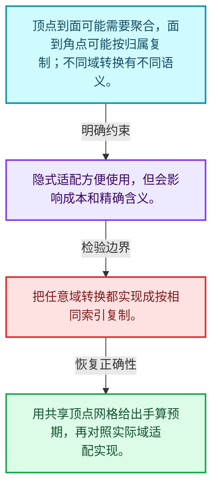
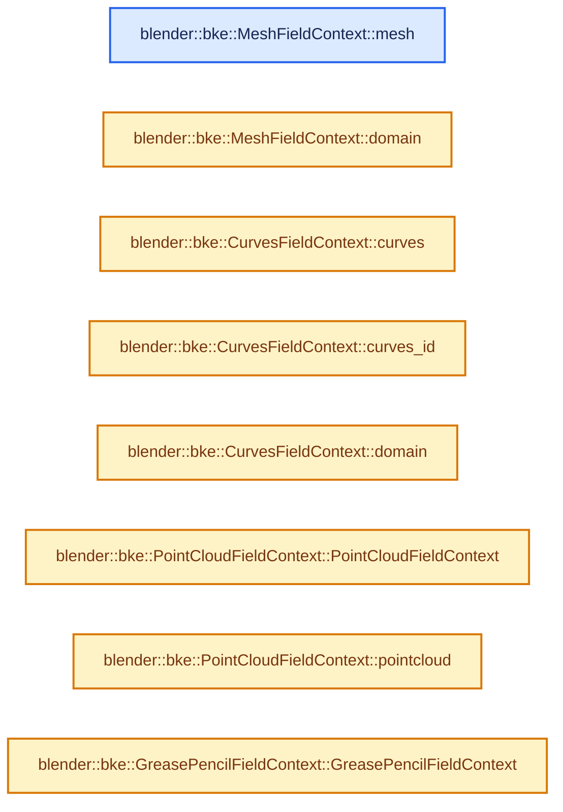
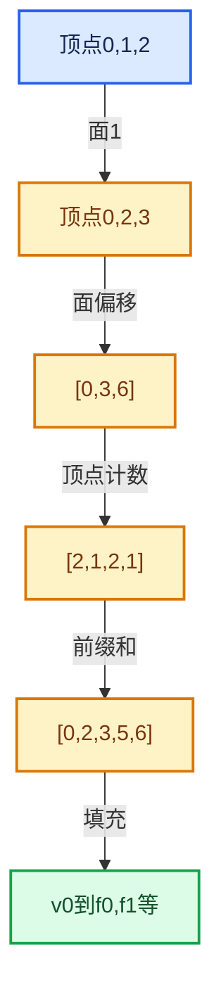

# 05-09 属性域与转换

[方向导航](README.md) · [总目录](../README.md) · [实现索引](../00-课程指南/02-源码与提交索引/符号依赖与实现索引.md)

## 从问题到实现

表达式在不同域求值会产生什么变化？

上下文规定元素集合与域，域适配可能涉及插值或聚合，不能一律当作简单索引重命名。

**数据模型**

顶点到面可能需要聚合，面到角点可能按归属复制；不同域转换有不同语义。

**设计取舍**

隐式适配方便使用，但会影响成本和精确含义。

**最小反例**

把任意域转换都实现成按相同索引复制。

**推导**

用共享顶点网格给出手算预期，再对照实际域适配实现。

## 阅读地图与执行推演








图中的数值推演是本方向的教学模型；实际函数之间的调用边与概念分析边分别标注，不能把概念关系当作运行时调度顺序。

## 完整源码单元与就地讲解

中文讲解直接放在相关代码旁，复杂机制在代码下展开。原文折叠区保留基准行号；不需要在行号表和函数之间来回查找。类布局可分段展示，函数实现不按固定行数切开。

### 类型布局、声明与编译条件 · BKE_geometry_fields.hh L1—L39

<a id="t-d6a5d3f66b37"></a>

<a id="t-8cbdb9f82bcb"></a>

<a id="t-2c9da95da60d"></a>

<a id="t-40d9840e09ac"></a>

<a id="t-0c0e57777df6"></a>

<a id="t-31c354bd7d6c"></a>

`MeshFieldContext`在这里声明的数据成员：

- `Mesh mesh_`
- `AttrDomain domain_`

<!-- annotated:5a7df4c299d40b -->

```cpp
/* SPDX-FileCopyrightText: 2023 Blender Authors
 *
 * SPDX-License-Identifier: GPL-2.0-or-later */

#pragma once

/** \file
 * \ingroup bke
 *
 * Common field utilities and field definitions for geometry components.
 */

#include "BKE_anonymous_attribute_id.hh"
#include "BKE_geometry_set.hh"

#include "BLI_fixed_string.hh"

#include "FN_field_evaluation.hh"

namespace blender {

struct Mesh;
struct PointCloud;

namespace bke {

class CurvesGeometry;
class GeometryFieldInput;
namespace greasepencil {
class Drawing;
}

class MeshFieldContext : public fn::FieldContext {
 private:
  const Mesh &mesh_;
  AttrDomain domain_;

 public:
  MeshFieldContext(const Mesh &mesh, AttrDomain domain);
```

<details>
<summary>核对原始源码：source/blender/blenkernel/BKE_geometry_fields.hh · L1—L39</summary>

<!-- original:5a7df4c299d40b:source/blender/blenkernel/BKE_geometry_fields.hh:1:39 -->

```cpp
/* SPDX-FileCopyrightText: 2023 Blender Authors
 *
 * SPDX-License-Identifier: GPL-2.0-or-later */

#pragma once

/** \file
 * \ingroup bke
 *
 * Common field utilities and field definitions for geometry components.
 */

#include "BKE_anonymous_attribute_id.hh"
#include "BKE_geometry_set.hh"

#include "BLI_fixed_string.hh"

#include "FN_field_evaluation.hh"

namespace blender {

struct Mesh;
struct PointCloud;

namespace bke {

class CurvesGeometry;
class GeometryFieldInput;
namespace greasepencil {
class Drawing;
}

class MeshFieldContext : public fn::FieldContext {
 private:
  const Mesh &mesh_;
  AttrDomain domain_;

 public:
  MeshFieldContext(const Mesh &mesh, AttrDomain domain);
```

</details>

<a id="f-91a02bcc81348f9b"></a>

### `blender::bke::MeshFieldContext::mesh`

实现位置：[source/blender/blenkernel/BKE_geometry_fields.hh](../../../../../source/blender/blenkernel/BKE_geometry_fields.hh) · L40—L43。

**教学注释版**

<!-- annotated:3326cefa031f43 -->

```cpp
  const Mesh &mesh() const
  {
    return mesh_;
  }
```

<details>
<summary>核对原始源码：source/blender/blenkernel/BKE_geometry_fields.hh · L40—L43</summary>

<!-- original:3326cefa031f43:source/blender/blenkernel/BKE_geometry_fields.hh:40:43 -->

```cpp
  const Mesh &mesh() const
  {
    return mesh_;
  }
```

</details>

**结果出口**

- `return mesh_;`

**继续追踪实现**

本实现没有需要继续展开的显式调用；检查返回表达式、对象转换和调用者前置条件。

<!-- annotated:061fdf67fbf70f -->

```cpp

```

<details>
<summary>核对原始源码：source/blender/blenkernel/BKE_geometry_fields.hh · L44—L44</summary>

<!-- original:061fdf67fbf70f:source/blender/blenkernel/BKE_geometry_fields.hh:44:44 -->

```cpp

```

</details>

<a id="f-d79465234e208679"></a>

### `blender::bke::MeshFieldContext::domain`

实现位置：[source/blender/blenkernel/BKE_geometry_fields.hh](../../../../../source/blender/blenkernel/BKE_geometry_fields.hh) · L45—L48。

**教学注释版**

<!-- annotated:23456ee9bdac77 -->

```cpp
  AttrDomain domain() const
  {
    return domain_;
  }
```

<details>
<summary>核对原始源码：source/blender/blenkernel/BKE_geometry_fields.hh · L45—L48</summary>

<!-- original:23456ee9bdac77:source/blender/blenkernel/BKE_geometry_fields.hh:45:48 -->

```cpp
  AttrDomain domain() const
  {
    return domain_;
  }
```

</details>

**结果出口**

- `return domain_;`

**继续追踪实现**

本实现没有需要继续展开的显式调用；检查返回表达式、对象转换和调用者前置条件。

### 类型布局、声明与编译条件 · BKE_geometry_fields.hh L49—L60

<a id="t-d24857e91c0f"></a>

`CurvesFieldContext`在这里声明的数据成员：

- `CurvesGeometry curves_`
- `AttrDomain domain_`
- `Curves curves_id_`

<!-- annotated:8d2a810e59e993 -->

```cpp
};

class CurvesFieldContext : public fn::FieldContext {
 private:
  const CurvesGeometry &curves_;
  AttrDomain domain_;
  const Curves *curves_id_ = nullptr;

 public:
  CurvesFieldContext(const CurvesGeometry &curves, AttrDomain domain);
  CurvesFieldContext(const Curves &curves_id, AttrDomain domain);

```

<details>
<summary>核对原始源码：source/blender/blenkernel/BKE_geometry_fields.hh · L49—L60</summary>

<!-- original:8d2a810e59e993:source/blender/blenkernel/BKE_geometry_fields.hh:49:60 -->

```cpp
};

class CurvesFieldContext : public fn::FieldContext {
 private:
  const CurvesGeometry &curves_;
  AttrDomain domain_;
  const Curves *curves_id_ = nullptr;

 public:
  CurvesFieldContext(const CurvesGeometry &curves, AttrDomain domain);
  CurvesFieldContext(const Curves &curves_id, AttrDomain domain);

```

</details>

<a id="f-653d2e4598f77b4f"></a>

### `blender::bke::CurvesFieldContext::curves`

实现位置：[source/blender/blenkernel/BKE_geometry_fields.hh](../../../../../source/blender/blenkernel/BKE_geometry_fields.hh) · L61—L64。

**教学注释版**

<!-- annotated:3e730a675052f4 -->

```cpp
  const CurvesGeometry &curves() const
  {
    return curves_;
  }
```

<details>
<summary>核对原始源码：source/blender/blenkernel/BKE_geometry_fields.hh · L61—L64</summary>

<!-- original:3e730a675052f4:source/blender/blenkernel/BKE_geometry_fields.hh:61:64 -->

```cpp
  const CurvesGeometry &curves() const
  {
    return curves_;
  }
```

</details>

**结果出口**

- `return curves_;`

**继续追踪实现**

本实现没有需要继续展开的显式调用；检查返回表达式、对象转换和调用者前置条件。

<!-- annotated:7578179d4e6e85 -->

```cpp

```

<details>
<summary>核对原始源码：source/blender/blenkernel/BKE_geometry_fields.hh · L65—L65</summary>

<!-- original:7578179d4e6e85:source/blender/blenkernel/BKE_geometry_fields.hh:65:65 -->

```cpp

```

</details>

<a id="f-e8ce1ee0ef1464ea"></a>

### `blender::bke::CurvesFieldContext::curves_id`

实现位置：[source/blender/blenkernel/BKE_geometry_fields.hh](../../../../../source/blender/blenkernel/BKE_geometry_fields.hh) · L66—L69。

**教学注释版**

<!-- annotated:e57804f3e8d580 -->

```cpp
  const Curves *curves_id() const
  {
    return curves_id_;
  }
```

<details>
<summary>核对原始源码：source/blender/blenkernel/BKE_geometry_fields.hh · L66—L69</summary>

<!-- original:e57804f3e8d580:source/blender/blenkernel/BKE_geometry_fields.hh:66:69 -->

```cpp
  const Curves *curves_id() const
  {
    return curves_id_;
  }
```

</details>

**结果出口**

- `return curves_id_;`

**继续追踪实现**

本实现没有需要继续展开的显式调用；检查返回表达式、对象转换和调用者前置条件。

<!-- annotated:d4f378a36244d4 -->

```cpp

```

<details>
<summary>核对原始源码：source/blender/blenkernel/BKE_geometry_fields.hh · L70—L70</summary>

<!-- original:d4f378a36244d4:source/blender/blenkernel/BKE_geometry_fields.hh:70:70 -->

```cpp

```

</details>

<a id="f-0038edf79d2032b0"></a>

### `blender::bke::CurvesFieldContext::domain`

实现位置：[source/blender/blenkernel/BKE_geometry_fields.hh](../../../../../source/blender/blenkernel/BKE_geometry_fields.hh) · L71—L74。

**教学注释版**

<!-- annotated:336d9ab81fbc77 -->

```cpp
  AttrDomain domain() const
  {
    return domain_;
  }
```

<details>
<summary>核对原始源码：source/blender/blenkernel/BKE_geometry_fields.hh · L71—L74</summary>

<!-- original:336d9ab81fbc77:source/blender/blenkernel/BKE_geometry_fields.hh:71:74 -->

```cpp
  AttrDomain domain() const
  {
    return domain_;
  }
```

</details>

**结果出口**

- `return domain_;`

**继续追踪实现**

本实现没有需要继续展开的显式调用；检查返回表达式、对象转换和调用者前置条件。

### 类型布局、声明与编译条件 · BKE_geometry_fields.hh L75—L81

<a id="t-5768a2770628"></a>

`PointCloudFieldContext`在这里声明的数据成员：

- `PointCloud pointcloud_`

<!-- annotated:c91e429d01ac6f -->

```cpp
};

class PointCloudFieldContext : public fn::FieldContext {
 private:
  const PointCloud &pointcloud_;

 public:
```

<details>
<summary>核对原始源码：source/blender/blenkernel/BKE_geometry_fields.hh · L75—L81</summary>

<!-- original:c91e429d01ac6f:source/blender/blenkernel/BKE_geometry_fields.hh:75:81 -->

```cpp
};

class PointCloudFieldContext : public fn::FieldContext {
 private:
  const PointCloud &pointcloud_;

 public:
```

</details>

<a id="f-a4bb7d7ea8d7b008"></a>

### `blender::bke::PointCloudFieldContext::PointCloudFieldContext`

实现位置：[source/blender/blenkernel/BKE_geometry_fields.hh](../../../../../source/blender/blenkernel/BKE_geometry_fields.hh) · L82—L82。

接口参数：

- `const PointCloud &pointcloud`

**教学注释版**

<!-- annotated:6e00130c1a2bb2 -->

```cpp
  PointCloudFieldContext(const PointCloud &pointcloud) : pointcloud_(pointcloud) {}
```

<details>
<summary>核对原始源码：source/blender/blenkernel/BKE_geometry_fields.hh · L82—L82</summary>

<!-- original:6e00130c1a2bb2:source/blender/blenkernel/BKE_geometry_fields.hh:82:82 -->

```cpp
  PointCloudFieldContext(const PointCloud &pointcloud) : pointcloud_(pointcloud) {}
```

</details>

**继续追踪实现**

本实现没有需要继续展开的显式调用；检查返回表达式、对象转换和调用者前置条件。

<!-- annotated:22f3f96fdccb48 -->

```cpp

```

<details>
<summary>核对原始源码：source/blender/blenkernel/BKE_geometry_fields.hh · L83—L83</summary>

<!-- original:22f3f96fdccb48:source/blender/blenkernel/BKE_geometry_fields.hh:83:83 -->

```cpp

```

</details>

<a id="f-ec1abb64b783b0cb"></a>

### `blender::bke::PointCloudFieldContext::pointcloud`

实现位置：[source/blender/blenkernel/BKE_geometry_fields.hh](../../../../../source/blender/blenkernel/BKE_geometry_fields.hh) · L84—L87。

**教学注释版**

<!-- annotated:b185ba2389a449 -->

```cpp
  const PointCloud &pointcloud() const
  {
    return pointcloud_;
  }
```

<details>
<summary>核对原始源码：source/blender/blenkernel/BKE_geometry_fields.hh · L84—L87</summary>

<!-- original:b185ba2389a449:source/blender/blenkernel/BKE_geometry_fields.hh:84:87 -->

```cpp
  const PointCloud &pointcloud() const
  {
    return pointcloud_;
  }
```

</details>

**结果出口**

- `return pointcloud_;`

**继续追踪实现**

本实现没有需要继续展开的显式调用；检查返回表达式、对象转换和调用者前置条件。

### 类型布局、声明与编译条件 · BKE_geometry_fields.hh L88—L94

<a id="t-b570d56ffd1e"></a>

`GreasePencilFieldContext`在这里声明的数据成员：

- `GreasePencil grease_pencil_`

<!-- annotated:de913b1484e795 -->

```cpp
};

class GreasePencilFieldContext : public fn::FieldContext {
 private:
  const GreasePencil &grease_pencil_;

 public:
```

<details>
<summary>核对原始源码：source/blender/blenkernel/BKE_geometry_fields.hh · L88—L94</summary>

<!-- original:de913b1484e795:source/blender/blenkernel/BKE_geometry_fields.hh:88:94 -->

```cpp
};

class GreasePencilFieldContext : public fn::FieldContext {
 private:
  const GreasePencil &grease_pencil_;

 public:
```

</details>

<a id="f-491735092629faa9"></a>

### `blender::bke::GreasePencilFieldContext::GreasePencilFieldContext`

实现位置：[source/blender/blenkernel/BKE_geometry_fields.hh](../../../../../source/blender/blenkernel/BKE_geometry_fields.hh) · L95—L95。

接口参数：

- `const GreasePencil &grease_pencil`

**教学注释版**

<!-- annotated:92b3637d767e65 -->

```cpp
  GreasePencilFieldContext(const GreasePencil &grease_pencil) : grease_pencil_(grease_pencil) {}
```

<details>
<summary>核对原始源码：source/blender/blenkernel/BKE_geometry_fields.hh · L95—L95</summary>

<!-- original:92b3637d767e65:source/blender/blenkernel/BKE_geometry_fields.hh:95:95 -->

```cpp
  GreasePencilFieldContext(const GreasePencil &grease_pencil) : grease_pencil_(grease_pencil) {}
```

</details>

**继续追踪实现**

本实现没有需要继续展开的显式调用；检查返回表达式、对象转换和调用者前置条件。

<!-- annotated:f1dd247086e419 -->

```cpp

```

<details>
<summary>核对原始源码：source/blender/blenkernel/BKE_geometry_fields.hh · L96—L96</summary>

<!-- original:f1dd247086e419:source/blender/blenkernel/BKE_geometry_fields.hh:96:96 -->

```cpp

```

</details>

<a id="f-56a77031bab0a35f"></a>

### `blender::bke::GreasePencilFieldContext::grease_pencil`

实现位置：[source/blender/blenkernel/BKE_geometry_fields.hh](../../../../../source/blender/blenkernel/BKE_geometry_fields.hh) · L97—L100。

**教学注释版**

<!-- annotated:33d53a97c098a1 -->

```cpp
  const GreasePencil &grease_pencil() const
  {
    return grease_pencil_;
  }
```

<details>
<summary>核对原始源码：source/blender/blenkernel/BKE_geometry_fields.hh · L97—L100</summary>

<!-- original:33d53a97c098a1:source/blender/blenkernel/BKE_geometry_fields.hh:97:100 -->

```cpp
  const GreasePencil &grease_pencil() const
  {
    return grease_pencil_;
  }
```

</details>

**结果出口**

- `return grease_pencil_;`

**继续追踪实现**

本实现没有需要继续展开的显式调用；检查返回表达式、对象转换和调用者前置条件。

### 类型布局、声明与编译条件 · BKE_geometry_fields.hh L101—L109

<a id="t-d1a55807adad"></a>

`GreasePencilLayerFieldContext`在这里声明的数据成员：

- `GreasePencil grease_pencil_`
- `AttrDomain domain_`
- `int layer_index_`

<!-- annotated:d485a52ae16fef -->

```cpp
};

class GreasePencilLayerFieldContext : public fn::FieldContext {
 private:
  const GreasePencil &grease_pencil_;
  AttrDomain domain_;
  int layer_index_;

 public:
```

<details>
<summary>核对原始源码：source/blender/blenkernel/BKE_geometry_fields.hh · L101—L109</summary>

<!-- original:d485a52ae16fef:source/blender/blenkernel/BKE_geometry_fields.hh:101:109 -->

```cpp
};

class GreasePencilLayerFieldContext : public fn::FieldContext {
 private:
  const GreasePencil &grease_pencil_;
  AttrDomain domain_;
  int layer_index_;

 public:
```

</details>

<a id="f-bd0f57d7d905998c"></a>

### `blender::bke::GreasePencilLayerFieldContext::GreasePencilLayerFieldContext`

实现位置：[source/blender/blenkernel/BKE_geometry_fields.hh](../../../../../source/blender/blenkernel/BKE_geometry_fields.hh) · L110—L115。

接口参数：

- `const GreasePencil &grease_pencil`
- `AttrDomain domain`
- `int layer_index`

**教学注释版**

<!-- annotated:b29e832df3050d -->

```cpp
  GreasePencilLayerFieldContext(const GreasePencil &grease_pencil,
                                AttrDomain domain,
                                int layer_index)
      : grease_pencil_(grease_pencil), domain_(domain), layer_index_(layer_index)
  {
  }
```

<details>
<summary>核对原始源码：source/blender/blenkernel/BKE_geometry_fields.hh · L110—L115</summary>

<!-- original:b29e832df3050d:source/blender/blenkernel/BKE_geometry_fields.hh:110:115 -->

```cpp
  GreasePencilLayerFieldContext(const GreasePencil &grease_pencil,
                                AttrDomain domain,
                                int layer_index)
      : grease_pencil_(grease_pencil), domain_(domain), layer_index_(layer_index)
  {
  }
```

</details>

**继续追踪实现**

本实现没有需要继续展开的显式调用；检查返回表达式、对象转换和调用者前置条件。

<!-- annotated:aee5df2084e8bd -->

```cpp

```

<details>
<summary>核对原始源码：source/blender/blenkernel/BKE_geometry_fields.hh · L116—L116</summary>

<!-- original:aee5df2084e8bd:source/blender/blenkernel/BKE_geometry_fields.hh:116:116 -->

```cpp

```

</details>

<a id="f-3c94c2040c2c802c"></a>

### `blender::bke::GreasePencilLayerFieldContext::grease_pencil`

实现位置：[source/blender/blenkernel/BKE_geometry_fields.hh](../../../../../source/blender/blenkernel/BKE_geometry_fields.hh) · L117—L120。

**教学注释版**

<!-- annotated:661d6f7ebb536b -->

```cpp
  const GreasePencil &grease_pencil() const
  {
    return grease_pencil_;
  }
```

<details>
<summary>核对原始源码：source/blender/blenkernel/BKE_geometry_fields.hh · L117—L120</summary>

<!-- original:661d6f7ebb536b:source/blender/blenkernel/BKE_geometry_fields.hh:117:120 -->

```cpp
  const GreasePencil &grease_pencil() const
  {
    return grease_pencil_;
  }
```

</details>

**结果出口**

- `return grease_pencil_;`

**继续追踪实现**

本实现没有需要继续展开的显式调用；检查返回表达式、对象转换和调用者前置条件。

<!-- annotated:dff5f7628a9a59 -->

```cpp

```

<details>
<summary>核对原始源码：source/blender/blenkernel/BKE_geometry_fields.hh · L121—L121</summary>

<!-- original:dff5f7628a9a59:source/blender/blenkernel/BKE_geometry_fields.hh:121:121 -->

```cpp

```

</details>

<a id="f-831bc39cbc1d57e2"></a>

### `blender::bke::GreasePencilLayerFieldContext::domain`

实现位置：[source/blender/blenkernel/BKE_geometry_fields.hh](../../../../../source/blender/blenkernel/BKE_geometry_fields.hh) · L122—L125。

**教学注释版**

<!-- annotated:af69b21c1d5532 -->

```cpp
  AttrDomain domain() const
  {
    return domain_;
  }
```

<details>
<summary>核对原始源码：source/blender/blenkernel/BKE_geometry_fields.hh · L122—L125</summary>

<!-- original:af69b21c1d5532:source/blender/blenkernel/BKE_geometry_fields.hh:122:125 -->

```cpp
  AttrDomain domain() const
  {
    return domain_;
  }
```

</details>

**结果出口**

- `return domain_;`

**继续追踪实现**

本实现没有需要继续展开的显式调用；检查返回表达式、对象转换和调用者前置条件。

<!-- annotated:3f938dd7b8dccc -->

```cpp

```

<details>
<summary>核对原始源码：source/blender/blenkernel/BKE_geometry_fields.hh · L126—L126</summary>

<!-- original:3f938dd7b8dccc:source/blender/blenkernel/BKE_geometry_fields.hh:126:126 -->

```cpp

```

</details>

<a id="f-1fd57245025db164"></a>

### `blender::bke::GreasePencilLayerFieldContext::layer_index`

实现位置：[source/blender/blenkernel/BKE_geometry_fields.hh](../../../../../source/blender/blenkernel/BKE_geometry_fields.hh) · L127—L130。

**教学注释版**

<!-- annotated:429b04b116bfba -->

```cpp
  int layer_index() const
  {
    return layer_index_;
  }
```

<details>
<summary>核对原始源码：source/blender/blenkernel/BKE_geometry_fields.hh · L127—L130</summary>

<!-- original:429b04b116bfba:source/blender/blenkernel/BKE_geometry_fields.hh:127:130 -->

```cpp
  int layer_index() const
  {
    return layer_index_;
  }
```

</details>

**结果出口**

- `return layer_index_;`

**继续追踪实现**

本实现没有需要继续展开的显式调用；检查返回表达式、对象转换和调用者前置条件。

### 类型布局、声明与编译条件 · BKE_geometry_fields.hh L131—L141

<a id="t-15539174d9d2"></a>

`InstancesFieldContext`在这里声明的数据成员：

- `Instances instances_`

<!-- annotated:32443d65f4f9bf -->

```cpp

  GVArray get_varray_for_input(const fn::FieldInput &field_input,
                               const IndexMask &mask,
                               ResourceScope &scope) const override;
};

class InstancesFieldContext : public fn::FieldContext {
 private:
  const Instances &instances_;

 public:
```

<details>
<summary>核对原始源码：source/blender/blenkernel/BKE_geometry_fields.hh · L131—L141</summary>

<!-- original:32443d65f4f9bf:source/blender/blenkernel/BKE_geometry_fields.hh:131:141 -->

```cpp

  GVArray get_varray_for_input(const fn::FieldInput &field_input,
                               const IndexMask &mask,
                               ResourceScope &scope) const override;
};

class InstancesFieldContext : public fn::FieldContext {
 private:
  const Instances &instances_;

 public:
```

</details>

<a id="f-04b46b20758c9d64"></a>

### `blender::bke::InstancesFieldContext::InstancesFieldContext`

实现位置：[source/blender/blenkernel/BKE_geometry_fields.hh](../../../../../source/blender/blenkernel/BKE_geometry_fields.hh) · L142—L142。

接口参数：

- `const Instances &instances`

**教学注释版**

<!-- annotated:7121a73004eb71 -->

```cpp
  InstancesFieldContext(const Instances &instances) : instances_(instances) {}
```

<details>
<summary>核对原始源码：source/blender/blenkernel/BKE_geometry_fields.hh · L142—L142</summary>

<!-- original:7121a73004eb71:source/blender/blenkernel/BKE_geometry_fields.hh:142:142 -->

```cpp
  InstancesFieldContext(const Instances &instances) : instances_(instances) {}
```

</details>

**继续追踪实现**

本实现没有需要继续展开的显式调用；检查返回表达式、对象转换和调用者前置条件。

<!-- annotated:09f93811e1dbf6 -->

```cpp

```

<details>
<summary>核对原始源码：source/blender/blenkernel/BKE_geometry_fields.hh · L143—L143</summary>

<!-- original:09f93811e1dbf6:source/blender/blenkernel/BKE_geometry_fields.hh:143:143 -->

```cpp

```

</details>

<a id="f-83b99c9da983d0a1"></a>

### `blender::bke::InstancesFieldContext::instances`

实现位置：[source/blender/blenkernel/BKE_geometry_fields.hh](../../../../../source/blender/blenkernel/BKE_geometry_fields.hh) · L144—L147。

**教学注释版**

<!-- annotated:faf39d7c2fe95c -->

```cpp
  const Instances &instances() const
  {
    return instances_;
  }
```

<details>
<summary>核对原始源码：source/blender/blenkernel/BKE_geometry_fields.hh · L144—L147</summary>

<!-- original:faf39d7c2fe95c:source/blender/blenkernel/BKE_geometry_fields.hh:144:147 -->

```cpp
  const Instances &instances() const
  {
    return instances_;
  }
```

</details>

**结果出口**

- `return instances_;`

**继续追踪实现**

本实现没有需要继续展开的显式调用；检查返回表达式、对象转换和调用者前置条件。

### 类型布局、声明与编译条件 · BKE_geometry_fields.hh L148—L187

<a id="t-59643f4cc7f8"></a>

`GeometryFieldContext`在这里声明的数据成员：

- `void geometry_`
- `GeometryComponent::Type type_`
- `AttrDomain domain_`
- `Curves curves_id_`
- `int grease_pencil_layer_index_`

<!-- annotated:e7d1483b0eef59 -->

```cpp
};

/**
 * A field context that can represent meshes, curves, point clouds, instances or grease pencil
 * layers, used for field inputs that can work for multiple geometry types.
 */
class GeometryFieldContext : public fn::FieldContext {
 private:
  /**
   * Store the geometry as a void pointer instead of a #GeometryComponent to allow referencing data
   * that doesn't correspond directly to a geometry component type, in this case #CurvesGeometry
   * instead of #Curves.
   */
  const void *geometry_;
  const GeometryComponent::Type type_;
  AttrDomain domain_;
  const Curves *curves_id_ = nullptr;
  /**
   * Only used when the type is grease pencil and the domain is either points or curves
   * (not layers).
   */
  int grease_pencil_layer_index_;

  friend GeometryFieldInput;

 public:
  GeometryFieldContext(const GeometryFieldContext &other, AttrDomain domain);
  GeometryFieldContext(const GeometryComponent &component, AttrDomain domain);
  GeometryFieldContext(const void *geometry,
                       GeometryComponent::Type type,
                       AttrDomain domain,
                       int grease_pencil_layer_index);
  GeometryFieldContext(const Mesh &mesh, AttrDomain domain);
  GeometryFieldContext(const CurvesGeometry &curves, AttrDomain domain);
  GeometryFieldContext(const Curves &curves_id, AttrDomain domain);
  GeometryFieldContext(const GreasePencil &grease_pencil);
  GeometryFieldContext(const GreasePencil &grease_pencil, AttrDomain domain, int layer_index);
  GeometryFieldContext(const PointCloud &points);
  GeometryFieldContext(const Instances &instances);

```

<details>
<summary>核对原始源码：source/blender/blenkernel/BKE_geometry_fields.hh · L148—L187</summary>

<!-- original:e7d1483b0eef59:source/blender/blenkernel/BKE_geometry_fields.hh:148:187 -->

```cpp
};

/**
 * A field context that can represent meshes, curves, point clouds, instances or grease pencil
 * layers, used for field inputs that can work for multiple geometry types.
 */
class GeometryFieldContext : public fn::FieldContext {
 private:
  /**
   * Store the geometry as a void pointer instead of a #GeometryComponent to allow referencing data
   * that doesn't correspond directly to a geometry component type, in this case #CurvesGeometry
   * instead of #Curves.
   */
  const void *geometry_;
  const GeometryComponent::Type type_;
  AttrDomain domain_;
  const Curves *curves_id_ = nullptr;
  /**
   * Only used when the type is grease pencil and the domain is either points or curves
   * (not layers).
   */
  int grease_pencil_layer_index_;

  friend GeometryFieldInput;

 public:
  GeometryFieldContext(const GeometryFieldContext &other, AttrDomain domain);
  GeometryFieldContext(const GeometryComponent &component, AttrDomain domain);
  GeometryFieldContext(const void *geometry,
                       GeometryComponent::Type type,
                       AttrDomain domain,
                       int grease_pencil_layer_index);
  GeometryFieldContext(const Mesh &mesh, AttrDomain domain);
  GeometryFieldContext(const CurvesGeometry &curves, AttrDomain domain);
  GeometryFieldContext(const Curves &curves_id, AttrDomain domain);
  GeometryFieldContext(const GreasePencil &grease_pencil);
  GeometryFieldContext(const GreasePencil &grease_pencil, AttrDomain domain, int layer_index);
  GeometryFieldContext(const PointCloud &points);
  GeometryFieldContext(const Instances &instances);

```

</details>

<a id="f-ec432eb686c477fb"></a>

### `blender::bke::GeometryFieldContext::geometry`

实现位置：[source/blender/blenkernel/BKE_geometry_fields.hh](../../../../../source/blender/blenkernel/BKE_geometry_fields.hh) · L188—L191。

**教学注释版**

<!-- annotated:5fa730dab6705b -->

```cpp
  const void *geometry() const
  {
    return geometry_;
  }
```

<details>
<summary>核对原始源码：source/blender/blenkernel/BKE_geometry_fields.hh · L188—L191</summary>

<!-- original:5fa730dab6705b:source/blender/blenkernel/BKE_geometry_fields.hh:188:191 -->

```cpp
  const void *geometry() const
  {
    return geometry_;
  }
```

</details>

**结果出口**

- `return geometry_;`

**继续追踪实现**

本实现没有需要继续展开的显式调用；检查返回表达式、对象转换和调用者前置条件。

<!-- annotated:409c26a0386e73 -->

```cpp

```

<details>
<summary>核对原始源码：source/blender/blenkernel/BKE_geometry_fields.hh · L192—L192</summary>

<!-- original:409c26a0386e73:source/blender/blenkernel/BKE_geometry_fields.hh:192:192 -->

```cpp

```

</details>

<a id="f-48e9fe71391982f6"></a>

### `blender::bke::GeometryFieldContext::type`

实现位置：[source/blender/blenkernel/BKE_geometry_fields.hh](../../../../../source/blender/blenkernel/BKE_geometry_fields.hh) · L193—L196。

**教学注释版**

<!-- annotated:f9238a76c4f46b -->

```cpp
  GeometryComponent::Type type() const
  {
    return type_;
  }
```

<details>
<summary>核对原始源码：source/blender/blenkernel/BKE_geometry_fields.hh · L193—L196</summary>

<!-- original:f9238a76c4f46b:source/blender/blenkernel/BKE_geometry_fields.hh:193:196 -->

```cpp
  GeometryComponent::Type type() const
  {
    return type_;
  }
```

</details>

**结果出口**

- `return type_;`

**继续追踪实现**

本实现没有需要继续展开的显式调用；检查返回表达式、对象转换和调用者前置条件。

<!-- annotated:caa4f5bf6c5e11 -->

```cpp

```

<details>
<summary>核对原始源码：source/blender/blenkernel/BKE_geometry_fields.hh · L197—L197</summary>

<!-- original:caa4f5bf6c5e11:source/blender/blenkernel/BKE_geometry_fields.hh:197:197 -->

```cpp

```

</details>

<a id="f-e616fe8766422431"></a>

### `blender::bke::GeometryFieldContext::domain`

实现位置：[source/blender/blenkernel/BKE_geometry_fields.hh](../../../../../source/blender/blenkernel/BKE_geometry_fields.hh) · L198—L201。

**教学注释版**

<!-- annotated:f2a91d2ec8f183 -->

```cpp
  AttrDomain domain() const
  {
    return domain_;
  }
```

<details>
<summary>核对原始源码：source/blender/blenkernel/BKE_geometry_fields.hh · L198—L201</summary>

<!-- original:f2a91d2ec8f183:source/blender/blenkernel/BKE_geometry_fields.hh:198:201 -->

```cpp
  AttrDomain domain() const
  {
    return domain_;
  }
```

</details>

**结果出口**

- `return domain_;`

**继续追踪实现**

本实现没有需要继续展开的显式调用；检查返回表达式、对象转换和调用者前置条件。

<!-- annotated:27f5bd4a836dd2 -->

```cpp

```

<details>
<summary>核对原始源码：source/blender/blenkernel/BKE_geometry_fields.hh · L202—L202</summary>

<!-- original:27f5bd4a836dd2:source/blender/blenkernel/BKE_geometry_fields.hh:202:202 -->

```cpp

```

</details>

<a id="f-b48faa617e8f5bee"></a>

### `blender::bke::GeometryFieldContext::grease_pencil_layer_index`

实现位置：[source/blender/blenkernel/BKE_geometry_fields.hh](../../../../../source/blender/blenkernel/BKE_geometry_fields.hh) · L203—L208。

**教学注释版**

<!-- annotated:e654c9a9b97a2a -->

```cpp
  int grease_pencil_layer_index() const
  {
    BLI_assert(this->type_ == GeometryComponent::Type::GreasePencil);
    BLI_assert(ELEM(this->domain_, AttrDomain::Layer, AttrDomain::Curve, AttrDomain::Point));
    return grease_pencil_layer_index_;
  }
```

<details>
<summary>核对原始源码：source/blender/blenkernel/BKE_geometry_fields.hh · L203—L208</summary>

<!-- original:e654c9a9b97a2a:source/blender/blenkernel/BKE_geometry_fields.hh:203:208 -->

```cpp
  int grease_pencil_layer_index() const
  {
    BLI_assert(this->type_ == GeometryComponent::Type::GreasePencil);
    BLI_assert(ELEM(this->domain_, AttrDomain::Layer, AttrDomain::Curve, AttrDomain::Point));
    return grease_pencil_layer_index_;
  }
```

</details>

**结果出口**

- `return grease_pencil_layer_index_;`

**继续追踪实现**

- `BLI_assert` → [BLI_assert · L48](../90-实现依赖专题/01-BLI基础库/BLI_assert.hh.md#m-57a88495704d)；[BLI_assert · L63](../90-实现依赖专题/01-BLI基础库/BLI_assert.hh.md#m-d07050020cb5)。宏定义由构建条件选择。
- `ELEM` → [ELEM · L88](../90-实现依赖专题/07-Intern运行时与平台/ghost/intern/GHOST_utildefines.hh.md#m-d28724a15928)；[ELEM · L135](../90-实现依赖专题/01-BLI基础库/BLI_utildefines.hh.md#m-d6572de7cae0)。宏定义由构建条件选择。

### 类型布局、声明与编译条件 · BKE_geometry_fields.hh L209—L246

<a id="t-43ca0ab2bc8f"></a>

`NativeFieldDomain`在这里声明的数据成员：

- `std::variant<None, Domain, Constant> variant`

<a id="t-759c42ac532d"></a>

<a id="t-d0e66f0cf838"></a>

`Domain`在这里声明的数据成员：

- `AttrDomain domain`

<a id="t-3a22bec8641d"></a>

<!-- annotated:f2713643361f72 -->

```cpp

  std::optional<AttributeAccessor> attributes() const;
  const Mesh *mesh() const;
  const CurvesGeometry *curves() const;
  const PointCloud *pointcloud() const;
  const GreasePencil *grease_pencil() const;
  const greasepencil::Drawing *grease_pencil_layer_drawing() const;
  const Instances *instances() const;
  const CurvesGeometry *curves_or_strokes() const;
  const Curves *curves_id() const;
};

/**
 * Information about a field input's relationship with the domain of the data it represents.
 *
 * If the native field domain is `Point/Face`, evaluating the field on the corner domain is
 * identical to evaluating it on the native domain and copying the values to corners afterwards. If
 * the native field domain is `Curve`, evaluating it on the point domain is identical to evaluating
 * it on the curve domain and copying the values to the points afterwards. Of course, copying the
 * values to the more complex domain can be skipped if the algorithm can be optimized to use the
 * data directly from the smaller domain.
 */
struct NativeFieldDomain {
  /**
   * The input may depend on the order of the domain. For example, the index field, can't be
   * transparently evaluated on a different domain unlike attribute fields which are more flexible
   * because of domain interpolation.
   */
  struct None {};
  /** The input represents data on a specific domain. */
  struct Domain {
    AttrDomain domain;
  };
  /** Interpolating the field between domains does not change the value. */
  struct Constant {};

  std::variant<None, Domain, Constant> variant;

```

<details>
<summary>核对原始源码：source/blender/blenkernel/BKE_geometry_fields.hh · L209—L246</summary>

<!-- original:f2713643361f72:source/blender/blenkernel/BKE_geometry_fields.hh:209:246 -->

```cpp

  std::optional<AttributeAccessor> attributes() const;
  const Mesh *mesh() const;
  const CurvesGeometry *curves() const;
  const PointCloud *pointcloud() const;
  const GreasePencil *grease_pencil() const;
  const greasepencil::Drawing *grease_pencil_layer_drawing() const;
  const Instances *instances() const;
  const CurvesGeometry *curves_or_strokes() const;
  const Curves *curves_id() const;
};

/**
 * Information about a field input's relationship with the domain of the data it represents.
 *
 * If the native field domain is `Point/Face`, evaluating the field on the corner domain is
 * identical to evaluating it on the native domain and copying the values to corners afterwards. If
 * the native field domain is `Curve`, evaluating it on the point domain is identical to evaluating
 * it on the curve domain and copying the values to the points afterwards. Of course, copying the
 * values to the more complex domain can be skipped if the algorithm can be optimized to use the
 * data directly from the smaller domain.
 */
struct NativeFieldDomain {
  /**
   * The input may depend on the order of the domain. For example, the index field, can't be
   * transparently evaluated on a different domain unlike attribute fields which are more flexible
   * because of domain interpolation.
   */
  struct None {};
  /** The input represents data on a specific domain. */
  struct Domain {
    AttrDomain domain;
  };
  /** Interpolating the field between domains does not change the value. */
  struct Constant {};

  std::variant<None, Domain, Constant> variant;

```

</details>

<a id="f-57aafdb998fcbe3e"></a>

### `blender::bke::NativeFieldDomain::NativeFieldDomain`

实现位置：[source/blender/blenkernel/BKE_geometry_fields.hh](../../../../../source/blender/blenkernel/BKE_geometry_fields.hh) · L247—L247。

接口参数：

- `const None &`

**教学注释版**

<!-- annotated:121444336e5f7b -->

```cpp
  NativeFieldDomain(const None & /*tag*/) : variant(None{}) {}
```

<details>
<summary>核对原始源码：source/blender/blenkernel/BKE_geometry_fields.hh · L247—L247</summary>

<!-- original:121444336e5f7b:source/blender/blenkernel/BKE_geometry_fields.hh:247:247 -->

```cpp
  NativeFieldDomain(const None & /*tag*/) : variant(None{}) {}
```

</details>

**继续追踪实现**

本实现没有需要继续展开的显式调用；检查返回表达式、对象转换和调用者前置条件。

<a id="f-69c545c74aed6790"></a>

### `blender::bke::NativeFieldDomain::NativeFieldDomain`

实现位置：[source/blender/blenkernel/BKE_geometry_fields.hh](../../../../../source/blender/blenkernel/BKE_geometry_fields.hh) · L248—L248。

接口参数：

- `const Domain &domain`

**教学注释版**

<!-- annotated:623e1de63f1894 -->

```cpp
  NativeFieldDomain(const Domain &domain) : variant(domain) {}
```

<details>
<summary>核对原始源码：source/blender/blenkernel/BKE_geometry_fields.hh · L248—L248</summary>

<!-- original:623e1de63f1894:source/blender/blenkernel/BKE_geometry_fields.hh:248:248 -->

```cpp
  NativeFieldDomain(const Domain &domain) : variant(domain) {}
```

</details>

**继续追踪实现**

本实现没有需要继续展开的显式调用；检查返回表达式、对象转换和调用者前置条件。

<a id="f-9d89fd4661f767bf"></a>

### `blender::bke::NativeFieldDomain::NativeFieldDomain`

实现位置：[source/blender/blenkernel/BKE_geometry_fields.hh](../../../../../source/blender/blenkernel/BKE_geometry_fields.hh) · L249—L249。

接口参数：

- `const Constant &`

**教学注释版**

<!-- annotated:fd39ddaf4af75c -->

```cpp
  NativeFieldDomain(const Constant & /*tag*/) : variant(Constant{}) {}
```

<details>
<summary>核对原始源码：source/blender/blenkernel/BKE_geometry_fields.hh · L249—L249</summary>

<!-- original:fd39ddaf4af75c:source/blender/blenkernel/BKE_geometry_fields.hh:249:249 -->

```cpp
  NativeFieldDomain(const Constant & /*tag*/) : variant(Constant{}) {}
```

</details>

**继续追踪实现**

本实现没有需要继续展开的显式调用；检查返回表达式、对象转换和调用者前置条件。

### 类型布局、声明与编译条件 · BKE_geometry_fields.hh L250—L314

<a id="t-fc566134eaeb"></a>

`GeometryFieldInput`在这里声明的数据成员：

- `GVArray get_varray_for_context`
- `GVArray get_varray_for_context`
- `std::optional<AttrDomain> preferred_domain`
- `NativeFieldDomain native_domain_info`

<a id="t-2f697501ab76"></a>

`MeshFieldInput`在这里声明的数据成员：

- `GVArray get_varray_for_context`
- `GVArray get_varray_for_context`
- `std::optional<AttrDomain> preferred_domain`
- `NativeFieldDomain native_domain_info`

<a id="t-d9fb626f5f64"></a>

`CurvesFieldInput`在这里声明的数据成员：

- `GVArray get_varray_for_context`
- `GVArray get_varray_for_context`
- `std::optional<AttrDomain> preferred_domain`

<a id="t-dd37b41b0016"></a>

`PointCloudFieldInput`在这里声明的数据成员：

- `GVArray get_varray_for_context`
- `GVArray get_varray_for_context`

<a id="t-1d33af76821b"></a>

`InstancesFieldInput`在这里声明的数据成员：

- `GVArray get_varray_for_context`
- `GVArray get_varray_for_context`

<a id="t-24ed40bc9316"></a>

`AttributeFieldInput`在这里声明的数据成员：

- `std::string name_`
- `std::optional<std::string> socket_inspection_name_`

<!-- annotated:fc6b95156deca0 -->

```cpp
};

class GeometryFieldInput : public fn::FieldInput {
 public:
  using fn::FieldInput::FieldInput;
  GVArray get_varray_for_context(const fn::FieldContext &context,
                                 const IndexMask &mask,
                                 ResourceScope &scope) const override;
  virtual GVArray get_varray_for_context(const GeometryFieldContext &context,
                                         const IndexMask &mask) const = 0;
  virtual std::optional<AttrDomain> preferred_domain(const GeometryComponent &component) const;
  virtual NativeFieldDomain native_domain_info(const GeometryComponent &component) const;
};

class MeshFieldInput : public fn::FieldInput {
 public:
  using fn::FieldInput::FieldInput;
  GVArray get_varray_for_context(const fn::FieldContext &context,
                                 const IndexMask &mask,
                                 ResourceScope &scope) const override;
  virtual GVArray get_varray_for_context(const Mesh &mesh,
                                         AttrDomain domain,
                                         const IndexMask &mask) const = 0;
  virtual std::optional<AttrDomain> preferred_domain(const Mesh &mesh) const;
  virtual NativeFieldDomain native_domain_info(const Mesh &mesh) const;
};

class CurvesFieldInput : public fn::FieldInput {
 public:
  using fn::FieldInput::FieldInput;
  GVArray get_varray_for_context(const fn::FieldContext &context,
                                 const IndexMask &mask,
                                 ResourceScope &scope) const override;
  virtual GVArray get_varray_for_context(const CurvesGeometry &curves,
                                         AttrDomain domain,
                                         const IndexMask &mask) const = 0;
  virtual std::optional<AttrDomain> preferred_domain(const CurvesGeometry &curves) const;
};

class PointCloudFieldInput : public fn::FieldInput {
 public:
  using fn::FieldInput::FieldInput;
  GVArray get_varray_for_context(const fn::FieldContext &context,
                                 const IndexMask &mask,
                                 ResourceScope &scope) const override;
  virtual GVArray get_varray_for_context(const PointCloud &pointcloud,
                                         const IndexMask &mask) const = 0;
};

class InstancesFieldInput : public fn::FieldInput {
 public:
  using fn::FieldInput::FieldInput;
  GVArray get_varray_for_context(const fn::FieldContext &context,
                                 const IndexMask &mask,
                                 ResourceScope &scope) const override;
  virtual GVArray get_varray_for_context(const Instances &instances,
                                         const IndexMask &mask) const = 0;
};

class AttributeFieldInput : public GeometryFieldInput {
 private:
  std::string name_;
  std::optional<std::string> socket_inspection_name_;

 public:
```

<details>
<summary>核对原始源码：source/blender/blenkernel/BKE_geometry_fields.hh · L250—L314</summary>

<!-- original:fc6b95156deca0:source/blender/blenkernel/BKE_geometry_fields.hh:250:314 -->

```cpp
};

class GeometryFieldInput : public fn::FieldInput {
 public:
  using fn::FieldInput::FieldInput;
  GVArray get_varray_for_context(const fn::FieldContext &context,
                                 const IndexMask &mask,
                                 ResourceScope &scope) const override;
  virtual GVArray get_varray_for_context(const GeometryFieldContext &context,
                                         const IndexMask &mask) const = 0;
  virtual std::optional<AttrDomain> preferred_domain(const GeometryComponent &component) const;
  virtual NativeFieldDomain native_domain_info(const GeometryComponent &component) const;
};

class MeshFieldInput : public fn::FieldInput {
 public:
  using fn::FieldInput::FieldInput;
  GVArray get_varray_for_context(const fn::FieldContext &context,
                                 const IndexMask &mask,
                                 ResourceScope &scope) const override;
  virtual GVArray get_varray_for_context(const Mesh &mesh,
                                         AttrDomain domain,
                                         const IndexMask &mask) const = 0;
  virtual std::optional<AttrDomain> preferred_domain(const Mesh &mesh) const;
  virtual NativeFieldDomain native_domain_info(const Mesh &mesh) const;
};

class CurvesFieldInput : public fn::FieldInput {
 public:
  using fn::FieldInput::FieldInput;
  GVArray get_varray_for_context(const fn::FieldContext &context,
                                 const IndexMask &mask,
                                 ResourceScope &scope) const override;
  virtual GVArray get_varray_for_context(const CurvesGeometry &curves,
                                         AttrDomain domain,
                                         const IndexMask &mask) const = 0;
  virtual std::optional<AttrDomain> preferred_domain(const CurvesGeometry &curves) const;
};

class PointCloudFieldInput : public fn::FieldInput {
 public:
  using fn::FieldInput::FieldInput;
  GVArray get_varray_for_context(const fn::FieldContext &context,
                                 const IndexMask &mask,
                                 ResourceScope &scope) const override;
  virtual GVArray get_varray_for_context(const PointCloud &pointcloud,
                                         const IndexMask &mask) const = 0;
};

class InstancesFieldInput : public fn::FieldInput {
 public:
  using fn::FieldInput::FieldInput;
  GVArray get_varray_for_context(const fn::FieldContext &context,
                                 const IndexMask &mask,
                                 ResourceScope &scope) const override;
  virtual GVArray get_varray_for_context(const Instances &instances,
                                         const IndexMask &mask) const = 0;
};

class AttributeFieldInput : public GeometryFieldInput {
 private:
  std::string name_;
  std::optional<std::string> socket_inspection_name_;

 public:
```

</details>

### 类型布局、声明与编译条件 · geometry_fields.cc L1—L31

<!-- annotated:ebfdb88fc594be -->

```cpp
/* SPDX-FileCopyrightText: 2023 Blender Authors
 *
 * SPDX-License-Identifier: GPL-2.0-or-later */

/** \file
 * \ingroup bke
 */

#include "BLI_array_utils.hh"
#include "BLI_generic_array.hh"
#include "BLI_implicit_sharing_ptr.hh"

#include "BKE_attribute.hh"
#include "BKE_curves.hh"
#include "BKE_geometry_fields.hh"
#include "BKE_geometry_set.hh"
#include "BKE_grease_pencil.hh"
#include "BKE_instances.hh"
#include "BKE_mesh.hh"

#include "DNA_mesh_types.h"
#include "DNA_pointcloud_types.h"

#include "BLT_translation.hh"

#include <fmt/format.h>

namespace blender {

namespace bke {

```

<details>
<summary>核对原始源码：source/blender/blenkernel/intern/geometry_fields.cc · L1—L31</summary>

<!-- original:ebfdb88fc594be:source/blender/blenkernel/intern/geometry_fields.cc:1:31 -->

```cpp
/* SPDX-FileCopyrightText: 2023 Blender Authors
 *
 * SPDX-License-Identifier: GPL-2.0-or-later */

/** \file
 * \ingroup bke
 */

#include "BLI_array_utils.hh"
#include "BLI_generic_array.hh"
#include "BLI_implicit_sharing_ptr.hh"

#include "BKE_attribute.hh"
#include "BKE_curves.hh"
#include "BKE_geometry_fields.hh"
#include "BKE_geometry_set.hh"
#include "BKE_grease_pencil.hh"
#include "BKE_instances.hh"
#include "BKE_mesh.hh"

#include "DNA_mesh_types.h"
#include "DNA_pointcloud_types.h"

#include "BLT_translation.hh"

#include <fmt/format.h>

namespace blender {

namespace bke {

```

</details>

<a id="f-5660a4d8efb6eaea"></a>

### `blender::bke::MeshFieldContext::MeshFieldContext`

实现位置：[source/blender/blenkernel/intern/geometry_fields.cc](../../../../../source/blender/blenkernel/intern/geometry_fields.cc) · L32—L36。

接口参数：

- `const Mesh &mesh`
- `const AttrDomain domain`

**教学注释版**

<!-- annotated:0dca59bc3ad967 -->

```cpp
MeshFieldContext::MeshFieldContext(const Mesh &mesh, const AttrDomain domain)
    : mesh_(mesh), domain_(domain)
{
  BLI_assert(mesh.attributes().domain_supported(domain_));
}
```

<details>
<summary>核对原始源码：source/blender/blenkernel/intern/geometry_fields.cc · L32—L36</summary>

<!-- original:0dca59bc3ad967:source/blender/blenkernel/intern/geometry_fields.cc:32:36 -->

```cpp
MeshFieldContext::MeshFieldContext(const Mesh &mesh, const AttrDomain domain)
    : mesh_(mesh), domain_(domain)
{
  BLI_assert(mesh.attributes().domain_supported(domain_));
}
```

</details>

**继续追踪实现**

- `BLI_assert` → [BLI_assert · L48](../90-实现依赖专题/01-BLI基础库/BLI_assert.hh.md#m-57a88495704d)；[BLI_assert · L63](../90-实现依赖专题/01-BLI基础库/BLI_assert.hh.md#m-d07050020cb5)。宏定义由构建条件选择。
- `mesh.attributes().domain_supported` → [调用协议](../00-课程指南/01-路线与规范/模板宏与动态分派协议.md)：接收对象类型依赖auto、返回值或模板实例；不按同名猜测目标。调用位置L35。
- `mesh.attributes` → [Mesh::attributes · L1298](03-MPoly迁移与兼容.md#f-607bbfe3e57cfc7f)。

<!-- annotated:f98ca4213c57d9 -->

```cpp

```

<details>
<summary>核对原始源码：source/blender/blenkernel/intern/geometry_fields.cc · L37—L37</summary>

<!-- original:f98ca4213c57d9:source/blender/blenkernel/intern/geometry_fields.cc:37:37 -->

```cpp

```

</details>

<a id="f-c3b22ec14276311d"></a>

### `blender::bke::CurvesFieldContext::CurvesFieldContext`

实现位置：[source/blender/blenkernel/intern/geometry_fields.cc](../../../../../source/blender/blenkernel/intern/geometry_fields.cc) · L38—L42。

接口参数：

- `const CurvesGeometry &curves`
- `const AttrDomain domain`

**教学注释版**

<!-- annotated:5148a03b891fd0 -->

```cpp
CurvesFieldContext::CurvesFieldContext(const CurvesGeometry &curves, const AttrDomain domain)
    : curves_(curves), domain_(domain)
{
  BLI_assert(curves.attributes().domain_supported(domain));
}
```

<details>
<summary>核对原始源码：source/blender/blenkernel/intern/geometry_fields.cc · L38—L42</summary>

<!-- original:5148a03b891fd0:source/blender/blenkernel/intern/geometry_fields.cc:38:42 -->

```cpp
CurvesFieldContext::CurvesFieldContext(const CurvesGeometry &curves, const AttrDomain domain)
    : curves_(curves), domain_(domain)
{
  BLI_assert(curves.attributes().domain_supported(domain));
}
```

</details>

**继续追踪实现**

- `BLI_assert` → [BLI_assert · L48](../90-实现依赖专题/01-BLI基础库/BLI_assert.hh.md#m-57a88495704d)；[BLI_assert · L63](../90-实现依赖专题/01-BLI基础库/BLI_assert.hh.md#m-d07050020cb5)。宏定义由构建条件选择。
- `curves.attributes().domain_supported` → [调用协议](../00-课程指南/01-路线与规范/模板宏与动态分派协议.md)：接收对象类型依赖auto、返回值或模板实例；不按同名猜测目标。调用位置L41。
- `curves.attributes` → [blender::bke::CurvesGeometry::attributes · L1908](../90-实现依赖专题/02-BKE几何与数据/intern/curves_geometry.cc.md#f-8e24fbf758862a22)。

<!-- annotated:6da4bb3c4c3e06 -->

```cpp

```

<details>
<summary>核对原始源码：source/blender/blenkernel/intern/geometry_fields.cc · L43—L43</summary>

<!-- original:6da4bb3c4c3e06:source/blender/blenkernel/intern/geometry_fields.cc:43:43 -->

```cpp

```

</details>

<a id="f-01111fea909d16de"></a>

### `blender::bke::CurvesFieldContext::CurvesFieldContext`

实现位置：[source/blender/blenkernel/intern/geometry_fields.cc](../../../../../source/blender/blenkernel/intern/geometry_fields.cc) · L44—L48。

接口参数：

- `const Curves &curves_id`
- `const AttrDomain domain`

**教学注释版**

<!-- annotated:f2641a3d43dbc0 -->

```cpp
CurvesFieldContext::CurvesFieldContext(const Curves &curves_id, const AttrDomain domain)
    : CurvesFieldContext(curves_id.geometry.wrap(), domain)
{
  curves_id_ = &curves_id;
}
```

<details>
<summary>核对原始源码：source/blender/blenkernel/intern/geometry_fields.cc · L44—L48</summary>

<!-- original:f2641a3d43dbc0:source/blender/blenkernel/intern/geometry_fields.cc:44:48 -->

```cpp
CurvesFieldContext::CurvesFieldContext(const Curves &curves_id, const AttrDomain domain)
    : CurvesFieldContext(curves_id.geometry.wrap(), domain)
{
  curves_id_ = &curves_id;
}
```

</details>

**沿实际写入检查状态**

- `curves_id_ = &curves_id;`

**继续追踪实现**

本实现没有需要继续展开的显式调用；检查返回表达式、对象转换和调用者前置条件。

<!-- annotated:0b2d82cf7e0ef8 -->

```cpp

```

<details>
<summary>核对原始源码：source/blender/blenkernel/intern/geometry_fields.cc · L49—L49</summary>

<!-- original:0b2d82cf7e0ef8:source/blender/blenkernel/intern/geometry_fields.cc:49:49 -->

```cpp

```

</details>

<a id="f-57473c14901651ba"></a>

### `blender::bke::GreasePencilLayerFieldContext::get_varray_for_input`

实现位置：[source/blender/blenkernel/intern/geometry_fields.cc](../../../../../source/blender/blenkernel/intern/geometry_fields.cc) · L50—L68。

接口参数：

- `const fn::FieldInput &field_input`
- `const IndexMask &mask`
- `ResourceScope &scope`

**教学注释版**

<!-- annotated:4014e25b792ce3 -->

```cpp
GVArray GreasePencilLayerFieldContext::get_varray_for_input(const fn::FieldInput &field_input,
                                                            const IndexMask &mask,
                                                            ResourceScope &scope) const
{
  if (const CurvesFieldInput *curves_field_input = dynamic_cast<const CurvesFieldInput *>(
          &field_input))
  {
    if (const bke::greasepencil::Drawing *drawing = this->grease_pencil().get_eval_drawing(
            this->grease_pencil().layer(this->layer_index())))
    {
      if (drawing->strokes().attributes().domain_supported(this->domain())) {
        const CurvesFieldContext context{drawing->strokes(), this->domain()};
        return curves_field_input->get_varray_for_context(context, mask, scope);
      }
    }
    return {};
  }
  return field_input.get_varray_for_context(*this, mask, scope);
}
```

<details>
<summary>核对原始源码：source/blender/blenkernel/intern/geometry_fields.cc · L50—L68</summary>

<!-- original:4014e25b792ce3:source/blender/blenkernel/intern/geometry_fields.cc:50:68 -->

```cpp
GVArray GreasePencilLayerFieldContext::get_varray_for_input(const fn::FieldInput &field_input,
                                                            const IndexMask &mask,
                                                            ResourceScope &scope) const
{
  if (const CurvesFieldInput *curves_field_input = dynamic_cast<const CurvesFieldInput *>(
          &field_input))
  {
    if (const bke::greasepencil::Drawing *drawing = this->grease_pencil().get_eval_drawing(
            this->grease_pencil().layer(this->layer_index())))
    {
      if (drawing->strokes().attributes().domain_supported(this->domain())) {
        const CurvesFieldContext context{drawing->strokes(), this->domain()};
        return curves_field_input->get_varray_for_context(context, mask, scope);
      }
    }
    return {};
  }
  return field_input.get_varray_for_context(*this, mask, scope);
}
```

</details>

**结果出口**

- `return curves_field_input->get_varray_for_context(context, mask, scope);`
- `return {};`
- `return field_input.get_varray_for_context(*this, mask, scope);`

**继续追踪实现**

- `this->grease_pencil().get_eval_drawing` → [调用协议](../00-课程指南/01-路线与规范/模板宏与动态分派协议.md)：接收对象类型依赖auto、返回值或模板实例；不按同名猜测目标。调用位置L57。
- `this->grease_pencil` → [blender::bke::GreasePencilLayerFieldContext::grease_pencil · L117](09-属性域与转换.md#f-3c94c2040c2c802c)。
- `this->grease_pencil().layer` → [调用协议](../00-课程指南/01-路线与规范/模板宏与动态分派协议.md)：接收对象类型依赖auto、返回值或模板实例；不按同名猜测目标。调用位置L58。
- `this->layer_index` → [blender::bke::GreasePencilLayerFieldContext::layer_index · L127](09-属性域与转换.md#f-1fd57245025db164)。
- `drawing->strokes().attributes().domain_supported` → [调用协议](../00-课程指南/01-路线与规范/模板宏与动态分派协议.md)：接收对象类型依赖auto、返回值或模板实例；不按同名猜测目标。调用位置L60。
- `drawing->strokes().attributes` → [调用协议](../00-课程指南/01-路线与规范/模板宏与动态分派协议.md)：接收对象类型依赖auto、返回值或模板实例；不按同名猜测目标。调用位置L60。
- `drawing->strokes` → [blender::bke::greasepencil::Drawing::strokes · L1007](../90-实现依赖专题/02-BKE几何与数据/intern/grease_pencil.cc.md#f-59e6522a8e8ac409)。
- `this->domain` → [blender::bke::GreasePencilLayerFieldContext::domain · L122](09-属性域与转换.md#f-831bc39cbc1d57e2)。
- `curves_field_input->get_varray_for_context` → [blender::bke::CurvesFieldInput::get_varray_for_context · L357](09-属性域与转换.md#f-7f2cfc4e8b3e45ff)。
- `field_input.get_varray_for_context` → [blender::bke::GeometryFieldInput::get_varray_for_context · L306](09-属性域与转换.md#f-969974f0d2971fc2)；[blender::bke::MeshFieldInput::get_varray_for_context · L330](09-属性域与转换.md#f-60159ab818daa2cc)；[blender::bke::CurvesFieldInput::get_varray_for_context · L357](09-属性域与转换.md#f-7f2cfc4e8b3e45ff)；[blender::bke::PointCloudFieldInput::get_varray_for_context · L382](09-属性域与转换.md#f-7361b403c670ad54)；[blender::bke::InstancesFieldInput::get_varray_for_context · L401](09-属性域与转换.md#f-10eb49b4bef487dc)；[blender::bke::AttributeFieldInput::get_varray_for_context · L420](09-属性域与转换.md#f-b504248f0dc8ea52)；[blender::bke::AttributeExistsFieldInput::get_varray_for_context · L458](09-属性域与转换.md#f-aeb3848f1ff9c132)；[blender::bke::IDAttributeFieldInput::get_varray_for_context · L547](09-属性域与转换.md#f-3f0914b4c386fad1)；[blender::bke::NamedLayerSelectionFieldInput::get_varray_for_context · L581](09-属性域与转换.md#f-4d89a07a7e7f1a4f)；[blender::bke::EvaluateAtIndexInput::get_varray_for_context · L637](09-属性域与转换.md#f-d4eadb7700c756d2)；[blender::bke::EvaluateOnDomainInput::get_varray_for_context · L773](09-属性域与转换.md#f-7ffaaec45fb8818f)；[blender::bke::NormalFieldInput::get_varray_for_context · L849](09-属性域与转换.md#f-5e0c392bb420ba33)。同名重载需按实参类型选择。

<!-- annotated:4ccc58ddf7b0bc -->

```cpp

```

<details>
<summary>核对原始源码：source/blender/blenkernel/intern/geometry_fields.cc · L69—L69</summary>

<!-- original:4ccc58ddf7b0bc:source/blender/blenkernel/intern/geometry_fields.cc:69:69 -->

```cpp

```

</details>

<a id="f-afca45b4fdff0cb8"></a>

### `blender::bke::GeometryFieldContext::GeometryFieldContext`

实现位置：[source/blender/blenkernel/intern/geometry_fields.cc](../../../../../source/blender/blenkernel/intern/geometry_fields.cc) · L70—L78。

接口参数：

- `const GeometryFieldContext &other`
- `const AttrDomain domain`

**教学注释版**

<!-- annotated:f9f830ca2a104c -->

```cpp
GeometryFieldContext::GeometryFieldContext(const GeometryFieldContext &other,
                                           const AttrDomain domain)
    : geometry_(other.geometry_),
      type_(other.type_),
      domain_(domain),
      curves_id_(other.curves_id_),
      grease_pencil_layer_index_(other.grease_pencil_layer_index_)
{
}
```

<details>
<summary>核对原始源码：source/blender/blenkernel/intern/geometry_fields.cc · L70—L78</summary>

<!-- original:f9f830ca2a104c:source/blender/blenkernel/intern/geometry_fields.cc:70:78 -->

```cpp
GeometryFieldContext::GeometryFieldContext(const GeometryFieldContext &other,
                                           const AttrDomain domain)
    : geometry_(other.geometry_),
      type_(other.type_),
      domain_(domain),
      curves_id_(other.curves_id_),
      grease_pencil_layer_index_(other.grease_pencil_layer_index_)
{
}
```

</details>

**继续追踪实现**

本实现没有需要继续展开的显式调用；检查返回表达式、对象转换和调用者前置条件。

<!-- annotated:777fcc2686f289 -->

```cpp

```

<details>
<summary>核对原始源码：source/blender/blenkernel/intern/geometry_fields.cc · L79—L79</summary>

<!-- original:777fcc2686f289:source/blender/blenkernel/intern/geometry_fields.cc:79:79 -->

```cpp

```

</details>

<a id="f-7b56cd9144b091c3"></a>

### `blender::bke::GeometryFieldContext::GeometryFieldContext`

实现位置：[source/blender/blenkernel/intern/geometry_fields.cc](../../../../../source/blender/blenkernel/intern/geometry_fields.cc) · L80—L95。

接口参数：

- `const void *geometry`
- `const GeometryComponent::Type type`
- `const AttrDomain domain`
- `const int grease_pencil_layer_index`

**教学注释版**

<!-- annotated:1c35d31386d76c -->

```cpp
GeometryFieldContext::GeometryFieldContext(const void *geometry,
                                           const GeometryComponent::Type type,
                                           const AttrDomain domain,
                                           const int grease_pencil_layer_index)
    : geometry_(geometry),
      type_(type),
      domain_(domain),
      grease_pencil_layer_index_(grease_pencil_layer_index)
{
  BLI_assert(ELEM(type,
                  GeometryComponent::Type::Mesh,
                  GeometryComponent::Type::Curve,
                  GeometryComponent::Type::PointCloud,
                  GeometryComponent::Type::GreasePencil,
                  GeometryComponent::Type::Instance));
}
```

<details>
<summary>核对原始源码：source/blender/blenkernel/intern/geometry_fields.cc · L80—L95</summary>

<!-- original:1c35d31386d76c:source/blender/blenkernel/intern/geometry_fields.cc:80:95 -->

```cpp
GeometryFieldContext::GeometryFieldContext(const void *geometry,
                                           const GeometryComponent::Type type,
                                           const AttrDomain domain,
                                           const int grease_pencil_layer_index)
    : geometry_(geometry),
      type_(type),
      domain_(domain),
      grease_pencil_layer_index_(grease_pencil_layer_index)
{
  BLI_assert(ELEM(type,
                  GeometryComponent::Type::Mesh,
                  GeometryComponent::Type::Curve,
                  GeometryComponent::Type::PointCloud,
                  GeometryComponent::Type::GreasePencil,
                  GeometryComponent::Type::Instance));
}
```

</details>

**继续追踪实现**

- `BLI_assert` → [BLI_assert · L48](../90-实现依赖专题/01-BLI基础库/BLI_assert.hh.md#m-57a88495704d)；[BLI_assert · L63](../90-实现依赖专题/01-BLI基础库/BLI_assert.hh.md#m-d07050020cb5)。宏定义由构建条件选择。
- `ELEM` → [ELEM · L88](../90-实现依赖专题/07-Intern运行时与平台/ghost/intern/GHOST_utildefines.hh.md#m-d28724a15928)；[ELEM · L135](../90-实现依赖专题/01-BLI基础库/BLI_utildefines.hh.md#m-d6572de7cae0)。宏定义由构建条件选择。

<!-- annotated:4e7750651c4421 -->

```cpp

```

<details>
<summary>核对原始源码：source/blender/blenkernel/intern/geometry_fields.cc · L96—L96</summary>

<!-- original:4e7750651c4421:source/blender/blenkernel/intern/geometry_fields.cc:96:96 -->

```cpp

```

</details>

<a id="f-bc263eb677cfbc67"></a>

### `blender::bke::GeometryFieldContext::GeometryFieldContext`

实现位置：[source/blender/blenkernel/intern/geometry_fields.cc](../../../../../source/blender/blenkernel/intern/geometry_fields.cc) · L97—L139。

接口参数：

- `const GeometryComponent &component`
- `const AttrDomain domain`

**教学注释版**

<!-- annotated:1f82566d5b667f -->

```cpp
GeometryFieldContext::GeometryFieldContext(const GeometryComponent &component,
                                           const AttrDomain domain)
    : type_(component.type()), domain_(domain)
{
  switch (component.type()) {
    case GeometryComponent::Type::Mesh: {
      const MeshComponent &mesh_component = static_cast<const MeshComponent &>(component);
      geometry_ = mesh_component.get();
      break;
    }
    case GeometryComponent::Type::Curve: {
      const CurveComponent &curve_component = static_cast<const CurveComponent &>(component);
      const Curves *curves = curve_component.get();
      geometry_ = curves ? &curves->geometry.wrap() : nullptr;
      curves_id_ = curve_component.get();
      break;
    }
    case GeometryComponent::Type::PointCloud: {
      const PointCloudComponent &pointcloud_component = static_cast<const PointCloudComponent &>(
          component);
      geometry_ = pointcloud_component.get();
      break;
    }
    case GeometryComponent::Type::GreasePencil: {
      const GreasePencilComponent &grease_pencil_component =
          static_cast<const GreasePencilComponent &>(component);
      geometry_ = grease_pencil_component.get();
      /* Need to use another constructor for other domains. */
      BLI_assert(domain == AttrDomain::Layer);
      break;
    }
    case GeometryComponent::Type::Instance: {
      const InstancesComponent &instances_component = static_cast<const InstancesComponent &>(
          component);
      geometry_ = instances_component.get();
      break;
    }
    case GeometryComponent::Type::Volume:
    case GeometryComponent::Type::Edit:
      BLI_assert_unreachable();
      break;
  }
}
```

<details>
<summary>核对原始源码：source/blender/blenkernel/intern/geometry_fields.cc · L97—L139</summary>

<!-- original:1f82566d5b667f:source/blender/blenkernel/intern/geometry_fields.cc:97:139 -->

```cpp
GeometryFieldContext::GeometryFieldContext(const GeometryComponent &component,
                                           const AttrDomain domain)
    : type_(component.type()), domain_(domain)
{
  switch (component.type()) {
    case GeometryComponent::Type::Mesh: {
      const MeshComponent &mesh_component = static_cast<const MeshComponent &>(component);
      geometry_ = mesh_component.get();
      break;
    }
    case GeometryComponent::Type::Curve: {
      const CurveComponent &curve_component = static_cast<const CurveComponent &>(component);
      const Curves *curves = curve_component.get();
      geometry_ = curves ? &curves->geometry.wrap() : nullptr;
      curves_id_ = curve_component.get();
      break;
    }
    case GeometryComponent::Type::PointCloud: {
      const PointCloudComponent &pointcloud_component = static_cast<const PointCloudComponent &>(
          component);
      geometry_ = pointcloud_component.get();
      break;
    }
    case GeometryComponent::Type::GreasePencil: {
      const GreasePencilComponent &grease_pencil_component =
          static_cast<const GreasePencilComponent &>(component);
      geometry_ = grease_pencil_component.get();
      /* Need to use another constructor for other domains. */
      BLI_assert(domain == AttrDomain::Layer);
      break;
    }
    case GeometryComponent::Type::Instance: {
      const InstancesComponent &instances_component = static_cast<const InstancesComponent &>(
          component);
      geometry_ = instances_component.get();
      break;
    }
    case GeometryComponent::Type::Volume:
    case GeometryComponent::Type::Edit:
      BLI_assert_unreachable();
      break;
  }
}
```

</details>

**沿实际写入检查状态**

- `geometry_ = mesh_component.get();`
- `geometry_ = curves ? &curves->geometry.wrap() : nullptr;`
- `curves_id_ = curve_component.get();`
- `geometry_ = pointcloud_component.get();`
- `geometry_ = grease_pencil_component.get();`
- `geometry_ = instances_component.get();`

**继续追踪实现**

- `component.type` → [blender::bke::GeometryComponent::type · L86](../06-隐式共享与缓存系统/05-GeometrySet读写与复制.md#f-f73336c224943890)。
- `mesh_component.get` → [blender::bke::MeshComponent::get · L78](../90-实现依赖专题/02-BKE几何与数据/intern/geometry_component_mesh.cc.md#f-10a41ea54073cd9c)。
- `curve_component.get` → [blender::bke::CurveComponent::get · L85](../90-实现依赖专题/02-BKE几何与数据/intern/geometry_component_curves.cc.md#f-dcafa3852e73eb1e)。
- `curves->geometry.wrap` → [调用协议](../00-课程指南/01-路线与规范/模板宏与动态分派协议.md)：接收对象类型依赖auto、返回值或模板实例；不按同名猜测目标。调用位置L110。
- `pointcloud_component.get` → [blender::bke::PointCloudComponent::get · L77](../90-实现依赖专题/02-BKE几何与数据/intern/geometry_component_pointcloud.cc.md#f-fe39c478efa2050c)。
- `grease_pencil_component.get` → [blender::bke::GreasePencilComponent::get · L72](../90-实现依赖专题/02-BKE几何与数据/intern/geometry_component_grease_pencil.cc.md#f-5a16e7ffc6574319)。
- `BLI_assert` → [BLI_assert · L48](../90-实现依赖专题/01-BLI基础库/BLI_assert.hh.md#m-57a88495704d)；[BLI_assert · L63](../90-实现依赖专题/01-BLI基础库/BLI_assert.hh.md#m-d07050020cb5)。宏定义由构建条件选择。
- `instances_component.get` → [blender::bke::InstancesComponent::get · L74](../90-实现依赖专题/02-BKE几何与数据/intern/geometry_component_instances.cc.md#f-4c08d16e1f4a620c)。
- `BLI_assert_unreachable` → [BLI_assert_unreachable · L77](../90-实现依赖专题/01-BLI基础库/BLI_assert.hh.md#m-7a2d91a67d8e)。宏定义由构建条件选择。

<!-- annotated:96b04b256a0bcc -->

```cpp

```

<details>
<summary>核对原始源码：source/blender/blenkernel/intern/geometry_fields.cc · L140—L140</summary>

<!-- original:96b04b256a0bcc:source/blender/blenkernel/intern/geometry_fields.cc:140:140 -->

```cpp

```

</details>

<a id="f-bd3e814f0d8e6695"></a>

### `blender::bke::GeometryFieldContext::GeometryFieldContext`

实现位置：[source/blender/blenkernel/intern/geometry_fields.cc](../../../../../source/blender/blenkernel/intern/geometry_fields.cc) · L141—L144。

接口参数：

- `const Mesh &mesh`
- `AttrDomain domain`

**教学注释版**

<!-- annotated:5fd941e41c27ac -->

```cpp
GeometryFieldContext::GeometryFieldContext(const Mesh &mesh, AttrDomain domain)
    : geometry_(&mesh), type_(GeometryComponent::Type::Mesh), domain_(domain)
{
}
```

<details>
<summary>核对原始源码：source/blender/blenkernel/intern/geometry_fields.cc · L141—L144</summary>

<!-- original:5fd941e41c27ac:source/blender/blenkernel/intern/geometry_fields.cc:141:144 -->

```cpp
GeometryFieldContext::GeometryFieldContext(const Mesh &mesh, AttrDomain domain)
    : geometry_(&mesh), type_(GeometryComponent::Type::Mesh), domain_(domain)
{
}
```

</details>

**继续追踪实现**

本实现没有需要继续展开的显式调用；检查返回表达式、对象转换和调用者前置条件。

<a id="f-5033c387bd0c1efa"></a>

### `blender::bke::GeometryFieldContext::GeometryFieldContext`

实现位置：[source/blender/blenkernel/intern/geometry_fields.cc](../../../../../source/blender/blenkernel/intern/geometry_fields.cc) · L145—L148。

接口参数：

- `const CurvesGeometry &curves`
- `AttrDomain domain`

**教学注释版**

<!-- annotated:00442576961a6a -->

```cpp
GeometryFieldContext::GeometryFieldContext(const CurvesGeometry &curves, AttrDomain domain)
    : geometry_(&curves), type_(GeometryComponent::Type::Curve), domain_(domain)
{
}
```

<details>
<summary>核对原始源码：source/blender/blenkernel/intern/geometry_fields.cc · L145—L148</summary>

<!-- original:00442576961a6a:source/blender/blenkernel/intern/geometry_fields.cc:145:148 -->

```cpp
GeometryFieldContext::GeometryFieldContext(const CurvesGeometry &curves, AttrDomain domain)
    : geometry_(&curves), type_(GeometryComponent::Type::Curve), domain_(domain)
{
}
```

</details>

**继续追踪实现**

本实现没有需要继续展开的显式调用；检查返回表达式、对象转换和调用者前置条件。

<a id="f-6091e42f35008293"></a>

### `blender::bke::GeometryFieldContext::GeometryFieldContext`

实现位置：[source/blender/blenkernel/intern/geometry_fields.cc](../../../../../source/blender/blenkernel/intern/geometry_fields.cc) · L149—L155。

接口参数：

- `const Curves &curves_id`
- `AttrDomain domain`

**教学注释版**

<!-- annotated:efc9501ad005b4 -->

```cpp
GeometryFieldContext::GeometryFieldContext(const Curves &curves_id, AttrDomain domain)
    : geometry_(&curves_id.geometry.wrap()),
      type_(GeometryComponent::Type::Curve),
      domain_(domain),
      curves_id_(&curves_id)
{
}
```

<details>
<summary>核对原始源码：source/blender/blenkernel/intern/geometry_fields.cc · L149—L155</summary>

<!-- original:efc9501ad005b4:source/blender/blenkernel/intern/geometry_fields.cc:149:155 -->

```cpp
GeometryFieldContext::GeometryFieldContext(const Curves &curves_id, AttrDomain domain)
    : geometry_(&curves_id.geometry.wrap()),
      type_(GeometryComponent::Type::Curve),
      domain_(domain),
      curves_id_(&curves_id)
{
}
```

</details>

**继续追踪实现**

本实现没有需要继续展开的显式调用；检查返回表达式、对象转换和调用者前置条件。

<a id="f-1d2ff7866319c9fc"></a>

### `blender::bke::GeometryFieldContext::GeometryFieldContext`

实现位置：[source/blender/blenkernel/intern/geometry_fields.cc](../../../../../source/blender/blenkernel/intern/geometry_fields.cc) · L156—L159。

接口参数：

- `const PointCloud &points`

**教学注释版**

<!-- annotated:d4b962cba6ab46 -->

```cpp
GeometryFieldContext::GeometryFieldContext(const PointCloud &points)
    : geometry_(&points), type_(GeometryComponent::Type::PointCloud), domain_(AttrDomain::Point)
{
}
```

<details>
<summary>核对原始源码：source/blender/blenkernel/intern/geometry_fields.cc · L156—L159</summary>

<!-- original:d4b962cba6ab46:source/blender/blenkernel/intern/geometry_fields.cc:156:159 -->

```cpp
GeometryFieldContext::GeometryFieldContext(const PointCloud &points)
    : geometry_(&points), type_(GeometryComponent::Type::PointCloud), domain_(AttrDomain::Point)
{
}
```

</details>

**继续追踪实现**

本实现没有需要继续展开的显式调用；检查返回表达式、对象转换和调用者前置条件。

<a id="f-24151eecd46d157f"></a>

### `blender::bke::GeometryFieldContext::GeometryFieldContext`

实现位置：[source/blender/blenkernel/intern/geometry_fields.cc](../../../../../source/blender/blenkernel/intern/geometry_fields.cc) · L160—L165。

接口参数：

- `const GreasePencil &grease_pencil`

**教学注释版**

<!-- annotated:2b1ac73e539049 -->

```cpp
GeometryFieldContext::GeometryFieldContext(const GreasePencil &grease_pencil)
    : geometry_(&grease_pencil),
      type_(GeometryComponent::Type::GreasePencil),
      domain_(AttrDomain::Layer)
{
}
```

<details>
<summary>核对原始源码：source/blender/blenkernel/intern/geometry_fields.cc · L160—L165</summary>

<!-- original:2b1ac73e539049:source/blender/blenkernel/intern/geometry_fields.cc:160:165 -->

```cpp
GeometryFieldContext::GeometryFieldContext(const GreasePencil &grease_pencil)
    : geometry_(&grease_pencil),
      type_(GeometryComponent::Type::GreasePencil),
      domain_(AttrDomain::Layer)
{
}
```

</details>

**继续追踪实现**

本实现没有需要继续展开的显式调用；检查返回表达式、对象转换和调用者前置条件。

<a id="f-476f0639b8e0a974"></a>

### `blender::bke::GeometryFieldContext::GeometryFieldContext`

实现位置：[source/blender/blenkernel/intern/geometry_fields.cc](../../../../../source/blender/blenkernel/intern/geometry_fields.cc) · L166—L174。

接口参数：

- `const GreasePencil &grease_pencil`
- `const AttrDomain domain`
- `const int layer_index`

**教学注释版**

<!-- annotated:9fe4f5a1180b05 -->

```cpp
GeometryFieldContext::GeometryFieldContext(const GreasePencil &grease_pencil,
                                           const AttrDomain domain,
                                           const int layer_index)
    : geometry_(&grease_pencil),
      type_(GeometryComponent::Type::GreasePencil),
      domain_(domain),
      grease_pencil_layer_index_(layer_index)
{
}
```

<details>
<summary>核对原始源码：source/blender/blenkernel/intern/geometry_fields.cc · L166—L174</summary>

<!-- original:9fe4f5a1180b05:source/blender/blenkernel/intern/geometry_fields.cc:166:174 -->

```cpp
GeometryFieldContext::GeometryFieldContext(const GreasePencil &grease_pencil,
                                           const AttrDomain domain,
                                           const int layer_index)
    : geometry_(&grease_pencil),
      type_(GeometryComponent::Type::GreasePencil),
      domain_(domain),
      grease_pencil_layer_index_(layer_index)
{
}
```

</details>

**继续追踪实现**

本实现没有需要继续展开的显式调用；检查返回表达式、对象转换和调用者前置条件。

<a id="f-8031185278a9f611"></a>

### `blender::bke::GeometryFieldContext::GeometryFieldContext`

实现位置：[source/blender/blenkernel/intern/geometry_fields.cc](../../../../../source/blender/blenkernel/intern/geometry_fields.cc) · L175—L180。

接口参数：

- `const Instances &instances`

**教学注释版**

<!-- annotated:223fc11f6e39d8 -->

```cpp
GeometryFieldContext::GeometryFieldContext(const Instances &instances)
    : geometry_(&instances),
      type_(GeometryComponent::Type::Instance),
      domain_(AttrDomain::Instance)
{
}
```

<details>
<summary>核对原始源码：source/blender/blenkernel/intern/geometry_fields.cc · L175—L180</summary>

<!-- original:223fc11f6e39d8:source/blender/blenkernel/intern/geometry_fields.cc:175:180 -->

```cpp
GeometryFieldContext::GeometryFieldContext(const Instances &instances)
    : geometry_(&instances),
      type_(GeometryComponent::Type::Instance),
      domain_(AttrDomain::Instance)
{
}
```

</details>

**继续追踪实现**

本实现没有需要继续展开的显式调用；检查返回表达式、对象转换和调用者前置条件。

<!-- annotated:d6547b56e7b462 -->

```cpp

```

<details>
<summary>核对原始源码：source/blender/blenkernel/intern/geometry_fields.cc · L181—L181</summary>

<!-- original:d6547b56e7b462:source/blender/blenkernel/intern/geometry_fields.cc:181:181 -->

```cpp

```

</details>

<a id="f-931d6ea979988cc3"></a>

### `blender::bke::GeometryFieldContext::attributes`

实现位置：[source/blender/blenkernel/intern/geometry_fields.cc](../../../../../source/blender/blenkernel/intern/geometry_fields.cc) · L182—L207。

**教学注释版**

<!-- annotated:4701fa72b0b473 -->

```cpp
std::optional<AttributeAccessor> GeometryFieldContext::attributes() const
{
  if (const Mesh *mesh = this->mesh()) {
    return mesh->attributes();
  }
  if (const CurvesGeometry *curves = this->curves()) {
    return curves->attributes();
  }
  if (const PointCloud *pointcloud = this->pointcloud()) {
    return pointcloud->attributes();
  }
  if (const GreasePencil *grease_pencil = this->grease_pencil()) {
    if (domain_ == AttrDomain::Layer) {
      return grease_pencil->attributes();
    }
    if (const greasepencil::Drawing *drawing = grease_pencil->get_eval_drawing(
            grease_pencil->layer(grease_pencil_layer_index_)))
    {
      return drawing->strokes().attributes();
    }
  }
  if (const Instances *instances = this->instances()) {
    return instances->attributes();
  }
  return {};
}
```

<details>
<summary>核对原始源码：source/blender/blenkernel/intern/geometry_fields.cc · L182—L207</summary>

<!-- original:4701fa72b0b473:source/blender/blenkernel/intern/geometry_fields.cc:182:207 -->

```cpp
std::optional<AttributeAccessor> GeometryFieldContext::attributes() const
{
  if (const Mesh *mesh = this->mesh()) {
    return mesh->attributes();
  }
  if (const CurvesGeometry *curves = this->curves()) {
    return curves->attributes();
  }
  if (const PointCloud *pointcloud = this->pointcloud()) {
    return pointcloud->attributes();
  }
  if (const GreasePencil *grease_pencil = this->grease_pencil()) {
    if (domain_ == AttrDomain::Layer) {
      return grease_pencil->attributes();
    }
    if (const greasepencil::Drawing *drawing = grease_pencil->get_eval_drawing(
            grease_pencil->layer(grease_pencil_layer_index_)))
    {
      return drawing->strokes().attributes();
    }
  }
  if (const Instances *instances = this->instances()) {
    return instances->attributes();
  }
  return {};
}
```

</details>

**结果出口**

- `return mesh->attributes();`
- `return curves->attributes();`
- `return pointcloud->attributes();`
- `return grease_pencil->attributes();`
- `return drawing->strokes().attributes();`
- `return instances->attributes();`
- `return {};`

**继续追踪实现**

- `this->mesh` → [blender::bke::GeometryFieldContext::mesh · L209](09-属性域与转换.md#f-a4e6fc3cf94a29c3)。
- `mesh->attributes` → [Mesh::attributes · L1298](03-MPoly迁移与兼容.md#f-607bbfe3e57cfc7f)。
- `this->curves` → [blender::bke::GeometryFieldContext::curves · L214](09-属性域与转换.md#f-50963d21154ea342)。
- `curves->attributes` → [blender::bke::CurvesGeometry::attributes · L1908](../90-实现依赖专题/02-BKE几何与数据/intern/curves_geometry.cc.md#f-8e24fbf758862a22)。
- `this->pointcloud` → [blender::bke::GeometryFieldContext::pointcloud · L220](09-属性域与转换.md#f-00b35709c6c18fd9)。
- `pointcloud->attributes` → [blender::PointCloud::attributes · L307](../90-实现依赖专题/02-BKE几何与数据/intern/pointcloud.cc.md#f-bf2e5928a63a6e15)。
- `this->grease_pencil` → [blender::bke::GeometryFieldContext::grease_pencil · L226](09-属性域与转换.md#f-2edeb11000171692)。
- `grease_pencil->attributes` → [blender::GreasePencil::attributes · L4779](../90-实现依赖专题/02-BKE几何与数据/intern/grease_pencil.cc.md#f-ec6cc4692f8712ff)。
- `grease_pencil->get_eval_drawing` → [blender::GreasePencil::get_eval_drawing · L3877](../90-实现依赖专题/02-BKE几何与数据/intern/grease_pencil.cc.md#f-90fc4aad8697fbb6)；[blender::GreasePencil::get_eval_drawing · L3883](../90-实现依赖专题/02-BKE几何与数据/intern/grease_pencil.cc.md#f-c0c3d7e7fffac861)。同名重载需按实参类型选择。
- `grease_pencil->layer` → [blender::GreasePencil::layer · L1144](../90-实现依赖专题/02-BKE几何与数据/BKE_grease_pencil.hh.md#f-7196ac6431650af5)；[blender::GreasePencil::layer · L1148](../90-实现依赖专题/02-BKE几何与数据/BKE_grease_pencil.hh.md#f-82f7eddc62fb11fe)。同名重载需按实参类型选择。
- `drawing->strokes().attributes` → [调用协议](../00-课程指南/01-路线与规范/模板宏与动态分派协议.md)：接收对象类型依赖auto、返回值或模板实例；不按同名猜测目标。调用位置L200。
- `drawing->strokes` → [blender::bke::greasepencil::Drawing::strokes · L1007](../90-实现依赖专题/02-BKE几何与数据/intern/grease_pencil.cc.md#f-59e6522a8e8ac409)。
- `this->instances` → [blender::bke::GeometryFieldContext::instances · L256](09-属性域与转换.md#f-467cbfb7848f00fb)。
- `instances->attributes` → [blender::bke::Instances::attributes · L68](../90-实现依赖专题/02-BKE几何与数据/intern/instances.cc.md#f-41bd4f24fbbb94a0)。

<!-- annotated:042bd6575946d9 -->

```cpp

```

<details>
<summary>核对原始源码：source/blender/blenkernel/intern/geometry_fields.cc · L208—L208</summary>

<!-- original:042bd6575946d9:source/blender/blenkernel/intern/geometry_fields.cc:208:208 -->

```cpp

```

</details>

<a id="f-a4e6fc3cf94a29c3"></a>

### `blender::bke::GeometryFieldContext::mesh`

实现位置：[source/blender/blenkernel/intern/geometry_fields.cc](../../../../../source/blender/blenkernel/intern/geometry_fields.cc) · L209—L213。

**教学注释版**

<!-- annotated:9b114974b1f1d1 -->

```cpp
const Mesh *GeometryFieldContext::mesh() const
{
  return this->type() == GeometryComponent::Type::Mesh ? static_cast<const Mesh *>(geometry_) :
                                                         nullptr;
}
```

<details>
<summary>核对原始源码：source/blender/blenkernel/intern/geometry_fields.cc · L209—L213</summary>

<!-- original:9b114974b1f1d1:source/blender/blenkernel/intern/geometry_fields.cc:209:213 -->

```cpp
const Mesh *GeometryFieldContext::mesh() const
{
  return this->type() == GeometryComponent::Type::Mesh ? static_cast<const Mesh *>(geometry_) :
                                                         nullptr;
}
```

</details>

**结果出口**

- `return this->type() == GeometryComponent::Type::Mesh ? static_cast<const Mesh *>(geometry_) :`

**继续追踪实现**

- `this->type` → [blender::bke::GeometryFieldContext::type · L193](09-属性域与转换.md#f-48e9fe71391982f6)。

<a id="f-50963d21154ea342"></a>

### `blender::bke::GeometryFieldContext::curves`

实现位置：[source/blender/blenkernel/intern/geometry_fields.cc](../../../../../source/blender/blenkernel/intern/geometry_fields.cc) · L214—L219。

**教学注释版**

<!-- annotated:56750953672328 -->

```cpp
const CurvesGeometry *GeometryFieldContext::curves() const
{
  return this->type() == GeometryComponent::Type::Curve ?
             static_cast<const CurvesGeometry *>(geometry_) :
             nullptr;
}
```

<details>
<summary>核对原始源码：source/blender/blenkernel/intern/geometry_fields.cc · L214—L219</summary>

<!-- original:56750953672328:source/blender/blenkernel/intern/geometry_fields.cc:214:219 -->

```cpp
const CurvesGeometry *GeometryFieldContext::curves() const
{
  return this->type() == GeometryComponent::Type::Curve ?
             static_cast<const CurvesGeometry *>(geometry_) :
             nullptr;
}
```

</details>

**结果出口**

- `return this->type() == GeometryComponent::Type::Curve ?`

**继续追踪实现**

- `this->type` → [blender::bke::GeometryFieldContext::type · L193](09-属性域与转换.md#f-48e9fe71391982f6)。

<a id="f-00b35709c6c18fd9"></a>

### `blender::bke::GeometryFieldContext::pointcloud`

实现位置：[source/blender/blenkernel/intern/geometry_fields.cc](../../../../../source/blender/blenkernel/intern/geometry_fields.cc) · L220—L225。

**教学注释版**

<!-- annotated:ac2b1b3c46780f -->

```cpp
const PointCloud *GeometryFieldContext::pointcloud() const
{
  return this->type() == GeometryComponent::Type::PointCloud ?
             static_cast<const PointCloud *>(geometry_) :
             nullptr;
}
```

<details>
<summary>核对原始源码：source/blender/blenkernel/intern/geometry_fields.cc · L220—L225</summary>

<!-- original:ac2b1b3c46780f:source/blender/blenkernel/intern/geometry_fields.cc:220:225 -->

```cpp
const PointCloud *GeometryFieldContext::pointcloud() const
{
  return this->type() == GeometryComponent::Type::PointCloud ?
             static_cast<const PointCloud *>(geometry_) :
             nullptr;
}
```

</details>

**结果出口**

- `return this->type() == GeometryComponent::Type::PointCloud ?`

**继续追踪实现**

- `this->type` → [blender::bke::GeometryFieldContext::type · L193](09-属性域与转换.md#f-48e9fe71391982f6)。

<a id="f-2edeb11000171692"></a>

### `blender::bke::GeometryFieldContext::grease_pencil`

实现位置：[source/blender/blenkernel/intern/geometry_fields.cc](../../../../../source/blender/blenkernel/intern/geometry_fields.cc) · L226—L231。

**教学注释版**

<!-- annotated:0c8c856642687b -->

```cpp
const GreasePencil *GeometryFieldContext::grease_pencil() const
{
  return this->type() == GeometryComponent::Type::GreasePencil ?
             static_cast<const GreasePencil *>(geometry_) :
             nullptr;
}
```

<details>
<summary>核对原始源码：source/blender/blenkernel/intern/geometry_fields.cc · L226—L231</summary>

<!-- original:0c8c856642687b:source/blender/blenkernel/intern/geometry_fields.cc:226:231 -->

```cpp
const GreasePencil *GeometryFieldContext::grease_pencil() const
{
  return this->type() == GeometryComponent::Type::GreasePencil ?
             static_cast<const GreasePencil *>(geometry_) :
             nullptr;
}
```

</details>

**结果出口**

- `return this->type() == GeometryComponent::Type::GreasePencil ?`

**继续追踪实现**

- `this->type` → [blender::bke::GeometryFieldContext::type · L193](09-属性域与转换.md#f-48e9fe71391982f6)。

<a id="f-6a635796314120cf"></a>

### `blender::bke::GeometryFieldContext::grease_pencil_layer_drawing`

实现位置：[source/blender/blenkernel/intern/geometry_fields.cc](../../../../../source/blender/blenkernel/intern/geometry_fields.cc) · L232—L241。

**教学注释版**

<!-- annotated:ecba1d15f633c4 -->

```cpp
const greasepencil::Drawing *GeometryFieldContext::grease_pencil_layer_drawing() const
{
  if (!(this->type() == GeometryComponent::Type::GreasePencil) ||
      !ELEM(domain_, AttrDomain::Curve, AttrDomain::Point))
  {
    return nullptr;
  }
  return this->grease_pencil()->get_eval_drawing(
      this->grease_pencil()->layer(this->grease_pencil_layer_index_));
}
```

<details>
<summary>核对原始源码：source/blender/blenkernel/intern/geometry_fields.cc · L232—L241</summary>

<!-- original:ecba1d15f633c4:source/blender/blenkernel/intern/geometry_fields.cc:232:241 -->

```cpp
const greasepencil::Drawing *GeometryFieldContext::grease_pencil_layer_drawing() const
{
  if (!(this->type() == GeometryComponent::Type::GreasePencil) ||
      !ELEM(domain_, AttrDomain::Curve, AttrDomain::Point))
  {
    return nullptr;
  }
  return this->grease_pencil()->get_eval_drawing(
      this->grease_pencil()->layer(this->grease_pencil_layer_index_));
}
```

</details>

**结果出口**

- `return nullptr;`
- `return this->grease_pencil()->get_eval_drawing(`

**继续追踪实现**

- `this->type` → [blender::bke::GeometryFieldContext::type · L193](09-属性域与转换.md#f-48e9fe71391982f6)。
- `ELEM` → [ELEM · L88](../90-实现依赖专题/07-Intern运行时与平台/ghost/intern/GHOST_utildefines.hh.md#m-d28724a15928)；[ELEM · L135](../90-实现依赖专题/01-BLI基础库/BLI_utildefines.hh.md#m-d6572de7cae0)。宏定义由构建条件选择。
- `this->grease_pencil()->get_eval_drawing` → [调用协议](../00-课程指南/01-路线与规范/模板宏与动态分派协议.md)：接收对象类型依赖auto、返回值或模板实例；不按同名猜测目标。调用位置L239。
- `this->grease_pencil` → [blender::bke::GeometryFieldContext::grease_pencil · L226](09-属性域与转换.md#f-2edeb11000171692)。
- `this->grease_pencil()->layer` → [调用协议](../00-课程指南/01-路线与规范/模板宏与动态分派协议.md)：接收对象类型依赖auto、返回值或模板实例；不按同名猜测目标。调用位置L240。

<a id="f-58ef2aeb036a13cb"></a>

### `blender::bke::GeometryFieldContext::curves_or_strokes`

实现位置：[source/blender/blenkernel/intern/geometry_fields.cc](../../../../../source/blender/blenkernel/intern/geometry_fields.cc) · L242—L251。

**教学注释版**

<!-- annotated:3ed9b0f9fa5af3 -->

```cpp
const CurvesGeometry *GeometryFieldContext::curves_or_strokes() const
{
  if (const CurvesGeometry *curves = this->curves()) {
    return curves;
  }
  if (const greasepencil::Drawing *drawing = this->grease_pencil_layer_drawing()) {
    return &drawing->strokes();
  }
  return nullptr;
}
```

<details>
<summary>核对原始源码：source/blender/blenkernel/intern/geometry_fields.cc · L242—L251</summary>

<!-- original:3ed9b0f9fa5af3:source/blender/blenkernel/intern/geometry_fields.cc:242:251 -->

```cpp
const CurvesGeometry *GeometryFieldContext::curves_or_strokes() const
{
  if (const CurvesGeometry *curves = this->curves()) {
    return curves;
  }
  if (const greasepencil::Drawing *drawing = this->grease_pencil_layer_drawing()) {
    return &drawing->strokes();
  }
  return nullptr;
}
```

</details>

**结果出口**

- `return curves;`
- `return &drawing->strokes();`
- `return nullptr;`

**继续追踪实现**

- `this->curves` → [blender::bke::GeometryFieldContext::curves · L214](09-属性域与转换.md#f-50963d21154ea342)。
- `this->grease_pencil_layer_drawing` → [blender::bke::GeometryFieldContext::grease_pencil_layer_drawing · L232](09-属性域与转换.md#f-6a635796314120cf)。
- `drawing->strokes` → [blender::bke::greasepencil::Drawing::strokes · L1007](../90-实现依赖专题/02-BKE几何与数据/intern/grease_pencil.cc.md#f-59e6522a8e8ac409)。

<a id="f-8cca028dc69e917b"></a>

### `blender::bke::GeometryFieldContext::curves_id`

实现位置：[source/blender/blenkernel/intern/geometry_fields.cc](../../../../../source/blender/blenkernel/intern/geometry_fields.cc) · L252—L255。

**教学注释版**

<!-- annotated:707678cee20b26 -->

```cpp
const Curves *GeometryFieldContext::curves_id() const
{
  return curves_id_;
}
```

<details>
<summary>核对原始源码：source/blender/blenkernel/intern/geometry_fields.cc · L252—L255</summary>

<!-- original:707678cee20b26:source/blender/blenkernel/intern/geometry_fields.cc:252:255 -->

```cpp
const Curves *GeometryFieldContext::curves_id() const
{
  return curves_id_;
}
```

</details>

**结果出口**

- `return curves_id_;`

**继续追踪实现**

本实现没有需要继续展开的显式调用；检查返回表达式、对象转换和调用者前置条件。

<a id="f-467cbfb7848f00fb"></a>

### `blender::bke::GeometryFieldContext::instances`

实现位置：[source/blender/blenkernel/intern/geometry_fields.cc](../../../../../source/blender/blenkernel/intern/geometry_fields.cc) · L256—L261。

**教学注释版**

<!-- annotated:20607015451908 -->

```cpp
const Instances *GeometryFieldContext::instances() const
{
  return this->type() == GeometryComponent::Type::Instance ?
             static_cast<const Instances *>(geometry_) :
             nullptr;
}
```

<details>
<summary>核对原始源码：source/blender/blenkernel/intern/geometry_fields.cc · L256—L261</summary>

<!-- original:20607015451908:source/blender/blenkernel/intern/geometry_fields.cc:256:261 -->

```cpp
const Instances *GeometryFieldContext::instances() const
{
  return this->type() == GeometryComponent::Type::Instance ?
             static_cast<const Instances *>(geometry_) :
             nullptr;
}
```

</details>

**结果出口**

- `return this->type() == GeometryComponent::Type::Instance ?`

**继续追踪实现**

- `this->type` → [blender::bke::GeometryFieldContext::type · L193](09-属性域与转换.md#f-48e9fe71391982f6)。

<!-- annotated:3784eb269c01f7 -->

```cpp

```

<details>
<summary>核对原始源码：source/blender/blenkernel/intern/geometry_fields.cc · L262—L262</summary>

<!-- original:3784eb269c01f7:source/blender/blenkernel/intern/geometry_fields.cc:262:262 -->

```cpp

```

</details>

<a id="f-c8c6e5082215d7a2"></a>

### `blender::bke::try_get_geometry_field_context`

实现位置：[source/blender/blenkernel/intern/geometry_fields.cc](../../../../../source/blender/blenkernel/intern/geometry_fields.cc) · L263—L304。

接口参数：

- `const fn::FieldContext &context`

**教学注释版**

<!-- annotated:48a58213d32a48 -->

```cpp
static std::optional<GeometryFieldContext> try_get_geometry_field_context(
    const fn::FieldContext &context)
{
  if (const GeometryFieldContext *geometry_context = dynamic_cast<const GeometryFieldContext *>(
          &context))
  {
    return *geometry_context;
  }
  if (const MeshFieldContext *mesh_context = dynamic_cast<const MeshFieldContext *>(&context)) {
    return GeometryFieldContext(mesh_context->mesh(), mesh_context->domain());
  }
  if (const CurvesFieldContext *curve_context = dynamic_cast<const CurvesFieldContext *>(&context))
  {
    if (const Curves *curves_id = curve_context->curves_id()) {
      return GeometryFieldContext(*curves_id, curve_context->domain());
    }
    return GeometryFieldContext(curve_context->curves(), curve_context->domain());
  }
  if (const PointCloudFieldContext *point_context = dynamic_cast<const PointCloudFieldContext *>(
          &context))
  {
    return GeometryFieldContext(point_context->pointcloud());
  }
  if (const GreasePencilFieldContext *grease_pencil_context =
          dynamic_cast<const GreasePencilFieldContext *>(&context))
  {
    return GeometryFieldContext(grease_pencil_context->grease_pencil());
  }
  if (const GreasePencilLayerFieldContext *grease_pencil_context =
          dynamic_cast<const GreasePencilLayerFieldContext *>(&context))
  {
    return GeometryFieldContext(grease_pencil_context->grease_pencil(),
                                grease_pencil_context->domain(),
                                grease_pencil_context->layer_index());
  }
  if (const InstancesFieldContext *instances_context = dynamic_cast<const InstancesFieldContext *>(
          &context))
  {
    return GeometryFieldContext(instances_context->instances());
  }
  return std::nullopt;
}
```

<details>
<summary>核对原始源码：source/blender/blenkernel/intern/geometry_fields.cc · L263—L304</summary>

<!-- original:48a58213d32a48:source/blender/blenkernel/intern/geometry_fields.cc:263:304 -->

```cpp
static std::optional<GeometryFieldContext> try_get_geometry_field_context(
    const fn::FieldContext &context)
{
  if (const GeometryFieldContext *geometry_context = dynamic_cast<const GeometryFieldContext *>(
          &context))
  {
    return *geometry_context;
  }
  if (const MeshFieldContext *mesh_context = dynamic_cast<const MeshFieldContext *>(&context)) {
    return GeometryFieldContext(mesh_context->mesh(), mesh_context->domain());
  }
  if (const CurvesFieldContext *curve_context = dynamic_cast<const CurvesFieldContext *>(&context))
  {
    if (const Curves *curves_id = curve_context->curves_id()) {
      return GeometryFieldContext(*curves_id, curve_context->domain());
    }
    return GeometryFieldContext(curve_context->curves(), curve_context->domain());
  }
  if (const PointCloudFieldContext *point_context = dynamic_cast<const PointCloudFieldContext *>(
          &context))
  {
    return GeometryFieldContext(point_context->pointcloud());
  }
  if (const GreasePencilFieldContext *grease_pencil_context =
          dynamic_cast<const GreasePencilFieldContext *>(&context))
  {
    return GeometryFieldContext(grease_pencil_context->grease_pencil());
  }
  if (const GreasePencilLayerFieldContext *grease_pencil_context =
          dynamic_cast<const GreasePencilLayerFieldContext *>(&context))
  {
    return GeometryFieldContext(grease_pencil_context->grease_pencil(),
                                grease_pencil_context->domain(),
                                grease_pencil_context->layer_index());
  }
  if (const InstancesFieldContext *instances_context = dynamic_cast<const InstancesFieldContext *>(
          &context))
  {
    return GeometryFieldContext(instances_context->instances());
  }
  return std::nullopt;
}
```

</details>

**结果出口**

- `return *geometry_context;`
- `return GeometryFieldContext(mesh_context->mesh(), mesh_context->domain());`
- `return GeometryFieldContext(*curves_id, curve_context->domain());`
- `return GeometryFieldContext(curve_context->curves(), curve_context->domain());`
- `return GeometryFieldContext(point_context->pointcloud());`
- `return GeometryFieldContext(grease_pencil_context->grease_pencil());`
- `return GeometryFieldContext(grease_pencil_context->grease_pencil(),`
- `return GeometryFieldContext(instances_context->instances());`
- `return std::nullopt;`

**继续追踪实现**

- `GeometryFieldContext` → [blender::bke::GeometryFieldContext::GeometryFieldContext · L70](09-属性域与转换.md#f-afca45b4fdff0cb8)；[blender::bke::GeometryFieldContext::GeometryFieldContext · L80](09-属性域与转换.md#f-7b56cd9144b091c3)；[blender::bke::GeometryFieldContext::GeometryFieldContext · L97](09-属性域与转换.md#f-bc263eb677cfbc67)；[blender::bke::GeometryFieldContext::GeometryFieldContext · L141](09-属性域与转换.md#f-bd3e814f0d8e6695)；[blender::bke::GeometryFieldContext::GeometryFieldContext · L145](09-属性域与转换.md#f-5033c387bd0c1efa)；[blender::bke::GeometryFieldContext::GeometryFieldContext · L149](09-属性域与转换.md#f-6091e42f35008293)；[blender::bke::GeometryFieldContext::GeometryFieldContext · L156](09-属性域与转换.md#f-1d2ff7866319c9fc)；[blender::bke::GeometryFieldContext::GeometryFieldContext · L160](09-属性域与转换.md#f-24151eecd46d157f)；[blender::bke::GeometryFieldContext::GeometryFieldContext · L166](09-属性域与转换.md#f-476f0639b8e0a974)；[blender::bke::GeometryFieldContext::GeometryFieldContext · L175](09-属性域与转换.md#f-8031185278a9f611)。同名重载需按实参类型选择。
- `mesh_context->mesh` → [blender::bke::MeshFieldContext::mesh · L40](09-属性域与转换.md#f-91a02bcc81348f9b)。
- `mesh_context->domain` → [blender::bke::MeshFieldContext::domain · L45](09-属性域与转换.md#f-d79465234e208679)。
- `curve_context->curves_id` → [blender::bke::CurvesFieldContext::curves_id · L66](09-属性域与转换.md#f-e8ce1ee0ef1464ea)。
- `curve_context->domain` → [blender::bke::CurvesFieldContext::domain · L71](09-属性域与转换.md#f-0038edf79d2032b0)。
- `curve_context->curves` → [blender::bke::CurvesFieldContext::curves · L61](09-属性域与转换.md#f-653d2e4598f77b4f)。
- `point_context->pointcloud` → [blender::bke::PointCloudFieldContext::pointcloud · L84](09-属性域与转换.md#f-ec1abb64b783b0cb)。
- `grease_pencil_context->grease_pencil` → [blender::bke::GreasePencilLayerFieldContext::grease_pencil · L117](09-属性域与转换.md#f-3c94c2040c2c802c)。
- `grease_pencil_context->domain` → [blender::bke::GreasePencilLayerFieldContext::domain · L122](09-属性域与转换.md#f-831bc39cbc1d57e2)。
- `grease_pencil_context->layer_index` → [blender::bke::GreasePencilLayerFieldContext::layer_index · L127](09-属性域与转换.md#f-1fd57245025db164)。
- `instances_context->instances` → [blender::bke::InstancesFieldContext::instances · L144](09-属性域与转换.md#f-83b99c9da983d0a1)。

<!-- annotated:a7ace5374bf416 -->

```cpp

```

<details>
<summary>核对原始源码：source/blender/blenkernel/intern/geometry_fields.cc · L305—L305</summary>

<!-- original:a7ace5374bf416:source/blender/blenkernel/intern/geometry_fields.cc:305:305 -->

```cpp

```

</details>

<a id="f-969974f0d2971fc2"></a>

### `blender::bke::GeometryFieldInput::get_varray_for_context`

实现位置：[source/blender/blenkernel/intern/geometry_fields.cc](../../../../../source/blender/blenkernel/intern/geometry_fields.cc) · L306—L316。

接口参数：

- `const fn::FieldContext &context`
- `const IndexMask &mask`
- `ResourceScope &`

**教学注释版**

<!-- annotated:9c9edf5198a7d3 -->

```cpp
GVArray GeometryFieldInput::get_varray_for_context(const fn::FieldContext &context,
                                                   const IndexMask &mask,
                                                   ResourceScope & /*scope*/) const
{
  if (const std::optional<GeometryFieldContext> geometry_context = try_get_geometry_field_context(
          context))
  {
    return this->get_varray_for_context(*geometry_context, mask);
  }
  return {};
}
```

<details>
<summary>核对原始源码：source/blender/blenkernel/intern/geometry_fields.cc · L306—L316</summary>

<!-- original:9c9edf5198a7d3:source/blender/blenkernel/intern/geometry_fields.cc:306:316 -->

```cpp
GVArray GeometryFieldInput::get_varray_for_context(const fn::FieldContext &context,
                                                   const IndexMask &mask,
                                                   ResourceScope & /*scope*/) const
{
  if (const std::optional<GeometryFieldContext> geometry_context = try_get_geometry_field_context(
          context))
  {
    return this->get_varray_for_context(*geometry_context, mask);
  }
  return {};
}
```

</details>

**结果出口**

- `return this->get_varray_for_context(*geometry_context, mask);`
- `return {};`

**继续追踪实现**

- `try_get_geometry_field_context` → [blender::bke::try_get_geometry_field_context · L263](09-属性域与转换.md#f-c8c6e5082215d7a2)。
- `this->get_varray_for_context` → [blender::bke::GeometryFieldInput::get_varray_for_context · L306](09-属性域与转换.md#f-969974f0d2971fc2)。

<!-- annotated:f2d69b5c19a6a3 -->

```cpp

```

<details>
<summary>核对原始源码：source/blender/blenkernel/intern/geometry_fields.cc · L317—L317</summary>

<!-- original:f2d69b5c19a6a3:source/blender/blenkernel/intern/geometry_fields.cc:317:317 -->

```cpp

```

</details>

<a id="f-062b8cb8677e0878"></a>

### `blender::bke::GeometryFieldInput::preferred_domain`

实现位置：[source/blender/blenkernel/intern/geometry_fields.cc](../../../../../source/blender/blenkernel/intern/geometry_fields.cc) · L318—L322。

接口参数：

- `const GeometryComponent &`

**教学注释版**

<!-- annotated:faa806256a090f -->

```cpp
std::optional<AttrDomain> GeometryFieldInput::preferred_domain(
    const GeometryComponent & /*component*/) const
{
  return std::nullopt;
}
```

<details>
<summary>核对原始源码：source/blender/blenkernel/intern/geometry_fields.cc · L318—L322</summary>

<!-- original:faa806256a090f:source/blender/blenkernel/intern/geometry_fields.cc:318:322 -->

```cpp
std::optional<AttrDomain> GeometryFieldInput::preferred_domain(
    const GeometryComponent & /*component*/) const
{
  return std::nullopt;
}
```

</details>

**结果出口**

- `return std::nullopt;`

**继续追踪实现**

本实现没有需要继续展开的显式调用；检查返回表达式、对象转换和调用者前置条件。

<!-- annotated:316f30df630780 -->

```cpp

```

<details>
<summary>核对原始源码：source/blender/blenkernel/intern/geometry_fields.cc · L323—L323</summary>

<!-- original:316f30df630780:source/blender/blenkernel/intern/geometry_fields.cc:323:323 -->

```cpp

```

</details>

<a id="f-2e09d351a9f7e337"></a>

### `blender::bke::GeometryFieldInput::native_domain_info`

实现位置：[source/blender/blenkernel/intern/geometry_fields.cc](../../../../../source/blender/blenkernel/intern/geometry_fields.cc) · L324—L328。

接口参数：

- `const GeometryComponent &`

**教学注释版**

<!-- annotated:98d00dd36153ab -->

```cpp
NativeFieldDomain GeometryFieldInput::native_domain_info(
    const GeometryComponent & /*component*/) const
{
  return NativeFieldDomain::None();
}
```

<details>
<summary>核对原始源码：source/blender/blenkernel/intern/geometry_fields.cc · L324—L328</summary>

<!-- original:98d00dd36153ab:source/blender/blenkernel/intern/geometry_fields.cc:324:328 -->

```cpp
NativeFieldDomain GeometryFieldInput::native_domain_info(
    const GeometryComponent & /*component*/) const
{
  return NativeFieldDomain::None();
}
```

</details>

**结果出口**

- `return NativeFieldDomain::None();`

**继续追踪实现**

- `NativeFieldDomain::None` → [blender::bke::NativeFieldDomain::None](../90-实现依赖专题/02-BKE几何与数据/BKE_geometry_fields.hh.md#t-759c42ac532d)；[blender::nodes::OutputStructureTypeDependency::None](../90-实现依赖专题/04-Nodes节点系统/NOD_node_declaration.hh.md#t-10f6dec077e2)。

<!-- annotated:6132527b8906b3 -->

```cpp

```

<details>
<summary>核对原始源码：source/blender/blenkernel/intern/geometry_fields.cc · L329—L329</summary>

<!-- original:6132527b8906b3:source/blender/blenkernel/intern/geometry_fields.cc:329:329 -->

```cpp

```

</details>

<a id="f-60159ab818daa2cc"></a>

### `blender::bke::MeshFieldInput::get_varray_for_context`

实现位置：[source/blender/blenkernel/intern/geometry_fields.cc](../../../../../source/blender/blenkernel/intern/geometry_fields.cc) · L330—L345。

接口参数：

- `const fn::FieldContext &context`
- `const IndexMask &mask`
- `ResourceScope &`

**教学注释版**

<!-- annotated:16a601cb5cb189 -->

```cpp
GVArray MeshFieldInput::get_varray_for_context(const fn::FieldContext &context,
                                               const IndexMask &mask,
                                               ResourceScope & /*scope*/) const
{
  if (const GeometryFieldContext *geometry_context = dynamic_cast<const GeometryFieldContext *>(
          &context))
  {
    if (const Mesh *mesh = geometry_context->mesh()) {
      return this->get_varray_for_context(*mesh, geometry_context->domain(), mask);
    }
  }
  if (const MeshFieldContext *mesh_context = dynamic_cast<const MeshFieldContext *>(&context)) {
    return this->get_varray_for_context(mesh_context->mesh(), mesh_context->domain(), mask);
  }
  return {};
}
```

<details>
<summary>核对原始源码：source/blender/blenkernel/intern/geometry_fields.cc · L330—L345</summary>

<!-- original:16a601cb5cb189:source/blender/blenkernel/intern/geometry_fields.cc:330:345 -->

```cpp
GVArray MeshFieldInput::get_varray_for_context(const fn::FieldContext &context,
                                               const IndexMask &mask,
                                               ResourceScope & /*scope*/) const
{
  if (const GeometryFieldContext *geometry_context = dynamic_cast<const GeometryFieldContext *>(
          &context))
  {
    if (const Mesh *mesh = geometry_context->mesh()) {
      return this->get_varray_for_context(*mesh, geometry_context->domain(), mask);
    }
  }
  if (const MeshFieldContext *mesh_context = dynamic_cast<const MeshFieldContext *>(&context)) {
    return this->get_varray_for_context(mesh_context->mesh(), mesh_context->domain(), mask);
  }
  return {};
}
```

</details>

**结果出口**

- `return this->get_varray_for_context(*mesh, geometry_context->domain(), mask);`
- `return this->get_varray_for_context(mesh_context->mesh(), mesh_context->domain(), mask);`
- `return {};`

**继续追踪实现**

- `geometry_context->mesh` → [blender::bke::GeometryFieldContext::mesh · L209](09-属性域与转换.md#f-a4e6fc3cf94a29c3)。
- `this->get_varray_for_context` → [blender::bke::MeshFieldInput::get_varray_for_context · L330](09-属性域与转换.md#f-60159ab818daa2cc)。
- `geometry_context->domain` → [blender::bke::GeometryFieldContext::domain · L198](09-属性域与转换.md#f-e616fe8766422431)。
- `mesh_context->mesh` → [blender::bke::MeshFieldContext::mesh · L40](09-属性域与转换.md#f-91a02bcc81348f9b)。
- `mesh_context->domain` → [blender::bke::MeshFieldContext::domain · L45](09-属性域与转换.md#f-d79465234e208679)。

<!-- annotated:2b67c39e7986be -->

```cpp

```

<details>
<summary>核对原始源码：source/blender/blenkernel/intern/geometry_fields.cc · L346—L346</summary>

<!-- original:2b67c39e7986be:source/blender/blenkernel/intern/geometry_fields.cc:346:346 -->

```cpp

```

</details>

<a id="f-193c84335b5c275d"></a>

### `blender::bke::MeshFieldInput::preferred_domain`

实现位置：[source/blender/blenkernel/intern/geometry_fields.cc](../../../../../source/blender/blenkernel/intern/geometry_fields.cc) · L347—L350。

接口参数：

- `const Mesh &`

**教学注释版**

<!-- annotated:a1591c1f6e9c4b -->

```cpp
std::optional<AttrDomain> MeshFieldInput::preferred_domain(const Mesh & /*mesh*/) const
{
  return std::nullopt;
}
```

<details>
<summary>核对原始源码：source/blender/blenkernel/intern/geometry_fields.cc · L347—L350</summary>

<!-- original:a1591c1f6e9c4b:source/blender/blenkernel/intern/geometry_fields.cc:347:350 -->

```cpp
std::optional<AttrDomain> MeshFieldInput::preferred_domain(const Mesh & /*mesh*/) const
{
  return std::nullopt;
}
```

</details>

**结果出口**

- `return std::nullopt;`

**继续追踪实现**

本实现没有需要继续展开的显式调用；检查返回表达式、对象转换和调用者前置条件。

<!-- annotated:8776532dd1e89a -->

```cpp

```

<details>
<summary>核对原始源码：source/blender/blenkernel/intern/geometry_fields.cc · L351—L351</summary>

<!-- original:8776532dd1e89a:source/blender/blenkernel/intern/geometry_fields.cc:351:351 -->

```cpp

```

</details>

<a id="f-6cd21f19964ef692"></a>

### `blender::bke::MeshFieldInput::native_domain_info`

实现位置：[source/blender/blenkernel/intern/geometry_fields.cc](../../../../../source/blender/blenkernel/intern/geometry_fields.cc) · L352—L355。

接口参数：

- `const Mesh &`

**教学注释版**

<!-- annotated:11fcccae31a340 -->

```cpp
NativeFieldDomain MeshFieldInput::native_domain_info(const Mesh & /*mesh*/) const
{
  return NativeFieldDomain::None();
}
```

<details>
<summary>核对原始源码：source/blender/blenkernel/intern/geometry_fields.cc · L352—L355</summary>

<!-- original:11fcccae31a340:source/blender/blenkernel/intern/geometry_fields.cc:352:355 -->

```cpp
NativeFieldDomain MeshFieldInput::native_domain_info(const Mesh & /*mesh*/) const
{
  return NativeFieldDomain::None();
}
```

</details>

**结果出口**

- `return NativeFieldDomain::None();`

**继续追踪实现**

- `NativeFieldDomain::None` → [blender::bke::NativeFieldDomain::None](../90-实现依赖专题/02-BKE几何与数据/BKE_geometry_fields.hh.md#t-759c42ac532d)；[blender::nodes::OutputStructureTypeDependency::None](../90-实现依赖专题/04-Nodes节点系统/NOD_node_declaration.hh.md#t-10f6dec077e2)。

<!-- annotated:88e1e4c97300e6 -->

```cpp

```

<details>
<summary>核对原始源码：source/blender/blenkernel/intern/geometry_fields.cc · L356—L356</summary>

<!-- original:88e1e4c97300e6:source/blender/blenkernel/intern/geometry_fields.cc:356:356 -->

```cpp

```

</details>

<a id="f-7f2cfc4e8b3e45ff"></a>

### `blender::bke::CurvesFieldInput::get_varray_for_context`

实现位置：[source/blender/blenkernel/intern/geometry_fields.cc](../../../../../source/blender/blenkernel/intern/geometry_fields.cc) · L357—L374。

接口参数：

- `const fn::FieldContext &context`
- `const IndexMask &mask`
- `ResourceScope &`

**教学注释版**

<!-- annotated:53f0445356fa14 -->

```cpp
GVArray CurvesFieldInput::get_varray_for_context(const fn::FieldContext &context,
                                                 const IndexMask &mask,
                                                 ResourceScope & /*scope*/) const
{
  if (const GeometryFieldContext *geometry_context = dynamic_cast<const GeometryFieldContext *>(
          &context))
  {
    if (const CurvesGeometry *curves = geometry_context->curves_or_strokes()) {
      return this->get_varray_for_context(*curves, geometry_context->domain(), mask);
    }
  }
  if (const CurvesFieldContext *curves_context = dynamic_cast<const CurvesFieldContext *>(
          &context))
  {
    return this->get_varray_for_context(curves_context->curves(), curves_context->domain(), mask);
  }
  return {};
}
```

<details>
<summary>核对原始源码：source/blender/blenkernel/intern/geometry_fields.cc · L357—L374</summary>

<!-- original:53f0445356fa14:source/blender/blenkernel/intern/geometry_fields.cc:357:374 -->

```cpp
GVArray CurvesFieldInput::get_varray_for_context(const fn::FieldContext &context,
                                                 const IndexMask &mask,
                                                 ResourceScope & /*scope*/) const
{
  if (const GeometryFieldContext *geometry_context = dynamic_cast<const GeometryFieldContext *>(
          &context))
  {
    if (const CurvesGeometry *curves = geometry_context->curves_or_strokes()) {
      return this->get_varray_for_context(*curves, geometry_context->domain(), mask);
    }
  }
  if (const CurvesFieldContext *curves_context = dynamic_cast<const CurvesFieldContext *>(
          &context))
  {
    return this->get_varray_for_context(curves_context->curves(), curves_context->domain(), mask);
  }
  return {};
}
```

</details>

**结果出口**

- `return this->get_varray_for_context(*curves, geometry_context->domain(), mask);`
- `return this->get_varray_for_context(curves_context->curves(), curves_context->domain(), mask);`
- `return {};`

**继续追踪实现**

- `geometry_context->curves_or_strokes` → [blender::bke::GeometryFieldContext::curves_or_strokes · L242](09-属性域与转换.md#f-58ef2aeb036a13cb)。
- `this->get_varray_for_context` → [blender::bke::CurvesFieldInput::get_varray_for_context · L357](09-属性域与转换.md#f-7f2cfc4e8b3e45ff)。
- `geometry_context->domain` → [blender::bke::GeometryFieldContext::domain · L198](09-属性域与转换.md#f-e616fe8766422431)。
- `curves_context->curves` → [blender::bke::CurvesFieldContext::curves · L61](09-属性域与转换.md#f-653d2e4598f77b4f)。
- `curves_context->domain` → [blender::bke::CurvesFieldContext::domain · L71](09-属性域与转换.md#f-0038edf79d2032b0)。

<!-- annotated:ac67ff215d6251 -->

```cpp

```

<details>
<summary>核对原始源码：source/blender/blenkernel/intern/geometry_fields.cc · L375—L375</summary>

<!-- original:ac67ff215d6251:source/blender/blenkernel/intern/geometry_fields.cc:375:375 -->

```cpp

```

</details>

<a id="f-b7931ddd750b3cdc"></a>

### `blender::bke::CurvesFieldInput::preferred_domain`

实现位置：[source/blender/blenkernel/intern/geometry_fields.cc](../../../../../source/blender/blenkernel/intern/geometry_fields.cc) · L376—L380。

接口参数：

- `const CurvesGeometry &`

**教学注释版**

<!-- annotated:491885e9948ad1 -->

```cpp
std::optional<AttrDomain> CurvesFieldInput::preferred_domain(
    const CurvesGeometry & /*curves*/) const
{
  return std::nullopt;
}
```

<details>
<summary>核对原始源码：source/blender/blenkernel/intern/geometry_fields.cc · L376—L380</summary>

<!-- original:491885e9948ad1:source/blender/blenkernel/intern/geometry_fields.cc:376:380 -->

```cpp
std::optional<AttrDomain> CurvesFieldInput::preferred_domain(
    const CurvesGeometry & /*curves*/) const
{
  return std::nullopt;
}
```

</details>

**结果出口**

- `return std::nullopt;`

**继续追踪实现**

本实现没有需要继续展开的显式调用；检查返回表达式、对象转换和调用者前置条件。

<!-- annotated:cb121119fcd703 -->

```cpp

```

<details>
<summary>核对原始源码：source/blender/blenkernel/intern/geometry_fields.cc · L381—L381</summary>

<!-- original:cb121119fcd703:source/blender/blenkernel/intern/geometry_fields.cc:381:381 -->

```cpp

```

</details>

<a id="f-7361b403c670ad54"></a>

### `blender::bke::PointCloudFieldInput::get_varray_for_context`

实现位置：[source/blender/blenkernel/intern/geometry_fields.cc](../../../../../source/blender/blenkernel/intern/geometry_fields.cc) · L382—L399。

接口参数：

- `const fn::FieldContext &context`
- `const IndexMask &mask`
- `ResourceScope &`

**教学注释版**

<!-- annotated:3366e0607d1663 -->

```cpp
GVArray PointCloudFieldInput::get_varray_for_context(const fn::FieldContext &context,
                                                     const IndexMask &mask,
                                                     ResourceScope & /*scope*/) const
{
  if (const GeometryFieldContext *geometry_context = dynamic_cast<const GeometryFieldContext *>(
          &context))
  {
    if (const PointCloud *pointcloud = geometry_context->pointcloud()) {
      return this->get_varray_for_context(*pointcloud, mask);
    }
  }
  if (const PointCloudFieldContext *point_context = dynamic_cast<const PointCloudFieldContext *>(
          &context))
  {
    return this->get_varray_for_context(point_context->pointcloud(), mask);
  }
  return {};
}
```

<details>
<summary>核对原始源码：source/blender/blenkernel/intern/geometry_fields.cc · L382—L399</summary>

<!-- original:3366e0607d1663:source/blender/blenkernel/intern/geometry_fields.cc:382:399 -->

```cpp
GVArray PointCloudFieldInput::get_varray_for_context(const fn::FieldContext &context,
                                                     const IndexMask &mask,
                                                     ResourceScope & /*scope*/) const
{
  if (const GeometryFieldContext *geometry_context = dynamic_cast<const GeometryFieldContext *>(
          &context))
  {
    if (const PointCloud *pointcloud = geometry_context->pointcloud()) {
      return this->get_varray_for_context(*pointcloud, mask);
    }
  }
  if (const PointCloudFieldContext *point_context = dynamic_cast<const PointCloudFieldContext *>(
          &context))
  {
    return this->get_varray_for_context(point_context->pointcloud(), mask);
  }
  return {};
}
```

</details>

**结果出口**

- `return this->get_varray_for_context(*pointcloud, mask);`
- `return this->get_varray_for_context(point_context->pointcloud(), mask);`
- `return {};`

**继续追踪实现**

- `geometry_context->pointcloud` → [blender::bke::GeometryFieldContext::pointcloud · L220](09-属性域与转换.md#f-00b35709c6c18fd9)。
- `this->get_varray_for_context` → [blender::bke::PointCloudFieldInput::get_varray_for_context · L382](09-属性域与转换.md#f-7361b403c670ad54)。
- `point_context->pointcloud` → [blender::bke::PointCloudFieldContext::pointcloud · L84](09-属性域与转换.md#f-ec1abb64b783b0cb)。

<!-- annotated:5e6ff39389f2d5 -->

```cpp

```

<details>
<summary>核对原始源码：source/blender/blenkernel/intern/geometry_fields.cc · L400—L400</summary>

<!-- original:5e6ff39389f2d5:source/blender/blenkernel/intern/geometry_fields.cc:400:400 -->

```cpp

```

</details>

<a id="f-10eb49b4bef487dc"></a>

### `blender::bke::InstancesFieldInput::get_varray_for_context`

实现位置：[source/blender/blenkernel/intern/geometry_fields.cc](../../../../../source/blender/blenkernel/intern/geometry_fields.cc) · L401—L418。

接口参数：

- `const fn::FieldContext &context`
- `const IndexMask &mask`
- `ResourceScope &`

**教学注释版**

<!-- annotated:33256bb2930754 -->

```cpp
GVArray InstancesFieldInput::get_varray_for_context(const fn::FieldContext &context,
                                                    const IndexMask &mask,
                                                    ResourceScope & /*scope*/) const
{
  if (const GeometryFieldContext *geometry_context = dynamic_cast<const GeometryFieldContext *>(
          &context))
  {
    if (const Instances *instances = geometry_context->instances()) {
      return this->get_varray_for_context(*instances, mask);
    }
  }
  if (const InstancesFieldContext *instances_context = dynamic_cast<const InstancesFieldContext *>(
          &context))
  {
    return this->get_varray_for_context(instances_context->instances(), mask);
  }
  return {};
}
```

<details>
<summary>核对原始源码：source/blender/blenkernel/intern/geometry_fields.cc · L401—L418</summary>

<!-- original:33256bb2930754:source/blender/blenkernel/intern/geometry_fields.cc:401:418 -->

```cpp
GVArray InstancesFieldInput::get_varray_for_context(const fn::FieldContext &context,
                                                    const IndexMask &mask,
                                                    ResourceScope & /*scope*/) const
{
  if (const GeometryFieldContext *geometry_context = dynamic_cast<const GeometryFieldContext *>(
          &context))
  {
    if (const Instances *instances = geometry_context->instances()) {
      return this->get_varray_for_context(*instances, mask);
    }
  }
  if (const InstancesFieldContext *instances_context = dynamic_cast<const InstancesFieldContext *>(
          &context))
  {
    return this->get_varray_for_context(instances_context->instances(), mask);
  }
  return {};
}
```

</details>

**结果出口**

- `return this->get_varray_for_context(*instances, mask);`
- `return this->get_varray_for_context(instances_context->instances(), mask);`
- `return {};`

**继续追踪实现**

- `geometry_context->instances` → [blender::bke::GeometryFieldContext::instances · L256](09-属性域与转换.md#f-467cbfb7848f00fb)。
- `this->get_varray_for_context` → [blender::bke::InstancesFieldInput::get_varray_for_context · L401](09-属性域与转换.md#f-10eb49b4bef487dc)。
- `instances_context->instances` → [blender::bke::InstancesFieldContext::instances · L144](09-属性域与转换.md#f-83b99c9da983d0a1)。

<!-- annotated:97f19a1a532664 -->

```cpp

```

<details>
<summary>核对原始源码：source/blender/blenkernel/intern/geometry_fields.cc · L419—L419</summary>

<!-- original:97f19a1a532664:source/blender/blenkernel/intern/geometry_fields.cc:419:419 -->

```cpp

```

</details>

<a id="f-b504248f0dc8ea52"></a>

### `blender::bke::AttributeFieldInput::get_varray_for_context`

实现位置：[source/blender/blenkernel/intern/geometry_fields.cc](../../../../../source/blender/blenkernel/intern/geometry_fields.cc) · L420—L456。

接口参数：

- `const GeometryFieldContext &context`
- `const IndexMask &`

**教学注释版**

<!-- annotated:0550f71f34abab -->

```cpp
GVArray AttributeFieldInput::get_varray_for_context(const GeometryFieldContext &context,
                                                    const IndexMask & /*mask*/) const
{
  const bke::AttrType data_type = cpp_type_to_attribute_type(*type_);
  const AttrDomain domain = context.domain();
  if (const GreasePencil *grease_pencil = context.grease_pencil()) {
    const AttributeAccessor layer_attributes = grease_pencil->attributes();
    if (domain == AttrDomain::Layer) {
      return *layer_attributes.lookup(name_, data_type);
    }
    if (ELEM(domain, AttrDomain::Point, AttrDomain::Curve)) {
      const int layer_index = context.grease_pencil_layer_index();
      const AttributeAccessor curves_attributes = *context.attributes();
      if (const GAttributeReader reader = curves_attributes.lookup(name_, domain, data_type)) {
        return *reader;
      }
      /* Lookup attribute on the layer domain if it does not exist on points or curves. */
      if (const GAttributeReader reader = layer_attributes.lookup(name_)) {
        const CPPType &cpp_type = reader.varray.type();
        BUFFER_FOR_CPP_TYPE_VALUE(cpp_type, value);
        BLI_SCOPED_DEFER([&]() { cpp_type.destruct(value); });
        reader.varray.get_to_uninitialized(layer_index, value);
        const int domain_size = curves_attributes.domain_size(domain);
        return GVArray::from_single(cpp_type, domain_size, value);
      }
    }
  }
  else if (context.domain() == bke::AttrDomain::Instance && name_ == "position") {
    /* Special case for "position" which is no longer an attribute on instances. */
    return bke::instance_position_varray(*context.instances());
  }
  else if (auto attributes = context.attributes()) {
    return *attributes->lookup(name_, domain, data_type);
  }

  return {};
}
```

<details>
<summary>核对原始源码：source/blender/blenkernel/intern/geometry_fields.cc · L420—L456</summary>

<!-- original:0550f71f34abab:source/blender/blenkernel/intern/geometry_fields.cc:420:456 -->

```cpp
GVArray AttributeFieldInput::get_varray_for_context(const GeometryFieldContext &context,
                                                    const IndexMask & /*mask*/) const
{
  const bke::AttrType data_type = cpp_type_to_attribute_type(*type_);
  const AttrDomain domain = context.domain();
  if (const GreasePencil *grease_pencil = context.grease_pencil()) {
    const AttributeAccessor layer_attributes = grease_pencil->attributes();
    if (domain == AttrDomain::Layer) {
      return *layer_attributes.lookup(name_, data_type);
    }
    if (ELEM(domain, AttrDomain::Point, AttrDomain::Curve)) {
      const int layer_index = context.grease_pencil_layer_index();
      const AttributeAccessor curves_attributes = *context.attributes();
      if (const GAttributeReader reader = curves_attributes.lookup(name_, domain, data_type)) {
        return *reader;
      }
      /* Lookup attribute on the layer domain if it does not exist on points or curves. */
      if (const GAttributeReader reader = layer_attributes.lookup(name_)) {
        const CPPType &cpp_type = reader.varray.type();
        BUFFER_FOR_CPP_TYPE_VALUE(cpp_type, value);
        BLI_SCOPED_DEFER([&]() { cpp_type.destruct(value); });
        reader.varray.get_to_uninitialized(layer_index, value);
        const int domain_size = curves_attributes.domain_size(domain);
        return GVArray::from_single(cpp_type, domain_size, value);
      }
    }
  }
  else if (context.domain() == bke::AttrDomain::Instance && name_ == "position") {
    /* Special case for "position" which is no longer an attribute on instances. */
    return bke::instance_position_varray(*context.instances());
  }
  else if (auto attributes = context.attributes()) {
    return *attributes->lookup(name_, domain, data_type);
  }

  return {};
}
```

</details>

**结果出口**

- `return *layer_attributes.lookup(name_, data_type);`
- `return *reader;`
- `return GVArray::from_single(cpp_type, domain_size, value);`
- `return bke::instance_position_varray(*context.instances());`
- `return *attributes->lookup(name_, domain, data_type);`
- `return {};`

**继续追踪实现**

- `cpp_type_to_attribute_type` → [blender::bke::cpp_type_to_attribute_type · L80](../90-实现依赖专题/02-BKE几何与数据/intern/attribute_access.cc.md#f-6ce44c9d2f385cb5)。
- `context.domain` → [blender::bke::GeometryFieldContext::domain · L198](09-属性域与转换.md#f-e616fe8766422431)。
- `context.grease_pencil` → [blender::bke::GeometryFieldContext::grease_pencil · L226](09-属性域与转换.md#f-2edeb11000171692)。
- `grease_pencil->attributes` → [blender::GreasePencil::attributes · L4779](../90-实现依赖专题/02-BKE几何与数据/intern/grease_pencil.cc.md#f-ec6cc4692f8712ff)。
- `layer_attributes.lookup` → [blender::bke::AttributeAccessor::lookup · L401](../90-实现依赖专题/02-BKE几何与数据/intern/attribute_access.cc.md#f-4673351b7bb3b651)。
- `ELEM` → [ELEM · L88](../90-实现依赖专题/07-Intern运行时与平台/ghost/intern/GHOST_utildefines.hh.md#m-d28724a15928)；[ELEM · L135](../90-实现依赖专题/01-BLI基础库/BLI_utildefines.hh.md#m-d6572de7cae0)。宏定义由构建条件选择。
- `context.grease_pencil_layer_index` → [blender::bke::GeometryFieldContext::grease_pencil_layer_index · L203](09-属性域与转换.md#f-b48faa617e8f5bee)。
- `context.attributes` → [blender::bke::GeometryFieldContext::attributes · L182](09-属性域与转换.md#f-931d6ea979988cc3)。
- `curves_attributes.lookup` → [blender::bke::AttributeAccessor::lookup · L401](../90-实现依赖专题/02-BKE几何与数据/intern/attribute_access.cc.md#f-4673351b7bb3b651)。
- `reader.varray.type` → [调用协议](../00-课程指南/01-路线与规范/模板宏与动态分派协议.md)：接收对象类型依赖auto、返回值或模板实例；不按同名猜测目标。调用位置L438。
- `BUFFER_FOR_CPP_TYPE_VALUE` → [BUFFER_FOR_CPP_TYPE_VALUE · L460](../90-实现依赖专题/01-BLI基础库/BLI_cpp_type.hh.md#m-ef0157733591)。宏定义由构建条件选择。
- `BLI_SCOPED_DEFER` → [BLI_SCOPED_DEFER · L367](../90-实现依赖专题/01-BLI基础库/BLI_memory_utils.hh.md#m-f6328443021d)。宏定义由构建条件选择。
- `cpp_type.destruct` → [blender::CPPType::destruct · L557](../03-内存分配与运行时类型/09-CPPType复制移动重定位.md#f-85f4f006e822b3c7)。
- `reader.varray.get_to_uninitialized` → [调用协议](../00-课程指南/01-路线与规范/模板宏与动态分派协议.md)：接收对象类型依赖auto、返回值或模板实例；不按同名猜测目标。调用位置L441。
- `curves_attributes.domain_size` → [blender::bke::AttributeAccessor::domain_size · L549](08-AttributeAccessor接口.md#f-ef6a71571070a259)。
- `GVArray::from_single` → [blender::GVArray::from_single · L880](../04-虚拟数组与索引选择/05-GVArray运行时类型.md#f-1c85e09520e47c5a)。
- `bke::instance_position_varray` → [blender::bke::instance_position_varray · L544](../90-实现依赖专题/02-BKE几何与数据/intern/instances.cc.md#f-00fbd740895c868f)。
- `context.instances` → [blender::bke::GeometryFieldContext::instances · L256](09-属性域与转换.md#f-467cbfb7848f00fb)。
- `attributes->lookup` → [调用协议](../00-课程指南/01-路线与规范/模板宏与动态分派协议.md)：接收对象类型依赖auto、返回值或模板实例；不按同名猜测目标。调用位置L452。

<!-- annotated:cdade312b3c728 -->

```cpp

```

<details>
<summary>核对原始源码：source/blender/blenkernel/intern/geometry_fields.cc · L457—L457</summary>

<!-- original:cdade312b3c728:source/blender/blenkernel/intern/geometry_fields.cc:457:457 -->

```cpp

```

</details>

<a id="f-aeb3848f1ff9c132"></a>

### `blender::bke::AttributeExistsFieldInput::get_varray_for_context`

实现位置：[source/blender/blenkernel/intern/geometry_fields.cc](../../../../../source/blender/blenkernel/intern/geometry_fields.cc) · L458—L478。

接口参数：

- `const bke::GeometryFieldContext &context`
- `const IndexMask &`

**教学注释版**

<!-- annotated:09dc74e7530cf5 -->

```cpp
GVArray AttributeExistsFieldInput::get_varray_for_context(const bke::GeometryFieldContext &context,
                                                          const IndexMask & /*mask*/) const
{
  const AttrDomain domain = context.domain();
  if (context.type() == GeometryComponent::Type::GreasePencil) {
    const AttributeAccessor layer_attributes = context.grease_pencil()->attributes();
    if (context.domain() == AttrDomain::Layer) {
      const bool exists = layer_attributes.contains(name_);
      const int domain_size = layer_attributes.domain_size(AttrDomain::Layer);
      return VArray<bool>::from_single(exists, domain_size);
    }
    const greasepencil::Drawing *drawing = context.grease_pencil_layer_drawing();
    const AttributeAccessor curve_attributes = drawing->strokes().attributes();
    const bool exists = layer_attributes.contains(name_) || curve_attributes.contains(name_);
    const int domain_size = curve_attributes.domain_size(domain);
    return VArray<bool>::from_single(exists, domain_size);
  }
  const bool exists = context.attributes()->contains(name_);
  const int domain_size = context.attributes()->domain_size(domain);
  return VArray<bool>::from_single(exists, domain_size);
}
```

<details>
<summary>核对原始源码：source/blender/blenkernel/intern/geometry_fields.cc · L458—L478</summary>

<!-- original:09dc74e7530cf5:source/blender/blenkernel/intern/geometry_fields.cc:458:478 -->

```cpp
GVArray AttributeExistsFieldInput::get_varray_for_context(const bke::GeometryFieldContext &context,
                                                          const IndexMask & /*mask*/) const
{
  const AttrDomain domain = context.domain();
  if (context.type() == GeometryComponent::Type::GreasePencil) {
    const AttributeAccessor layer_attributes = context.grease_pencil()->attributes();
    if (context.domain() == AttrDomain::Layer) {
      const bool exists = layer_attributes.contains(name_);
      const int domain_size = layer_attributes.domain_size(AttrDomain::Layer);
      return VArray<bool>::from_single(exists, domain_size);
    }
    const greasepencil::Drawing *drawing = context.grease_pencil_layer_drawing();
    const AttributeAccessor curve_attributes = drawing->strokes().attributes();
    const bool exists = layer_attributes.contains(name_) || curve_attributes.contains(name_);
    const int domain_size = curve_attributes.domain_size(domain);
    return VArray<bool>::from_single(exists, domain_size);
  }
  const bool exists = context.attributes()->contains(name_);
  const int domain_size = context.attributes()->domain_size(domain);
  return VArray<bool>::from_single(exists, domain_size);
}
```

</details>

**结果出口**

- `return VArray<bool>::from_single(exists, domain_size);`

**继续追踪实现**

- `context.domain` → [blender::bke::GeometryFieldContext::domain · L198](09-属性域与转换.md#f-e616fe8766422431)。
- `context.type` → [blender::bke::GeometryFieldContext::type · L193](09-属性域与转换.md#f-48e9fe71391982f6)。
- `context.grease_pencil()->attributes` → [调用协议](../00-课程指南/01-路线与规范/模板宏与动态分派协议.md)：接收对象类型依赖auto、返回值或模板实例；不按同名猜测目标。调用位置L463。
- `context.grease_pencil` → [blender::bke::GeometryFieldContext::grease_pencil · L226](09-属性域与转换.md#f-2edeb11000171692)。
- `layer_attributes.contains` → [blender::bke::AttributeAccessor::contains · L525](08-AttributeAccessor接口.md#f-b0f1620f38a5372d)。
- `layer_attributes.domain_size` → [blender::bke::AttributeAccessor::domain_size · L549](08-AttributeAccessor接口.md#f-ef6a71571070a259)。
- `VArray<bool>::from_single` → [blender::GVArray::from_single · L880](../04-虚拟数组与索引选择/05-GVArray运行时类型.md#f-1c85e09520e47c5a)；[blender::VArray::from_single · L759](../04-虚拟数组与索引选择/03-单值与Span表示.md#f-ea0b7b864c7f4785)。同名重载需按实参类型选择。
- `context.grease_pencil_layer_drawing` → [blender::bke::GeometryFieldContext::grease_pencil_layer_drawing · L232](09-属性域与转换.md#f-6a635796314120cf)。
- `drawing->strokes().attributes` → [调用协议](../00-课程指南/01-路线与规范/模板宏与动态分派协议.md)：接收对象类型依赖auto、返回值或模板实例；不按同名猜测目标。调用位置L470。
- `drawing->strokes` → [blender::bke::greasepencil::Drawing::strokes · L1007](../90-实现依赖专题/02-BKE几何与数据/intern/grease_pencil.cc.md#f-59e6522a8e8ac409)。
- `curve_attributes.contains` → [blender::bke::AttributeAccessor::contains · L525](08-AttributeAccessor接口.md#f-b0f1620f38a5372d)。
- `curve_attributes.domain_size` → [blender::bke::AttributeAccessor::domain_size · L549](08-AttributeAccessor接口.md#f-ef6a71571070a259)。
- `context.attributes()->contains` → [调用协议](../00-课程指南/01-路线与规范/模板宏与动态分派协议.md)：接收对象类型依赖auto、返回值或模板实例；不按同名猜测目标。调用位置L475。
- `context.attributes` → [blender::bke::GeometryFieldContext::attributes · L182](09-属性域与转换.md#f-931d6ea979988cc3)。
- `context.attributes()->domain_size` → [调用协议](../00-课程指南/01-路线与规范/模板宏与动态分派协议.md)：接收对象类型依赖auto、返回值或模板实例；不按同名猜测目标。调用位置L476。

<!-- annotated:34d16575adb00e -->

```cpp

```

<details>
<summary>核对原始源码：source/blender/blenkernel/intern/geometry_fields.cc · L479—L479</summary>

<!-- original:34d16575adb00e:source/blender/blenkernel/intern/geometry_fields.cc:479:479 -->

```cpp

```

</details>

<a id="f-c7f8a67d97bf70b9"></a>

### `blender::bke::AttributeExistsFieldInput::hash_unique`

实现位置：[source/blender/blenkernel/intern/geometry_fields.cc](../../../../../source/blender/blenkernel/intern/geometry_fields.cc) · L480—L486。

接口参数：

- `UniqueHashBytes &hash`
- `fn::FieldHashDeep &`

**教学注释版**

<!-- annotated:b594bc51d825ad -->

```cpp
void AttributeExistsFieldInput::hash_unique(UniqueHashBytes &hash,
                                            fn::FieldHashDeep & /*deep_hash_cache*/) const
{
  static constexpr int8_t id = 0;
  hash.add(&id);
  hash.data.extend(Span(name_.data(), name_.size()).cast<std::byte>());
}
```

<details>
<summary>核对原始源码：source/blender/blenkernel/intern/geometry_fields.cc · L480—L486</summary>

<!-- original:b594bc51d825ad:source/blender/blenkernel/intern/geometry_fields.cc:480:486 -->

```cpp
void AttributeExistsFieldInput::hash_unique(UniqueHashBytes &hash,
                                            fn::FieldHashDeep & /*deep_hash_cache*/) const
{
  static constexpr int8_t id = 0;
  hash.add(&id);
  hash.data.extend(Span(name_.data(), name_.size()).cast<std::byte>());
}
```

</details>

**继续追踪实现**

- `hash.add` → [blender::UniqueHashBytes::add · L40](../90-实现依赖专题/01-BLI基础库/BLI_unique_hash.hh.md#f-12ca7cac7556bc01)。
- `hash.data.extend` → [调用协议](../00-课程指南/01-路线与规范/模板宏与动态分派协议.md)：接收对象类型依赖auto、返回值或模板实例；不按同名猜测目标。调用位置L485。
- `Span(name_.data(), name_.size()).cast<std::byte>` → [调用协议](../00-课程指南/01-路线与规范/模板宏与动态分派协议.md)：接收对象类型依赖auto、返回值或模板实例；不按同名猜测目标。调用位置L485。
- `Span` → [blender::Span](../90-实现依赖专题/01-BLI基础库/BLI_span.hh.md#t-8765a8e0c1d5)；[blender::Span](../90-实现依赖专题/01-BLI基础库/BLI_index_range.hh.md#t-86091874a1c0)；[blender::Span](../90-实现依赖专题/08-其他Blender模块/makesdna/DNA_pointcloud_types.h.md#t-112aa6ed842c)；[blender::Span](../90-实现依赖专题/08-其他Blender模块/makesdna/DNA_node_types.h.md#t-49ec6fbb9b69)；[blender::Span](../90-实现依赖专题/08-其他Blender模块/makesdna/DNA_mesh_types.h.md#t-184fd48fb638)；[blender::Span](../90-实现依赖专题/08-其他Blender模块/makesdna/DNA_anim_types.h.md#t-d841071994c2)；[blender::Span](../90-实现依赖专题/08-其他Blender模块/makesrna/RNA_path_fwd.hh.md#t-4dbb08969e41)。
- `name_.data` → [调用协议](../00-课程指南/01-路线与规范/模板宏与动态分派协议.md)：接收对象类型依赖auto、返回值或模板实例；不按同名猜测目标。调用位置L485。
- `name_.size` → [调用协议](../00-课程指南/01-路线与规范/模板宏与动态分派协议.md)：接收对象类型依赖auto、返回值或模板实例；不按同名猜测目标。调用位置L485。

<!-- annotated:c5d2c0d80b231d -->

```cpp

```

<details>
<summary>核对原始源码：source/blender/blenkernel/intern/geometry_fields.cc · L487—L487</summary>

<!-- original:c5d2c0d80b231d:source/blender/blenkernel/intern/geometry_fields.cc:487:487 -->

```cpp

```

</details>

<a id="f-e79a2ba6275c166c"></a>

### `blender::bke::AttributeExistsFieldInput::native_domain_info`

实现位置：[source/blender/blenkernel/intern/geometry_fields.cc](../../../../../source/blender/blenkernel/intern/geometry_fields.cc) · L488—L492。

接口参数：

- `const GeometryComponent &`

**教学注释版**

<!-- annotated:b56fd50ef01f31 -->

```cpp
NativeFieldDomain AttributeExistsFieldInput::native_domain_info(
    const GeometryComponent & /*component*/) const
{
  return NativeFieldDomain::Constant();
}
```

<details>
<summary>核对原始源码：source/blender/blenkernel/intern/geometry_fields.cc · L488—L492</summary>

<!-- original:b56fd50ef01f31:source/blender/blenkernel/intern/geometry_fields.cc:488:492 -->

```cpp
NativeFieldDomain AttributeExistsFieldInput::native_domain_info(
    const GeometryComponent & /*component*/) const
{
  return NativeFieldDomain::Constant();
}
```

</details>

**结果出口**

- `return NativeFieldDomain::Constant();`

**继续追踪实现**

- `NativeFieldDomain::Constant` → [blender::bke::NativeFieldDomain::Constant](../90-实现依赖专题/02-BKE几何与数据/BKE_geometry_fields.hh.md#t-3a22bec8641d)。

<!-- annotated:b76879feeb5a6f -->

```cpp

```

<details>
<summary>核对原始源码：source/blender/blenkernel/intern/geometry_fields.cc · L493—L493</summary>

<!-- original:b76879feeb5a6f:source/blender/blenkernel/intern/geometry_fields.cc:493:493 -->

```cpp

```

</details>

<a id="f-e69729f175ca5602"></a>

### `blender::bke::AttributeFieldInput::socket_inspection_name`

实现位置：[source/blender/blenkernel/intern/geometry_fields.cc](../../../../../source/blender/blenkernel/intern/geometry_fields.cc) · L494—L500。

**教学注释版**

<!-- annotated:e0d97364c55374 -->

```cpp
std::string AttributeFieldInput::socket_inspection_name() const
{
  if (socket_inspection_name_) {
    return *socket_inspection_name_;
  }
  return fmt::format(fmt::runtime(TIP_("\"{}\" attribute from geometry")), name_);
}
```

<details>
<summary>核对原始源码：source/blender/blenkernel/intern/geometry_fields.cc · L494—L500</summary>

<!-- original:e0d97364c55374:source/blender/blenkernel/intern/geometry_fields.cc:494:500 -->

```cpp
std::string AttributeFieldInput::socket_inspection_name() const
{
  if (socket_inspection_name_) {
    return *socket_inspection_name_;
  }
  return fmt::format(fmt::runtime(TIP_("\"{}\" attribute from geometry")), name_);
}
```

</details>

**结果出口**

- `return *socket_inspection_name_;`
- `return fmt::format(fmt::runtime(TIP_("\"{}\" attribute from geometry")), name_);`

**继续追踪实现**

- `fmt::format` → [外部契约](https://fmt.dev/latest/api/)：按fmt接口的格式字符串与参数类型契约使用，格式化不改变被格式化对象的拥有关系。
- `fmt::runtime` → [外部契约](https://fmt.dev/latest/api/)：按fmt接口的格式字符串与参数类型契约使用，格式化不改变被格式化对象的拥有关系。
- `TIP_` → [TIP_ · L50](../90-实现依赖专题/08-其他Blender模块/blentranslation/BLT_translation.hh.md#m-42b98cfb3af1)。宏定义由构建条件选择。

<!-- annotated:f35a59c96bc298 -->

```cpp

```

<details>
<summary>核对原始源码：source/blender/blenkernel/intern/geometry_fields.cc · L501—L501</summary>

<!-- original:f35a59c96bc298:source/blender/blenkernel/intern/geometry_fields.cc:501:501 -->

```cpp

```

</details>

<a id="f-02a14c800f857083"></a>

### `blender::bke::AttributeFieldInput::hash_unique`

实现位置：[source/blender/blenkernel/intern/geometry_fields.cc](../../../../../source/blender/blenkernel/intern/geometry_fields.cc) · L502—L507。

接口参数：

- `UniqueHashBytes &hash`
- `fn::FieldHashDeep &`

**教学注释版**

<!-- annotated:daa7aee6feb20c -->

```cpp
void AttributeFieldInput::hash_unique(UniqueHashBytes &hash,
                                      fn::FieldHashDeep & /*deep_hash_cache*/) const
{
  hash.data.extend(Span(name_.data(), name_.size()).cast<std::byte>());
  hash.add(type_);
}
```

<details>
<summary>核对原始源码：source/blender/blenkernel/intern/geometry_fields.cc · L502—L507</summary>

<!-- original:daa7aee6feb20c:source/blender/blenkernel/intern/geometry_fields.cc:502:507 -->

```cpp
void AttributeFieldInput::hash_unique(UniqueHashBytes &hash,
                                      fn::FieldHashDeep & /*deep_hash_cache*/) const
{
  hash.data.extend(Span(name_.data(), name_.size()).cast<std::byte>());
  hash.add(type_);
}
```

</details>

**继续追踪实现**

- `hash.data.extend` → [调用协议](../00-课程指南/01-路线与规范/模板宏与动态分派协议.md)：接收对象类型依赖auto、返回值或模板实例；不按同名猜测目标。调用位置L505。
- `Span(name_.data(), name_.size()).cast<std::byte>` → [调用协议](../00-课程指南/01-路线与规范/模板宏与动态分派协议.md)：接收对象类型依赖auto、返回值或模板实例；不按同名猜测目标。调用位置L505。
- `Span` → [blender::Span](../90-实现依赖专题/01-BLI基础库/BLI_span.hh.md#t-8765a8e0c1d5)；[blender::Span](../90-实现依赖专题/01-BLI基础库/BLI_index_range.hh.md#t-86091874a1c0)；[blender::Span](../90-实现依赖专题/08-其他Blender模块/makesdna/DNA_pointcloud_types.h.md#t-112aa6ed842c)；[blender::Span](../90-实现依赖专题/08-其他Blender模块/makesdna/DNA_node_types.h.md#t-49ec6fbb9b69)；[blender::Span](../90-实现依赖专题/08-其他Blender模块/makesdna/DNA_mesh_types.h.md#t-184fd48fb638)；[blender::Span](../90-实现依赖专题/08-其他Blender模块/makesdna/DNA_anim_types.h.md#t-d841071994c2)；[blender::Span](../90-实现依赖专题/08-其他Blender模块/makesrna/RNA_path_fwd.hh.md#t-4dbb08969e41)。
- `name_.data` → [调用协议](../00-课程指南/01-路线与规范/模板宏与动态分派协议.md)：接收对象类型依赖auto、返回值或模板实例；不按同名猜测目标。调用位置L505。
- `name_.size` → [调用协议](../00-课程指南/01-路线与规范/模板宏与动态分派协议.md)：接收对象类型依赖auto、返回值或模板实例；不按同名猜测目标。调用位置L505。
- `hash.add` → [blender::UniqueHashBytes::add · L40](../90-实现依赖专题/01-BLI基础库/BLI_unique_hash.hh.md#f-12ca7cac7556bc01)。

<!-- annotated:2f7c7d990171bb -->

```cpp

```

<details>
<summary>核对原始源码：source/blender/blenkernel/intern/geometry_fields.cc · L508—L508</summary>

<!-- original:2f7c7d990171bb:source/blender/blenkernel/intern/geometry_fields.cc:508:508 -->

```cpp

```

</details>

<a id="f-4bb3e364fbc3f901"></a>

### `blender::bke::AttributeFieldInput::preferred_domain`

实现位置：[source/blender/blenkernel/intern/geometry_fields.cc](../../../../../source/blender/blenkernel/intern/geometry_fields.cc) · L509—L521。

接口参数：

- `const GeometryComponent &component`

**教学注释版**

<!-- annotated:f4cffb34948a51 -->

```cpp
std::optional<AttrDomain> AttributeFieldInput::preferred_domain(
    const GeometryComponent &component) const
{
  const std::optional<AttributeAccessor> attributes = component.attributes();
  if (!attributes.has_value()) {
    return std::nullopt;
  }
  const std::optional<AttributeMetaData> meta_data = attributes->lookup_meta_data(name_);
  if (!meta_data.has_value()) {
    return std::nullopt;
  }
  return meta_data->domain;
}
```

<details>
<summary>核对原始源码：source/blender/blenkernel/intern/geometry_fields.cc · L509—L521</summary>

<!-- original:f4cffb34948a51:source/blender/blenkernel/intern/geometry_fields.cc:509:521 -->

```cpp
std::optional<AttrDomain> AttributeFieldInput::preferred_domain(
    const GeometryComponent &component) const
{
  const std::optional<AttributeAccessor> attributes = component.attributes();
  if (!attributes.has_value()) {
    return std::nullopt;
  }
  const std::optional<AttributeMetaData> meta_data = attributes->lookup_meta_data(name_);
  if (!meta_data.has_value()) {
    return std::nullopt;
  }
  return meta_data->domain;
}
```

</details>

**结果出口**

- `return std::nullopt;`
- `return meta_data->domain;`

**继续追踪实现**

- `component.attributes` → [blender::bke::GeometryComponent::attributes · L75](../06-隐式共享与缓存系统/05-GeometrySet读写与复制.md#f-d58a41ede5a46f2c)。
- `attributes.has_value` → [外部契约](https://eel.is/c++draft/)：这个边界按实际表达式及所属类型核对参数、返回值、寿命与失败行为。这里提供接口入口，不声称已解释该第三方版本的内部实现。
- `attributes->lookup_meta_data` → [外部契约](https://eel.is/c++draft/)：这个边界按实际表达式及所属类型核对参数、返回值、寿命与失败行为。这里提供接口入口，不声称已解释该第三方版本的内部实现。
- `meta_data.has_value` → [外部契约](https://eel.is/c++draft/)：这个边界按实际表达式及所属类型核对参数、返回值、寿命与失败行为。这里提供接口入口，不声称已解释该第三方版本的内部实现。

<!-- annotated:35199fb23460ff -->

```cpp

```

<details>
<summary>核对原始源码：source/blender/blenkernel/intern/geometry_fields.cc · L522—L522</summary>

<!-- original:35199fb23460ff:source/blender/blenkernel/intern/geometry_fields.cc:522:522 -->

```cpp

```

</details>

<a id="f-2a8c091c8e75276b"></a>

### `blender::bke::AttributeFieldInput::native_domain_info`

实现位置：[source/blender/blenkernel/intern/geometry_fields.cc](../../../../../source/blender/blenkernel/intern/geometry_fields.cc) · L523—L534。

接口参数：

- `const GeometryComponent &component`

**教学注释版**

<!-- annotated:19782827fa27fa -->

```cpp
NativeFieldDomain AttributeFieldInput::native_domain_info(const GeometryComponent &component) const
{
  const std::optional<AttributeAccessor> attributes = component.attributes();
  if (!attributes.has_value()) {
    return NativeFieldDomain::Constant();
  }
  const std::optional<AttributeMetaData> meta_data = attributes->lookup_meta_data(name_);
  if (!meta_data.has_value()) {
    return NativeFieldDomain::Constant();
  }
  return NativeFieldDomain(NativeFieldDomain::Domain{meta_data->domain});
}
```

<details>
<summary>核对原始源码：source/blender/blenkernel/intern/geometry_fields.cc · L523—L534</summary>

<!-- original:19782827fa27fa:source/blender/blenkernel/intern/geometry_fields.cc:523:534 -->

```cpp
NativeFieldDomain AttributeFieldInput::native_domain_info(const GeometryComponent &component) const
{
  const std::optional<AttributeAccessor> attributes = component.attributes();
  if (!attributes.has_value()) {
    return NativeFieldDomain::Constant();
  }
  const std::optional<AttributeMetaData> meta_data = attributes->lookup_meta_data(name_);
  if (!meta_data.has_value()) {
    return NativeFieldDomain::Constant();
  }
  return NativeFieldDomain(NativeFieldDomain::Domain{meta_data->domain});
}
```

</details>

**结果出口**

- `return NativeFieldDomain::Constant();`
- `return NativeFieldDomain(NativeFieldDomain::Domain{meta_data->domain});`

**继续追踪实现**

- `component.attributes` → [blender::bke::GeometryComponent::attributes · L75](../06-隐式共享与缓存系统/05-GeometrySet读写与复制.md#f-d58a41ede5a46f2c)。
- `attributes.has_value` → [外部契约](https://eel.is/c++draft/)：这个边界按实际表达式及所属类型核对参数、返回值、寿命与失败行为。这里提供接口入口，不声称已解释该第三方版本的内部实现。
- `NativeFieldDomain::Constant` → [blender::bke::NativeFieldDomain::Constant](../90-实现依赖专题/02-BKE几何与数据/BKE_geometry_fields.hh.md#t-3a22bec8641d)。
- `attributes->lookup_meta_data` → [外部契约](https://eel.is/c++draft/)：这个边界按实际表达式及所属类型核对参数、返回值、寿命与失败行为。这里提供接口入口，不声称已解释该第三方版本的内部实现。
- `meta_data.has_value` → [外部契约](https://eel.is/c++draft/)：这个边界按实际表达式及所属类型核对参数、返回值、寿命与失败行为。这里提供接口入口，不声称已解释该第三方版本的内部实现。
- `NativeFieldDomain` → [blender::bke::NativeFieldDomain::NativeFieldDomain · L247](09-属性域与转换.md#f-57aafdb998fcbe3e)；[blender::bke::NativeFieldDomain::NativeFieldDomain · L248](09-属性域与转换.md#f-69c545c74aed6790)；[blender::bke::NativeFieldDomain::NativeFieldDomain · L249](09-属性域与转换.md#f-9d89fd4661f767bf)。同名重载需按实参类型选择。

<!-- annotated:4a19995f9ddf75 -->

```cpp

```

<details>
<summary>核对原始源码：source/blender/blenkernel/intern/geometry_fields.cc · L535—L535</summary>

<!-- original:4a19995f9ddf75:source/blender/blenkernel/intern/geometry_fields.cc:535:535 -->

```cpp

```

</details>

<a id="f-08670c3d4867b9f4"></a>

### `blender::bke::get_random_id_attribute_name`

实现位置：[source/blender/blenkernel/intern/geometry_fields.cc](../../../../../source/blender/blenkernel/intern/geometry_fields.cc) · L536—L545。

接口参数：

- `const AttrDomain domain`

**教学注释版**

<!-- annotated:466ce373d98380 -->

```cpp
static StringRef get_random_id_attribute_name(const AttrDomain domain)
{
  switch (domain) {
    case AttrDomain::Point:
    case AttrDomain::Instance:
      return "id";
    default:
      return "";
  }
}
```

<details>
<summary>核对原始源码：source/blender/blenkernel/intern/geometry_fields.cc · L536—L545</summary>

<!-- original:466ce373d98380:source/blender/blenkernel/intern/geometry_fields.cc:536:545 -->

```cpp
static StringRef get_random_id_attribute_name(const AttrDomain domain)
{
  switch (domain) {
    case AttrDomain::Point:
    case AttrDomain::Instance:
      return "id";
    default:
      return "";
  }
}
```

</details>

**结果出口**

- `return "id";`
- `return "";`

**继续追踪实现**

本实现没有需要继续展开的显式调用；检查返回表达式、对象转换和调用者前置条件。

<!-- annotated:64fcf1a2a72ef1 -->

```cpp

```

<details>
<summary>核对原始源码：source/blender/blenkernel/intern/geometry_fields.cc · L546—L546</summary>

<!-- original:64fcf1a2a72ef1:source/blender/blenkernel/intern/geometry_fields.cc:546:546 -->

```cpp

```

</details>

<a id="f-3f0914b4c386fad1"></a>

### `blender::bke::IDAttributeFieldInput::get_varray_for_context`

实现位置：[source/blender/blenkernel/intern/geometry_fields.cc](../../../../../source/blender/blenkernel/intern/geometry_fields.cc) · L547—L560。

接口参数：

- `const GeometryFieldContext &context`
- `const IndexMask &mask`

**教学注释版**

<!-- annotated:ef9e9cbb012a55 -->

```cpp
GVArray IDAttributeFieldInput::get_varray_for_context(const GeometryFieldContext &context,
                                                      const IndexMask &mask) const
{

  const StringRef name = get_random_id_attribute_name(context.domain());
  if (auto attributes = context.attributes()) {
    if (GVArray attribute = *attributes->lookup<int>(name, context.domain())) {
      return attribute;
    }
  }

  /* Use the index as the fallback if no random ID attribute exists. */
  return fn::IndexFieldInput::get_index_varray(mask);
}
```

<details>
<summary>核对原始源码：source/blender/blenkernel/intern/geometry_fields.cc · L547—L560</summary>

<!-- original:ef9e9cbb012a55:source/blender/blenkernel/intern/geometry_fields.cc:547:560 -->

```cpp
GVArray IDAttributeFieldInput::get_varray_for_context(const GeometryFieldContext &context,
                                                      const IndexMask &mask) const
{

  const StringRef name = get_random_id_attribute_name(context.domain());
  if (auto attributes = context.attributes()) {
    if (GVArray attribute = *attributes->lookup<int>(name, context.domain())) {
      return attribute;
    }
  }

  /* Use the index as the fallback if no random ID attribute exists. */
  return fn::IndexFieldInput::get_index_varray(mask);
}
```

</details>

**结果出口**

- `return attribute;`
- `return fn::IndexFieldInput::get_index_varray(mask);`

**继续追踪实现**

- `get_random_id_attribute_name` → [blender::bke::get_random_id_attribute_name · L536](09-属性域与转换.md#f-08670c3d4867b9f4)。
- `context.domain` → [blender::bke::GeometryFieldContext::domain · L198](09-属性域与转换.md#f-e616fe8766422431)。
- `context.attributes` → [blender::bke::GeometryFieldContext::attributes · L182](09-属性域与转换.md#f-931d6ea979988cc3)。
- `attributes->lookup<int>` → [调用协议](../00-课程指南/01-路线与规范/模板宏与动态分派协议.md)：接收对象类型依赖auto、返回值或模板实例；不按同名猜测目标。调用位置L553。
- `fn::IndexFieldInput::get_index_varray` → [blender::fn::IndexFieldInput::get_index_varray · L536](../08-Field表达式与求值/12-Field重构与深链销毁.md#f-ccbff6769d817bd8)。

<!-- annotated:165ac3be8a9d1f -->

```cpp

```

<details>
<summary>核对原始源码：source/blender/blenkernel/intern/geometry_fields.cc · L561—L561</summary>

<!-- original:165ac3be8a9d1f:source/blender/blenkernel/intern/geometry_fields.cc:561:561 -->

```cpp

```

</details>

<a id="f-431f23c8feaa76ba"></a>

### `blender::bke::IDAttributeFieldInput::socket_inspection_name`

实现位置：[source/blender/blenkernel/intern/geometry_fields.cc](../../../../../source/blender/blenkernel/intern/geometry_fields.cc) · L562—L565。

**教学注释版**

<!-- annotated:18419cb2a21479 -->

```cpp
std::string IDAttributeFieldInput::socket_inspection_name() const
{
  return TIP_("ID / Index");
}
```

<details>
<summary>核对原始源码：source/blender/blenkernel/intern/geometry_fields.cc · L562—L565</summary>

<!-- original:18419cb2a21479:source/blender/blenkernel/intern/geometry_fields.cc:562:565 -->

```cpp
std::string IDAttributeFieldInput::socket_inspection_name() const
{
  return TIP_("ID / Index");
}
```

</details>

**结果出口**

- `return TIP_("ID / Index");`

**继续追踪实现**

- `TIP_` → [TIP_ · L50](../90-实现依赖专题/08-其他Blender模块/blentranslation/BLT_translation.hh.md#m-42b98cfb3af1)。宏定义由构建条件选择。

<!-- annotated:28af512e3bd433 -->

```cpp

```

<details>
<summary>核对原始源码：source/blender/blenkernel/intern/geometry_fields.cc · L566—L566</summary>

<!-- original:28af512e3bd433:source/blender/blenkernel/intern/geometry_fields.cc:566:566 -->

```cpp

```

</details>

<a id="f-75ad9abf1550c9f0"></a>

### `blender::bke::IDAttributeFieldInput::hash_unique`

实现位置：[source/blender/blenkernel/intern/geometry_fields.cc](../../../../../source/blender/blenkernel/intern/geometry_fields.cc) · L567—L572。

接口参数：

- `UniqueHashBytes &hash`
- `fn::FieldHashDeep &`

**教学注释版**

<!-- annotated:e6a70444c22907 -->

```cpp
void IDAttributeFieldInput::hash_unique(UniqueHashBytes &hash,
                                        fn::FieldHashDeep & /*deep_hash_cache*/) const
{
  static constexpr int8_t id = 0;
  hash.add(&id);
}
```

<details>
<summary>核对原始源码：source/blender/blenkernel/intern/geometry_fields.cc · L567—L572</summary>

<!-- original:e6a70444c22907:source/blender/blenkernel/intern/geometry_fields.cc:567:572 -->

```cpp
void IDAttributeFieldInput::hash_unique(UniqueHashBytes &hash,
                                        fn::FieldHashDeep & /*deep_hash_cache*/) const
{
  static constexpr int8_t id = 0;
  hash.add(&id);
}
```

</details>

**继续追踪实现**

- `hash.add` → [blender::UniqueHashBytes::add · L40](../90-实现依赖专题/01-BLI基础库/BLI_unique_hash.hh.md#f-12ca7cac7556bc01)。

<!-- annotated:0448211d8575a6 -->

```cpp

```

<details>
<summary>核对原始源码：source/blender/blenkernel/intern/geometry_fields.cc · L573—L573</summary>

<!-- original:0448211d8575a6:source/blender/blenkernel/intern/geometry_fields.cc:573:573 -->

```cpp

```

</details>

<a id="f-86f478ec7a2d2fa4"></a>

### `blender::bke::IDAttributeFieldInput::get_field`

实现位置：[source/blender/blenkernel/intern/geometry_fields.cc](../../../../../source/blender/blenkernel/intern/geometry_fields.cc) · L574—L579。

**教学注释版**

<!-- annotated:85695900f87f90 -->

```cpp
const fn::Field<int> &IDAttributeFieldInput::get_field()
{
  static const fn::Field<int> field = fn::Field<int>::from_input<IDAttributeFieldInput>();
  static const fn::Field<int> field_ref = fn::Field<int>::from_non_owning_ref(field);
  return field_ref;
}
```

<details>
<summary>核对原始源码：source/blender/blenkernel/intern/geometry_fields.cc · L574—L579</summary>

<!-- original:85695900f87f90:source/blender/blenkernel/intern/geometry_fields.cc:574:579 -->

```cpp
const fn::Field<int> &IDAttributeFieldInput::get_field()
{
  static const fn::Field<int> field = fn::Field<int>::from_input<IDAttributeFieldInput>();
  static const fn::Field<int> field_ref = fn::Field<int>::from_non_owning_ref(field);
  return field_ref;
}
```

</details>

**结果出口**

- `return field_ref;`

**继续追踪实现**

- `fn::Field<int>::from_input<IDAttributeFieldInput>` → [blender::fn::Field<T>::Field · L495](../08-Field表达式与求值/05-FieldOperation运算节点.md#f-0b2f3f4cecd8c44a)；[blender::fn::Field<T>::Field · L603](../08-Field表达式与求值/05-FieldOperation运算节点.md#f-6fbbe0144f689448)；[blender::fn::Field<T>::Field · L605](../08-Field表达式与求值/05-FieldOperation运算节点.md#f-b9fadbb0d8465bfe)；[blender::fn::Field<T>::Field · L608](../08-Field表达式与求值/05-FieldOperation运算节点.md#f-be75a0525262720c)。同名重载需按实参类型选择。
- `fn::Field<int>::from_non_owning_ref` → [调用协议](../00-课程指南/01-路线与规范/模板宏与动态分派协议.md)：函数指针、局部可调用对象或未展开的宏；必须结合调用者环境。调用位置L577。

<!-- annotated:eea8deb274c591 -->

```cpp

```

<details>
<summary>核对原始源码：source/blender/blenkernel/intern/geometry_fields.cc · L580—L580</summary>

<!-- original:eea8deb274c591:source/blender/blenkernel/intern/geometry_fields.cc:580:580 -->

```cpp

```

</details>

<a id="f-4d89a07a7e7f1a4f"></a>

### `blender::bke::NamedLayerSelectionFieldInput::get_varray_for_context`

实现位置：[source/blender/blenkernel/intern/geometry_fields.cc](../../../../../source/blender/blenkernel/intern/geometry_fields.cc) · L581—L612。

接口参数：

- `const bke::GeometryFieldContext &context`
- `const IndexMask &mask`

**教学注释版**

<!-- annotated:95eb59119bdcb2 -->

```cpp
GVArray NamedLayerSelectionFieldInput::get_varray_for_context(
    const bke::GeometryFieldContext &context, const IndexMask &mask) const
{
  using namespace bke::greasepencil;
  const AttrDomain domain = context.domain();
  if (!ELEM(domain, AttrDomain::Point, AttrDomain::Curve, AttrDomain::Layer)) {
    return {};
  }

  const GreasePencil &grease_pencil = *context.grease_pencil();
  if (!context.grease_pencil()) {
    return {};
  }

  auto layer_is_selected = [selection_name = StringRef(layer_name_),
                            &grease_pencil,
                            size = mask.min_array_size()](const int layer_i) {
    if (layer_i < 0 || layer_i >= grease_pencil.layers().size()) {
      return false;
    }
    const Layer &layer = grease_pencil.layer(layer_i);
    return layer.name() == selection_name;
  };

  if (ELEM(domain, AttrDomain::Point, AttrDomain::Curve)) {
    const int layer_i = context.grease_pencil_layer_index();
    const bool selected = layer_is_selected(layer_i);
    return VArray<bool>::from_single(selected, mask.min_array_size());
  }

  return VArray<bool>::from_func(mask.min_array_size(), layer_is_selected);
}
```

<details>
<summary>核对原始源码：source/blender/blenkernel/intern/geometry_fields.cc · L581—L612</summary>

<!-- original:95eb59119bdcb2:source/blender/blenkernel/intern/geometry_fields.cc:581:612 -->

```cpp
GVArray NamedLayerSelectionFieldInput::get_varray_for_context(
    const bke::GeometryFieldContext &context, const IndexMask &mask) const
{
  using namespace bke::greasepencil;
  const AttrDomain domain = context.domain();
  if (!ELEM(domain, AttrDomain::Point, AttrDomain::Curve, AttrDomain::Layer)) {
    return {};
  }

  const GreasePencil &grease_pencil = *context.grease_pencil();
  if (!context.grease_pencil()) {
    return {};
  }

  auto layer_is_selected = [selection_name = StringRef(layer_name_),
                            &grease_pencil,
                            size = mask.min_array_size()](const int layer_i) {
    if (layer_i < 0 || layer_i >= grease_pencil.layers().size()) {
      return false;
    }
    const Layer &layer = grease_pencil.layer(layer_i);
    return layer.name() == selection_name;
  };

  if (ELEM(domain, AttrDomain::Point, AttrDomain::Curve)) {
    const int layer_i = context.grease_pencil_layer_index();
    const bool selected = layer_is_selected(layer_i);
    return VArray<bool>::from_single(selected, mask.min_array_size());
  }

  return VArray<bool>::from_func(mask.min_array_size(), layer_is_selected);
}
```

</details>

**沿实际写入检查状态**

- `size = mask.min_array_size()](const int layer_i) {`

**结果出口**

- `return {};`
- `return false;`
- `return layer.name() == selection_name;`
- `return VArray<bool>::from_single(selected, mask.min_array_size());`
- `return VArray<bool>::from_func(mask.min_array_size(), layer_is_selected);`

**继续追踪实现**

- `context.domain` → [blender::bke::GeometryFieldContext::domain · L198](09-属性域与转换.md#f-e616fe8766422431)。
- `ELEM` → [ELEM · L88](../90-实现依赖专题/07-Intern运行时与平台/ghost/intern/GHOST_utildefines.hh.md#m-d28724a15928)；[ELEM · L135](../90-实现依赖专题/01-BLI基础库/BLI_utildefines.hh.md#m-d6572de7cae0)。宏定义由构建条件选择。
- `context.grease_pencil` → [blender::bke::GeometryFieldContext::grease_pencil · L226](09-属性域与转换.md#f-2edeb11000171692)。
- `StringRef` → [blender::StringRef::StringRef · L555](../01-基础容器与现代CPP/15-StringRef字符串视图.md#f-f6aca324a36faa7e)；[blender::StringRef::StringRef · L560](../01-基础容器与现代CPP/15-StringRef字符串视图.md#f-ab9714781ca51bac)；[blender::StringRef::StringRef · L565](../01-基础容器与现代CPP/15-StringRef字符串视图.md#f-95f0b483bbdd7739)；[blender::StringRef::StringRef · L570](../01-基础容器与现代CPP/15-StringRef字符串视图.md#f-808d05699cb33334)；[blender::StringRef::StringRef · L631](../01-基础容器与现代CPP/15-StringRef字符串视图.md#f-37788e5f3fa3b736)；[blender::StringRef::StringRef · L641](../01-基础容器与现代CPP/15-StringRef字符串视图.md#f-11abd0510fb6b926)；[blender::StringRef::StringRef · L646](../01-基础容器与现代CPP/15-StringRef字符串视图.md#f-8437dbd8a582eefd)；[blender::StringRef::StringRef · L651](../01-基础容器与现代CPP/15-StringRef字符串视图.md#f-70bcb338de0db978)。同名重载需按实参类型选择。
- `mask.min_array_size` → [blender::index_mask::IndexMask::min_array_size · L782](../04-虚拟数组与索引选择/09-分段存储与遍历.md#f-f3a460d74b4fc7d6)。
- `grease_pencil.layers().size` → [调用协议](../00-课程指南/01-路线与规范/模板宏与动态分派协议.md)：接收对象类型依赖auto、返回值或模板实例；不按同名猜测目标。调用位置L598。
- `grease_pencil.layers` → [blender::GreasePencil::layers · L3983](../90-实现依赖专题/02-BKE几何与数据/intern/grease_pencil.cc.md#f-15d64ed11a2babc0)。
- `grease_pencil.layer` → [blender::GreasePencil::layer · L1144](../90-实现依赖专题/02-BKE几何与数据/BKE_grease_pencil.hh.md#f-7196ac6431650af5)；[blender::GreasePencil::layer · L1148](../90-实现依赖专题/02-BKE几何与数据/BKE_grease_pencil.hh.md#f-82f7eddc62fb11fe)。同名重载需按实参类型选择。
- `layer.name` → [blender::bke::InstanceReference::name · L140](../90-实现依赖专题/02-BKE几何与数据/intern/instances.cc.md#f-4024eea24b3596d9)；[blender::bke::GeometrySet::name · L810](../06-隐式共享与缓存系统/05-GeometrySet读写与复制.md#f-8cf6870c2e71a4aa)。同名重载需按实参类型选择。
- `context.grease_pencil_layer_index` → [blender::bke::GeometryFieldContext::grease_pencil_layer_index · L203](09-属性域与转换.md#f-b48faa617e8f5bee)。
- `layer_is_selected` → [调用协议](../00-课程指南/01-路线与规范/模板宏与动态分派协议.md)：局部可调用对象，须结合其初始化与捕获环境。调用位置L607。
- `VArray<bool>::from_single` → [blender::GVArray::from_single · L880](../04-虚拟数组与索引选择/05-GVArray运行时类型.md#f-1c85e09520e47c5a)；[blender::VArray::from_single · L759](../04-虚拟数组与索引选择/03-单值与Span表示.md#f-ea0b7b864c7f4785)。同名重载需按实参类型选择。
- `VArray<bool>::from_func` → [blender::GVArray::from_func · L935](../04-虚拟数组与索引选择/05-GVArray运行时类型.md#f-5284f38409debf59)；[blender::VArray::from_func · L777](../04-虚拟数组与索引选择/03-单值与Span表示.md#f-960f6d3e81b7819d)。同名重载需按实参类型选择。

<!-- annotated:a922bb210f42f8 -->

```cpp

```

<details>
<summary>核对原始源码：source/blender/blenkernel/intern/geometry_fields.cc · L613—L613</summary>

<!-- original:a922bb210f42f8:source/blender/blenkernel/intern/geometry_fields.cc:613:613 -->

```cpp

```

</details>

<a id="f-f998997055cddaae"></a>

### `blender::bke::NamedLayerSelectionFieldInput::hash_unique`

实现位置：[source/blender/blenkernel/intern/geometry_fields.cc](../../../../../source/blender/blenkernel/intern/geometry_fields.cc) · L614—L619。

接口参数：

- `UniqueHashBytes &hash`
- `fn::FieldHashDeep &`

**教学注释版**

<!-- annotated:9689177170d24a -->

```cpp
void NamedLayerSelectionFieldInput::hash_unique(UniqueHashBytes &hash,
                                                fn::FieldHashDeep & /*deep_hash_cache*/) const
{
  hash.data.extend(Span(layer_name_.data(), layer_name_.size()).cast<std::byte>());
  hash.add(type_);
}
```

<details>
<summary>核对原始源码：source/blender/blenkernel/intern/geometry_fields.cc · L614—L619</summary>

<!-- original:9689177170d24a:source/blender/blenkernel/intern/geometry_fields.cc:614:619 -->

```cpp
void NamedLayerSelectionFieldInput::hash_unique(UniqueHashBytes &hash,
                                                fn::FieldHashDeep & /*deep_hash_cache*/) const
{
  hash.data.extend(Span(layer_name_.data(), layer_name_.size()).cast<std::byte>());
  hash.add(type_);
}
```

</details>

**继续追踪实现**

- `hash.data.extend` → [调用协议](../00-课程指南/01-路线与规范/模板宏与动态分派协议.md)：接收对象类型依赖auto、返回值或模板实例；不按同名猜测目标。调用位置L617。
- `Span(layer_name_.data(), layer_name_.size()).cast<std::byte>` → [调用协议](../00-课程指南/01-路线与规范/模板宏与动态分派协议.md)：接收对象类型依赖auto、返回值或模板实例；不按同名猜测目标。调用位置L617。
- `Span` → [blender::Span](../90-实现依赖专题/01-BLI基础库/BLI_span.hh.md#t-8765a8e0c1d5)；[blender::Span](../90-实现依赖专题/01-BLI基础库/BLI_index_range.hh.md#t-86091874a1c0)；[blender::Span](../90-实现依赖专题/08-其他Blender模块/makesdna/DNA_pointcloud_types.h.md#t-112aa6ed842c)；[blender::Span](../90-实现依赖专题/08-其他Blender模块/makesdna/DNA_node_types.h.md#t-49ec6fbb9b69)；[blender::Span](../90-实现依赖专题/08-其他Blender模块/makesdna/DNA_mesh_types.h.md#t-184fd48fb638)；[blender::Span](../90-实现依赖专题/08-其他Blender模块/makesdna/DNA_anim_types.h.md#t-d841071994c2)；[blender::Span](../90-实现依赖专题/08-其他Blender模块/makesrna/RNA_path_fwd.hh.md#t-4dbb08969e41)。
- `layer_name_.data` → [调用协议](../00-课程指南/01-路线与规范/模板宏与动态分派协议.md)：接收对象类型依赖auto、返回值或模板实例；不按同名猜测目标。调用位置L617。
- `layer_name_.size` → [调用协议](../00-课程指南/01-路线与规范/模板宏与动态分派协议.md)：接收对象类型依赖auto、返回值或模板实例；不按同名猜测目标。调用位置L617。
- `hash.add` → [blender::UniqueHashBytes::add · L40](../90-实现依赖专题/01-BLI基础库/BLI_unique_hash.hh.md#f-12ca7cac7556bc01)。

<!-- annotated:5045f6e7ea9372 -->

```cpp

```

<details>
<summary>核对原始源码：source/blender/blenkernel/intern/geometry_fields.cc · L620—L620</summary>

<!-- original:5045f6e7ea9372:source/blender/blenkernel/intern/geometry_fields.cc:620:620 -->

```cpp

```

</details>

<a id="f-5e7cd234f5e17838"></a>

### `blender::bke::NamedLayerSelectionFieldInput::preferred_domain`

实现位置：[source/blender/blenkernel/intern/geometry_fields.cc](../../../../../source/blender/blenkernel/intern/geometry_fields.cc) · L621—L625。

接口参数：

- `const bke::GeometryComponent &`

**教学注释版**

<!-- annotated:1603b3346f80e1 -->

```cpp
std::optional<AttrDomain> NamedLayerSelectionFieldInput::preferred_domain(
    const bke::GeometryComponent & /*component*/) const
{
  return AttrDomain::Layer;
}
```

<details>
<summary>核对原始源码：source/blender/blenkernel/intern/geometry_fields.cc · L621—L625</summary>

<!-- original:1603b3346f80e1:source/blender/blenkernel/intern/geometry_fields.cc:621:625 -->

```cpp
std::optional<AttrDomain> NamedLayerSelectionFieldInput::preferred_domain(
    const bke::GeometryComponent & /*component*/) const
{
  return AttrDomain::Layer;
}
```

</details>

**结果出口**

- `return AttrDomain::Layer;`

**继续追踪实现**

本实现没有需要继续展开的显式调用；检查返回表达式、对象转换和调用者前置条件。

<!-- annotated:d2d388b8a702be -->

```cpp

```

<details>
<summary>核对原始源码：source/blender/blenkernel/intern/geometry_fields.cc · L626—L626</summary>

<!-- original:d2d388b8a702be:source/blender/blenkernel/intern/geometry_fields.cc:626:626 -->

```cpp

```

</details>

<a id="f-3078e68686cfc1a9"></a>

### `blender::bke::EvaluateAtIndexInput::EvaluateAtIndexInput`

实现位置：[source/blender/blenkernel/intern/geometry_fields.cc](../../../../../source/blender/blenkernel/intern/geometry_fields.cc) · L627—L635。

接口参数：

- `fn::Field<int> index_field`
- `fn::GField value_field`
- `AttrDomain value_field_domain`

**教学注释版**

<!-- annotated:a7f7eeb01481c3 -->

```cpp
EvaluateAtIndexInput::EvaluateAtIndexInput(fn::Field<int> index_field,
                                           fn::GField value_field,
                                           AttrDomain value_field_domain)
    : bke::GeometryFieldInput(value_field.cpp_type(), "Evaluate at Index"),
      index_field_(std::move(index_field)),
      value_field_(std::move(value_field)),
      value_field_domain_(value_field_domain)
{
}
```

<details>
<summary>核对原始源码：source/blender/blenkernel/intern/geometry_fields.cc · L627—L635</summary>

<!-- original:a7f7eeb01481c3:source/blender/blenkernel/intern/geometry_fields.cc:627:635 -->

```cpp
EvaluateAtIndexInput::EvaluateAtIndexInput(fn::Field<int> index_field,
                                           fn::GField value_field,
                                           AttrDomain value_field_domain)
    : bke::GeometryFieldInput(value_field.cpp_type(), "Evaluate at Index"),
      index_field_(std::move(index_field)),
      value_field_(std::move(value_field)),
      value_field_domain_(value_field_domain)
{
}
```

</details>

**继续追踪实现**

本实现没有需要继续展开的显式调用；检查返回表达式、对象转换和调用者前置条件。

<!-- annotated:994971299e05b1 -->

```cpp

```

<details>
<summary>核对原始源码：source/blender/blenkernel/intern/geometry_fields.cc · L636—L636</summary>

<!-- original:994971299e05b1:source/blender/blenkernel/intern/geometry_fields.cc:636:636 -->

```cpp

```

</details>

<a id="f-d4eadb7700c756d2"></a>

### `blender::bke::EvaluateAtIndexInput::get_varray_for_context`

实现位置：[source/blender/blenkernel/intern/geometry_fields.cc](../../../../../source/blender/blenkernel/intern/geometry_fields.cc) · L637—L663。

接口参数：

- `const bke::GeometryFieldContext &context`
- `const IndexMask &mask`

**教学注释版**

<!-- annotated:544638cebaed9e -->

```cpp
GVArray EvaluateAtIndexInput::get_varray_for_context(const bke::GeometryFieldContext &context,
                                                     const IndexMask &mask) const
{
  const std::optional<AttributeAccessor> attributes = context.attributes();
  if (!attributes) {
    return {};
  }

  const bke::GeometryFieldContext value_context{context, value_field_domain_};
  fn::FieldEvaluator value_evaluator{value_context, attributes->domain_size(value_field_domain_)};
  // [讲解] value_evaluator.add：登记表达式和可选的结果目标。
  value_evaluator.add(value_field_);
  // [讲解] value_evaluator.evaluate：先确定selection，再求所有输出并回填调用者位置。
  value_evaluator.evaluate();
  // [讲解] value_evaluator.get_evaluated：读取已完成的求值结果或选择。
  const GVArray &values = value_evaluator.get_evaluated(0);

  fn::FieldEvaluator index_evaluator{context, &mask};
  index_evaluator.add(index_field_);
  index_evaluator.evaluate();
  const VArraySpan<int> indices = index_evaluator.get_evaluated<int>(0);

  GArray<> dst_array(values.type(), mask.min_array_size());
  IndexMaskMemory memory;
  const IndexMask valid_mask = array_utils::indices_in_range(
      mask, indices, values.index_range(), memory);
  bke::attribute_math::gather(values, indices, valid_mask, dst_array);
  dst_array.type().value_initialize_indices(dst_array.data(), valid_mask.complement(mask, memory));
  // [讲解] std::move：把表达式转换成可供移动重载选择的值类别；不保证真的移动，不结束源对象寿命，对const值可能选择复制。
  return GVArray::from_garray(std::move(dst_array));
}
```

<details>
<summary>核对原始源码：source/blender/blenkernel/intern/geometry_fields.cc · L637—L663</summary>

<!-- original:544638cebaed9e:source/blender/blenkernel/intern/geometry_fields.cc:637:663 -->

```cpp
GVArray EvaluateAtIndexInput::get_varray_for_context(const bke::GeometryFieldContext &context,
                                                     const IndexMask &mask) const
{
  const std::optional<AttributeAccessor> attributes = context.attributes();
  if (!attributes) {
    return {};
  }

  const bke::GeometryFieldContext value_context{context, value_field_domain_};
  fn::FieldEvaluator value_evaluator{value_context, attributes->domain_size(value_field_domain_)};
  value_evaluator.add(value_field_);
  value_evaluator.evaluate();
  const GVArray &values = value_evaluator.get_evaluated(0);

  fn::FieldEvaluator index_evaluator{context, &mask};
  index_evaluator.add(index_field_);
  index_evaluator.evaluate();
  const VArraySpan<int> indices = index_evaluator.get_evaluated<int>(0);

  GArray<> dst_array(values.type(), mask.min_array_size());
  IndexMaskMemory memory;
  const IndexMask valid_mask = array_utils::indices_in_range(
      mask, indices, values.index_range(), memory);
  bke::attribute_math::gather(values, indices, valid_mask, dst_array);
  dst_array.type().value_initialize_indices(dst_array.data(), valid_mask.complement(mask, memory));
  return GVArray::from_garray(std::move(dst_array));
}
```

</details>

**结果出口**

- `return {};`
- `return GVArray::from_garray(std::move(dst_array));`

**继续追踪实现**

- `context.attributes` → [blender::bke::GeometryFieldContext::attributes · L182](09-属性域与转换.md#f-931d6ea979988cc3)。
- `attributes->domain_size` → [外部契约](https://eel.is/c++draft/)：这个边界按实际表达式及所属类型核对参数、返回值、寿命与失败行为。这里提供接口入口，不声称已解释该第三方版本的内部实现。
- `value_evaluator.add` → [blender::fn::FieldEvaluator::add · L561](../08-Field表达式与求值/09-生成Procedure与执行.md#f-0095e095e744d86b)；[blender::fn::FieldEvaluator::add · L572](../08-Field表达式与求值/09-生成Procedure与执行.md#f-fa52050946072c2f)；[blender::fn::FieldEvaluator::add · L112](../08-Field表达式与求值/07-FieldEvaluator接口与使用.md#f-ab31e309cff56785)；[blender::fn::FieldEvaluator::add · L123](../08-Field表达式与求值/07-FieldEvaluator接口与使用.md#f-d1fd1566630f59d2)。同名重载需按实参类型选择。
- `value_evaluator.evaluate` → [blender::fn::FieldEvaluator::evaluate · L590](../08-Field表达式与求值/09-生成Procedure与执行.md#f-d2c4933d17ec204c)。
- `value_evaluator.get_evaluated` → [blender::fn::FieldEvaluator::get_evaluated · L144](../08-Field表达式与求值/07-FieldEvaluator接口与使用.md#f-57a3012b0391bad8)；[blender::fn::FieldEvaluator::get_evaluated · L150](../08-Field表达式与求值/07-FieldEvaluator接口与使用.md#f-65bbf8d4b675d2cc)。同名重载需按实参类型选择。
- `index_evaluator.add` → [blender::fn::FieldEvaluator::add · L561](../08-Field表达式与求值/09-生成Procedure与执行.md#f-0095e095e744d86b)；[blender::fn::FieldEvaluator::add · L572](../08-Field表达式与求值/09-生成Procedure与执行.md#f-fa52050946072c2f)；[blender::fn::FieldEvaluator::add · L112](../08-Field表达式与求值/07-FieldEvaluator接口与使用.md#f-ab31e309cff56785)；[blender::fn::FieldEvaluator::add · L123](../08-Field表达式与求值/07-FieldEvaluator接口与使用.md#f-d1fd1566630f59d2)。同名重载需按实参类型选择。
- `index_evaluator.evaluate` → [blender::fn::FieldEvaluator::evaluate · L590](../08-Field表达式与求值/09-生成Procedure与执行.md#f-d2c4933d17ec204c)。
- `index_evaluator.get_evaluated<int>` → [blender::fn::FieldEvaluator::get_evaluated · L144](../08-Field表达式与求值/07-FieldEvaluator接口与使用.md#f-57a3012b0391bad8)；[blender::fn::FieldEvaluator::get_evaluated · L150](../08-Field表达式与求值/07-FieldEvaluator接口与使用.md#f-65bbf8d4b675d2cc)。同名重载需按实参类型选择。
- `values.type` → [blender::bke::GeometryComponent::type · L86](../06-隐式共享与缓存系统/05-GeometrySet读写与复制.md#f-f73336c224943890)。
- `mask.min_array_size` → [blender::index_mask::IndexMask::min_array_size · L782](../04-虚拟数组与索引选择/09-分段存储与遍历.md#f-f3a460d74b4fc7d6)。
- `array_utils::indices_in_range` → [blender::array_utils::indices_in_range · L464](../90-实现依赖专题/01-BLI基础库/intern/array_utils.cc.md#f-007e526f3e906ed1)。
- `values.index_range` → [调用协议](../00-课程指南/01-路线与规范/模板宏与动态分派协议.md)：由接收对象具体类型或运行时策略提供实现。调用位置L659。
- `bke::attribute_math::gather` → [blender::bke::attribute_math::gather · L423](../90-实现依赖专题/02-BKE几何与数据/intern/attribute_math.cc.md#f-b6baceb74af92359)；[blender::bke::attribute_math::gather · L428](../90-实现依赖专题/02-BKE几何与数据/intern/attribute_math.cc.md#f-2516f95595549791)；[blender::bke::attribute_math::gather · L433](../90-实现依赖专题/02-BKE几何与数据/intern/attribute_math.cc.md#f-a5162715f16ef3e5)；[blender::bke::attribute_math::gather · L438](../90-实现依赖专题/02-BKE几何与数据/intern/attribute_math.cc.md#f-dda898f8cb8735c3)。同名重载需按实参类型选择。
- `dst_array.type().value_initialize_indices` → [调用协议](../00-课程指南/01-路线与规范/模板宏与动态分派协议.md)：接收对象类型依赖auto、返回值或模板实例；不按同名猜测目标。调用位置L661。
- `dst_array.type` → [blender::GArray::type · L138](../03-内存分配与运行时类型/11-GSpan与GArray.md#f-3c4bebd424df52cc)。
- `dst_array.data` → [blender::GArray::data · L160](../03-内存分配与运行时类型/11-GSpan与GArray.md#f-fe965f44840f15ac)；[blender::GArray::data · L164](../03-内存分配与运行时类型/11-GSpan与GArray.md#f-831c5c3abf4c5711)。同名重载需按实参类型选择。
- `valid_mask.complement` → [blender::index_mask::IndexMask::complement · L407](../04-虚拟数组与索引选择/10-IndexMask构建与并行.md#f-1e9932d5baa6f719)。
- `GVArray::from_garray` → [blender::GVArray::from_garray · L647](../04-虚拟数组与索引选择/05-GVArray运行时类型.md#f-1b814aa9b1fb3a37)。
- `std::move` → [外部契约](https://eel.is/c++draft/utility.forward)：把表达式转换成可供移动重载选择的值类别；不保证真的移动，不结束源对象寿命，对const值可能选择复制。

<!-- annotated:a693280019136c -->

```cpp

```

<details>
<summary>核对原始源码：source/blender/blenkernel/intern/geometry_fields.cc · L664—L664</summary>

<!-- original:a693280019136c:source/blender/blenkernel/intern/geometry_fields.cc:664:664 -->

```cpp

```

</details>

<a id="f-7a8fd4ae34e3b37d"></a>

### `blender::bke::EvaluateAtIndexInput::hash_unique`

实现位置：[source/blender/blenkernel/intern/geometry_fields.cc](../../../../../source/blender/blenkernel/intern/geometry_fields.cc) · L665—L674。

接口参数：

- `UniqueHashBytes &hash`
- `fn::FieldHashDeep &deep_hash_cache`

**教学注释版**

<!-- annotated:25e8d9d4e39b74 -->

```cpp
void EvaluateAtIndexInput::hash_unique(UniqueHashBytes &hash,
                                       fn::FieldHashDeep &deep_hash_cache) const
{
  static constexpr int8_t id = 0;
  hash.add(&id);
  hash.add(type_);
  hash.add(deep_hash_cache.ensure(index_field_));
  hash.add(deep_hash_cache.ensure(value_field_));
  hash.add(value_field_domain_);
}
```

<details>
<summary>核对原始源码：source/blender/blenkernel/intern/geometry_fields.cc · L665—L674</summary>

<!-- original:25e8d9d4e39b74:source/blender/blenkernel/intern/geometry_fields.cc:665:674 -->

```cpp
void EvaluateAtIndexInput::hash_unique(UniqueHashBytes &hash,
                                       fn::FieldHashDeep &deep_hash_cache) const
{
  static constexpr int8_t id = 0;
  hash.add(&id);
  hash.add(type_);
  hash.add(deep_hash_cache.ensure(index_field_));
  hash.add(deep_hash_cache.ensure(value_field_));
  hash.add(value_field_domain_);
}
```

</details>

**继续追踪实现**

- `hash.add` → [blender::UniqueHashBytes::add · L40](../90-实现依赖专题/01-BLI基础库/BLI_unique_hash.hh.md#f-12ca7cac7556bc01)。
- `deep_hash_cache.ensure` → [blender::fn::FieldHashDeep::ensure · L113](../08-Field表达式与求值/06-FieldContext上下文.md#f-b9ff7b1bca42851f)。

<!-- annotated:db6fa50e72f589 -->

```cpp

```

<details>
<summary>核对原始源码：source/blender/blenkernel/intern/geometry_fields.cc · L675—L675</summary>

<!-- original:db6fa50e72f589:source/blender/blenkernel/intern/geometry_fields.cc:675:675 -->

```cpp

```

</details>

<a id="f-32a3cb30814fb56b"></a>

### `blender::bke::component_is_available`

实现位置：[source/blender/blenkernel/intern/geometry_fields.cc](../../../../../source/blender/blenkernel/intern/geometry_fields.cc) · L676—L685。

接口参数：

- `const GeometrySet &geometry`
- `const GeometryComponent::Type type`
- `const AttrDomain domain`

**教学注释版**

<!-- annotated:fa6b96b72da4a6 -->

```cpp
static bool component_is_available(const GeometrySet &geometry,
                                   const GeometryComponent::Type type,
                                   const AttrDomain domain)
{
  if (!geometry.has(type)) {
    return false;
  }
  const GeometryComponent &component = *geometry.get_component(type);
  return component.attribute_domain_size(domain) != 0;
}
```

<details>
<summary>核对原始源码：source/blender/blenkernel/intern/geometry_fields.cc · L676—L685</summary>

<!-- original:fa6b96b72da4a6:source/blender/blenkernel/intern/geometry_fields.cc:676:685 -->

```cpp
static bool component_is_available(const GeometrySet &geometry,
                                   const GeometryComponent::Type type,
                                   const AttrDomain domain)
{
  if (!geometry.has(type)) {
    return false;
  }
  const GeometryComponent &component = *geometry.get_component(type);
  return component.attribute_domain_size(domain) != 0;
}
```

</details>

**结果出口**

- `return false;`
- `return component.attribute_domain_size(domain) != 0;`

**继续追踪实现**

- `geometry.has` → [blender::bke::GeometrySet::has · L142](../06-隐式共享与缓存系统/05-GeometrySet读写与复制.md#f-5777be605a5451b6)。
- `geometry.get_component` → [blender::bke::GeometrySet::get_component · L137](../06-隐式共享与缓存系统/05-GeometrySet读写与复制.md#f-26f915a73bb3d7e8)。
- `component.attribute_domain_size` → [blender::bke::GeometryComponent::attribute_domain_size · L63](../06-隐式共享与缓存系统/05-GeometrySet读写与复制.md#f-3cb3765f59e14900)。

<!-- annotated:1f920599094105 -->

```cpp

```

<details>
<summary>核对原始源码：source/blender/blenkernel/intern/geometry_fields.cc · L686—L686</summary>

<!-- original:1f920599094105:source/blender/blenkernel/intern/geometry_fields.cc:686:686 -->

```cpp

```

</details>

<a id="f-395147ceb5ded1ec"></a>

### `blender::bke::SampleIndexFunction::find_source_component`

实现位置：[source/blender/blenkernel/intern/geometry_fields.cc](../../../../../source/blender/blenkernel/intern/geometry_fields.cc) · L687—L705。

接口参数：

- `const GeometrySet &geometry`
- `const AttrDomain domain`

**教学注释版**

<!-- annotated:acf0a4e78e9a0d -->

```cpp
const GeometryComponent *SampleIndexFunction::find_source_component(const GeometrySet &geometry,
                                                                    const AttrDomain domain)
{
  /* Choose the other component based on a consistent order, rather than some more complicated
   * heuristic. This is the same order visible in the spreadsheet and used in the ray-cast node. */
  static const Array<GeometryComponent::Type> supported_types = {
      GeometryComponent::Type::Mesh,
      GeometryComponent::Type::PointCloud,
      GeometryComponent::Type::Curve,
      GeometryComponent::Type::Instance,
      GeometryComponent::Type::GreasePencil};
  for (const GeometryComponent::Type src_type : supported_types) {
    if (component_is_available(geometry, src_type, domain)) {
      return geometry.get_component(src_type);
    }
  }

  return nullptr;
}
```

<details>
<summary>核对原始源码：source/blender/blenkernel/intern/geometry_fields.cc · L687—L705</summary>

<!-- original:acf0a4e78e9a0d:source/blender/blenkernel/intern/geometry_fields.cc:687:705 -->

```cpp
const GeometryComponent *SampleIndexFunction::find_source_component(const GeometrySet &geometry,
                                                                    const AttrDomain domain)
{
  /* Choose the other component based on a consistent order, rather than some more complicated
   * heuristic. This is the same order visible in the spreadsheet and used in the ray-cast node. */
  static const Array<GeometryComponent::Type> supported_types = {
      GeometryComponent::Type::Mesh,
      GeometryComponent::Type::PointCloud,
      GeometryComponent::Type::Curve,
      GeometryComponent::Type::Instance,
      GeometryComponent::Type::GreasePencil};
  for (const GeometryComponent::Type src_type : supported_types) {
    if (component_is_available(geometry, src_type, domain)) {
      return geometry.get_component(src_type);
    }
  }

  return nullptr;
}
```

</details>

**结果出口**

- `return geometry.get_component(src_type);`
- `return nullptr;`

**继续追踪实现**

- `component_is_available` → [blender::bke::component_is_available · L676](09-属性域与转换.md#f-32a3cb30814fb56b)。
- `geometry.get_component` → [blender::bke::GeometrySet::get_component · L137](../06-隐式共享与缓存系统/05-GeometrySet读写与复制.md#f-26f915a73bb3d7e8)。

<!-- annotated:08c93811037699 -->

```cpp

```

<details>
<summary>核对原始源码：source/blender/blenkernel/intern/geometry_fields.cc · L706—L706</summary>

<!-- original:08c93811037699:source/blender/blenkernel/intern/geometry_fields.cc:706:706 -->

```cpp

```

</details>

<a id="f-40bc98aae79bf1cc"></a>

### `blender::bke::SampleIndexFunction::SampleIndexFunction`

实现位置：[source/blender/blenkernel/intern/geometry_fields.cc](../../../../../source/blender/blenkernel/intern/geometry_fields.cc) · L707—L718。

接口参数：

- `GeometrySet geometry`
- `fn::GField src_field`
- `const AttrDomain domain`

**教学注释版**

<!-- annotated:cc6ac5e1b18c28 -->

```cpp
SampleIndexFunction::SampleIndexFunction(GeometrySet geometry,
                                         fn::GField src_field,
                                         const AttrDomain domain)
    : src_geometry_(std::move(geometry)), src_field_(std::move(src_field)), domain_(domain)
{
  src_geometry_.ensure_owns_direct_data();

  mf::SignatureBuilder builder{"Sample Index", signature_};
  builder.single_input<int>("Index");
  builder.single_output("Value", src_field_.cpp_type());
  this->set_signature(&signature_);
}
```

<details>
<summary>核对原始源码：source/blender/blenkernel/intern/geometry_fields.cc · L707—L718</summary>

<!-- original:cc6ac5e1b18c28:source/blender/blenkernel/intern/geometry_fields.cc:707:718 -->

```cpp
SampleIndexFunction::SampleIndexFunction(GeometrySet geometry,
                                         fn::GField src_field,
                                         const AttrDomain domain)
    : src_geometry_(std::move(geometry)), src_field_(std::move(src_field)), domain_(domain)
{
  src_geometry_.ensure_owns_direct_data();

  mf::SignatureBuilder builder{"Sample Index", signature_};
  builder.single_input<int>("Index");
  builder.single_output("Value", src_field_.cpp_type());
  this->set_signature(&signature_);
}
```

</details>

**继续追踪实现**

- `src_geometry_.ensure_owns_direct_data` → [调用协议](../00-课程指南/01-路线与规范/模板宏与动态分派协议.md)：接收对象类型依赖auto、返回值或模板实例；不按同名猜测目标。调用位置L712。
- `builder.single_input<int>` → [blender::fn::multi_function::SignatureBuilder::single_input · L102](../07-MultiFunction与批量执行/02-函数签名.md#f-8c435d9e973ba71d)；[blender::fn::multi_function::SignatureBuilder::single_input · L107](../07-MultiFunction与批量执行/02-函数签名.md#f-9df9b61334a7062a)。同名重载需按实参类型选择。
- `builder.single_output` → [blender::fn::multi_function::SignatureBuilder::single_output · L127](../07-MultiFunction与批量执行/02-函数签名.md#f-12fe60c15a0df7eb)；[blender::fn::multi_function::SignatureBuilder::single_output · L133](../07-MultiFunction与批量执行/02-函数签名.md#f-578452e5167aab0d)。同名重载需按实参类型选择。
- `src_field_.cpp_type` → [调用协议](../00-课程指南/01-路线与规范/模板宏与动态分派协议.md)：接收对象类型依赖auto、返回值或模板实例；不按同名猜测目标。调用位置L716。
- `this->set_signature` → [blender::fn::multi_function::MultiFunction::set_signature · L133](../07-MultiFunction与批量执行/01-批量计算模型.md#f-3b440d337b220123)。

<!-- annotated:1bbcb75def89b6 -->

```cpp

```

<details>
<summary>核对原始源码：source/blender/blenkernel/intern/geometry_fields.cc · L719—L719</summary>

<!-- original:1bbcb75def89b6:source/blender/blenkernel/intern/geometry_fields.cc:719:719 -->

```cpp

```

</details>

<a id="f-a61b8dc3eb91db81"></a>

### `blender::bke::SampleIndexFunction::prepare_for_execution`

实现位置：[source/blender/blenkernel/intern/geometry_fields.cc](../../../../../source/blender/blenkernel/intern/geometry_fields.cc) · L720—L734。

**教学注释版**

<!-- annotated:fab7422b5ca439 -->

```cpp
void SampleIndexFunction::prepare_for_execution() const
{
  mutex_.ensure([&]() {
    const GeometryComponent *component = find_source_component(src_geometry_, domain_);
    if (component == nullptr) {
      return;
    }
    const int domain_num = component->attribute_domain_size(domain_);
    geometry_context_.emplace(GeometryFieldContext(*component, domain_));
    // [讲解] std::make_unique<fn::FieldEvaluator>：创建独占拥有的对象，拥有关系可移动，get返回的借用指针不自动延长寿命。
    evaluator_ = std::make_unique<fn::FieldEvaluator>(*geometry_context_, domain_num);
    evaluator_->add(src_field_);
    evaluator_->evaluate();
    src_data_ = &evaluator_->get_evaluated(0);
  });
}
```

<details>
<summary>核对原始源码：source/blender/blenkernel/intern/geometry_fields.cc · L720—L734</summary>

<!-- original:fab7422b5ca439:source/blender/blenkernel/intern/geometry_fields.cc:720:734 -->

```cpp
void SampleIndexFunction::prepare_for_execution() const
{
  mutex_.ensure([&]() {
    const GeometryComponent *component = find_source_component(src_geometry_, domain_);
    if (component == nullptr) {
      return;
    }
    const int domain_num = component->attribute_domain_size(domain_);
    geometry_context_.emplace(GeometryFieldContext(*component, domain_));
    evaluator_ = std::make_unique<fn::FieldEvaluator>(*geometry_context_, domain_num);
    evaluator_->add(src_field_);
    evaluator_->evaluate();
    src_data_ = &evaluator_->get_evaluated(0);
  });
}
```

</details>

**沿实际写入检查状态**

- `evaluator_ = std::make_unique<fn::FieldEvaluator>(*geometry_context_, domain_num);`
- `src_data_ = &evaluator_->get_evaluated(0);`

**继续追踪实现**

- `mutex_.ensure` → [调用协议](../00-课程指南/01-路线与规范/模板宏与动态分派协议.md)：接收对象类型依赖auto、返回值或模板实例；不按同名猜测目标。调用位置L722。
- `find_source_component` → [blender::bke::SampleIndexFunction::find_source_component · L687](09-属性域与转换.md#f-395147ceb5ded1ec)。
- `component->attribute_domain_size` → [blender::bke::GeometryComponent::attribute_domain_size · L63](../06-隐式共享与缓存系统/05-GeometrySet读写与复制.md#f-3cb3765f59e14900)。
- `geometry_context_.emplace` → [调用协议](../00-课程指南/01-路线与规范/模板宏与动态分派协议.md)：接收对象类型依赖auto、返回值或模板实例；不按同名猜测目标。调用位置L728。
- `GeometryFieldContext` → [blender::bke::GeometryFieldContext::GeometryFieldContext · L70](09-属性域与转换.md#f-afca45b4fdff0cb8)；[blender::bke::GeometryFieldContext::GeometryFieldContext · L80](09-属性域与转换.md#f-7b56cd9144b091c3)；[blender::bke::GeometryFieldContext::GeometryFieldContext · L97](09-属性域与转换.md#f-bc263eb677cfbc67)；[blender::bke::GeometryFieldContext::GeometryFieldContext · L141](09-属性域与转换.md#f-bd3e814f0d8e6695)；[blender::bke::GeometryFieldContext::GeometryFieldContext · L145](09-属性域与转换.md#f-5033c387bd0c1efa)；[blender::bke::GeometryFieldContext::GeometryFieldContext · L149](09-属性域与转换.md#f-6091e42f35008293)；[blender::bke::GeometryFieldContext::GeometryFieldContext · L156](09-属性域与转换.md#f-1d2ff7866319c9fc)；[blender::bke::GeometryFieldContext::GeometryFieldContext · L160](09-属性域与转换.md#f-24151eecd46d157f)；[blender::bke::GeometryFieldContext::GeometryFieldContext · L166](09-属性域与转换.md#f-476f0639b8e0a974)；[blender::bke::GeometryFieldContext::GeometryFieldContext · L175](09-属性域与转换.md#f-8031185278a9f611)。同名重载需按实参类型选择。
- `std::make_unique<fn::FieldEvaluator>` → [外部契约](https://eel.is/c++draft/unique.ptr.create)：创建独占拥有的对象，拥有关系可移动，get返回的借用指针不自动延长寿命。
- `evaluator_->add` → [调用协议](../00-课程指南/01-路线与规范/模板宏与动态分派协议.md)：接收对象类型依赖auto、返回值或模板实例；不按同名猜测目标。调用位置L730。
- `evaluator_->evaluate` → [调用协议](../00-课程指南/01-路线与规范/模板宏与动态分派协议.md)：接收对象类型依赖auto、返回值或模板实例；不按同名猜测目标。调用位置L731。
- `evaluator_->get_evaluated` → [调用协议](../00-课程指南/01-路线与规范/模板宏与动态分派协议.md)：接收对象类型依赖auto、返回值或模板实例；不按同名猜测目标。调用位置L732。

<!-- annotated:56c936687ed8f2 -->

```cpp

```

<details>
<summary>核对原始源码：source/blender/blenkernel/intern/geometry_fields.cc · L735—L735</summary>

<!-- original:56c936687ed8f2:source/blender/blenkernel/intern/geometry_fields.cc:735:735 -->

```cpp

```

</details>

<a id="f-7c81a07eef894626"></a>

### `blender::bke::SampleIndexFunction::call`

实现位置：[source/blender/blenkernel/intern/geometry_fields.cc](../../../../../source/blender/blenkernel/intern/geometry_fields.cc) · L736—L754。

接口参数：

- `const IndexMask &mask`
- `mf::Params params`
- `mf::Context`

**教学注释版**

<!-- annotated:69d392acf882c3 -->

```cpp
void SampleIndexFunction::call(const IndexMask &mask,
                               mf::Params params,
                               mf::Context /*context*/) const
{
  const VArraySpan<int> indices = params.readonly_single_input<int>(0, "Index");
  GMutableSpan dst = params.uninitialized_single_output(1, "Value");

  const CPPType &type = dst.type();
  if (src_data_ == nullptr) {
    type.value_initialize_indices(dst.data(), mask);
    return;
  }

  IndexMaskMemory memory;
  const IndexMask valid_mask = array_utils::indices_in_range(
      mask, indices, src_data_->index_range(), memory);
  bke::attribute_math::gather(*src_data_, indices, valid_mask, dst);
  dst.type().value_initialize_indices(dst.data(), valid_mask.complement(mask, memory));
}
```

<details>
<summary>核对原始源码：source/blender/blenkernel/intern/geometry_fields.cc · L736—L754</summary>

<!-- original:69d392acf882c3:source/blender/blenkernel/intern/geometry_fields.cc:736:754 -->

```cpp
void SampleIndexFunction::call(const IndexMask &mask,
                               mf::Params params,
                               mf::Context /*context*/) const
{
  const VArraySpan<int> indices = params.readonly_single_input<int>(0, "Index");
  GMutableSpan dst = params.uninitialized_single_output(1, "Value");

  const CPPType &type = dst.type();
  if (src_data_ == nullptr) {
    type.value_initialize_indices(dst.data(), mask);
    return;
  }

  IndexMaskMemory memory;
  const IndexMask valid_mask = array_utils::indices_in_range(
      mask, indices, src_data_->index_range(), memory);
  bke::attribute_math::gather(*src_data_, indices, valid_mask, dst);
  dst.type().value_initialize_indices(dst.data(), valid_mask.complement(mask, memory));
}
```

</details>

**继续追踪实现**

- `params.readonly_single_input<int>` → [blender::fn::multi_function::Params::readonly_single_input · L333](../07-MultiFunction与批量执行/04-参数访问与输出构造.md#f-bf8962325f032689)；[blender::fn::multi_function::Params::readonly_single_input · L340](../07-MultiFunction与批量执行/04-参数访问与输出构造.md#f-fb1c312ddfea5e55)。同名重载需按实参类型选择。
- `params.uninitialized_single_output` → [blender::fn::multi_function::Params::uninitialized_single_output · L352](../07-MultiFunction与批量执行/04-参数访问与输出构造.md#f-80ab080c634045bd)；[blender::fn::multi_function::Params::uninitialized_single_output · L358](../07-MultiFunction与批量执行/04-参数访问与输出构造.md#f-86ca5af9f5eee7ba)。同名重载需按实参类型选择。
- `dst.type` → [blender::GMutableSpan::type · L182](../03-内存分配与运行时类型/11-GSpan与GArray.md#f-74385040046c86d5)。
- `type.value_initialize_indices` → [blender::CPPType::value_initialize_indices · L552](../03-内存分配与运行时类型/09-CPPType复制移动重定位.md#f-8a08e958708a4989)。
- `dst.data` → [blender::GMutableSpan::data · L208](../03-内存分配与运行时类型/11-GSpan与GArray.md#f-f951536a0bdbb159)。
- `array_utils::indices_in_range` → [blender::array_utils::indices_in_range · L464](../90-实现依赖专题/01-BLI基础库/intern/array_utils.cc.md#f-007e526f3e906ed1)。
- `src_data_->index_range` → [调用协议](../00-课程指南/01-路线与规范/模板宏与动态分派协议.md)：接收对象类型依赖auto、返回值或模板实例；不按同名猜测目标。调用位置L751。
- `bke::attribute_math::gather` → [blender::bke::attribute_math::gather · L423](../90-实现依赖专题/02-BKE几何与数据/intern/attribute_math.cc.md#f-b6baceb74af92359)；[blender::bke::attribute_math::gather · L428](../90-实现依赖专题/02-BKE几何与数据/intern/attribute_math.cc.md#f-2516f95595549791)；[blender::bke::attribute_math::gather · L433](../90-实现依赖专题/02-BKE几何与数据/intern/attribute_math.cc.md#f-a5162715f16ef3e5)；[blender::bke::attribute_math::gather · L438](../90-实现依赖专题/02-BKE几何与数据/intern/attribute_math.cc.md#f-dda898f8cb8735c3)。同名重载需按实参类型选择。
- `dst.type().value_initialize_indices` → [调用协议](../00-课程指南/01-路线与规范/模板宏与动态分派协议.md)：接收对象类型依赖auto、返回值或模板实例；不按同名猜测目标。调用位置L753。
- `valid_mask.complement` → [blender::index_mask::IndexMask::complement · L407](../04-虚拟数组与索引选择/10-IndexMask构建与并行.md#f-1e9932d5baa6f719)。

<!-- annotated:a05cf6fdbd6f5f -->

```cpp

```

<details>
<summary>核对原始源码：source/blender/blenkernel/intern/geometry_fields.cc · L755—L755</summary>

<!-- original:a05cf6fdbd6f5f:source/blender/blenkernel/intern/geometry_fields.cc:755:755 -->

```cpp

```

</details>

<a id="f-c0e5b9a0e75f7d26"></a>

### `blender::bke::SampleIndexFunction::hash_unique`

实现位置：[source/blender/blenkernel/intern/geometry_fields.cc](../../../../../source/blender/blenkernel/intern/geometry_fields.cc) · L756—L764。

接口参数：

- `UniqueHashBytes &hash`

**教学注释版**

<!-- annotated:bd580e5e9ac791 -->

```cpp
void SampleIndexFunction::hash_unique(UniqueHashBytes &hash) const
{
  static constexpr int8_t id = 0;
  hash.add(&id);
  hash.add(find_source_component(src_geometry_, domain_));
  hash.add(domain_);
  fn::FieldHashDeep field_hash;
  hash.add(field_hash.ensure(src_field_));
}
```

<details>
<summary>核对原始源码：source/blender/blenkernel/intern/geometry_fields.cc · L756—L764</summary>

<!-- original:bd580e5e9ac791:source/blender/blenkernel/intern/geometry_fields.cc:756:764 -->

```cpp
void SampleIndexFunction::hash_unique(UniqueHashBytes &hash) const
{
  static constexpr int8_t id = 0;
  hash.add(&id);
  hash.add(find_source_component(src_geometry_, domain_));
  hash.add(domain_);
  fn::FieldHashDeep field_hash;
  hash.add(field_hash.ensure(src_field_));
}
```

</details>

**继续追踪实现**

- `hash.add` → [blender::UniqueHashBytes::add · L40](../90-实现依赖专题/01-BLI基础库/BLI_unique_hash.hh.md#f-12ca7cac7556bc01)。
- `find_source_component` → [blender::bke::SampleIndexFunction::find_source_component · L687](09-属性域与转换.md#f-395147ceb5ded1ec)。
- `field_hash.ensure` → [blender::fn::FieldHashDeep::ensure · L113](../08-Field表达式与求值/06-FieldContext上下文.md#f-b9ff7b1bca42851f)。

<!-- annotated:61933df831f6db -->

```cpp

```

<details>
<summary>核对原始源码：source/blender/blenkernel/intern/geometry_fields.cc · L765—L765</summary>

<!-- original:61933df831f6db:source/blender/blenkernel/intern/geometry_fields.cc:765:765 -->

```cpp

```

</details>

<a id="f-de4db7e3ecfad84f"></a>

### `blender::bke::EvaluateOnDomainInput::EvaluateOnDomainInput`

实现位置：[source/blender/blenkernel/intern/geometry_fields.cc](../../../../../source/blender/blenkernel/intern/geometry_fields.cc) · L766—L771。

接口参数：

- `fn::GField field`
- `AttrDomain domain`

**教学注释版**

<!-- annotated:b0008bc5a1c2a4 -->

```cpp
EvaluateOnDomainInput::EvaluateOnDomainInput(fn::GField field, AttrDomain domain)
    : bke::GeometryFieldInput(field.cpp_type(), "Evaluate on Domain"),
      src_field_(std::move(field)),
      src_domain_(domain)
{
}
```

<details>
<summary>核对原始源码：source/blender/blenkernel/intern/geometry_fields.cc · L766—L771</summary>

<!-- original:b0008bc5a1c2a4:source/blender/blenkernel/intern/geometry_fields.cc:766:771 -->

```cpp
EvaluateOnDomainInput::EvaluateOnDomainInput(fn::GField field, AttrDomain domain)
    : bke::GeometryFieldInput(field.cpp_type(), "Evaluate on Domain"),
      src_field_(std::move(field)),
      src_domain_(domain)
{
}
```

</details>

**继续追踪实现**

本实现没有需要继续展开的显式调用；检查返回表达式、对象转换和调用者前置条件。

<!-- annotated:728c19f631d6d7 -->

```cpp

```

<details>
<summary>核对原始源码：source/blender/blenkernel/intern/geometry_fields.cc · L772—L772</summary>

<!-- original:728c19f631d6d7:source/blender/blenkernel/intern/geometry_fields.cc:772:772 -->

```cpp

```

</details>

<a id="f-7ffaaec45fb8818f"></a>

### `blender::bke::EvaluateOnDomainInput::get_varray_for_context`

实现位置：[source/blender/blenkernel/intern/geometry_fields.cc](../../../../../source/blender/blenkernel/intern/geometry_fields.cc) · L773—L813。

接口参数：

- `const bke::GeometryFieldContext &context`
- `const IndexMask &`

**教学注释版**

<!-- annotated:3e52490fe0091a -->

```cpp
GVArray EvaluateOnDomainInput::get_varray_for_context(const bke::GeometryFieldContext &context,
                                                      const IndexMask & /*mask*/) const
{
  const AttrDomain dst_domain = context.domain();
  const int dst_domain_size = context.attributes()->domain_size(dst_domain);
  const CPPType &cpp_type = src_field_.cpp_type();

  if (context.type() == GeometryComponent::Type::GreasePencil &&
      (src_domain_ == AttrDomain::Layer) != (dst_domain == AttrDomain::Layer))
  {
    /* Evaluate field just for the current layer. */
    if (src_domain_ == AttrDomain::Layer) {
      const bke::GeometryFieldContext src_domain_context{context, AttrDomain::Layer};
      const int layer_index = context.grease_pencil_layer_index();

      const IndexMask single_layer_mask = IndexRange(layer_index, 1);
      fn::FieldEvaluator value_evaluator{src_domain_context, &single_layer_mask};
      // [讲解] value_evaluator.add：登记表达式和可选的结果目标。
      value_evaluator.add(src_field_);
      // [讲解] value_evaluator.evaluate：先确定selection，再求所有输出并回填调用者位置。
      value_evaluator.evaluate();

      // [讲解] value_evaluator.get_evaluated：读取已完成的求值结果或选择。
      const GVArray &values = value_evaluator.get_evaluated(0);

      BUFFER_FOR_CPP_TYPE_VALUE(cpp_type, value);
      BLI_SCOPED_DEFER([&]() { cpp_type.destruct(value); });
      values.get_to_uninitialized(layer_index, value);
      return GVArray::from_single(cpp_type, dst_domain_size, value);
    }
    /* We don't adapt from curve to layer domain currently. */
    return GVArray::from_single_default(cpp_type, dst_domain_size);
  }

  const bke::AttributeAccessor attributes = *context.attributes();

  const bke::GeometryFieldContext other_domain_context{context, src_domain_};
  const int64_t src_domain_size = attributes.domain_size(src_domain_);
  GArray<> values(cpp_type, src_domain_size);
  fn::FieldEvaluator value_evaluator{other_domain_context, src_domain_size};
  // [讲解] value_evaluator.add_with_destination：登记表达式和可选的结果目标。
  value_evaluator.add_with_destination(src_field_, values.as_mutable_span());
  value_evaluator.evaluate();
  // [讲解] std::move：把表达式转换成可供移动重载选择的值类别；不保证真的移动，不结束源对象寿命，对const值可能选择复制。
  return attributes.adapt_domain(GVArray::from_garray(std::move(values)), src_domain_, dst_domain);
}
```

<details>
<summary>核对原始源码：source/blender/blenkernel/intern/geometry_fields.cc · L773—L813</summary>

<!-- original:3e52490fe0091a:source/blender/blenkernel/intern/geometry_fields.cc:773:813 -->

```cpp
GVArray EvaluateOnDomainInput::get_varray_for_context(const bke::GeometryFieldContext &context,
                                                      const IndexMask & /*mask*/) const
{
  const AttrDomain dst_domain = context.domain();
  const int dst_domain_size = context.attributes()->domain_size(dst_domain);
  const CPPType &cpp_type = src_field_.cpp_type();

  if (context.type() == GeometryComponent::Type::GreasePencil &&
      (src_domain_ == AttrDomain::Layer) != (dst_domain == AttrDomain::Layer))
  {
    /* Evaluate field just for the current layer. */
    if (src_domain_ == AttrDomain::Layer) {
      const bke::GeometryFieldContext src_domain_context{context, AttrDomain::Layer};
      const int layer_index = context.grease_pencil_layer_index();

      const IndexMask single_layer_mask = IndexRange(layer_index, 1);
      fn::FieldEvaluator value_evaluator{src_domain_context, &single_layer_mask};
      value_evaluator.add(src_field_);
      value_evaluator.evaluate();

      const GVArray &values = value_evaluator.get_evaluated(0);

      BUFFER_FOR_CPP_TYPE_VALUE(cpp_type, value);
      BLI_SCOPED_DEFER([&]() { cpp_type.destruct(value); });
      values.get_to_uninitialized(layer_index, value);
      return GVArray::from_single(cpp_type, dst_domain_size, value);
    }
    /* We don't adapt from curve to layer domain currently. */
    return GVArray::from_single_default(cpp_type, dst_domain_size);
  }

  const bke::AttributeAccessor attributes = *context.attributes();

  const bke::GeometryFieldContext other_domain_context{context, src_domain_};
  const int64_t src_domain_size = attributes.domain_size(src_domain_);
  GArray<> values(cpp_type, src_domain_size);
  fn::FieldEvaluator value_evaluator{other_domain_context, src_domain_size};
  value_evaluator.add_with_destination(src_field_, values.as_mutable_span());
  value_evaluator.evaluate();
  return attributes.adapt_domain(GVArray::from_garray(std::move(values)), src_domain_, dst_domain);
}
```

</details>

**结果出口**

- `return GVArray::from_single(cpp_type, dst_domain_size, value);`
- `return GVArray::from_single_default(cpp_type, dst_domain_size);`
- `return attributes.adapt_domain(GVArray::from_garray(std::move(values)), src_domain_, dst_domain);`

**继续追踪实现**

- `context.domain` → [blender::bke::GeometryFieldContext::domain · L198](09-属性域与转换.md#f-e616fe8766422431)。
- `context.attributes()->domain_size` → [调用协议](../00-课程指南/01-路线与规范/模板宏与动态分派协议.md)：接收对象类型依赖auto、返回值或模板实例；不按同名猜测目标。调用位置L777。
- `context.attributes` → [blender::bke::GeometryFieldContext::attributes · L182](09-属性域与转换.md#f-931d6ea979988cc3)。
- `src_field_.cpp_type` → [调用协议](../00-课程指南/01-路线与规范/模板宏与动态分派协议.md)：接收对象类型依赖auto、返回值或模板实例；不按同名猜测目标。调用位置L778。
- `context.type` → [blender::bke::GeometryFieldContext::type · L193](09-属性域与转换.md#f-48e9fe71391982f6)。
- `context.grease_pencil_layer_index` → [blender::bke::GeometryFieldContext::grease_pencil_layer_index · L203](09-属性域与转换.md#f-b48faa617e8f5bee)。
- `IndexRange` → [blender::IndexRange](../90-实现依赖专题/01-BLI基础库/BLI_index_range.hh.md#t-caa3466d6776)；[blender::gpu::shader::parser::IndexRange](../90-实现依赖专题/08-其他Blender模块/gpu/shader_tool/utils.hh.md#t-82d2bd4ea71c)；[blender::IndexRange](../90-实现依赖专题/08-其他Blender模块/makesdna/DNA_node_types.h.md#t-0448cc889d39)。
- `value_evaluator.add` → [blender::fn::FieldEvaluator::add · L561](../08-Field表达式与求值/09-生成Procedure与执行.md#f-0095e095e744d86b)；[blender::fn::FieldEvaluator::add · L572](../08-Field表达式与求值/09-生成Procedure与执行.md#f-fa52050946072c2f)；[blender::fn::FieldEvaluator::add · L112](../08-Field表达式与求值/07-FieldEvaluator接口与使用.md#f-ab31e309cff56785)；[blender::fn::FieldEvaluator::add · L123](../08-Field表达式与求值/07-FieldEvaluator接口与使用.md#f-d1fd1566630f59d2)。同名重载需按实参类型选择。
- `value_evaluator.evaluate` → [blender::fn::FieldEvaluator::evaluate · L590](../08-Field表达式与求值/09-生成Procedure与执行.md#f-d2c4933d17ec204c)。
- `value_evaluator.get_evaluated` → [blender::fn::FieldEvaluator::get_evaluated · L144](../08-Field表达式与求值/07-FieldEvaluator接口与使用.md#f-57a3012b0391bad8)；[blender::fn::FieldEvaluator::get_evaluated · L150](../08-Field表达式与求值/07-FieldEvaluator接口与使用.md#f-65bbf8d4b675d2cc)。同名重载需按实参类型选择。
- `BUFFER_FOR_CPP_TYPE_VALUE` → [BUFFER_FOR_CPP_TYPE_VALUE · L460](../90-实现依赖专题/01-BLI基础库/BLI_cpp_type.hh.md#m-ef0157733591)。宏定义由构建条件选择。
- `BLI_SCOPED_DEFER` → [BLI_SCOPED_DEFER · L367](../90-实现依赖专题/01-BLI基础库/BLI_memory_utils.hh.md#m-f6328443021d)。宏定义由构建条件选择。
- `cpp_type.destruct` → [blender::CPPType::destruct · L557](../03-内存分配与运行时类型/09-CPPType复制移动重定位.md#f-85f4f006e822b3c7)。
- `values.get_to_uninitialized` → [调用协议](../00-课程指南/01-路线与规范/模板宏与动态分派协议.md)：由接收对象具体类型或运行时策略提供实现。调用位置L797。
- `GVArray::from_single` → [blender::GVArray::from_single · L880](../04-虚拟数组与索引选择/05-GVArray运行时类型.md#f-1c85e09520e47c5a)。
- `GVArray::from_single_default` → [blender::GVArray::from_single_default · L890](../04-虚拟数组与索引选择/05-GVArray运行时类型.md#f-c4a824ac76fa9b56)。
- `attributes.domain_size` → [blender::bke::AttributeAccessor::domain_size · L549](08-AttributeAccessor接口.md#f-ef6a71571070a259)。
- `value_evaluator.add_with_destination` → [blender::fn::FieldEvaluator::add_with_destination · L548](../08-Field表达式与求值/09-生成Procedure与执行.md#f-165e23b00ea43ee4)；[blender::fn::FieldEvaluator::add_with_destination · L556](../08-Field表达式与求值/09-生成Procedure与执行.md#f-79ade07d74d08d73)；[blender::fn::FieldEvaluator::add_with_destination · L80](../08-Field表达式与求值/07-FieldEvaluator接口与使用.md#f-3edfceb249cb5cad)；[blender::fn::FieldEvaluator::add_with_destination · L99](../08-Field表达式与求值/07-FieldEvaluator接口与使用.md#f-03289f589afbd469)。同名重载需按实参类型选择。
- `values.as_mutable_span` → [blender::GArray::as_mutable_span · L198](../03-内存分配与运行时类型/11-GSpan与GArray.md#f-2f8508997cf678b6)。
- `attributes.adapt_domain` → [blender::bke::AttributeAccessor::adapt_domain · L665](08-AttributeAccessor接口.md#f-305741960874253d)；[blender::bke::AttributeAccessor::adapt_domain · L675](08-AttributeAccessor接口.md#f-4a5f3c263af68b9c)。同名重载需按实参类型选择。
- `GVArray::from_garray` → [blender::GVArray::from_garray · L647](../04-虚拟数组与索引选择/05-GVArray运行时类型.md#f-1b814aa9b1fb3a37)。
- `std::move` → [外部契约](https://eel.is/c++draft/utility.forward)：把表达式转换成可供移动重载选择的值类别；不保证真的移动，不结束源对象寿命，对const值可能选择复制。

<!-- annotated:924477a8496960 -->

```cpp

```

<details>
<summary>核对原始源码：source/blender/blenkernel/intern/geometry_fields.cc · L814—L814</summary>

<!-- original:924477a8496960:source/blender/blenkernel/intern/geometry_fields.cc:814:814 -->

```cpp

```

</details>

<a id="f-87285ee9c811cf27"></a>

### `blender::bke::EvaluateOnDomainInput::hash_unique`

实现位置：[source/blender/blenkernel/intern/geometry_fields.cc](../../../../../source/blender/blenkernel/intern/geometry_fields.cc) · L815—L822。

接口参数：

- `UniqueHashBytes &hash`
- `fn::FieldHashDeep &deep_hash_cache`

**教学注释版**

<!-- annotated:fbd6510f0bac84 -->

```cpp
void EvaluateOnDomainInput::hash_unique(UniqueHashBytes &hash,
                                        fn::FieldHashDeep &deep_hash_cache) const
{
  static constexpr int8_t id = 0;
  hash.add(&id);
  hash.add(deep_hash_cache.ensure(src_field_));
  hash.add(src_domain_);
}
```

<details>
<summary>核对原始源码：source/blender/blenkernel/intern/geometry_fields.cc · L815—L822</summary>

<!-- original:fbd6510f0bac84:source/blender/blenkernel/intern/geometry_fields.cc:815:822 -->

```cpp
void EvaluateOnDomainInput::hash_unique(UniqueHashBytes &hash,
                                        fn::FieldHashDeep &deep_hash_cache) const
{
  static constexpr int8_t id = 0;
  hash.add(&id);
  hash.add(deep_hash_cache.ensure(src_field_));
  hash.add(src_domain_);
}
```

</details>

**继续追踪实现**

- `hash.add` → [blender::UniqueHashBytes::add · L40](../90-实现依赖专题/01-BLI基础库/BLI_unique_hash.hh.md#f-12ca7cac7556bc01)。
- `deep_hash_cache.ensure` → [blender::fn::FieldHashDeep::ensure · L113](../08-Field表达式与求值/06-FieldContext上下文.md#f-b9ff7b1bca42851f)。

<!-- annotated:6bf85cce6fe1f9 -->

```cpp

```

<details>
<summary>核对原始源码：source/blender/blenkernel/intern/geometry_fields.cc · L823—L823</summary>

<!-- original:6bf85cce6fe1f9:source/blender/blenkernel/intern/geometry_fields.cc:823:823 -->

```cpp

```

</details>

<a id="f-99e9f6b0a4127071"></a>

### `blender::bke::EvaluateOnDomainInput::foreach_recursive_field`

实现位置：[source/blender/blenkernel/intern/geometry_fields.cc](../../../../../source/blender/blenkernel/intern/geometry_fields.cc) · L824—L827。

接口参数：

- `FunctionRef<void(const fn::GField &)> fn`
- `const fn::GField &`

**教学注释版**

<!-- annotated:624b4bd7031c76 -->

```cpp
void EvaluateOnDomainInput::foreach_recursive_field(FunctionRef<void(const fn::GField &)> fn) const
{
  fn(src_field_);
}
```

<details>
<summary>核对原始源码：source/blender/blenkernel/intern/geometry_fields.cc · L824—L827</summary>

<!-- original:624b4bd7031c76:source/blender/blenkernel/intern/geometry_fields.cc:824:827 -->

```cpp
void EvaluateOnDomainInput::foreach_recursive_field(FunctionRef<void(const fn::GField &)> fn) const
{
  fn(src_field_);
}
```

</details>

**继续追踪实现**

- `fn` → [调用协议](../00-课程指南/01-路线与规范/模板宏与动态分派协议.md)：局部可调用对象，须结合其初始化与捕获环境。调用位置L826。

<!-- annotated:8f40c4d2180570 -->

```cpp

```

<details>
<summary>核对原始源码：source/blender/blenkernel/intern/geometry_fields.cc · L828—L828</summary>

<!-- original:8f40c4d2180570:source/blender/blenkernel/intern/geometry_fields.cc:828:828 -->

```cpp

```

</details>

<a id="f-8208cffdde650cc1"></a>

### `blender::bke::EvaluateOnDomainInput::preferred_domain`

实现位置：[source/blender/blenkernel/intern/geometry_fields.cc](../../../../../source/blender/blenkernel/intern/geometry_fields.cc) · L829—L833。

接口参数：

- `const GeometryComponent &`

**教学注释版**

<!-- annotated:7c19ece936deb2 -->

```cpp
std::optional<AttrDomain> EvaluateOnDomainInput::preferred_domain(
    const GeometryComponent & /*component*/) const
{
  return src_domain_;
}
```

<details>
<summary>核对原始源码：source/blender/blenkernel/intern/geometry_fields.cc · L829—L833</summary>

<!-- original:7c19ece936deb2:source/blender/blenkernel/intern/geometry_fields.cc:829:833 -->

```cpp
std::optional<AttrDomain> EvaluateOnDomainInput::preferred_domain(
    const GeometryComponent & /*component*/) const
{
  return src_domain_;
}
```

</details>

**结果出口**

- `return src_domain_;`

**继续追踪实现**

本实现没有需要继续展开的显式调用；检查返回表达式、对象转换和调用者前置条件。

<!-- annotated:72df19fa87f690 -->

```cpp

```

<details>
<summary>核对原始源码：source/blender/blenkernel/intern/geometry_fields.cc · L834—L834</summary>

<!-- original:72df19fa87f690:source/blender/blenkernel/intern/geometry_fields.cc:834:834 -->

```cpp

```

</details>

<a id="f-70da1128186e773d"></a>

### `blender::bke::EvaluateOnDomainInput::native_domain_info`

实现位置：[source/blender/blenkernel/intern/geometry_fields.cc](../../../../../source/blender/blenkernel/intern/geometry_fields.cc) · L835—L839。

接口参数：

- `const GeometryComponent &`

**教学注释版**

<!-- annotated:2c04b4c0d1c8bd -->

```cpp
NativeFieldDomain EvaluateOnDomainInput::native_domain_info(
    const GeometryComponent & /*component*/) const
{
  return bke::NativeFieldDomain::Domain{src_domain_};
}
```

<details>
<summary>核对原始源码：source/blender/blenkernel/intern/geometry_fields.cc · L835—L839</summary>

<!-- original:2c04b4c0d1c8bd:source/blender/blenkernel/intern/geometry_fields.cc:835:839 -->

```cpp
NativeFieldDomain EvaluateOnDomainInput::native_domain_info(
    const GeometryComponent & /*component*/) const
{
  return bke::NativeFieldDomain::Domain{src_domain_};
}
```

</details>

**结果出口**

- `return bke::NativeFieldDomain::Domain{src_domain_};`

**继续追踪实现**

本实现没有需要继续展开的显式调用；检查返回表达式、对象转换和调用者前置条件。

### 类型布局、声明与编译条件 · geometry_fields.cc L840—L848

<!-- annotated:f22c0d513bb5e1 -->

```cpp

}  // namespace bke

/* -------------------------------------------------------------------- */
/** \name Mesh and Curve Normals Field Input
 * \{ */

namespace bke {

```

<details>
<summary>核对原始源码：source/blender/blenkernel/intern/geometry_fields.cc · L840—L848</summary>

<!-- original:f22c0d513bb5e1:source/blender/blenkernel/intern/geometry_fields.cc:840:848 -->

```cpp

}  // namespace bke

/* -------------------------------------------------------------------- */
/** \name Mesh and Curve Normals Field Input
 * \{ */

namespace bke {

```

</details>

<a id="f-5e0c392bb420ba33"></a>

### `blender::bke::NormalFieldInput::get_varray_for_context`

实现位置：[source/blender/blenkernel/intern/geometry_fields.cc](../../../../../source/blender/blenkernel/intern/geometry_fields.cc) · L849—L860。

接口参数：

- `const GeometryFieldContext &context`
- `const IndexMask &mask`

**教学注释版**

<!-- annotated:b92eb0965e0773 -->

```cpp
GVArray NormalFieldInput::get_varray_for_context(const GeometryFieldContext &context,
                                                 const IndexMask &mask) const
{
  if (const Mesh *mesh = context.mesh()) {
    return mesh_normals_varray(
        *mesh, mask, context.domain(), legacy_corner_normals_, true_normals_);
  }
  if (const CurvesGeometry *curves = context.curves_or_strokes()) {
    return curve_normals_varray(*curves, context.domain());
  }
  return {};
}
```

<details>
<summary>核对原始源码：source/blender/blenkernel/intern/geometry_fields.cc · L849—L860</summary>

<!-- original:b92eb0965e0773:source/blender/blenkernel/intern/geometry_fields.cc:849:860 -->

```cpp
GVArray NormalFieldInput::get_varray_for_context(const GeometryFieldContext &context,
                                                 const IndexMask &mask) const
{
  if (const Mesh *mesh = context.mesh()) {
    return mesh_normals_varray(
        *mesh, mask, context.domain(), legacy_corner_normals_, true_normals_);
  }
  if (const CurvesGeometry *curves = context.curves_or_strokes()) {
    return curve_normals_varray(*curves, context.domain());
  }
  return {};
}
```

</details>

**结果出口**

- `return mesh_normals_varray(`
- `return curve_normals_varray(*curves, context.domain());`
- `return {};`

**继续追踪实现**

- `context.mesh` → [blender::bke::GeometryFieldContext::mesh · L209](09-属性域与转换.md#f-a4e6fc3cf94a29c3)。
- `mesh_normals_varray` → [blender::bke::mesh_normals_varray · L127](../90-实现依赖专题/02-BKE几何与数据/intern/geometry_component_mesh.cc.md#f-fdf5b3dac5310683)。
- `context.domain` → [blender::bke::GeometryFieldContext::domain · L198](09-属性域与转换.md#f-e616fe8766422431)。
- `context.curves_or_strokes` → [blender::bke::GeometryFieldContext::curves_or_strokes · L242](09-属性域与转换.md#f-58ef2aeb036a13cb)。
- `curve_normals_varray` → [blender::bke::curve_normals_varray · L228](../90-实现依赖专题/02-BKE几何与数据/intern/geometry_component_curves.cc.md#f-020eb03be1280f86)。

<!-- annotated:2269064cae1e9e -->

```cpp

```

<details>
<summary>核对原始源码：source/blender/blenkernel/intern/geometry_fields.cc · L861—L861</summary>

<!-- original:2269064cae1e9e:source/blender/blenkernel/intern/geometry_fields.cc:861:861 -->

```cpp

```

</details>

<a id="f-631e7f371553ca9c"></a>

### `blender::bke::NormalFieldInput::socket_inspection_name`

实现位置：[source/blender/blenkernel/intern/geometry_fields.cc](../../../../../source/blender/blenkernel/intern/geometry_fields.cc) · L862—L865。

**教学注释版**

<!-- annotated:9ff04c0f9bff9d -->

```cpp
std::string NormalFieldInput::socket_inspection_name() const
{
  return true_normals_ ? TIP_("True Normal") : TIP_("Normal");
}
```

<details>
<summary>核对原始源码：source/blender/blenkernel/intern/geometry_fields.cc · L862—L865</summary>

<!-- original:9ff04c0f9bff9d:source/blender/blenkernel/intern/geometry_fields.cc:862:865 -->

```cpp
std::string NormalFieldInput::socket_inspection_name() const
{
  return true_normals_ ? TIP_("True Normal") : TIP_("Normal");
}
```

</details>

**结果出口**

- `return true_normals_ ? TIP_("True Normal") : TIP_("Normal");`

**继续追踪实现**

- `TIP_` → [TIP_ · L50](../90-实现依赖专题/08-其他Blender模块/blentranslation/BLT_translation.hh.md#m-42b98cfb3af1)。宏定义由构建条件选择。

<!-- annotated:41ef03524416b1 -->

```cpp

```

<details>
<summary>核对原始源码：source/blender/blenkernel/intern/geometry_fields.cc · L866—L866</summary>

<!-- original:41ef03524416b1:source/blender/blenkernel/intern/geometry_fields.cc:866:866 -->

```cpp

```

</details>

<a id="f-fa3496ff89e34532"></a>

### `blender::bke::NormalFieldInput::hash_unique`

实现位置：[source/blender/blenkernel/intern/geometry_fields.cc](../../../../../source/blender/blenkernel/intern/geometry_fields.cc) · L867—L874。

接口参数：

- `UniqueHashBytes &hash`
- `fn::FieldHashDeep &`

**教学注释版**

<!-- annotated:6d6304f7da50ff -->

```cpp
void NormalFieldInput::hash_unique(UniqueHashBytes &hash,
                                   fn::FieldHashDeep & /*deep_hash_cache*/) const
{
  static constexpr int8_t id = 0;
  hash.add(&id);
  hash.add(legacy_corner_normals_);
  hash.add(true_normals_);
}
```

<details>
<summary>核对原始源码：source/blender/blenkernel/intern/geometry_fields.cc · L867—L874</summary>

<!-- original:6d6304f7da50ff:source/blender/blenkernel/intern/geometry_fields.cc:867:874 -->

```cpp
void NormalFieldInput::hash_unique(UniqueHashBytes &hash,
                                   fn::FieldHashDeep & /*deep_hash_cache*/) const
{
  static constexpr int8_t id = 0;
  hash.add(&id);
  hash.add(legacy_corner_normals_);
  hash.add(true_normals_);
}
```

</details>

**继续追踪实现**

- `hash.add` → [blender::UniqueHashBytes::add · L40](../90-实现依赖专题/01-BLI基础库/BLI_unique_hash.hh.md#f-12ca7cac7556bc01)。

<!-- annotated:14fa09c3f3d562 -->

```cpp

```

<details>
<summary>核对原始源码：source/blender/blenkernel/intern/geometry_fields.cc · L875—L875</summary>

<!-- original:14fa09c3f3d562:source/blender/blenkernel/intern/geometry_fields.cc:875:875 -->

```cpp

```

</details>

<a id="f-e2f15da072276575"></a>

### `blender::bke::NormalFieldInput::native_domain_info`

实现位置：[source/blender/blenkernel/intern/geometry_fields.cc](../../../../../source/blender/blenkernel/intern/geometry_fields.cc) · L876—L898。

接口参数：

- `const GeometryComponent &component`

**教学注释版**

<!-- annotated:6f496f0dbaffa7 -->

```cpp
NativeFieldDomain NormalFieldInput::native_domain_info(const GeometryComponent &component) const
{
  switch (component.type()) {
    case GeometryComponent::Type::Mesh: {
      if (const Mesh *mesh = static_cast<const MeshComponent &>(component).get()) {
        switch (mesh->normals_domain()) {
          case MeshNormalDomain::Face:
            return bke::NativeFieldDomain::Domain{AttrDomain::Face};
          case MeshNormalDomain::Point:
            return bke::NativeFieldDomain::Domain{AttrDomain::Point};
          case MeshNormalDomain::Corner:
            return bke::NativeFieldDomain::Domain{AttrDomain::Corner};
        }
      }
      break;
    }
    case GeometryComponent::Type::Curve:
      return bke::NativeFieldDomain::Domain{AttrDomain::Point};
    default:
      return bke::NativeFieldDomain::Constant();
  }
  return bke::NativeFieldDomain::Constant();
}
```

<details>
<summary>核对原始源码：source/blender/blenkernel/intern/geometry_fields.cc · L876—L898</summary>

<!-- original:6f496f0dbaffa7:source/blender/blenkernel/intern/geometry_fields.cc:876:898 -->

```cpp
NativeFieldDomain NormalFieldInput::native_domain_info(const GeometryComponent &component) const
{
  switch (component.type()) {
    case GeometryComponent::Type::Mesh: {
      if (const Mesh *mesh = static_cast<const MeshComponent &>(component).get()) {
        switch (mesh->normals_domain()) {
          case MeshNormalDomain::Face:
            return bke::NativeFieldDomain::Domain{AttrDomain::Face};
          case MeshNormalDomain::Point:
            return bke::NativeFieldDomain::Domain{AttrDomain::Point};
          case MeshNormalDomain::Corner:
            return bke::NativeFieldDomain::Domain{AttrDomain::Corner};
        }
      }
      break;
    }
    case GeometryComponent::Type::Curve:
      return bke::NativeFieldDomain::Domain{AttrDomain::Point};
    default:
      return bke::NativeFieldDomain::Constant();
  }
  return bke::NativeFieldDomain::Constant();
}
```

</details>

**结果出口**

- `return bke::NativeFieldDomain::Domain{AttrDomain::Face};`
- `return bke::NativeFieldDomain::Domain{AttrDomain::Point};`
- `return bke::NativeFieldDomain::Domain{AttrDomain::Corner};`
- `return bke::NativeFieldDomain::Constant();`

**继续追踪实现**

- `component.type` → [blender::bke::GeometryComponent::type · L86](../06-隐式共享与缓存系统/05-GeometrySet读写与复制.md#f-f73336c224943890)。
- `static_cast<const MeshComponent &>(component).get` → [调用协议](../00-课程指南/01-路线与规范/模板宏与动态分派协议.md)：接收对象类型依赖auto、返回值或模板实例；不按同名猜测目标。调用位置L880。
- `mesh->normals_domain` → [blender::Mesh::normals_domain · L301](../06-隐式共享与缓存系统/08-法线缓存的真实依赖.md#f-303a2beb01515e4a)。
- `bke::NativeFieldDomain::Constant` → [blender::bke::NativeFieldDomain::Constant](../90-实现依赖专题/02-BKE几何与数据/BKE_geometry_fields.hh.md#t-3a22bec8641d)。

<!-- annotated:1d7dbca6bda799 -->

```cpp

```

<details>
<summary>核对原始源码：source/blender/blenkernel/intern/geometry_fields.cc · L899—L899</summary>

<!-- original:1d7dbca6bda799:source/blender/blenkernel/intern/geometry_fields.cc:899:899 -->

```cpp

```

</details>

<a id="f-03d23babdc306e1b"></a>

### `blender::bke::NormalFieldInput::get_field`

实现位置：[source/blender/blenkernel/intern/geometry_fields.cc](../../../../../source/blender/blenkernel/intern/geometry_fields.cc) · L900—L905。

**教学注释版**

<!-- annotated:15b783fb1beb29 -->

```cpp
const fn::Field<float3> &NormalFieldInput::get_field()
{
  static const fn::Field<float3> field = fn::Field<float3>::from_input<NormalFieldInput>();
  static const fn::Field<float3> field_ref = fn::Field<float3>::from_non_owning_ref(field);
  return field_ref;
}
```

<details>
<summary>核对原始源码：source/blender/blenkernel/intern/geometry_fields.cc · L900—L905</summary>

<!-- original:15b783fb1beb29:source/blender/blenkernel/intern/geometry_fields.cc:900:905 -->

```cpp
const fn::Field<float3> &NormalFieldInput::get_field()
{
  static const fn::Field<float3> field = fn::Field<float3>::from_input<NormalFieldInput>();
  static const fn::Field<float3> field_ref = fn::Field<float3>::from_non_owning_ref(field);
  return field_ref;
}
```

</details>

**结果出口**

- `return field_ref;`

**继续追踪实现**

- `fn::Field<float3>::from_input<NormalFieldInput>` → [blender::fn::Field<T>::Field · L495](../08-Field表达式与求值/05-FieldOperation运算节点.md#f-0b2f3f4cecd8c44a)；[blender::fn::Field<T>::Field · L603](../08-Field表达式与求值/05-FieldOperation运算节点.md#f-6fbbe0144f689448)；[blender::fn::Field<T>::Field · L605](../08-Field表达式与求值/05-FieldOperation运算节点.md#f-b9fadbb0d8465bfe)；[blender::fn::Field<T>::Field · L608](../08-Field表达式与求值/05-FieldOperation运算节点.md#f-be75a0525262720c)。同名重载需按实参类型选择。
- `fn::Field<float3>::from_non_owning_ref` → [调用协议](../00-课程指南/01-路线与规范/模板宏与动态分派协议.md)：函数指针、局部可调用对象或未展开的宏；必须结合调用者环境。调用位置L903。

<!-- annotated:f5e963e54cc194 -->

```cpp

```

<details>
<summary>核对原始源码：source/blender/blenkernel/intern/geometry_fields.cc · L906—L906</summary>

<!-- original:f5e963e54cc194:source/blender/blenkernel/intern/geometry_fields.cc:906:906 -->

```cpp

```

</details>

<a id="f-d8b9840abebde91e"></a>

### `blender::bke::try_get_field_direct_attribute_id`

实现位置：[source/blender/blenkernel/intern/geometry_fields.cc](../../../../../source/blender/blenkernel/intern/geometry_fields.cc) · L907—L913。

接口参数：

- `const fn::GField &any_field`

**教学注释版**

<!-- annotated:864d563a8e612d -->

```cpp
static std::optional<StringRefNull> try_get_field_direct_attribute_id(const fn::GField &any_field)
{
  if (const auto *attribute_input = any_field.get_input_if<AttributeFieldInput>()) {
    return attribute_input->attribute_name();
  }
  return {};
}
```

<details>
<summary>核对原始源码：source/blender/blenkernel/intern/geometry_fields.cc · L907—L913</summary>

<!-- original:864d563a8e612d:source/blender/blenkernel/intern/geometry_fields.cc:907:913 -->

```cpp
static std::optional<StringRefNull> try_get_field_direct_attribute_id(const fn::GField &any_field)
{
  if (const auto *attribute_input = any_field.get_input_if<AttributeFieldInput>()) {
    return attribute_input->attribute_name();
  }
  return {};
}
```

</details>

**结果出口**

- `return attribute_input->attribute_name();`
- `return {};`

**继续追踪实现**

- `any_field.get_input_if<AttributeFieldInput>` → [blender::fn::GField::get_input_if · L623](../08-Field表达式与求值/05-FieldOperation运算节点.md#f-38e9a387769f7559)。
- `attribute_input->attribute_name` → [调用协议](../00-课程指南/01-路线与规范/模板宏与动态分派协议.md)：接收对象类型依赖auto、返回值或模板实例；不按同名猜测目标。调用位置L910。

<!-- annotated:087b76960cda52 -->

```cpp

```

<details>
<summary>核对原始源码：source/blender/blenkernel/intern/geometry_fields.cc · L914—L914</summary>

<!-- original:087b76960cda52:source/blender/blenkernel/intern/geometry_fields.cc:914:914 -->

```cpp

```

</details>

<a id="f-38e5d7392d7ba97e"></a>

### `blender::bke::attribute_kind_matches`

实现位置：[source/blender/blenkernel/intern/geometry_fields.cc](../../../../../source/blender/blenkernel/intern/geometry_fields.cc) · L915—L920。

接口参数：

- `const AttributeMetaData meta_data`
- `const AttrDomain domain`
- `const bke::AttrType data_type`

**教学注释版**

<!-- annotated:02fc8bd66b09c0 -->

```cpp
static bool attribute_kind_matches(const AttributeMetaData meta_data,
                                   const AttrDomain domain,
                                   const bke::AttrType data_type)
{
  return meta_data.domain == domain && meta_data.data_type == data_type;
}
```

<details>
<summary>核对原始源码：source/blender/blenkernel/intern/geometry_fields.cc · L915—L920</summary>

<!-- original:02fc8bd66b09c0:source/blender/blenkernel/intern/geometry_fields.cc:915:920 -->

```cpp
static bool attribute_kind_matches(const AttributeMetaData meta_data,
                                   const AttrDomain domain,
                                   const bke::AttrType data_type)
{
  return meta_data.domain == domain && meta_data.data_type == data_type;
}
```

</details>

**结果出口**

- `return meta_data.domain == domain && meta_data.data_type == data_type;`

**继续追踪实现**

本实现没有需要继续展开的显式调用；检查返回表达式、对象转换和调用者前置条件。

### 类型布局、声明与编译条件 · geometry_fields.cc L921—L925

<!-- annotated:4a8ceed5ef5277 -->

```cpp

/**
 * Some fields reference attributes directly. When the referenced attribute has the requested type
 * and domain, use implicit sharing to avoid duplication when creating the captured attribute.
 */
```

<details>
<summary>核对原始源码：source/blender/blenkernel/intern/geometry_fields.cc · L921—L925</summary>

<!-- original:4a8ceed5ef5277:source/blender/blenkernel/intern/geometry_fields.cc:921:925 -->

```cpp

/**
 * Some fields reference attributes directly. When the referenced attribute has the requested type
 * and domain, use implicit sharing to avoid duplication when creating the captured attribute.
 */
```

</details>

<a id="f-36db4dfadb67c31e"></a>

### `blender::bke::try_add_shared_field_attribute`

实现位置：[source/blender/blenkernel/intern/geometry_fields.cc](../../../../../source/blender/blenkernel/intern/geometry_fields.cc) · L926—L951。

接口参数：

- `MutableAttributeAccessor attributes`
- `const StringRef id_to_create`
- `const AttrDomain domain`
- `const fn::GField &field`

**教学注释版**

<!-- annotated:371fc167f7c3a9 -->

```cpp
static bool try_add_shared_field_attribute(MutableAttributeAccessor attributes,
                                           const StringRef id_to_create,
                                           const AttrDomain domain,
                                           const fn::GField &field)
{
  const std::optional<StringRef> field_id = try_get_field_direct_attribute_id(field);
  if (!field_id) {
    return false;
  }
  const std::optional<AttributeMetaData> meta_data = attributes.lookup_meta_data(*field_id);
  if (!meta_data) {
    return false;
  }
  // [讲解] field.cpp_type：取得表达式结果的类型信息。
  const bke::AttrType data_type = bke::cpp_type_to_attribute_type(field.cpp_type());
  if (!attribute_kind_matches(*meta_data, domain, data_type)) {
    /* Avoid costly domain and type interpolation, which would make sharing impossible. */
    return false;
  }
  const GAttributeReader attribute = attributes.lookup(*field_id, domain, data_type);
  if (!attribute.sharing_info || !attribute.varray.is_span()) {
    return false;
  }
  const AttributeInitShared init(attribute.varray.get_internal_span().data(),
                                 *attribute.sharing_info);
  return attributes.add_override(id_to_create, domain, data_type, init);
}
```

<details>
<summary>核对原始源码：source/blender/blenkernel/intern/geometry_fields.cc · L926—L951</summary>

<!-- original:371fc167f7c3a9:source/blender/blenkernel/intern/geometry_fields.cc:926:951 -->

```cpp
static bool try_add_shared_field_attribute(MutableAttributeAccessor attributes,
                                           const StringRef id_to_create,
                                           const AttrDomain domain,
                                           const fn::GField &field)
{
  const std::optional<StringRef> field_id = try_get_field_direct_attribute_id(field);
  if (!field_id) {
    return false;
  }
  const std::optional<AttributeMetaData> meta_data = attributes.lookup_meta_data(*field_id);
  if (!meta_data) {
    return false;
  }
  const bke::AttrType data_type = bke::cpp_type_to_attribute_type(field.cpp_type());
  if (!attribute_kind_matches(*meta_data, domain, data_type)) {
    /* Avoid costly domain and type interpolation, which would make sharing impossible. */
    return false;
  }
  const GAttributeReader attribute = attributes.lookup(*field_id, domain, data_type);
  if (!attribute.sharing_info || !attribute.varray.is_span()) {
    return false;
  }
  const AttributeInitShared init(attribute.varray.get_internal_span().data(),
                                 *attribute.sharing_info);
  return attributes.add_override(id_to_create, domain, data_type, init);
}
```

</details>

**结果出口**

- `return false;`
- `return attributes.add_override(id_to_create, domain, data_type, init);`

**继续追踪实现**

- `try_get_field_direct_attribute_id` → [blender::bke::try_get_field_direct_attribute_id · L907](09-属性域与转换.md#f-d8b9840abebde91e)。
- `attributes.lookup_meta_data` → [调用协议](../00-课程指南/01-路线与规范/模板宏与动态分派协议.md)：由接收对象具体类型或运行时策略提供实现。调用位置L935。
- `bke::cpp_type_to_attribute_type` → [blender::bke::cpp_type_to_attribute_type · L80](../90-实现依赖专题/02-BKE几何与数据/intern/attribute_access.cc.md#f-6ce44c9d2f385cb5)。
- `field.cpp_type` → [blender::fn::GField::cpp_type · L518](../08-Field表达式与求值/05-FieldOperation运算节点.md#f-284e6a7a85c0110e)。
- `attribute_kind_matches` → [blender::bke::attribute_kind_matches · L915](09-属性域与转换.md#f-38e5d7392d7ba97e)。
- `attributes.lookup` → [blender::bke::AttributeStorage::lookup · L218](../90-实现依赖专题/02-BKE几何与数据/intern/attribute_storage.cc.md#f-7fdc83fb77004833)；[blender::bke::AttributeStorage::lookup · L228](../90-实现依赖专题/02-BKE几何与数据/intern/attribute_storage.cc.md#f-4c9ec35a31afcd06)；[blender::bke::AttributeAccessor::lookup · L401](../90-实现依赖专题/02-BKE几何与数据/intern/attribute_access.cc.md#f-4673351b7bb3b651)。同名重载需按实参类型选择。
- `attribute.varray.is_span` → [调用协议](../00-课程指南/01-路线与规范/模板宏与动态分派协议.md)：接收对象类型依赖auto、返回值或模板实例；不按同名猜测目标。调用位置L945。
- `attribute.varray.get_internal_span().data` → [调用协议](../00-课程指南/01-路线与规范/模板宏与动态分派协议.md)：接收对象类型依赖auto、返回值或模板实例；不按同名猜测目标。调用位置L948。
- `attribute.varray.get_internal_span` → [调用协议](../00-课程指南/01-路线与规范/模板宏与动态分派协议.md)：接收对象类型依赖auto、返回值或模板实例；不按同名猜测目标。调用位置L948。
- `attributes.add_override` → [blender::bke::MutableAttributeAccessor::add_override · L793](08-AttributeAccessor接口.md#f-534f5c942f0c96e5)。

<!-- annotated:b44849b51cc771 -->

```cpp

```

<details>
<summary>核对原始源码：source/blender/blenkernel/intern/geometry_fields.cc · L952—L952</summary>

<!-- original:b44849b51cc771:source/blender/blenkernel/intern/geometry_fields.cc:952:952 -->

```cpp

```

</details>

<a id="f-1fbff09988e255de"></a>

### `blender::bke::attribute_data_matches_varray`

实现位置：[source/blender/blenkernel/intern/geometry_fields.cc](../../../../../source/blender/blenkernel/intern/geometry_fields.cc) · L953—L964。

接口参数：

- `const GAttributeReader &attribute`
- `const CommonVArrayInfo &varray_info`

**教学注释版**

<!-- annotated:643952be5c010a -->

```cpp
static bool attribute_data_matches_varray(const GAttributeReader &attribute,
                                          const CommonVArrayInfo &varray_info)
{
  if (varray_info.type != CommonVArrayInfo::Type::Span) {
    return false;
  }
  const CommonVArrayInfo attribute_info = attribute.varray.common_info();
  if (attribute_info.type != CommonVArrayInfo::Type::Span) {
    return false;
  }
  return varray_info.data == attribute_info.data;
}
```

<details>
<summary>核对原始源码：source/blender/blenkernel/intern/geometry_fields.cc · L953—L964</summary>

<!-- original:643952be5c010a:source/blender/blenkernel/intern/geometry_fields.cc:953:964 -->

```cpp
static bool attribute_data_matches_varray(const GAttributeReader &attribute,
                                          const CommonVArrayInfo &varray_info)
{
  if (varray_info.type != CommonVArrayInfo::Type::Span) {
    return false;
  }
  const CommonVArrayInfo attribute_info = attribute.varray.common_info();
  if (attribute_info.type != CommonVArrayInfo::Type::Span) {
    return false;
  }
  return varray_info.data == attribute_info.data;
}
```

</details>

**结果出口**

- `return false;`
- `return varray_info.data == attribute_info.data;`

**继续追踪实现**

- `attribute.varray.common_info` → [调用协议](../00-课程指南/01-路线与规范/模板宏与动态分派协议.md)：接收对象类型依赖auto、返回值或模板实例；不按同名猜测目标。调用位置L959。

<!-- annotated:4bc95daab70df0 -->

```cpp

```

<details>
<summary>核对原始源码：source/blender/blenkernel/intern/geometry_fields.cc · L965—L965</summary>

<!-- original:4bc95daab70df0:source/blender/blenkernel/intern/geometry_fields.cc:965:965 -->

```cpp

```

</details>

<a id="f-41b97c46f256081e"></a>

### `blender::bke::try_assign_single_value`

实现位置：[source/blender/blenkernel/intern/geometry_fields.cc](../../../../../source/blender/blenkernel/intern/geometry_fields.cc) · L966—L971。

接口参数：

- `MutableAttributeAccessor &attributes`
- `const StringRef name`
- `const GPointer value`

**教学注释版**

<!-- annotated:2c8c2fd5e06903 -->

```cpp
static bool try_assign_single_value(MutableAttributeAccessor &attributes,
                                    const StringRef name,
                                    const GPointer value)
{
  return attributes.assign_data(name, AttributeInitValue(value));
}
```

<details>
<summary>核对原始源码：source/blender/blenkernel/intern/geometry_fields.cc · L966—L971</summary>

<!-- original:2c8c2fd5e06903:source/blender/blenkernel/intern/geometry_fields.cc:966:971 -->

```cpp
static bool try_assign_single_value(MutableAttributeAccessor &attributes,
                                    const StringRef name,
                                    const GPointer value)
{
  return attributes.assign_data(name, AttributeInitValue(value));
}
```

</details>

**结果出口**

- `return attributes.assign_data(name, AttributeInitValue(value));`

**继续追踪实现**

- `attributes.assign_data` → [blender::bke::MutableAttributeAccessor::assign_data · L816](08-AttributeAccessor接口.md#f-a3b636639737383c)。
- `AttributeInitValue` → [blender::bke::AttributeInitValue::AttributeInitValue · L100](08-AttributeAccessor接口.md#f-cd502d5742ad6d0f)；[blender::bke::AttributeInitValue::AttributeInitValue · L104](08-AttributeAccessor接口.md#f-54b1dad08bff7914)。同名重载需按实参类型选择。

<!-- annotated:c71302c2940c33 -->

```cpp

```

<details>
<summary>核对原始源码：source/blender/blenkernel/intern/geometry_fields.cc · L972—L972</summary>

<!-- original:c71302c2940c33:source/blender/blenkernel/intern/geometry_fields.cc:972:972 -->

```cpp

```

</details>

<a id="f-fdea885a10607c64"></a>

### `blender::bke::initialize_new_data`

实现位置：[source/blender/blenkernel/intern/geometry_fields.cc](../../../../../source/blender/blenkernel/intern/geometry_fields.cc) · L973—L996。

接口参数：

- `MutableAttributeAccessor &attributes`
- `const AttrDomain domain`
- `const int domain_size`
- `const StringRef name`
- `const CPPType &type`
- `const bke::AttrType data_type`
- `void *buffer`

**教学注释版**

<!-- annotated:2cfc4c2aad8b72 -->

```cpp
static void initialize_new_data(MutableAttributeAccessor &attributes,
                                const AttrDomain domain,
                                const int domain_size,
                                const StringRef name,
                                const CPPType &type,
                                const bke::AttrType data_type,
                                void *buffer)
{
  /* NOTE: It's unnecessary to fill the values for elements that will be selected and also set
   * during field evaluation. A future optimization could evaluate the selection separately and use
   * its inverse here. */

  if (attributes.is_builtin(name)) {
    if (const GPointer value = attributes.get_builtin_default(name)) {
      type.fill_construct_n(value.get(), buffer, domain_size);
      return;
    }
  }
  if (const GAttributeReader old_attribute = attributes.lookup(name, domain, data_type)) {
    old_attribute.varray.materialize(buffer);
    return;
  }
  type.fill_construct_n(type.default_value(), buffer, domain_size);
}
```

<details>
<summary>核对原始源码：source/blender/blenkernel/intern/geometry_fields.cc · L973—L996</summary>

<!-- original:2cfc4c2aad8b72:source/blender/blenkernel/intern/geometry_fields.cc:973:996 -->

```cpp
static void initialize_new_data(MutableAttributeAccessor &attributes,
                                const AttrDomain domain,
                                const int domain_size,
                                const StringRef name,
                                const CPPType &type,
                                const bke::AttrType data_type,
                                void *buffer)
{
  /* NOTE: It's unnecessary to fill the values for elements that will be selected and also set
   * during field evaluation. A future optimization could evaluate the selection separately and use
   * its inverse here. */

  if (attributes.is_builtin(name)) {
    if (const GPointer value = attributes.get_builtin_default(name)) {
      type.fill_construct_n(value.get(), buffer, domain_size);
      return;
    }
  }
  if (const GAttributeReader old_attribute = attributes.lookup(name, domain, data_type)) {
    old_attribute.varray.materialize(buffer);
    return;
  }
  type.fill_construct_n(type.default_value(), buffer, domain_size);
}
```

</details>

**继续追踪实现**

- `attributes.is_builtin` → [调用协议](../00-课程指南/01-路线与规范/模板宏与动态分派协议.md)：由接收对象具体类型或运行时策略提供实现。调用位置L985。
- `attributes.get_builtin_default` → [blender::bke::AttributeAccessor::get_builtin_default · L575](08-AttributeAccessor接口.md#f-b332b7ba40482768)。
- `type.fill_construct_n` → [blender::CPPType::fill_construct_n · L688](../03-内存分配与运行时类型/09-CPPType复制移动重定位.md#f-705024b9be263717)。
- `value.get` → [blender::GPointer::get · L117](../03-内存分配与运行时类型/12-异构值存储实战.md#f-d98a4f1af4104afe)；[blender::GPointer::get · L127](../03-内存分配与运行时类型/12-异构值存储实战.md#f-5cf9e563400cde6b)。同名重载需按实参类型选择。
- `attributes.lookup` → [blender::bke::AttributeStorage::lookup · L218](../90-实现依赖专题/02-BKE几何与数据/intern/attribute_storage.cc.md#f-7fdc83fb77004833)；[blender::bke::AttributeStorage::lookup · L228](../90-实现依赖专题/02-BKE几何与数据/intern/attribute_storage.cc.md#f-4c9ec35a31afcd06)；[blender::bke::AttributeAccessor::lookup · L401](../90-实现依赖专题/02-BKE几何与数据/intern/attribute_access.cc.md#f-4673351b7bb3b651)。同名重载需按实参类型选择。
- `old_attribute.varray.materialize` → [调用协议](../00-课程指南/01-路线与规范/模板宏与动态分派协议.md)：接收对象类型依赖auto、返回值或模板实例；不按同名猜测目标。调用位置L992。
- `type.default_value` → [blender::CPPType::default_value · L743](../03-内存分配与运行时类型/09-CPPType复制移动重定位.md#f-95e76cbe74b383e8)。

<!-- annotated:5425bb5cd3d7b9 -->

```cpp

```

<details>
<summary>核对原始源码：source/blender/blenkernel/intern/geometry_fields.cc · L997—L997</summary>

<!-- original:5425bb5cd3d7b9:source/blender/blenkernel/intern/geometry_fields.cc:997:997 -->

```cpp

```

</details>

<a id="f-53d2a58a397bf570"></a>

### `blender::bke::try_capture_fields_on_geometry`

实现位置：[source/blender/blenkernel/intern/geometry_fields.cc](../../../../../source/blender/blenkernel/intern/geometry_fields.cc) · L998—L1142。

接口参数：

- `MutableAttributeAccessor attributes`
- `const fn::FieldContext &field_context`
- `const Span<StringRef> names`
- `const AttrDomain domain`
- `const fn::Field<bool> &selection`
- `const Span<fn::GField> fields`

**教学注释版**

<!-- annotated:c1e66a26abb2eb -->

```cpp
bool try_capture_fields_on_geometry(MutableAttributeAccessor attributes,
                                    const fn::FieldContext &field_context,
                                    const Span<StringRef> names,
                                    const AttrDomain domain,
                                    const fn::Field<bool> &selection,
                                    const Span<fn::GField> fields)
{
  // [讲解] names.size：查询视图长度或生成对应有效索引区间。
  BLI_assert(names.size() == fields.size());
  const int domain_size = attributes.domain_size(domain);
  if (domain_size == 0) {
    bool all_added = true;
    // [讲解] names.index_range：查询视图长度或生成对应有效索引区间。
    for (const int i : names.index_range()) {
      const bke::AttrType data_type = bke::cpp_type_to_attribute_type(fields[i].cpp_type());
      all_added &= attributes.add(names[i], domain, data_type, AttributeInitConstruct{});
    }
    return all_added;
  }

  fn::FieldEvaluator evaluator{field_context, domain_size};
  // [讲解] evaluator.set_selection：登记本轮选择表达式。
  evaluator.set_selection(selection);

  const bool selection_is_full = !selection.depends_on_input() &&
                                 fn::evaluate_constant_field(selection);

  struct StoreResult {
    int input_index;
    int evaluator_index;
  };
  Vector<StoreResult> results_to_store;

  ResourceScope scope;

  struct AddResult {
    int input_index;
    struct Single {
      void *value;
    };
    struct Array {
      ImplicitSharingPtr<ImplicitSharedValue<GArray<>>> data;
    };
    std::variant<Single, Array> new_data;
  };
  Vector<AddResult> results_to_add;

  bool success = true;

  for (const int input_index : names.index_range()) {
    const StringRef name = names[input_index];
    const CPPType &type = fields[input_index].cpp_type();
    const bke::AttrType data_type = bke::cpp_type_to_attribute_type(type);

    /* Avoid adding or writing to builtin attributes with an incorrect type or domain. */
    if (const std::optional<AttributeDomainAndType> meta_data =
            attributes.get_builtin_domain_and_type(name))
    {
      if (*meta_data != AttributeDomainAndType{domain, data_type}) {
        success = false;
        continue;
      }
    }

    const AttributeValidator validator = attributes.lookup_validator(name);
    const fn::GField field = validator.validate_field_if_necessary(fields[input_index]);

    if (!validator && selection_is_full) {
      if (try_add_shared_field_attribute(attributes, name, domain, field)) {
        continue;
      }
    }

    /* We are writing to an attribute that exists already with the correct domain and type. */
    if (const GAttributeReader dst = attributes.lookup(name)) {
      // [讲解] field.cpp_type：取得表达式结果的类型信息。
      if (dst.domain == domain && dst.varray.type() == field.cpp_type()) {
        // [讲解] evaluator.add：登记表达式和可选的结果目标。
        const int evaluator_index = evaluator.add(field);
        // [讲解] results_to_store.append：在尾部建立新元素，必要时先扩大存储。
        results_to_store.append({input_index, evaluator_index});
        continue;
      }
    }

    if (field.depends_on_input() || !selection_is_full) {
      /* Could avoid allocating a new buffer if:
       * - The field does not depend on that attribute (we can't easily check for that yet). */
      auto *data = new ImplicitSharedValue<GArray<>>(type, domain_size, NoInitialization());
      void *buffer = data->data.data();
      if (!selection_is_full) {
        initialize_new_data(attributes, domain, domain_size, name, type, data_type, buffer);
      }

      GMutableSpan dst(type, buffer, domain_size);
      // [讲解] evaluator.add_with_destination：登记表达式和可选的结果目标。
      evaluator.add_with_destination(field, dst);
      results_to_add.append({input_index, AddResult::Array{ImplicitSharingPtr(data)}});
    }
    else {
      void *value = scope.allocate_owned(field.cpp_type());
      fn::evaluate_constant_field(field, value);
      results_to_add.append({input_index, AddResult::Single{value}});
    }
  }

  // [讲解] evaluator.evaluate：先确定selection，再求所有输出并回填调用者位置。
  evaluator.evaluate();
  // [讲解] evaluator.get_evaluated_selection_as_mask：读取已完成的求值结果或选择。
  const IndexMask &mask = evaluator.get_evaluated_selection_as_mask();

  for (const StoreResult &result : results_to_store) {
    const StringRef name = names[result.input_index];
    // [讲解] evaluator.get_evaluated：读取已完成的求值结果或选择。
    const GVArray &result_data = evaluator.get_evaluated(result.evaluator_index);
    const CommonVArrayInfo info = result_data.common_info();
    if (selection_is_full) {
      if (info.type == CommonVArrayInfo::Type::Single) {
        if (try_assign_single_value(attributes, name, GPointer(result_data.type(), info.data))) {
          continue;
        }
      }
    }
    const GAttributeReader dst = attributes.lookup(name);
    if (!attribute_data_matches_varray(dst, info)) {
      GSpanAttributeWriter dst_mut = attributes.lookup_for_write_span(name);
      array_utils::copy(result_data, mask, dst_mut.span);
      dst_mut.finish();
    }
  }

  for (AddResult &result : results_to_add) {
    const StringRef name = names[result.input_index];
    attributes.remove(name);
    const CPPType &type = fields[result.input_index].cpp_type();
    const bke::AttrType data_type = bke::cpp_type_to_attribute_type(type);
    if (auto *array = std::get_if<AddResult::Array>(&result.new_data)) {
      const ImplicitSharedValue<GArray<>> &data = *array->data;
      if (!attributes.add(name, domain, data_type, AttributeInitShared(data.data.data(), data))) {
        /* If the name corresponds to a builtin attribute, removing the attribute might fail if
         * it's required, adding the attribute might fail if the domain or type is incorrect. */
        success = false;
      }
    }
    else {
      const auto value = std::get<AddResult::Single>(result.new_data);
      const AttributeInitValue init(GPointer(type, value.value));
      if (!attributes.add(name, domain, data_type, init)) {
        success = false;
      }
    }
  }

  return success;
}
```

<details>
<summary>核对原始源码：source/blender/blenkernel/intern/geometry_fields.cc · L998—L1142</summary>

<!-- original:c1e66a26abb2eb:source/blender/blenkernel/intern/geometry_fields.cc:998:1142 -->

```cpp
bool try_capture_fields_on_geometry(MutableAttributeAccessor attributes,
                                    const fn::FieldContext &field_context,
                                    const Span<StringRef> names,
                                    const AttrDomain domain,
                                    const fn::Field<bool> &selection,
                                    const Span<fn::GField> fields)
{
  BLI_assert(names.size() == fields.size());
  const int domain_size = attributes.domain_size(domain);
  if (domain_size == 0) {
    bool all_added = true;
    for (const int i : names.index_range()) {
      const bke::AttrType data_type = bke::cpp_type_to_attribute_type(fields[i].cpp_type());
      all_added &= attributes.add(names[i], domain, data_type, AttributeInitConstruct{});
    }
    return all_added;
  }

  fn::FieldEvaluator evaluator{field_context, domain_size};
  evaluator.set_selection(selection);

  const bool selection_is_full = !selection.depends_on_input() &&
                                 fn::evaluate_constant_field(selection);

  struct StoreResult {
    int input_index;
    int evaluator_index;
  };
  Vector<StoreResult> results_to_store;

  ResourceScope scope;

  struct AddResult {
    int input_index;
    struct Single {
      void *value;
    };
    struct Array {
      ImplicitSharingPtr<ImplicitSharedValue<GArray<>>> data;
    };
    std::variant<Single, Array> new_data;
  };
  Vector<AddResult> results_to_add;

  bool success = true;

  for (const int input_index : names.index_range()) {
    const StringRef name = names[input_index];
    const CPPType &type = fields[input_index].cpp_type();
    const bke::AttrType data_type = bke::cpp_type_to_attribute_type(type);

    /* Avoid adding or writing to builtin attributes with an incorrect type or domain. */
    if (const std::optional<AttributeDomainAndType> meta_data =
            attributes.get_builtin_domain_and_type(name))
    {
      if (*meta_data != AttributeDomainAndType{domain, data_type}) {
        success = false;
        continue;
      }
    }

    const AttributeValidator validator = attributes.lookup_validator(name);
    const fn::GField field = validator.validate_field_if_necessary(fields[input_index]);

    if (!validator && selection_is_full) {
      if (try_add_shared_field_attribute(attributes, name, domain, field)) {
        continue;
      }
    }

    /* We are writing to an attribute that exists already with the correct domain and type. */
    if (const GAttributeReader dst = attributes.lookup(name)) {
      if (dst.domain == domain && dst.varray.type() == field.cpp_type()) {
        const int evaluator_index = evaluator.add(field);
        results_to_store.append({input_index, evaluator_index});
        continue;
      }
    }

    if (field.depends_on_input() || !selection_is_full) {
      /* Could avoid allocating a new buffer if:
       * - The field does not depend on that attribute (we can't easily check for that yet). */
      auto *data = new ImplicitSharedValue<GArray<>>(type, domain_size, NoInitialization());
      void *buffer = data->data.data();
      if (!selection_is_full) {
        initialize_new_data(attributes, domain, domain_size, name, type, data_type, buffer);
      }

      GMutableSpan dst(type, buffer, domain_size);
      evaluator.add_with_destination(field, dst);
      results_to_add.append({input_index, AddResult::Array{ImplicitSharingPtr(data)}});
    }
    else {
      void *value = scope.allocate_owned(field.cpp_type());
      fn::evaluate_constant_field(field, value);
      results_to_add.append({input_index, AddResult::Single{value}});
    }
  }

  evaluator.evaluate();
  const IndexMask &mask = evaluator.get_evaluated_selection_as_mask();

  for (const StoreResult &result : results_to_store) {
    const StringRef name = names[result.input_index];
    const GVArray &result_data = evaluator.get_evaluated(result.evaluator_index);
    const CommonVArrayInfo info = result_data.common_info();
    if (selection_is_full) {
      if (info.type == CommonVArrayInfo::Type::Single) {
        if (try_assign_single_value(attributes, name, GPointer(result_data.type(), info.data))) {
          continue;
        }
      }
    }
    const GAttributeReader dst = attributes.lookup(name);
    if (!attribute_data_matches_varray(dst, info)) {
      GSpanAttributeWriter dst_mut = attributes.lookup_for_write_span(name);
      array_utils::copy(result_data, mask, dst_mut.span);
      dst_mut.finish();
    }
  }

  for (AddResult &result : results_to_add) {
    const StringRef name = names[result.input_index];
    attributes.remove(name);
    const CPPType &type = fields[result.input_index].cpp_type();
    const bke::AttrType data_type = bke::cpp_type_to_attribute_type(type);
    if (auto *array = std::get_if<AddResult::Array>(&result.new_data)) {
      const ImplicitSharedValue<GArray<>> &data = *array->data;
      if (!attributes.add(name, domain, data_type, AttributeInitShared(data.data.data(), data))) {
        /* If the name corresponds to a builtin attribute, removing the attribute might fail if
         * it's required, adding the attribute might fail if the domain or type is incorrect. */
        success = false;
      }
    }
    else {
      const auto value = std::get<AddResult::Single>(result.new_data);
      const AttributeInitValue init(GPointer(type, value.value));
      if (!attributes.add(name, domain, data_type, init)) {
        success = false;
      }
    }
  }

  return success;
}
```

</details>

**沿实际写入检查状态**

- `all_added &= attributes.add(names[i], domain, data_type, AttributeInitConstruct{});`
- `success = false;`

**结果出口**

- `return all_added;`
- `return success;`

**继续追踪实现**

- `BLI_assert` → [BLI_assert · L48](../90-实现依赖专题/01-BLI基础库/BLI_assert.hh.md#m-57a88495704d)；[BLI_assert · L63](../90-实现依赖专题/01-BLI基础库/BLI_assert.hh.md#m-d07050020cb5)。宏定义由构建条件选择。
- `names.size` → [blender::Span::size · L256](../01-基础容器与现代CPP/05-Span只读连续视图.md#f-5f80fa006089c998)。
- `fields.size` → [blender::Span::size · L256](../01-基础容器与现代CPP/05-Span只读连续视图.md#f-5f80fa006089c998)。
- `attributes.domain_size` → [调用协议](../00-课程指南/01-路线与规范/模板宏与动态分派协议.md)：由接收对象具体类型或运行时策略提供实现。调用位置L1006。
- `names.index_range` → [blender::Span::index_range · L405](../01-基础容器与现代CPP/05-Span只读连续视图.md#f-caaa9b06e13e53e0)。
- `bke::cpp_type_to_attribute_type` → [blender::bke::cpp_type_to_attribute_type · L80](../90-实现依赖专题/02-BKE几何与数据/intern/attribute_access.cc.md#f-6ce44c9d2f385cb5)。
- `fields[i].cpp_type` → [调用协议](../00-课程指南/01-路线与规范/模板宏与动态分派协议.md)：接收对象类型依赖auto、返回值或模板实例；不按同名猜测目标。调用位置L1010。
- `attributes.add` → [blender::bke::MutableAttributeAccessor::add · L769](08-AttributeAccessor接口.md#f-5fa7f06d7e22891a)；[blender::bke::MutableAttributeAccessor::add · L785](08-AttributeAccessor接口.md#f-42998ceb23ada8cc)。同名重载需按实参类型选择。
- `evaluator.set_selection` → [blender::fn::FieldEvaluator::set_selection · L68](../08-Field表达式与求值/07-FieldEvaluator接口与使用.md#f-1d38e812a1e29e63)。
- `selection.depends_on_input` → [blender::fn::Field<T>::depends_on_input · L513](../08-Field表达式与求值/05-FieldOperation运算节点.md#f-c0874f9733e45938)。
- `fn::evaluate_constant_field` → [blender::fn::evaluate_constant_field · L507](../08-Field表达式与求值/09-生成Procedure与执行.md#f-6d8b2700cb0e9775)；[blender::fn::evaluate_constant_field · L200](../08-Field表达式与求值/07-FieldEvaluator接口与使用.md#f-643b2a9dabb93260)。同名重载需按实参类型选择。
- `fields[input_index].cpp_type` → [调用协议](../00-课程指南/01-路线与规范/模板宏与动态分派协议.md)：接收对象类型依赖auto、返回值或模板实例；不按同名猜测目标。调用位置L1046。
- `attributes.get_builtin_domain_and_type` → [blender::bke::AttributeAccessor::get_builtin_domain_and_type · L566](08-AttributeAccessor接口.md#f-a96d2a8736a8e586)。
- `attributes.lookup_validator` → [blender::bke::AttributeAccessor::lookup_validator · L657](08-AttributeAccessor接口.md#f-157191d13b91c8be)。
- `validator.validate_field_if_necessary` → [blender::bke::AttributeValidator::validate_field_if_necessary · L647](../90-实现依赖专题/02-BKE几何与数据/intern/attribute_access.cc.md#f-58eec9c30257f381)。
- `try_add_shared_field_attribute` → [blender::bke::try_add_shared_field_attribute · L926](09-属性域与转换.md#f-36db4dfadb67c31e)。
- `attributes.lookup` → [blender::bke::AttributeStorage::lookup · L218](../90-实现依赖专题/02-BKE几何与数据/intern/attribute_storage.cc.md#f-7fdc83fb77004833)；[blender::bke::AttributeStorage::lookup · L228](../90-实现依赖专题/02-BKE几何与数据/intern/attribute_storage.cc.md#f-4c9ec35a31afcd06)；[blender::bke::AttributeAccessor::lookup · L401](../90-实现依赖专题/02-BKE几何与数据/intern/attribute_access.cc.md#f-4673351b7bb3b651)。同名重载需按实参类型选择。
- `dst.varray.type` → [调用协议](../00-课程指南/01-路线与规范/模板宏与动态分派协议.md)：接收对象类型依赖auto、返回值或模板实例；不按同名猜测目标。调用位置L1070。
- `field.cpp_type` → [blender::fn::GField::cpp_type · L518](../08-Field表达式与求值/05-FieldOperation运算节点.md#f-284e6a7a85c0110e)。
- `evaluator.add` → [blender::fn::FieldEvaluator::add · L561](../08-Field表达式与求值/09-生成Procedure与执行.md#f-0095e095e744d86b)；[blender::fn::FieldEvaluator::add · L572](../08-Field表达式与求值/09-生成Procedure与执行.md#f-fa52050946072c2f)；[blender::fn::FieldEvaluator::add · L112](../08-Field表达式与求值/07-FieldEvaluator接口与使用.md#f-ab31e309cff56785)；[blender::fn::FieldEvaluator::add · L123](../08-Field表达式与求值/07-FieldEvaluator接口与使用.md#f-d1fd1566630f59d2)。同名重载需按实参类型选择。
- `results_to_store.append` → [blender::Vector::append · L498](../01-基础容器与现代CPP/11-Vector插入删除与重排.md#f-5bde268a69e443ec)；[blender::Vector::append · L502](../01-基础容器与现代CPP/11-Vector插入删除与重排.md#f-591e0b15e6308532)。同名重载需按实参类型选择。
- `field.depends_on_input` → [blender::fn::GField::depends_on_input · L614](../08-Field表达式与求值/05-FieldOperation运算节点.md#f-f9ec31f757d56a15)。
- `NoInitialization` → [blender::NoInitialization](../90-实现依赖专题/01-BLI基础库/BLI_memory_utils.hh.md#t-3502e11e3a54)。
- `data->data.data` → [调用协议](../00-课程指南/01-路线与规范/模板宏与动态分派协议.md)：接收对象类型依赖auto、返回值或模板实例；不按同名猜测目标。调用位置L1081。
- `initialize_new_data` → [blender::bke::initialize_new_data · L973](09-属性域与转换.md#f-fdea885a10607c64)。
- `evaluator.add_with_destination` → [blender::fn::FieldEvaluator::add_with_destination · L548](../08-Field表达式与求值/09-生成Procedure与执行.md#f-165e23b00ea43ee4)；[blender::fn::FieldEvaluator::add_with_destination · L556](../08-Field表达式与求值/09-生成Procedure与执行.md#f-79ade07d74d08d73)；[blender::fn::FieldEvaluator::add_with_destination · L80](../08-Field表达式与求值/07-FieldEvaluator接口与使用.md#f-3edfceb249cb5cad)；[blender::fn::FieldEvaluator::add_with_destination · L99](../08-Field表达式与求值/07-FieldEvaluator接口与使用.md#f-03289f589afbd469)。同名重载需按实参类型选择。
- `results_to_add.append` → [blender::Vector::append · L498](../01-基础容器与现代CPP/11-Vector插入删除与重排.md#f-5bde268a69e443ec)；[blender::Vector::append · L502](../01-基础容器与现代CPP/11-Vector插入删除与重排.md#f-591e0b15e6308532)。同名重载需按实参类型选择。
- `ImplicitSharingPtr` → [blender::ImplicitSharingPtr::ImplicitSharingPtr · L32](../06-隐式共享与缓存系统/03-Mixin与共享指针封装.md#f-d28a43dbb5ed8c05)；[blender::ImplicitSharingPtr::ImplicitSharingPtr · L34](../06-隐式共享与缓存系统/03-Mixin与共享指针封装.md#f-d27d5ebf676e244a)；[blender::ImplicitSharingPtr::ImplicitSharingPtr · L37](../06-隐式共享与缓存系统/03-Mixin与共享指针封装.md#f-17d0c5fe2b03a664)；[blender::ImplicitSharingPtr::ImplicitSharingPtr · L39](../06-隐式共享与缓存系统/03-Mixin与共享指针封装.md#f-1c8729ae57532370)；[blender::ImplicitSharingPtr::ImplicitSharingPtr · L44](../06-隐式共享与缓存系统/03-Mixin与共享指针封装.md#f-0b6be0142b98009e)；[blender::ImplicitSharingPtr::ImplicitSharingPtr · L49](../06-隐式共享与缓存系统/03-Mixin与共享指针封装.md#f-90c601ed9ed99045)；[blender::ImplicitSharingPtr::ImplicitSharingPtr · L57](../06-隐式共享与缓存系统/03-Mixin与共享指针封装.md#f-1625179ceae7a66d)。同名重载需按实参类型选择。
- `scope.allocate_owned` → [blender::ResourceScope::allocate_owned · L227](../03-内存分配与运行时类型/05-ResourceScope销毁责任.md#f-09d5097dca8b32ae)。
- `evaluator.evaluate` → [blender::fn::FieldEvaluator::evaluate · L590](../08-Field表达式与求值/09-生成Procedure与执行.md#f-d2c4933d17ec204c)。
- `evaluator.get_evaluated_selection_as_mask` → [blender::fn::FieldEvaluator::get_evaluated_selection_as_mask · L635](../08-Field表达式与求值/09-生成Procedure与执行.md#f-fcf42f8a6ea87efa)。
- `evaluator.get_evaluated` → [blender::fn::FieldEvaluator::get_evaluated · L144](../08-Field表达式与求值/07-FieldEvaluator接口与使用.md#f-57a3012b0391bad8)；[blender::fn::FieldEvaluator::get_evaluated · L150](../08-Field表达式与求值/07-FieldEvaluator接口与使用.md#f-65bbf8d4b675d2cc)。同名重载需按实参类型选择。
- `result_data.common_info` → [调用协议](../00-课程指南/01-路线与规范/模板宏与动态分派协议.md)：由接收对象具体类型或运行时策略提供实现。调用位置L1103。
- `try_assign_single_value` → [blender::bke::try_assign_single_value · L966](09-属性域与转换.md#f-41b97c46f256081e)。
- `GPointer` → [blender::GPointer::GPointer · L93](../03-内存分配与运行时类型/12-异构值存储实战.md#f-40f7a024c1e541df)；[blender::GPointer::GPointer · L95](../03-内存分配与运行时类型/12-异构值存储实战.md#f-e981128b9c36f9ef)；[blender::GPointer::GPointer · L97](../03-内存分配与运行时类型/12-异构值存储实战.md#f-5d3066175455aed0)；[blender::GPointer::GPointer · L103](../03-内存分配与运行时类型/12-异构值存储实战.md#f-9194d11793ea4a06)；[blender::GPointer::GPointer · L105](../03-内存分配与运行时类型/12-异构值存储实战.md#f-1a9887b65d37a9ca)。同名重载需按实参类型选择。
- `result_data.type` → [blender::bke::GeometryComponent::type · L86](../06-隐式共享与缓存系统/05-GeometrySet读写与复制.md#f-f73336c224943890)。
- `attribute_data_matches_varray` → [blender::bke::attribute_data_matches_varray · L953](09-属性域与转换.md#f-1fbff09988e255de)。
- `attributes.lookup_for_write_span` → [blender::bke::MutableAttributeAccessor::lookup_for_write_span · L505](../90-实现依赖专题/02-BKE几何与数据/intern/attribute_access.cc.md#f-eac5b5d8814ff900)。
- `array_utils::copy` → [blender::array_utils::copy · L54](../01-基础容器与现代CPP/20-容器选择与独立实现.md#f-82e21acdac93f91c)；[blender::array_utils::copy · L72](../01-基础容器与现代CPP/20-容器选择与独立实现.md#f-ee9c17de026a6c9a)；[blender::array_utils::copy · L98](../01-基础容器与现代CPP/20-容器选择与独立实现.md#f-ec9fd099c7280717)；[blender::array_utils::copy · L27](../90-实现依赖专题/01-BLI基础库/intern/array_utils.cc.md#f-245f7c23437cf35f)；[blender::array_utils::copy · L43](../90-实现依赖专题/01-BLI基础库/intern/array_utils.cc.md#f-6170524934215b36)。同名重载需按实参类型选择。
- `dst_mut.finish` → [blender::bke::GSpanAttributeWriter::finish · L372](08-AttributeAccessor接口.md#f-6e58c9c72c82f592)。
- `attributes.remove` → [blender::bke::MutableAttributeAccessor::remove · L1007](08-AttributeAccessor接口.md#f-70cc562b046f24be)。
- `fields[result.input_index].cpp_type` → [调用协议](../00-课程指南/01-路线与规范/模板宏与动态分派协议.md)：接收对象类型依赖auto、返回值或模板实例；不按同名猜测目标。调用位置L1122。
- `std::get_if<AddResult::Array>` → [外部契约](https://eel.is/c++draft/)：这个边界按实际表达式及所属类型核对参数、返回值、寿命与失败行为。这里提供接口入口，不声称已解释该第三方版本的内部实现。
- `AttributeInitShared` → [blender::bke::AttributeInitShared::AttributeInitShared · L132](08-AttributeAccessor接口.md#f-d833f311804f775e)。
- `data.data.data` → [调用协议](../00-课程指南/01-路线与规范/模板宏与动态分派协议.md)：接收对象类型依赖auto、返回值或模板实例；不按同名猜测目标。调用位置L1126。
- `std::get<AddResult::Single>` → [外部契约](https://eel.is/c++draft/)：这个边界按实际表达式及所属类型核对参数、返回值、寿命与失败行为。这里提供接口入口，不声称已解释该第三方版本的内部实现。

<!-- annotated:4a2a55ac57eea6 -->

```cpp

```

<details>
<summary>核对原始源码：source/blender/blenkernel/intern/geometry_fields.cc · L1143—L1143</summary>

<!-- original:4a2a55ac57eea6:source/blender/blenkernel/intern/geometry_fields.cc:1143:1143 -->

```cpp

```

</details>

<a id="f-5d358ef05cd2c31e"></a>

### `blender::bke::try_capture_fields_on_geometry`

实现位置：[source/blender/blenkernel/intern/geometry_fields.cc](../../../../../source/blender/blenkernel/intern/geometry_fields.cc) · L1144—L1191。

接口参数：

- `GeometryComponent &component`
- `const Span<StringRef> names`
- `const AttrDomain domain`
- `const fn::Field<bool> &selection`
- `const Span<fn::GField> fields`

**教学注释版**

<!-- annotated:e959262b103d28 -->

```cpp
bool try_capture_fields_on_geometry(GeometryComponent &component,
                                    const Span<StringRef> names,
                                    const AttrDomain domain,
                                    const fn::Field<bool> &selection,
                                    const Span<fn::GField> fields)
{
  const GeometryComponent::Type component_type = component.type();
  if (component_type == GeometryComponent::Type::GreasePencil &&
      ELEM(domain, AttrDomain::Point, AttrDomain::Curve))
  {
    /* Capture the field on every layer individually. */
    auto &grease_pencil_component = static_cast<GreasePencilComponent &>(component);
    GreasePencil *grease_pencil = grease_pencil_component.get_for_write();
    if (grease_pencil == nullptr) {
      return false;
    }
    bool any_success = false;
    threading::parallel_for(grease_pencil->layers().index_range(), 8, [&](const IndexRange range) {
      for (const int layer_index : range) {
        if (greasepencil::Drawing *drawing = grease_pencil->get_eval_drawing(
                grease_pencil->layer(layer_index)))
        {
          const GeometryFieldContext field_context{*grease_pencil, domain, layer_index};
          const bool success = try_capture_fields_on_geometry(
              drawing->strokes_for_write().attributes_for_write(),
              field_context,
              names,
              domain,
              selection,
              fields);
          if (success & !any_success) {
            any_success = true;
          }
        }
      }
    });
    return any_success;
  }
  if (component_type == GeometryComponent::Type::GreasePencil && domain != AttrDomain::Layer) {
    /* The remaining code only handles the layer domain for grease pencil geometries. */
    return false;
  }

  MutableAttributeAccessor attributes = *component.attributes_for_write();
  const GeometryFieldContext field_context{component, domain};
  return try_capture_fields_on_geometry(
      attributes, field_context, names, domain, selection, fields);
}
```

<details>
<summary>核对原始源码：source/blender/blenkernel/intern/geometry_fields.cc · L1144—L1191</summary>

<!-- original:e959262b103d28:source/blender/blenkernel/intern/geometry_fields.cc:1144:1191 -->

```cpp
bool try_capture_fields_on_geometry(GeometryComponent &component,
                                    const Span<StringRef> names,
                                    const AttrDomain domain,
                                    const fn::Field<bool> &selection,
                                    const Span<fn::GField> fields)
{
  const GeometryComponent::Type component_type = component.type();
  if (component_type == GeometryComponent::Type::GreasePencil &&
      ELEM(domain, AttrDomain::Point, AttrDomain::Curve))
  {
    /* Capture the field on every layer individually. */
    auto &grease_pencil_component = static_cast<GreasePencilComponent &>(component);
    GreasePencil *grease_pencil = grease_pencil_component.get_for_write();
    if (grease_pencil == nullptr) {
      return false;
    }
    bool any_success = false;
    threading::parallel_for(grease_pencil->layers().index_range(), 8, [&](const IndexRange range) {
      for (const int layer_index : range) {
        if (greasepencil::Drawing *drawing = grease_pencil->get_eval_drawing(
                grease_pencil->layer(layer_index)))
        {
          const GeometryFieldContext field_context{*grease_pencil, domain, layer_index};
          const bool success = try_capture_fields_on_geometry(
              drawing->strokes_for_write().attributes_for_write(),
              field_context,
              names,
              domain,
              selection,
              fields);
          if (success & !any_success) {
            any_success = true;
          }
        }
      }
    });
    return any_success;
  }
  if (component_type == GeometryComponent::Type::GreasePencil && domain != AttrDomain::Layer) {
    /* The remaining code only handles the layer domain for grease pencil geometries. */
    return false;
  }

  MutableAttributeAccessor attributes = *component.attributes_for_write();
  const GeometryFieldContext field_context{component, domain};
  return try_capture_fields_on_geometry(
      attributes, field_context, names, domain, selection, fields);
}
```

</details>

**沿实际写入检查状态**

- `any_success = true;`

**结果出口**

- `return false;`
- `return any_success;`
- `return try_capture_fields_on_geometry(`

**继续追踪实现**

- `component.type` → [blender::bke::GeometryComponent::type · L86](../06-隐式共享与缓存系统/05-GeometrySet读写与复制.md#f-f73336c224943890)。
- `ELEM` → [ELEM · L88](../90-实现依赖专题/07-Intern运行时与平台/ghost/intern/GHOST_utildefines.hh.md#m-d28724a15928)；[ELEM · L135](../90-实现依赖专题/01-BLI基础库/BLI_utildefines.hh.md#m-d6572de7cae0)。宏定义由构建条件选择。
- `grease_pencil_component.get_for_write` → [调用协议](../00-课程指南/01-路线与规范/模板宏与动态分派协议.md)：接收对象类型依赖auto、返回值或模板实例；不按同名猜测目标。调用位置L1156。
- `threading::parallel_for` → [blender::threading::parallel_for · L68](../11-Depsgraph与并行任务系统/07-任务池与TBB接入.md#f-838294754c24426c)。
- `grease_pencil->layers().index_range` → [调用协议](../00-课程指南/01-路线与规范/模板宏与动态分派协议.md)：接收对象类型依赖auto、返回值或模板实例；不按同名猜测目标。调用位置L1161。
- `grease_pencil->layers` → [blender::GreasePencil::layers · L3983](../90-实现依赖专题/02-BKE几何与数据/intern/grease_pencil.cc.md#f-15d64ed11a2babc0)。
- `grease_pencil->get_eval_drawing` → [blender::GreasePencil::get_eval_drawing · L3877](../90-实现依赖专题/02-BKE几何与数据/intern/grease_pencil.cc.md#f-90fc4aad8697fbb6)；[blender::GreasePencil::get_eval_drawing · L3883](../90-实现依赖专题/02-BKE几何与数据/intern/grease_pencil.cc.md#f-c0c3d7e7fffac861)。同名重载需按实参类型选择。
- `grease_pencil->layer` → [blender::GreasePencil::layer · L1144](../90-实现依赖专题/02-BKE几何与数据/BKE_grease_pencil.hh.md#f-7196ac6431650af5)；[blender::GreasePencil::layer · L1148](../90-实现依赖专题/02-BKE几何与数据/BKE_grease_pencil.hh.md#f-82f7eddc62fb11fe)。同名重载需按实参类型选择。
- `try_capture_fields_on_geometry` → [blender::bke::try_capture_fields_on_geometry · L998](09-属性域与转换.md#f-53d2a58a397bf570)；[blender::bke::try_capture_fields_on_geometry · L1144](09-属性域与转换.md#f-5d358ef05cd2c31e)；[blender::bke::try_capture_fields_on_geometry · L1193](09-属性域与转换.md#f-acecccde14dde369)。同名重载需按实参类型选择。
- `drawing->strokes_for_write().attributes_for_write` → [调用协议](../00-课程指南/01-路线与规范/模板宏与动态分派协议.md)：接收对象类型依赖auto、返回值或模板实例；不按同名猜测目标。调用位置L1168。
- `drawing->strokes_for_write` → [blender::bke::greasepencil::Drawing::strokes_for_write · L1012](../90-实现依赖专题/02-BKE几何与数据/intern/grease_pencil.cc.md#f-0649333785d0aa95)。
- `component.attributes_for_write` → [blender::bke::GeometryComponent::attributes_for_write · L79](../06-隐式共享与缓存系统/05-GeometrySet读写与复制.md#f-c68ee72f71fc3179)。

<!-- annotated:c1f0fdad78662b -->

```cpp

```

<details>
<summary>核对原始源码：source/blender/blenkernel/intern/geometry_fields.cc · L1192—L1192</summary>

<!-- original:c1f0fdad78662b:source/blender/blenkernel/intern/geometry_fields.cc:1192:1192 -->

```cpp

```

</details>

<a id="f-acecccde14dde369"></a>

### `blender::bke::try_capture_fields_on_geometry`

实现位置：[source/blender/blenkernel/intern/geometry_fields.cc](../../../../../source/blender/blenkernel/intern/geometry_fields.cc) · L1193—L1200。

接口参数：

- `GeometryComponent &component`
- `const Span<StringRef> names`
- `const AttrDomain domain`
- `const Span<fn::GField> fields`

**教学注释版**

<!-- annotated:a6d385d9bc1f8c -->

```cpp
bool try_capture_fields_on_geometry(GeometryComponent &component,
                                    const Span<StringRef> names,
                                    const AttrDomain domain,
                                    const Span<fn::GField> fields)
{
  const fn::Field<bool> selection = fn::Field<bool>(true);
  return try_capture_fields_on_geometry(component, names, domain, selection, fields);
}
```

<details>
<summary>核对原始源码：source/blender/blenkernel/intern/geometry_fields.cc · L1193—L1200</summary>

<!-- original:a6d385d9bc1f8c:source/blender/blenkernel/intern/geometry_fields.cc:1193:1200 -->

```cpp
bool try_capture_fields_on_geometry(GeometryComponent &component,
                                    const Span<StringRef> names,
                                    const AttrDomain domain,
                                    const Span<fn::GField> fields)
{
  const fn::Field<bool> selection = fn::Field<bool>(true);
  return try_capture_fields_on_geometry(component, names, domain, selection, fields);
}
```

</details>

**结果出口**

- `return try_capture_fields_on_geometry(component, names, domain, selection, fields);`

**继续追踪实现**

- `fn::Field<bool>` → [blender::fn::Field<T>::Field · L495](../08-Field表达式与求值/05-FieldOperation运算节点.md#f-0b2f3f4cecd8c44a)；[blender::fn::Field<T>::Field · L603](../08-Field表达式与求值/05-FieldOperation运算节点.md#f-6fbbe0144f689448)；[blender::fn::Field<T>::Field · L605](../08-Field表达式与求值/05-FieldOperation运算节点.md#f-b9fadbb0d8465bfe)；[blender::fn::Field<T>::Field · L608](../08-Field表达式与求值/05-FieldOperation运算节点.md#f-be75a0525262720c)。同名重载需按实参类型选择。
- `try_capture_fields_on_geometry` → [blender::bke::try_capture_fields_on_geometry · L998](09-属性域与转换.md#f-53d2a58a397bf570)；[blender::bke::try_capture_fields_on_geometry · L1144](09-属性域与转换.md#f-5d358ef05cd2c31e)；[blender::bke::try_capture_fields_on_geometry · L1193](09-属性域与转换.md#f-acecccde14dde369)。同名重载需按实参类型选择。

<!-- annotated:db0ec1ac1a0222 -->

```cpp

```

<details>
<summary>核对原始源码：source/blender/blenkernel/intern/geometry_fields.cc · L1201—L1201</summary>

<!-- original:db0ec1ac1a0222:source/blender/blenkernel/intern/geometry_fields.cc:1201:1201 -->

```cpp

```

</details>

<a id="f-6bb1185186516d32"></a>

### `blender::bke::try_detect_native_field_domain`

实现位置：[source/blender/blenkernel/intern/geometry_fields.cc](../../../../../source/blender/blenkernel/intern/geometry_fields.cc) · L1202—L1240。

接口参数：

- `const GeometryComponent &component`
- `const fn::GField &field`

**教学注释版**

<!-- annotated:93cde443b77c5c -->

```cpp
std::optional<AttrDomain> try_detect_native_field_domain(const GeometryComponent &component,
                                                         const fn::GField &field)
{
  const fn::FieldInputsPtr &field_inputs = field.field_inputs();
  if (!field_inputs) {
    return std::nullopt;
  }
  VectorSet<AttrDomain, 8> domains;
  for (const fn::FieldInput &field_input : field_inputs->inputs) {
    if (const auto *input = dynamic_cast<const GeometryFieldInput *>(&field_input)) {
      const NativeFieldDomain domain_info = input->native_domain_info(component);
      if (std::holds_alternative<NativeFieldDomain::None>(domain_info.variant)) {
        return std::nullopt;
      }
      if (const auto *value = std::get_if<NativeFieldDomain::Domain>(&domain_info.variant)) {
        // [讲解] domains.add：按哈希与相等关系加入键或键值。
        domains.add(value->domain);
      }
    }
    if (component.type() == GeometryComponent::Type::Mesh) {
      if (const Mesh *mesh = static_cast<const MeshComponent &>(component).get()) {
        if (const auto *input = dynamic_cast<const MeshFieldInput *>(&field_input)) {
          const NativeFieldDomain domain_info = input->native_domain_info(*mesh);
          if (std::holds_alternative<NativeFieldDomain::None>(domain_info.variant)) {
            return std::nullopt;
          }
          if (const auto *value = std::get_if<NativeFieldDomain::Domain>(&domain_info.variant)) {
            domains.add(value->domain);
          }
        }
      }
    }
    return std::nullopt;
  }
  // [讲解] domains.size：查询活项数量或键是否存在。
  if (domains.size() != 1) {
    /* Any combination of domains means there is no particular native domain. */
    return std::nullopt;
  }
  return domains[0];
}
```

<details>
<summary>核对原始源码：source/blender/blenkernel/intern/geometry_fields.cc · L1202—L1240</summary>

<!-- original:93cde443b77c5c:source/blender/blenkernel/intern/geometry_fields.cc:1202:1240 -->

```cpp
std::optional<AttrDomain> try_detect_native_field_domain(const GeometryComponent &component,
                                                         const fn::GField &field)
{
  const fn::FieldInputsPtr &field_inputs = field.field_inputs();
  if (!field_inputs) {
    return std::nullopt;
  }
  VectorSet<AttrDomain, 8> domains;
  for (const fn::FieldInput &field_input : field_inputs->inputs) {
    if (const auto *input = dynamic_cast<const GeometryFieldInput *>(&field_input)) {
      const NativeFieldDomain domain_info = input->native_domain_info(component);
      if (std::holds_alternative<NativeFieldDomain::None>(domain_info.variant)) {
        return std::nullopt;
      }
      if (const auto *value = std::get_if<NativeFieldDomain::Domain>(&domain_info.variant)) {
        domains.add(value->domain);
      }
    }
    if (component.type() == GeometryComponent::Type::Mesh) {
      if (const Mesh *mesh = static_cast<const MeshComponent &>(component).get()) {
        if (const auto *input = dynamic_cast<const MeshFieldInput *>(&field_input)) {
          const NativeFieldDomain domain_info = input->native_domain_info(*mesh);
          if (std::holds_alternative<NativeFieldDomain::None>(domain_info.variant)) {
            return std::nullopt;
          }
          if (const auto *value = std::get_if<NativeFieldDomain::Domain>(&domain_info.variant)) {
            domains.add(value->domain);
          }
        }
      }
    }
    return std::nullopt;
  }
  if (domains.size() != 1) {
    /* Any combination of domains means there is no particular native domain. */
    return std::nullopt;
  }
  return domains[0];
}
```

</details>

**结果出口**

- `return std::nullopt;`
- `return domains[0];`

**继续追踪实现**

- `field.field_inputs` → [blender::fn::GField::field_inputs · L504](../08-Field表达式与求值/12-Field重构与深链销毁.md#f-38d3beaa39d9b6e4)。
- `input->native_domain_info` → [调用协议](../00-课程指南/01-路线与规范/模板宏与动态分派协议.md)：接收对象类型依赖auto、返回值或模板实例；不按同名猜测目标。调用位置L1212。
- `std::holds_alternative<NativeFieldDomain::None>` → [外部契约](https://eel.is/c++draft/)：这个边界按实际表达式及所属类型核对参数、返回值、寿命与失败行为。这里提供接口入口，不声称已解释该第三方版本的内部实现。
- `std::get_if<NativeFieldDomain::Domain>` → [外部契约](https://eel.is/c++draft/)：这个边界按实际表达式及所属类型核对参数、返回值、寿命与失败行为。这里提供接口入口，不声称已解释该第三方版本的内部实现。
- `domains.add` → [blender::VectorSet::add · L351](../01-基础容器与现代CPP/14-VectorSet稳定索引与去重.md#f-96bfe2bf376d6298)；[blender::VectorSet::add · L355](../01-基础容器与现代CPP/14-VectorSet稳定索引与去重.md#f-c0474f6a0568033b)。同名重载需按实参类型选择。
- `component.type` → [blender::bke::GeometryComponent::type · L86](../06-隐式共享与缓存系统/05-GeometrySet读写与复制.md#f-f73336c224943890)。
- `static_cast<const MeshComponent &>(component).get` → [调用协议](../00-课程指南/01-路线与规范/模板宏与动态分派协议.md)：接收对象类型依赖auto、返回值或模板实例；不按同名猜测目标。调用位置L1221。
- `domains.size` → [blender::VectorSet::size · L611](../01-基础容器与现代CPP/14-VectorSet稳定索引与去重.md#f-f42667f4f31e3349)。

<!-- annotated:e4b1d4cfe3936d -->

```cpp

```

<details>
<summary>核对原始源码：source/blender/blenkernel/intern/geometry_fields.cc · L1241—L1241</summary>

<!-- original:e4b1d4cfe3936d:source/blender/blenkernel/intern/geometry_fields.cc:1241:1241 -->

```cpp

```

</details>

<a id="f-cc6ad2248ff4ee63"></a>

### `blender::bke::try_detect_field_domain`

实现位置：[source/blender/blenkernel/intern/geometry_fields.cc](../../../../../source/blender/blenkernel/intern/geometry_fields.cc) · L1242—L1324。

接口参数：

- `const GeometryComponent &component`
- `const fn::GField &field`

**教学注释版**

<!-- annotated:a8e2fb19f40f47 -->

```cpp
std::optional<AttrDomain> try_detect_field_domain(const GeometryComponent &component,
                                                  const fn::GField &field)
{
  const GeometryComponent::Type component_type = component.type();
  if (component_type == GeometryComponent::Type::PointCloud) {
    return AttrDomain::Point;
  }
  if (component_type == GeometryComponent::Type::GreasePencil) {
    return AttrDomain::Layer;
  }
  if (component_type == GeometryComponent::Type::Instance) {
    return AttrDomain::Instance;
  }
  const fn::FieldInputsPtr &field_inputs = field.field_inputs();
  if (!field_inputs) {
    return std::nullopt;
  }
  std::optional<AttrDomain> output_domain;
  auto handle_domain = [&](const std::optional<AttrDomain> domain) {
    if (!domain.has_value()) {
      return false;
    }
    if (output_domain.has_value()) {
      if (*output_domain != *domain) {
        return false;
      }
      return true;
    }
    output_domain = domain;
    return true;
  };
  if (component_type == GeometryComponent::Type::Mesh) {
    const MeshComponent &mesh_component = static_cast<const MeshComponent &>(component);
    const Mesh *mesh = mesh_component.get();
    if (mesh == nullptr) {
      return std::nullopt;
    }
    for (const fn::FieldInput &field_input : field_inputs->inputs) {
      if (const auto *geometry_field_input = dynamic_cast<const GeometryFieldInput *>(
              &field_input))
      {
        if (!handle_domain(geometry_field_input->preferred_domain(component))) {
          return std::nullopt;
        }
      }
      else if (const auto *mesh_field_input = dynamic_cast<const MeshFieldInput *>(&field_input)) {
        if (!handle_domain(mesh_field_input->preferred_domain(*mesh))) {
          return std::nullopt;
        }
      }
      else {
        return std::nullopt;
      }
    }
  }
  if (component_type == GeometryComponent::Type::Curve) {
    const CurveComponent &curve_component = static_cast<const CurveComponent &>(component);
    const Curves *curves = curve_component.get();
    if (curves == nullptr) {
      return std::nullopt;
    }
    for (const fn::FieldInput &field_input : field_inputs->inputs) {
      if (const auto *geometry_field_input = dynamic_cast<const GeometryFieldInput *>(
              &field_input))
      {
        if (!handle_domain(geometry_field_input->preferred_domain(component))) {
          return std::nullopt;
        }
      }
      else if (const auto *curves_field_input = dynamic_cast<const CurvesFieldInput *>(
                   &field_input))
      {
        if (!handle_domain(curves_field_input->preferred_domain(curves->geometry.wrap()))) {
          return std::nullopt;
        }
      }
      else {
        return std::nullopt;
      }
    }
  }
  return output_domain;
}
```

<details>
<summary>核对原始源码：source/blender/blenkernel/intern/geometry_fields.cc · L1242—L1324</summary>

<!-- original:a8e2fb19f40f47:source/blender/blenkernel/intern/geometry_fields.cc:1242:1324 -->

```cpp
std::optional<AttrDomain> try_detect_field_domain(const GeometryComponent &component,
                                                  const fn::GField &field)
{
  const GeometryComponent::Type component_type = component.type();
  if (component_type == GeometryComponent::Type::PointCloud) {
    return AttrDomain::Point;
  }
  if (component_type == GeometryComponent::Type::GreasePencil) {
    return AttrDomain::Layer;
  }
  if (component_type == GeometryComponent::Type::Instance) {
    return AttrDomain::Instance;
  }
  const fn::FieldInputsPtr &field_inputs = field.field_inputs();
  if (!field_inputs) {
    return std::nullopt;
  }
  std::optional<AttrDomain> output_domain;
  auto handle_domain = [&](const std::optional<AttrDomain> domain) {
    if (!domain.has_value()) {
      return false;
    }
    if (output_domain.has_value()) {
      if (*output_domain != *domain) {
        return false;
      }
      return true;
    }
    output_domain = domain;
    return true;
  };
  if (component_type == GeometryComponent::Type::Mesh) {
    const MeshComponent &mesh_component = static_cast<const MeshComponent &>(component);
    const Mesh *mesh = mesh_component.get();
    if (mesh == nullptr) {
      return std::nullopt;
    }
    for (const fn::FieldInput &field_input : field_inputs->inputs) {
      if (const auto *geometry_field_input = dynamic_cast<const GeometryFieldInput *>(
              &field_input))
      {
        if (!handle_domain(geometry_field_input->preferred_domain(component))) {
          return std::nullopt;
        }
      }
      else if (const auto *mesh_field_input = dynamic_cast<const MeshFieldInput *>(&field_input)) {
        if (!handle_domain(mesh_field_input->preferred_domain(*mesh))) {
          return std::nullopt;
        }
      }
      else {
        return std::nullopt;
      }
    }
  }
  if (component_type == GeometryComponent::Type::Curve) {
    const CurveComponent &curve_component = static_cast<const CurveComponent &>(component);
    const Curves *curves = curve_component.get();
    if (curves == nullptr) {
      return std::nullopt;
    }
    for (const fn::FieldInput &field_input : field_inputs->inputs) {
      if (const auto *geometry_field_input = dynamic_cast<const GeometryFieldInput *>(
              &field_input))
      {
        if (!handle_domain(geometry_field_input->preferred_domain(component))) {
          return std::nullopt;
        }
      }
      else if (const auto *curves_field_input = dynamic_cast<const CurvesFieldInput *>(
                   &field_input))
      {
        if (!handle_domain(curves_field_input->preferred_domain(curves->geometry.wrap()))) {
          return std::nullopt;
        }
      }
      else {
        return std::nullopt;
      }
    }
  }
  return output_domain;
}
```

</details>

**沿实际写入检查状态**

- `output_domain = domain;`

**结果出口**

- `return AttrDomain::Point;`
- `return AttrDomain::Layer;`
- `return AttrDomain::Instance;`
- `return std::nullopt;`
- `return false;`
- `return true;`
- `return output_domain;`

**继续追踪实现**

- `component.type` → [blender::bke::GeometryComponent::type · L86](../06-隐式共享与缓存系统/05-GeometrySet读写与复制.md#f-f73336c224943890)。
- `field.field_inputs` → [blender::fn::GField::field_inputs · L504](../08-Field表达式与求值/12-Field重构与深链销毁.md#f-38d3beaa39d9b6e4)。
- `domain.has_value` → [外部契约](https://eel.is/c++draft/)：这个边界按实际表达式及所属类型核对参数、返回值、寿命与失败行为。这里提供接口入口，不声称已解释该第三方版本的内部实现。
- `output_domain.has_value` → [外部契约](https://eel.is/c++draft/)：这个边界按实际表达式及所属类型核对参数、返回值、寿命与失败行为。这里提供接口入口，不声称已解释该第三方版本的内部实现。
- `mesh_component.get` → [blender::bke::MeshComponent::get · L78](../90-实现依赖专题/02-BKE几何与数据/intern/geometry_component_mesh.cc.md#f-10a41ea54073cd9c)。
- `handle_domain` → [调用协议](../00-课程指南/01-路线与规范/模板宏与动态分派协议.md)：局部可调用对象，须结合其初始化与捕获环境。调用位置L1283。
- `geometry_field_input->preferred_domain` → [调用协议](../00-课程指南/01-路线与规范/模板宏与动态分派协议.md)：接收对象类型依赖auto、返回值或模板实例；不按同名猜测目标。调用位置L1283。
- `mesh_field_input->preferred_domain` → [调用协议](../00-课程指南/01-路线与规范/模板宏与动态分派协议.md)：接收对象类型依赖auto、返回值或模板实例；不按同名猜测目标。调用位置L1288。
- `curve_component.get` → [blender::bke::CurveComponent::get · L85](../90-实现依赖专题/02-BKE几何与数据/intern/geometry_component_curves.cc.md#f-dcafa3852e73eb1e)。
- `curves_field_input->preferred_domain` → [调用协议](../00-课程指南/01-路线与规范/模板宏与动态分派协议.md)：接收对象类型依赖auto、返回值或模板实例；不按同名猜测目标。调用位置L1314。
- `curves->geometry.wrap` → [调用协议](../00-课程指南/01-路线与规范/模板宏与动态分派协议.md)：接收对象类型依赖auto、返回值或模板实例；不按同名猜测目标。调用位置L1314。

### 类型布局、声明与编译条件 · geometry_fields.cc L1325—L1330

<!-- annotated:ca4bd2f245c907 -->

```cpp

}  // namespace bke

/** \} */

}  // namespace blender
```

<details>
<summary>核对原始源码：source/blender/blenkernel/intern/geometry_fields.cc · L1325—L1330</summary>

<!-- original:ca4bd2f245c907:source/blender/blenkernel/intern/geometry_fields.cc:1325:1330 -->

```cpp

}  // namespace bke

/** \} */

}  // namespace blender
```

</details>

## 语法与相关类型

### 常量求值 constexpr

constexpr声明允许相应实体参与常量求值，但constexpr函数仍可以在运行时执行。是否常量求值由调用场景和表达式合法性共同决定。

比较constexpr变量初始化和从运行时输入调用同一函数。

### 只读限定 const

const约束当前访问路径可做的修改。const指针、指向const的指针、const视图对象、const元素是不同位置的限定；其他别名可能仍可修改原对象。

分别写T* const、const T*与const T* const，并画出不可修改的层次。

### 移动转换 std::move

std::move把表达式转换为可供移动重载选择的值类别，实际资源转移发生在被选中的构造或赋值中。对const对象move可能仍调用复制，对视图move也不会获得底层数据所有权。

记录移动构造调用次数，不用变量名或std::move的出现次数替代测量。

### 异常边界 try与catch

try定义异常传播的局部边界。失败路径需要销毁已经成功构造的部分并释放相应存储；未构造的对象不能被析构。

在第k次构造失败，列出已经存在的对象集合与待释放缓冲。

### 显式静态转换 static_cast

static_cast表达编译期允许的转换，不会自动验证运行时真实类型、指针寿命或索引边界。由void指针恢复T指针时，调用者仍须保证实际存储中确有合法T对象。

标出转换前后的类型以及正确性依据来自哪里。

### 运行时多态 virtual

虚调用根据实际动态类型选择实现；经基类指针销毁对象时通常需要相应虚析构契约。每元素虚调用和循环外一次分派有不同开销。

找出虚接口的实现类和调用频率，再讨论是否值得去虚拟化。

### 覆写检查 override

override要求函数确实覆盖基类虚函数，可捕获参数类型和const限定不匹配。它不改变基类规定的生命周期或线程约束。

故意改变一个参数或const，观察编译器如何拒绝误写的新函数。

### 可选值 optional

optional把不存在与存在的T区分开，T的构造和析构跟随engaged状态变化。访问前应由has_value或条件分支证明存在。

把空Field状态与合法常量零区分，不能用某个普通值代替不存在。

### 判别联合 variant

variant在若干候选类型中保存一个活动值，通过判别信息选择操作。它能把不同表示集中在值类型中，但各分支的复制移动成本不同。

列出活动分支及每种分支实际拥有或借用的数据。

### 构造与new表达式

普通new可能分配并构造；placement new在给定地址构造，存储由其他机制提供。失败回滚应区分两类责任。

追踪地址来自哪里、构造何时成功、由谁析构、由谁释放。

### 内部断言 assert

断言表达开发者预期成立的内部契约，发布构建可能关闭。它不能替代对不可信输入的完整错误处理，也不保证后续操作被运行时保护。

对每条断言构造违反条件的输入，区分调用者错误与应向用户报告的错误。

### 受控访问 friend

friend授予指定函数或类访问非公开成员的权限，并不意味着继承，也不自动扩展到友元的派生类。

解释执行器为何需要访问包装器的内部映射，同时检查边界是否仍清楚。

### 类型别名 using

类型别名为已有类型建立名字，不创建运行期对象。它常把模板内部使用的类型统一暴露给泛型调用者。

展开别名直到基础类型，区分类型别名和变量声明。

## 实现练习与验证

比较顶点值到面值与面值到角点值的语义。

参考推理：用共享顶点网格给出手算预期，再对照实际域适配实现。

偏移单调不减；最终偏移与存储边界对应；每个角点引用合法顶点，每个反向映射可由正向关系验证。

## 历史、跨库比较与证据

把偏移数组与vector<vector<int>>、CSR邻接表示作比较：前者集中存储，后者方便独立增长；是否稳定修改比容器名字更影响选型。

[历史提交索引](../00-课程指南/02-源码与提交索引/历史提交与设计演化索引.md) · [源码基准](../00-课程指南/02-源码与提交索引/源码版本与覆盖索引.md) · [验收报告](../00-课程指南/03-验收报告/验收报告.md)
