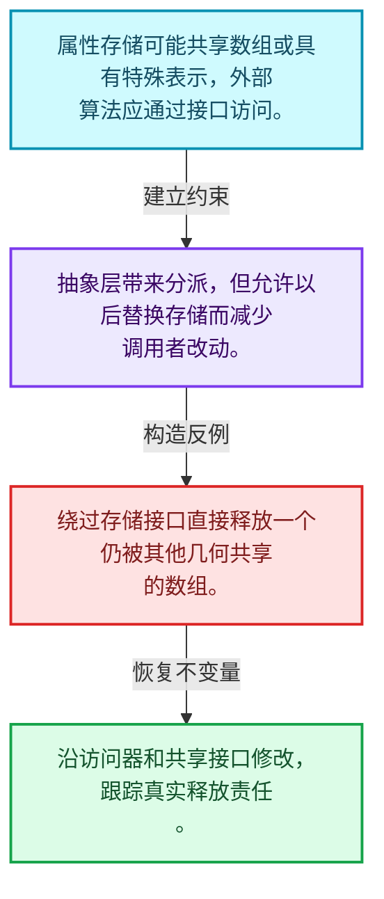
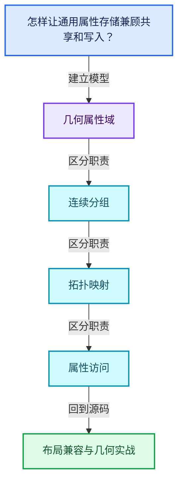
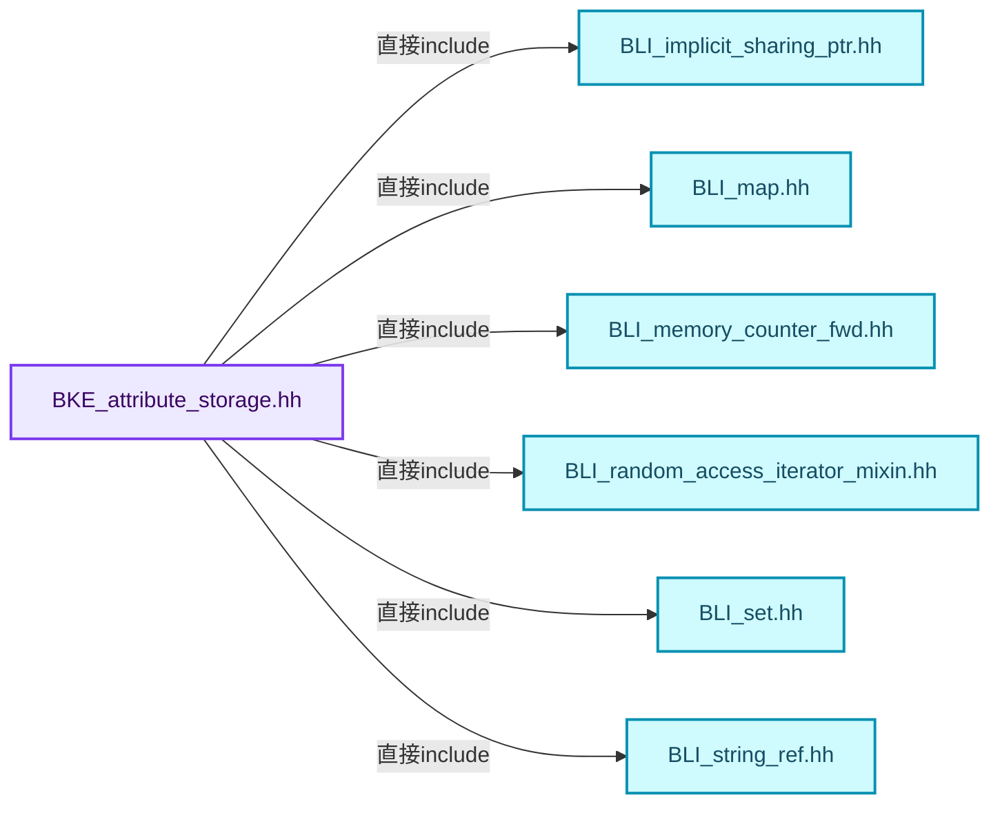
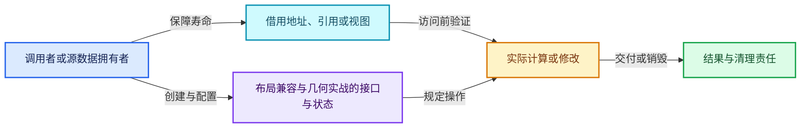
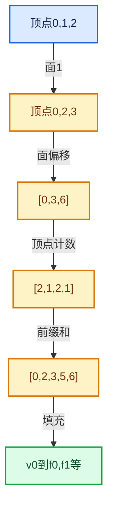

# 05-10 布局兼容与几何实战

[方向导航](README.md) · [总目录](../README.md) · [覆盖索引](../%E6%BA%90%E7%A0%81%E7%89%88%E6%9C%AC%E4%B8%8E%E8%A6%86%E7%9B%96%E7%B4%A2%E5%BC%95.md)

> 阅读顺序：问题与数据模型 → 语法与类型 → 源码逐行 → 调用线索 → 历史与取舍 → 推演和练习。

- 基准 HEAD：`cbda6b96c26c0dee3c3b5cbb93960c4ac06a6b30`。
- 记录日期：2026-10-14。
- 教学示例状态：正文中的推演不是本机性能实测；已运行练习见验收报告。

## 一、从问题到设计

怎样让通用属性存储兼顾共享和写入？

存储形式影响拷贝、写时分离和默认值；算法应通过公开接口维护约束。

本篇把语法、数据语义和系统取舍连接起来。利用连续性和重复关系选择表示，让冗余状态尽量无法表达。

### 本篇独立模型与设计推理

属性存储可能共享数组或具有特殊表示，外部算法应通过接口访问。

设计取舍：抽象层带来分派，但允许以后替换存储而减少调用者改动。

最小反例：绕过存储接口直接释放一个仍被其他几何共享的数组。

推导与处理：沿访问器和共享接口修改，跟踪真实释放责任。



### 源码范围与相邻篇章

| 文件 | 本篇逐行范围 | 基准SHA-256 |
|---|---|---|
| [source/blender/blenkernel/BKE_attribute_storage.hh](../../../../../source/blender/blenkernel/BKE_attribute_storage.hh) | L1—L352 | `0a35215500c39e5ccb3e39c863eb7dbccb6dc535b3ba47c1c6b6c8f62f0d5a39` |

同一主讲文件可能分多篇覆盖；超出本篇范围的符号通过覆盖索引定位。空行与纯注释保留在源码摘录中，逐行表解释有效语句与语法边界；许可证头统一保留。

前篇：[属性域与转换](09-%E5%B1%9E%E6%80%A7%E5%9F%9F%E4%B8%8E%E8%BD%AC%E6%8D%A2.md).

## 二、类型、数据与阅读地图



这是概念依赖图，边表示阅读关系，不声称是运行时调用顺序。

### 直接编译依赖



箭头只表示头文件包含关系；完整调用线索见后面的符号定位表。

## 三、关键词、语法与类型角色

### 只读限定 const

const约束当前访问路径可做的修改。const指针、指向const的指针、const视图对象、const元素是不同位置的限定；其他别名可能仍可修改原对象。

具体检查：分别写T* const、const T*与const T* const，并画出不可修改的层次。

### 移动转换 std::move

std::move把表达式转换为可供移动重载选择的值类别，实际资源转移发生在被选中的构造或赋值中。对const对象move可能仍调用复制，对视图move也不会获得底层数据所有权。

具体检查：记录移动构造调用次数，不用变量名或std::move的出现次数替代测量。

### 异常边界 try与catch

try定义异常传播的局部边界。失败路径需要销毁已经成功构造的部分并释放相应存储；未构造的对象不能被析构。

具体检查：在第k次构造失败，列出已经存在的对象集合与待释放缓冲。

### 表示层转换 reinterpret_cast

reinterpret_cast不能自动开始任意对象的生命周期，也不能豁免对齐和别名规则。读这类代码需要追溯原始分配与实际构造操作。

具体检查：分别检查大小、对齐、生命周期和可访问类型，四项不能互相替代。

### 限定转换 const_cast

const_cast可以改变访问路径的限定，但不能让本来就是const的对象合法可写。常用于复用只读实现时，仍需检查底层对象是否实际可变。

具体检查：对非const对象的const引用与真正const对象分别分析修改是否合法。

### 判别联合 variant

variant在若干候选类型中保存一个活动值，通过判别信息选择操作。它能把不同表示集中在值类型中，但各分支的复制移动成本不同。

具体检查：列出活动分支及每种分支实际拥有或借用的数据。

### 对象表示 sizeof

sizeof给出对象表示大小，不是其引用的所有堆内存总量。sizeof视图很小并不说明底层数组很小。

具体检查：分别统计容器对象、容量字节和元素拥有的间接资源。

### 受控访问 friend

friend授予指定函数或类访问非公开成员的权限，并不意味着继承，也不自动扩展到友元的派生类。

具体检查：解释执行器为何需要访问包装器的内部映射，同时检查边界是否仍清楚。

### 独占拥有 unique_ptr

unique_ptr通过移动转移拥有关系，默认删除策略必须与资源来源匹配。get返回借用指针，release交出责任而不销毁。

具体检查：区分move、get、release和reset后谁负责销毁。

### 类型别名 using

类型别名为已有类型建立名字，不创建运行期对象。它常把模板内部使用的类型统一暴露给泛型调用者。

具体检查：展开别名直到基础类型，区分类型别名和变量声明。

### 枚举与状态模型 enum

枚举把有限状态命名；enum class避免许多隐式整数转换。状态机正确性还依赖允许的转移，不能只看有哪些枚举项。

具体检查：列出每个状态的进入条件和离开条件，检查终止状态是否仍可能被调度。

## 四、真实源码与逐行讲解

源码块保持原行内容，原始行号由小节标题及逐行表给出。表中的调用定位是静态阅读辅助；重载、模板实例化、宏展开和虚调用需结合完整声明，不能仅凭词法出现证明动态调用。

### BKE_attribute_storage.hh：L1—L52

<!-- source:source/blender/blenkernel/BKE_attribute_storage.hh:1:52 -->

```cpp
/* SPDX-FileCopyrightText: 2025 Blender Authors
 *
 * SPDX-License-Identifier: GPL-2.0-or-later */

/** \file
 * \ingroup bke
 */

#pragma once

#include <variant>

#include "BLI_implicit_sharing_ptr.hh"
#include "BLI_map.hh"
#include "BLI_memory_counter_fwd.hh"
#include "BLI_random_access_iterator_mixin.hh"
#include "BLI_set.hh"
#include "BLI_string_ref.hh"
#include "BLI_vector_set.hh"

#include "BKE_attribute_enums.hh"

#include "DNA_attribute_types.h"

namespace blender {

struct Attribute;
struct BlendDataReader;
struct BlendWriter;
struct IDTypeForeachColorFunctionCallback;
class GPointer;
class CPPType;
class ResourceScope;

namespace bke {

enum class AttrDomain : int8_t;
enum class AttrType : int16_t;
enum class AttrStorageType : int8_t;

/** Data and metadata for a single geometry attribute. */
class Attribute {
 public:
  /**
   * Data for an attribute stored as a full contiguous array with a data type exactly matching the
   * attribute's type. The array referenced must match the size of the domain and the data type.
   */
  struct ArrayData {
    /* NOTE: Since the shared data pointed to by `sharing_info` knows how to free itself, it often
     * stores the size and type itself. It may be possible to make use of that fact to avoid
     * storing it here, or even vice versa. */
    void *data;
```

| 原始行 | 语义、约束与检查 |
|---|---|
| L9 | 防止同一头文件在一个翻译单元中重复展开；不控制多个源文件之间的链接或对象寿命。 |
| L11 | 引入编译依赖 <variant>；这是声明可见性关系，不表示运行时一定调用该文件的所有接口。 |
| L13 | 引入编译依赖 "BLI_implicit_sharing_ptr.hh"；这是声明可见性关系，不表示运行时一定调用该文件的所有接口。 |
| L14 | 引入编译依赖 "BLI_map.hh"；这是声明可见性关系，不表示运行时一定调用该文件的所有接口。 |
| L15 | 引入编译依赖 "BLI_memory_counter_fwd.hh"；这是声明可见性关系，不表示运行时一定调用该文件的所有接口。 |
| L16 | 引入编译依赖 "BLI_random_access_iterator_mixin.hh"；这是声明可见性关系，不表示运行时一定调用该文件的所有接口。 |
| L17 | 引入编译依赖 "BLI_set.hh"；这是声明可见性关系，不表示运行时一定调用该文件的所有接口。 |
| L18 | 引入编译依赖 "BLI_string_ref.hh"；这是声明可见性关系，不表示运行时一定调用该文件的所有接口。 |
| L19 | 引入编译依赖 "BLI_vector_set.hh"；这是声明可见性关系，不表示运行时一定调用该文件的所有接口。 |
| L21 | 引入编译依赖 "BKE_attribute_enums.hh"；这是声明可见性关系，不表示运行时一定调用该文件的所有接口。 |
| L23 | 引入编译依赖 "DNA_attribute_types.h"；这是声明可见性关系，不表示运行时一定调用该文件的所有接口。 |
| L25 | 把后续声明放入 blender 命名空间，影响名称查找和符号归属，不创建运行时对象。 |
| L27 | 声明或定义类型 `struct Attribute`。结合继承、访问权限和成员布局确认接口与拥有关系；前向声明本身没有完整对象布局。 |
| L28 | 声明或定义类型 `struct BlendDataReader`。结合继承、访问权限和成员布局确认接口与拥有关系；前向声明本身没有完整对象布局。 |
| L29 | 声明或定义类型 `struct BlendWriter`。结合继承、访问权限和成员布局确认接口与拥有关系；前向声明本身没有完整对象布局。 |
| L30 | 声明或定义类型 `struct IDTypeForeachColorFunctionCallback`。结合继承、访问权限和成员布局确认接口与拥有关系；前向声明本身没有完整对象布局。 |
| L31 | 声明或定义类型 `class GPointer`。结合继承、访问权限和成员布局确认接口与拥有关系；前向声明本身没有完整对象布局。 |
| L32 | 声明或定义类型 `class CPPType`。结合继承、访问权限和成员布局确认接口与拥有关系；前向声明本身没有完整对象布局。 |
| L33 | 声明或定义类型 `class ResourceScope`。结合继承、访问权限和成员布局确认接口与拥有关系；前向声明本身没有完整对象布局。 |
| L35 | 把后续声明放入 bke 命名空间，影响名称查找和符号归属，不创建运行时对象。 |
| L37 | 声明或定义类型 `enum class AttrDomain : int8_t`。结合继承、访问权限和成员布局确认接口与拥有关系；前向声明本身没有完整对象布局。 |
| L38 | 声明或定义类型 `enum class AttrType : int16_t`。结合继承、访问权限和成员布局确认接口与拥有关系；前向声明本身没有完整对象布局。 |
| L39 | 声明或定义类型 `enum class AttrStorageType : int8_t`。结合继承、访问权限和成员布局确认接口与拥有关系；前向声明本身没有完整对象布局。 |
| L42 | 声明或定义类型 `class Attribute`。结合继承、访问权限和成员布局确认接口与拥有关系；前向声明本身没有完整对象布局。 |
| L43 | 切换成员访问权限为 public；它是编译期接口边界，不是线程同步或内存保护。 |
| L48 | 声明或定义类型 `struct ArrayData`。结合继承、访问权限和成员布局确认接口与拥有关系；前向声明本身没有完整对象布局。 |
| L52 | 声明成员、局部对象或完成语句 `void *data`。若为指针或引用，它本身不说明拥有；若为值对象，其构造析构由所在作用域或外层对象管理。 |

### BKE_attribute_storage.hh：L53—L100

<!-- source:source/blender/blenkernel/BKE_attribute_storage.hh:53:100 -->

```cpp
    /** The number of elements in the array. */
    int64_t size;
    ImplicitSharingPtr<> sharing_info;
    static ArrayData from_value(const GPointer &value, int64_t domain_size);
    static ArrayData from_default_value(const CPPType &type, int64_t domain_size);
    static ArrayData from_uninitialized(const CPPType &type, int64_t domain_size);
    static ArrayData from_constructed(const CPPType &type, int64_t domain_size);
  };
  /** Data for an attribute stored as a single value for the entire domain. */
  struct SingleData {
    /* NOTE: For simplicity and to avoid a bit of redundancy, the domain size isn't stored here.
     * It's not necessary to manage a single value. */
    void *value;
    ImplicitSharingPtr<> sharing_info;
    static SingleData from_value(const GPointer &value);
    static SingleData from_default_value(const CPPType &type);
  };
  using DataVariant = std::variant<ArrayData, SingleData>;
  friend AttributeStorage;

 private:
  /**
   * Because it's used as the custom ID for the attributes vector set, the name cannot be changed
   * without removing and adding the attribute.
   */
  std::string name_;
  AttrDomain domain_;
  AttrType type_;

  DataVariant data_;

 public:
  /**
   * Unique name across all domains.
   * \note Compared to #CustomData, which doesn't enforce uniqueness, across domains on its own,
   * this is enforced by asserts when adding attributes. See #unique_name_calc() (which is also
   * called during the conversion process).
   */
  StringRefNull name() const;

  /** Which part of a geometry the attribute corresponds to. */
  AttrDomain domain() const;

  /**
   * The data type exposed to the user. Depending on the storage type, the actual internal values
   * may not be the same type.
   */
  AttrType data_type() const;
```

本段语义重点：

- `data_`：数据或实现的存储入口；是否拥有应按该类声明和析构判定。

| 原始行 | 语义、约束与检查 |
|---|---|
| L54 | 声明成员、局部对象或完成语句 `int64_t size`。若为指针或引用，它本身不说明拥有；若为值对象，其构造析构由所在作用域或外层对象管理。 |
| L55 | 声明成员、局部对象或完成语句 `ImplicitSharingPtr<> sharing_info`。若为指针或引用，它本身不说明拥有；若为值对象，其构造析构由所在作用域或外层对象管理。 |
| L56 | 声明接口 `static ArrayData from_value(const GPointer &value, int64_t domain_size)`，本行没有对应函数体；返回类型、参数限定和const/noexcept共同组成调用契约，实际行为需继续定位实现。 |
| L57 | 声明接口 `static ArrayData from_default_value(const CPPType &type, int64_t domain_size)`，本行没有对应函数体；返回类型、参数限定和const/noexcept共同组成调用契约，实际行为需继续定位实现。 |
| L58 | 声明接口 `static ArrayData from_uninitialized(const CPPType &type, int64_t domain_size)`，本行没有对应函数体；返回类型、参数限定和const/noexcept共同组成调用契约，实际行为需继续定位实现。 |
| L59 | 声明接口 `static ArrayData from_constructed(const CPPType &type, int64_t domain_size)`，本行没有对应函数体；返回类型、参数限定和const/noexcept共同组成调用契约，实际行为需继续定位实现。 |
| L60 | 结束当前语法单元。局部自动对象在离开其作用域时按规则销毁；这不等于所有被引用的外部数据也被释放。 |
| L62 | 声明或定义类型 `struct SingleData`。结合继承、访问权限和成员布局确认接口与拥有关系；前向声明本身没有完整对象布局。 |
| L65 | 声明成员、局部对象或完成语句 `void *value`。若为指针或引用，它本身不说明拥有；若为值对象，其构造析构由所在作用域或外层对象管理。 |
| L66 | 声明成员、局部对象或完成语句 `ImplicitSharingPtr<> sharing_info`。若为指针或引用，它本身不说明拥有；若为值对象，其构造析构由所在作用域或外层对象管理。 |
| L67 | 声明接口 `static SingleData from_value(const GPointer &value)`，本行没有对应函数体；返回类型、参数限定和const/noexcept共同组成调用契约，实际行为需继续定位实现。 |
| L68 | 声明接口 `static SingleData from_default_value(const CPPType &type)`，本行没有对应函数体；返回类型、参数限定和const/noexcept共同组成调用契约，实际行为需继续定位实现。 |
| L69 | 结束当前语法单元。局部自动对象在离开其作用域时按规则销毁；这不等于所有被引用的外部数据也被释放。 |
| L70 | 定义类型别名 `using DataVariant = std::variant<ArrayData, SingleData>`，为模板接口或内部实现统一命名；本行不分配该类型对象。 |
| L71 | 声明成员、局部对象或完成语句 `friend AttributeStorage`。若为指针或引用，它本身不说明拥有；若为值对象，其构造析构由所在作用域或外层对象管理。 |
| L73 | 切换成员访问权限为 private；它是编译期接口边界，不是线程同步或内存保护。 |
| L78 | 声明成员、局部对象或完成语句 `std::string name_`。若为指针或引用，它本身不说明拥有；若为值对象，其构造析构由所在作用域或外层对象管理。 |
| L79 | 声明成员、局部对象或完成语句 `AttrDomain domain_`。若为指针或引用，它本身不说明拥有；若为值对象，其构造析构由所在作用域或外层对象管理。 |
| L80 | 声明成员、局部对象或完成语句 `AttrType type_`。若为指针或引用，它本身不说明拥有；若为值对象，其构造析构由所在作用域或外层对象管理。 |
| L82 | 本行涉及 `data_`：数据或实现的存储入口；是否拥有应按该类声明和析构判定。按此语义解读 `DataVariant data_`，不要把地址、数量或状态混用。 |
| L84 | 切换成员访问权限为 public；它是编译期接口边界，不是线程同步或内存保护。 |
| L91 | 声明接口 `StringRefNull name() const`，本行没有对应函数体；返回类型、参数限定和const/noexcept共同组成调用契约，实际行为需继续定位实现。 |
| L94 | 声明接口 `AttrDomain domain() const`，本行没有对应函数体；返回类型、参数限定和const/noexcept共同组成调用契约，实际行为需继续定位实现。 |
| L100 | 声明接口 `AttrType data_type() const`，本行没有对应函数体；返回类型、参数限定和const/noexcept共同组成调用契约，实际行为需继续定位实现。 |

### BKE_attribute_storage.hh：L101—L147

<!-- source:source/blender/blenkernel/BKE_attribute_storage.hh:101:147 -->

```cpp

  /**
   * The method used to store the data. This gives flexibility to optimize the internal storage
   * even though conceptually the attribute is an array of values.
   */
  AttrStorageType storage_type() const;

  /**
   * Low level access to the data stored for the attribute. The variant's type will correspond to
   * the storage type.
   */
  const DataVariant &data() const;

  /**
   * The same as #data(), but if the attribute data is shared initially, it will be unshared and
   * made mutable.
   */
  DataVariant &data_for_write();

  /** Replace the attribute's data without first making the existing data mutable. */
  void assign_data(DataVariant &&data);
};

class AttributeStorageRuntime {
  friend AttributeStorage;
  struct AttributeNameGetter {
    StringRef operator()(const std::unique_ptr<Attribute> &value) const
    {
      return value->name();
    }
  };
  /**
   * For quick access, the attributes are stored in a vector set, keyed by their name. Attributes
   * can still be reordered by rebuilding the vector set from scratch. Each attribute is allocated
   * to give pointer stability across additions and removals.
   */
  CustomIDVectorSet<std::unique_ptr<Attribute>, AttributeNameGetter> attributes;
};

class AttributeStorage : public blender::AttributeStorage {
 public:
  AttributeStorage();
  AttributeStorage(const AttributeStorage &other);
  AttributeStorage(AttributeStorage &&other);
  AttributeStorage &operator=(const AttributeStorage &other);
  AttributeStorage &operator=(AttributeStorage &&other);
  ~AttributeStorage();
```

| 原始行 | 语义、约束与检查 |
|---|---|
| L106 | 声明接口 `AttrStorageType storage_type() const`，本行没有对应函数体；返回类型、参数限定和const/noexcept共同组成调用契约，实际行为需继续定位实现。 |
| L112 | 声明接口 `const DataVariant &data() const`，本行没有对应函数体；返回类型、参数限定和const/noexcept共同组成调用契约，实际行为需继续定位实现。 |
| L118 | 出现调用或函数声明 `data_for_write`，对应表达式为 `DataVariant &data_for_write();`。参数求值、返回类型与重载需结合前后完整语句；静态文本引用不能证明动态目标。 |
| L121 | 声明接口 `void assign_data(DataVariant &&data)`，本行没有对应函数体；返回类型、参数限定和const/noexcept共同组成调用契约，实际行为需继续定位实现。 |
| L122 | 结束当前语法单元。局部自动对象在离开其作用域时按规则销毁；这不等于所有被引用的外部数据也被释放。 |
| L124 | 声明或定义类型 `class AttributeStorageRuntime`。结合继承、访问权限和成员布局确认接口与拥有关系；前向声明本身没有完整对象布局。 |
| L125 | 声明成员、局部对象或完成语句 `friend AttributeStorage`。若为指针或引用，它本身不说明拥有；若为值对象，其构造析构由所在作用域或外层对象管理。 |
| L126 | 声明或定义类型 `struct AttributeNameGetter`。结合继承、访问权限和成员布局确认接口与拥有关系；前向声明本身没有完整对象布局。 |
| L127 | 运算符重载声明、定义或显式调用：`StringRef operator()(const std::unique_ptr<Attribute> &value) const`。结合参数和返回类型判断是赋值、索引、比较还是转换；operator=声明中的等号不是在给名为operator的变量赋值。 |
| L128 | 连接上一行的声明或控制结构与其语句块；后续行在这个作用域中执行或声明。 |
| L129 | 返回表达式 `value->name()`。 |
| L130 | 结束当前语法单元。局部自动对象在离开其作用域时按规则销毁；这不等于所有被引用的外部数据也被释放。 |
| L131 | 结束当前语法单元。局部自动对象在离开其作用域时按规则销毁；这不等于所有被引用的外部数据也被释放。 |
| L137 | 声明成员、局部对象或完成语句 `CustomIDVectorSet<std::unique_ptr<Attribute>, AttributeNameGetter> attributes`。若为指针或引用，它本身不说明拥有；若为值对象，其构造析构由所在作用域或外层对象管理。 |
| L138 | 结束当前语法单元。局部自动对象在离开其作用域时按规则销毁；这不等于所有被引用的外部数据也被释放。 |
| L140 | 声明或定义类型 `class AttributeStorage : public blender::AttributeStorage`。结合继承、访问权限和成员布局确认接口与拥有关系；前向声明本身没有完整对象布局。 |
| L141 | 切换成员访问权限为 public；它是编译期接口边界，不是线程同步或内存保护。 |
| L142 | 出现调用或函数声明 `AttributeStorage`，对应表达式为 `AttributeStorage();`。参数求值、返回类型与重载需结合前后完整语句；静态文本引用不能证明动态目标。 |
| L143 | 出现调用或函数声明 `AttributeStorage`，对应表达式为 `AttributeStorage(const AttributeStorage &other);`。参数求值、返回类型与重载需结合前后完整语句；静态文本引用不能证明动态目标。 |
| L144 | 出现调用或函数声明 `AttributeStorage`，对应表达式为 `AttributeStorage(AttributeStorage &&other);`。参数求值、返回类型与重载需结合前后完整语句；静态文本引用不能证明动态目标。 |
| L145 | 运算符重载声明、定义或显式调用：`AttributeStorage &operator=(const AttributeStorage &other);`。结合参数和返回类型判断是赋值、索引、比较还是转换；operator=声明中的等号不是在给名为operator的变量赋值。 |
| L146 | 运算符重载声明、定义或显式调用：`AttributeStorage &operator=(AttributeStorage &&other);`。结合参数和返回类型判断是赋值、索引、比较还是转换；operator=声明中的等号不是在给名为operator的变量赋值。 |
| L147 | 涉及析构接口或显式析构：`~AttributeStorage();`。检查目标对象已成功构造，且资源不会在另一条清理路径再次销毁。 |

### BKE_attribute_storage.hh：L148—L195

<!-- source:source/blender/blenkernel/BKE_attribute_storage.hh:148:195 -->

```cpp

  /** Return the number of attributes. */
  int count() const;

  /** Return the attribute at the given index. */
  Attribute &at_index(int index);
  const Attribute &at_index(int index) const;

  /** Return the index of the attribute with the given name, or -1 if not found. */
  int index_of(StringRef name) const;

  /**
   * Try to find the attribute with a given name. The non-const overload does not make the
   * attribute data itself mutable.
   */
  Attribute *lookup(StringRef name);
  const Attribute *lookup(StringRef name) const;

  /**
   * Attempt to remove the attribute with the given name, returning `true` if successful. Should
   * not be called while iterating over attributes.
   */
  bool remove(StringRef name);
  bool remove(const Set<StringRef> &names);
  bool remove(const Set<const Attribute *> &attributes);

  /**
   * Add an attribute with the given name, which must not already be used by an existing attribute
   * or this will invoke undefined behavior.
   */
  Attribute &add(std::string name,
                 bke::AttrDomain domain,
                 bke::AttrType data_type,
                 Attribute::DataVariant data);

  /** Return a possibly changed version of the input name that is unique within existing names. */
  std::string unique_name_calc(StringRef name) const;

  /** Change the name of a single existing attribute. */
  void rename(StringRef old_name, std::string new_name);
  void rename(Attribute &attr, std::string new_name);
  void rename(const Map<Attribute *, StringRef> &renames);

  /**
   * Resize the data for a given domain. New values will be default initialized (meaning no zero
   * initialization for trivial types).
   */
  void resize(AttrDomain domain, int64_t new_size);
```

| 原始行 | 语义、约束与检查 |
|---|---|
| L150 | 声明接口 `int count() const`，本行没有对应函数体；返回类型、参数限定和const/noexcept共同组成调用契约，实际行为需继续定位实现。 |
| L153 | 出现调用或函数声明 `at_index`，对应表达式为 `Attribute &at_index(int index);`。参数求值、返回类型与重载需结合前后完整语句；静态文本引用不能证明动态目标。 |
| L154 | 声明接口 `const Attribute &at_index(int index) const`，本行没有对应函数体；返回类型、参数限定和const/noexcept共同组成调用契约，实际行为需继续定位实现。 |
| L157 | 声明接口 `int index_of(StringRef name) const`，本行没有对应函数体；返回类型、参数限定和const/noexcept共同组成调用契约，实际行为需继续定位实现。 |
| L163 | 出现调用或函数声明 `lookup`，对应表达式为 `Attribute *lookup(StringRef name);`。参数求值、返回类型与重载需结合前后完整语句；静态文本引用不能证明动态目标。 |
| L164 | 声明接口 `const Attribute *lookup(StringRef name) const`，本行没有对应函数体；返回类型、参数限定和const/noexcept共同组成调用契约，实际行为需继续定位实现。 |
| L170 | 声明接口 `bool remove(StringRef name)`，本行没有对应函数体；返回类型、参数限定和const/noexcept共同组成调用契约，实际行为需继续定位实现。 |
| L171 | 声明接口 `bool remove(const Set<StringRef> &names)`，本行没有对应函数体；返回类型、参数限定和const/noexcept共同组成调用契约，实际行为需继续定位实现。 |
| L172 | 声明接口 `bool remove(const Set<const Attribute *> &attributes)`，本行没有对应函数体；返回类型、参数限定和const/noexcept共同组成调用契约，实际行为需继续定位实现。 |
| L178 | 出现调用或函数声明 `add`，对应表达式为 `Attribute &add(std::string name,`。参数求值、返回类型与重载需结合前后完整语句；静态文本引用不能证明动态目标。 |
| L179 | 本行是连续声明或表达式的一部分：`bke::AttrDomain domain,`。与本段前后行合读；逗号、括号和限定符决定它属于参数、初始化列表还是实际计算。 |
| L180 | 本行是连续声明或表达式的一部分：`bke::AttrType data_type,`。与本段前后行合读；逗号、括号和限定符决定它属于参数、初始化列表还是实际计算。 |
| L181 | 声明成员、局部对象或完成语句 `Attribute::DataVariant data)`。若为指针或引用，它本身不说明拥有；若为值对象，其构造析构由所在作用域或外层对象管理。 |
| L184 | 声明接口 `std::string unique_name_calc(StringRef name) const`，本行没有对应函数体；返回类型、参数限定和const/noexcept共同组成调用契约，实际行为需继续定位实现。 |
| L187 | 声明接口 `void rename(StringRef old_name, std::string new_name)`，本行没有对应函数体；返回类型、参数限定和const/noexcept共同组成调用契约，实际行为需继续定位实现。 |
| L188 | 声明接口 `void rename(Attribute &attr, std::string new_name)`，本行没有对应函数体；返回类型、参数限定和const/noexcept共同组成调用契约，实际行为需继续定位实现。 |
| L189 | 声明接口 `void rename(const Map<Attribute *, StringRef> &renames)`，本行没有对应函数体；返回类型、参数限定和const/noexcept共同组成调用契约，实际行为需继续定位实现。 |
| L195 | 声明接口 `void resize(AttrDomain domain, int64_t new_size)`，本行没有对应函数体；返回类型、参数限定和const/noexcept共同组成调用契约，实际行为需继续定位实现。 |

### BKE_attribute_storage.hh：L196—L245

<!-- source:source/blender/blenkernel/BKE_attribute_storage.hh:196:245 -->

```cpp

  /**
   * Read data owned by the #AttributeStorage struct. This works by converting the DNA-specific
   * types stored in the files to the runtime data structures.
   */
  void blend_read(BlendDataReader &reader);
  /**
   * Temporary data used to write a #AttributeStorage struct embedded in another struct. See
   * #attribute_storage_blend_write_prepare for more information.
   */
  struct BlendWriteData {
    BlendWriter *writer;
    ResourceScope &scope;
    Vector<blender::Attribute, 16> &attributes;
    explicit BlendWriteData(BlendWriter *writer, ResourceScope &scope);
  };
  /**
   * Write the prepared data and the data stored in the DNA fields in
   * the #AttributeStorage struct.
   */
  void blend_write(BlendWriter &writer, const BlendWriteData &write_data);

  /**
   * Iterate over every color to change it to another color-space.
   */
  void foreach_working_space_color(const IDTypeForeachColorFunctionCallback &fn);

  void count_memory(MemoryCounter &memory) const;

  class Iterator : public iterator::RandomAccessIteratorMixin<Iterator> {
   private:
    using It = const std::unique_ptr<Attribute> *;
    It it_;

   public:
    using value_type = Attribute;
    using pointer = const Attribute *;
    using reference = const Attribute &;

    explicit Iterator(It it) : it_(it) {}

    const Attribute &operator*() const
    {
      return **it_;
    }

    const It &iter_prop() const
    {
      return it_;
    }
```

| 原始行 | 语义、约束与检查 |
|---|---|
| L201 | 声明接口 `void blend_read(BlendDataReader &reader)`，本行没有对应函数体；返回类型、参数限定和const/noexcept共同组成调用契约，实际行为需继续定位实现。 |
| L206 | 声明或定义类型 `struct BlendWriteData`。结合继承、访问权限和成员布局确认接口与拥有关系；前向声明本身没有完整对象布局。 |
| L207 | 声明成员、局部对象或完成语句 `BlendWriter *writer`。若为指针或引用，它本身不说明拥有；若为值对象，其构造析构由所在作用域或外层对象管理。 |
| L208 | 声明成员、局部对象或完成语句 `ResourceScope &scope`。若为指针或引用，它本身不说明拥有；若为值对象，其构造析构由所在作用域或外层对象管理。 |
| L209 | 声明成员、局部对象或完成语句 `Vector<blender::Attribute, 16> &attributes`。若为指针或引用，它本身不说明拥有；若为值对象，其构造析构由所在作用域或外层对象管理。 |
| L210 | 声明接口 `explicit BlendWriteData(BlendWriter *writer, ResourceScope &scope)`，本行没有对应函数体；返回类型、参数限定和const/noexcept共同组成调用契约，实际行为需继续定位实现。 |
| L211 | 结束当前语法单元。局部自动对象在离开其作用域时按规则销毁；这不等于所有被引用的外部数据也被释放。 |
| L216 | 声明接口 `void blend_write(BlendWriter &writer, const BlendWriteData &write_data)`，本行没有对应函数体；返回类型、参数限定和const/noexcept共同组成调用契约，实际行为需继续定位实现。 |
| L221 | 声明接口 `void foreach_working_space_color(const IDTypeForeachColorFunctionCallback &fn)`，本行没有对应函数体；返回类型、参数限定和const/noexcept共同组成调用契约，实际行为需继续定位实现。 |
| L223 | 声明接口 `void count_memory(MemoryCounter &memory) const`，本行没有对应函数体；返回类型、参数限定和const/noexcept共同组成调用契约，实际行为需继续定位实现。 |
| L225 | 声明或定义类型 `class Iterator : public iterator::RandomAccessIteratorMixin<Iterator>`。结合继承、访问权限和成员布局确认接口与拥有关系；前向声明本身没有完整对象布局。 |
| L226 | 切换成员访问权限为 private；它是编译期接口边界，不是线程同步或内存保护。 |
| L227 | 定义类型别名 `using It = const std::unique_ptr<Attribute> *`，为模板接口或内部实现统一命名；本行不分配该类型对象。 |
| L228 | 声明成员、局部对象或完成语句 `It it_`。若为指针或引用，它本身不说明拥有；若为值对象，其构造析构由所在作用域或外层对象管理。 |
| L230 | 切换成员访问权限为 public；它是编译期接口边界，不是线程同步或内存保护。 |
| L231 | 定义类型别名 `using value_type = Attribute`，为模板接口或内部实现统一命名；本行不分配该类型对象。 |
| L232 | 定义类型别名 `using pointer = const Attribute *`，为模板接口或内部实现统一命名；本行不分配该类型对象。 |
| L233 | 定义类型别名 `using reference = const Attribute &`，为模板接口或内部实现统一命名；本行不分配该类型对象。 |
| L235 | 出现调用或函数声明 `Iterator`，对应表达式为 `explicit Iterator(It it) : it_(it) {}`。参数求值、返回类型与重载需结合前后完整语句；静态文本引用不能证明动态目标。 |
| L237 | 运算符重载声明、定义或显式调用：`const Attribute &operator*() const`。结合参数和返回类型判断是赋值、索引、比较还是转换；operator=声明中的等号不是在给名为operator的变量赋值。 |
| L238 | 连接上一行的声明或控制结构与其语句块；后续行在这个作用域中执行或声明。 |
| L239 | 返回表达式 `**it_`。 |
| L240 | 结束当前语法单元。局部自动对象在离开其作用域时按规则销毁；这不等于所有被引用的外部数据也被释放。 |
| L242 | 出现调用或函数声明 `iter_prop`，对应表达式为 `const It &iter_prop() const`。参数求值、返回类型与重载需结合前后完整语句；静态文本引用不能证明动态目标。 |
| L243 | 连接上一行的声明或控制结构与其语句块；后续行在这个作用域中执行或声明。 |
| L244 | 返回表达式 `it_`。 |
| L245 | 结束当前语法单元。局部自动对象在离开其作用域时按规则销毁；这不等于所有被引用的外部数据也被释放。 |

### BKE_attribute_storage.hh：L246—L294

<!-- source:source/blender/blenkernel/BKE_attribute_storage.hh:246:294 -->

```cpp
  };

  class MutableIterator : public iterator::RandomAccessIteratorMixin<MutableIterator> {
   private:
    using It = std::unique_ptr<Attribute> *;
    It it_;

   public:
    using value_type = Attribute;
    using pointer = Attribute *;
    using reference = Attribute &;

    explicit MutableIterator(It it) : it_(it) {}

    Attribute &operator*() const
    {
      return **it_;
    }

    const It &iter_prop() const
    {
      return it_;
    }
  };

  Iterator begin() const;
  Iterator end() const;

  MutableIterator begin();
  MutableIterator end();
};

/** The C++ wrapper needs to be the same size as the DNA struct. */
static_assert(sizeof(AttributeStorage) == sizeof(AttributeStorage));

inline StringRefNull Attribute::name() const
{
  return name_;
}

inline AttrDomain Attribute::domain() const
{
  return domain_;
}

inline AttrType Attribute::data_type() const
{
  return type_;
}
```

| 原始行 | 语义、约束与检查 |
|---|---|
| L246 | 结束当前语法单元。局部自动对象在离开其作用域时按规则销毁；这不等于所有被引用的外部数据也被释放。 |
| L248 | 声明或定义类型 `class MutableIterator : public iterator::RandomAccessIteratorMixin<MutableIterator>`。结合继承、访问权限和成员布局确认接口与拥有关系；前向声明本身没有完整对象布局。 |
| L249 | 切换成员访问权限为 private；它是编译期接口边界，不是线程同步或内存保护。 |
| L250 | 定义类型别名 `using It = std::unique_ptr<Attribute> *`，为模板接口或内部实现统一命名；本行不分配该类型对象。 |
| L251 | 声明成员、局部对象或完成语句 `It it_`。若为指针或引用，它本身不说明拥有；若为值对象，其构造析构由所在作用域或外层对象管理。 |
| L253 | 切换成员访问权限为 public；它是编译期接口边界，不是线程同步或内存保护。 |
| L254 | 定义类型别名 `using value_type = Attribute`，为模板接口或内部实现统一命名；本行不分配该类型对象。 |
| L255 | 定义类型别名 `using pointer = Attribute *`，为模板接口或内部实现统一命名；本行不分配该类型对象。 |
| L256 | 定义类型别名 `using reference = Attribute &`，为模板接口或内部实现统一命名；本行不分配该类型对象。 |
| L258 | 出现调用或函数声明 `MutableIterator`，对应表达式为 `explicit MutableIterator(It it) : it_(it) {}`。参数求值、返回类型与重载需结合前后完整语句；静态文本引用不能证明动态目标。 |
| L260 | 运算符重载声明、定义或显式调用：`Attribute &operator*() const`。结合参数和返回类型判断是赋值、索引、比较还是转换；operator=声明中的等号不是在给名为operator的变量赋值。 |
| L261 | 连接上一行的声明或控制结构与其语句块；后续行在这个作用域中执行或声明。 |
| L262 | 返回表达式 `**it_`。 |
| L263 | 结束当前语法单元。局部自动对象在离开其作用域时按规则销毁；这不等于所有被引用的外部数据也被释放。 |
| L265 | 出现调用或函数声明 `iter_prop`，对应表达式为 `const It &iter_prop() const`。参数求值、返回类型与重载需结合前后完整语句；静态文本引用不能证明动态目标。 |
| L266 | 连接上一行的声明或控制结构与其语句块；后续行在这个作用域中执行或声明。 |
| L267 | 返回表达式 `it_`。 |
| L268 | 结束当前语法单元。局部自动对象在离开其作用域时按规则销毁；这不等于所有被引用的外部数据也被释放。 |
| L269 | 结束当前语法单元。局部自动对象在离开其作用域时按规则销毁；这不等于所有被引用的外部数据也被释放。 |
| L271 | 声明接口 `Iterator begin() const`，本行没有对应函数体；返回类型、参数限定和const/noexcept共同组成调用契约，实际行为需继续定位实现。 |
| L272 | 声明接口 `Iterator end() const`，本行没有对应函数体；返回类型、参数限定和const/noexcept共同组成调用契约，实际行为需继续定位实现。 |
| L274 | 出现调用或函数声明 `begin`，对应表达式为 `MutableIterator begin();`。参数求值、返回类型与重载需结合前后完整语句；静态文本引用不能证明动态目标。 |
| L275 | 出现调用或函数声明 `end`，对应表达式为 `MutableIterator end();`。参数求值、返回类型与重载需结合前后完整语句；静态文本引用不能证明动态目标。 |
| L276 | 结束当前语法单元。局部自动对象在离开其作用域时按规则销毁；这不等于所有被引用的外部数据也被释放。 |
| L279 | 在编译期检查 `static_assert(sizeof(AttributeStorage) == sizeof(AttributeStorage));`；条件失败导致编译错误，不存在运行时错误恢复路径。 |
| L281 | 出现调用或函数声明 `Attribute::name`，对应表达式为 `inline StringRefNull Attribute::name() const`。参数求值、返回类型与重载需结合前后完整语句；静态文本引用不能证明动态目标。 |
| L282 | 连接上一行的声明或控制结构与其语句块；后续行在这个作用域中执行或声明。 |
| L283 | 返回表达式 `name_`。 |
| L284 | 结束当前语法单元。局部自动对象在离开其作用域时按规则销毁；这不等于所有被引用的外部数据也被释放。 |
| L286 | 出现调用或函数声明 `Attribute::domain`，对应表达式为 `inline AttrDomain Attribute::domain() const`。参数求值、返回类型与重载需结合前后完整语句；静态文本引用不能证明动态目标。 |
| L287 | 连接上一行的声明或控制结构与其语句块；后续行在这个作用域中执行或声明。 |
| L288 | 返回表达式 `domain_`。 |
| L289 | 结束当前语法单元。局部自动对象在离开其作用域时按规则销毁；这不等于所有被引用的外部数据也被释放。 |
| L291 | 出现调用或函数声明 `Attribute::data_type`，对应表达式为 `inline AttrType Attribute::data_type() const`。参数求值、返回类型与重载需结合前后完整语句；静态文本引用不能证明动态目标。 |
| L292 | 连接上一行的声明或控制结构与其语句块；后续行在这个作用域中执行或声明。 |
| L293 | 返回表达式 `type_`。 |
| L294 | 结束当前语法单元。局部自动对象在离开其作用域时按规则销毁；这不等于所有被引用的外部数据也被释放。 |

### BKE_attribute_storage.hh：L295—L352

<!-- source:source/blender/blenkernel/BKE_attribute_storage.hh:295:352 -->

```cpp

inline const Attribute::DataVariant &Attribute::data() const
{
  return data_;
}

inline AttrStorageType Attribute::storage_type() const
{
  static_assert(std::is_same_v<
                std::variant_alternative_t<int(AttrStorageType::Array), Attribute::DataVariant>,
                Attribute::ArrayData>);
  static_assert(std::is_same_v<
                std::variant_alternative_t<int(AttrStorageType::Single), Attribute::DataVariant>,
                Attribute::SingleData>);
  return AttrStorageType(data_.index());
}

inline void Attribute::assign_data(DataVariant &&data)
{
  data_ = std::move(data);
}

inline AttributeStorage::Iterator AttributeStorage::begin() const
{
  return Iterator(this->runtime->attributes.begin());
}

inline AttributeStorage::Iterator AttributeStorage::end() const
{
  return Iterator(this->runtime->attributes.end());
}

inline AttributeStorage::MutableIterator AttributeStorage::begin()
{
  /* Removing const is fine as long as the name of the attribute is not changed while iterating
   * over the attributes. Renaming goes through #AttributeStorage::rename anyway. */
  return MutableIterator(
      const_cast<std::unique_ptr<Attribute> *>(this->runtime->attributes.begin()));
}

inline AttributeStorage::MutableIterator AttributeStorage::end()
{
  return MutableIterator(
      const_cast<std::unique_ptr<Attribute> *>(this->runtime->attributes.end()));
}

}  // namespace bke

inline bke::AttributeStorage &AttributeStorage::wrap()
{
  return *reinterpret_cast<bke::AttributeStorage *>(this);
}
inline const bke::AttributeStorage &AttributeStorage::wrap() const
{
  return *reinterpret_cast<const bke::AttributeStorage *>(this);
}

}  // namespace blender
```

本段语义重点：

- `data_`：数据或实现的存储入口；是否拥有应按该类声明和析构判定。

| 原始行 | 语义、约束与检查 |
|---|---|
| L296 | 出现调用或函数声明 `Attribute::data`，对应表达式为 `inline const Attribute::DataVariant &Attribute::data() const`。参数求值、返回类型与重载需结合前后完整语句；静态文本引用不能证明动态目标。 |
| L297 | 连接上一行的声明或控制结构与其语句块；后续行在这个作用域中执行或声明。 |
| L298 | 返回表达式 `data_`。 |
| L299 | 结束当前语法单元。局部自动对象在离开其作用域时按规则销毁；这不等于所有被引用的外部数据也被释放。 |
| L301 | 出现调用或函数声明 `Attribute::storage_type`，对应表达式为 `inline AttrStorageType Attribute::storage_type() const`。参数求值、返回类型与重载需结合前后完整语句；静态文本引用不能证明动态目标。 |
| L302 | 连接上一行的声明或控制结构与其语句块；后续行在这个作用域中执行或声明。 |
| L303 | 在编译期检查 `static_assert(std::is_same_v<`；条件失败导致编译错误，不存在运行时错误恢复路径。 |
| L304 | 出现调用或函数声明 `int`，对应表达式为 `std::variant_alternative_t<int(AttrStorageType::Array), Attribute::DataVariant>,`。参数求值、返回类型与重载需结合前后完整语句；静态文本引用不能证明动态目标。 |
| L305 | 声明成员、局部对象或完成语句 `Attribute::ArrayData>)`。若为指针或引用，它本身不说明拥有；若为值对象，其构造析构由所在作用域或外层对象管理。 |
| L306 | 在编译期检查 `static_assert(std::is_same_v<`；条件失败导致编译错误，不存在运行时错误恢复路径。 |
| L307 | 出现调用或函数声明 `int`，对应表达式为 `std::variant_alternative_t<int(AttrStorageType::Single), Attribute::DataVariant>,`。参数求值、返回类型与重载需结合前后完整语句；静态文本引用不能证明动态目标。 |
| L308 | 声明成员、局部对象或完成语句 `Attribute::SingleData>)`。若为指针或引用，它本身不说明拥有；若为值对象，其构造析构由所在作用域或外层对象管理。 |
| L309 | 返回表达式 `AttrStorageType(data_.index())`。 |
| L310 | 结束当前语法单元。局部自动对象在离开其作用域时按规则销毁；这不等于所有被引用的外部数据也被释放。 |
| L312 | 出现调用或函数声明 `Attribute::assign_data`，对应表达式为 `inline void Attribute::assign_data(DataVariant &&data)`。参数求值、返回类型与重载需结合前后完整语句；静态文本引用不能证明动态目标。 |
| L313 | 连接上一行的声明或控制结构与其语句块；后续行在这个作用域中执行或声明。 |
| L314 | 建立或更新 `data_`：数据或实现的存储入口；是否拥有应按该类声明和析构判定。本行的具体值关系为 `data_ = std::move(data)`；对照更新前后相应范围或状态是否一致。 |
| L315 | 结束当前语法单元。局部自动对象在离开其作用域时按规则销毁；这不等于所有被引用的外部数据也被释放。 |
| L317 | 出现调用或函数声明 `AttributeStorage::begin`，对应表达式为 `inline AttributeStorage::Iterator AttributeStorage::begin() const`。参数求值、返回类型与重载需结合前后完整语句；静态文本引用不能证明动态目标。 |
| L318 | 连接上一行的声明或控制结构与其语句块；后续行在这个作用域中执行或声明。 |
| L319 | 返回表达式 `Iterator(this->runtime->attributes.begin())`。 |
| L320 | 结束当前语法单元。局部自动对象在离开其作用域时按规则销毁；这不等于所有被引用的外部数据也被释放。 |
| L322 | 出现调用或函数声明 `AttributeStorage::end`，对应表达式为 `inline AttributeStorage::Iterator AttributeStorage::end() const`。参数求值、返回类型与重载需结合前后完整语句；静态文本引用不能证明动态目标。 |
| L323 | 连接上一行的声明或控制结构与其语句块；后续行在这个作用域中执行或声明。 |
| L324 | 返回表达式 `Iterator(this->runtime->attributes.end())`。 |
| L325 | 结束当前语法单元。局部自动对象在离开其作用域时按规则销毁；这不等于所有被引用的外部数据也被释放。 |
| L327 | 出现调用或函数声明 `AttributeStorage::begin`，对应表达式为 `inline AttributeStorage::MutableIterator AttributeStorage::begin()`。参数求值、返回类型与重载需结合前后完整语句；静态文本引用不能证明动态目标。 |
| L328 | 连接上一行的声明或控制结构与其语句块；后续行在这个作用域中执行或声明。 |
| L331 | 返回表达式 `MutableIterator(`。 |
| L332 | 出现调用或函数声明 `const_cast`，对应表达式为 `const_cast<std::unique_ptr<Attribute> *>(this->runtime->attributes.begin()));`。参数求值、返回类型与重载需结合前后完整语句；静态文本引用不能证明动态目标。 |
| L333 | 结束当前语法单元。局部自动对象在离开其作用域时按规则销毁；这不等于所有被引用的外部数据也被释放。 |
| L335 | 出现调用或函数声明 `AttributeStorage::end`，对应表达式为 `inline AttributeStorage::MutableIterator AttributeStorage::end()`。参数求值、返回类型与重载需结合前后完整语句；静态文本引用不能证明动态目标。 |
| L336 | 连接上一行的声明或控制结构与其语句块；后续行在这个作用域中执行或声明。 |
| L337 | 返回表达式 `MutableIterator(`。 |
| L338 | 出现调用或函数声明 `const_cast`，对应表达式为 `const_cast<std::unique_ptr<Attribute> *>(this->runtime->attributes.end()));`。参数求值、返回类型与重载需结合前后完整语句；静态文本引用不能证明动态目标。 |
| L339 | 结束当前语法单元。局部自动对象在离开其作用域时按规则销毁；这不等于所有被引用的外部数据也被释放。 |
| L341 | 结束当前语法单元。局部自动对象在离开其作用域时按规则销毁；这不等于所有被引用的外部数据也被释放。 |
| L343 | 出现调用或函数声明 `AttributeStorage::wrap`，对应表达式为 `inline bke::AttributeStorage &AttributeStorage::wrap()`。参数求值、返回类型与重载需结合前后完整语句；静态文本引用不能证明动态目标。 |
| L344 | 连接上一行的声明或控制结构与其语句块；后续行在这个作用域中执行或声明。 |
| L345 | 返回表达式 `*reinterpret_cast<bke::AttributeStorage *>(this)`。 |
| L346 | 结束当前语法单元。局部自动对象在离开其作用域时按规则销毁；这不等于所有被引用的外部数据也被释放。 |
| L347 | 出现调用或函数声明 `AttributeStorage::wrap`，对应表达式为 `inline const bke::AttributeStorage &AttributeStorage::wrap() const`。参数求值、返回类型与重载需结合前后完整语句；静态文本引用不能证明动态目标。 |
| L348 | 连接上一行的声明或控制结构与其语句块；后续行在这个作用域中执行或声明。 |
| L349 | 返回表达式 `*reinterpret_cast<const bke::AttributeStorage *>(this)`。 |
| L350 | 结束当前语法单元。局部自动对象在离开其作用域时按规则销毁；这不等于所有被引用的外部数据也被释放。 |
| L352 | 结束当前语法单元。局部自动对象在离开其作用域时按规则销毁；这不等于所有被引用的外部数据也被释放。 |

## 五、接口定位、调用线索与生命周期

### 本篇声明与实现入口

| 源码位置 | 实际声明片段 |
|---|---|
| [BKE_attribute_storage.hh:L27](../../../../../source/blender/blenkernel/BKE_attribute_storage.hh#L27) | `struct Attribute;` |
| [BKE_attribute_storage.hh:L28](../../../../../source/blender/blenkernel/BKE_attribute_storage.hh#L28) | `struct BlendDataReader;` |
| [BKE_attribute_storage.hh:L29](../../../../../source/blender/blenkernel/BKE_attribute_storage.hh#L29) | `struct BlendWriter;` |
| [BKE_attribute_storage.hh:L30](../../../../../source/blender/blenkernel/BKE_attribute_storage.hh#L30) | `struct IDTypeForeachColorFunctionCallback;` |
| [BKE_attribute_storage.hh:L31](../../../../../source/blender/blenkernel/BKE_attribute_storage.hh#L31) | `class GPointer;` |
| [BKE_attribute_storage.hh:L32](../../../../../source/blender/blenkernel/BKE_attribute_storage.hh#L32) | `class CPPType;` |
| [BKE_attribute_storage.hh:L33](../../../../../source/blender/blenkernel/BKE_attribute_storage.hh#L33) | `class ResourceScope;` |
| [BKE_attribute_storage.hh:L37](../../../../../source/blender/blenkernel/BKE_attribute_storage.hh#L37) | `enum class AttrDomain : int8_t;` |
| [BKE_attribute_storage.hh:L38](../../../../../source/blender/blenkernel/BKE_attribute_storage.hh#L38) | `enum class AttrType : int16_t;` |
| [BKE_attribute_storage.hh:L39](../../../../../source/blender/blenkernel/BKE_attribute_storage.hh#L39) | `enum class AttrStorageType : int8_t;` |
| [BKE_attribute_storage.hh:L42](../../../../../source/blender/blenkernel/BKE_attribute_storage.hh#L42) | `class Attribute` |
| [BKE_attribute_storage.hh:L48](../../../../../source/blender/blenkernel/BKE_attribute_storage.hh#L48) | `struct ArrayData` |
| [BKE_attribute_storage.hh:L56](../../../../../source/blender/blenkernel/BKE_attribute_storage.hh#L56) | `static ArrayData from_value(const GPointer &value, int64_t domain_size);` |
| [BKE_attribute_storage.hh:L57](../../../../../source/blender/blenkernel/BKE_attribute_storage.hh#L57) | `static ArrayData from_default_value(const CPPType &type, int64_t domain_size);` |
| [BKE_attribute_storage.hh:L58](../../../../../source/blender/blenkernel/BKE_attribute_storage.hh#L58) | `static ArrayData from_uninitialized(const CPPType &type, int64_t domain_size);` |
| [BKE_attribute_storage.hh:L59](../../../../../source/blender/blenkernel/BKE_attribute_storage.hh#L59) | `static ArrayData from_constructed(const CPPType &type, int64_t domain_size);` |
| [BKE_attribute_storage.hh:L62](../../../../../source/blender/blenkernel/BKE_attribute_storage.hh#L62) | `struct SingleData` |
| [BKE_attribute_storage.hh:L67](../../../../../source/blender/blenkernel/BKE_attribute_storage.hh#L67) | `static SingleData from_value(const GPointer &value);` |
| [BKE_attribute_storage.hh:L68](../../../../../source/blender/blenkernel/BKE_attribute_storage.hh#L68) | `static SingleData from_default_value(const CPPType &type);` |
| [BKE_attribute_storage.hh:L91](../../../../../source/blender/blenkernel/BKE_attribute_storage.hh#L91) | `StringRefNull name() const;` |
| [BKE_attribute_storage.hh:L94](../../../../../source/blender/blenkernel/BKE_attribute_storage.hh#L94) | `AttrDomain domain() const;` |
| [BKE_attribute_storage.hh:L100](../../../../../source/blender/blenkernel/BKE_attribute_storage.hh#L100) | `AttrType data_type() const;` |
| [BKE_attribute_storage.hh:L106](../../../../../source/blender/blenkernel/BKE_attribute_storage.hh#L106) | `AttrStorageType storage_type() const;` |
| [BKE_attribute_storage.hh:L112](../../../../../source/blender/blenkernel/BKE_attribute_storage.hh#L112) | `const DataVariant &data() const;` |
| [BKE_attribute_storage.hh:L118](../../../../../source/blender/blenkernel/BKE_attribute_storage.hh#L118) | `DataVariant &data_for_write();` |
| [BKE_attribute_storage.hh:L121](../../../../../source/blender/blenkernel/BKE_attribute_storage.hh#L121) | `void assign_data(DataVariant &&data);` |
| [BKE_attribute_storage.hh:L124](../../../../../source/blender/blenkernel/BKE_attribute_storage.hh#L124) | `class AttributeStorageRuntime` |
| [BKE_attribute_storage.hh:L126](../../../../../source/blender/blenkernel/BKE_attribute_storage.hh#L126) | `struct AttributeNameGetter` |
| [BKE_attribute_storage.hh:L127](../../../../../source/blender/blenkernel/BKE_attribute_storage.hh#L127) | `StringRef operator()(const std::unique_ptr<Attribute> &value) const` |
| [BKE_attribute_storage.hh:L140](../../../../../source/blender/blenkernel/BKE_attribute_storage.hh#L140) | `class AttributeStorage : public blender::AttributeStorage` |
| [BKE_attribute_storage.hh:L142](../../../../../source/blender/blenkernel/BKE_attribute_storage.hh#L142) | `AttributeStorage();` |
| [BKE_attribute_storage.hh:L143](../../../../../source/blender/blenkernel/BKE_attribute_storage.hh#L143) | `AttributeStorage(const AttributeStorage &other);` |
| [BKE_attribute_storage.hh:L144](../../../../../source/blender/blenkernel/BKE_attribute_storage.hh#L144) | `AttributeStorage(AttributeStorage &&other);` |
| [BKE_attribute_storage.hh:L150](../../../../../source/blender/blenkernel/BKE_attribute_storage.hh#L150) | `int count() const;` |
| [BKE_attribute_storage.hh:L153](../../../../../source/blender/blenkernel/BKE_attribute_storage.hh#L153) | `Attribute &at_index(int index);` |
| [BKE_attribute_storage.hh:L154](../../../../../source/blender/blenkernel/BKE_attribute_storage.hh#L154) | `const Attribute &at_index(int index) const;` |
| [BKE_attribute_storage.hh:L157](../../../../../source/blender/blenkernel/BKE_attribute_storage.hh#L157) | `int index_of(StringRef name) const;` |
| [BKE_attribute_storage.hh:L163](../../../../../source/blender/blenkernel/BKE_attribute_storage.hh#L163) | `Attribute *lookup(StringRef name);` |
| [BKE_attribute_storage.hh:L164](../../../../../source/blender/blenkernel/BKE_attribute_storage.hh#L164) | `const Attribute *lookup(StringRef name) const;` |
| [BKE_attribute_storage.hh:L170](../../../../../source/blender/blenkernel/BKE_attribute_storage.hh#L170) | `bool remove(StringRef name);` |
| [BKE_attribute_storage.hh:L171](../../../../../source/blender/blenkernel/BKE_attribute_storage.hh#L171) | `bool remove(const Set<StringRef> &names);` |
| [BKE_attribute_storage.hh:L172](../../../../../source/blender/blenkernel/BKE_attribute_storage.hh#L172) | `bool remove(const Set<const Attribute *> &attributes);` |
| [BKE_attribute_storage.hh:L178](../../../../../source/blender/blenkernel/BKE_attribute_storage.hh#L178) | `Attribute &add(std::string name,` |
| [BKE_attribute_storage.hh:L184](../../../../../source/blender/blenkernel/BKE_attribute_storage.hh#L184) | `std::string unique_name_calc(StringRef name) const;` |
| [BKE_attribute_storage.hh:L187](../../../../../source/blender/blenkernel/BKE_attribute_storage.hh#L187) | `void rename(StringRef old_name, std::string new_name);` |
| [BKE_attribute_storage.hh:L188](../../../../../source/blender/blenkernel/BKE_attribute_storage.hh#L188) | `void rename(Attribute &attr, std::string new_name);` |
| [BKE_attribute_storage.hh:L189](../../../../../source/blender/blenkernel/BKE_attribute_storage.hh#L189) | `void rename(const Map<Attribute *, StringRef> &renames);` |
| [BKE_attribute_storage.hh:L195](../../../../../source/blender/blenkernel/BKE_attribute_storage.hh#L195) | `void resize(AttrDomain domain, int64_t new_size);` |
| [BKE_attribute_storage.hh:L201](../../../../../source/blender/blenkernel/BKE_attribute_storage.hh#L201) | `void blend_read(BlendDataReader &reader);` |
| [BKE_attribute_storage.hh:L206](../../../../../source/blender/blenkernel/BKE_attribute_storage.hh#L206) | `struct BlendWriteData` |
| [BKE_attribute_storage.hh:L210](../../../../../source/blender/blenkernel/BKE_attribute_storage.hh#L210) | `explicit BlendWriteData(BlendWriter *writer, ResourceScope &scope);` |
| [BKE_attribute_storage.hh:L216](../../../../../source/blender/blenkernel/BKE_attribute_storage.hh#L216) | `void blend_write(BlendWriter &writer, const BlendWriteData &write_data);` |
| [BKE_attribute_storage.hh:L221](../../../../../source/blender/blenkernel/BKE_attribute_storage.hh#L221) | `void foreach_working_space_color(const IDTypeForeachColorFunctionCallback &fn);` |
| [BKE_attribute_storage.hh:L223](../../../../../source/blender/blenkernel/BKE_attribute_storage.hh#L223) | `void count_memory(MemoryCounter &memory) const;` |
| [BKE_attribute_storage.hh:L225](../../../../../source/blender/blenkernel/BKE_attribute_storage.hh#L225) | `class Iterator : public iterator::RandomAccessIteratorMixin<Iterator>` |
| [BKE_attribute_storage.hh:L235](../../../../../source/blender/blenkernel/BKE_attribute_storage.hh#L235) | `explicit Iterator(It it) : it_(it) {}` |
| [BKE_attribute_storage.hh:L242](../../../../../source/blender/blenkernel/BKE_attribute_storage.hh#L242) | `const It &iter_prop() const` |
| [BKE_attribute_storage.hh:L248](../../../../../source/blender/blenkernel/BKE_attribute_storage.hh#L248) | `class MutableIterator : public iterator::RandomAccessIteratorMixin<MutableIterator>` |
| [BKE_attribute_storage.hh:L258](../../../../../source/blender/blenkernel/BKE_attribute_storage.hh#L258) | `explicit MutableIterator(It it) : it_(it) {}` |
| [BKE_attribute_storage.hh:L265](../../../../../source/blender/blenkernel/BKE_attribute_storage.hh#L265) | `const It &iter_prop() const` |
| [BKE_attribute_storage.hh:L271](../../../../../source/blender/blenkernel/BKE_attribute_storage.hh#L271) | `Iterator begin() const;` |
| [BKE_attribute_storage.hh:L272](../../../../../source/blender/blenkernel/BKE_attribute_storage.hh#L272) | `Iterator end() const;` |
| [BKE_attribute_storage.hh:L274](../../../../../source/blender/blenkernel/BKE_attribute_storage.hh#L274) | `MutableIterator begin();` |
| [BKE_attribute_storage.hh:L275](../../../../../source/blender/blenkernel/BKE_attribute_storage.hh#L275) | `MutableIterator end();` |
| [BKE_attribute_storage.hh:L281](../../../../../source/blender/blenkernel/BKE_attribute_storage.hh#L281) | `inline StringRefNull Attribute::name() const` |
| [BKE_attribute_storage.hh:L286](../../../../../source/blender/blenkernel/BKE_attribute_storage.hh#L286) | `inline AttrDomain Attribute::domain() const` |
| [BKE_attribute_storage.hh:L291](../../../../../source/blender/blenkernel/BKE_attribute_storage.hh#L291) | `inline AttrType Attribute::data_type() const` |
| [BKE_attribute_storage.hh:L296](../../../../../source/blender/blenkernel/BKE_attribute_storage.hh#L296) | `inline const Attribute::DataVariant &Attribute::data() const` |
| [BKE_attribute_storage.hh:L301](../../../../../source/blender/blenkernel/BKE_attribute_storage.hh#L301) | `inline AttrStorageType Attribute::storage_type() const` |
| [BKE_attribute_storage.hh:L312](../../../../../source/blender/blenkernel/BKE_attribute_storage.hh#L312) | `inline void Attribute::assign_data(DataVariant &&data)` |
| [BKE_attribute_storage.hh:L317](../../../../../source/blender/blenkernel/BKE_attribute_storage.hh#L317) | `inline AttributeStorage::Iterator AttributeStorage::begin() const` |
| [BKE_attribute_storage.hh:L322](../../../../../source/blender/blenkernel/BKE_attribute_storage.hh#L322) | `inline AttributeStorage::Iterator AttributeStorage::end() const` |
| [BKE_attribute_storage.hh:L327](../../../../../source/blender/blenkernel/BKE_attribute_storage.hh#L327) | `inline AttributeStorage::MutableIterator AttributeStorage::begin()` |
| [BKE_attribute_storage.hh:L335](../../../../../source/blender/blenkernel/BKE_attribute_storage.hh#L335) | `inline AttributeStorage::MutableIterator AttributeStorage::end()` |
| [BKE_attribute_storage.hh:L343](../../../../../source/blender/blenkernel/BKE_attribute_storage.hh#L343) | `inline bke::AttributeStorage &AttributeStorage::wrap()` |
| [BKE_attribute_storage.hh:L347](../../../../../source/blender/blenkernel/BKE_attribute_storage.hh#L347) | `inline const bke::AttributeStorage &AttributeStorage::wrap() const` |

### 同名符号出现位置

以下表提供跨文件阅读入口，包含声明、调用或测试使用；没有经过完整C++名称解析，不把它命名为已证明的运行时调用图。

| 符号 | 位置 | 文本证据 |
|---|---|---|
| `name` | [BKE_attribute.hh:L409](../../../../../source/blender/blenkernel/BKE_attribute.hh#L409) | `: name(name), domain(domain), data_type(data_type), get_fn_(get_fn)` |
| `name` | [BKE_geometry_set.hh:L461](../../../../../source/blender/blenkernel/BKE_geometry_set.hh#L461) | `StringRefNull name() const;` |
| `name` | [geometry_fields.cc:L602](../../../../../source/blender/blenkernel/intern/geometry_fields.cc#L602) | `return layer.name() == selection_name;` |
| `domain` | [BKE_attribute.hh:L264](../../../../../source/blender/blenkernel/BKE_attribute.hh#L264) | `domain(other.domain),` |
| `domain` | [BKE_attribute.hh:L362](../../../../../source/blender/blenkernel/BKE_attribute.hh#L362) | `domain(other.domain),` |
| `domain` | [BKE_attribute.hh:L409](../../../../../source/blender/blenkernel/BKE_attribute.hh#L409) | `: name(name), domain(domain), data_type(data_type), get_fn_(get_fn)` |
| `data_type` | [BKE_attribute.hh:L409](../../../../../source/blender/blenkernel/BKE_attribute.hh#L409) | `: name(name), domain(domain), data_type(data_type), get_fn_(get_fn)` |
| `data_type` | [mesh.cc:L1561](../../../../../source/blender/blenkernel/intern/mesh.cc#L1561) | `dst_attrs.add(attr.name(), attr.domain(), attr.data_type(), bke::AttributeInitDefaultValue());` |
| `data_type` | [FN_multi_function_param_type.hh:L63](../../../../../source/blender/functions/FN_multi_function_param_type.hh#L63) | `const DataType &data_type() const;` |
| `data` | [BKE_attribute.hh:L133](../../../../../source/blender/blenkernel/BKE_attribute.hh#L133) | `: AttributeInit(Type::Shared), data(data), sharing_info(&sharing_info)` |
| `data` | [BKE_curves.hh:L1075](../../../../../source/blender/blenkernel/BKE_curves.hh#L1075) | `const Span<int> offsets = this->runtime->evaluated_offsets_cache.data().all_bezier_offsets;` |
| `data` | [BKE_curves.hh:L1092](../../../../../source/blender/blenkernel/BKE_curves.hh#L1092) | `return this->runtime->evaluated_length_cache.data().as_span().slice(range);` |
| `assign_data` | [BKE_attribute.hh:L807](../../../../../source/blender/blenkernel/BKE_attribute.hh#L807) | `return this->assign_data(name, initializer);` |
| `assign_data` | [BKE_attribute.hh:L816](../../../../../source/blender/blenkernel/BKE_attribute.hh#L816) | `bool assign_data(const StringRef name, const AttributeInit &initializer)` |
| `assign_data` | [BKE_attribute.hh:L819](../../../../../source/blender/blenkernel/BKE_attribute.hh#L819) | `return fn_->assign_data(owner_, name, initializer);` |
| `operator` | [BLI_cpp_type.hh:L441](../../../../../source/blender/blenlib/BLI_cpp_type.hh#L441) | `fn.template operator()<T>();` |
| `operator` | [BLI_function_ref.hh:L147](../../../../../source/blender/blenlib/BLI_function_ref.hh#L147) | `Ret operator()(Params... params) const` |
| `operator` | [BLI_hash.hh:L86](../../../../../source/blender/blenlib/BLI_hash.hh#L86) | `constexpr uint64_t operator()(const T &value) const` |
| `AttributeStorage` | [mesh.cc:L100](../../../../../source/blender/blenkernel/intern/mesh.cc#L100) | `new (&mesh->attribute_storage.wrap()) bke::AttributeStorage();` |
| `AttributeStorage` | [mesh.cc:L226](../../../../../source/blender/blenkernel/intern/mesh.cc#L226) | `bke::AttributeStorage(mesh_src->attribute_storage.wrap());` |
| `AttributeStorage` | [mesh.cc:L272](../../../../../source/blender/blenkernel/intern/mesh.cc#L272) | `mesh->attribute_storage.wrap().~AttributeStorage();` |
| `count` | [BLI_kdtree_new.hh:L361](../../../../../source/blender/blenlib/BLI_kdtree_new.hh#L361) | `int count() const` |
| `count` | [BLI_kdtree_new.hh:L412](../../../../../source/blender/blenlib/BLI_kdtree_new.hh#L412) | `int count() const` |
| `count` | [BLI_kdtree_new.hh:L554](../../../../../source/blender/blenlib/BLI_kdtree_new.hh#L554) | `return query.count();` |
| `index_of` | [BLI_vector_set.hh:L479](../../../../../source/blender/blenlib/BLI_vector_set.hh#L479) | `int64_t index_of(const Key &key) const` |
| `index_of` | [field_evaluation.cc:L355](../../../../../source/blender/functions/intern/field_evaluation.cc#L355) | `const int input_i = field_tree_info.deduplicated_input_hashes.index_of(hash);` |
| `lookup` | [BKE_attribute.hh:L585](../../../../../source/blender/blenkernel/BKE_attribute.hh#L585) | `GAttributeReader lookup(const StringRef name) const` |
| `lookup` | [BKE_attribute.hh:L587](../../../../../source/blender/blenkernel/BKE_attribute.hh#L587) | `return fn_->lookup(owner_, name);` |
| `lookup` | [BKE_attribute.hh:L594](../../../../../source/blender/blenkernel/BKE_attribute.hh#L594) | `GAttributeReader lookup(StringRef name,` |
| `remove` | [BKE_attribute.hh:L809](../../../../../source/blender/blenkernel/BKE_attribute.hh#L809) | `if (!this->remove(name)) {` |
| `remove` | [BKE_attribute.hh:L1007](../../../../../source/blender/blenkernel/BKE_attribute.hh#L1007) | `bool remove(const StringRef name)` |
| `remove` | [BKE_attribute.hh:L1009](../../../../../source/blender/blenkernel/BKE_attribute.hh#L1009) | `return fn_->remove(owner_, name);` |

### 生命周期推理图



这是审查生命周期的通用模型。具体类是否拥有数据由本篇成员、构造、析构和调用者一起证明；任何箭头都不自动代表shared_ptr。

## 六、把代码放进具体数据中推演

本方向的共同数值模型如下。本篇的专门检查是：实现最小网格与属性表，执行拓扑改变并说明属性如何传播。

| 步骤 | 数据或状态 | 为什么需要这一步 |
|---|---|---|
| 面0 | 顶点0,1,2 | 产生3个角点 |
| 面1 | 顶点0,2,3 | 另有3个角点 |
| 面偏移 | [0,3,6] | face0范围[0,3)，face1范围[3,6) |
| 顶点计数 | [2,1,2,1] | 分别统计相邻面数量 |
| 前缀和 | [0,2,3,5,6] | 分配6个映射条目 |
| 填充 | v0到f0,f1等 | 拓扑查询转为连续组访问 |



图是教学推演模型；精确分支与状态更新以本篇摘录及调用契约为准。

### 本篇独立练习与参考思路

实现最小网格与属性表，执行拓扑改变并说明属性如何传播。

参考思路：存储形式影响拷贝、写时分离和默认值；算法应通过公开接口维护约束。

将输入、预期结果和资源责任分成三张清单。先用最直接的实现给出可核对的答案，再替换成对应源码使用的表示；比较结果不变的条件，而不是只比较接口名字。

验收依据：偏移单调不减；最终偏移与存储边界对应；每个角点引用合法顶点，每个反向映射可由正向关系验证。

## 七、复杂度、设计取舍与其他基础库

把偏移数组与vector<vector<int>>、CSR邻接表示作比较：前者集中存储，后者方便独立增长；是否稳定修改比容器名字更影响选型。

本篇的具体取舍：存储形式影响拷贝、写时分离和默认值；算法应通过公开接口维护约束。

| 观察维度 | 从源码取得证据的方法 | 本篇要避免的误判 |
|---|---|---|
| 时间 | 对循环次数、分派次数和重建频率分别计数 | 看到单次常数操作就断定整个操作序列是常数成本 |
| 内存 | 区分对象本体、容量存储、间接资源和共享控制块 | 用sizeof代替总内存 |
| 安全 | 沿构造、失败回滚、销毁与失效逐路径检查 | 把断言或非空指针当作完整安全证明 |
| 并发 | 逐字段确认锁、发布顺序和借用寿命 | 把引用计数线程安全等同数据读写线程安全 |

相关一手资料：

- [C++公开工作草案](https://eel.is/c++draft/)：持续更新的工作草案；语言与标准库语义以相应章节为准。
- [Blender依赖图设计](https://developer.blender.org/docs/features/core/depsgraph/)：包含历史设计背景，当前行为以本地源码为准。

资料用于核对契约和进一步阅读；这里没有声称外部库与Blender实现相同，也没有把上游性能数字当作本机实测。

## 八、历史提交与设计演化

本篇主要讲当前接口或辅助实现，方向导航给出相关架构演化提交；没有把不涉及本篇文件的提交硬写成该实现的引入证据。

## 九、反例、测试入口与掌握标准

需要实际构造的反例：

- 空输入或没有结果需求：确认接口允许的空状态与不允许访问的操作。
- 边界位置和退化结构：把长度为1、末尾位置、重复值或深链代入真实分支。
- 生命周期结束或修改之后：检查保存的指针、引用、结果视图是否仍有效。
- 与本篇核心不变量相冲突的输入：实现最小网格与属性表，执行拓扑改变并说明属性如何传播。

### 可运行的教学参考程序

[reference_exercises.cc](../_tools/reference_exercises.cc)包含独立于Blender的C++20参考检查：视图、简化SmallVector、异常回滚、哈希碰撞与删除、偏移数组、拓扑映射、共享缓存、表达式、惰性分支、闭包和暴力最近邻。

参考程序有意省略生产实现的完整能力。例如SmallVector禁止复制移动容器，不支持只能移动的元素，并禁止append参数别名到自身元素；TinyMap固定8槽，不提供增长。程序通过不能替代Blender实现测试。实际运行结果、编译器与命令见验收报告。

掌握标准：离开源码解释“怎样让通用属性存储兼顾共享和写入？”；独立完成上述练习；能指出一个会破坏几何属性域相关约束的最小反例，并用具体代码行说明检查或修复应放在哪里。
