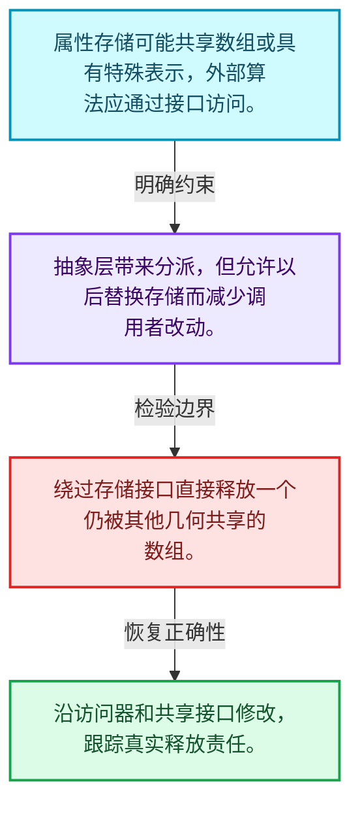
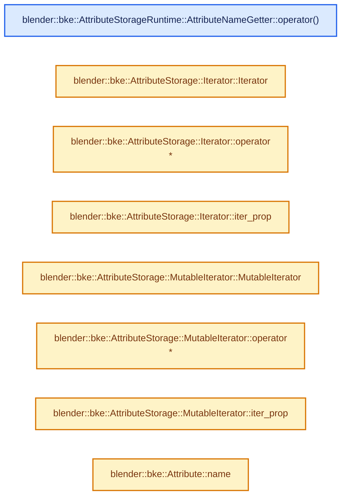
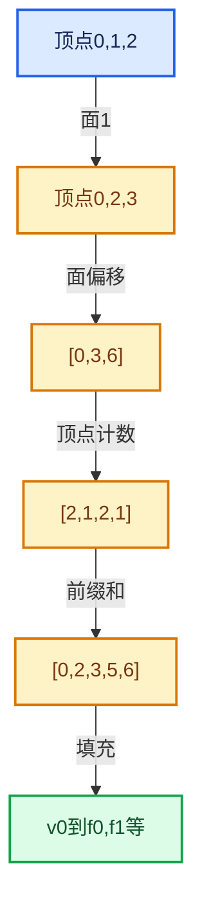

# 05-10 布局兼容与几何实战

[方向导航](README.md) · [总目录](../README.md) · [实现索引](../%E7%AC%A6%E5%8F%B7%E4%BE%9D%E8%B5%96%E4%B8%8E%E5%AE%9E%E7%8E%B0%E7%B4%A2%E5%BC%95.md)

## 从问题到实现

怎样让通用属性存储兼顾共享和写入？

存储形式影响拷贝、写时分离和默认值；算法应通过公开接口维护约束。

**数据模型**

属性存储可能共享数组或具有特殊表示，外部算法应通过接口访问。

**设计取舍**

抽象层带来分派，但允许以后替换存储而减少调用者改动。

**最小反例**

绕过存储接口直接释放一个仍被其他几何共享的数组。

**推导**

沿访问器和共享接口修改，跟踪真实释放责任。

## 阅读地图与执行推演








图中的数值推演是本方向的教学模型；实际函数之间的调用边与概念分析边分别标注，不能把概念关系当作运行时调度顺序。

## 完整源码单元与就地讲解

中文讲解直接放在相关代码旁，复杂机制在代码下展开。原文折叠区保留基准行号；不需要在行号表和函数之间来回查找。类布局可分段展示，函数实现不按固定行数切开。

### 类型布局、声明与编译条件 · BKE_attribute_storage.hh L1—L126

<a id="t-1577a6cd58b6"></a>

`Attribute`在这里声明的数据成员：

- `std::string name_`
- `AttrDomain domain_`
- `AttrType type_`
- `DataVariant data_`
- `StringRefNull name`
- `AttrDomain domain`
- `AttrType data_type`
- `AttrStorageType storage_type`
- `DataVariant data`
- `DataVariant data_for_write`
- `void assign_data`

<a id="t-0403c14170ef"></a>

<a id="t-8d5b3201381a"></a>

<a id="t-b11ec0058dd7"></a>

<a id="t-87228c71b03d"></a>

<a id="t-c5325168c7c9"></a>

<a id="t-e73ad8186af7"></a>

<a id="t-8c716c3bc0e2"></a>

<a id="t-17e455b9ec2c"></a>

<a id="t-95b0e61910db"></a>

<a id="t-ff2efff2662c"></a>

`Attribute`在这里声明的数据成员：

- `std::string name_`
- `AttrDomain domain_`
- `AttrType type_`
- `DataVariant data_`
- `StringRefNull name`
- `AttrDomain domain`
- `AttrType data_type`
- `AttrStorageType storage_type`
- `DataVariant data`
- `DataVariant data_for_write`
- `void assign_data`

<a id="t-532a140ae614"></a>

`ArrayData`在这里声明的数据成员：

- `void data`
- `int64_t size`
- `ImplicitSharingPtr<> sharing_info`
- `ArrayData from_value`
- `ArrayData from_default_value`
- `ArrayData from_uninitialized`
- `ArrayData from_constructed`

<a id="t-d946606c9c09"></a>

`SingleData`在这里声明的数据成员：

- `void value`
- `ImplicitSharingPtr<> sharing_info`
- `SingleData from_value`
- `SingleData from_default_value`

<a id="t-c2add316143f"></a>

<a id="t-6f31b025d7af"></a>

<!-- annotated:324467696c657e -->

```cpp
/* SPDX-FileCopyrightText: 2025 Blender Authors
 *
 * SPDX-License-Identifier: GPL-2.0-or-later */

/** \file
 * \ingroup bke
 */

#pragma once

#include <variant>

#include "BLI_implicit_sharing_ptr.hh"
#include "BLI_map.hh"
#include "BLI_memory_counter_fwd.hh"
#include "BLI_random_access_iterator_mixin.hh"
#include "BLI_set.hh"
#include "BLI_string_ref.hh"
#include "BLI_vector_set.hh"

#include "BKE_attribute_enums.hh"

#include "DNA_attribute_types.h"

namespace blender {

struct Attribute;
struct BlendDataReader;
struct BlendWriter;
struct IDTypeForeachColorFunctionCallback;
class GPointer;
class CPPType;
class ResourceScope;

namespace bke {

enum class AttrDomain : int8_t;
enum class AttrType : int16_t;
enum class AttrStorageType : int8_t;

/** Data and metadata for a single geometry attribute. */
class Attribute {
 public:
  /**
   * Data for an attribute stored as a full contiguous array with a data type exactly matching the
   * attribute's type. The array referenced must match the size of the domain and the data type.
   */
  struct ArrayData {
    /* NOTE: Since the shared data pointed to by `sharing_info` knows how to free itself, it often
     * stores the size and type itself. It may be possible to make use of that fact to avoid
     * storing it here, or even vice versa. */
    void *data;
    /** The number of elements in the array. */
    int64_t size;
    ImplicitSharingPtr<> sharing_info;
    static ArrayData from_value(const GPointer &value, int64_t domain_size);
    static ArrayData from_default_value(const CPPType &type, int64_t domain_size);
    static ArrayData from_uninitialized(const CPPType &type, int64_t domain_size);
    static ArrayData from_constructed(const CPPType &type, int64_t domain_size);
  };
  /** Data for an attribute stored as a single value for the entire domain. */
  struct SingleData {
    /* NOTE: For simplicity and to avoid a bit of redundancy, the domain size isn't stored here.
     * It's not necessary to manage a single value. */
    void *value;
    ImplicitSharingPtr<> sharing_info;
    static SingleData from_value(const GPointer &value);
    static SingleData from_default_value(const CPPType &type);
  };
  using DataVariant = std::variant<ArrayData, SingleData>;
  friend AttributeStorage;

 private:
  /**
   * Because it's used as the custom ID for the attributes vector set, the name cannot be changed
   * without removing and adding the attribute.
   */
  std::string name_;
  AttrDomain domain_;
  AttrType type_;

  DataVariant data_;

 public:
  /**
   * Unique name across all domains.
   * \note Compared to #CustomData, which doesn't enforce uniqueness, across domains on its own,
   * this is enforced by asserts when adding attributes. See #unique_name_calc() (which is also
   * called during the conversion process).
   */
  StringRefNull name() const;

  /** Which part of a geometry the attribute corresponds to. */
  AttrDomain domain() const;

  /**
   * The data type exposed to the user. Depending on the storage type, the actual internal values
   * may not be the same type.
   */
  AttrType data_type() const;

  /**
   * The method used to store the data. This gives flexibility to optimize the internal storage
   * even though conceptually the attribute is an array of values.
   */
  AttrStorageType storage_type() const;

  /**
   * Low level access to the data stored for the attribute. The variant's type will correspond to
   * the storage type.
   */
  const DataVariant &data() const;

  /**
   * The same as #data(), but if the attribute data is shared initially, it will be unshared and
   * made mutable.
   */
  DataVariant &data_for_write();

  /** Replace the attribute's data without first making the existing data mutable. */
  void assign_data(DataVariant &&data);
};

class AttributeStorageRuntime {
  friend AttributeStorage;
  struct AttributeNameGetter {
```

<details>
<summary>核对原始源码：source/blender/blenkernel/BKE_attribute_storage.hh · L1—L126</summary>

<!-- original:324467696c657e:source/blender/blenkernel/BKE_attribute_storage.hh:1:126 -->

```cpp
/* SPDX-FileCopyrightText: 2025 Blender Authors
 *
 * SPDX-License-Identifier: GPL-2.0-or-later */

/** \file
 * \ingroup bke
 */

#pragma once

#include <variant>

#include "BLI_implicit_sharing_ptr.hh"
#include "BLI_map.hh"
#include "BLI_memory_counter_fwd.hh"
#include "BLI_random_access_iterator_mixin.hh"
#include "BLI_set.hh"
#include "BLI_string_ref.hh"
#include "BLI_vector_set.hh"

#include "BKE_attribute_enums.hh"

#include "DNA_attribute_types.h"

namespace blender {

struct Attribute;
struct BlendDataReader;
struct BlendWriter;
struct IDTypeForeachColorFunctionCallback;
class GPointer;
class CPPType;
class ResourceScope;

namespace bke {

enum class AttrDomain : int8_t;
enum class AttrType : int16_t;
enum class AttrStorageType : int8_t;

/** Data and metadata for a single geometry attribute. */
class Attribute {
 public:
  /**
   * Data for an attribute stored as a full contiguous array with a data type exactly matching the
   * attribute's type. The array referenced must match the size of the domain and the data type.
   */
  struct ArrayData {
    /* NOTE: Since the shared data pointed to by `sharing_info` knows how to free itself, it often
     * stores the size and type itself. It may be possible to make use of that fact to avoid
     * storing it here, or even vice versa. */
    void *data;
    /** The number of elements in the array. */
    int64_t size;
    ImplicitSharingPtr<> sharing_info;
    static ArrayData from_value(const GPointer &value, int64_t domain_size);
    static ArrayData from_default_value(const CPPType &type, int64_t domain_size);
    static ArrayData from_uninitialized(const CPPType &type, int64_t domain_size);
    static ArrayData from_constructed(const CPPType &type, int64_t domain_size);
  };
  /** Data for an attribute stored as a single value for the entire domain. */
  struct SingleData {
    /* NOTE: For simplicity and to avoid a bit of redundancy, the domain size isn't stored here.
     * It's not necessary to manage a single value. */
    void *value;
    ImplicitSharingPtr<> sharing_info;
    static SingleData from_value(const GPointer &value);
    static SingleData from_default_value(const CPPType &type);
  };
  using DataVariant = std::variant<ArrayData, SingleData>;
  friend AttributeStorage;

 private:
  /**
   * Because it's used as the custom ID for the attributes vector set, the name cannot be changed
   * without removing and adding the attribute.
   */
  std::string name_;
  AttrDomain domain_;
  AttrType type_;

  DataVariant data_;

 public:
  /**
   * Unique name across all domains.
   * \note Compared to #CustomData, which doesn't enforce uniqueness, across domains on its own,
   * this is enforced by asserts when adding attributes. See #unique_name_calc() (which is also
   * called during the conversion process).
   */
  StringRefNull name() const;

  /** Which part of a geometry the attribute corresponds to. */
  AttrDomain domain() const;

  /**
   * The data type exposed to the user. Depending on the storage type, the actual internal values
   * may not be the same type.
   */
  AttrType data_type() const;

  /**
   * The method used to store the data. This gives flexibility to optimize the internal storage
   * even though conceptually the attribute is an array of values.
   */
  AttrStorageType storage_type() const;

  /**
   * Low level access to the data stored for the attribute. The variant's type will correspond to
   * the storage type.
   */
  const DataVariant &data() const;

  /**
   * The same as #data(), but if the attribute data is shared initially, it will be unshared and
   * made mutable.
   */
  DataVariant &data_for_write();

  /** Replace the attribute's data without first making the existing data mutable. */
  void assign_data(DataVariant &&data);
};

class AttributeStorageRuntime {
  friend AttributeStorage;
  struct AttributeNameGetter {
```

</details>

<a id="f-ce20a330c808f5e4"></a>

### `blender::bke::AttributeStorageRuntime::AttributeNameGetter::operator()`

实现位置：[source/blender/blenkernel/BKE_attribute_storage.hh](../../../../../source/blender/blenkernel/BKE_attribute_storage.hh) · L127—L130。

接口参数：

- `const std::unique_ptr<Attribute> &value`

**教学注释版**

<!-- annotated:1cc45856b8c43c -->

```cpp
    StringRef operator()(const std::unique_ptr<Attribute> &value) const
    {
      return value->name();
    }
```

<details>
<summary>核对原始源码：source/blender/blenkernel/BKE_attribute_storage.hh · L127—L130</summary>

<!-- original:1cc45856b8c43c:source/blender/blenkernel/BKE_attribute_storage.hh:127:130 -->

```cpp
    StringRef operator()(const std::unique_ptr<Attribute> &value) const
    {
      return value->name();
    }
```

</details>

**结果出口**

- `return value->name();`

**继续追踪实现**

- `value->name` → [外部契约](https://eel.is/c++draft/)：这个边界按实际表达式及所属类型核对参数、返回值、寿命与失败行为。这里提供接口入口，不声称已解释该第三方版本的内部实现。

### 类型布局、声明与编译条件 · BKE_attribute_storage.hh L131—L234

<a id="t-3918bb61ef0b"></a>

`AttributeStorage`在这里声明的数据成员：

- `AttributeStorage operator=`
- `AttributeStorage operator=`
- `int count`
- `Attribute at_index`
- `Attribute at_index`
- `int index_of`
- `Attribute lookup`
- `Attribute lookup`
- `bool remove`
- `bool remove`
- `bool remove`
- `Attribute add`
- `std::string unique_name_calc`
- `void rename`
- `void rename`
- `void rename`
- `void resize`
- `void blend_read`
- `void blend_write`
- `void foreach_working_space_color`
- `void count_memory`

<a id="t-7c0febdecf49"></a>

`BlendWriteData`在这里声明的数据成员：

- `BlendWriter writer`
- `ResourceScope scope`
- `Vector<blender::Attribute, 16> attributes`

<a id="t-0627721aee8b"></a>

`Iterator`在这里声明的数据成员：

- `It it_`

<!-- annotated:fb037e2b514ff1 -->

```cpp
  };
  /**
   * For quick access, the attributes are stored in a vector set, keyed by their name. Attributes
   * can still be reordered by rebuilding the vector set from scratch. Each attribute is allocated
   * to give pointer stability across additions and removals.
   */
  CustomIDVectorSet<std::unique_ptr<Attribute>, AttributeNameGetter> attributes;
};

class AttributeStorage : public blender::AttributeStorage {
 public:
  AttributeStorage();
  AttributeStorage(const AttributeStorage &other);
  AttributeStorage(AttributeStorage &&other);
  AttributeStorage &operator=(const AttributeStorage &other);
  AttributeStorage &operator=(AttributeStorage &&other);
  ~AttributeStorage();

  /** Return the number of attributes. */
  int count() const;

  /** Return the attribute at the given index. */
  Attribute &at_index(int index);
  const Attribute &at_index(int index) const;

  /** Return the index of the attribute with the given name, or -1 if not found. */
  int index_of(StringRef name) const;

  /**
   * Try to find the attribute with a given name. The non-const overload does not make the
   * attribute data itself mutable.
   */
  Attribute *lookup(StringRef name);
  const Attribute *lookup(StringRef name) const;

  /**
   * Attempt to remove the attribute with the given name, returning `true` if successful. Should
   * not be called while iterating over attributes.
   */
  bool remove(StringRef name);
  bool remove(const Set<StringRef> &names);
  bool remove(const Set<const Attribute *> &attributes);

  /**
   * Add an attribute with the given name, which must not already be used by an existing attribute
   * or this will invoke undefined behavior.
   */
  Attribute &add(std::string name,
                 bke::AttrDomain domain,
                 bke::AttrType data_type,
                 Attribute::DataVariant data);

  /** Return a possibly changed version of the input name that is unique within existing names. */
  std::string unique_name_calc(StringRef name) const;

  /** Change the name of a single existing attribute. */
  void rename(StringRef old_name, std::string new_name);
  void rename(Attribute &attr, std::string new_name);
  void rename(const Map<Attribute *, StringRef> &renames);

  /**
   * Resize the data for a given domain. New values will be default initialized (meaning no zero
   * initialization for trivial types).
   */
  void resize(AttrDomain domain, int64_t new_size);

  /**
   * Read data owned by the #AttributeStorage struct. This works by converting the DNA-specific
   * types stored in the files to the runtime data structures.
   */
  void blend_read(BlendDataReader &reader);
  /**
   * Temporary data used to write a #AttributeStorage struct embedded in another struct. See
   * #attribute_storage_blend_write_prepare for more information.
   */
  struct BlendWriteData {
    BlendWriter *writer;
    ResourceScope &scope;
    Vector<blender::Attribute, 16> &attributes;
    explicit BlendWriteData(BlendWriter *writer, ResourceScope &scope);
  };
  /**
   * Write the prepared data and the data stored in the DNA fields in
   * the #AttributeStorage struct.
   */
  void blend_write(BlendWriter &writer, const BlendWriteData &write_data);

  /**
   * Iterate over every color to change it to another color-space.
   */
  void foreach_working_space_color(const IDTypeForeachColorFunctionCallback &fn);

  void count_memory(MemoryCounter &memory) const;

  class Iterator : public iterator::RandomAccessIteratorMixin<Iterator> {
   private:
    using It = const std::unique_ptr<Attribute> *;
    It it_;

   public:
    using value_type = Attribute;
    using pointer = const Attribute *;
    using reference = const Attribute &;

```

<details>
<summary>核对原始源码：source/blender/blenkernel/BKE_attribute_storage.hh · L131—L234</summary>

<!-- original:fb037e2b514ff1:source/blender/blenkernel/BKE_attribute_storage.hh:131:234 -->

```cpp
  };
  /**
   * For quick access, the attributes are stored in a vector set, keyed by their name. Attributes
   * can still be reordered by rebuilding the vector set from scratch. Each attribute is allocated
   * to give pointer stability across additions and removals.
   */
  CustomIDVectorSet<std::unique_ptr<Attribute>, AttributeNameGetter> attributes;
};

class AttributeStorage : public blender::AttributeStorage {
 public:
  AttributeStorage();
  AttributeStorage(const AttributeStorage &other);
  AttributeStorage(AttributeStorage &&other);
  AttributeStorage &operator=(const AttributeStorage &other);
  AttributeStorage &operator=(AttributeStorage &&other);
  ~AttributeStorage();

  /** Return the number of attributes. */
  int count() const;

  /** Return the attribute at the given index. */
  Attribute &at_index(int index);
  const Attribute &at_index(int index) const;

  /** Return the index of the attribute with the given name, or -1 if not found. */
  int index_of(StringRef name) const;

  /**
   * Try to find the attribute with a given name. The non-const overload does not make the
   * attribute data itself mutable.
   */
  Attribute *lookup(StringRef name);
  const Attribute *lookup(StringRef name) const;

  /**
   * Attempt to remove the attribute with the given name, returning `true` if successful. Should
   * not be called while iterating over attributes.
   */
  bool remove(StringRef name);
  bool remove(const Set<StringRef> &names);
  bool remove(const Set<const Attribute *> &attributes);

  /**
   * Add an attribute with the given name, which must not already be used by an existing attribute
   * or this will invoke undefined behavior.
   */
  Attribute &add(std::string name,
                 bke::AttrDomain domain,
                 bke::AttrType data_type,
                 Attribute::DataVariant data);

  /** Return a possibly changed version of the input name that is unique within existing names. */
  std::string unique_name_calc(StringRef name) const;

  /** Change the name of a single existing attribute. */
  void rename(StringRef old_name, std::string new_name);
  void rename(Attribute &attr, std::string new_name);
  void rename(const Map<Attribute *, StringRef> &renames);

  /**
   * Resize the data for a given domain. New values will be default initialized (meaning no zero
   * initialization for trivial types).
   */
  void resize(AttrDomain domain, int64_t new_size);

  /**
   * Read data owned by the #AttributeStorage struct. This works by converting the DNA-specific
   * types stored in the files to the runtime data structures.
   */
  void blend_read(BlendDataReader &reader);
  /**
   * Temporary data used to write a #AttributeStorage struct embedded in another struct. See
   * #attribute_storage_blend_write_prepare for more information.
   */
  struct BlendWriteData {
    BlendWriter *writer;
    ResourceScope &scope;
    Vector<blender::Attribute, 16> &attributes;
    explicit BlendWriteData(BlendWriter *writer, ResourceScope &scope);
  };
  /**
   * Write the prepared data and the data stored in the DNA fields in
   * the #AttributeStorage struct.
   */
  void blend_write(BlendWriter &writer, const BlendWriteData &write_data);

  /**
   * Iterate over every color to change it to another color-space.
   */
  void foreach_working_space_color(const IDTypeForeachColorFunctionCallback &fn);

  void count_memory(MemoryCounter &memory) const;

  class Iterator : public iterator::RandomAccessIteratorMixin<Iterator> {
   private:
    using It = const std::unique_ptr<Attribute> *;
    It it_;

   public:
    using value_type = Attribute;
    using pointer = const Attribute *;
    using reference = const Attribute &;

```

</details>

<a id="f-09865f3b508bb2ff"></a>

### `blender::bke::AttributeStorage::Iterator::Iterator`

实现位置：[source/blender/blenkernel/BKE_attribute_storage.hh](../../../../../source/blender/blenkernel/BKE_attribute_storage.hh) · L235—L235。

接口参数：

- `It it`

**教学注释版**

<!-- annotated:9f81527da5846c -->

```cpp
    explicit Iterator(It it) : it_(it) {}
```

<details>
<summary>核对原始源码：source/blender/blenkernel/BKE_attribute_storage.hh · L235—L235</summary>

<!-- original:9f81527da5846c:source/blender/blenkernel/BKE_attribute_storage.hh:235:235 -->

```cpp
    explicit Iterator(It it) : it_(it) {}
```

</details>

**继续追踪实现**

本实现没有需要继续展开的显式调用；检查返回表达式、对象转换和调用者前置条件。

<!-- annotated:59871be9fd73a7 -->

```cpp

```

<details>
<summary>核对原始源码：source/blender/blenkernel/BKE_attribute_storage.hh · L236—L236</summary>

<!-- original:59871be9fd73a7:source/blender/blenkernel/BKE_attribute_storage.hh:236:236 -->

```cpp

```

</details>

<a id="f-8af8f36d636ff94c"></a>

### `blender::bke::AttributeStorage::Iterator::operator*`

实现位置：[source/blender/blenkernel/BKE_attribute_storage.hh](../../../../../source/blender/blenkernel/BKE_attribute_storage.hh) · L237—L240。

**教学注释版**

<!-- annotated:9268c19f888bf7 -->

```cpp
    const Attribute &operator*() const
    {
      return **it_;
    }
```

<details>
<summary>核对原始源码：source/blender/blenkernel/BKE_attribute_storage.hh · L237—L240</summary>

<!-- original:9268c19f888bf7:source/blender/blenkernel/BKE_attribute_storage.hh:237:240 -->

```cpp
    const Attribute &operator*() const
    {
      return **it_;
    }
```

</details>

**结果出口**

- `return **it_;`

**继续追踪实现**

本实现没有需要继续展开的显式调用；检查返回表达式、对象转换和调用者前置条件。

<!-- annotated:784c7e2ca124cd -->

```cpp

```

<details>
<summary>核对原始源码：source/blender/blenkernel/BKE_attribute_storage.hh · L241—L241</summary>

<!-- original:784c7e2ca124cd:source/blender/blenkernel/BKE_attribute_storage.hh:241:241 -->

```cpp

```

</details>

<a id="f-c0bcc2b8d0a4d972"></a>

### `blender::bke::AttributeStorage::Iterator::iter_prop`

实现位置：[source/blender/blenkernel/BKE_attribute_storage.hh](../../../../../source/blender/blenkernel/BKE_attribute_storage.hh) · L242—L245。

**教学注释版**

<!-- annotated:ba2e5546aca8a0 -->

```cpp
    const It &iter_prop() const
    {
      return it_;
    }
```

<details>
<summary>核对原始源码：source/blender/blenkernel/BKE_attribute_storage.hh · L242—L245</summary>

<!-- original:ba2e5546aca8a0:source/blender/blenkernel/BKE_attribute_storage.hh:242:245 -->

```cpp
    const It &iter_prop() const
    {
      return it_;
    }
```

</details>

**结果出口**

- `return it_;`

**继续追踪实现**

本实现没有需要继续展开的显式调用；检查返回表达式、对象转换和调用者前置条件。

### 类型布局、声明与编译条件 · BKE_attribute_storage.hh L246—L257

<a id="t-060807037f45"></a>

`MutableIterator`在这里声明的数据成员：

- `It it_`

<!-- annotated:f8a603189eeefd -->

```cpp
  };

  class MutableIterator : public iterator::RandomAccessIteratorMixin<MutableIterator> {
   private:
    using It = std::unique_ptr<Attribute> *;
    It it_;

   public:
    using value_type = Attribute;
    using pointer = Attribute *;
    using reference = Attribute &;

```

<details>
<summary>核对原始源码：source/blender/blenkernel/BKE_attribute_storage.hh · L246—L257</summary>

<!-- original:f8a603189eeefd:source/blender/blenkernel/BKE_attribute_storage.hh:246:257 -->

```cpp
  };

  class MutableIterator : public iterator::RandomAccessIteratorMixin<MutableIterator> {
   private:
    using It = std::unique_ptr<Attribute> *;
    It it_;

   public:
    using value_type = Attribute;
    using pointer = Attribute *;
    using reference = Attribute &;

```

</details>

<a id="f-64b23fb063c2eb68"></a>

### `blender::bke::AttributeStorage::MutableIterator::MutableIterator`

实现位置：[source/blender/blenkernel/BKE_attribute_storage.hh](../../../../../source/blender/blenkernel/BKE_attribute_storage.hh) · L258—L258。

接口参数：

- `It it`

**教学注释版**

<!-- annotated:32ec1dcb0a70c3 -->

```cpp
    explicit MutableIterator(It it) : it_(it) {}
```

<details>
<summary>核对原始源码：source/blender/blenkernel/BKE_attribute_storage.hh · L258—L258</summary>

<!-- original:32ec1dcb0a70c3:source/blender/blenkernel/BKE_attribute_storage.hh:258:258 -->

```cpp
    explicit MutableIterator(It it) : it_(it) {}
```

</details>

**继续追踪实现**

本实现没有需要继续展开的显式调用；检查返回表达式、对象转换和调用者前置条件。

<!-- annotated:703fe4d100010e -->

```cpp

```

<details>
<summary>核对原始源码：source/blender/blenkernel/BKE_attribute_storage.hh · L259—L259</summary>

<!-- original:703fe4d100010e:source/blender/blenkernel/BKE_attribute_storage.hh:259:259 -->

```cpp

```

</details>

<a id="f-ddcb9ab8eee1ed4a"></a>

### `blender::bke::AttributeStorage::MutableIterator::operator*`

实现位置：[source/blender/blenkernel/BKE_attribute_storage.hh](../../../../../source/blender/blenkernel/BKE_attribute_storage.hh) · L260—L263。

**教学注释版**

<!-- annotated:cde590a557ca73 -->

```cpp
    Attribute &operator*() const
    {
      return **it_;
    }
```

<details>
<summary>核对原始源码：source/blender/blenkernel/BKE_attribute_storage.hh · L260—L263</summary>

<!-- original:cde590a557ca73:source/blender/blenkernel/BKE_attribute_storage.hh:260:263 -->

```cpp
    Attribute &operator*() const
    {
      return **it_;
    }
```

</details>

**结果出口**

- `return **it_;`

**继续追踪实现**

本实现没有需要继续展开的显式调用；检查返回表达式、对象转换和调用者前置条件。

<!-- annotated:5e7dbb8e7b59ad -->

```cpp

```

<details>
<summary>核对原始源码：source/blender/blenkernel/BKE_attribute_storage.hh · L264—L264</summary>

<!-- original:5e7dbb8e7b59ad:source/blender/blenkernel/BKE_attribute_storage.hh:264:264 -->

```cpp

```

</details>

<a id="f-c4054518f7f3b804"></a>

### `blender::bke::AttributeStorage::MutableIterator::iter_prop`

实现位置：[source/blender/blenkernel/BKE_attribute_storage.hh](../../../../../source/blender/blenkernel/BKE_attribute_storage.hh) · L265—L268。

**教学注释版**

<!-- annotated:41f8fd615980f3 -->

```cpp
    const It &iter_prop() const
    {
      return it_;
    }
```

<details>
<summary>核对原始源码：source/blender/blenkernel/BKE_attribute_storage.hh · L265—L268</summary>

<!-- original:41f8fd615980f3:source/blender/blenkernel/BKE_attribute_storage.hh:265:268 -->

```cpp
    const It &iter_prop() const
    {
      return it_;
    }
```

</details>

**结果出口**

- `return it_;`

**继续追踪实现**

本实现没有需要继续展开的显式调用；检查返回表达式、对象转换和调用者前置条件。

### 类型布局、声明与编译条件 · BKE_attribute_storage.hh L269—L280

<!-- annotated:668cfcaa0c2699 -->

```cpp
  };

  Iterator begin() const;
  Iterator end() const;

  MutableIterator begin();
  MutableIterator end();
};

/** The C++ wrapper needs to be the same size as the DNA struct. */
static_assert(sizeof(AttributeStorage) == sizeof(AttributeStorage));

```

<details>
<summary>核对原始源码：source/blender/blenkernel/BKE_attribute_storage.hh · L269—L280</summary>

<!-- original:668cfcaa0c2699:source/blender/blenkernel/BKE_attribute_storage.hh:269:280 -->

```cpp
  };

  Iterator begin() const;
  Iterator end() const;

  MutableIterator begin();
  MutableIterator end();
};

/** The C++ wrapper needs to be the same size as the DNA struct. */
static_assert(sizeof(AttributeStorage) == sizeof(AttributeStorage));

```

</details>

<a id="f-673c10c3082f9df5"></a>

### `blender::bke::Attribute::name`

实现位置：[source/blender/blenkernel/BKE_attribute_storage.hh](../../../../../source/blender/blenkernel/BKE_attribute_storage.hh) · L281—L284。

**教学注释版**

<!-- annotated:ec4f032471bf33 -->

```cpp
inline StringRefNull Attribute::name() const
{
  return name_;
}
```

<details>
<summary>核对原始源码：source/blender/blenkernel/BKE_attribute_storage.hh · L281—L284</summary>

<!-- original:ec4f032471bf33:source/blender/blenkernel/BKE_attribute_storage.hh:281:284 -->

```cpp
inline StringRefNull Attribute::name() const
{
  return name_;
}
```

</details>

**结果出口**

- `return name_;`

**继续追踪实现**

本实现没有需要继续展开的显式调用；检查返回表达式、对象转换和调用者前置条件。

<!-- annotated:fc76325ff4fb1c -->

```cpp

```

<details>
<summary>核对原始源码：source/blender/blenkernel/BKE_attribute_storage.hh · L285—L285</summary>

<!-- original:fc76325ff4fb1c:source/blender/blenkernel/BKE_attribute_storage.hh:285:285 -->

```cpp

```

</details>

<a id="f-03667cd47954e9ff"></a>

### `blender::bke::Attribute::domain`

实现位置：[source/blender/blenkernel/BKE_attribute_storage.hh](../../../../../source/blender/blenkernel/BKE_attribute_storage.hh) · L286—L289。

**教学注释版**

<!-- annotated:c80c8874729233 -->

```cpp
inline AttrDomain Attribute::domain() const
{
  return domain_;
}
```

<details>
<summary>核对原始源码：source/blender/blenkernel/BKE_attribute_storage.hh · L286—L289</summary>

<!-- original:c80c8874729233:source/blender/blenkernel/BKE_attribute_storage.hh:286:289 -->

```cpp
inline AttrDomain Attribute::domain() const
{
  return domain_;
}
```

</details>

**结果出口**

- `return domain_;`

**继续追踪实现**

本实现没有需要继续展开的显式调用；检查返回表达式、对象转换和调用者前置条件。

<!-- annotated:9f6fa8025bf67f -->

```cpp

```

<details>
<summary>核对原始源码：source/blender/blenkernel/BKE_attribute_storage.hh · L290—L290</summary>

<!-- original:9f6fa8025bf67f:source/blender/blenkernel/BKE_attribute_storage.hh:290:290 -->

```cpp

```

</details>

<a id="f-d86548da166fa237"></a>

### `blender::bke::Attribute::data_type`

实现位置：[source/blender/blenkernel/BKE_attribute_storage.hh](../../../../../source/blender/blenkernel/BKE_attribute_storage.hh) · L291—L294。

**教学注释版**

<!-- annotated:6c343e560b9fb5 -->

```cpp
inline AttrType Attribute::data_type() const
{
  return type_;
}
```

<details>
<summary>核对原始源码：source/blender/blenkernel/BKE_attribute_storage.hh · L291—L294</summary>

<!-- original:6c343e560b9fb5:source/blender/blenkernel/BKE_attribute_storage.hh:291:294 -->

```cpp
inline AttrType Attribute::data_type() const
{
  return type_;
}
```

</details>

**结果出口**

- `return type_;`

**继续追踪实现**

本实现没有需要继续展开的显式调用；检查返回表达式、对象转换和调用者前置条件。

<!-- annotated:ebf06be3267aa5 -->

```cpp

```

<details>
<summary>核对原始源码：source/blender/blenkernel/BKE_attribute_storage.hh · L295—L295</summary>

<!-- original:ebf06be3267aa5:source/blender/blenkernel/BKE_attribute_storage.hh:295:295 -->

```cpp

```

</details>

<a id="f-1d913000744fef94"></a>

### `blender::bke::Attribute::data`

实现位置：[source/blender/blenkernel/BKE_attribute_storage.hh](../../../../../source/blender/blenkernel/BKE_attribute_storage.hh) · L296—L299。

**教学注释版**

<!-- annotated:0f0e09c8962c1e -->

```cpp
inline const Attribute::DataVariant &Attribute::data() const
{
  return data_;
}
```

<details>
<summary>核对原始源码：source/blender/blenkernel/BKE_attribute_storage.hh · L296—L299</summary>

<!-- original:0f0e09c8962c1e:source/blender/blenkernel/BKE_attribute_storage.hh:296:299 -->

```cpp
inline const Attribute::DataVariant &Attribute::data() const
{
  return data_;
}
```

</details>

**结果出口**

- `return data_;`

**继续追踪实现**

本实现没有需要继续展开的显式调用；检查返回表达式、对象转换和调用者前置条件。

<!-- annotated:daf8b5f573bea3 -->

```cpp

```

<details>
<summary>核对原始源码：source/blender/blenkernel/BKE_attribute_storage.hh · L300—L300</summary>

<!-- original:daf8b5f573bea3:source/blender/blenkernel/BKE_attribute_storage.hh:300:300 -->

```cpp

```

</details>

<a id="f-e08ee0374bedc01d"></a>

### `blender::bke::Attribute::storage_type`

实现位置：[source/blender/blenkernel/BKE_attribute_storage.hh](../../../../../source/blender/blenkernel/BKE_attribute_storage.hh) · L301—L310。

**教学注释版**

<!-- annotated:c679a7ccd90f7f -->

```cpp
inline AttrStorageType Attribute::storage_type() const
{
  static_assert(std::is_same_v<
                std::variant_alternative_t<int(AttrStorageType::Array), Attribute::DataVariant>,
                Attribute::ArrayData>);
  static_assert(std::is_same_v<
                std::variant_alternative_t<int(AttrStorageType::Single), Attribute::DataVariant>,
                Attribute::SingleData>);
  return AttrStorageType(data_.index());
}
```

<details>
<summary>核对原始源码：source/blender/blenkernel/BKE_attribute_storage.hh · L301—L310</summary>

<!-- original:c679a7ccd90f7f:source/blender/blenkernel/BKE_attribute_storage.hh:301:310 -->

```cpp
inline AttrStorageType Attribute::storage_type() const
{
  static_assert(std::is_same_v<
                std::variant_alternative_t<int(AttrStorageType::Array), Attribute::DataVariant>,
                Attribute::ArrayData>);
  static_assert(std::is_same_v<
                std::variant_alternative_t<int(AttrStorageType::Single), Attribute::DataVariant>,
                Attribute::SingleData>);
  return AttrStorageType(data_.index());
}
```

</details>

**结果出口**

- `return AttrStorageType(data_.index());`

**继续追踪实现**

- `AttrStorageType` → [blender::bke::AttrStorageType](%E4%BE%9D%E8%B5%96-BKE_attribute_storage-58c142.md#t-95b0e61910db)。
- `data_.index` → [index · L103](%E4%BE%9D%E8%B5%96-gpu_shader_cxx_attribute-d75f56.md#m-a452734c9407)。宏定义由构建条件选择。

<!-- annotated:f6882171e2a5c8 -->

```cpp

```

<details>
<summary>核对原始源码：source/blender/blenkernel/BKE_attribute_storage.hh · L311—L311</summary>

<!-- original:f6882171e2a5c8:source/blender/blenkernel/BKE_attribute_storage.hh:311:311 -->

```cpp

```

</details>

<a id="f-9fcff5d02b6d8c44"></a>

### `blender::bke::Attribute::assign_data`

实现位置：[source/blender/blenkernel/BKE_attribute_storage.hh](../../../../../source/blender/blenkernel/BKE_attribute_storage.hh) · L312—L315。

接口参数：

- `DataVariant &&data`

**教学注释版**

<!-- annotated:06c0604712c48c -->

```cpp
inline void Attribute::assign_data(DataVariant &&data)
{
  // [讲解] std::move：把表达式转换成可供移动重载选择的值类别；不保证真的移动，不结束源对象寿命，对const值可能选择复制。
  data_ = std::move(data);
}
```

<details>
<summary>核对原始源码：source/blender/blenkernel/BKE_attribute_storage.hh · L312—L315</summary>

<!-- original:06c0604712c48c:source/blender/blenkernel/BKE_attribute_storage.hh:312:315 -->

```cpp
inline void Attribute::assign_data(DataVariant &&data)
{
  data_ = std::move(data);
}
```

</details>

**沿实际写入检查状态**

- `data_ = std::move(data);`

**继续追踪实现**

- `std::move` → [外部契约](https://eel.is/c++draft/utility.forward)：把表达式转换成可供移动重载选择的值类别；不保证真的移动，不结束源对象寿命，对const值可能选择复制。

<!-- annotated:31b67cce6b7731 -->

```cpp

```

<details>
<summary>核对原始源码：source/blender/blenkernel/BKE_attribute_storage.hh · L316—L316</summary>

<!-- original:31b67cce6b7731:source/blender/blenkernel/BKE_attribute_storage.hh:316:316 -->

```cpp

```

</details>

<a id="f-70f7155955ff8b3f"></a>

### `blender::bke::AttributeStorage::begin`

实现位置：[source/blender/blenkernel/BKE_attribute_storage.hh](../../../../../source/blender/blenkernel/BKE_attribute_storage.hh) · L317—L320。

**教学注释版**

<!-- annotated:a03d63d41fc25e -->

```cpp
inline AttributeStorage::Iterator AttributeStorage::begin() const
{
  return Iterator(this->runtime->attributes.begin());
}
```

<details>
<summary>核对原始源码：source/blender/blenkernel/BKE_attribute_storage.hh · L317—L320</summary>

<!-- original:a03d63d41fc25e:source/blender/blenkernel/BKE_attribute_storage.hh:317:320 -->

```cpp
inline AttributeStorage::Iterator AttributeStorage::begin() const
{
  return Iterator(this->runtime->attributes.begin());
}
```

</details>

**结果出口**

- `return Iterator(this->runtime->attributes.begin());`

**继续追踪实现**

- `Iterator` → [blender::bke::AttributeStorage::Iterator::Iterator · L235](10-%E5%B8%83%E5%B1%80%E5%85%BC%E5%AE%B9%E4%B8%8E%E5%87%A0%E4%BD%95%E5%AE%9E%E6%88%98.md#f-09865f3b508bb2ff)。
- `this->runtime->attributes.begin` → [调用协议](../%E6%A8%A1%E6%9D%BF%E5%AE%8F%E4%B8%8E%E5%8A%A8%E6%80%81%E5%88%86%E6%B4%BE%E5%8D%8F%E8%AE%AE.md)：接收对象类型依赖auto、返回值或模板实例；不按同名猜测目标。调用位置L319。

<!-- annotated:4ccbc46e2c75cc -->

```cpp

```

<details>
<summary>核对原始源码：source/blender/blenkernel/BKE_attribute_storage.hh · L321—L321</summary>

<!-- original:4ccbc46e2c75cc:source/blender/blenkernel/BKE_attribute_storage.hh:321:321 -->

```cpp

```

</details>

<a id="f-5d715f2bee737620"></a>

### `blender::bke::AttributeStorage::end`

实现位置：[source/blender/blenkernel/BKE_attribute_storage.hh](../../../../../source/blender/blenkernel/BKE_attribute_storage.hh) · L322—L325。

**教学注释版**

<!-- annotated:cc8ed999ee0600 -->

```cpp
inline AttributeStorage::Iterator AttributeStorage::end() const
{
  return Iterator(this->runtime->attributes.end());
}
```

<details>
<summary>核对原始源码：source/blender/blenkernel/BKE_attribute_storage.hh · L322—L325</summary>

<!-- original:cc8ed999ee0600:source/blender/blenkernel/BKE_attribute_storage.hh:322:325 -->

```cpp
inline AttributeStorage::Iterator AttributeStorage::end() const
{
  return Iterator(this->runtime->attributes.end());
}
```

</details>

**结果出口**

- `return Iterator(this->runtime->attributes.end());`

**继续追踪实现**

- `Iterator` → [blender::bke::AttributeStorage::Iterator::Iterator · L235](10-%E5%B8%83%E5%B1%80%E5%85%BC%E5%AE%B9%E4%B8%8E%E5%87%A0%E4%BD%95%E5%AE%9E%E6%88%98.md#f-09865f3b508bb2ff)。
- `this->runtime->attributes.end` → [调用协议](../%E6%A8%A1%E6%9D%BF%E5%AE%8F%E4%B8%8E%E5%8A%A8%E6%80%81%E5%88%86%E6%B4%BE%E5%8D%8F%E8%AE%AE.md)：接收对象类型依赖auto、返回值或模板实例；不按同名猜测目标。调用位置L324。

<!-- annotated:1a5519dfaa0cda -->

```cpp

```

<details>
<summary>核对原始源码：source/blender/blenkernel/BKE_attribute_storage.hh · L326—L326</summary>

<!-- original:1a5519dfaa0cda:source/blender/blenkernel/BKE_attribute_storage.hh:326:326 -->

```cpp

```

</details>

<a id="f-a8a145499157c9cc"></a>

### `blender::bke::AttributeStorage::begin`

实现位置：[source/blender/blenkernel/BKE_attribute_storage.hh](../../../../../source/blender/blenkernel/BKE_attribute_storage.hh) · L327—L333。

**教学注释版**

<!-- annotated:0dd6992f7f0de7 -->

```cpp
inline AttributeStorage::MutableIterator AttributeStorage::begin()
{
  /* Removing const is fine as long as the name of the attribute is not changed while iterating
   * over the attributes. Renaming goes through #AttributeStorage::rename anyway. */
  return MutableIterator(
      const_cast<std::unique_ptr<Attribute> *>(this->runtime->attributes.begin()));
}
```

<details>
<summary>核对原始源码：source/blender/blenkernel/BKE_attribute_storage.hh · L327—L333</summary>

<!-- original:0dd6992f7f0de7:source/blender/blenkernel/BKE_attribute_storage.hh:327:333 -->

```cpp
inline AttributeStorage::MutableIterator AttributeStorage::begin()
{
  /* Removing const is fine as long as the name of the attribute is not changed while iterating
   * over the attributes. Renaming goes through #AttributeStorage::rename anyway. */
  return MutableIterator(
      const_cast<std::unique_ptr<Attribute> *>(this->runtime->attributes.begin()));
}
```

</details>

**结果出口**

- `return MutableIterator(`

**继续追踪实现**

- `MutableIterator` → [blender::bke::AttributeStorage::MutableIterator::MutableIterator · L258](10-%E5%B8%83%E5%B1%80%E5%85%BC%E5%AE%B9%E4%B8%8E%E5%87%A0%E4%BD%95%E5%AE%9E%E6%88%98.md#f-64b23fb063c2eb68)。
- `this->runtime->attributes.begin` → [调用协议](../%E6%A8%A1%E6%9D%BF%E5%AE%8F%E4%B8%8E%E5%8A%A8%E6%80%81%E5%88%86%E6%B4%BE%E5%8D%8F%E8%AE%AE.md)：接收对象类型依赖auto、返回值或模板实例；不按同名猜测目标。调用位置L332。

<!-- annotated:42766d4ef07ef7 -->

```cpp

```

<details>
<summary>核对原始源码：source/blender/blenkernel/BKE_attribute_storage.hh · L334—L334</summary>

<!-- original:42766d4ef07ef7:source/blender/blenkernel/BKE_attribute_storage.hh:334:334 -->

```cpp

```

</details>

<a id="f-77457cb350c01404"></a>

### `blender::bke::AttributeStorage::end`

实现位置：[source/blender/blenkernel/BKE_attribute_storage.hh](../../../../../source/blender/blenkernel/BKE_attribute_storage.hh) · L335—L339。

**教学注释版**

<!-- annotated:a5167271cd1e48 -->

```cpp
inline AttributeStorage::MutableIterator AttributeStorage::end()
{
  return MutableIterator(
      const_cast<std::unique_ptr<Attribute> *>(this->runtime->attributes.end()));
}
```

<details>
<summary>核对原始源码：source/blender/blenkernel/BKE_attribute_storage.hh · L335—L339</summary>

<!-- original:a5167271cd1e48:source/blender/blenkernel/BKE_attribute_storage.hh:335:339 -->

```cpp
inline AttributeStorage::MutableIterator AttributeStorage::end()
{
  return MutableIterator(
      const_cast<std::unique_ptr<Attribute> *>(this->runtime->attributes.end()));
}
```

</details>

**结果出口**

- `return MutableIterator(`

**继续追踪实现**

- `MutableIterator` → [blender::bke::AttributeStorage::MutableIterator::MutableIterator · L258](10-%E5%B8%83%E5%B1%80%E5%85%BC%E5%AE%B9%E4%B8%8E%E5%87%A0%E4%BD%95%E5%AE%9E%E6%88%98.md#f-64b23fb063c2eb68)。
- `this->runtime->attributes.end` → [调用协议](../%E6%A8%A1%E6%9D%BF%E5%AE%8F%E4%B8%8E%E5%8A%A8%E6%80%81%E5%88%86%E6%B4%BE%E5%8D%8F%E8%AE%AE.md)：接收对象类型依赖auto、返回值或模板实例；不按同名猜测目标。调用位置L338。

### 类型布局、声明与编译条件 · BKE_attribute_storage.hh L340—L342

<!-- annotated:28e32b18cfd2ae -->

```cpp

}  // namespace bke

```

<details>
<summary>核对原始源码：source/blender/blenkernel/BKE_attribute_storage.hh · L340—L342</summary>

<!-- original:28e32b18cfd2ae:source/blender/blenkernel/BKE_attribute_storage.hh:340:342 -->

```cpp

}  // namespace bke

```

</details>

<a id="f-dcd2d04d6f92ca8c"></a>

### `blender::AttributeStorage::wrap`

实现位置：[source/blender/blenkernel/BKE_attribute_storage.hh](../../../../../source/blender/blenkernel/BKE_attribute_storage.hh) · L343—L346。

**教学注释版**

<!-- annotated:dc85c9956db40a -->

```cpp
inline bke::AttributeStorage &AttributeStorage::wrap()
{
  return *reinterpret_cast<bke::AttributeStorage *>(this);
}
```

<details>
<summary>核对原始源码：source/blender/blenkernel/BKE_attribute_storage.hh · L343—L346</summary>

<!-- original:dc85c9956db40a:source/blender/blenkernel/BKE_attribute_storage.hh:343:346 -->

```cpp
inline bke::AttributeStorage &AttributeStorage::wrap()
{
  return *reinterpret_cast<bke::AttributeStorage *>(this);
}
```

</details>

**结果出口**

- `return *reinterpret_cast<bke::AttributeStorage *>(this);`

**继续追踪实现**

本实现没有需要继续展开的显式调用；检查返回表达式、对象转换和调用者前置条件。

<a id="f-9ad0fac9bae8a380"></a>

### `blender::AttributeStorage::wrap`

实现位置：[source/blender/blenkernel/BKE_attribute_storage.hh](../../../../../source/blender/blenkernel/BKE_attribute_storage.hh) · L347—L350。

**教学注释版**

<!-- annotated:010cc299d88b9a -->

```cpp
inline const bke::AttributeStorage &AttributeStorage::wrap() const
{
  return *reinterpret_cast<const bke::AttributeStorage *>(this);
}
```

<details>
<summary>核对原始源码：source/blender/blenkernel/BKE_attribute_storage.hh · L347—L350</summary>

<!-- original:010cc299d88b9a:source/blender/blenkernel/BKE_attribute_storage.hh:347:350 -->

```cpp
inline const bke::AttributeStorage &AttributeStorage::wrap() const
{
  return *reinterpret_cast<const bke::AttributeStorage *>(this);
}
```

</details>

**结果出口**

- `return *reinterpret_cast<const bke::AttributeStorage *>(this);`

**继续追踪实现**

本实现没有需要继续展开的显式调用；检查返回表达式、对象转换和调用者前置条件。

### 类型布局、声明与编译条件 · BKE_attribute_storage.hh L351—L352

<!-- annotated:83789f8caa9bd2 -->

```cpp

}  // namespace blender
```

<details>
<summary>核对原始源码：source/blender/blenkernel/BKE_attribute_storage.hh · L351—L352</summary>

<!-- original:83789f8caa9bd2:source/blender/blenkernel/BKE_attribute_storage.hh:351:352 -->

```cpp

}  // namespace blender
```

</details>

## 语法与相关类型

### 只读限定 const

const约束当前访问路径可做的修改。const指针、指向const的指针、const视图对象、const元素是不同位置的限定；其他别名可能仍可修改原对象。

分别写T* const、const T*与const T* const，并画出不可修改的层次。

### 移动转换 std::move

std::move把表达式转换为可供移动重载选择的值类别，实际资源转移发生在被选中的构造或赋值中。对const对象move可能仍调用复制，对视图move也不会获得底层数据所有权。

记录移动构造调用次数，不用变量名或std::move的出现次数替代测量。

### 异常边界 try与catch

try定义异常传播的局部边界。失败路径需要销毁已经成功构造的部分并释放相应存储；未构造的对象不能被析构。

在第k次构造失败，列出已经存在的对象集合与待释放缓冲。

### 表示层转换 reinterpret_cast

reinterpret_cast不能自动开始任意对象的生命周期，也不能豁免对齐和别名规则。读这类代码需要追溯原始分配与实际构造操作。

分别检查大小、对齐、生命周期和可访问类型，四项不能互相替代。

### 限定转换 const_cast

const_cast可以改变访问路径的限定，但不能让本来就是const的对象合法可写。常用于复用只读实现时，仍需检查底层对象是否实际可变。

对非const对象的const引用与真正const对象分别分析修改是否合法。

### 判别联合 variant

variant在若干候选类型中保存一个活动值，通过判别信息选择操作。它能把不同表示集中在值类型中，但各分支的复制移动成本不同。

列出活动分支及每种分支实际拥有或借用的数据。

### 对象表示 sizeof

sizeof给出对象表示大小，不是其引用的所有堆内存总量。sizeof视图很小并不说明底层数组很小。

分别统计容器对象、容量字节和元素拥有的间接资源。

### 受控访问 friend

friend授予指定函数或类访问非公开成员的权限，并不意味着继承，也不自动扩展到友元的派生类。

解释执行器为何需要访问包装器的内部映射，同时检查边界是否仍清楚。

### 独占拥有 unique_ptr

unique_ptr通过移动转移拥有关系，默认删除策略必须与资源来源匹配。get返回借用指针，release交出责任而不销毁。

区分move、get、release和reset后谁负责销毁。

### 类型别名 using

类型别名为已有类型建立名字，不创建运行期对象。它常把模板内部使用的类型统一暴露给泛型调用者。

展开别名直到基础类型，区分类型别名和变量声明。

### 枚举与状态模型 enum

枚举把有限状态命名；enum class避免许多隐式整数转换。状态机正确性还依赖允许的转移，不能只看有哪些枚举项。

列出每个状态的进入条件和离开条件，检查终止状态是否仍可能被调度。

## 实现练习与验证

实现最小网格与属性表，执行拓扑改变并说明属性如何传播。

参考推理：沿访问器和共享接口修改，跟踪真实释放责任。

偏移单调不减；最终偏移与存储边界对应；每个角点引用合法顶点，每个反向映射可由正向关系验证。

## 历史、跨库比较与证据

把偏移数组与vector<vector<int>>、CSR邻接表示作比较：前者集中存储，后者方便独立增长；是否稳定修改比容器名字更影响选型。

[历史提交索引](../%E5%8E%86%E5%8F%B2%E6%8F%90%E4%BA%A4%E4%B8%8E%E8%AE%BE%E8%AE%A1%E6%BC%94%E5%8C%96%E7%B4%A2%E5%BC%95.md) · [源码基准](../%E6%BA%90%E7%A0%81%E7%89%88%E6%9C%AC%E4%B8%8E%E8%A6%86%E7%9B%96%E7%B4%A2%E5%BC%95.md) · [验收报告](../%E9%AA%8C%E6%94%B6%E6%8A%A5%E5%91%8A.md)
