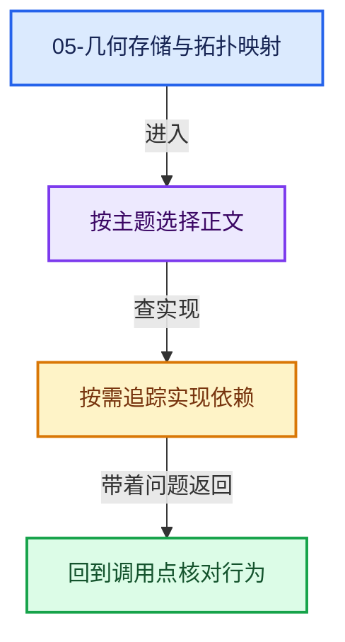
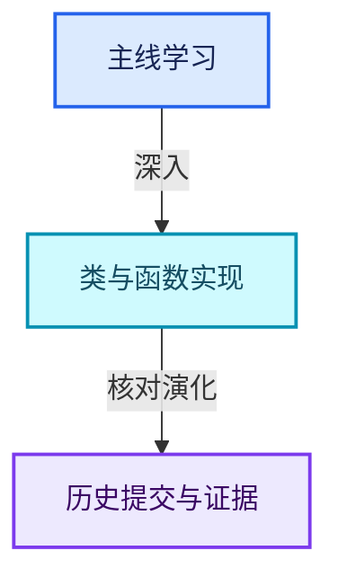

# 05-几何存储与拓扑映射

[总入口](../README.md) · [几何节点专题](../13-几何节点专题/README.md) · [实现依赖](../90-实现依赖专题/README.md)

## 阅读顺序

- [05-01 Mesh顶点边面角点](01-Mesh顶点边面角点.md)
- [05-02 OffsetIndices完整接口](02-OffsetIndices完整接口.md)
- [05-03 MPoly迁移与兼容](03-MPoly迁移与兼容.md)
- [05-04 CurvesGeometry存储](04-CurvesGeometry存储.md)
- [05-05 邻接关系与前缀和](05-邻接关系与前缀和.md)
- [05-06 拓扑映射构建](06-拓扑映射构建.md)
- [05-07 分组访问与反向索引](07-分组访问与反向索引.md)
- [05-08 AttributeAccessor接口](08-AttributeAccessor接口.md)
- [05-09 属性域与转换](09-属性域与转换.md)
- [05-10 布局兼容与几何实战](10-布局兼容与几何实战.md)

