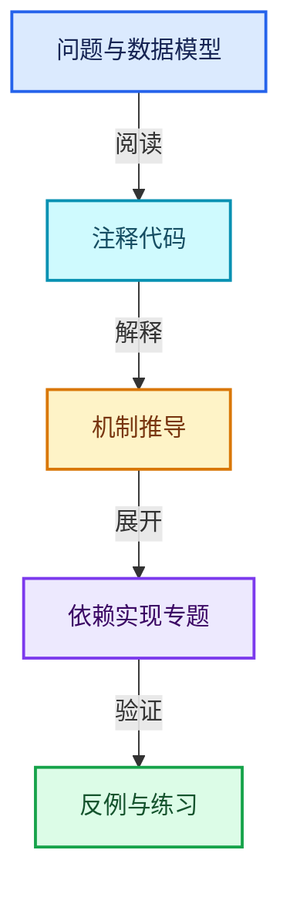
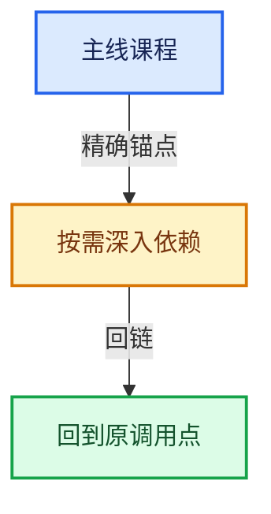

# 05-几何存储与拓扑映射

[总目录](../README.md) · [实现索引](../%E7%AC%A6%E5%8F%B7%E4%BE%9D%E8%B5%96%E4%B8%8E%E5%AE%9E%E7%8E%B0%E7%B4%A2%E5%BC%95.md)

## 主线课程

- [05-01 Mesh顶点边面角点](01-Mesh%E9%A1%B6%E7%82%B9%E8%BE%B9%E9%9D%A2%E8%A7%92%E7%82%B9.md)
- [05-02 OffsetIndices完整接口](02-OffsetIndices%E5%AE%8C%E6%95%B4%E6%8E%A5%E5%8F%A3.md)
- [05-03 MPoly迁移与兼容](03-MPoly%E8%BF%81%E7%A7%BB%E4%B8%8E%E5%85%BC%E5%AE%B9.md)
- [05-04 CurvesGeometry存储](04-CurvesGeometry%E5%AD%98%E5%82%A8.md)
- [05-05 邻接关系与前缀和](05-%E9%82%BB%E6%8E%A5%E5%85%B3%E7%B3%BB%E4%B8%8E%E5%89%8D%E7%BC%80%E5%92%8C.md)
- [05-06 拓扑映射构建](06-%E6%8B%93%E6%89%91%E6%98%A0%E5%B0%84%E6%9E%84%E5%BB%BA.md)
- [05-07 分组访问与反向索引](07-%E5%88%86%E7%BB%84%E8%AE%BF%E9%97%AE%E4%B8%8E%E5%8F%8D%E5%90%91%E7%B4%A2%E5%BC%95.md)
- [05-08 AttributeAccessor接口](08-AttributeAccessor%E6%8E%A5%E5%8F%A3.md)
- [05-09 属性域与转换](09-%E5%B1%9E%E6%80%A7%E5%9F%9F%E4%B8%8E%E8%BD%AC%E6%8D%A2.md)
- [05-10 布局兼容与几何实战](10-%E5%B8%83%E5%B1%80%E5%85%BC%E5%AE%B9%E4%B8%8E%E5%87%A0%E4%BD%95%E5%AE%9E%E6%88%98.md)

## 共享实现专题

- [intern/atomic/intern/atomic_ops_ext.h](%E4%BE%9D%E8%B5%96-atomic_ops_ext-271a62.md)
- [intern/atomic/intern/atomic_ops_msvc.h](%E4%BE%9D%E8%B5%96-atomic_ops_msvc-14f679.md)
- [intern/atomic/intern/atomic_ops_unix.h](%E4%BE%9D%E8%B5%96-atomic_ops_unix-6b7be2.md)
- [intern/clog/CLG_log.h](%E4%BE%9D%E8%B5%96-CLG_log-e9051b.md)
- [intern/clog/clog.cc](%E4%BE%9D%E8%B5%96-clog-a0bec8.md)
- [intern/cycles/app/cycles_standalone.cpp](%E4%BE%9D%E8%B5%96-cycles_standalone-7f3bbe.md)
- [intern/cycles/app/cycles_xml.h](%E4%BE%9D%E8%B5%96-cycles_xml-1f0542.md)
- [intern/cycles/blender/id_map.h](%E4%BE%9D%E8%B5%96-id_map-959220.md)
- [intern/cycles/blender/python.cpp](%E4%BE%9D%E8%B5%96-python-ee139d.md)
- [intern/cycles/blender/session.cpp](%E4%BE%9D%E8%B5%96-session-bf7379.md)
- [intern/cycles/blender/util.h](%E4%BE%9D%E8%B5%96-util-8a10d2.md)
- [intern/cycles/bvh/binning.cpp](%E4%BE%9D%E8%B5%96-binning-6d6f5c.md)
- [intern/cycles/device/queue.h](%E4%BE%9D%E8%B5%96-queue-9648eb.md)
- [intern/cycles/graph/node.cpp](%E4%BE%9D%E8%B5%96-node-d6ff7e.md)
- [intern/cycles/graph/node_type.cpp](%E4%BE%9D%E8%B5%96-node_type-7c58a3.md)
- [intern/cycles/graph/node_type.h](%E4%BE%9D%E8%B5%96-node_type-22d623.md)
- [intern/cycles/hydra/render_buffer.cpp](%E4%BE%9D%E8%B5%96-render_buffer-3897e3.md)
- [intern/cycles/kernel/device/cuda/compat.h](%E4%BE%9D%E8%B5%96-compat-e9eab7.md)
- [intern/cycles/kernel/device/hip/compat.h](%E4%BE%9D%E8%B5%96-compat-9e0a25.md)
- [intern/cycles/kernel/device/metal/compat.h](%E4%BE%9D%E8%B5%96-compat-efe0e9.md)
- [intern/cycles/kernel/device/oneapi/compat.h](%E4%BE%9D%E8%B5%96-compat-56205c.md)
- [intern/cycles/kernel/integrator/guiding.h](%E4%BE%9D%E8%B5%96-guiding-98f15c.md)
- [intern/cycles/kernel/osl/shaders/node_math.h](%E4%BE%9D%E8%B5%96-node_math-ec728a.md)
- [intern/cycles/kernel/osl/shaders/node_noise.h](%E4%BE%9D%E8%B5%96-node_noise-c645a4.md)
- [intern/cycles/kernel/osl/shaders/node_radial_tiling_shared.h](%E4%BE%9D%E8%B5%96-node_radial_tiling_shared-b14bc2.md)
- [intern/cycles/kernel/svm/radial_tiling_shared.h](%E4%BE%9D%E8%B5%96-radial_tiling_shared-98abf9.md)
- [intern/cycles/scene/attribute.cpp](%E4%BE%9D%E8%B5%96-attribute-dd7b4e.md)
- [intern/cycles/scene/geometry.cpp](%E4%BE%9D%E8%B5%96-geometry-390a47.md)
- [intern/cycles/scene/geometry.h](%E4%BE%9D%E8%B5%96-geometry-3276f6.md)
- [intern/cycles/scene/hair.h](%E4%BE%9D%E8%B5%96-hair-67e944.md)
- [intern/cycles/scene/image_cache.cpp](%E4%BE%9D%E8%B5%96-image_cache-2a529e.md)
- [intern/cycles/scene/image_cache.h](%E4%BE%9D%E8%B5%96-image_cache-ab8b3b.md)
- [intern/cycles/scene/mesh.cpp](%E4%BE%9D%E8%B5%96-mesh-a4d7f1.md)
- [intern/cycles/scene/mesh.h](%E4%BE%9D%E8%B5%96-mesh-3a7c29.md)
- [intern/cycles/scene/pass.cpp](%E4%BE%9D%E8%B5%96-pass-d31598.md)
- [intern/cycles/scene/pointcloud.cpp](%E4%BE%9D%E8%B5%96-pointcloud-ada28f.md)
- [intern/cycles/scene/shader_nodes.h](%E4%BE%9D%E8%B5%96-shader_nodes-5bcedf.md)
- [intern/cycles/session/display_driver.cpp](%E4%BE%9D%E8%B5%96-display_driver-7f7844.md)
- [intern/cycles/subd/osd.cpp](%E4%BE%9D%E8%B5%96-osd-7e2706.md)
- [intern/cycles/subd/patch.cpp](%E4%BE%9D%E8%B5%96-patch-26f041.md)
- [intern/cycles/subd/split.cpp](%E4%BE%9D%E8%B5%96-split-5f5804.md)
- [intern/cycles/subd/subpatch.h](%E4%BE%9D%E8%B5%96-subpatch-ee57c2.md)
- [intern/cycles/test/util_half_test.h](%E4%BE%9D%E8%B5%96-util_half_test-cbec66.md)
- [intern/cycles/util/aligned_malloc.cpp](%E4%BE%9D%E8%B5%96-aligned_malloc-6a6909.md)
- [intern/cycles/util/array.h](%E4%BE%9D%E8%B5%96-array-0b4e3f.md)
- [intern/cycles/util/defines.h](%E4%BE%9D%E8%B5%96-defines-cd82f8.md)
- [intern/cycles/util/guarded_allocator.cpp](%E4%BE%9D%E8%B5%96-guarded_allocator-6ffa00.md)
- [intern/cycles/util/guarded_allocator.h](%E4%BE%9D%E8%B5%96-guarded_allocator-e5a8cb.md)
- [intern/cycles/util/math_base.h](%E4%BE%9D%E8%B5%96-math_base-b01ba9.md)
- [intern/cycles/util/math_dual.h](%E4%BE%9D%E8%B5%96-math_dual-a0f3ee.md)
- [intern/cycles/util/math_fast.h](%E4%BE%9D%E8%B5%96-math_fast-146819.md)
- [intern/cycles/util/math_float2.h](%E4%BE%9D%E8%B5%96-math_float2-be3c03.md)
- [intern/cycles/util/math_float3.h](%E4%BE%9D%E8%B5%96-math_float3-eb3e6f.md)
- [intern/cycles/util/math_float4.h](%E4%BE%9D%E8%B5%96-math_float4-2d91ea.md)
- [intern/cycles/util/math_float8.h](%E4%BE%9D%E8%B5%96-math_float8-4760ed.md)
- [intern/cycles/util/math_int3.h](%E4%BE%9D%E8%B5%96-math_int3-53dfcc.md)
- [intern/cycles/util/math_int4.h](%E4%BE%9D%E8%B5%96-math_int4-34bf39.md)
- [intern/cycles/util/math_int8.h](%E4%BE%9D%E8%B5%96-math_int8-80ce43.md)
- [intern/cycles/util/math_quaternion.h](%E4%BE%9D%E8%B5%96-math_quaternion-957b27.md)
- [intern/cycles/util/path.cpp](%E4%BE%9D%E8%B5%96-path-126dbb.md)
- [intern/cycles/util/simd.h](%E4%BE%9D%E8%B5%96-simd-b50468.md)
- [intern/cycles/util/transform.h](%E4%BE%9D%E8%B5%96-transform-df248a.md)
- [intern/cycles/util/types_dual.h](%E4%BE%9D%E8%B5%96-types_dual-2ddd2c.md)
- [intern/cycles/util/types_float2.h](%E4%BE%9D%E8%B5%96-types_float2-e7a8fa.md)
- [intern/cycles/util/types_float3.h](%E4%BE%9D%E8%B5%96-types_float3-48c65a.md)
- [intern/cycles/util/types_float3x3.h](%E4%BE%9D%E8%B5%96-types_float3x3-79862d.md)
- [intern/cycles/util/types_float4.h](%E4%BE%9D%E8%B5%96-types_float4-fe598f.md)
- [intern/cycles/util/types_float8.h](%E4%BE%9D%E8%B5%96-types_float8-8fe1c9.md)
- [intern/cycles/util/types_int3.h](%E4%BE%9D%E8%B5%96-types_int3-7d3986.md)
- [intern/cycles/util/types_int4.h](%E4%BE%9D%E8%B5%96-types_int4-5a7d8e.md)
- [intern/cycles/util/types_int8.h](%E4%BE%9D%E8%B5%96-types_int8-f5dcfc.md)
- [intern/cycles/util/types_quaternion.h](%E4%BE%9D%E8%B5%96-types_quaternion-4c3c66.md)
- [intern/cycles/util/types_uchar4.h](%E4%BE%9D%E8%B5%96-types_uchar4-f8b270.md)
- [intern/cycles/util/types_uint2.h](%E4%BE%9D%E8%B5%96-types_uint2-d0ea06.md)
- [intern/cycles/util/types_uint3.h](%E4%BE%9D%E8%B5%96-types_uint3-654ef1.md)
- [intern/cycles/util/types_uint4.h](%E4%BE%9D%E8%B5%96-types_uint4-675ccb.md)
- [intern/cycles/util/unique_ptr_vector.h](%E4%BE%9D%E8%B5%96-unique_ptr_vector-b13772.md)
- [intern/dbus_dynload/intern/dbus_dynload_utils.h](%E4%BE%9D%E8%B5%96-dbus_dynload_utils-f2a236.md)
- [intern/dualcon/intern/Projections.cpp](%E4%BE%9D%E8%B5%96-Projections-91a559.md)
- [intern/dualcon/intern/Queue.h](%E4%BE%9D%E8%B5%96-Queue-104268.md)
- [intern/dualcon/intern/dualcon_c_api.cpp](%E4%BE%9D%E8%B5%96-dualcon_c_api-e6fd00.md)
- [intern/dualcon/intern/octree.cpp](%E4%BE%9D%E8%B5%96-octree-c5818b.md)
- [intern/dualcon/intern/octree.h](%E4%BE%9D%E8%B5%96-octree-aa27b7.md)
- [intern/eigen/intern/eigenvalues.cc](%E4%BE%9D%E8%B5%96-eigenvalues-22cfe0.md)
- [intern/eigen/intern/linear_solver.cc](%E4%BE%9D%E8%B5%96-linear_solver-fa35c0.md)
- [intern/eigen/intern/matrix.cc](%E4%BE%9D%E8%B5%96-matrix-01436c.md)
- [intern/eigen/intern/svd.cc](%E4%BE%9D%E8%B5%96-svd-d0c031.md)
- [intern/ghost/GHOST_IWindow.hh](%E4%BE%9D%E8%B5%96-GHOST_IWindow-540ee7.md)
- [intern/ghost/GHOST_Rect.hh](%E4%BE%9D%E8%B5%96-GHOST_Rect-b69c82.md)
- [intern/ghost/GHOST_Types.hh](%E4%BE%9D%E8%B5%96-GHOST_Types-79c088.md)
- [intern/ghost/intern/GHOST_Debug.hh](%E4%BE%9D%E8%B5%96-GHOST_Debug-d2cec3.md)
- [intern/ghost/intern/GHOST_ISystem.cc](%E4%BE%9D%E8%B5%96-GHOST_ISystem-75010f.md)
- [intern/ghost/intern/GHOST_ISystemPaths.cc](%E4%BE%9D%E8%B5%96-GHOST_ISystemPaths-b4bf3d.md)
- [intern/ghost/intern/GHOST_ImeWin32.cc](%E4%BE%9D%E8%B5%96-GHOST_ImeWin32-d625ae.md)
- [intern/ghost/intern/GHOST_NDOFManager.cc](%E4%BE%9D%E8%B5%96-GHOST_NDOFManager-a4d1bc.md)
- [intern/ghost/intern/GHOST_System.cc](%E4%BE%9D%E8%B5%96-GHOST_System-94cdd0.md)
- [intern/ghost/intern/GHOST_SystemWayland.cc](%E4%BE%9D%E8%B5%96-GHOST_SystemWayland-7c97b0.md)
- [intern/ghost/intern/GHOST_Window.cc](%E4%BE%9D%E8%B5%96-GHOST_Window-d88676.md)
- [intern/ghost/intern/GHOST_Window.hh](%E4%BE%9D%E8%B5%96-GHOST_Window-47becc.md)
- [intern/ghost/intern/GHOST_WindowSDL.cc](%E4%BE%9D%E8%B5%96-GHOST_WindowSDL-fd52db.md)
- [intern/ghost/intern/GHOST_WindowWayland.cc](%E4%BE%9D%E8%B5%96-GHOST_WindowWayland-934deb.md)
- [intern/ghost/intern/GHOST_WindowWin32.cc](%E4%BE%9D%E8%B5%96-GHOST_WindowWin32-a91c51.md)
- [intern/ghost/intern/GHOST_WindowX11.cc](%E4%BE%9D%E8%B5%96-GHOST_WindowX11-4ac837.md)
- [intern/ghost/intern/GHOST_XrException.hh](%E4%BE%9D%E8%B5%96-GHOST_XrException-37f429.md)
- [intern/ghost/intern/GHOST_utildefines.hh](%E4%BE%9D%E8%B5%96-GHOST_utildefines-34b996.md)
- [intern/iksolver/intern/IK_Math.h](%E4%BE%9D%E8%B5%96-IK_Math-614efe.md)
- [intern/itasc/Object.hpp](%E4%BE%9D%E8%B5%96-Object-7634b3.md)
- [intern/itasc/kdl/frames.hpp](%E4%BE%9D%E8%B5%96-frames-531715.md)
- [intern/itasc/kdl/utilities/rall2d.h](%E4%BE%9D%E8%B5%96-rall2d-144372.md)
- [intern/itasc/kdl/utilities/traits.h](%E4%BE%9D%E8%B5%96-traits-655f3e.md)
- [intern/libmv/intern/camera_intrinsics.cc](%E4%BE%9D%E8%B5%96-camera_intrinsics-1694e4.md)
- [intern/libmv/intern/homography.cc](%E4%BE%9D%E8%B5%96-homography-9e66f4.md)
- [intern/libmv/intern/stub.cc](%E4%BE%9D%E8%B5%96-stub-989cd2.md)
- [intern/libmv/intern/utildefines.h](%E4%BE%9D%E8%B5%96-utildefines-f77ca8.md)
- [intern/libmv/libmv/autotrack/marker.h](%E4%BE%9D%E8%B5%96-marker-f88969.md)
- [intern/libmv/libmv/multiview/conditioning.cc](%E4%BE%9D%E8%B5%96-conditioning-d281d0.md)
- [intern/libmv/libmv/multiview/homography.cc](%E4%BE%9D%E8%B5%96-homography-9e018a.md)
- [intern/libmv/libmv/multiview/homography_parameterization.h](%E4%BE%9D%E8%B5%96-homography_parameterization-428227.md)
- [intern/libmv/libmv/multiview/projection.cc](%E4%BE%9D%E8%B5%96-projection-2cdbfd.md)
- [intern/libmv/libmv/multiview/projection.h](%E4%BE%9D%E8%B5%96-projection-10222f.md)
- [intern/libmv/libmv/numeric/dogleg.h](%E4%BE%9D%E8%B5%96-dogleg-f988a4.md)
- [intern/libmv/libmv/numeric/levenberg_marquardt.h](%E4%BE%9D%E8%B5%96-levenberg_marquardt-261f51.md)
- [intern/libmv/libmv/numeric/numeric.cc](%E4%BE%9D%E8%B5%96-numeric-651f85.md)
- [intern/libmv/libmv/numeric/numeric.h](%E4%BE%9D%E8%B5%96-numeric-03255c.md)
- [intern/libmv/libmv/simple_pipeline/camera_intrinsics.cc](%E4%BE%9D%E8%B5%96-camera_intrinsics-bf941a.md)
- [intern/libmv/libmv/simple_pipeline/camera_intrinsics.h](%E4%BE%9D%E8%B5%96-camera_intrinsics-06d2db.md)
- [intern/libmv/libmv/simple_pipeline/camera_intrinsics_impl.h](%E4%BE%9D%E8%B5%96-camera_intrinsics_impl-47a22e.md)
- [intern/mantaflow/intern/MANTA_main.h](%E4%BE%9D%E8%B5%96-MANTA_main-c7c58e.md)
- [intern/mantaflow/intern/manta_fluid_API.cpp](%E4%BE%9D%E8%B5%96-manta_fluid_API-567b6c.md)
- [intern/memutil/MEM_CacheLimiter.h](%E4%BE%9D%E8%B5%96-MEM_CacheLimiter-f3a9af.md)
- [intern/memutil/MEM_alloc_string_storage.hh](%E4%BE%9D%E8%B5%96-MEM_alloc_string_storage-330cf5.md)
- [intern/memutil/intern/MEM_CacheLimiterC-Api.cpp](%E4%BE%9D%E8%B5%96-MEM_CacheLimiterC-Api-008d33.md)
- [intern/memutil/intern/MEM_alloc_string_storage.cc](%E4%BE%9D%E8%B5%96-MEM_alloc_string_storage-807aa2.md)
- [intern/mikktspace/mikk_atomic_hash_set.hh](%E4%BE%9D%E8%B5%96-mikk_atomic_hash_set-70d27d.md)
- [intern/mikktspace/mikk_float3.hh](%E4%BE%9D%E8%B5%96-mikk_float3-227415.md)
- [intern/mikktspace/mikk_util.hh](%E4%BE%9D%E8%B5%96-mikk_util-9cf568.md)
- [intern/mikktspace/mikktspace.hh](%E4%BE%9D%E8%B5%96-mikktspace-9523a0.md)
- [intern/opensubdiv/internal/base/type_convert.cc](%E4%BE%9D%E8%B5%96-type_convert-a4989a.md)
- [intern/opensubdiv/internal/evaluator/evaluator_cache_impl.cc](%E4%BE%9D%E8%B5%96-evaluator_cache_impl-ab04ec.md)
- [intern/opensubdiv/internal/evaluator/evaluator_capi.cc](%E4%BE%9D%E8%B5%96-evaluator_capi-ad4bf6.md)
- [intern/opensubdiv/internal/evaluator/evaluator_impl.cc](%E4%BE%9D%E8%B5%96-evaluator_impl-1b310e.md)
- [intern/opensubdiv/internal/evaluator/gpu_patch_table.cc](%E4%BE%9D%E8%B5%96-gpu_patch_table-b5a6f3.md)
- [intern/opensubdiv/internal/evaluator/gpu_patch_table.hh](%E4%BE%9D%E8%B5%96-gpu_patch_table-7ca9ff.md)
- [intern/opensubdiv/internal/topology/topology_refiner_factory.cc](%E4%BE%9D%E8%B5%96-topology_refiner_factory-02f84a.md)
- [intern/opensubdiv/opensubdiv_capi_type.hh](%E4%BE%9D%E8%B5%96-opensubdiv_capi_type-98b663.md)
- [intern/opensubdiv/opensubdiv_topology_refiner.hh](%E4%BE%9D%E8%B5%96-opensubdiv_topology_refiner-815e34.md)
- [intern/opensubdiv/stub/opensubdiv_evaluator_stub.cc](%E4%BE%9D%E8%B5%96-opensubdiv_evaluator_stub-ec0cf1.md)
- [intern/profile/PRF_profile.hh](%E4%BE%9D%E8%B5%96-PRF_profile-5a3577.md)
- [intern/rigidbody/rb_bullet_api.cpp](%E4%BE%9D%E8%B5%96-rb_bullet_api-cba13d.md)
- [intern/sky/source/sky_math.h](%E4%BE%9D%E8%B5%96-sky_math-8091a6.md)
- [intern/utfconv/utf_winfunc.cc](%E4%BE%9D%E8%B5%96-utf_winfunc-288522.md)
- [intern/utfconv/utfconv.cc](%E4%BE%9D%E8%B5%96-utfconv-434070.md)
- [intern/utfconv/utfconv.hh](%E4%BE%9D%E8%B5%96-utfconv-431f5d.md)
- [intern/wayland_dynload/extern/wayland_dynload_client.h](%E4%BE%9D%E8%B5%96-wayland_dynload_client-d1b1d8.md)
- [intern/wayland_dynload/intern/wayland_dynload_client.c](%E4%BE%9D%E8%B5%96-wayland_dynload_client-60e29f.md)
- [intern/wayland_dynload/intern/wayland_dynload_cursor.c](%E4%BE%9D%E8%B5%96-wayland_dynload_cursor-6a3e12.md)
- [intern/wayland_dynload/intern/wayland_dynload_egl.c](%E4%BE%9D%E8%B5%96-wayland_dynload_egl-83e9ec.md)
- [intern/wayland_dynload/intern/wayland_dynload_utils.h](%E4%BE%9D%E8%B5%96-wayland_dynload_utils-982c8e.md)
- [source/blender/animrig/ANIM_action.hh](%E4%BE%9D%E8%B5%96-ANIM_action-8e402f.md)
- [source/blender/animrig/ANIM_armature.hh](%E4%BE%9D%E8%B5%96-ANIM_armature-72ec83.md)
- [source/blender/animrig/ANIM_armature_iter.hh](%E4%BE%9D%E8%B5%96-ANIM_armature_iter-ef2cb2.md)
- [source/blender/animrig/ANIM_bone_collections.hh](%E4%BE%9D%E8%B5%96-ANIM_bone_collections-b169c9.md)
- [source/blender/animrig/ANIM_evaluation.hh](%E4%BE%9D%E8%B5%96-ANIM_evaluation-a2dc3b.md)
- [source/blender/animrig/ANIM_keyingsets.hh](%E4%BE%9D%E8%B5%96-ANIM_keyingsets-16f7a3.md)
- [source/blender/animrig/intern/action.cc](%E4%BE%9D%E8%B5%96-action-a70714.md)
- [source/blender/animrig/intern/action_iterators.cc](%E4%BE%9D%E8%B5%96-action_iterators-f53e91.md)
- [source/blender/animrig/intern/action_legacy.cc](%E4%BE%9D%E8%B5%96-action_legacy-97c3c1.md)
- [source/blender/animrig/intern/action_runtime.cc](%E4%BE%9D%E8%B5%96-action_runtime-212101.md)
- [source/blender/animrig/intern/anim_rna.cc](%E4%BE%9D%E8%B5%96-anim_rna-f43021.md)
- [source/blender/animrig/intern/animdata.cc](%E4%BE%9D%E8%B5%96-animdata-f7cd6c.md)
- [source/blender/animrig/intern/bone_collections.cc](%E4%BE%9D%E8%B5%96-bone_collections-88bf14.md)
- [source/blender/animrig/intern/evaluation.cc](%E4%BE%9D%E8%B5%96-evaluation-cf27ff.md)
- [source/blender/animrig/intern/fcurve.cc](%E4%BE%9D%E8%B5%96-fcurve-53c215.md)
- [source/blender/animrig/intern/keyframing.cc](%E4%BE%9D%E8%B5%96-keyframing-a5a71b.md)
- [source/blender/animrig/intern/keyframing_auto.cc](%E4%BE%9D%E8%B5%96-keyframing_auto-71b185.md)
- [source/blender/animrig/intern/nla.cc](%E4%BE%9D%E8%B5%96-nla-f2a71a.md)
- [source/blender/animrig/intern/pose.cc](%E4%BE%9D%E8%B5%96-pose-a7d738.md)
- [source/blender/animrig/intern/versioning.cc](%E4%BE%9D%E8%B5%96-versioning-fb0df5.md)
- [source/blender/animrig/intern/visualkey.cc](%E4%BE%9D%E8%B5%96-visualkey-93a48f.md)
- [source/blender/asset_system/AS_remote_library.hh](%E4%BE%9D%E8%B5%96-AS_remote_library-b6a587.md)
- [source/blender/asset_system/intern/asset_library.cc](%E4%BE%9D%E8%B5%96-asset_library-77812f.md)
- [source/blender/asset_system/intern/asset_library_service.cc](%E4%BE%9D%E8%B5%96-asset_library_service-73631e.md)
- [source/blender/asset_system/intern/asset_library_service.hh](%E4%BE%9D%E8%B5%96-asset_library_service-d7b8df.md)
- [source/blender/asset_system/intern/asset_representation.cc](%E4%BE%9D%E8%B5%96-asset_representation-2e7ea0.md)
- [source/blender/asset_system/intern/library_types/essentials_library.cc](%E4%BE%9D%E8%B5%96-essentials_library-b263fd.md)
- [source/blender/asset_system/intern/library_types/remote_library.cc](%E4%BE%9D%E8%B5%96-remote_library-20ac78.md)
- [source/blender/asset_system/intern/utils.cc](%E4%BE%9D%E8%B5%96-utils-26a821.md)
- [source/blender/blenfont/intern/blf.cc](%E4%BE%9D%E8%B5%96-blf-1ee3d6.md)
- [source/blender/blenfont/intern/blf_default.cc](%E4%BE%9D%E8%B5%96-blf_default-2ce71d.md)
- [source/blender/blenfont/intern/blf_dir.cc](%E4%BE%9D%E8%B5%96-blf_dir-569dc6.md)
- [source/blender/blenfont/intern/blf_font.cc](%E4%BE%9D%E8%B5%96-blf_font-763011.md)
- [source/blender/blenfont/intern/blf_glyph.cc](%E4%BE%9D%E8%B5%96-blf_glyph-e4ad17.md)
- [source/blender/blenfont/intern/blf_glyph_curves.cc](%E4%BE%9D%E8%B5%96-blf_glyph_curves-46ff02.md)
- [source/blender/blenfont/intern/blf_internal_types.hh](%E4%BE%9D%E8%B5%96-blf_internal_types-828120.md)
- [source/blender/blenfont/intern/blf_thumbs.cc](%E4%BE%9D%E8%B5%96-blf_thumbs-6adab2.md)
- [source/blender/blenkernel/BKE_animsys.hh](%E4%BE%9D%E8%B5%96-BKE_animsys-e75fd5.md)
- [source/blender/blenkernel/BKE_annotations.h](%E4%BE%9D%E8%B5%96-BKE_annotations-5516fd.md)
- [source/blender/blenkernel/BKE_asset.hh](%E4%BE%9D%E8%B5%96-BKE_asset-d39881.md)
- [source/blender/blenkernel/BKE_attribute.h](%E4%BE%9D%E8%B5%96-BKE_attribute-613f58.md)
- [source/blender/blenkernel/BKE_attribute.hh](%E4%BE%9D%E8%B5%96-BKE_attribute-eeea72.md)
- [source/blender/blenkernel/BKE_attribute_enums.hh](%E4%BE%9D%E8%B5%96-BKE_attribute_enums-4912bd.md)
- [source/blender/blenkernel/BKE_attribute_math.hh](%E4%BE%9D%E8%B5%96-BKE_attribute_math-ac7998.md)
- [source/blender/blenkernel/BKE_attribute_storage.hh](%E4%BE%9D%E8%B5%96-BKE_attribute_storage-58c142.md)
- [source/blender/blenkernel/BKE_blender_project.hh](%E4%BE%9D%E8%B5%96-BKE_blender_project-d4cd26.md)
- [source/blender/blenkernel/BKE_blendfile_link_append.hh](%E4%BE%9D%E8%B5%96-BKE_blendfile_link_append-b4f1c8.md)
- [source/blender/blenkernel/BKE_brush.hh](%E4%BE%9D%E8%B5%96-BKE_brush-637f8e.md)
- [source/blender/blenkernel/BKE_bvh.hh](%E4%BE%9D%E8%B5%96-BKE_bvh-c100f7.md)
- [source/blender/blenkernel/BKE_camera.h](%E4%BE%9D%E8%B5%96-BKE_camera-c06735.md)
- [source/blender/blenkernel/BKE_ccg.hh](%E4%BE%9D%E8%B5%96-BKE_ccg-361d09.md)
- [source/blender/blenkernel/BKE_cloth.hh](%E4%BE%9D%E8%B5%96-BKE_cloth-7f6fa8.md)
- [source/blender/blenkernel/BKE_collection.hh](%E4%BE%9D%E8%B5%96-BKE_collection-5db915.md)
- [source/blender/blenkernel/BKE_colortools.hh](%E4%BE%9D%E8%B5%96-BKE_colortools-d1056d.md)
- [source/blender/blenkernel/BKE_compute_context_cache.hh](%E4%BE%9D%E8%B5%96-BKE_compute_context_cache-4a440b.md)
- [source/blender/blenkernel/BKE_compute_contexts.hh](%E4%BE%9D%E8%B5%96-BKE_compute_contexts-620a2f.md)
- [source/blender/blenkernel/BKE_context.hh](%E4%BE%9D%E8%B5%96-BKE_context-fe0648.md)
- [source/blender/blenkernel/BKE_crazyspace.hh](%E4%BE%9D%E8%B5%96-BKE_crazyspace-6fda68.md)
- [source/blender/blenkernel/BKE_cryptomatte.h](%E4%BE%9D%E8%B5%96-BKE_cryptomatte-b220b9.md)
- [source/blender/blenkernel/BKE_curve.hh](%E4%BE%9D%E8%B5%96-BKE_curve-04dd17.md)
- [source/blender/blenkernel/BKE_curves.hh](%E4%BE%9D%E8%B5%96-BKE_curves-a4dcb4.md)
- [source/blender/blenkernel/BKE_curves_utils.hh](%E4%BE%9D%E8%B5%96-BKE_curves_utils-4dc953.md)
- [source/blender/blenkernel/BKE_customdata.hh](%E4%BE%9D%E8%B5%96-BKE_customdata-f70cc3.md)
- [source/blender/blenkernel/BKE_effect.h](%E4%BE%9D%E8%B5%96-BKE_effect-aa7436.md)
- [source/blender/blenkernel/BKE_geometry_fields.hh](%E4%BE%9D%E8%B5%96-BKE_geometry_fields-318f04.md)
- [source/blender/blenkernel/BKE_grease_pencil.hh](%E4%BE%9D%E8%B5%96-BKE_grease_pencil-42a7a1.md)
- [source/blender/blenkernel/BKE_idprop.hh](%E4%BE%9D%E8%B5%96-BKE_idprop-fe422c.md)
- [source/blender/blenkernel/BKE_image.hh](%E4%BE%9D%E8%B5%96-BKE_image-10b63f.md)
- [source/blender/blenkernel/BKE_image_format.hh](%E4%BE%9D%E8%B5%96-BKE_image_format-0f3fb2.md)
- [source/blender/blenkernel/BKE_image_save.hh](%E4%BE%9D%E8%B5%96-BKE_image_save-03ca2c.md)
- [source/blender/blenkernel/BKE_instances.hh](%E4%BE%9D%E8%B5%96-BKE_instances-b32a94.md)
- [source/blender/blenkernel/BKE_key.hh](%E4%BE%9D%E8%B5%96-BKE_key-b867b5.md)
- [source/blender/blenkernel/BKE_layer.hh](%E4%BE%9D%E8%B5%96-BKE_layer-810074.md)
- [source/blender/blenkernel/BKE_lib_id.hh](%E4%BE%9D%E8%B5%96-BKE_lib_id-3c6ccd.md)
- [source/blender/blenkernel/BKE_lib_override.hh](%E4%BE%9D%E8%B5%96-BKE_lib_override-90e85f.md)
- [source/blender/blenkernel/BKE_lib_query.hh](%E4%BE%9D%E8%B5%96-BKE_lib_query-b986a2.md)
- [source/blender/blenkernel/BKE_lib_remap.hh](%E4%BE%9D%E8%B5%96-BKE_lib_remap-e9ac23.md)
- [source/blender/blenkernel/BKE_main.hh](%E4%BE%9D%E8%B5%96-BKE_main-626d8f.md)
- [source/blender/blenkernel/BKE_mesh.h](%E4%BE%9D%E8%B5%96-BKE_mesh-59f808.md)
- [source/blender/blenkernel/BKE_mesh.hh](%E4%BE%9D%E8%B5%96-BKE_mesh-aad89c.md)
- [source/blender/blenkernel/BKE_mesh_legacy_convert.hh](%E4%BE%9D%E8%B5%96-BKE_mesh_legacy_convert-3a760f.md)
- [source/blender/blenkernel/BKE_mesh_types.hh](%E4%BE%9D%E8%B5%96-BKE_mesh_types-c419ce.md)
- [source/blender/blenkernel/BKE_modifier.hh](%E4%BE%9D%E8%B5%96-BKE_modifier-47a96c.md)
- [source/blender/blenkernel/BKE_node.hh](%E4%BE%9D%E8%B5%96-BKE_node-4006d7.md)
- [source/blender/blenkernel/BKE_node_runtime.hh](%E4%BE%9D%E8%B5%96-BKE_node_runtime-ee561b.md)
- [source/blender/blenkernel/BKE_node_socket_value.hh](%E4%BE%9D%E8%B5%96-BKE_node_socket_value-24f0e5.md)
- [source/blender/blenkernel/BKE_node_socket_value_iter.hh](%E4%BE%9D%E8%B5%96-BKE_node_socket_value_iter-ce0ec3.md)
- [source/blender/blenkernel/BKE_node_tree_interface.hh](%E4%BE%9D%E8%B5%96-BKE_node_tree_interface-a38e1b.md)
- [source/blender/blenkernel/BKE_node_tree_zones.hh](%E4%BE%9D%E8%B5%96-BKE_node_tree_zones-856b67.md)
- [source/blender/blenkernel/BKE_object.hh](%E4%BE%9D%E8%B5%96-BKE_object-ee6850.md)
- [source/blender/blenkernel/BKE_paint.hh](%E4%BE%9D%E8%B5%96-BKE_paint-5c7185.md)
- [source/blender/blenkernel/BKE_paint_bvh.hh](%E4%BE%9D%E8%B5%96-BKE_paint_bvh-80f563.md)
- [source/blender/blenkernel/BKE_particle.h](%E4%BE%9D%E8%B5%96-BKE_particle-4071a0.md)
- [source/blender/blenkernel/BKE_preview_image.hh](%E4%BE%9D%E8%B5%96-BKE_preview_image-376d86.md)
- [source/blender/blenkernel/BKE_recents.hh](%E4%BE%9D%E8%B5%96-BKE_recents-d2c760.md)
- [source/blender/blenkernel/BKE_report.hh](%E4%BE%9D%E8%B5%96-BKE_report-17e93a.md)
- [source/blender/blenkernel/BKE_rigidbody.h](%E4%BE%9D%E8%B5%96-BKE_rigidbody-874696.md)
- [source/blender/blenkernel/BKE_scene.hh](%E4%BE%9D%E8%B5%96-BKE_scene-a9d9f6.md)
- [source/blender/blenkernel/BKE_screen.hh](%E4%BE%9D%E8%B5%96-BKE_screen-deaa4e.md)
- [source/blender/blenkernel/BKE_sound.hh](%E4%BE%9D%E8%B5%96-BKE_sound-4b4318.md)
- [source/blender/blenkernel/BKE_sound_sample.hh](%E4%BE%9D%E8%B5%96-BKE_sound_sample-57af36.md)
- [source/blender/blenkernel/BKE_subdiv_ccg.hh](%E4%BE%9D%E8%B5%96-BKE_subdiv_ccg-b67d4c.md)
- [source/blender/blenkernel/BKE_subdiv_modifier.hh](%E4%BE%9D%E8%B5%96-BKE_subdiv_modifier-8fccac.md)
- [source/blender/blenkernel/BKE_texture.h](%E4%BE%9D%E8%B5%96-BKE_texture-748fde.md)
- [source/blender/blenkernel/BKE_type_conversions.hh](%E4%BE%9D%E8%B5%96-BKE_type_conversions-74e976.md)
- [source/blender/blenkernel/BKE_vfont.hh](%E4%BE%9D%E8%B5%96-BKE_vfont-93f9f8.md)
- [source/blender/blenkernel/BKE_volume_grid.hh](%E4%BE%9D%E8%B5%96-BKE_volume_grid-cde05a.md)
- [source/blender/blenkernel/BKE_volume_grid_process.hh](%E4%BE%9D%E8%B5%96-BKE_volume_grid_process-493995.md)
- [source/blender/blenkernel/BKE_volume_openvdb.hh](%E4%BE%9D%E8%B5%96-BKE_volume_openvdb-4fd2e3.md)
- [source/blender/blenkernel/intern/action.cc](%E4%BE%9D%E8%B5%96-action-b3a47a.md)
- [source/blender/blenkernel/intern/action_bones.cc](%E4%BE%9D%E8%B5%96-action_bones-48dc79.md)
- [source/blender/blenkernel/intern/addon.cc](%E4%BE%9D%E8%B5%96-addon-a39fac.md)
- [source/blender/blenkernel/intern/anim_data.cc](%E4%BE%9D%E8%B5%96-anim_data-56c81c.md)
- [source/blender/blenkernel/intern/anim_data_bmain_utils.cc](%E4%BE%9D%E8%B5%96-anim_data_bmain_utils-7be283.md)
- [source/blender/blenkernel/intern/anim_path.cc](%E4%BE%9D%E8%B5%96-anim_path-3d7dfa.md)
- [source/blender/blenkernel/intern/anim_sys.cc](%E4%BE%9D%E8%B5%96-anim_sys-5a63db.md)
- [source/blender/blenkernel/intern/anim_visualization.cc](%E4%BE%9D%E8%B5%96-anim_visualization-8b5ba6.md)
- [source/blender/blenkernel/intern/annotations.cc](%E4%BE%9D%E8%B5%96-annotations-5a70d3.md)
- [source/blender/blenkernel/intern/annotations_geom.cc](%E4%BE%9D%E8%B5%96-annotations_geom-a28fa4.md)
- [source/blender/blenkernel/intern/appdir.cc](%E4%BE%9D%E8%B5%96-appdir-5d7b58.md)
- [source/blender/blenkernel/intern/armature.cc](%E4%BE%9D%E8%B5%96-armature-cc8366.md)
- [source/blender/blenkernel/intern/armature_deform.cc](%E4%BE%9D%E8%B5%96-armature_deform-1f81ac.md)
- [source/blender/blenkernel/intern/armature_update.cc](%E4%BE%9D%E8%B5%96-armature_update-3ccb02.md)
- [source/blender/blenkernel/intern/asset.cc](%E4%BE%9D%E8%B5%96-asset-354441.md)
- [source/blender/blenkernel/intern/asset_edit.cc](%E4%BE%9D%E8%B5%96-asset_edit-4fa3ad.md)
- [source/blender/blenkernel/intern/attribute.cc](%E4%BE%9D%E8%B5%96-attribute-2d9c29.md)
- [source/blender/blenkernel/intern/attribute_access.cc](%E4%BE%9D%E8%B5%96-attribute_access-bceef3.md)
- [source/blender/blenkernel/intern/attribute_legacy_convert.cc](%E4%BE%9D%E8%B5%96-attribute_legacy_convert-5c03a1.md)
- [source/blender/blenkernel/intern/attribute_math.cc](%E4%BE%9D%E8%B5%96-attribute_math-ecaf96.md)
- [source/blender/blenkernel/intern/attribute_storage.cc](%E4%BE%9D%E8%B5%96-attribute_storage-1cb73b.md)
- [source/blender/blenkernel/intern/attribute_storage_access.cc](%E4%BE%9D%E8%B5%96-attribute_storage_access-f9a095.md)
- [source/blender/blenkernel/intern/attribute_storage_access.hh](%E4%BE%9D%E8%B5%96-attribute_storage_access-8d5498.md)
- [source/blender/blenkernel/intern/blender.cc](%E4%BE%9D%E8%B5%96-blender-0166ac.md)
- [source/blender/blenkernel/intern/blender_project.cc](%E4%BE%9D%E8%B5%96-blender_project-e71755.md)
- [source/blender/blenkernel/intern/blender_user_menu.cc](%E4%BE%9D%E8%B5%96-blender_user_menu-51a71e.md)
- [source/blender/blenkernel/intern/blendfile.cc](%E4%BE%9D%E8%B5%96-blendfile-94979c.md)
- [source/blender/blenkernel/intern/blendfile_link_append.cc](%E4%BE%9D%E8%B5%96-blendfile_link_append-c970f5.md)
- [source/blender/blenkernel/intern/bpath.cc](%E4%BE%9D%E8%B5%96-bpath-8b7c95.md)
- [source/blender/blenkernel/intern/brush.cc](%E4%BE%9D%E8%B5%96-brush-7c0efe.md)
- [source/blender/blenkernel/intern/bvh.cc](%E4%BE%9D%E8%B5%96-bvh-718c1e.md)
- [source/blender/blenkernel/intern/cachefile.cc](%E4%BE%9D%E8%B5%96-cachefile-fec8cc.md)
- [source/blender/blenkernel/intern/callbacks.cc](%E4%BE%9D%E8%B5%96-callbacks-448f23.md)
- [source/blender/blenkernel/intern/camera.cc](%E4%BE%9D%E8%B5%96-camera-dbe667.md)
- [source/blender/blenkernel/intern/cloth.cc](%E4%BE%9D%E8%B5%96-cloth-91d9f7.md)
- [source/blender/blenkernel/intern/collection.cc](%E4%BE%9D%E8%B5%96-collection-e11dcd.md)
- [source/blender/blenkernel/intern/collision.cc](%E4%BE%9D%E8%B5%96-collision-f2e5c0.md)
- [source/blender/blenkernel/intern/colorband.cc](%E4%BE%9D%E8%B5%96-colorband-8196f8.md)
- [source/blender/blenkernel/intern/colortools.cc](%E4%BE%9D%E8%B5%96-colortools-8bc37a.md)
- [source/blender/blenkernel/intern/compositor.cc](%E4%BE%9D%E8%B5%96-compositor-ce5aa3.md)
- [source/blender/blenkernel/intern/compute_contexts.cc](%E4%BE%9D%E8%B5%96-compute_contexts-daf7f5.md)
- [source/blender/blenkernel/intern/constraint.cc](%E4%BE%9D%E8%B5%96-constraint-42d573.md)
- [source/blender/blenkernel/intern/context.cc](%E4%BE%9D%E8%B5%96-context-a929d9.md)
- [source/blender/blenkernel/intern/crazyspace.cc](%E4%BE%9D%E8%B5%96-crazyspace-e15fef.md)
- [source/blender/blenkernel/intern/cryptomatte.cc](%E4%BE%9D%E8%B5%96-cryptomatte-457bfc.md)
- [source/blender/blenkernel/intern/curve.cc](%E4%BE%9D%E8%B5%96-curve-ae13d5.md)
- [source/blender/blenkernel/intern/curve_bevel.cc](%E4%BE%9D%E8%B5%96-curve_bevel-a226b9.md)
- [source/blender/blenkernel/intern/curve_bezier.cc](%E4%BE%9D%E8%B5%96-curve_bezier-e098bb.md)
- [source/blender/blenkernel/intern/curve_catmull_rom.cc](%E4%BE%9D%E8%B5%96-curve_catmull_rom-e9ebc0.md)
- [source/blender/blenkernel/intern/curve_deform.cc](%E4%BE%9D%E8%B5%96-curve_deform-cace29.md)
- [source/blender/blenkernel/intern/curve_legacy_convert.cc](%E4%BE%9D%E8%B5%96-curve_legacy_convert-a698dd.md)
- [source/blender/blenkernel/intern/curve_nurbs.cc](%E4%BE%9D%E8%B5%96-curve_nurbs-fced28.md)
- [source/blender/blenkernel/intern/curve_poly.cc](%E4%BE%9D%E8%B5%96-curve_poly-183836.md)
- [source/blender/blenkernel/intern/curve_to_mesh_convert.cc](%E4%BE%9D%E8%B5%96-curve_to_mesh_convert-b4cd69.md)
- [source/blender/blenkernel/intern/curveprofile.cc](%E4%BE%9D%E8%B5%96-curveprofile-85268d.md)
- [source/blender/blenkernel/intern/curves.cc](%E4%BE%9D%E8%B5%96-curves-fcb14d.md)
- [source/blender/blenkernel/intern/curves_attributes.cc](%E4%BE%9D%E8%B5%96-curves_attributes-871a75.md)
- [source/blender/blenkernel/intern/curves_geometry.cc](%E4%BE%9D%E8%B5%96-curves_geometry-ad7f9f.md)
- [source/blender/blenkernel/intern/curves_utils.cc](%E4%BE%9D%E8%B5%96-curves_utils-29d2f5.md)
- [source/blender/blenkernel/intern/customdata.cc](%E4%BE%9D%E8%B5%96-customdata-2eef81.md)
- [source/blender/blenkernel/intern/customdata_file.cc](%E4%BE%9D%E8%B5%96-customdata_file-ae3747.md)
- [source/blender/blenkernel/intern/data_transfer.cc](%E4%BE%9D%E8%B5%96-data_transfer-8584e8.md)
- [source/blender/blenkernel/intern/deform.cc](%E4%BE%9D%E8%B5%96-deform-6949f4.md)
- [source/blender/blenkernel/intern/displist.cc](%E4%BE%9D%E8%B5%96-displist-7e6457.md)
- [source/blender/blenkernel/intern/dynamicpaint.cc](%E4%BE%9D%E8%B5%96-dynamicpaint-bdf7e4.md)
- [source/blender/blenkernel/intern/editmesh.cc](%E4%BE%9D%E8%B5%96-editmesh-1ee56f.md)
- [source/blender/blenkernel/intern/editmesh_bvh.cc](%E4%BE%9D%E8%B5%96-editmesh_bvh-78b927.md)
- [source/blender/blenkernel/intern/editmesh_cache.cc](%E4%BE%9D%E8%B5%96-editmesh_cache-deec82.md)
- [source/blender/blenkernel/intern/editmesh_tangent.cc](%E4%BE%9D%E8%B5%96-editmesh_tangent-0227c5.md)
- [source/blender/blenkernel/intern/effect.cc](%E4%BE%9D%E8%B5%96-effect-9eb97f.md)
- [source/blender/blenkernel/intern/fcurve.cc](%E4%BE%9D%E8%B5%96-fcurve-593e2e.md)
- [source/blender/blenkernel/intern/fcurve_driver.cc](%E4%BE%9D%E8%B5%96-fcurve_driver-ac5bc2.md)
- [source/blender/blenkernel/intern/file_handler.cc](%E4%BE%9D%E8%B5%96-file_handler-b4f1b9.md)
- [source/blender/blenkernel/intern/fluid.cc](%E4%BE%9D%E8%B5%96-fluid-2d2f3b.md)
- [source/blender/blenkernel/intern/fmodifier.cc](%E4%BE%9D%E8%B5%96-fmodifier-bf33eb.md)
- [source/blender/blenkernel/intern/freestyle.cc](%E4%BE%9D%E8%B5%96-freestyle-17a7e1.md)
- [source/blender/blenkernel/intern/geometry_component_curves.cc](%E4%BE%9D%E8%B5%96-geometry_component_curves-b84d24.md)
- [source/blender/blenkernel/intern/geometry_component_edit_data.cc](%E4%BE%9D%E8%B5%96-geometry_component_edit_data-c26582.md)
- [source/blender/blenkernel/intern/geometry_component_grease_pencil.cc](%E4%BE%9D%E8%B5%96-geometry_component_grease_pencil-01c648.md)
- [source/blender/blenkernel/intern/geometry_component_instances.cc](%E4%BE%9D%E8%B5%96-geometry_component_instances-4b1341.md)
- [source/blender/blenkernel/intern/geometry_component_mesh.cc](%E4%BE%9D%E8%B5%96-geometry_component_mesh-de716f.md)
- [source/blender/blenkernel/intern/geometry_component_pointcloud.cc](%E4%BE%9D%E8%B5%96-geometry_component_pointcloud-0caac6.md)
- [source/blender/blenkernel/intern/geometry_component_volume.cc](%E4%BE%9D%E8%B5%96-geometry_component_volume-b14dd5.md)
- [source/blender/blenkernel/intern/grease_pencil.cc](%E4%BE%9D%E8%B5%96-grease_pencil-f750d6.md)
- [source/blender/blenkernel/intern/grease_pencil_attributes.cc](%E4%BE%9D%E8%B5%96-grease_pencil_attributes-248043.md)
- [source/blender/blenkernel/intern/grease_pencil_convert_legacy.cc](%E4%BE%9D%E8%B5%96-grease_pencil_convert_legacy-d3d41f.md)
- [source/blender/blenkernel/intern/grease_pencil_fills.cc](%E4%BE%9D%E8%B5%96-grease_pencil_fills-e96a03.md)
- [source/blender/blenkernel/intern/grease_pencil_modifiers.cc](%E4%BE%9D%E8%B5%96-grease_pencil_modifiers-4584a5.md)
- [source/blender/blenkernel/intern/grease_pencil_vertex_groups.cc](%E4%BE%9D%E8%B5%96-grease_pencil_vertex_groups-f8b0e1.md)
- [source/blender/blenkernel/intern/icons.cc](%E4%BE%9D%E8%B5%96-icons-4f3340.md)
- [source/blender/blenkernel/intern/idprop.cc](%E4%BE%9D%E8%B5%96-idprop-006c65.md)
- [source/blender/blenkernel/intern/idprop_create.cc](%E4%BE%9D%E8%B5%96-idprop_create-f89f51.md)
- [source/blender/blenkernel/intern/idprop_utils.cc](%E4%BE%9D%E8%B5%96-idprop_utils-f11117.md)
- [source/blender/blenkernel/intern/idtype.cc](%E4%BE%9D%E8%B5%96-idtype-cbba99.md)
- [source/blender/blenkernel/intern/image.cc](%E4%BE%9D%E8%B5%96-image-4859ac.md)
- [source/blender/blenkernel/intern/image_format.cc](%E4%BE%9D%E8%B5%96-image_format-a25a14.md)
- [source/blender/blenkernel/intern/image_gpu.cc](%E4%BE%9D%E8%B5%96-image_gpu-0d1d94.md)
- [source/blender/blenkernel/intern/image_intern.hh](%E4%BE%9D%E8%B5%96-image_intern-102ca5.md)
- [source/blender/blenkernel/intern/image_save.cc](%E4%BE%9D%E8%B5%96-image_save-4a442e.md)
- [source/blender/blenkernel/intern/instances.cc](%E4%BE%9D%E8%B5%96-instances-5b2776.md)
- [source/blender/blenkernel/intern/instances_attributes.cc](%E4%BE%9D%E8%B5%96-instances_attributes-ebca21.md)
- [source/blender/blenkernel/intern/key.cc](%E4%BE%9D%E8%B5%96-key-2b3be3.md)
- [source/blender/blenkernel/intern/keyconfig.cc](%E4%BE%9D%E8%B5%96-keyconfig-60c760.md)
- [source/blender/blenkernel/intern/lattice.cc](%E4%BE%9D%E8%B5%96-lattice-b3920b.md)
- [source/blender/blenkernel/intern/lattice_deform.cc](%E4%BE%9D%E8%B5%96-lattice_deform-0c25d0.md)
- [source/blender/blenkernel/intern/layer.cc](%E4%BE%9D%E8%B5%96-layer-0bc136.md)
- [source/blender/blenkernel/intern/layer_utils.cc](%E4%BE%9D%E8%B5%96-layer_utils-31ba6d.md)
- [source/blender/blenkernel/intern/lib_id.cc](%E4%BE%9D%E8%B5%96-lib_id-d4e6bd.md)
- [source/blender/blenkernel/intern/lib_id_delete.cc](%E4%BE%9D%E8%B5%96-lib_id_delete-0cb33f.md)
- [source/blender/blenkernel/intern/lib_id_eval.cc](%E4%BE%9D%E8%B5%96-lib_id_eval-64a517.md)
- [source/blender/blenkernel/intern/lib_id_remapper.cc](%E4%BE%9D%E8%B5%96-lib_id_remapper-733436.md)
- [source/blender/blenkernel/intern/lib_override.cc](%E4%BE%9D%E8%B5%96-lib_override-90a5a9.md)
- [source/blender/blenkernel/intern/lib_override_proxy_conversion.cc](%E4%BE%9D%E8%B5%96-lib_override_proxy_conversion-45fe06.md)
- [source/blender/blenkernel/intern/lib_query.cc](%E4%BE%9D%E8%B5%96-lib_query-3f8b96.md)
- [source/blender/blenkernel/intern/lib_remap.cc](%E4%BE%9D%E8%B5%96-lib_remap-25f80e.md)
- [source/blender/blenkernel/intern/library.cc](%E4%BE%9D%E8%B5%96-library-b754fe.md)
- [source/blender/blenkernel/intern/light.cc](%E4%BE%9D%E8%B5%96-light-254629.md)
- [source/blender/blenkernel/intern/lightprobe.cc](%E4%BE%9D%E8%B5%96-lightprobe-fba855.md)
- [source/blender/blenkernel/intern/main.cc](%E4%BE%9D%E8%B5%96-main-ffa8b3.md)
- [source/blender/blenkernel/intern/main_idmap.cc](%E4%BE%9D%E8%B5%96-main_idmap-d73128.md)
- [source/blender/blenkernel/intern/main_invariants.cc](%E4%BE%9D%E8%B5%96-main_invariants-daa29b.md)
- [source/blender/blenkernel/intern/main_namemap.cc](%E4%BE%9D%E8%B5%96-main_namemap-dbe2fc.md)
- [source/blender/blenkernel/intern/mask.cc](%E4%BE%9D%E8%B5%96-mask-6d7faa.md)
- [source/blender/blenkernel/intern/mask_evaluate.cc](%E4%BE%9D%E8%B5%96-mask_evaluate-be60bf.md)
- [source/blender/blenkernel/intern/material.cc](%E4%BE%9D%E8%B5%96-material-aea8ec.md)
- [source/blender/blenkernel/intern/mball.cc](%E4%BE%9D%E8%B5%96-mball-9a7f23.md)
- [source/blender/blenkernel/intern/mball_tessellate.cc](%E4%BE%9D%E8%B5%96-mball_tessellate-eb42cc.md)
- [source/blender/blenkernel/intern/mesh_attributes.cc](%E4%BE%9D%E8%B5%96-mesh_attributes-dc90c4.md)
- [source/blender/blenkernel/intern/mesh_calc_edges.cc](%E4%BE%9D%E8%B5%96-mesh_calc_edges-37447c.md)
- [source/blender/blenkernel/intern/mesh_convert.cc](%E4%BE%9D%E8%B5%96-mesh_convert-9d2753.md)
- [source/blender/blenkernel/intern/mesh_data_update.cc](%E4%BE%9D%E8%B5%96-mesh_data_update-f96015.md)
- [source/blender/blenkernel/intern/mesh_evaluate.cc](%E4%BE%9D%E8%B5%96-mesh_evaluate-427cfd.md)
- [source/blender/blenkernel/intern/mesh_flip_faces.cc](%E4%BE%9D%E8%B5%96-mesh_flip_faces-227102.md)
- [source/blender/blenkernel/intern/mesh_legacy_convert.cc](%E4%BE%9D%E8%B5%96-mesh_legacy_convert-87e0b4.md)
- [source/blender/blenkernel/intern/mesh_mirror.cc](%E4%BE%9D%E8%B5%96-mesh_mirror-fdab9a.md)
- [source/blender/blenkernel/intern/mesh_normals.cc](%E4%BE%9D%E8%B5%96-mesh_normals-78ade8.md)
- [source/blender/blenkernel/intern/mesh_remap.cc](%E4%BE%9D%E8%B5%96-mesh_remap-b14c80.md)
- [source/blender/blenkernel/intern/mesh_remesh_voxel.cc](%E4%BE%9D%E8%B5%96-mesh_remesh_voxel-ec8066.md)
- [source/blender/blenkernel/intern/mesh_sample.cc](%E4%BE%9D%E8%B5%96-mesh_sample-68a358.md)
- [source/blender/blenkernel/intern/mesh_tangent.cc](%E4%BE%9D%E8%B5%96-mesh_tangent-70e398.md)
- [source/blender/blenkernel/intern/mesh_tessellate.cc](%E4%BE%9D%E8%B5%96-mesh_tessellate-a0d323.md)
- [source/blender/blenkernel/intern/mesh_topology_state.cc](%E4%BE%9D%E8%B5%96-mesh_topology_state-f00f7a.md)
- [source/blender/blenkernel/intern/mesh_validate.cc](%E4%BE%9D%E8%B5%96-mesh_validate-569560.md)
- [source/blender/blenkernel/intern/mesh_wrapper.cc](%E4%BE%9D%E8%B5%96-mesh_wrapper-33fdae.md)
- [source/blender/blenkernel/intern/modifier.cc](%E4%BE%9D%E8%B5%96-modifier-ab0273.md)
- [source/blender/blenkernel/intern/movieclip.cc](%E4%BE%9D%E8%B5%96-movieclip-625888.md)
- [source/blender/blenkernel/intern/multires.cc](%E4%BE%9D%E8%B5%96-multires-7e6ba8.md)
- [source/blender/blenkernel/intern/multires_inline.hh](%E4%BE%9D%E8%B5%96-multires_inline-cf684c.md)
- [source/blender/blenkernel/intern/multires_reshape.cc](%E4%BE%9D%E8%B5%96-multires_reshape-0d1958.md)
- [source/blender/blenkernel/intern/multires_reshape_ccg.cc](%E4%BE%9D%E8%B5%96-multires_reshape_ccg-1b293f.md)
- [source/blender/blenkernel/intern/multires_reshape_smooth.cc](%E4%BE%9D%E8%B5%96-multires_reshape_smooth-7329e5.md)
- [source/blender/blenkernel/intern/multires_reshape_util.cc](%E4%BE%9D%E8%B5%96-multires_reshape_util-23c60a.md)
- [source/blender/blenkernel/intern/multires_subdiv.cc](%E4%BE%9D%E8%B5%96-multires_subdiv-8d3f87.md)
- [source/blender/blenkernel/intern/multires_versioning.cc](%E4%BE%9D%E8%B5%96-multires_versioning-86e620.md)
- [source/blender/blenkernel/intern/nla.cc](%E4%BE%9D%E8%B5%96-nla-763f5d.md)
- [source/blender/blenkernel/intern/node.cc](%E4%BE%9D%E8%B5%96-node-89d753.md)
- [source/blender/blenkernel/intern/node_enum_definition.cc](%E4%BE%9D%E8%B5%96-node_enum_definition-d2a941.md)
- [source/blender/blenkernel/intern/node_runtime.cc](%E4%BE%9D%E8%B5%96-node_runtime-ee7c39.md)
- [source/blender/blenkernel/intern/node_socket_value.cc](%E4%BE%9D%E8%B5%96-node_socket_value-841c72.md)
- [source/blender/blenkernel/intern/node_socket_value_iter.cc](%E4%BE%9D%E8%B5%96-node_socket_value_iter-8963c5.md)
- [source/blender/blenkernel/intern/node_tree_dot_export.cc](%E4%BE%9D%E8%B5%96-node_tree_dot_export-8e10d4.md)
- [source/blender/blenkernel/intern/node_tree_interface.cc](%E4%BE%9D%E8%B5%96-node_tree_interface-893d31.md)
- [source/blender/blenkernel/intern/node_tree_structure_type_inferencing.cc](%E4%BE%9D%E8%B5%96-node_tree_structure_type_inferencing-b48401.md)
- [source/blender/blenkernel/intern/node_tree_update.cc](%E4%BE%9D%E8%B5%96-node_tree_update-60230f.md)
- [source/blender/blenkernel/intern/node_tree_zones.cc](%E4%BE%9D%E8%B5%96-node_tree_zones-eecd0c.md)
- [source/blender/blenkernel/intern/object.cc](%E4%BE%9D%E8%B5%96-object-843689.md)
- [source/blender/blenkernel/intern/object_deform.cc](%E4%BE%9D%E8%B5%96-object_deform-506d0f.md)
- [source/blender/blenkernel/intern/object_dupli.cc](%E4%BE%9D%E8%B5%96-object_dupli-b38b8d.md)
- [source/blender/blenkernel/intern/object_update.cc](%E4%BE%9D%E8%B5%96-object_update-7d4f1a.md)
- [source/blender/blenkernel/intern/ocean.cc](%E4%BE%9D%E8%B5%96-ocean-b0c3d0.md)
- [source/blender/blenkernel/intern/ocean_spectrum.cc](%E4%BE%9D%E8%B5%96-ocean_spectrum-874826.md)
- [source/blender/blenkernel/intern/packedFile.cc](%E4%BE%9D%E8%B5%96-packedFile-564564.md)
- [source/blender/blenkernel/intern/paint.cc](%E4%BE%9D%E8%B5%96-paint-dbafe0.md)
- [source/blender/blenkernel/intern/paint_canvas.cc](%E4%BE%9D%E8%B5%96-paint_canvas-2d48f0.md)
- [source/blender/blenkernel/intern/particle.cc](%E4%BE%9D%E8%B5%96-particle-765be1.md)
- [source/blender/blenkernel/intern/particle_child.cc](%E4%BE%9D%E8%B5%96-particle_child-0d0280.md)
- [source/blender/blenkernel/intern/particle_distribute.cc](%E4%BE%9D%E8%B5%96-particle_distribute-71bf0b.md)
- [source/blender/blenkernel/intern/particle_system.cc](%E4%BE%9D%E8%B5%96-particle_system-a2d1f4.md)
- [source/blender/blenkernel/intern/path_templates.cc](%E4%BE%9D%E8%B5%96-path_templates-3ebbe3.md)
- [source/blender/blenkernel/intern/pbvh.cc](%E4%BE%9D%E8%B5%96-pbvh-41a537.md)
- [source/blender/blenkernel/intern/pbvh_bmesh.cc](%E4%BE%9D%E8%B5%96-pbvh_bmesh-6963fe.md)
- [source/blender/blenkernel/intern/pointcache.cc](%E4%BE%9D%E8%B5%96-pointcache-0bc3be.md)
- [source/blender/blenkernel/intern/pointcloud.cc](%E4%BE%9D%E8%B5%96-pointcloud-49a366.md)
- [source/blender/blenkernel/intern/pointcloud_attributes.cc](%E4%BE%9D%E8%B5%96-pointcloud_attributes-5bb7c0.md)
- [source/blender/blenkernel/intern/pose_backup.cc](%E4%BE%9D%E8%B5%96-pose_backup-704493.md)
- [source/blender/blenkernel/intern/preview_image.cc](%E4%BE%9D%E8%B5%96-preview_image-dce125.md)
- [source/blender/blenkernel/intern/report.cc](%E4%BE%9D%E8%B5%96-report-f916fd.md)
- [source/blender/blenkernel/intern/rigidbody.cc](%E4%BE%9D%E8%B5%96-rigidbody-a0862d.md)
- [source/blender/blenkernel/intern/scene.cc](%E4%BE%9D%E8%B5%96-scene-94f43c.md)
- [source/blender/blenkernel/intern/screen.cc](%E4%BE%9D%E8%B5%96-screen-f062a7.md)
- [source/blender/blenkernel/intern/shader_fx.cc](%E4%BE%9D%E8%B5%96-shader_fx-c6b033.md)
- [source/blender/blenkernel/intern/shrinkwrap.cc](%E4%BE%9D%E8%B5%96-shrinkwrap-e3f168.md)
- [source/blender/blenkernel/intern/softbody.cc](%E4%BE%9D%E8%B5%96-softbody-2da5d2.md)
- [source/blender/blenkernel/intern/sound.cc](%E4%BE%9D%E8%B5%96-sound-6c4717.md)
- [source/blender/blenkernel/intern/sound_reader_cache_test.cc](%E4%BE%9D%E8%B5%96-sound_reader_cache_test-8c2fcc.md)
- [source/blender/blenkernel/intern/speaker.cc](%E4%BE%9D%E8%B5%96-speaker-ee8996.md)
- [source/blender/blenkernel/intern/studiolight.cc](%E4%BE%9D%E8%B5%96-studiolight-d558b7.md)
- [source/blender/blenkernel/intern/subdiv.cc](%E4%BE%9D%E8%B5%96-subdiv-6aa500.md)
- [source/blender/blenkernel/intern/subdiv_ccg.cc](%E4%BE%9D%E8%B5%96-subdiv_ccg-2071ed.md)
- [source/blender/blenkernel/intern/subdiv_ccg_mask.cc](%E4%BE%9D%E8%B5%96-subdiv_ccg_mask-b49610.md)
- [source/blender/blenkernel/intern/subdiv_converter.cc](%E4%BE%9D%E8%B5%96-subdiv_converter-1b64e3.md)
- [source/blender/blenkernel/intern/subdiv_converter_mesh.cc](%E4%BE%9D%E8%B5%96-subdiv_converter_mesh-b9292d.md)
- [source/blender/blenkernel/intern/subdiv_deform.cc](%E4%BE%9D%E8%B5%96-subdiv_deform-ec6b49.md)
- [source/blender/blenkernel/intern/subdiv_displacement.cc](%E4%BE%9D%E8%B5%96-subdiv_displacement-776d84.md)
- [source/blender/blenkernel/intern/subdiv_displacement_multires.cc](%E4%BE%9D%E8%B5%96-subdiv_displacement_multires-353ac6.md)
- [source/blender/blenkernel/intern/subdiv_eval.cc](%E4%BE%9D%E8%B5%96-subdiv_eval-8a9c8f.md)
- [source/blender/blenkernel/intern/subdiv_foreach.cc](%E4%BE%9D%E8%B5%96-subdiv_foreach-1abd36.md)
- [source/blender/blenkernel/intern/subdiv_inline.hh](%E4%BE%9D%E8%B5%96-subdiv_inline-5c22ff.md)
- [source/blender/blenkernel/intern/subdiv_mesh.cc](%E4%BE%9D%E8%B5%96-subdiv_mesh-062851.md)
- [source/blender/blenkernel/intern/subdiv_modifier.cc](%E4%BE%9D%E8%B5%96-subdiv_modifier-14496d.md)
- [source/blender/blenkernel/intern/subdiv_stats.cc](%E4%BE%9D%E8%B5%96-subdiv_stats-17e8f0.md)
- [source/blender/blenkernel/intern/text.cc](%E4%BE%9D%E8%B5%96-text-b96d7a.md)
- [source/blender/blenkernel/intern/texture.cc](%E4%BE%9D%E8%B5%96-texture-60b86b.md)
- [source/blender/blenkernel/intern/tracking.cc](%E4%BE%9D%E8%B5%96-tracking-31679a.md)
- [source/blender/blenkernel/intern/tracking_plane_tracker.cc](%E4%BE%9D%E8%B5%96-tracking_plane_tracker-c65989.md)
- [source/blender/blenkernel/intern/tracking_util.cc](%E4%BE%9D%E8%B5%96-tracking_util-a3a241.md)
- [source/blender/blenkernel/intern/type_conversions.cc](%E4%BE%9D%E8%B5%96-type_conversions-3b750b.md)
- [source/blender/blenkernel/intern/undo_system.cc](%E4%BE%9D%E8%B5%96-undo_system-be6b00.md)
- [source/blender/blenkernel/intern/unit.cc](%E4%BE%9D%E8%B5%96-unit-b8ceb8.md)
- [source/blender/blenkernel/intern/uvproject.cc](%E4%BE%9D%E8%B5%96-uvproject-7f0c3e.md)
- [source/blender/blenkernel/intern/vfont.cc](%E4%BE%9D%E8%B5%96-vfont-38c130.md)
- [source/blender/blenkernel/intern/vfont_curve.cc](%E4%BE%9D%E8%B5%96-vfont_curve-7ff4cd.md)
- [source/blender/blenkernel/intern/vfontdata_freetype.cc](%E4%BE%9D%E8%B5%96-vfontdata_freetype-56c918.md)
- [source/blender/blenkernel/intern/volume.cc](%E4%BE%9D%E8%B5%96-volume-8dd0eb.md)
- [source/blender/blenkernel/intern/volume_grid.cc](%E4%BE%9D%E8%B5%96-volume_grid-a7c9da.md)
- [source/blender/blenkernel/intern/volume_grid_file_cache.cc](%E4%BE%9D%E8%B5%96-volume_grid_file_cache-3f219a.md)
- [source/blender/blenkernel/intern/volume_grid_multi_function_eval.cc](%E4%BE%9D%E8%B5%96-volume_grid_multi_function_eval-b6ec92.md)
- [source/blender/blenkernel/intern/volume_to_mesh.cc](%E4%BE%9D%E8%B5%96-volume_to_mesh-a35075.md)
- [source/blender/blenkernel/intern/workspace.cc](%E4%BE%9D%E8%B5%96-workspace-c772d1.md)
- [source/blender/blenkernel/intern/world.cc](%E4%BE%9D%E8%B5%96-world-6fd64c.md)
- [source/blender/blenloader/BLO_read_write.hh](%E4%BE%9D%E8%B5%96-BLO_read_write-a54308.md)
- [source/blender/blenloader/BLO_readfile.hh](%E4%BE%9D%E8%B5%96-BLO_readfile-7fd143.md)
- [source/blender/blenloader/intern/blend_validate.cc](%E4%BE%9D%E8%B5%96-blend_validate-f26671.md)
- [source/blender/blenloader/intern/readblenentry.cc](%E4%BE%9D%E8%B5%96-readblenentry-9e660c.md)
- [source/blender/blenloader/intern/readfile.cc](%E4%BE%9D%E8%B5%96-readfile-05cc37.md)
- [source/blender/blenloader/intern/readfile.hh](%E4%BE%9D%E8%B5%96-readfile-fd4161.md)
- [source/blender/blenloader/intern/undofile.cc](%E4%BE%9D%E8%B5%96-undofile-ec786f.md)
- [source/blender/blenloader/intern/versioning_250.cc](%E4%BE%9D%E8%B5%96-versioning_250-efbc8e.md)
- [source/blender/blenloader/intern/versioning_260.cc](%E4%BE%9D%E8%B5%96-versioning_260-d1e553.md)
- [source/blender/blenloader/intern/versioning_270.cc](%E4%BE%9D%E8%B5%96-versioning_270-96c673.md)
- [source/blender/blenloader/intern/versioning_280.cc](%E4%BE%9D%E8%B5%96-versioning_280-a6e928.md)
- [source/blender/blenloader/intern/versioning_290.cc](%E4%BE%9D%E8%B5%96-versioning_290-b94b68.md)
- [source/blender/blenloader/intern/versioning_300.cc](%E4%BE%9D%E8%B5%96-versioning_300-69de3d.md)
- [source/blender/blenloader/intern/versioning_400.cc](%E4%BE%9D%E8%B5%96-versioning_400-f1a810.md)
- [source/blender/blenloader/intern/versioning_401.cc](%E4%BE%9D%E8%B5%96-versioning_401-c439dd.md)
- [source/blender/blenloader/intern/versioning_402.cc](%E4%BE%9D%E8%B5%96-versioning_402-1ac42f.md)
- [source/blender/blenloader/intern/versioning_403.cc](%E4%BE%9D%E8%B5%96-versioning_403-1f2331.md)
- [source/blender/blenloader/intern/versioning_404.cc](%E4%BE%9D%E8%B5%96-versioning_404-e80e83.md)
- [source/blender/blenloader/intern/versioning_405.cc](%E4%BE%9D%E8%B5%96-versioning_405-3c9d86.md)
- [source/blender/blenloader/intern/versioning_500.cc](%E4%BE%9D%E8%B5%96-versioning_500-2c7b39.md)
- [source/blender/blenloader/intern/versioning_501.cc](%E4%BE%9D%E8%B5%96-versioning_501-7e8d70.md)
- [source/blender/blenloader/intern/versioning_502.cc](%E4%BE%9D%E8%B5%96-versioning_502-aa3b8a.md)
- [source/blender/blenloader/intern/versioning_503.cc](%E4%BE%9D%E8%B5%96-versioning_503-33f61c.md)
- [source/blender/blenloader/intern/versioning_504.cc](%E4%BE%9D%E8%B5%96-versioning_504-c334ae.md)
- [source/blender/blenloader/intern/versioning_common.cc](%E4%BE%9D%E8%B5%96-versioning_common-5f7e5c.md)
- [source/blender/blenloader/intern/versioning_dna.cc](%E4%BE%9D%E8%B5%96-versioning_dna-c6a4b5.md)
- [source/blender/blenloader/intern/versioning_legacy.cc](%E4%BE%9D%E8%B5%96-versioning_legacy-a53ac2.md)
- [source/blender/blenloader/intern/versioning_userdef.cc](%E4%BE%9D%E8%B5%96-versioning_userdef-fdee9b.md)
- [source/blender/blenloader/intern/writefile.cc](%E4%BE%9D%E8%B5%96-writefile-3eb36f.md)
- [source/blender/blenloader/versioning_common.hh](%E4%BE%9D%E8%B5%96-versioning_common-2d70cb.md)
- [source/blender/blenloader_core/BLO_core_bhead.hh](%E4%BE%9D%E8%B5%96-BLO_core_bhead-09f3a9.md)
- [source/blender/blenloader_core/intern/blo_core_bhead.cc](%E4%BE%9D%E8%B5%96-blo_core_bhead-87df7d.md)
- [source/blender/blenloader_core/intern/blo_core_blend_header.cc](%E4%BE%9D%E8%B5%96-blo_core_blend_header-a9cce8.md)
- [source/blender/blenloader_core/intern/blo_core_file_reader.cc](%E4%BE%9D%E8%B5%96-blo_core_file_reader-6ad76d.md)
- [source/blender/blentranslation/BLT_translation.hh](%E4%BE%9D%E8%B5%96-BLT_translation-c89e58.md)
- [source/blender/blentranslation/intern/blt_lang.cc](%E4%BE%9D%E8%B5%96-blt_lang-97bb72.md)
- [source/blender/blentranslation/intern/blt_translation.cc](%E4%BE%9D%E8%B5%96-blt_translation-6aa72a.md)
- [source/blender/blentranslation/intern/messages.cc](%E4%BE%9D%E8%B5%96-messages-2a0df5.md)
- [source/blender/blentranslation/msgfmt/msgfmt.cc](%E4%BE%9D%E8%B5%96-msgfmt-76f41a.md)
- [source/blender/bmesh/bmesh_class.hh](%E4%BE%9D%E8%B5%96-bmesh_class-4cf146.md)
- [source/blender/bmesh/intern/bmesh_construct.cc](%E4%BE%9D%E8%B5%96-bmesh_construct-9cb32e.md)
- [source/blender/bmesh/intern/bmesh_core.cc](%E4%BE%9D%E8%B5%96-bmesh_core-9fd9f8.md)
- [source/blender/bmesh/intern/bmesh_core.hh](%E4%BE%9D%E8%B5%96-bmesh_core-767c26.md)
- [source/blender/bmesh/intern/bmesh_delete.cc](%E4%BE%9D%E8%B5%96-bmesh_delete-b9452c.md)
- [source/blender/bmesh/intern/bmesh_error.hh](%E4%BE%9D%E8%B5%96-bmesh_error-8056e3.md)
- [source/blender/bmesh/intern/bmesh_inline.hh](%E4%BE%9D%E8%B5%96-bmesh_inline-74f1be.md)
- [source/blender/bmesh/intern/bmesh_interp.cc](%E4%BE%9D%E8%B5%96-bmesh_interp-cac3db.md)
- [source/blender/bmesh/intern/bmesh_interp.hh](%E4%BE%9D%E8%B5%96-bmesh_interp-09ee27.md)
- [source/blender/bmesh/intern/bmesh_iterators.cc](%E4%BE%9D%E8%B5%96-bmesh_iterators-733ac7.md)
- [source/blender/bmesh/intern/bmesh_iterators.hh](%E4%BE%9D%E8%B5%96-bmesh_iterators-13971c.md)
- [source/blender/bmesh/intern/bmesh_iterators_inline.hh](%E4%BE%9D%E8%B5%96-bmesh_iterators_inline-a7c7cd.md)
- [source/blender/bmesh/intern/bmesh_marking.cc](%E4%BE%9D%E8%B5%96-bmesh_marking-fbaba1.md)
- [source/blender/bmesh/intern/bmesh_marking.hh](%E4%BE%9D%E8%B5%96-bmesh_marking-abf002.md)
- [source/blender/bmesh/intern/bmesh_mesh.cc](%E4%BE%9D%E8%B5%96-bmesh_mesh-283e2d.md)
- [source/blender/bmesh/intern/bmesh_mesh.hh](%E4%BE%9D%E8%B5%96-bmesh_mesh-df20c7.md)
- [source/blender/bmesh/intern/bmesh_mesh_convert.cc](%E4%BE%9D%E8%B5%96-bmesh_mesh_convert-19b1b9.md)
- [source/blender/bmesh/intern/bmesh_mesh_normals.cc](%E4%BE%9D%E8%B5%96-bmesh_mesh_normals-d1c2ce.md)
- [source/blender/bmesh/intern/bmesh_mesh_tessellate.cc](%E4%BE%9D%E8%B5%96-bmesh_mesh_tessellate-948e63.md)
- [source/blender/bmesh/intern/bmesh_mods.cc](%E4%BE%9D%E8%B5%96-bmesh_mods-0dee70.md)
- [source/blender/bmesh/intern/bmesh_operator_api.hh](%E4%BE%9D%E8%B5%96-bmesh_operator_api-4be594.md)
- [source/blender/bmesh/intern/bmesh_operator_api_inline.hh](%E4%BE%9D%E8%B5%96-bmesh_operator_api_inline-f4b279.md)
- [source/blender/bmesh/intern/bmesh_operators.cc](%E4%BE%9D%E8%B5%96-bmesh_operators-ef2e74.md)
- [source/blender/bmesh/intern/bmesh_polygon.cc](%E4%BE%9D%E8%B5%96-bmesh_polygon-a8ec8c.md)
- [source/blender/bmesh/intern/bmesh_polygon_edgenet.cc](%E4%BE%9D%E8%B5%96-bmesh_polygon_edgenet-974b0a.md)
- [source/blender/bmesh/intern/bmesh_private.hh](%E4%BE%9D%E8%B5%96-bmesh_private-781987.md)
- [source/blender/bmesh/intern/bmesh_query.cc](%E4%BE%9D%E8%B5%96-bmesh_query-b0f8d6.md)
- [source/blender/bmesh/intern/bmesh_query.hh](%E4%BE%9D%E8%B5%96-bmesh_query-cc0fec.md)
- [source/blender/bmesh/intern/bmesh_query_inline.hh](%E4%BE%9D%E8%B5%96-bmesh_query_inline-c93392.md)
- [source/blender/bmesh/intern/bmesh_query_uv.cc](%E4%BE%9D%E8%B5%96-bmesh_query_uv-df9004.md)
- [source/blender/bmesh/intern/bmesh_structure.cc](%E4%BE%9D%E8%B5%96-bmesh_structure-8ade17.md)
- [source/blender/bmesh/intern/bmesh_structure_inline.hh](%E4%BE%9D%E8%B5%96-bmesh_structure_inline-3e4d59.md)
- [source/blender/bmesh/operators/bmo_offset_edgeloops.cc](%E4%BE%9D%E8%B5%96-bmo_offset_edgeloops-14c59b.md)
- [source/blender/bmesh/tools/bmesh_beautify.cc](%E4%BE%9D%E8%B5%96-bmesh_beautify-9cc7e3.md)
- [source/blender/bmesh/tools/bmesh_bevel.cc](%E4%BE%9D%E8%B5%96-bmesh_bevel-300f81.md)
- [source/blender/bmesh/tools/bmesh_bisect_plane.cc](%E4%BE%9D%E8%B5%96-bmesh_bisect_plane-82e72c.md)
- [source/blender/bmesh/tools/bmesh_decimate_collapse.cc](%E4%BE%9D%E8%B5%96-bmesh_decimate_collapse-dc3386.md)
- [source/blender/bmesh/tools/bmesh_decimate_dissolve.cc](%E4%BE%9D%E8%B5%96-bmesh_decimate_dissolve-f4233a.md)
- [source/blender/bmesh/tools/bmesh_decimate_unsubdivide.cc](%E4%BE%9D%E8%B5%96-bmesh_decimate_unsubdivide-45ddab.md)
- [source/blender/bmesh/tools/bmesh_edgesplit.cc](%E4%BE%9D%E8%B5%96-bmesh_edgesplit-a1ac8c.md)
- [source/blender/bmesh/tools/bmesh_intersect.cc](%E4%BE%9D%E8%B5%96-bmesh_intersect-82b651.md)
- [source/blender/bmesh/tools/bmesh_triangulate.cc](%E4%BE%9D%E8%B5%96-bmesh_triangulate-0423c3.md)
- [source/blender/bmesh/tools/bmesh_wireframe.cc](%E4%BE%9D%E8%B5%96-bmesh_wireframe-3c8392.md)
- [source/blender/compositor/COM_render_context.hh](%E4%BE%9D%E8%B5%96-COM_render_context-c3f0a8.md)
- [source/blender/compositor/COM_result.hh](%E4%BE%9D%E8%B5%96-COM_result-462d01.md)
- [source/blender/compositor/algorithms/intern/smaa.cc](%E4%BE%9D%E8%B5%96-smaa-b67bc2.md)
- [source/blender/compositor/cached_resources/intern/ocio_color_space_conversion_shader.cc](%E4%BE%9D%E8%B5%96-ocio_color_space_conversion_shader-1c4da4.md)
- [source/blender/compositor/intern/domain.cc](%E4%BE%9D%E8%B5%96-domain-042fe4.md)
- [source/blender/compositor/intern/operation.cc](%E4%BE%9D%E8%B5%96-operation-7700b0.md)
- [source/blender/compositor/intern/result.cc](%E4%BE%9D%E8%B5%96-result-844e73.md)
- [source/blender/compositor/intern/utilities.cc](%E4%BE%9D%E8%B5%96-utilities-1ec26a.md)
- [source/blender/datatoc/datatoc.cc](%E4%BE%9D%E8%B5%96-datatoc-5ae3c3.md)
- [source/blender/draw/DRW_pbvh.hh](%E4%BE%9D%E8%B5%96-DRW_pbvh-bc1e20.md)
- [source/blender/draw/engines/external/external_engine.cc](%E4%BE%9D%E8%B5%96-external_engine-626011.md)
- [source/blender/draw/engines/gpencil/gpencil_antialiasing.cc](%E4%BE%9D%E8%B5%96-gpencil_antialiasing-1fe25b.md)
- [source/blender/draw/engines/gpencil/gpencil_cache_utils.cc](%E4%BE%9D%E8%B5%96-gpencil_cache_utils-eb293a.md)
- [source/blender/draw/engines/gpencil/gpencil_draw_data.cc](%E4%BE%9D%E8%B5%96-gpencil_draw_data-d38be3.md)
- [source/blender/draw/engines/gpencil/gpencil_engine_c.cc](%E4%BE%9D%E8%B5%96-gpencil_engine_c-86e37c.md)
- [source/blender/draw/engines/gpencil/gpencil_engine_private.hh](%E4%BE%9D%E8%B5%96-gpencil_engine_private-94d106.md)
- [source/blender/draw/engines/gpencil/gpencil_render.cc](%E4%BE%9D%E8%B5%96-gpencil_render-5d293a.md)
- [source/blender/draw/engines/gpencil/gpencil_shader.hh](%E4%BE%9D%E8%B5%96-gpencil_shader-68faa1.md)
- [source/blender/draw/engines/gpencil/gpencil_shader_fx.cc](%E4%BE%9D%E8%B5%96-gpencil_shader_fx-1d0c68.md)
- [source/blender/draw/engines/overlay/overlay_bounds.hh](%E4%BE%9D%E8%B5%96-overlay_bounds-5e4545.md)
- [source/blender/draw/intern/DRW_gpu_wrapper.hh](%E4%BE%9D%E8%B5%96-DRW_gpu_wrapper-c80c4f.md)
- [source/blender/draw/intern/DRW_render.hh](%E4%BE%9D%E8%B5%96-DRW_render-2c5210.md)
- [source/blender/draw/intern/attribute_convert.cc](%E4%BE%9D%E8%B5%96-attribute_convert-95c6e9.md)
- [source/blender/draw/intern/draw_attributes.cc](%E4%BE%9D%E8%B5%96-draw_attributes-bfed74.md)
- [source/blender/draw/intern/draw_attributes.hh](%E4%BE%9D%E8%B5%96-draw_attributes-60ec88.md)
- [source/blender/draw/intern/draw_cache.cc](%E4%BE%9D%E8%B5%96-draw_cache-f3e1b1.md)
- [source/blender/draw/intern/draw_cache_extract.hh](%E4%BE%9D%E8%B5%96-draw_cache_extract-2d4f40.md)
- [source/blender/draw/intern/draw_cache_extract_mesh.cc](%E4%BE%9D%E8%B5%96-draw_cache_extract_mesh-504d29.md)
- [source/blender/draw/intern/draw_cache_extract_mesh_render_data.cc](%E4%BE%9D%E8%B5%96-draw_cache_extract_mesh_render_data-4dc6bc.md)
- [source/blender/draw/intern/draw_cache_impl_curve.cc](%E4%BE%9D%E8%B5%96-draw_cache_impl_curve-f2f88a.md)
- [source/blender/draw/intern/draw_cache_impl_curves.cc](%E4%BE%9D%E8%B5%96-draw_cache_impl_curves-1de700.md)
- [source/blender/draw/intern/draw_cache_impl_grease_pencil.cc](%E4%BE%9D%E8%B5%96-draw_cache_impl_grease_pencil-ea876b.md)
- [source/blender/draw/intern/draw_cache_impl_gsplat.cc](%E4%BE%9D%E8%B5%96-draw_cache_impl_gsplat-0b4128.md)
- [source/blender/draw/intern/draw_cache_impl_lattice.cc](%E4%BE%9D%E8%B5%96-draw_cache_impl_lattice-7b787b.md)
- [source/blender/draw/intern/draw_cache_impl_mesh.cc](%E4%BE%9D%E8%B5%96-draw_cache_impl_mesh-9e7b5a.md)
- [source/blender/draw/intern/draw_cache_impl_pointcloud.cc](%E4%BE%9D%E8%B5%96-draw_cache_impl_pointcloud-c6a7ae.md)
- [source/blender/draw/intern/draw_cache_impl_subdivision.cc](%E4%BE%9D%E8%B5%96-draw_cache_impl_subdivision-33125a.md)
- [source/blender/draw/intern/draw_cache_impl_volume.cc](%E4%BE%9D%E8%B5%96-draw_cache_impl_volume-a34811.md)
- [source/blender/draw/intern/draw_cache_inline.hh](%E4%BE%9D%E8%B5%96-draw_cache_inline-16a910.md)
- [source/blender/draw/intern/draw_command.cc](%E4%BE%9D%E8%B5%96-draw_command-401de9.md)
- [source/blender/draw/intern/draw_command.hh](%E4%BE%9D%E8%B5%96-draw_command-8da745.md)
- [source/blender/draw/intern/draw_context.cc](%E4%BE%9D%E8%B5%96-draw_context-58a534.md)
- [source/blender/draw/intern/draw_context_private.hh](%E4%BE%9D%E8%B5%96-draw_context_private-b45cc2.md)
- [source/blender/draw/intern/draw_curves.cc](%E4%BE%9D%E8%B5%96-draw_curves-62ac47.md)
- [source/blender/draw/intern/draw_debug.cc](%E4%BE%9D%E8%B5%96-draw_debug-33d6c9.md)
- [source/blender/draw/intern/draw_debug.hh](%E4%BE%9D%E8%B5%96-draw_debug-61b32f.md)
- [source/blender/draw/intern/draw_debug_shared.hh](%E4%BE%9D%E8%B5%96-draw_debug_shared-97e73c.md)
- [source/blender/draw/intern/draw_gpu_context.cc](%E4%BE%9D%E8%B5%96-draw_gpu_context-25fcfe.md)
- [source/blender/draw/intern/draw_gsplat.cc](%E4%BE%9D%E8%B5%96-draw_gsplat-443a34.md)
- [source/blender/draw/intern/draw_handle.hh](%E4%BE%9D%E8%B5%96-draw_handle-b6355d.md)
- [source/blender/draw/intern/draw_manager.cc](%E4%BE%9D%E8%B5%96-draw_manager-3065ec.md)
- [source/blender/draw/intern/draw_manager.hh](%E4%BE%9D%E8%B5%96-draw_manager-326828.md)
- [source/blender/draw/intern/draw_pass.hh](%E4%BE%9D%E8%B5%96-draw_pass-5d652c.md)
- [source/blender/draw/intern/draw_pointcloud.cc](%E4%BE%9D%E8%B5%96-draw_pointcloud-3cb1ad.md)
- [source/blender/draw/intern/draw_resource.hh](%E4%BE%9D%E8%B5%96-draw_resource-8750fb.md)
- [source/blender/draw/intern/draw_shader.cc](%E4%BE%9D%E8%B5%96-draw_shader-7ef611.md)
- [source/blender/draw/intern/draw_subdivision.hh](%E4%BE%9D%E8%B5%96-draw_subdivision-515402.md)
- [source/blender/draw/intern/draw_view.cc](%E4%BE%9D%E8%B5%96-draw_view-1762f2.md)
- [source/blender/draw/intern/draw_view.hh](%E4%BE%9D%E8%B5%96-draw_view-94a480.md)
- [source/blender/draw/intern/draw_view_c.cc](%E4%BE%9D%E8%B5%96-draw_view_c-545035.md)
- [source/blender/draw/intern/draw_view_data.cc](%E4%BE%9D%E8%B5%96-draw_view_data-a5cb02.md)
- [source/blender/draw/intern/draw_view_data.hh](%E4%BE%9D%E8%B5%96-draw_view_data-604728.md)
- [source/blender/draw/intern/draw_volume.cc](%E4%BE%9D%E8%B5%96-draw_volume-ffa6d3.md)
- [source/blender/draw/intern/mesh_extractors/extract_mesh.cc](%E4%BE%9D%E8%B5%96-extract_mesh-3c59ed.md)
- [source/blender/draw/intern/mesh_extractors/extract_mesh.hh](%E4%BE%9D%E8%B5%96-extract_mesh-4bd3fc.md)
- [source/blender/draw/intern/mesh_extractors/extract_mesh_corner_gpu.cc](%E4%BE%9D%E8%B5%96-extract_mesh_corner_gpu-46fb3f.md)
- [source/blender/draw/intern/mesh_extractors/extract_mesh_ibo_edituv.cc](%E4%BE%9D%E8%B5%96-extract_mesh_ibo_edituv-ad34dc.md)
- [source/blender/draw/intern/mesh_extractors/extract_mesh_ibo_fdots.cc](%E4%BE%9D%E8%B5%96-extract_mesh_ibo_fdots-c719cf.md)
- [source/blender/draw/intern/mesh_extractors/extract_mesh_ibo_lines.cc](%E4%BE%9D%E8%B5%96-extract_mesh_ibo_lines-07d02a.md)
- [source/blender/draw/intern/mesh_extractors/extract_mesh_ibo_lines_adjacency.cc](%E4%BE%9D%E8%B5%96-extract_mesh_ibo_lines_adjacency-b62d63.md)
- [source/blender/draw/intern/mesh_extractors/extract_mesh_ibo_lines_paint_mask.cc](%E4%BE%9D%E8%B5%96-extract_mesh_ibo_lines_paint_mask-21c13e.md)
- [source/blender/draw/intern/mesh_extractors/extract_mesh_ibo_points.cc](%E4%BE%9D%E8%B5%96-extract_mesh_ibo_points-c428dd.md)
- [source/blender/draw/intern/mesh_extractors/extract_mesh_ibo_tris.cc](%E4%BE%9D%E8%B5%96-extract_mesh_ibo_tris-ddd9e4.md)
- [source/blender/draw/intern/mesh_extractors/extract_mesh_vbo_attributes.cc](%E4%BE%9D%E8%B5%96-extract_mesh_vbo_attributes-512b4a.md)
- [source/blender/draw/intern/mesh_extractors/extract_mesh_vbo_edge_fac.cc](%E4%BE%9D%E8%B5%96-extract_mesh_vbo_edge_fac-6dad61.md)
- [source/blender/draw/intern/mesh_extractors/extract_mesh_vbo_edit_data.cc](%E4%BE%9D%E8%B5%96-extract_mesh_vbo_edit_data-a69196.md)
- [source/blender/draw/intern/mesh_extractors/extract_mesh_vbo_edituv_data.cc](%E4%BE%9D%E8%B5%96-extract_mesh_vbo_edituv_data-6bda0e.md)
- [source/blender/draw/intern/mesh_extractors/extract_mesh_vbo_edituv_stretch_angle.cc](%E4%BE%9D%E8%B5%96-extract_mesh_vbo_edituv_stretch_angle-8dc512.md)
- [source/blender/draw/intern/mesh_extractors/extract_mesh_vbo_edituv_stretch_area.cc](%E4%BE%9D%E8%B5%96-extract_mesh_vbo_edituv_stretch_area-964778.md)
- [source/blender/draw/intern/mesh_extractors/extract_mesh_vbo_fdots_edituv_data.cc](%E4%BE%9D%E8%B5%96-extract_mesh_vbo_fdots_edituv_data-9e90ee.md)
- [source/blender/draw/intern/mesh_extractors/extract_mesh_vbo_fdots_nor.cc](%E4%BE%9D%E8%B5%96-extract_mesh_vbo_fdots_nor-ec1b6a.md)
- [source/blender/draw/intern/mesh_extractors/extract_mesh_vbo_fdots_pos.cc](%E4%BE%9D%E8%B5%96-extract_mesh_vbo_fdots_pos-836f42.md)
- [source/blender/draw/intern/mesh_extractors/extract_mesh_vbo_fdots_uv.cc](%E4%BE%9D%E8%B5%96-extract_mesh_vbo_fdots_uv-648ff8.md)
- [source/blender/draw/intern/mesh_extractors/extract_mesh_vbo_lnor.cc](%E4%BE%9D%E8%B5%96-extract_mesh_vbo_lnor-ac7238.md)
- [source/blender/draw/intern/mesh_extractors/extract_mesh_vbo_mesh_analysis.cc](%E4%BE%9D%E8%B5%96-extract_mesh_vbo_mesh_analysis-c10902.md)
- [source/blender/draw/intern/mesh_extractors/extract_mesh_vbo_orco.cc](%E4%BE%9D%E8%B5%96-extract_mesh_vbo_orco-425b5c.md)
- [source/blender/draw/intern/mesh_extractors/extract_mesh_vbo_paint_overlay_flag.cc](%E4%BE%9D%E8%B5%96-extract_mesh_vbo_paint_overlay_flag-8972d1.md)
- [source/blender/draw/intern/mesh_extractors/extract_mesh_vbo_pos.cc](%E4%BE%9D%E8%B5%96-extract_mesh_vbo_pos-9f6624.md)
- [source/blender/draw/intern/mesh_extractors/extract_mesh_vbo_sculpt_data.cc](%E4%BE%9D%E8%B5%96-extract_mesh_vbo_sculpt_data-a2023f.md)
- [source/blender/draw/intern/mesh_extractors/extract_mesh_vbo_select_idx.cc](%E4%BE%9D%E8%B5%96-extract_mesh_vbo_select_idx-598ba4.md)
- [source/blender/draw/intern/mesh_extractors/extract_mesh_vbo_skin_roots.cc](%E4%BE%9D%E8%B5%96-extract_mesh_vbo_skin_roots-ab8712.md)
- [source/blender/draw/intern/mesh_extractors/extract_mesh_vbo_tan.cc](%E4%BE%9D%E8%B5%96-extract_mesh_vbo_tan-163203.md)
- [source/blender/draw/intern/mesh_extractors/extract_mesh_vbo_uv.cc](%E4%BE%9D%E8%B5%96-extract_mesh_vbo_uv-5b7e3e.md)
- [source/blender/draw/intern/mesh_extractors/extract_mesh_vbo_vnor.cc](%E4%BE%9D%E8%B5%96-extract_mesh_vbo_vnor-78ba9a.md)
- [source/blender/draw/intern/mesh_extractors/extract_mesh_vbo_weights.cc](%E4%BE%9D%E8%B5%96-extract_mesh_vbo_weights-3f65ae.md)
- [source/blender/editors/animation/anim_channels_defines.cc](%E4%BE%9D%E8%B5%96-anim_channels_defines-895bf9.md)
- [source/blender/editors/animation/anim_convert.cc](%E4%BE%9D%E8%B5%96-anim_convert-9192df.md)
- [source/blender/editors/animation/anim_deps.cc](%E4%BE%9D%E8%B5%96-anim_deps-ba7801.md)
- [source/blender/editors/animation/anim_filter.cc](%E4%BE%9D%E8%B5%96-anim_filter-ad667b.md)
- [source/blender/editors/animation/drivers.cc](%E4%BE%9D%E8%B5%96-drivers-fb92e9.md)
- [source/blender/editors/animation/keyframing.cc](%E4%BE%9D%E8%B5%96-keyframing-67aa70.md)
- [source/blender/editors/armature/armature_select.cc](%E4%BE%9D%E8%B5%96-armature_select-9fd11c.md)
- [source/blender/editors/armature/armature_utils.cc](%E4%BE%9D%E8%B5%96-armature_utils-385289.md)
- [source/blender/editors/armature/meshlaplacian.cc](%E4%BE%9D%E8%B5%96-meshlaplacian-4eaf6f.md)
- [source/blender/editors/armature/pose_select.cc](%E4%BE%9D%E8%B5%96-pose_select-c9b16c.md)
- [source/blender/editors/asset/ED_asset_filter.hh](%E4%BE%9D%E8%B5%96-ED_asset_filter-b027c1.md)
- [source/blender/editors/asset/ED_asset_library.hh](%E4%BE%9D%E8%B5%96-ED_asset_library-708c2f.md)
- [source/blender/editors/asset/ED_asset_list.hh](%E4%BE%9D%E8%B5%96-ED_asset_list-403447.md)
- [source/blender/editors/asset/intern/asset_index.hh](%E4%BE%9D%E8%B5%96-asset_index-66abf0.md)
- [source/blender/editors/asset/intern/asset_list.cc](%E4%BE%9D%E8%B5%96-asset_list-d25fcb.md)
- [source/blender/editors/asset/intern/asset_mark_clear.cc](%E4%BE%9D%E8%B5%96-asset_mark_clear-a666c2.md)
- [source/blender/editors/asset/intern/asset_menu_utils.cc](%E4%BE%9D%E8%B5%96-asset_menu_utils-4defa0.md)
- [source/blender/editors/asset/intern/asset_shelf.cc](%E4%BE%9D%E8%B5%96-asset_shelf-fce9d5.md)
- [source/blender/editors/asset/intern/asset_shelf.hh](%E4%BE%9D%E8%B5%96-asset_shelf-eea663.md)
- [source/blender/editors/asset/intern/asset_shelf_regiondata.cc](%E4%BE%9D%E8%B5%96-asset_shelf_regiondata-733996.md)
- [source/blender/editors/asset/intern/asset_shelf_settings.cc](%E4%BE%9D%E8%B5%96-asset_shelf_settings-9088d9.md)
- [source/blender/editors/asset/intern/asset_type.cc](%E4%BE%9D%E8%B5%96-asset_type-fdc986.md)
- [source/blender/editors/asset/intern/custom_asset_library_list_ui.cc](%E4%BE%9D%E8%B5%96-custom_asset_library_list_ui-3bf05c.md)
- [source/blender/editors/gpencil_legacy/annotate_draw.cc](%E4%BE%9D%E8%B5%96-annotate_draw-736a31.md)
- [source/blender/editors/grease_pencil/intern/grease_pencil_geom.cc](%E4%BE%9D%E8%B5%96-grease_pencil_geom-65edba.md)
- [source/blender/editors/grease_pencil/intern/grease_pencil_lineart.cc](%E4%BE%9D%E8%B5%96-grease_pencil_lineart-3581f2.md)
- [source/blender/editors/grease_pencil/intern/grease_pencil_utils.cc](%E4%BE%9D%E8%B5%96-grease_pencil_utils-c9d820.md)
- [source/blender/editors/id_management/ed_id_management.cc](%E4%BE%9D%E8%B5%96-ed_id_management-72c000.md)
- [source/blender/editors/include/ED_anim_api.hh](%E4%BE%9D%E8%B5%96-ED_anim_api-28e639.md)
- [source/blender/editors/include/ED_anim_transformable.hh](%E4%BE%9D%E8%B5%96-ED_anim_transformable-359a00.md)
- [source/blender/editors/include/ED_armature.hh](%E4%BE%9D%E8%B5%96-ED_armature-324032.md)
- [source/blender/editors/include/ED_curves.hh](%E4%BE%9D%E8%B5%96-ED_curves-2ef205.md)
- [source/blender/editors/include/ED_geometry.hh](%E4%BE%9D%E8%B5%96-ED_geometry-b8393d.md)
- [source/blender/editors/include/ED_gpencil_legacy.hh](%E4%BE%9D%E8%B5%96-ED_gpencil_legacy-b19b7d.md)
- [source/blender/editors/include/ED_grease_pencil.hh](%E4%BE%9D%E8%B5%96-ED_grease_pencil-f07330.md)
- [source/blender/editors/include/ED_object.hh](%E4%BE%9D%E8%B5%96-ED_object-eec6ba.md)
- [source/blender/editors/include/ED_render.hh](%E4%BE%9D%E8%B5%96-ED_render-f6ef47.md)
- [source/blender/editors/include/ED_screen.hh](%E4%BE%9D%E8%B5%96-ED_screen-e80a4c.md)
- [source/blender/editors/include/ED_select_utils.hh](%E4%BE%9D%E8%B5%96-ED_select_utils-c4d02d.md)
- [source/blender/editors/include/ED_uvedit.hh](%E4%BE%9D%E8%B5%96-ED_uvedit-08b4cc.md)
- [source/blender/editors/include/ED_view3d.hh](%E4%BE%9D%E8%B5%96-ED_view3d-726409.md)
- [source/blender/editors/include/ED_view3d_offscreen.hh](%E4%BE%9D%E8%B5%96-ED_view3d_offscreen-487603.md)
- [source/blender/editors/include/UI_interface_c.hh](%E4%BE%9D%E8%B5%96-UI_interface_c-54f196.md)
- [source/blender/editors/include/UI_interface_icons.hh](%E4%BE%9D%E8%B5%96-UI_interface_icons-30a7d0.md)
- [source/blender/editors/include/UI_interface_layout.hh](%E4%BE%9D%E8%B5%96-UI_interface_layout-955c31.md)
- [source/blender/editors/include/UI_view2d.hh](%E4%BE%9D%E8%B5%96-UI_view2d-e82ef4.md)
- [source/blender/editors/interface/buttons/interface_label.cc](%E4%BE%9D%E8%B5%96-interface_label-dd24c5.md)
- [source/blender/editors/interface/buttons/interface_label_markdown.cc](%E4%BE%9D%E8%B5%96-interface_label_markdown-dd2362.md)
- [source/blender/editors/interface/buttons/interface_textbox.cc](%E4%BE%9D%E8%B5%96-interface_textbox-44b37d.md)
- [source/blender/editors/interface/interface.cc](%E4%BE%9D%E8%B5%96-interface-11578b.md)
- [source/blender/editors/interface/interface_align.cc](%E4%BE%9D%E8%B5%96-interface_align-22e135.md)
- [source/blender/editors/interface/interface_anim.cc](%E4%BE%9D%E8%B5%96-interface_anim-9d3469.md)
- [source/blender/editors/interface/interface_button_group.cc](%E4%BE%9D%E8%B5%96-interface_button_group-f7403c.md)
- [source/blender/editors/interface/interface_button_sections.cc](%E4%BE%9D%E8%B5%96-interface_button_sections-dc706f.md)
- [source/blender/editors/interface/interface_context_menu.cc](%E4%BE%9D%E8%B5%96-interface_context_menu-950e6a.md)
- [source/blender/editors/interface/interface_drag.cc](%E4%BE%9D%E8%B5%96-interface_drag-77d766.md)
- [source/blender/editors/interface/interface_draw.cc](%E4%BE%9D%E8%B5%96-interface_draw-9cf624.md)
- [source/blender/editors/interface/interface_handlers.cc](%E4%BE%9D%E8%B5%96-interface_handlers-892571.md)
- [source/blender/editors/interface/interface_icons.cc](%E4%BE%9D%E8%B5%96-interface_icons-20a7bd.md)
- [source/blender/editors/interface/interface_intern.hh](%E4%BE%9D%E8%B5%96-interface_intern-60addc.md)
- [source/blender/editors/interface/interface_layout.cc](%E4%BE%9D%E8%B5%96-interface_layout-7cc3aa.md)
- [source/blender/editors/interface/interface_ops.cc](%E4%BE%9D%E8%B5%96-interface_ops-528e7c.md)
- [source/blender/editors/interface/interface_panel.cc](%E4%BE%9D%E8%B5%96-interface_panel-25dfe3.md)
- [source/blender/editors/interface/interface_query.cc](%E4%BE%9D%E8%B5%96-interface_query-cff19b.md)
- [source/blender/editors/interface/interface_string_search.cc](%E4%BE%9D%E8%B5%96-interface_string_search-98444f.md)
- [source/blender/editors/interface/interface_style.cc](%E4%BE%9D%E8%B5%96-interface_style-ef9218.md)
- [source/blender/editors/interface/interface_undo.cc](%E4%BE%9D%E8%B5%96-interface_undo-a6cb29.md)
- [source/blender/editors/interface/interface_utils.cc](%E4%BE%9D%E8%B5%96-interface_utils-7934bd.md)
- [source/blender/editors/interface/interface_widgets.cc](%E4%BE%9D%E8%B5%96-interface_widgets-5d01d0.md)
- [source/blender/editors/interface/regions/interface_region_color_picker.cc](%E4%BE%9D%E8%B5%96-interface_region_color_picker-948bcb.md)
- [source/blender/editors/interface/regions/interface_region_hud.cc](%E4%BE%9D%E8%B5%96-interface_region_hud-9de944.md)
- [source/blender/editors/interface/regions/interface_region_menu_popup.cc](%E4%BE%9D%E8%B5%96-interface_region_menu_popup-cde996.md)
- [source/blender/editors/interface/regions/interface_region_popover.cc](%E4%BE%9D%E8%B5%96-interface_region_popover-6a3452.md)
- [source/blender/editors/interface/regions/interface_region_popup.cc](%E4%BE%9D%E8%B5%96-interface_region_popup-366dbf.md)
- [source/blender/editors/interface/regions/interface_region_search.cc](%E4%BE%9D%E8%B5%96-interface_region_search-b212a3.md)
- [source/blender/editors/interface/regions/interface_region_tooltip.cc](%E4%BE%9D%E8%B5%96-interface_region_tooltip-074869.md)
- [source/blender/editors/interface/regions/interface_regions.cc](%E4%BE%9D%E8%B5%96-interface_regions-dd86de.md)
- [source/blender/editors/interface/resources.cc](%E4%BE%9D%E8%B5%96-resources-ffea13.md)
- [source/blender/editors/interface/templates/interface_template_asset_shelf_popover.cc](%E4%BE%9D%E8%B5%96-interface_template_asset_shelf_popover-17f74a.md)
- [source/blender/editors/interface/templates/interface_template_list.cc](%E4%BE%9D%E8%B5%96-interface_template_list-078f96.md)
- [source/blender/editors/interface/view2d/view2d.cc](%E4%BE%9D%E8%B5%96-view2d-9b49e8.md)
- [source/blender/editors/interface/views/abstract_view.cc](%E4%BE%9D%E8%B5%96-abstract_view-b1199e.md)
- [source/blender/editors/interface/views/abstract_view_item.cc](%E4%BE%9D%E8%B5%96-abstract_view_item-cb1cf2.md)
- [source/blender/editors/interface/views/interface_view.cc](%E4%BE%9D%E8%B5%96-interface_view-e067a9.md)
- [source/blender/editors/mesh/editmesh_utils.cc](%E4%BE%9D%E8%B5%96-editmesh_utils-d4e54c.md)
- [source/blender/editors/object/object_modes.cc](%E4%BE%9D%E8%B5%96-object_modes-012dcd.md)
- [source/blender/editors/object/object_select.cc](%E4%BE%9D%E8%B5%96-object_select-c72042.md)
- [source/blender/editors/physics/particle_edit.cc](%E4%BE%9D%E8%B5%96-particle_edit-e90641.md)
- [source/blender/editors/render/render_internal.cc](%E4%BE%9D%E8%B5%96-render_internal-6f4e5d.md)
- [source/blender/editors/render/render_preview.cc](%E4%BE%9D%E8%B5%96-render_preview-3e12aa.md)
- [source/blender/editors/render/render_update.cc](%E4%BE%9D%E8%B5%96-render_update-d87235.md)
- [source/blender/editors/scene/scene_fps.cc](%E4%BE%9D%E8%B5%96-scene_fps-fb5bbf.md)
- [source/blender/editors/screen/area.cc](%E4%BE%9D%E8%B5%96-area-87d68a.md)
- [source/blender/editors/screen/glutil.cc](%E4%BE%9D%E8%B5%96-glutil-0112b5.md)
- [source/blender/editors/screen/screen_edit.cc](%E4%BE%9D%E8%B5%96-screen_edit-a5f8d0.md)
- [source/blender/editors/screen/screen_ops.cc](%E4%BE%9D%E8%B5%96-screen_ops-22be7b.md)
- [source/blender/editors/screen/screen_user_menu.cc](%E4%BE%9D%E8%B5%96-screen_user_menu-8e2a4b.md)
- [source/blender/editors/sculpt_paint/grease_pencil/grease_pencil_intern.hh](%E4%BE%9D%E8%B5%96-grease_pencil_intern-f86bf8.md)
- [source/blender/editors/sculpt_paint/mesh/sculpt_color.hh](%E4%BE%9D%E8%B5%96-sculpt_color-9e6258.md)
- [source/blender/editors/sculpt_paint/mesh/sculpt_filter.hh](%E4%BE%9D%E8%B5%96-sculpt_filter-b9a899.md)
- [source/blender/editors/sculpt_paint/mesh/sculpt_intern.hh](%E4%BE%9D%E8%B5%96-sculpt_intern-9e9479.md)
- [source/blender/editors/sculpt_paint/mesh/sculpt_smooth.hh](%E4%BE%9D%E8%B5%96-sculpt_smooth-3ee437.md)
- [source/blender/editors/sculpt_paint/mesh/sculpt_undo.hh](%E4%BE%9D%E8%B5%96-sculpt_undo-b1770a.md)
- [source/blender/editors/sculpt_paint/paint_intern.hh](%E4%BE%9D%E8%B5%96-paint_intern-0eb4be.md)
- [source/blender/editors/space_api/spacetypes.cc](%E4%BE%9D%E8%B5%96-spacetypes-5dae9f.md)
- [source/blender/editors/space_buttons/space_buttons.cc](%E4%BE%9D%E8%B5%96-space_buttons-dacce7.md)
- [source/blender/editors/space_file/filelist.hh](%E4%BE%9D%E8%B5%96-filelist-d6fe6f.md)
- [source/blender/editors/space_file/filelist/filelist.cc](%E4%BE%9D%E8%B5%96-filelist-e10b60.md)
- [source/blender/editors/space_file/filelist/filelist_filter.cc](%E4%BE%9D%E8%B5%96-filelist_filter-c5a87e.md)
- [source/blender/editors/space_file/filelist/filelist_intern.hh](%E4%BE%9D%E8%B5%96-filelist_intern-ae60d6.md)
- [source/blender/editors/space_file/filelist/filelist_sort.cc](%E4%BE%9D%E8%B5%96-filelist_sort-54f58f.md)
- [source/blender/editors/space_file/filesel.cc](%E4%BE%9D%E8%B5%96-filesel-4d2f39.md)
- [source/blender/editors/space_graph/graph_slider_ops.cc](%E4%BE%9D%E8%B5%96-graph_slider_ops-7e325e.md)
- [source/blender/editors/space_image/image_edit.cc](%E4%BE%9D%E8%B5%96-image_edit-fab2cb.md)
- [source/blender/editors/space_image/space_image.cc](%E4%BE%9D%E8%B5%96-space_image-a96782.md)
- [source/blender/editors/space_info/info_stats.cc](%E4%BE%9D%E8%B5%96-info_stats-e8136a.md)
- [source/blender/editors/space_node/node_draw.cc](%E4%BE%9D%E8%B5%96-node_draw-1281fc.md)
- [source/blender/editors/space_node/node_edit.cc](%E4%BE%9D%E8%B5%96-node_edit-81b61f.md)
- [source/blender/editors/space_node/node_sync_sockets.cc](%E4%BE%9D%E8%B5%96-node_sync_sockets-e4fbe4.md)
- [source/blender/editors/space_node/space_node.cc](%E4%BE%9D%E8%B5%96-space_node-ab8ae3.md)
- [source/blender/editors/space_outliner/outliner_collections.cc](%E4%BE%9D%E8%B5%96-outliner_collections-b27704.md)
- [source/blender/editors/space_outliner/outliner_intern.hh](%E4%BE%9D%E8%B5%96-outliner_intern-4daa15.md)
- [source/blender/editors/space_outliner/outliner_sync.cc](%E4%BE%9D%E8%B5%96-outliner_sync-87fcc9.md)
- [source/blender/editors/space_outliner/outliner_utils.cc](%E4%BE%9D%E8%B5%96-outliner_utils-65e735.md)
- [source/blender/editors/space_sequencer/sequencer_quads_batch.cc](%E4%BE%9D%E8%B5%96-sequencer_quads_batch-f1b417.md)
- [source/blender/editors/space_sequencer/sequencer_quads_batch.hh](%E4%BE%9D%E8%B5%96-sequencer_quads_batch-030789.md)
- [source/blender/editors/space_userpref/space_userpref.cc](%E4%BE%9D%E8%B5%96-space_userpref-428ab5.md)
- [source/blender/editors/space_view3d/space_view3d.cc](%E4%BE%9D%E8%B5%96-space_view3d-962097.md)
- [source/blender/editors/space_view3d/view3d_draw.cc](%E4%BE%9D%E8%B5%96-view3d_draw-3c4e25.md)
- [source/blender/editors/space_view3d/view3d_project.cc](%E4%BE%9D%E8%B5%96-view3d_project-5a7773.md)
- [source/blender/editors/space_view3d/view3d_utils.cc](%E4%BE%9D%E8%B5%96-view3d_utils-7e7e0e.md)
- [source/blender/editors/space_view3d/view3d_view.cc](%E4%BE%9D%E8%B5%96-view3d_view-4a686c.md)
- [source/blender/editors/transform/transform_convert.hh](%E4%BE%9D%E8%B5%96-transform_convert-deccf2.md)
- [source/blender/editors/transform/transform_snap.hh](%E4%BE%9D%E8%B5%96-transform_snap-0b304f.md)
- [source/blender/editors/undo/ed_undo.cc](%E4%BE%9D%E8%B5%96-ed_undo-0195cf.md)
- [source/blender/editors/util/ed_draw.cc](%E4%BE%9D%E8%B5%96-ed_draw-026308.md)
- [source/blender/editors/util/ed_viewer_path.cc](%E4%BE%9D%E8%B5%96-ed_viewer_path-1ef3d9.md)
- [source/blender/editors/util/numinput.cc](%E4%BE%9D%E8%B5%96-numinput-543b75.md)
- [source/blender/editors/uvedit/uvedit_clipboard.cc](%E4%BE%9D%E8%B5%96-uvedit_clipboard-50a9f1.md)
- [source/blender/editors/uvedit/uvedit_clipboard_graph_iso.cc](%E4%BE%9D%E8%B5%96-uvedit_clipboard_graph_iso-c194b2.md)
- [source/blender/editors/uvedit/uvedit_intern.hh](%E4%BE%9D%E8%B5%96-uvedit_intern-f8e5a5.md)
- [source/blender/editors/uvedit/uvedit_select.cc](%E4%BE%9D%E8%B5%96-uvedit_select-286ca5.md)
- [source/blender/freestyle/intern/blender_interface/FRS_freestyle.cpp](%E4%BE%9D%E8%B5%96-FRS_freestyle-f05ee5.md)
- [source/blender/freestyle/intern/geometry/VecMat.h](%E4%BE%9D%E8%B5%96-VecMat-09b9c9.md)
- [source/blender/freestyle/intern/scene_graph/NodeLight.h](%E4%BE%9D%E8%B5%96-NodeLight-000458.md)
- [source/blender/freestyle/intern/stroke/BasicStrokeShaders.h](%E4%BE%9D%E8%B5%96-BasicStrokeShaders-04af06.md)
- [source/blender/freestyle/intern/stroke/Stroke.h](%E4%BE%9D%E8%B5%96-Stroke-8e150c.md)
- [source/blender/freestyle/intern/stroke/StrokeRep.h](%E4%BE%9D%E8%B5%96-StrokeRep-dfc6d7.md)
- [source/blender/freestyle/intern/system/TimeStamp.h](%E4%BE%9D%E8%B5%96-TimeStamp-ff1d02.md)
- [source/blender/geometry/GEO_mesh_copy_selection.hh](%E4%BE%9D%E8%B5%96-GEO_mesh_copy_selection-318d03.md)
- [source/blender/geometry/GEO_realize_instances.hh](%E4%BE%9D%E8%B5%96-GEO_realize_instances-75a10a.md)
- [source/blender/geometry/intern/extend_curves.cc](%E4%BE%9D%E8%B5%96-extend_curves-fc62d4.md)
- [source/blender/geometry/intern/foreach_geometry.cc](%E4%BE%9D%E8%B5%96-foreach_geometry-2f2ea3.md)
- [source/blender/geometry/intern/join_geometries.cc](%E4%BE%9D%E8%B5%96-join_geometries-e5d196.md)
- [source/blender/geometry/intern/mesh_boolean.cc](%E4%BE%9D%E8%B5%96-mesh_boolean-f78e67.md)
- [source/blender/geometry/intern/mesh_boolean_manifold.cc](%E4%BE%9D%E8%B5%96-mesh_boolean_manifold-582498.md)
- [source/blender/geometry/intern/mesh_merge_verts.cc](%E4%BE%9D%E8%B5%96-mesh_merge_verts-bfe93a.md)
- [source/blender/geometry/intern/mesh_to_volume.cc](%E4%BE%9D%E8%B5%96-mesh_to_volume-5931f7.md)
- [source/blender/geometry/intern/randomize.cc](%E4%BE%9D%E8%B5%96-randomize-2d10a6.md)
- [source/blender/geometry/intern/realize_instances.cc](%E4%BE%9D%E8%B5%96-realize_instances-35ae92.md)
- [source/blender/geometry/intern/reorder.cc](%E4%BE%9D%E8%B5%96-reorder-ead4ba.md)
- [source/blender/geometry/intern/resample_curves.cc](%E4%BE%9D%E8%B5%96-resample_curves-6db51f.md)
- [source/blender/geometry/intern/simplify_curves.cc](%E4%BE%9D%E8%B5%96-simplify_curves-6a123d.md)
- [source/blender/geometry/intern/smooth_curves.cc](%E4%BE%9D%E8%B5%96-smooth_curves-b27f29.md)
- [source/blender/geometry/intern/subdivide_curves.cc](%E4%BE%9D%E8%B5%96-subdivide_curves-525912.md)
- [source/blender/geometry/intern/trim_curves.cc](%E4%BE%9D%E8%B5%96-trim_curves-5f30b3.md)
- [source/blender/gpu/GPU_attribute_convert.hh](%E4%BE%9D%E8%B5%96-GPU_attribute_convert-3259c7.md)
- [source/blender/gpu/GPU_batch.hh](%E4%BE%9D%E8%B5%96-GPU_batch-98c422.md)
- [source/blender/gpu/GPU_common_types.hh](%E4%BE%9D%E8%B5%96-GPU_common_types-5aca01.md)
- [source/blender/gpu/GPU_debug.hh](%E4%BE%9D%E8%B5%96-GPU_debug-4a1247.md)
- [source/blender/gpu/GPU_format.hh](%E4%BE%9D%E8%B5%96-GPU_format-025e69.md)
- [source/blender/gpu/GPU_framebuffer.hh](%E4%BE%9D%E8%B5%96-GPU_framebuffer-faa4bc.md)
- [source/blender/gpu/GPU_index_buffer.hh](%E4%BE%9D%E8%B5%96-GPU_index_buffer-093835.md)
- [source/blender/gpu/GPU_primitive.hh](%E4%BE%9D%E8%B5%96-GPU_primitive-be38d9.md)
- [source/blender/gpu/GPU_shader.hh](%E4%BE%9D%E8%B5%96-GPU_shader-6d0644.md)
- [source/blender/gpu/GPU_shader_shared_utils.hh](%E4%BE%9D%E8%B5%96-GPU_shader_shared_utils-0adda3.md)
- [source/blender/gpu/GPU_state.hh](%E4%BE%9D%E8%B5%96-GPU_state-b2e698.md)
- [source/blender/gpu/GPU_storage_buffer.hh](%E4%BE%9D%E8%B5%96-GPU_storage_buffer-47e298.md)
- [source/blender/gpu/GPU_texture.hh](%E4%BE%9D%E8%B5%96-GPU_texture-7797f2.md)
- [source/blender/gpu/GPU_uniform_buffer.hh](%E4%BE%9D%E8%B5%96-GPU_uniform_buffer-988db0.md)
- [source/blender/gpu/GPU_vertex_buffer.hh](%E4%BE%9D%E8%B5%96-GPU_vertex_buffer-d7610b.md)
- [source/blender/gpu/GPU_vertex_format.hh](%E4%BE%9D%E8%B5%96-GPU_vertex_format-ef1cca.md)
- [source/blender/gpu/intern/gpu_batch.cc](%E4%BE%9D%E8%B5%96-gpu_batch-25aed8.md)
- [source/blender/gpu/intern/gpu_batch_presets.cc](%E4%BE%9D%E8%B5%96-gpu_batch_presets-183837.md)
- [source/blender/gpu/intern/gpu_capabilities.cc](%E4%BE%9D%E8%B5%96-gpu_capabilities-508ffd.md)
- [source/blender/gpu/intern/gpu_compute.cc](%E4%BE%9D%E8%B5%96-gpu_compute-dbaa20.md)
- [source/blender/gpu/intern/gpu_context.cc](%E4%BE%9D%E8%B5%96-gpu_context-77a234.md)
- [source/blender/gpu/intern/gpu_context_private.hh](%E4%BE%9D%E8%B5%96-gpu_context_private-92113f.md)
- [source/blender/gpu/intern/gpu_debug.cc](%E4%BE%9D%E8%B5%96-gpu_debug-248af2.md)
- [source/blender/gpu/intern/gpu_framebuffer.cc](%E4%BE%9D%E8%B5%96-gpu_framebuffer-cfe3fe.md)
- [source/blender/gpu/intern/gpu_framebuffer_private.hh](%E4%BE%9D%E8%B5%96-gpu_framebuffer_private-e365da.md)
- [source/blender/gpu/intern/gpu_immediate.cc](%E4%BE%9D%E8%B5%96-gpu_immediate-4842c0.md)
- [source/blender/gpu/intern/gpu_immediate_util.cc](%E4%BE%9D%E8%B5%96-gpu_immediate_util-34d2c1.md)
- [source/blender/gpu/intern/gpu_index_buffer.cc](%E4%BE%9D%E8%B5%96-gpu_index_buffer-c3daac.md)
- [source/blender/gpu/intern/gpu_init_exit.cc](%E4%BE%9D%E8%B5%96-gpu_init_exit-fd5827.md)
- [source/blender/gpu/intern/gpu_material.cc](%E4%BE%9D%E8%B5%96-gpu_material-e8dc22.md)
- [source/blender/gpu/intern/gpu_matrix.cc](%E4%BE%9D%E8%B5%96-gpu_matrix-f7dc40.md)
- [source/blender/gpu/intern/gpu_pass.cc](%E4%BE%9D%E8%B5%96-gpu_pass-efbc92.md)
- [source/blender/gpu/intern/gpu_platform.cc](%E4%BE%9D%E8%B5%96-gpu_platform-4858e1.md)
- [source/blender/gpu/intern/gpu_ray_tracing.cc](%E4%BE%9D%E8%B5%96-gpu_ray_tracing-4fda66.md)
- [source/blender/gpu/intern/gpu_shader.cc](%E4%BE%9D%E8%B5%96-gpu_shader-141cc9.md)
- [source/blender/gpu/intern/gpu_shader_builtin.cc](%E4%BE%9D%E8%B5%96-gpu_shader_builtin-4b5195.md)
- [source/blender/gpu/intern/gpu_shader_create_info.cc](%E4%BE%9D%E8%B5%96-gpu_shader_create_info-a2f1b5.md)
- [source/blender/gpu/intern/gpu_shader_dead_code_elimination.hh](%E4%BE%9D%E8%B5%96-gpu_shader_dead_code_elimination-9ad669.md)
- [source/blender/gpu/intern/gpu_shader_dependency.cc](%E4%BE%9D%E8%B5%96-gpu_shader_dependency-1f819e.md)
- [source/blender/gpu/intern/gpu_shader_interface.hh](%E4%BE%9D%E8%B5%96-gpu_shader_interface-80a49f.md)
- [source/blender/gpu/intern/gpu_shader_log.cc](%E4%BE%9D%E8%B5%96-gpu_shader_log-f23d6e.md)
- [source/blender/gpu/intern/gpu_shader_preprocessor.cc](%E4%BE%9D%E8%B5%96-gpu_shader_preprocessor-f9ad73.md)
- [source/blender/gpu/intern/gpu_state.cc](%E4%BE%9D%E8%B5%96-gpu_state-82c525.md)
- [source/blender/gpu/intern/gpu_state_private.hh](%E4%BE%9D%E8%B5%96-gpu_state_private-802898.md)
- [source/blender/gpu/intern/gpu_storage_buffer.cc](%E4%BE%9D%E8%B5%96-gpu_storage_buffer-1706c5.md)
- [source/blender/gpu/intern/gpu_texture.cc](%E4%BE%9D%E8%B5%96-gpu_texture-234bda.md)
- [source/blender/gpu/intern/gpu_texture_mipmap.cc](%E4%BE%9D%E8%B5%96-gpu_texture_mipmap-4069a9.md)
- [source/blender/gpu/intern/gpu_texture_pool.cc](%E4%BE%9D%E8%B5%96-gpu_texture_pool-81583e.md)
- [source/blender/gpu/intern/gpu_texture_pool_private.hh](%E4%BE%9D%E8%B5%96-gpu_texture_pool_private-1132be.md)
- [source/blender/gpu/intern/gpu_texture_private.hh](%E4%BE%9D%E8%B5%96-gpu_texture_private-c1aac7.md)
- [source/blender/gpu/intern/gpu_uniform_buffer.cc](%E4%BE%9D%E8%B5%96-gpu_uniform_buffer-ef4877.md)
- [source/blender/gpu/intern/gpu_vertex_buffer.cc](%E4%BE%9D%E8%B5%96-gpu_vertex_buffer-eaa662.md)
- [source/blender/gpu/intern/gpu_vertex_format.cc](%E4%BE%9D%E8%B5%96-gpu_vertex_format-4f7148.md)
- [source/blender/gpu/intern/gpu_vertex_format_normals.cc](%E4%BE%9D%E8%B5%96-gpu_vertex_format_normals-1f47a6.md)
- [source/blender/gpu/intern/gpu_viewport.cc](%E4%BE%9D%E8%B5%96-gpu_viewport-e62bce.md)
- [source/blender/gpu/intern/gpu_worker.cc](%E4%BE%9D%E8%B5%96-gpu_worker-09177f.md)
- [source/blender/gpu/opengl/gl_backend.hh](%E4%BE%9D%E8%B5%96-gl_backend-c36ff3.md)
- [source/blender/gpu/opengl/gl_batch.cc](%E4%BE%9D%E8%B5%96-gl_batch-d8877a.md)
- [source/blender/gpu/opengl/gl_batch.hh](%E4%BE%9D%E8%B5%96-gl_batch-8bff8d.md)
- [source/blender/gpu/opengl/gl_compilation_subprocess.hh](%E4%BE%9D%E8%B5%96-gl_compilation_subprocess-10c771.md)
- [source/blender/gpu/opengl/gl_context.cc](%E4%BE%9D%E8%B5%96-gl_context-43fe84.md)
- [source/blender/gpu/opengl/gl_context.hh](%E4%BE%9D%E8%B5%96-gl_context-965f7e.md)
- [source/blender/gpu/opengl/gl_debug.cc](%E4%BE%9D%E8%B5%96-gl_debug-e48d2d.md)
- [source/blender/gpu/opengl/gl_debug.hh](%E4%BE%9D%E8%B5%96-gl_debug-ed8082.md)
- [source/blender/gpu/opengl/gl_framebuffer.hh](%E4%BE%9D%E8%B5%96-gl_framebuffer-34c13a.md)
- [source/blender/gpu/opengl/gl_immediate.cc](%E4%BE%9D%E8%B5%96-gl_immediate-c2840f.md)
- [source/blender/gpu/opengl/gl_immediate.hh](%E4%BE%9D%E8%B5%96-gl_immediate-8fc03c.md)
- [source/blender/gpu/opengl/gl_index_buffer.cc](%E4%BE%9D%E8%B5%96-gl_index_buffer-d8d78b.md)
- [source/blender/gpu/opengl/gl_index_buffer.hh](%E4%BE%9D%E8%B5%96-gl_index_buffer-81db26.md)
- [source/blender/gpu/opengl/gl_primitive.hh](%E4%BE%9D%E8%B5%96-gl_primitive-6db290.md)
- [source/blender/gpu/opengl/gl_query.hh](%E4%BE%9D%E8%B5%96-gl_query-b55cf1.md)
- [source/blender/gpu/opengl/gl_shader.cc](%E4%BE%9D%E8%B5%96-gl_shader-766737.md)
- [source/blender/gpu/opengl/gl_shader.hh](%E4%BE%9D%E8%B5%96-gl_shader-ba0627.md)
- [source/blender/gpu/opengl/gl_shader_log.cc](%E4%BE%9D%E8%B5%96-gl_shader_log-088af7.md)
- [source/blender/gpu/opengl/gl_state.hh](%E4%BE%9D%E8%B5%96-gl_state-71a8df.md)
- [source/blender/gpu/opengl/gl_texture.cc](%E4%BE%9D%E8%B5%96-gl_texture-196c7f.md)
- [source/blender/gpu/opengl/gl_texture.hh](%E4%BE%9D%E8%B5%96-gl_texture-6991a7.md)
- [source/blender/gpu/opengl/gl_vertex_array.cc](%E4%BE%9D%E8%B5%96-gl_vertex_array-44cd19.md)
- [source/blender/gpu/opengl/gl_vertex_buffer.cc](%E4%BE%9D%E8%B5%96-gl_vertex_buffer-f91ac8.md)
- [source/blender/gpu/opengl/gl_vertex_buffer.hh](%E4%BE%9D%E8%B5%96-gl_vertex_buffer-ed6af2.md)
- [source/blender/gpu/shader_tool/ast.hh](%E4%BE%9D%E8%B5%96-ast-fcf748.md)
- [source/blender/gpu/shader_tool/bsl/constexpr.hh](%E4%BE%9D%E8%B5%96-constexpr-0326d6.md)
- [source/blender/gpu/shader_tool/bsl/diagnostic.hh](%E4%BE%9D%E8%B5%96-diagnostic-f76547.md)
- [source/blender/gpu/shader_tool/bsl/grammar.cc](%E4%BE%9D%E8%B5%96-grammar-a9ba19.md)
- [source/blender/gpu/shader_tool/bsl/symbol_function.hh](%E4%BE%9D%E8%B5%96-symbol_function-c29cbb.md)
- [source/blender/gpu/shader_tool/bsl/symbol_scope.hh](%E4%BE%9D%E8%B5%96-symbol_scope-47b254.md)
- [source/blender/gpu/shader_tool/expression.hh](%E4%BE%9D%E8%B5%96-expression-a92fb2.md)
- [source/blender/gpu/shader_tool/lexit/identifier.hh](%E4%BE%9D%E8%B5%96-identifier-d49678.md)
- [source/blender/gpu/shader_tool/lexit/lexit.cc](%E4%BE%9D%E8%B5%96-lexit-1d6e44.md)
- [source/blender/gpu/shader_tool/lexit/lexit.hh](%E4%BE%9D%E8%B5%96-lexit-afce23.md)
- [source/blender/gpu/shader_tool/lexit/simd.hh](%E4%BE%9D%E8%B5%96-simd-45c3bb.md)
- [source/blender/gpu/shader_tool/lexit/types.hh](%E4%BE%9D%E8%B5%96-types-448b16.md)
- [source/blender/gpu/shader_tool/metadata.hh](%E4%BE%9D%E8%B5%96-metadata-87b831.md)
- [source/blender/gpu/shader_tool/pratt_parser.hh](%E4%BE%9D%E8%B5%96-pratt_parser-3d8a76.md)
- [source/blender/gpu/shader_tool/processor.hh](%E4%BE%9D%E8%B5%96-processor-a76ee1.md)
- [source/blender/gpu/shader_tool/token.hh](%E4%BE%9D%E8%B5%96-token-e86ff5.md)
- [source/blender/gpu/shader_tool/token_stream.hh](%E4%BE%9D%E8%B5%96-token_stream-3a2d4a.md)
- [source/blender/gpu/shader_tool/utils.hh](%E4%BE%9D%E8%B5%96-utils-06433d.md)
- [source/blender/gpu/shaders/common/gpu_shader_math_angle.bsl.hh](%E4%BE%9D%E8%B5%96-gpu_shader_math_angle.bsl-04fabb.md)
- [source/blender/gpu/shaders/common/gpu_shader_math_base.bsl.hh](%E4%BE%9D%E8%B5%96-gpu_shader_math_base.bsl-79ca67.md)
- [source/blender/gpu/shaders/common/gpu_shader_math_euler.bsl.hh](%E4%BE%9D%E8%B5%96-gpu_shader_math_euler.bsl-2f868d.md)
- [source/blender/gpu/shaders/common/gpu_shader_math_matrix_normalize.bsl.hh](%E4%BE%9D%E8%B5%96-gpu_shader_math_matrix_normalize.bsl-299c5b.md)
- [source/blender/gpu/shaders/common/gpu_shader_math_matrix_transform.bsl.hh](%E4%BE%9D%E8%B5%96-gpu_shader_math_matrix_transform.bsl-846287.md)
- [source/blender/gpu/shaders/common/gpu_shader_math_vector.bsl.hh](%E4%BE%9D%E8%B5%96-gpu_shader_math_vector.bsl-418712.md)
- [source/blender/gpu/shaders/common/gpu_shader_test_lib.bsl.hh](%E4%BE%9D%E8%B5%96-gpu_shader_test_lib.bsl-fdb7ea.md)
- [source/blender/gpu/shaders/common/gpu_shader_utildefines.bsl.hh](%E4%BE%9D%E8%B5%96-gpu_shader_utildefines.bsl-e9f199.md)
- [source/blender/gpu/shaders/compat/gpu_shader_compat_cxx.hh](%E4%BE%9D%E8%B5%96-gpu_shader_compat_cxx-addb3c.md)
- [source/blender/gpu/shaders/compat/gpu_shader_cxx_attribute.hh](%E4%BE%9D%E8%B5%96-gpu_shader_cxx_attribute-d75f56.md)
- [source/blender/gpu/shaders/compat/gpu_shader_cxx_builtin.hh](%E4%BE%9D%E8%B5%96-gpu_shader_cxx_builtin-8ae191.md)
- [source/blender/gpu/shaders/compat/gpu_shader_cxx_matrix.hh](%E4%BE%9D%E8%B5%96-gpu_shader_cxx_matrix-a9ab87.md)
- [source/blender/gpu/shaders/compat/gpu_shader_cxx_vector.hh](%E4%BE%9D%E8%B5%96-gpu_shader_cxx_vector-e8e12d.md)
- [source/blender/gpu/tests/push_constants_test.cc](%E4%BE%9D%E8%B5%96-push_constants_test-3b2b36.md)
- [source/blender/gpu/vulkan/render_graph/vk_render_graph.hh](%E4%BE%9D%E8%B5%96-vk_render_graph-cb92b0.md)
- [source/blender/gpu/vulkan/render_graph/vk_render_graph_node.hh](%E4%BE%9D%E8%B5%96-vk_render_graph_node-1e117b.md)
- [source/blender/gpu/vulkan/vk_backend.cc](%E4%BE%9D%E8%B5%96-vk_backend-5cafaf.md)
- [source/blender/gpu/vulkan/vk_backend.hh](%E4%BE%9D%E8%B5%96-vk_backend-742e37.md)
- [source/blender/gpu/vulkan/vk_batch.hh](%E4%BE%9D%E8%B5%96-vk_batch-beb16a.md)
- [source/blender/gpu/vulkan/vk_buffer.cc](%E4%BE%9D%E8%B5%96-vk_buffer-138d3d.md)
- [source/blender/gpu/vulkan/vk_buffer.hh](%E4%BE%9D%E8%B5%96-vk_buffer-912d24.md)
- [source/blender/gpu/vulkan/vk_common.cc](%E4%BE%9D%E8%B5%96-vk_common-ee0ea7.md)
- [source/blender/gpu/vulkan/vk_common.hh](%E4%BE%9D%E8%B5%96-vk_common-9ed3a5.md)
- [source/blender/gpu/vulkan/vk_context.cc](%E4%BE%9D%E8%B5%96-vk_context-443184.md)
- [source/blender/gpu/vulkan/vk_context.hh](%E4%BE%9D%E8%B5%96-vk_context-f02d3a.md)
- [source/blender/gpu/vulkan/vk_data_conversion.cc](%E4%BE%9D%E8%B5%96-vk_data_conversion-90c4a0.md)
- [source/blender/gpu/vulkan/vk_data_conversion.hh](%E4%BE%9D%E8%B5%96-vk_data_conversion-df99c1.md)
- [source/blender/gpu/vulkan/vk_debug.cc](%E4%BE%9D%E8%B5%96-vk_debug-6d0bb9.md)
- [source/blender/gpu/vulkan/vk_debug.hh](%E4%BE%9D%E8%B5%96-vk_debug-d35656.md)
- [source/blender/gpu/vulkan/vk_descriptor_set.cc](%E4%BE%9D%E8%B5%96-vk_descriptor_set-8db396.md)
- [source/blender/gpu/vulkan/vk_device.hh](%E4%BE%9D%E8%B5%96-vk_device-7cec76.md)
- [source/blender/gpu/vulkan/vk_framebuffer.cc](%E4%BE%9D%E8%B5%96-vk_framebuffer-84f42c.md)
- [source/blender/gpu/vulkan/vk_framebuffer.hh](%E4%BE%9D%E8%B5%96-vk_framebuffer-c36f0d.md)
- [source/blender/gpu/vulkan/vk_image_view.cc](%E4%BE%9D%E8%B5%96-vk_image_view-a49e14.md)
- [source/blender/gpu/vulkan/vk_image_view.hh](%E4%BE%9D%E8%B5%96-vk_image_view-157dfc.md)
- [source/blender/gpu/vulkan/vk_immediate.cc](%E4%BE%9D%E8%B5%96-vk_immediate-b2c4a8.md)
- [source/blender/gpu/vulkan/vk_index_buffer.cc](%E4%BE%9D%E8%B5%96-vk_index_buffer-eb7fec.md)
- [source/blender/gpu/vulkan/vk_index_buffer.hh](%E4%BE%9D%E8%B5%96-vk_index_buffer-9ae58f.md)
- [source/blender/gpu/vulkan/vk_memory_pool.hh](%E4%BE%9D%E8%B5%96-vk_memory_pool-d54c59.md)
- [source/blender/gpu/vulkan/vk_pipeline_pool.cc](%E4%BE%9D%E8%B5%96-vk_pipeline_pool-7964b4.md)
- [source/blender/gpu/vulkan/vk_pixel_buffer.hh](%E4%BE%9D%E8%B5%96-vk_pixel_buffer-f57bf0.md)
- [source/blender/gpu/vulkan/vk_push_constants.cc](%E4%BE%9D%E8%B5%96-vk_push_constants-6f830c.md)
- [source/blender/gpu/vulkan/vk_push_constants.hh](%E4%BE%9D%E8%B5%96-vk_push_constants-90a71c.md)
- [source/blender/gpu/vulkan/vk_ray_tracing.hh](%E4%BE%9D%E8%B5%96-vk_ray_tracing-92bff6.md)
- [source/blender/gpu/vulkan/vk_resource_pool.cc](%E4%BE%9D%E8%B5%96-vk_resource_pool-8847d5.md)
- [source/blender/gpu/vulkan/vk_shader.cc](%E4%BE%9D%E8%B5%96-vk_shader-069c7e.md)
- [source/blender/gpu/vulkan/vk_shader.hh](%E4%BE%9D%E8%B5%96-vk_shader-54a32f.md)
- [source/blender/gpu/vulkan/vk_shader_interface.hh](%E4%BE%9D%E8%B5%96-vk_shader_interface-c1d19d.md)
- [source/blender/gpu/vulkan/vk_shader_log.cc](%E4%BE%9D%E8%B5%96-vk_shader_log-133118.md)
- [source/blender/gpu/vulkan/vk_staging_buffer.cc](%E4%BE%9D%E8%B5%96-vk_staging_buffer-fc65d8.md)
- [source/blender/gpu/vulkan/vk_staging_buffer.hh](%E4%BE%9D%E8%B5%96-vk_staging_buffer-afb795.md)
- [source/blender/gpu/vulkan/vk_state_manager.cc](%E4%BE%9D%E8%B5%96-vk_state_manager-22bab5.md)
- [source/blender/gpu/vulkan/vk_state_manager.hh](%E4%BE%9D%E8%B5%96-vk_state_manager-1261e9.md)
- [source/blender/gpu/vulkan/vk_storage_buffer.cc](%E4%BE%9D%E8%B5%96-vk_storage_buffer-a40125.md)
- [source/blender/gpu/vulkan/vk_storage_buffer.hh](%E4%BE%9D%E8%B5%96-vk_storage_buffer-e588a0.md)
- [source/blender/gpu/vulkan/vk_texture.cc](%E4%BE%9D%E8%B5%96-vk_texture-f027b3.md)
- [source/blender/gpu/vulkan/vk_texture.hh](%E4%BE%9D%E8%B5%96-vk_texture-f366e5.md)
- [source/blender/gpu/vulkan/vk_uniform_buffer.cc](%E4%BE%9D%E8%B5%96-vk_uniform_buffer-3b71f2.md)
- [source/blender/gpu/vulkan/vk_uniform_buffer.hh](%E4%BE%9D%E8%B5%96-vk_uniform_buffer-e09e45.md)
- [source/blender/gpu/vulkan/vk_vertex_buffer.cc](%E4%BE%9D%E8%B5%96-vk_vertex_buffer-e6ca5c.md)
- [source/blender/gpu/vulkan/vk_vertex_buffer.hh](%E4%BE%9D%E8%B5%96-vk_vertex_buffer-066078.md)
- [source/blender/ikplugin/intern/ikplugin_api.cc](%E4%BE%9D%E8%B5%96-ikplugin_api-741851.md)
- [source/blender/imbuf/IMB_colormanagement.hh](%E4%BE%9D%E8%B5%96-IMB_colormanagement-713b67.md)
- [source/blender/imbuf/IMB_imbuf.hh](%E4%BE%9D%E8%B5%96-IMB_imbuf-e70e3a.md)
- [source/blender/imbuf/IMB_imbuf_enums.h](%E4%BE%9D%E8%B5%96-IMB_imbuf_enums-0f44c7.md)
- [source/blender/imbuf/IMB_imbuf_types.hh](%E4%BE%9D%E8%B5%96-IMB_imbuf_types-f69e60.md)
- [source/blender/imbuf/IMB_interp.hh](%E4%BE%9D%E8%B5%96-IMB_interp-00373c.md)
- [source/blender/imbuf/IMB_thumbs.hh](%E4%BE%9D%E8%B5%96-IMB_thumbs-883ddb.md)
- [source/blender/imbuf/intern/allocimbuf.cc](%E4%BE%9D%E8%B5%96-allocimbuf-bc68dd.md)
- [source/blender/imbuf/intern/cache.cc](%E4%BE%9D%E8%B5%96-cache-3c473c.md)
- [source/blender/imbuf/intern/colormanagement.cc](%E4%BE%9D%E8%B5%96-colormanagement-d4733d.md)
- [source/blender/imbuf/intern/colormanagement_inline.h](%E4%BE%9D%E8%B5%96-colormanagement_inline-85361a.md)
- [source/blender/imbuf/intern/conversion.cc](%E4%BE%9D%E8%B5%96-conversion-b82337.md)
- [source/blender/imbuf/intern/filetype.cc](%E4%BE%9D%E8%B5%96-filetype-3df4ff.md)
- [source/blender/imbuf/intern/filter.cc](%E4%BE%9D%E8%B5%96-filter-a2d526.md)
- [source/blender/imbuf/intern/format_dds.cc](%E4%BE%9D%E8%B5%96-format_dds-a176c2.md)
- [source/blender/imbuf/intern/format_jp2.cc](%E4%BE%9D%E8%B5%96-format_jp2-f1e8b8.md)
- [source/blender/imbuf/intern/metadata.cc](%E4%BE%9D%E8%B5%96-metadata-bcdcfd.md)
- [source/blender/imbuf/intern/module.cc](%E4%BE%9D%E8%B5%96-module-1cad47.md)
- [source/blender/imbuf/intern/openexr/openexr_api.cpp](%E4%BE%9D%E8%B5%96-openexr_api-5c6bf8.md)
- [source/blender/imbuf/intern/partial_update.cc](%E4%BE%9D%E8%B5%96-partial_update-895ded.md)
- [source/blender/imbuf/intern/readimage.cc](%E4%BE%9D%E8%B5%96-readimage-322688.md)
- [source/blender/imbuf/intern/rectop.cc](%E4%BE%9D%E8%B5%96-rectop-1e2a15.md)
- [source/blender/imbuf/intern/scaling.cc](%E4%BE%9D%E8%B5%96-scaling-da6dee.md)
- [source/blender/imbuf/intern/stereoimbuf.cc](%E4%BE%9D%E8%B5%96-stereoimbuf-a4c335.md)
- [source/blender/imbuf/intern/thumbs.cc](%E4%BE%9D%E8%B5%96-thumbs-81ef1d.md)
- [source/blender/imbuf/intern/thumbs_blend.cc](%E4%BE%9D%E8%B5%96-thumbs_blend-c8aa05.md)
- [source/blender/imbuf/intern/thumbs_font.cc](%E4%BE%9D%E8%B5%96-thumbs_font-858861.md)
- [source/blender/imbuf/intern/util.cc](%E4%BE%9D%E8%B5%96-util-588c44.md)
- [source/blender/imbuf/intern/util_gpu.cc](%E4%BE%9D%E8%B5%96-util_gpu-e27867.md)
- [source/blender/imbuf/intern/writeimage.cc](%E4%BE%9D%E8%B5%96-writeimage-a7a72a.md)
- [source/blender/imbuf/movie/MOV_util.hh](%E4%BE%9D%E8%B5%96-MOV_util-6a99a7.md)
- [source/blender/imbuf/movie/MOV_write.hh](%E4%BE%9D%E8%B5%96-MOV_write-248523.md)
- [source/blender/imbuf/movie/intern/movie_proxy_indexer.cc](%E4%BE%9D%E8%B5%96-movie_proxy_indexer-c32f88.md)
- [source/blender/imbuf/movie/intern/movie_read.cc](%E4%BE%9D%E8%B5%96-movie_read-4cc1f5.md)
- [source/blender/imbuf/movie/intern/movie_util.cc](%E4%BE%9D%E8%B5%96-movie_util-a34e42.md)
- [source/blender/imbuf/opencolorio/OCIO_packed_image.hh](%E4%BE%9D%E8%B5%96-OCIO_packed_image-bafe10.md)
- [source/blender/imbuf/opencolorio/intern/libocio/error_handling.cc](%E4%BE%9D%E8%B5%96-error_handling-ec0235.md)
- [source/blender/imbuf/opencolorio/intern/libocio/libocio_colorspace.cc](%E4%BE%9D%E8%B5%96-libocio_colorspace-6a8e62.md)
- [source/blender/imbuf/opencolorio/intern/libocio/libocio_colorspace.hh](%E4%BE%9D%E8%B5%96-libocio_colorspace-4e6ac5.md)
- [source/blender/imbuf/opencolorio/intern/libocio/libocio_cpu_processor.cc](%E4%BE%9D%E8%B5%96-libocio_cpu_processor-5b1069.md)
- [source/blender/imbuf/opencolorio/intern/libocio/libocio_display.cc](%E4%BE%9D%E8%B5%96-libocio_display-6b3fa9.md)
- [source/blender/imbuf/opencolorio/intern/libocio/libocio_display.hh](%E4%BE%9D%E8%B5%96-libocio_display-c35f90.md)
- [source/blender/imbuf/opencolorio/intern/libocio/libocio_processor.cc](%E4%BE%9D%E8%B5%96-libocio_processor-fcea4e.md)
- [source/blender/imbuf/opencolorio/intern/libocio/libocio_view.hh](%E4%BE%9D%E8%B5%96-libocio_view-d55126.md)
- [source/blender/io/alembic/ABC_alembic.h](%E4%BE%9D%E8%B5%96-ABC_alembic-0d760f.md)
- [source/blender/io/alembic/intern/abc_reader_archive.cc](%E4%BE%9D%E8%B5%96-abc_reader_archive-9b15d1.md)
- [source/blender/io/alembic/intern/abc_reader_camera.cc](%E4%BE%9D%E8%B5%96-abc_reader_camera-973db2.md)
- [source/blender/io/alembic/intern/abc_reader_curves.cc](%E4%BE%9D%E8%B5%96-abc_reader_curves-624d7e.md)
- [source/blender/io/alembic/intern/abc_reader_mesh.cc](%E4%BE%9D%E8%B5%96-abc_reader_mesh-83c0a1.md)
- [source/blender/io/alembic/intern/abc_reader_nurbs.cc](%E4%BE%9D%E8%B5%96-abc_reader_nurbs-d4825c.md)
- [source/blender/io/alembic/intern/abc_reader_object.cc](%E4%BE%9D%E8%B5%96-abc_reader_object-9eea3d.md)
- [source/blender/io/alembic/intern/abc_reader_points.cc](%E4%BE%9D%E8%B5%96-abc_reader_points-9119bc.md)
- [source/blender/io/alembic/intern/abc_reader_transform.cc](%E4%BE%9D%E8%B5%96-abc_reader_transform-638c62.md)
- [source/blender/io/alembic/intern/abc_util.cc](%E4%BE%9D%E8%B5%96-abc_util-ab403a.md)
- [source/blender/io/alembic/intern/alembic_capi.cc](%E4%BE%9D%E8%B5%96-alembic_capi-a7fbc5.md)
- [source/blender/io/common/IO_abstract_hierarchy_iterator.h](%E4%BE%9D%E8%B5%96-IO_abstract_hierarchy_iterator-956642.md)
- [source/blender/io/common/IO_validate.hh](%E4%BE%9D%E8%B5%96-IO_validate-5ef738.md)
- [source/blender/io/common/intern/gsplat.cc](%E4%BE%9D%E8%B5%96-gsplat-794b70.md)
- [source/blender/io/fbx/importer/fbx_import_util.hh](%E4%BE%9D%E8%B5%96-fbx_import_util-0b8fc3.md)
- [source/blender/io/usd/intern/usd_attribute_utils.cc](%E4%BE%9D%E8%B5%96-usd_attribute_utils-fec74d.md)
- [source/blender/io/usd/intern/usd_attribute_utils.hh](%E4%BE%9D%E8%B5%96-usd_attribute_utils-8f80d9.md)
- [source/blender/io/usd/intern/usd_blend_shape_utils.hh](%E4%BE%9D%E8%B5%96-usd_blend_shape_utils-d23b47.md)
- [source/blender/io/usd/intern/usd_capi_import.cc](%E4%BE%9D%E8%B5%96-usd_capi_import-bd2588.md)
- [source/blender/io/usd/intern/usd_colorspace_utils.cc](%E4%BE%9D%E8%B5%96-usd_colorspace_utils-4de4c2.md)
- [source/blender/io/usd/intern/usd_mesh_utils.cc](%E4%BE%9D%E8%B5%96-usd_mesh_utils-640b25.md)
- [source/blender/io/usd/intern/usd_reader_curve.cc](%E4%BE%9D%E8%B5%96-usd_reader_curve-411e4d.md)
- [source/blender/io/usd/intern/usd_reader_geom.hh](%E4%BE%9D%E8%B5%96-usd_reader_geom-30bcc1.md)
- [source/blender/io/usd/intern/usd_reader_material.cc](%E4%BE%9D%E8%B5%96-usd_reader_material-76dff4.md)
- [source/blender/io/usd/intern/usd_reader_mesh.cc](%E4%BE%9D%E8%B5%96-usd_reader_mesh-77c109.md)
- [source/blender/io/usd/intern/usd_reader_mesh.hh](%E4%BE%9D%E8%B5%96-usd_reader_mesh-eddaab.md)
- [source/blender/io/usd/intern/usd_reader_particlefield.cc](%E4%BE%9D%E8%B5%96-usd_reader_particlefield-57460f.md)
- [source/blender/io/usd/intern/usd_reader_pointinstancer.cc](%E4%BE%9D%E8%B5%96-usd_reader_pointinstancer-9c4ec9.md)
- [source/blender/io/usd/intern/usd_reader_points.cc](%E4%BE%9D%E8%B5%96-usd_reader_points-9db6c0.md)
- [source/blender/io/usd/intern/usd_reader_prim.cc](%E4%BE%9D%E8%B5%96-usd_reader_prim-f2253f.md)
- [source/blender/io/usd/intern/usd_reader_prim.hh](%E4%BE%9D%E8%B5%96-usd_reader_prim-18670b.md)
- [source/blender/io/usd/intern/usd_reader_shape.cc](%E4%BE%9D%E8%B5%96-usd_reader_shape-f2a229.md)
- [source/blender/io/usd/intern/usd_reader_stage.cc](%E4%BE%9D%E8%B5%96-usd_reader_stage-cab0a7.md)
- [source/blender/io/usd/intern/usd_reader_stage.hh](%E4%BE%9D%E8%B5%96-usd_reader_stage-065657.md)
- [source/blender/io/usd/intern/usd_writer_abstract.cc](%E4%BE%9D%E8%B5%96-usd_writer_abstract-661ccb.md)
- [source/blender/io/usd/intern/usd_writer_abstract.hh](%E4%BE%9D%E8%B5%96-usd_writer_abstract-2d4373.md)
- [source/blender/io/usd/usd.hh](%E4%BE%9D%E8%B5%96-usd-beb4a9.md)
- [source/blender/makesdna/DNA_ID.h](%E4%BE%9D%E8%B5%96-DNA_ID-3eb091.md)
- [source/blender/makesdna/DNA_ID_enums.h](%E4%BE%9D%E8%B5%96-DNA_ID_enums-437b66.md)
- [source/blender/makesdna/DNA_action_types.h](%E4%BE%9D%E8%B5%96-DNA_action_types-e586d5.md)
- [source/blender/makesdna/DNA_anim_enums.h](%E4%BE%9D%E8%B5%96-DNA_anim_enums-b25ea7.md)
- [source/blender/makesdna/DNA_anim_types.h](%E4%BE%9D%E8%B5%96-DNA_anim_types-39c5d9.md)
- [source/blender/makesdna/DNA_armature_types.h](%E4%BE%9D%E8%B5%96-DNA_armature_types-d1a618.md)
- [source/blender/makesdna/DNA_array_utils.hh](%E4%BE%9D%E8%B5%96-DNA_array_utils-634d39.md)
- [source/blender/makesdna/DNA_asset_types.h](%E4%BE%9D%E8%B5%96-DNA_asset_types-824017.md)
- [source/blender/makesdna/DNA_brush_enums.h](%E4%BE%9D%E8%B5%96-DNA_brush_enums-228235.md)
- [source/blender/makesdna/DNA_brush_types.h](%E4%BE%9D%E8%B5%96-DNA_brush_types-dfd2ad.md)
- [source/blender/makesdna/DNA_camera_types.h](%E4%BE%9D%E8%B5%96-DNA_camera_types-3e32db.md)
- [source/blender/makesdna/DNA_constraint_types.h](%E4%BE%9D%E8%B5%96-DNA_constraint_types-597121.md)
- [source/blender/makesdna/DNA_curve_enums.h](%E4%BE%9D%E8%B5%96-DNA_curve_enums-dd6d52.md)
- [source/blender/makesdna/DNA_curve_types.h](%E4%BE%9D%E8%B5%96-DNA_curve_types-befcca.md)
- [source/blender/makesdna/DNA_curveprofile_types.h](%E4%BE%9D%E8%B5%96-DNA_curveprofile_types-d97845.md)
- [source/blender/makesdna/DNA_curves_types.h](%E4%BE%9D%E8%B5%96-DNA_curves_types-3af677.md)
- [source/blender/makesdna/DNA_customdata_types.h](%E4%BE%9D%E8%B5%96-DNA_customdata_types-f584e8.md)
- [source/blender/makesdna/DNA_defs.h](%E4%BE%9D%E8%B5%96-DNA_defs-ed47fd.md)
- [source/blender/makesdna/DNA_fluid_types.h](%E4%BE%9D%E8%B5%96-DNA_fluid_types-ed182c.md)
- [source/blender/makesdna/DNA_genfile.h](%E4%BE%9D%E8%B5%96-DNA_genfile-794e21.md)
- [source/blender/makesdna/DNA_gpencil_legacy_types.h](%E4%BE%9D%E8%B5%96-DNA_gpencil_legacy_types-960c76.md)
- [source/blender/makesdna/DNA_grease_pencil_modifier_types.h](%E4%BE%9D%E8%B5%96-DNA_grease_pencil_modifier_types-398d88.md)
- [source/blender/makesdna/DNA_grease_pencil_types.h](%E4%BE%9D%E8%B5%96-DNA_grease_pencil_types-e5dab2.md)
- [source/blender/makesdna/DNA_image_enums.h](%E4%BE%9D%E8%B5%96-DNA_image_enums-d9c51b.md)
- [source/blender/makesdna/DNA_image_types.h](%E4%BE%9D%E8%B5%96-DNA_image_types-447487.md)
- [source/blender/makesdna/DNA_key_types.h](%E4%BE%9D%E8%B5%96-DNA_key_types-60acde.md)
- [source/blender/makesdna/DNA_lattice_types.h](%E4%BE%9D%E8%B5%96-DNA_lattice_types-0d327e.md)
- [source/blender/makesdna/DNA_light_types.h](%E4%BE%9D%E8%B5%96-DNA_light_types-11f819.md)
- [source/blender/makesdna/DNA_linestyle_types.h](%E4%BE%9D%E8%B5%96-DNA_linestyle_types-479887.md)
- [source/blender/makesdna/DNA_listBase.h](%E4%BE%9D%E8%B5%96-DNA_listBase-48dbc9.md)
- [source/blender/makesdna/DNA_mask_types.h](%E4%BE%9D%E8%B5%96-DNA_mask_types-e891f4.md)
- [source/blender/makesdna/DNA_material_types.h](%E4%BE%9D%E8%B5%96-DNA_material_types-c79e8f.md)
- [source/blender/makesdna/DNA_mesh_types.h](%E4%BE%9D%E8%B5%96-DNA_mesh_types-81f02e.md)
- [source/blender/makesdna/DNA_meshdata_types.h](%E4%BE%9D%E8%B5%96-DNA_meshdata_types-2b29ad.md)
- [source/blender/makesdna/DNA_modifier_enums.h](%E4%BE%9D%E8%B5%96-DNA_modifier_enums-c5afd8.md)
- [source/blender/makesdna/DNA_modifier_types.h](%E4%BE%9D%E8%B5%96-DNA_modifier_types-56a227.md)
- [source/blender/makesdna/DNA_movieclip_types.h](%E4%BE%9D%E8%B5%96-DNA_movieclip_types-6f6908.md)
- [source/blender/makesdna/DNA_node_tree_interface_types.h](%E4%BE%9D%E8%B5%96-DNA_node_tree_interface_types-ffa165.md)
- [source/blender/makesdna/DNA_node_types.h](%E4%BE%9D%E8%B5%96-DNA_node_types-6708b9.md)
- [source/blender/makesdna/DNA_object_enums.h](%E4%BE%9D%E8%B5%96-DNA_object_enums-36cda3.md)
- [source/blender/makesdna/DNA_object_types.h](%E4%BE%9D%E8%B5%96-DNA_object_types-2c8fa3.md)
- [source/blender/makesdna/DNA_particle_types.h](%E4%BE%9D%E8%B5%96-DNA_particle_types-f1f7ef.md)
- [source/blender/makesdna/DNA_pointcache_types.h](%E4%BE%9D%E8%B5%96-DNA_pointcache_types-10d7c2.md)
- [source/blender/makesdna/DNA_pointcloud_types.h](%E4%BE%9D%E8%B5%96-DNA_pointcloud_types-cfb82c.md)
- [source/blender/makesdna/DNA_scene_enums.h](%E4%BE%9D%E8%B5%96-DNA_scene_enums-9be265.md)
- [source/blender/makesdna/DNA_scene_types.h](%E4%BE%9D%E8%B5%96-DNA_scene_types-6355de.md)
- [source/blender/makesdna/DNA_screen_types.h](%E4%BE%9D%E8%B5%96-DNA_screen_types-7eab90.md)
- [source/blender/makesdna/DNA_sequence_types.h](%E4%BE%9D%E8%B5%96-DNA_sequence_types-23a7e4.md)
- [source/blender/makesdna/DNA_session_uid_types.h](%E4%BE%9D%E8%B5%96-DNA_session_uid_types-309a7e.md)
- [source/blender/makesdna/DNA_shader_fx_types.h](%E4%BE%9D%E8%B5%96-DNA_shader_fx_types-2b7ffc.md)
- [source/blender/makesdna/DNA_space_enums.h](%E4%BE%9D%E8%B5%96-DNA_space_enums-4e70fa.md)
- [source/blender/makesdna/DNA_texture_types.h](%E4%BE%9D%E8%B5%96-DNA_texture_types-37c064.md)
- [source/blender/makesdna/DNA_userdef_types.h](%E4%BE%9D%E8%B5%96-DNA_userdef_types-b9b528.md)
- [source/blender/makesdna/DNA_view2d_types.h](%E4%BE%9D%E8%B5%96-DNA_view2d_types-bd7b21.md)
- [source/blender/makesdna/DNA_view3d_enums.h](%E4%BE%9D%E8%B5%96-DNA_view3d_enums-106e48.md)
- [source/blender/makesdna/DNA_view3d_types.h](%E4%BE%9D%E8%B5%96-DNA_view3d_types-26da97.md)
- [source/blender/makesdna/DNA_viewer_path_types.h](%E4%BE%9D%E8%B5%96-DNA_viewer_path_types-f87d86.md)
- [source/blender/makesdna/DNA_volume_types.h](%E4%BE%9D%E8%B5%96-DNA_volume_types-51e05f.md)
- [source/blender/makesdna/DNA_windowmanager_enums.h](%E4%BE%9D%E8%B5%96-DNA_windowmanager_enums-7ad8e2.md)
- [source/blender/makesdna/DNA_world_types.h](%E4%BE%9D%E8%B5%96-DNA_world_types-c19005.md)
- [source/blender/makesdna/DNA_xr_types.h](%E4%BE%9D%E8%B5%96-DNA_xr_types-38f011.md)
- [source/blender/makesdna/intern/dna_genfile.cc](%E4%BE%9D%E8%B5%96-dna_genfile-f567f8.md)
- [source/blender/makesdna/intern/dna_parse.cc](%E4%BE%9D%E8%B5%96-dna_parse-313122.md)
- [source/blender/makesdna/intern/dna_utils.cc](%E4%BE%9D%E8%B5%96-dna_utils-131d60.md)
- [source/blender/makesdna/intern/makesdna.cc](%E4%BE%9D%E8%B5%96-makesdna-e966d1.md)
- [source/blender/makesrna/RNA_access.hh](%E4%BE%9D%E8%B5%96-RNA_access-80976f.md)
- [source/blender/makesrna/RNA_path.hh](%E4%BE%9D%E8%B5%96-RNA_path-29cdf5.md)
- [source/blender/makesrna/RNA_path_fwd.hh](%E4%BE%9D%E8%B5%96-RNA_path_fwd-79c989.md)
- [source/blender/makesrna/RNA_types.hh](%E4%BE%9D%E8%B5%96-RNA_types-240f9f.md)
- [source/blender/makesrna/intern/makesrna.cc](%E4%BE%9D%E8%B5%96-makesrna-bf7367.md)
- [source/blender/makesrna/intern/rna_ID.cc](%E4%BE%9D%E8%B5%96-rna_ID-c327fd.md)
- [source/blender/makesrna/intern/rna_access.cc](%E4%BE%9D%E8%B5%96-rna_access-706bea.md)
- [source/blender/makesrna/intern/rna_access_compare_override.cc](%E4%BE%9D%E8%B5%96-rna_access_compare_override-10bd52.md)
- [source/blender/makesrna/intern/rna_define.cc](%E4%BE%9D%E8%B5%96-rna_define-0e9991.md)
- [source/blender/makesrna/intern/rna_internal.hh](%E4%BE%9D%E8%B5%96-rna_internal-949e15.md)
- [source/blender/makesrna/intern/rna_internal_types.hh](%E4%BE%9D%E8%B5%96-rna_internal_types-f26a41.md)
- [source/blender/makesrna/intern/rna_path.cc](%E4%BE%9D%E8%B5%96-rna_path-495878.md)
- [source/blender/makesrna/intern/rna_test.cc](%E4%BE%9D%E8%B5%96-rna_test-e441db.md)
- [source/blender/modifiers/intern/MOD_armature.cc](%E4%BE%9D%E8%B5%96-MOD_armature-a4abb0.md)
- [source/blender/modifiers/intern/MOD_array.cc](%E4%BE%9D%E8%B5%96-MOD_array-c062b5.md)
- [source/blender/modifiers/intern/MOD_bevel.cc](%E4%BE%9D%E8%B5%96-MOD_bevel-51eff1.md)
- [source/blender/modifiers/intern/MOD_boolean.cc](%E4%BE%9D%E8%B5%96-MOD_boolean-e93e01.md)
- [source/blender/modifiers/intern/MOD_build.cc](%E4%BE%9D%E8%B5%96-MOD_build-bbceaf.md)
- [source/blender/modifiers/intern/MOD_cast.cc](%E4%BE%9D%E8%B5%96-MOD_cast-c4f475.md)
- [source/blender/modifiers/intern/MOD_cloth.cc](%E4%BE%9D%E8%B5%96-MOD_cloth-232a0e.md)
- [source/blender/modifiers/intern/MOD_collision.cc](%E4%BE%9D%E8%B5%96-MOD_collision-49ad1c.md)
- [source/blender/modifiers/intern/MOD_correctivesmooth.cc](%E4%BE%9D%E8%B5%96-MOD_correctivesmooth-01d5fb.md)
- [source/blender/modifiers/intern/MOD_curve.cc](%E4%BE%9D%E8%B5%96-MOD_curve-81222f.md)
- [source/blender/modifiers/intern/MOD_datatransfer.cc](%E4%BE%9D%E8%B5%96-MOD_datatransfer-82a2d8.md)
- [source/blender/modifiers/intern/MOD_decimate.cc](%E4%BE%9D%E8%B5%96-MOD_decimate-897b44.md)
- [source/blender/modifiers/intern/MOD_displace.cc](%E4%BE%9D%E8%B5%96-MOD_displace-57c869.md)
- [source/blender/modifiers/intern/MOD_dynamicpaint.cc](%E4%BE%9D%E8%B5%96-MOD_dynamicpaint-261347.md)
- [source/blender/modifiers/intern/MOD_edgesplit.cc](%E4%BE%9D%E8%B5%96-MOD_edgesplit-999271.md)
- [source/blender/modifiers/intern/MOD_explode.cc](%E4%BE%9D%E8%B5%96-MOD_explode-ca1cc3.md)
- [source/blender/modifiers/intern/MOD_fluid.cc](%E4%BE%9D%E8%B5%96-MOD_fluid-b54017.md)
- [source/blender/modifiers/intern/MOD_grease_pencil_armature.cc](%E4%BE%9D%E8%B5%96-MOD_grease_pencil_armature-b733ac.md)
- [source/blender/modifiers/intern/MOD_grease_pencil_array.cc](%E4%BE%9D%E8%B5%96-MOD_grease_pencil_array-6250c2.md)
- [source/blender/modifiers/intern/MOD_grease_pencil_build.cc](%E4%BE%9D%E8%B5%96-MOD_grease_pencil_build-c03219.md)
- [source/blender/modifiers/intern/MOD_grease_pencil_color.cc](%E4%BE%9D%E8%B5%96-MOD_grease_pencil_color-247c5a.md)
- [source/blender/modifiers/intern/MOD_grease_pencil_dash.cc](%E4%BE%9D%E8%B5%96-MOD_grease_pencil_dash-8edc8e.md)
- [source/blender/modifiers/intern/MOD_grease_pencil_envelope.cc](%E4%BE%9D%E8%B5%96-MOD_grease_pencil_envelope-fe9b70.md)
- [source/blender/modifiers/intern/MOD_grease_pencil_hook.cc](%E4%BE%9D%E8%B5%96-MOD_grease_pencil_hook-a8b10b.md)
- [source/blender/modifiers/intern/MOD_grease_pencil_lattice.cc](%E4%BE%9D%E8%B5%96-MOD_grease_pencil_lattice-8f886f.md)
- [source/blender/modifiers/intern/MOD_grease_pencil_length.cc](%E4%BE%9D%E8%B5%96-MOD_grease_pencil_length-522992.md)
- [source/blender/modifiers/intern/MOD_grease_pencil_mirror.cc](%E4%BE%9D%E8%B5%96-MOD_grease_pencil_mirror-70efb7.md)
- [source/blender/modifiers/intern/MOD_grease_pencil_multiply.cc](%E4%BE%9D%E8%B5%96-MOD_grease_pencil_multiply-2e50d7.md)
- [source/blender/modifiers/intern/MOD_grease_pencil_noise.cc](%E4%BE%9D%E8%B5%96-MOD_grease_pencil_noise-eae4f5.md)
- [source/blender/modifiers/intern/MOD_grease_pencil_offset.cc](%E4%BE%9D%E8%B5%96-MOD_grease_pencil_offset-ea9491.md)
- [source/blender/modifiers/intern/MOD_grease_pencil_opacity.cc](%E4%BE%9D%E8%B5%96-MOD_grease_pencil_opacity-33f86c.md)
- [source/blender/modifiers/intern/MOD_grease_pencil_outline.cc](%E4%BE%9D%E8%B5%96-MOD_grease_pencil_outline-52807d.md)
- [source/blender/modifiers/intern/MOD_grease_pencil_shrinkwrap.cc](%E4%BE%9D%E8%B5%96-MOD_grease_pencil_shrinkwrap-67e646.md)
- [source/blender/modifiers/intern/MOD_grease_pencil_simplify.cc](%E4%BE%9D%E8%B5%96-MOD_grease_pencil_simplify-084e93.md)
- [source/blender/modifiers/intern/MOD_grease_pencil_smooth.cc](%E4%BE%9D%E8%B5%96-MOD_grease_pencil_smooth-84378f.md)
- [source/blender/modifiers/intern/MOD_grease_pencil_subdiv.cc](%E4%BE%9D%E8%B5%96-MOD_grease_pencil_subdiv-1b017f.md)
- [source/blender/modifiers/intern/MOD_grease_pencil_texture.cc](%E4%BE%9D%E8%B5%96-MOD_grease_pencil_texture-53cfff.md)
- [source/blender/modifiers/intern/MOD_grease_pencil_thickness.cc](%E4%BE%9D%E8%B5%96-MOD_grease_pencil_thickness-bd8572.md)
- [source/blender/modifiers/intern/MOD_grease_pencil_time.cc](%E4%BE%9D%E8%B5%96-MOD_grease_pencil_time-b2b2fa.md)
- [source/blender/modifiers/intern/MOD_grease_pencil_tint.cc](%E4%BE%9D%E8%B5%96-MOD_grease_pencil_tint-130b42.md)
- [source/blender/modifiers/intern/MOD_grease_pencil_util.cc](%E4%BE%9D%E8%B5%96-MOD_grease_pencil_util-d0b437.md)
- [source/blender/modifiers/intern/MOD_grease_pencil_weight_angle.cc](%E4%BE%9D%E8%B5%96-MOD_grease_pencil_weight_angle-591cee.md)
- [source/blender/modifiers/intern/MOD_grease_pencil_weight_proximity.cc](%E4%BE%9D%E8%B5%96-MOD_grease_pencil_weight_proximity-e5bd3c.md)
- [source/blender/modifiers/intern/MOD_hook.cc](%E4%BE%9D%E8%B5%96-MOD_hook-b76f1b.md)
- [source/blender/modifiers/intern/MOD_laplaciandeform.cc](%E4%BE%9D%E8%B5%96-MOD_laplaciandeform-15347d.md)
- [source/blender/modifiers/intern/MOD_laplaciansmooth.cc](%E4%BE%9D%E8%B5%96-MOD_laplaciansmooth-616d2e.md)
- [source/blender/modifiers/intern/MOD_lattice.cc](%E4%BE%9D%E8%B5%96-MOD_lattice-0787ab.md)
- [source/blender/modifiers/intern/MOD_lineart.cc](%E4%BE%9D%E8%B5%96-MOD_lineart-b0a62c.md)
- [source/blender/modifiers/intern/MOD_mask.cc](%E4%BE%9D%E8%B5%96-MOD_mask-a069c0.md)
- [source/blender/modifiers/intern/MOD_mesh_to_volume.cc](%E4%BE%9D%E8%B5%96-MOD_mesh_to_volume-98590f.md)
- [source/blender/modifiers/intern/MOD_meshcache.cc](%E4%BE%9D%E8%B5%96-MOD_meshcache-95a09c.md)
- [source/blender/modifiers/intern/MOD_meshcache_mdd.cc](%E4%BE%9D%E8%B5%96-MOD_meshcache_mdd-808e10.md)
- [source/blender/modifiers/intern/MOD_meshcache_pc2.cc](%E4%BE%9D%E8%B5%96-MOD_meshcache_pc2-cfad69.md)
- [source/blender/modifiers/intern/MOD_meshcache_util.cc](%E4%BE%9D%E8%B5%96-MOD_meshcache_util-8b8276.md)
- [source/blender/modifiers/intern/MOD_meshdeform.cc](%E4%BE%9D%E8%B5%96-MOD_meshdeform-fc8efd.md)
- [source/blender/modifiers/intern/MOD_meshsequencecache.cc](%E4%BE%9D%E8%B5%96-MOD_meshsequencecache-651784.md)
- [source/blender/modifiers/intern/MOD_mirror.cc](%E4%BE%9D%E8%B5%96-MOD_mirror-c39588.md)
- [source/blender/modifiers/intern/MOD_multires.cc](%E4%BE%9D%E8%B5%96-MOD_multires-fc3ced.md)
- [source/blender/modifiers/intern/MOD_nodes.cc](%E4%BE%9D%E8%B5%96-MOD_nodes-3d10f5.md)
- [source/blender/modifiers/intern/MOD_none.cc](%E4%BE%9D%E8%B5%96-MOD_none-f5cba2.md)
- [source/blender/modifiers/intern/MOD_normal_edit.cc](%E4%BE%9D%E8%B5%96-MOD_normal_edit-e6de24.md)
- [source/blender/modifiers/intern/MOD_ocean.cc](%E4%BE%9D%E8%B5%96-MOD_ocean-10186e.md)
- [source/blender/modifiers/intern/MOD_particleinstance.cc](%E4%BE%9D%E8%B5%96-MOD_particleinstance-7571a9.md)
- [source/blender/modifiers/intern/MOD_particlesystem.cc](%E4%BE%9D%E8%B5%96-MOD_particlesystem-809fe4.md)
- [source/blender/modifiers/intern/MOD_remesh.cc](%E4%BE%9D%E8%B5%96-MOD_remesh-819440.md)
- [source/blender/modifiers/intern/MOD_screw.cc](%E4%BE%9D%E8%B5%96-MOD_screw-6d60f6.md)
- [source/blender/modifiers/intern/MOD_shapekey.cc](%E4%BE%9D%E8%B5%96-MOD_shapekey-f95e99.md)
- [source/blender/modifiers/intern/MOD_shrinkwrap.cc](%E4%BE%9D%E8%B5%96-MOD_shrinkwrap-b862d4.md)
- [source/blender/modifiers/intern/MOD_simpledeform.cc](%E4%BE%9D%E8%B5%96-MOD_simpledeform-ac2cad.md)
- [source/blender/modifiers/intern/MOD_skin.cc](%E4%BE%9D%E8%B5%96-MOD_skin-4e2c68.md)
- [source/blender/modifiers/intern/MOD_smooth.cc](%E4%BE%9D%E8%B5%96-MOD_smooth-c5a1bf.md)
- [source/blender/modifiers/intern/MOD_softbody.cc](%E4%BE%9D%E8%B5%96-MOD_softbody-51bfa6.md)
- [source/blender/modifiers/intern/MOD_solidify.cc](%E4%BE%9D%E8%B5%96-MOD_solidify-773cc8.md)
- [source/blender/modifiers/intern/MOD_solidify_extrude.cc](%E4%BE%9D%E8%B5%96-MOD_solidify_extrude-4c87c5.md)
- [source/blender/modifiers/intern/MOD_solidify_nonmanifold.cc](%E4%BE%9D%E8%B5%96-MOD_solidify_nonmanifold-52716b.md)
- [source/blender/modifiers/intern/MOD_subsurf.cc](%E4%BE%9D%E8%B5%96-MOD_subsurf-270fc2.md)
- [source/blender/modifiers/intern/MOD_surface.cc](%E4%BE%9D%E8%B5%96-MOD_surface-807b53.md)
- [source/blender/modifiers/intern/MOD_surfacedeform.cc](%E4%BE%9D%E8%B5%96-MOD_surfacedeform-984aaa.md)
- [source/blender/modifiers/intern/MOD_triangulate.cc](%E4%BE%9D%E8%B5%96-MOD_triangulate-256626.md)
- [source/blender/modifiers/intern/MOD_util.cc](%E4%BE%9D%E8%B5%96-MOD_util-83ca4b.md)
- [source/blender/modifiers/intern/MOD_uvproject.cc](%E4%BE%9D%E8%B5%96-MOD_uvproject-0da7db.md)
- [source/blender/modifiers/intern/MOD_uvwarp.cc](%E4%BE%9D%E8%B5%96-MOD_uvwarp-2ac084.md)
- [source/blender/modifiers/intern/MOD_volume_displace.cc](%E4%BE%9D%E8%B5%96-MOD_volume_displace-d9d5ed.md)
- [source/blender/modifiers/intern/MOD_volume_to_mesh.cc](%E4%BE%9D%E8%B5%96-MOD_volume_to_mesh-299535.md)
- [source/blender/modifiers/intern/MOD_warp.cc](%E4%BE%9D%E8%B5%96-MOD_warp-e1832f.md)
- [source/blender/modifiers/intern/MOD_wave.cc](%E4%BE%9D%E8%B5%96-MOD_wave-b6885d.md)
- [source/blender/modifiers/intern/MOD_weighted_normal.cc](%E4%BE%9D%E8%B5%96-MOD_weighted_normal-c83003.md)
- [source/blender/modifiers/intern/MOD_weightvg_util.cc](%E4%BE%9D%E8%B5%96-MOD_weightvg_util-a15ff8.md)
- [source/blender/modifiers/intern/MOD_weightvgedit.cc](%E4%BE%9D%E8%B5%96-MOD_weightvgedit-9945f1.md)
- [source/blender/modifiers/intern/MOD_weightvgmix.cc](%E4%BE%9D%E8%B5%96-MOD_weightvgmix-25acab.md)
- [source/blender/modifiers/intern/MOD_weightvgproximity.cc](%E4%BE%9D%E8%B5%96-MOD_weightvgproximity-9e7c30.md)
- [source/blender/modifiers/intern/MOD_weld.cc](%E4%BE%9D%E8%B5%96-MOD_weld-95ccc8.md)
- [source/blender/modifiers/intern/MOD_wireframe.cc](%E4%BE%9D%E8%B5%96-MOD_wireframe-19a323.md)
- [source/blender/modifiers/intern/lineart/MOD_lineart.hh](%E4%BE%9D%E8%B5%96-MOD_lineart-dd1e12.md)
- [source/blender/modifiers/intern/lineart/lineart_chain.cc](%E4%BE%9D%E8%B5%96-lineart_chain-0c5402.md)
- [source/blender/modifiers/intern/lineart/lineart_cpu.cc](%E4%BE%9D%E8%B5%96-lineart_cpu-9ebd9e.md)
- [source/blender/modifiers/intern/lineart/lineart_intern.hh](%E4%BE%9D%E8%B5%96-lineart_intern-d51a26.md)
- [source/blender/modifiers/intern/lineart/lineart_shadow.cc](%E4%BE%9D%E8%B5%96-lineart_shadow-a45c50.md)
- [source/blender/modifiers/intern/lineart/lineart_util.cc](%E4%BE%9D%E8%B5%96-lineart_util-9eeea8.md)
- [source/blender/python/generic/py_capi_utils.cc](%E4%BE%9D%E8%B5%96-py_capi_utils-35fe47.md)
- [source/blender/python/intern/bpy_app_translations.cc](%E4%BE%9D%E8%B5%96-bpy_app_translations-0c44e6.md)
- [source/blender/python/intern/bpy_driver.cc](%E4%BE%9D%E8%B5%96-bpy_driver-8536b8.md)
- [source/blender/python/intern/bpy_driver_bytecode.cc](%E4%BE%9D%E8%B5%96-bpy_driver_bytecode-8bbf7a.md)
- [source/blender/python/intern/bpy_interface.cc](%E4%BE%9D%E8%B5%96-bpy_interface-b3b9e6.md)
- [source/blender/python/intern/bpy_interface_run.cc](%E4%BE%9D%E8%B5%96-bpy_interface_run-b959e2.md)
- [source/blender/python/intern/bpy_rna.cc](%E4%BE%9D%E8%B5%96-bpy_rna-536e7e.md)
- [source/blender/python/intern/bpy_rna.hh](%E4%BE%9D%E8%B5%96-bpy_rna-926d54.md)
- [source/blender/python/intern/bpy_rna_array.cc](%E4%BE%9D%E8%B5%96-bpy_rna_array-7783d3.md)
- [source/blender/python/intern/bpy_rna_driver.cc](%E4%BE%9D%E8%B5%96-bpy_rna_driver-64566b.md)
- [source/blender/python/mathutils/mathutils.hh](%E4%BE%9D%E8%B5%96-mathutils-0ede3f.md)
- [source/blender/python/mathutils/mathutils_Color.cc](%E4%BE%9D%E8%B5%96-mathutils_Color-a87a70.md)
- [source/blender/python/mathutils/mathutils_Euler.cc](%E4%BE%9D%E8%B5%96-mathutils_Euler-1f8cf6.md)
- [source/blender/python/mathutils/mathutils_Matrix.cc](%E4%BE%9D%E8%B5%96-mathutils_Matrix-3cdd44.md)
- [source/blender/python/mathutils/mathutils_Quaternion.cc](%E4%BE%9D%E8%B5%96-mathutils_Quaternion-56eafd.md)
- [source/blender/python/mathutils/mathutils_Vector.cc](%E4%BE%9D%E8%B5%96-mathutils_Vector-17c052.md)
- [source/blender/render/RE_engine.h](%E4%BE%9D%E8%B5%96-RE_engine-1717fd.md)
- [source/blender/render/RE_pipeline.h](%E4%BE%9D%E8%B5%96-RE_pipeline-65f431.md)
- [source/blender/render/RE_texture.h](%E4%BE%9D%E8%B5%96-RE_texture-3b7486.md)
- [source/blender/render/intern/engine.cc](%E4%BE%9D%E8%B5%96-engine-ac0ebe.md)
- [source/blender/render/intern/initrender.cc](%E4%BE%9D%E8%B5%96-initrender-a27eba.md)
- [source/blender/render/intern/pipeline.cc](%E4%BE%9D%E8%B5%96-pipeline-340e5b.md)
- [source/blender/render/intern/pipeline.hh](%E4%BE%9D%E8%B5%96-pipeline-111fd4.md)
- [source/blender/render/intern/render_result.cc](%E4%BE%9D%E8%B5%96-render_result-8cc813.md)
- [source/blender/render/intern/render_result.h](%E4%BE%9D%E8%B5%96-render_result-617dfa.md)
- [source/blender/render/intern/render_types.cc](%E4%BE%9D%E8%B5%96-render_types-a51bdc.md)
- [source/blender/render/intern/texture_image.cc](%E4%BE%9D%E8%B5%96-texture_image-d08c42.md)
- [source/blender/render/intern/texture_procedural.cc](%E4%BE%9D%E8%B5%96-texture_procedural-1a5538.md)
- [source/blender/render/intern/tile_highlight.h](%E4%BE%9D%E8%B5%96-tile_highlight-cc5a47.md)
- [source/blender/sequencer/SEQ_offscreen.hh](%E4%BE%9D%E8%B5%96-SEQ_offscreen-869086.md)
- [source/blender/sequencer/intern/cache/final_image_cache.cc](%E4%BE%9D%E8%B5%96-final_image_cache-1c7855.md)
- [source/blender/sequencer/intern/cache/source_image_cache.cc](%E4%BE%9D%E8%B5%96-source_image_cache-cd1224.md)
- [source/blender/sequencer/intern/channels.cc](%E4%BE%9D%E8%B5%96-channels-b95241.md)
- [source/blender/sequencer/intern/compositor.hh](%E4%BE%9D%E8%B5%96-compositor-a4aa61.md)
- [source/blender/sequencer/intern/effects/effect_add_sub_mul.cc](%E4%BE%9D%E8%B5%96-effect_add_sub_mul-a77c72.md)
- [source/blender/sequencer/intern/effects/effect_adjustment.cc](%E4%BE%9D%E8%B5%96-effect_adjustment-77c30d.md)
- [source/blender/sequencer/intern/effects/effect_blend.cc](%E4%BE%9D%E8%B5%96-effect_blend-ac6e36.md)
- [source/blender/sequencer/intern/effects/effect_compositor.cc](%E4%BE%9D%E8%B5%96-effect_compositor-63bd71.md)
- [source/blender/sequencer/intern/effects/effect_cross.cc](%E4%BE%9D%E8%B5%96-effect_cross-f5fbcf.md)
- [source/blender/sequencer/intern/effects/effect_gaussian_blur.cc](%E4%BE%9D%E8%B5%96-effect_gaussian_blur-c21166.md)
- [source/blender/sequencer/intern/effects/effect_glow.cc](%E4%BE%9D%E8%B5%96-effect_glow-5f5433.md)
- [source/blender/sequencer/intern/effects/effect_multi_camera.cc](%E4%BE%9D%E8%B5%96-effect_multi_camera-a92683.md)
- [source/blender/sequencer/intern/effects/effect_solid_color.cc](%E4%BE%9D%E8%B5%96-effect_solid_color-3c6961.md)
- [source/blender/sequencer/intern/effects/effect_speed.cc](%E4%BE%9D%E8%B5%96-effect_speed-a1134e.md)
- [source/blender/sequencer/intern/effects/effect_text.cc](%E4%BE%9D%E8%B5%96-effect_text-9adf94.md)
- [source/blender/sequencer/intern/effects/effect_wipe.cc](%E4%BE%9D%E8%B5%96-effect_wipe-fe7086.md)
- [source/blender/sequencer/intern/effects/effects.cc](%E4%BE%9D%E8%B5%96-effects-05081a.md)
- [source/blender/sequencer/intern/iterator.cc](%E4%BE%9D%E8%B5%96-iterator-5c8b05.md)
- [source/blender/sequencer/intern/modifiers/MOD_compositor.cc](%E4%BE%9D%E8%B5%96-MOD_compositor-a4b08a.md)
- [source/blender/sequencer/intern/modifiers/modifier.cc](%E4%BE%9D%E8%B5%96-modifier-39433f.md)
- [source/blender/sequencer/intern/prefetch.cc](%E4%BE%9D%E8%B5%96-prefetch-f1454a.md)
- [source/blender/sequencer/intern/proxy.cc](%E4%BE%9D%E8%B5%96-proxy-02e69b.md)
- [source/blender/sequencer/intern/render.cc](%E4%BE%9D%E8%B5%96-render-79404c.md)
- [source/blender/sequencer/intern/sequencer.cc](%E4%BE%9D%E8%B5%96-sequencer-837668.md)
- [source/blender/sequencer/intern/sound.cc](%E4%BE%9D%E8%B5%96-sound-43e4bc.md)
- [source/blender/sequencer/intern/strip_edit.cc](%E4%BE%9D%E8%B5%96-strip_edit-be093a.md)
- [source/blender/sequencer/intern/strip_lookup.cc](%E4%BE%9D%E8%B5%96-strip_lookup-2aba9a.md)
- [source/blender/sequencer/intern/strip_relations.cc](%E4%BE%9D%E8%B5%96-strip_relations-383baf.md)
- [source/blender/sequencer/intern/strip_retiming.cc](%E4%BE%9D%E8%B5%96-strip_retiming-3cc8eb.md)
- [source/blender/sequencer/intern/strip_time.cc](%E4%BE%9D%E8%B5%96-strip_time-f49968.md)
- [source/blender/sequencer/intern/utils.cc](%E4%BE%9D%E8%B5%96-utils-9efc85.md)
- [source/blender/shader_fx/intern/FX_shader_colorize.cc](%E4%BE%9D%E8%B5%96-FX_shader_colorize-fa3f50.md)
- [source/blender/shader_fx/intern/FX_shader_glow.cc](%E4%BE%9D%E8%B5%96-FX_shader_glow-fdaeee.md)
- [source/blender/shader_fx/intern/FX_shader_rim.cc](%E4%BE%9D%E8%B5%96-FX_shader_rim-dc849c.md)
- [source/blender/shader_fx/intern/FX_shader_shadow.cc](%E4%BE%9D%E8%B5%96-FX_shader_shadow-af05bc.md)
- [source/blender/shader_fx/intern/FX_shader_swirl.cc](%E4%BE%9D%E8%B5%96-FX_shader_swirl-a11837.md)
- [source/blender/simulation/intern/SIM_mass_spring.cc](%E4%BE%9D%E8%B5%96-SIM_mass_spring-63efc8.md)
- [source/blender/simulation/intern/eigen_utils.h](%E4%BE%9D%E8%B5%96-eigen_utils-276dfc.md)
- [source/blender/simulation/intern/hair_volume.cc](%E4%BE%9D%E8%B5%96-hair_volume-8dd8f5.md)
- [source/blender/simulation/intern/implicit.h](%E4%BE%9D%E8%B5%96-implicit-870463.md)
- [source/blender/simulation/intern/implicit_blender.cc](%E4%BE%9D%E8%B5%96-implicit_blender-1544a5.md)
- [source/blender/windowmanager/WM_api.hh](%E4%BE%9D%E8%B5%96-WM_api-91d43b.md)
- [source/blender/windowmanager/WM_types.hh](%E4%BE%9D%E8%B5%96-WM_types-f7314c.md)
- [source/blender/windowmanager/gizmo/intern/wm_gizmo.cc](%E4%BE%9D%E8%B5%96-wm_gizmo-686f1a.md)
- [source/blender/windowmanager/gizmo/intern/wm_gizmo_group.cc](%E4%BE%9D%E8%B5%96-wm_gizmo_group-79dae7.md)
- [source/blender/windowmanager/gizmo/intern/wm_gizmo_group_type.cc](%E4%BE%9D%E8%B5%96-wm_gizmo_group_type-40618a.md)
- [source/blender/windowmanager/gizmo/intern/wm_gizmo_map.cc](%E4%BE%9D%E8%B5%96-wm_gizmo_map-649dcc.md)
- [source/blender/windowmanager/gizmo/intern/wm_gizmo_target_props.cc](%E4%BE%9D%E8%B5%96-wm_gizmo_target_props-ada2a4.md)
- [source/blender/windowmanager/intern/wm.cc](%E4%BE%9D%E8%B5%96-wm-ef447a.md)
- [source/blender/windowmanager/intern/wm_cursors.cc](%E4%BE%9D%E8%B5%96-wm_cursors-5883bf.md)
- [source/blender/windowmanager/intern/wm_dragdrop.cc](%E4%BE%9D%E8%B5%96-wm_dragdrop-8d9d4e.md)
- [source/blender/windowmanager/intern/wm_draw.cc](%E4%BE%9D%E8%B5%96-wm_draw-d7f9f1.md)
- [source/blender/windowmanager/intern/wm_event_query.cc](%E4%BE%9D%E8%B5%96-wm_event_query-3f5652.md)
- [source/blender/windowmanager/intern/wm_event_system.cc](%E4%BE%9D%E8%B5%96-wm_event_system-a0fa4f.md)
- [source/blender/windowmanager/intern/wm_files.cc](%E4%BE%9D%E8%B5%96-wm_files-026458.md)
- [source/blender/windowmanager/intern/wm_gesture.cc](%E4%BE%9D%E8%B5%96-wm_gesture-528e91.md)
- [source/blender/windowmanager/intern/wm_init_exit.cc](%E4%BE%9D%E8%B5%96-wm_init_exit-857601.md)
- [source/blender/windowmanager/intern/wm_jobs.cc](%E4%BE%9D%E8%B5%96-wm_jobs-fec83b.md)
- [source/blender/windowmanager/intern/wm_keymap.cc](%E4%BE%9D%E8%B5%96-wm_keymap-7a630e.md)
- [source/blender/windowmanager/intern/wm_keymap_utils.cc](%E4%BE%9D%E8%B5%96-wm_keymap_utils-535ea5.md)
- [source/blender/windowmanager/intern/wm_menu_type.cc](%E4%BE%9D%E8%B5%96-wm_menu_type-5b6f6c.md)
- [source/blender/windowmanager/intern/wm_operator_type.cc](%E4%BE%9D%E8%B5%96-wm_operator_type-1e8a89.md)
- [source/blender/windowmanager/intern/wm_operators.cc](%E4%BE%9D%E8%B5%96-wm_operators-6f9715.md)
- [source/blender/windowmanager/intern/wm_panel_type.cc](%E4%BE%9D%E8%B5%96-wm_panel_type-1b2644.md)
- [source/blender/windowmanager/intern/wm_stereo.cc](%E4%BE%9D%E8%B5%96-wm_stereo-dc38b6.md)
- [source/blender/windowmanager/intern/wm_subwindow.cc](%E4%BE%9D%E8%B5%96-wm_subwindow-4edf77.md)
- [source/blender/windowmanager/intern/wm_toolsystem.cc](%E4%BE%9D%E8%B5%96-wm_toolsystem-d1c73e.md)
- [source/blender/windowmanager/intern/wm_tooltip.cc](%E4%BE%9D%E8%B5%96-wm_tooltip-deb97d.md)
- [source/blender/windowmanager/intern/wm_uilist_type.cc](%E4%BE%9D%E8%B5%96-wm_uilist_type-7b27c5.md)
- [source/blender/windowmanager/intern/wm_utils.cc](%E4%BE%9D%E8%B5%96-wm_utils-2d6444.md)
- [source/blender/windowmanager/intern/wm_window.cc](%E4%BE%9D%E8%B5%96-wm_window-b2a158.md)
- [source/blender/windowmanager/intern/wm_window_csd_layout.cc](%E4%BE%9D%E8%B5%96-wm_window_csd_layout-150d79.md)
- [source/blender/windowmanager/message_bus/intern/wm_message_bus.cc](%E4%BE%9D%E8%B5%96-wm_message_bus-4c4c38.md)
- [source/blender/windowmanager/message_bus/intern/wm_message_bus_intern.hh](%E4%BE%9D%E8%B5%96-wm_message_bus_intern-58303c.md)
- [source/blender/windowmanager/message_bus/intern/wm_message_bus_rna.cc](%E4%BE%9D%E8%B5%96-wm_message_bus_rna-6e6387.md)
- [source/blender/windowmanager/message_bus/wm_message_bus.hh](%E4%BE%9D%E8%B5%96-wm_message_bus-c9e566.md)
- [source/blender/windowmanager/wm_cursors.hh](%E4%BE%9D%E8%B5%96-wm_cursors-86e270.md)
- [source/blender/windowmanager/wm_event_system.hh](%E4%BE%9D%E8%B5%96-wm_event_system-d79291.md)
- [source/blender/windowmanager/wm_event_types.hh](%E4%BE%9D%E8%B5%96-wm_event_types-1eaf8f.md)
- [source/blender/windowmanager/xr/intern/wm_xr_session.cc](%E4%BE%9D%E8%B5%96-wm_xr_session-556f24.md)

## 几何节点扩展专题

- [GN-08 GeometrySet组件组合与写时分离](%E6%89%A9%E5%B1%9501-GeometrySet%E7%BB%84%E4%BB%B6%E7%BB%84%E5%90%88%E4%B8%8E%E5%86%99%E6%97%B6%E5%88%86%E7%A6%BB.md)
- [GN-12 属性捕获求值暂存与提交协议](%E6%89%A9%E5%B1%9502-%E5%B1%9E%E6%80%A7%E6%8D%95%E8%8E%B7%E6%B1%82%E5%80%BC%E6%9A%82%E5%AD%98%E4%B8%8E%E6%8F%90%E4%BA%A4%E5%8D%8F%E8%AE%AE.md)
- [GN-14 Instances引用表句柄与变换数组](%E6%89%A9%E5%B1%9503-Instances%E5%BC%95%E7%94%A8%E8%A1%A8%E5%8F%A5%E6%9F%84%E4%B8%8E%E5%8F%98%E6%8D%A2%E6%95%B0%E7%BB%84.md)
- [GN-15 InstanceOnPoints选择压缩与引用重映射](%E6%89%A9%E5%B1%9504-InstanceOnPoints%E9%80%89%E6%8B%A9%E5%8E%8B%E7%BC%A9%E4%B8%8E%E5%BC%95%E7%94%A8%E9%87%8D%E6%98%A0%E5%B0%84.md)
- [GN-16 JoinGeometry组件分派与Realize复用](%E6%89%A9%E5%B1%9505-JoinGeometry%E7%BB%84%E4%BB%B6%E5%88%86%E6%B4%BE%E4%B8%8ERealize%E5%A4%8D%E7%94%A8.md)
- [GN-17 RealizeInstances深度Field与任务流水线](%E6%89%A9%E5%B1%9506-RealizeInstances%E6%B7%B1%E5%BA%A6Field%E4%B8%8E%E4%BB%BB%E5%8A%A1%E6%B5%81%E6%B0%B4%E7%BA%BF.md)
