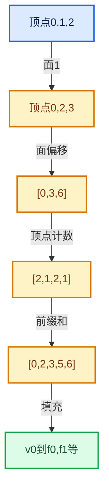

# 05-几何存储与拓扑映射

[总目录](../README.md)

利用连续性和重复关系选择表示，让冗余状态尽量无法表达。

## 前置知识与阅读层次

- [01-基础容器与现代CPP](../01-%E5%9F%BA%E7%A1%80%E5%AE%B9%E5%99%A8%E4%B8%8E%E7%8E%B0%E4%BB%A3CPP/README.md)
- [04-虚拟数组与索引选择](../04-%E8%99%9A%E6%8B%9F%E6%95%B0%E7%BB%84%E4%B8%8E%E7%B4%A2%E5%BC%95%E9%80%89%E6%8B%A9/README.md)

初读抓住数据模型，复读逐行检查，再完成反例和独立实现。方向间允许按实际问题回查，不要求机械线性阅读。

## 正文与源码范围

| 顺序 | 文档 | 主讲文件与范围 |
|---|---|---|
| 05-01 | [Mesh顶点边面角点](01-Mesh%E9%A1%B6%E7%82%B9%E8%BE%B9%E9%9D%A2%E8%A7%92%E7%82%B9.md) | BKE_mesh.hh:L1—L513 |
| 05-02 | [OffsetIndices完整接口](02-OffsetIndices%E5%AE%8C%E6%95%B4%E6%8E%A5%E5%8F%A3.md) | BLI_offset_indices.hh:L1—L284 |
| 05-03 | [MPoly迁移与兼容](03-MPoly%E8%BF%81%E7%A7%BB%E4%B8%8E%E5%85%BC%E5%AE%B9.md) | mesh.cc:L1—L2270 |
| 05-04 | [CurvesGeometry存储](04-CurvesGeometry%E5%AD%98%E5%82%A8.md) | BKE_curves.hh:L1—L1199 |
| 05-05 | [邻接关系与前缀和](05-%E9%82%BB%E6%8E%A5%E5%85%B3%E7%B3%BB%E4%B8%8E%E5%89%8D%E7%BC%80%E5%92%8C.md) | offset_indices.cc:L1—L454 |
| 05-06 | [拓扑映射构建](06-%E6%8B%93%E6%89%91%E6%98%A0%E5%B0%84%E6%9E%84%E5%BB%BA.md) | BKE_mesh_mapping.hh:L1—L314；mesh_mapping.cc:L1—L962 |
| 05-07 | [分组访问与反向索引](07-%E5%88%86%E7%BB%84%E8%AE%BF%E9%97%AE%E4%B8%8E%E5%8F%8D%E5%90%91%E7%B4%A2%E5%BC%95.md) | BLI_array_utils.hh:L273—L537 |
| 05-08 | [AttributeAccessor接口](08-AttributeAccessor%E6%8E%A5%E5%8F%A3.md) | BKE_attribute.hh:L1—L1113 |
| 05-09 | [属性域与转换](09-%E5%B1%9E%E6%80%A7%E5%9F%9F%E4%B8%8E%E8%BD%AC%E6%8D%A2.md) | geometry_fields.cc:L1—L1330；BKE_geometry_fields.hh:L1—L291 |
| 05-10 | [布局兼容与几何实战](10-%E5%B8%83%E5%B1%80%E5%85%BC%E5%AE%B9%E4%B8%8E%E5%87%A0%E4%BD%95%E5%AE%9E%E6%88%98.md) | BKE_attribute_storage.hh:L1—L352 |

## 本方向的数据模型

## 状态推演

## 历史入口

- [Mesh: Replace MPoly struct with offset indices](https://projects.blender.org/blender/blender/commit/7966cd16d6dc4e66d01f7bd68a090107c1a7978c) · Hans Goudey · 2023-04-04
- [Mesh: Reimplement and unify topology maps](https://projects.blender.org/blender/blender/commit/4d841e1b355959aba4b55e9f7bfa83af0ed2d162) · Hans Goudey · 2023-05-24
- [Geometry: Use implicit sharing for curve and mesh offsets](https://projects.blender.org/blender/blender/commit/dcb3b1c1f9cb3d5b5e1827a7378b909745c55d64) · Hans Goudey · 2023-04-14

## 跨库比较与验收

把偏移数组与vector<vector<int>>、CSR邻接表示作比较：前者集中存储，后者方便独立增长；是否稳定修改比容器名字更影响选型。

偏移单调不减；最终偏移与存储边界对应；每个角点引用合法顶点，每个反向映射可由正向关系验证。

正文和源码区间已建立；自动检查结果见根目录验收报告。阅读者的掌握程度以独立练习与反例推理为准。
