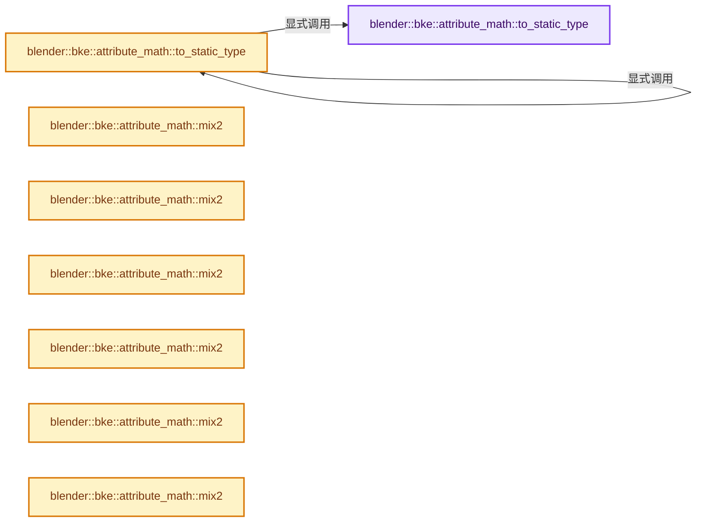
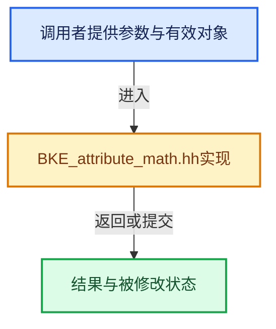

# 实现依赖专题：source/blender/blenkernel/BKE_attribute_math.hh

[方向导航](README.md) · [符号索引](../%E7%AC%A6%E5%8F%B7%E4%BE%9D%E8%B5%96%E4%B8%8E%E5%AE%9E%E7%8E%B0%E7%B4%A2%E5%BC%95.md)

本专题从正文实际调用进入，集中保存共享实现。函数有稳定锚点，可从调用处直接跳到对应完整函数；递归与互相调用通过回链组织。

## 本文件的实现关系






## 完整成员与函数实现

<a id="f-fdfaf0b86a24f278"></a>

### `blender::bke::attribute_math::to_static_type`

实现位置：[source/blender/blenkernel/BKE_attribute_math.hh](../../../../../source/blender/blenkernel/BKE_attribute_math.hh) · L35—L50。

接口参数：

- `const CPPType &cpp_type`
- `Fn &&fn`

**教学注释版**

<!-- annotated:8ec28aff314123 -->

```cpp
template<typename Fn> inline void to_static_type(const CPPType &cpp_type, Fn &&fn)
{
  cpp_type.to_static_type<float,
                          float2,
                          float3,
                          float4,
                          int,
                          int2,
                          bool,
                          int8_t,
                          short2,
                          ColorGeometry4f,
                          ColorGeometry4b,
                          math::Quaternion,
                          float4x4>([&]<typename T>() { fn.template operator()<T>(); });
}
```

<details>
<summary>核对原始源码：source/blender/blenkernel/BKE_attribute_math.hh · L35—L50</summary>

<!-- original:8ec28aff314123:source/blender/blenkernel/BKE_attribute_math.hh:35:50 -->

```cpp
template<typename Fn> inline void to_static_type(const CPPType &cpp_type, Fn &&fn)
{
  cpp_type.to_static_type<float,
                          float2,
                          float3,
                          float4,
                          int,
                          int2,
                          bool,
                          int8_t,
                          short2,
                          ColorGeometry4f,
                          ColorGeometry4b,
                          math::Quaternion,
                          float4x4>([&]<typename T>() { fn.template operator()<T>(); });
}
```

</details>

**继续追踪实现**

- `cpp_type.to_static_type<float, float2, float3, float4, int, int2, bool, int8_t, short2, ColorGeometry4f, ColorGeometry4b, math::Quaternion, float4x4>` → [blender::CPPType::to_static_type · L768](../03-%E5%86%85%E5%AD%98%E5%88%86%E9%85%8D%E4%B8%8E%E8%BF%90%E8%A1%8C%E6%97%B6%E7%B1%BB%E5%9E%8B/09-CPPType%E5%A4%8D%E5%88%B6%E7%A7%BB%E5%8A%A8%E9%87%8D%E5%AE%9A%E4%BD%8D.md#f-c63e6d79f19ab075)。
- `fn.template operator()<T>` → [调用协议](../%E6%A8%A1%E6%9D%BF%E5%AE%8F%E4%B8%8E%E5%8A%A8%E6%80%81%E5%88%86%E6%B4%BE%E5%8D%8F%E8%AE%AE.md)：Fn模板参数提供的操作协议。调用位置L49。

<a id="f-5346ade4e816ebd6"></a>

### `blender::bke::attribute_math::to_static_type`

实现位置：[source/blender/blenkernel/BKE_attribute_math.hh](../../../../../source/blender/blenkernel/BKE_attribute_math.hh) · L52—L56。

接口参数：

- `const bke::AttrType data_type`
- `Fn &&fn`

**教学注释版**

<!-- annotated:b18128706b5105 -->

```cpp
template<typename Fn> inline void to_static_type(const bke::AttrType data_type, Fn &&fn)
{
  const CPPType &cpp_type = bke::attribute_type_to_cpp_type(data_type);
  // [讲解] std::forward<Fn>：在转发引用中恢复调用者传入的值类别；依赖推导类型，不能与无条件move互换。
  to_static_type(cpp_type, std::forward<Fn>(fn));
}
```

<details>
<summary>核对原始源码：source/blender/blenkernel/BKE_attribute_math.hh · L52—L56</summary>

<!-- original:b18128706b5105:source/blender/blenkernel/BKE_attribute_math.hh:52:56 -->

```cpp
template<typename Fn> inline void to_static_type(const bke::AttrType data_type, Fn &&fn)
{
  const CPPType &cpp_type = bke::attribute_type_to_cpp_type(data_type);
  to_static_type(cpp_type, std::forward<Fn>(fn));
}
```

</details>

**继续追踪实现**

- `bke::attribute_type_to_cpp_type` → [blender::bke::attribute_type_to_cpp_type · L44](%E4%BE%9D%E8%B5%96-attribute_access-bceef3.md#f-69deacfd0fca6244)。
- `to_static_type` → [blender::bke::attribute_math::to_static_type · L35](%E4%BE%9D%E8%B5%96-BKE_attribute_math-ac7998.md#f-fdfaf0b86a24f278)；[blender::bke::attribute_math::to_static_type · L52](%E4%BE%9D%E8%B5%96-BKE_attribute_math-ac7998.md#f-5346ade4e816ebd6)。同名重载需按实参类型选择。
- `std::forward<Fn>` → [外部契约](https://eel.is/c++draft/utility.forward)：在转发引用中恢复调用者传入的值类别；依赖推导类型，不能与无条件move互换。

<a id="f-8b99af960eb48e28"></a>

### `blender::bke::attribute_math::mix2`

实现位置：[source/blender/blenkernel/BKE_attribute_math.hh](../../../../../source/blender/blenkernel/BKE_attribute_math.hh) · L66—L69。

接口参数：

- `const float factor`
- `const bool &a`
- `const bool &b`

**教学注释版**

<!-- annotated:259b95a02b1a42 -->

```cpp
template<> inline bool mix2(const float factor, const bool &a, const bool &b)
{
  return ((1.0f - factor) * a + factor * b) >= 0.5f;
}
```

<details>
<summary>核对原始源码：source/blender/blenkernel/BKE_attribute_math.hh · L66—L69</summary>

<!-- original:259b95a02b1a42:source/blender/blenkernel/BKE_attribute_math.hh:66:69 -->

```cpp
template<> inline bool mix2(const float factor, const bool &a, const bool &b)
{
  return ((1.0f - factor) * a + factor * b) >= 0.5f;
}
```

</details>

**结果出口**

- `return ((1.0f - factor) * a + factor * b) >= 0.5f;`

**继续追踪实现**

本实现没有需要继续展开的显式调用；检查返回表达式、对象转换和调用者前置条件。

<a id="f-9ef790651fef779c"></a>

### `blender::bke::attribute_math::mix2`

实现位置：[source/blender/blenkernel/BKE_attribute_math.hh](../../../../../source/blender/blenkernel/BKE_attribute_math.hh) · L71—L74。

接口参数：

- `const float factor`
- `const int8_t &a`
- `const int8_t &b`

**教学注释版**

<!-- annotated:de41a4abb528a8 -->

```cpp
template<> inline int8_t mix2(const float factor, const int8_t &a, const int8_t &b)
{
  return int8_t(std::round((1.0f - factor) * a + factor * b));
}
```

<details>
<summary>核对原始源码：source/blender/blenkernel/BKE_attribute_math.hh · L71—L74</summary>

<!-- original:de41a4abb528a8:source/blender/blenkernel/BKE_attribute_math.hh:71:74 -->

```cpp
template<> inline int8_t mix2(const float factor, const int8_t &a, const int8_t &b)
{
  return int8_t(std::round((1.0f - factor) * a + factor * b));
}
```

</details>

**结果出口**

- `return int8_t(std::round((1.0f - factor) * a + factor * b));`

**继续追踪实现**

- `std::round` → [外部契约](https://eel.is/c++draft/)：这个边界按实际表达式及所属类型核对参数、返回值、寿命与失败行为。这里提供接口入口，不声称已解释该第三方版本的内部实现。

<a id="f-cff51a3353ed28a9"></a>

### `blender::bke::attribute_math::mix2`

实现位置：[source/blender/blenkernel/BKE_attribute_math.hh](../../../../../source/blender/blenkernel/BKE_attribute_math.hh) · L76—L79。

接口参数：

- `const float factor`
- `const int &a`
- `const int &b`

**教学注释版**

<!-- annotated:afc9d524468212 -->

```cpp
template<> inline int mix2(const float factor, const int &a, const int &b)
{
  return int(std::round((1.0f - factor) * a + factor * b));
}
```

<details>
<summary>核对原始源码：source/blender/blenkernel/BKE_attribute_math.hh · L76—L79</summary>

<!-- original:afc9d524468212:source/blender/blenkernel/BKE_attribute_math.hh:76:79 -->

```cpp
template<> inline int mix2(const float factor, const int &a, const int &b)
{
  return int(std::round((1.0f - factor) * a + factor * b));
}
```

</details>

**结果出口**

- `return int(std::round((1.0f - factor) * a + factor * b));`

**继续追踪实现**

- `std::round` → [外部契约](https://eel.is/c++draft/)：这个边界按实际表达式及所属类型核对参数、返回值、寿命与失败行为。这里提供接口入口，不声称已解释该第三方版本的内部实现。

<a id="f-222deb3f0b06c022"></a>

### `blender::bke::attribute_math::mix2`

实现位置：[source/blender/blenkernel/BKE_attribute_math.hh](../../../../../source/blender/blenkernel/BKE_attribute_math.hh) · L81—L84。

接口参数：

- `const float factor`
- `const short2 &a`
- `const short2 &b`

**教学注释版**

<!-- annotated:1672fd7cb970b3 -->

```cpp
template<> inline short2 mix2(const float factor, const short2 &a, const short2 &b)
{
  return math::interpolate(a, b, factor);
}
```

<details>
<summary>核对原始源码：source/blender/blenkernel/BKE_attribute_math.hh · L81—L84</summary>

<!-- original:1672fd7cb970b3:source/blender/blenkernel/BKE_attribute_math.hh:81:84 -->

```cpp
template<> inline short2 mix2(const float factor, const short2 &a, const short2 &b)
{
  return math::interpolate(a, b, factor);
}
```

</details>

**结果出口**

- `return math::interpolate(a, b, factor);`

**继续追踪实现**

- `math::interpolate` → [blender::math::interpolate · L335](../12-%E7%A9%BA%E9%97%B4%E6%95%B0%E6%8D%AE%E7%BB%93%E6%9E%84%E4%B8%8E%E5%87%A0%E4%BD%95%E7%AE%97%E6%B3%95/%E4%BE%9D%E8%B5%96-math_matrix-d7d8ee.md#f-91e7f517ebd72fb5)；[blender::math::interpolate · L379](../12-%E7%A9%BA%E9%97%B4%E6%95%B0%E6%8D%AE%E7%BB%93%E6%9E%84%E4%B8%8E%E5%87%A0%E4%BD%95%E7%AE%97%E6%B3%95/%E4%BE%9D%E8%B5%96-math_matrix-d7d8ee.md#f-a1be14e86ce595c2)；[blender::math::interpolate · L636](../12-%E7%A9%BA%E9%97%B4%E6%95%B0%E6%8D%AE%E7%BB%93%E6%9E%84%E4%B8%8E%E5%87%A0%E4%BD%95%E7%AE%97%E6%B3%95/%E4%BE%9D%E8%B5%96-BLI_math_vector-906a87.md#f-d612b6d6ab1b6e7c)；[blender::math::interpolate · L303](../12-%E7%A9%BA%E9%97%B4%E6%95%B0%E6%8D%AE%E7%BB%93%E6%9E%84%E4%B8%8E%E5%87%A0%E4%BD%95%E7%AE%97%E6%B3%95/%E4%BE%9D%E8%B5%96-BLI_math_quaternion-cf105d.md#f-48b9ace2a9c6185c)；[blender::math::interpolate · L17](../12-%E7%A9%BA%E9%97%B4%E6%95%B0%E6%8D%AE%E7%BB%93%E6%9E%84%E4%B8%8E%E5%87%A0%E4%BD%95%E7%AE%97%E6%B3%95/%E4%BE%9D%E8%B5%96-BLI_math_color-f3a6ea.md#f-eb5ef92b0f8c0926)；[blender::math::interpolate · L28](../12-%E7%A9%BA%E9%97%B4%E6%95%B0%E6%8D%AE%E7%BB%93%E6%9E%84%E4%B8%8E%E5%87%A0%E4%BD%95%E7%AE%97%E6%B3%95/%E4%BE%9D%E8%B5%96-BLI_math_color-f3a6ea.md#f-2a9e33ec55979ab6)；[blender::math::interpolate · L278](../12-%E7%A9%BA%E9%97%B4%E6%95%B0%E6%8D%AE%E7%BB%93%E6%9E%84%E4%B8%8E%E5%87%A0%E4%BD%95%E7%AE%97%E6%B3%95/%E4%BE%9D%E8%B5%96-BLI_math_base-0728eb.md#f-2629b871528f6528)。同名重载需按实参类型选择。

<a id="f-842669f14eaf15e9"></a>

### `blender::bke::attribute_math::mix2`

实现位置：[source/blender/blenkernel/BKE_attribute_math.hh](../../../../../source/blender/blenkernel/BKE_attribute_math.hh) · L86—L89。

接口参数：

- `const float factor`
- `const int2 &a`
- `const int2 &b`

**教学注释版**

<!-- annotated:de562132660693 -->

```cpp
template<> inline int2 mix2(const float factor, const int2 &a, const int2 &b)
{
  return math::interpolate(a, b, factor);
}
```

<details>
<summary>核对原始源码：source/blender/blenkernel/BKE_attribute_math.hh · L86—L89</summary>

<!-- original:de562132660693:source/blender/blenkernel/BKE_attribute_math.hh:86:89 -->

```cpp
template<> inline int2 mix2(const float factor, const int2 &a, const int2 &b)
{
  return math::interpolate(a, b, factor);
}
```

</details>

**结果出口**

- `return math::interpolate(a, b, factor);`

**继续追踪实现**

- `math::interpolate` → [blender::math::interpolate · L335](../12-%E7%A9%BA%E9%97%B4%E6%95%B0%E6%8D%AE%E7%BB%93%E6%9E%84%E4%B8%8E%E5%87%A0%E4%BD%95%E7%AE%97%E6%B3%95/%E4%BE%9D%E8%B5%96-math_matrix-d7d8ee.md#f-91e7f517ebd72fb5)；[blender::math::interpolate · L379](../12-%E7%A9%BA%E9%97%B4%E6%95%B0%E6%8D%AE%E7%BB%93%E6%9E%84%E4%B8%8E%E5%87%A0%E4%BD%95%E7%AE%97%E6%B3%95/%E4%BE%9D%E8%B5%96-math_matrix-d7d8ee.md#f-a1be14e86ce595c2)；[blender::math::interpolate · L636](../12-%E7%A9%BA%E9%97%B4%E6%95%B0%E6%8D%AE%E7%BB%93%E6%9E%84%E4%B8%8E%E5%87%A0%E4%BD%95%E7%AE%97%E6%B3%95/%E4%BE%9D%E8%B5%96-BLI_math_vector-906a87.md#f-d612b6d6ab1b6e7c)；[blender::math::interpolate · L303](../12-%E7%A9%BA%E9%97%B4%E6%95%B0%E6%8D%AE%E7%BB%93%E6%9E%84%E4%B8%8E%E5%87%A0%E4%BD%95%E7%AE%97%E6%B3%95/%E4%BE%9D%E8%B5%96-BLI_math_quaternion-cf105d.md#f-48b9ace2a9c6185c)；[blender::math::interpolate · L17](../12-%E7%A9%BA%E9%97%B4%E6%95%B0%E6%8D%AE%E7%BB%93%E6%9E%84%E4%B8%8E%E5%87%A0%E4%BD%95%E7%AE%97%E6%B3%95/%E4%BE%9D%E8%B5%96-BLI_math_color-f3a6ea.md#f-eb5ef92b0f8c0926)；[blender::math::interpolate · L28](../12-%E7%A9%BA%E9%97%B4%E6%95%B0%E6%8D%AE%E7%BB%93%E6%9E%84%E4%B8%8E%E5%87%A0%E4%BD%95%E7%AE%97%E6%B3%95/%E4%BE%9D%E8%B5%96-BLI_math_color-f3a6ea.md#f-2a9e33ec55979ab6)；[blender::math::interpolate · L278](../12-%E7%A9%BA%E9%97%B4%E6%95%B0%E6%8D%AE%E7%BB%93%E6%9E%84%E4%B8%8E%E5%87%A0%E4%BD%95%E7%AE%97%E6%B3%95/%E4%BE%9D%E8%B5%96-BLI_math_base-0728eb.md#f-2629b871528f6528)。同名重载需按实参类型选择。

<a id="f-f0253aed0458d320"></a>

### `blender::bke::attribute_math::mix2`

实现位置：[source/blender/blenkernel/BKE_attribute_math.hh](../../../../../source/blender/blenkernel/BKE_attribute_math.hh) · L91—L94。

接口参数：

- `const float factor`
- `const float &a`
- `const float &b`

**教学注释版**

<!-- annotated:378ce3fe460bf9 -->

```cpp
template<> inline float mix2(const float factor, const float &a, const float &b)
{
  return (1.0f - factor) * a + factor * b;
}
```

<details>
<summary>核对原始源码：source/blender/blenkernel/BKE_attribute_math.hh · L91—L94</summary>

<!-- original:378ce3fe460bf9:source/blender/blenkernel/BKE_attribute_math.hh:91:94 -->

```cpp
template<> inline float mix2(const float factor, const float &a, const float &b)
{
  return (1.0f - factor) * a + factor * b;
}
```

</details>

**结果出口**

- `return (1.0f - factor) * a + factor * b;`

**继续追踪实现**

本实现没有需要继续展开的显式调用；检查返回表达式、对象转换和调用者前置条件。

<a id="f-fd2eb7495a3d5ca0"></a>

### `blender::bke::attribute_math::mix2`

实现位置：[source/blender/blenkernel/BKE_attribute_math.hh](../../../../../source/blender/blenkernel/BKE_attribute_math.hh) · L96—L99。

接口参数：

- `const float factor`
- `const float2 &a`
- `const float2 &b`

**教学注释版**

<!-- annotated:6908ba3e9055ac -->

```cpp
template<> inline float2 mix2(const float factor, const float2 &a, const float2 &b)
{
  return math::interpolate(a, b, factor);
}
```

<details>
<summary>核对原始源码：source/blender/blenkernel/BKE_attribute_math.hh · L96—L99</summary>

<!-- original:6908ba3e9055ac:source/blender/blenkernel/BKE_attribute_math.hh:96:99 -->

```cpp
template<> inline float2 mix2(const float factor, const float2 &a, const float2 &b)
{
  return math::interpolate(a, b, factor);
}
```

</details>

**结果出口**

- `return math::interpolate(a, b, factor);`

**继续追踪实现**

- `math::interpolate` → [blender::math::interpolate · L335](../12-%E7%A9%BA%E9%97%B4%E6%95%B0%E6%8D%AE%E7%BB%93%E6%9E%84%E4%B8%8E%E5%87%A0%E4%BD%95%E7%AE%97%E6%B3%95/%E4%BE%9D%E8%B5%96-math_matrix-d7d8ee.md#f-91e7f517ebd72fb5)；[blender::math::interpolate · L379](../12-%E7%A9%BA%E9%97%B4%E6%95%B0%E6%8D%AE%E7%BB%93%E6%9E%84%E4%B8%8E%E5%87%A0%E4%BD%95%E7%AE%97%E6%B3%95/%E4%BE%9D%E8%B5%96-math_matrix-d7d8ee.md#f-a1be14e86ce595c2)；[blender::math::interpolate · L636](../12-%E7%A9%BA%E9%97%B4%E6%95%B0%E6%8D%AE%E7%BB%93%E6%9E%84%E4%B8%8E%E5%87%A0%E4%BD%95%E7%AE%97%E6%B3%95/%E4%BE%9D%E8%B5%96-BLI_math_vector-906a87.md#f-d612b6d6ab1b6e7c)；[blender::math::interpolate · L303](../12-%E7%A9%BA%E9%97%B4%E6%95%B0%E6%8D%AE%E7%BB%93%E6%9E%84%E4%B8%8E%E5%87%A0%E4%BD%95%E7%AE%97%E6%B3%95/%E4%BE%9D%E8%B5%96-BLI_math_quaternion-cf105d.md#f-48b9ace2a9c6185c)；[blender::math::interpolate · L17](../12-%E7%A9%BA%E9%97%B4%E6%95%B0%E6%8D%AE%E7%BB%93%E6%9E%84%E4%B8%8E%E5%87%A0%E4%BD%95%E7%AE%97%E6%B3%95/%E4%BE%9D%E8%B5%96-BLI_math_color-f3a6ea.md#f-eb5ef92b0f8c0926)；[blender::math::interpolate · L28](../12-%E7%A9%BA%E9%97%B4%E6%95%B0%E6%8D%AE%E7%BB%93%E6%9E%84%E4%B8%8E%E5%87%A0%E4%BD%95%E7%AE%97%E6%B3%95/%E4%BE%9D%E8%B5%96-BLI_math_color-f3a6ea.md#f-2a9e33ec55979ab6)；[blender::math::interpolate · L278](../12-%E7%A9%BA%E9%97%B4%E6%95%B0%E6%8D%AE%E7%BB%93%E6%9E%84%E4%B8%8E%E5%87%A0%E4%BD%95%E7%AE%97%E6%B3%95/%E4%BE%9D%E8%B5%96-BLI_math_base-0728eb.md#f-2629b871528f6528)。同名重载需按实参类型选择。

<a id="f-c9dbb4763cfd2cf9"></a>

### `blender::bke::attribute_math::mix2`

实现位置：[source/blender/blenkernel/BKE_attribute_math.hh](../../../../../source/blender/blenkernel/BKE_attribute_math.hh) · L101—L104。

接口参数：

- `const float factor`
- `const float3 &a`
- `const float3 &b`

**教学注释版**

<!-- annotated:84d9380c31b57d -->

```cpp
template<> inline float3 mix2(const float factor, const float3 &a, const float3 &b)
{
  return math::interpolate(a, b, factor);
}
```

<details>
<summary>核对原始源码：source/blender/blenkernel/BKE_attribute_math.hh · L101—L104</summary>

<!-- original:84d9380c31b57d:source/blender/blenkernel/BKE_attribute_math.hh:101:104 -->

```cpp
template<> inline float3 mix2(const float factor, const float3 &a, const float3 &b)
{
  return math::interpolate(a, b, factor);
}
```

</details>

**结果出口**

- `return math::interpolate(a, b, factor);`

**继续追踪实现**

- `math::interpolate` → [blender::math::interpolate · L335](../12-%E7%A9%BA%E9%97%B4%E6%95%B0%E6%8D%AE%E7%BB%93%E6%9E%84%E4%B8%8E%E5%87%A0%E4%BD%95%E7%AE%97%E6%B3%95/%E4%BE%9D%E8%B5%96-math_matrix-d7d8ee.md#f-91e7f517ebd72fb5)；[blender::math::interpolate · L379](../12-%E7%A9%BA%E9%97%B4%E6%95%B0%E6%8D%AE%E7%BB%93%E6%9E%84%E4%B8%8E%E5%87%A0%E4%BD%95%E7%AE%97%E6%B3%95/%E4%BE%9D%E8%B5%96-math_matrix-d7d8ee.md#f-a1be14e86ce595c2)；[blender::math::interpolate · L636](../12-%E7%A9%BA%E9%97%B4%E6%95%B0%E6%8D%AE%E7%BB%93%E6%9E%84%E4%B8%8E%E5%87%A0%E4%BD%95%E7%AE%97%E6%B3%95/%E4%BE%9D%E8%B5%96-BLI_math_vector-906a87.md#f-d612b6d6ab1b6e7c)；[blender::math::interpolate · L303](../12-%E7%A9%BA%E9%97%B4%E6%95%B0%E6%8D%AE%E7%BB%93%E6%9E%84%E4%B8%8E%E5%87%A0%E4%BD%95%E7%AE%97%E6%B3%95/%E4%BE%9D%E8%B5%96-BLI_math_quaternion-cf105d.md#f-48b9ace2a9c6185c)；[blender::math::interpolate · L17](../12-%E7%A9%BA%E9%97%B4%E6%95%B0%E6%8D%AE%E7%BB%93%E6%9E%84%E4%B8%8E%E5%87%A0%E4%BD%95%E7%AE%97%E6%B3%95/%E4%BE%9D%E8%B5%96-BLI_math_color-f3a6ea.md#f-eb5ef92b0f8c0926)；[blender::math::interpolate · L28](../12-%E7%A9%BA%E9%97%B4%E6%95%B0%E6%8D%AE%E7%BB%93%E6%9E%84%E4%B8%8E%E5%87%A0%E4%BD%95%E7%AE%97%E6%B3%95/%E4%BE%9D%E8%B5%96-BLI_math_color-f3a6ea.md#f-2a9e33ec55979ab6)；[blender::math::interpolate · L278](../12-%E7%A9%BA%E9%97%B4%E6%95%B0%E6%8D%AE%E7%BB%93%E6%9E%84%E4%B8%8E%E5%87%A0%E4%BD%95%E7%AE%97%E6%B3%95/%E4%BE%9D%E8%B5%96-BLI_math_base-0728eb.md#f-2629b871528f6528)。同名重载需按实参类型选择。

<a id="f-455bd7e9fa141103"></a>

### `blender::bke::attribute_math::mix2`

实现位置：[source/blender/blenkernel/BKE_attribute_math.hh](../../../../../source/blender/blenkernel/BKE_attribute_math.hh) · L106—L109。

接口参数：

- `const float factor`
- `const float4 &a`
- `const float4 &b`

**教学注释版**

<!-- annotated:2015714f35172b -->

```cpp
template<> inline float4 mix2(const float factor, const float4 &a, const float4 &b)
{
  return math::interpolate(a, b, factor);
}
```

<details>
<summary>核对原始源码：source/blender/blenkernel/BKE_attribute_math.hh · L106—L109</summary>

<!-- original:2015714f35172b:source/blender/blenkernel/BKE_attribute_math.hh:106:109 -->

```cpp
template<> inline float4 mix2(const float factor, const float4 &a, const float4 &b)
{
  return math::interpolate(a, b, factor);
}
```

</details>

**结果出口**

- `return math::interpolate(a, b, factor);`

**继续追踪实现**

- `math::interpolate` → [blender::math::interpolate · L335](../12-%E7%A9%BA%E9%97%B4%E6%95%B0%E6%8D%AE%E7%BB%93%E6%9E%84%E4%B8%8E%E5%87%A0%E4%BD%95%E7%AE%97%E6%B3%95/%E4%BE%9D%E8%B5%96-math_matrix-d7d8ee.md#f-91e7f517ebd72fb5)；[blender::math::interpolate · L379](../12-%E7%A9%BA%E9%97%B4%E6%95%B0%E6%8D%AE%E7%BB%93%E6%9E%84%E4%B8%8E%E5%87%A0%E4%BD%95%E7%AE%97%E6%B3%95/%E4%BE%9D%E8%B5%96-math_matrix-d7d8ee.md#f-a1be14e86ce595c2)；[blender::math::interpolate · L636](../12-%E7%A9%BA%E9%97%B4%E6%95%B0%E6%8D%AE%E7%BB%93%E6%9E%84%E4%B8%8E%E5%87%A0%E4%BD%95%E7%AE%97%E6%B3%95/%E4%BE%9D%E8%B5%96-BLI_math_vector-906a87.md#f-d612b6d6ab1b6e7c)；[blender::math::interpolate · L303](../12-%E7%A9%BA%E9%97%B4%E6%95%B0%E6%8D%AE%E7%BB%93%E6%9E%84%E4%B8%8E%E5%87%A0%E4%BD%95%E7%AE%97%E6%B3%95/%E4%BE%9D%E8%B5%96-BLI_math_quaternion-cf105d.md#f-48b9ace2a9c6185c)；[blender::math::interpolate · L17](../12-%E7%A9%BA%E9%97%B4%E6%95%B0%E6%8D%AE%E7%BB%93%E6%9E%84%E4%B8%8E%E5%87%A0%E4%BD%95%E7%AE%97%E6%B3%95/%E4%BE%9D%E8%B5%96-BLI_math_color-f3a6ea.md#f-eb5ef92b0f8c0926)；[blender::math::interpolate · L28](../12-%E7%A9%BA%E9%97%B4%E6%95%B0%E6%8D%AE%E7%BB%93%E6%9E%84%E4%B8%8E%E5%87%A0%E4%BD%95%E7%AE%97%E6%B3%95/%E4%BE%9D%E8%B5%96-BLI_math_color-f3a6ea.md#f-2a9e33ec55979ab6)；[blender::math::interpolate · L278](../12-%E7%A9%BA%E9%97%B4%E6%95%B0%E6%8D%AE%E7%BB%93%E6%9E%84%E4%B8%8E%E5%87%A0%E4%BD%95%E7%AE%97%E6%B3%95/%E4%BE%9D%E8%B5%96-BLI_math_base-0728eb.md#f-2629b871528f6528)。同名重载需按实参类型选择。

<a id="f-7246e4b5a45d9f1b"></a>

### `blender::bke::attribute_math::mix2`

实现位置：[source/blender/blenkernel/BKE_attribute_math.hh](../../../../../source/blender/blenkernel/BKE_attribute_math.hh) · L111—L115。

接口参数：

- `const float factor`
- `const ColorGeometry4f &a`
- `const ColorGeometry4f &b`

**教学注释版**

<!-- annotated:ca20b4100348ef -->

```cpp
template<>
inline ColorGeometry4f mix2(const float factor, const ColorGeometry4f &a, const ColorGeometry4f &b)
{
  return math::interpolate(a, b, factor);
}
```

<details>
<summary>核对原始源码：source/blender/blenkernel/BKE_attribute_math.hh · L111—L115</summary>

<!-- original:ca20b4100348ef:source/blender/blenkernel/BKE_attribute_math.hh:111:115 -->

```cpp
template<>
inline ColorGeometry4f mix2(const float factor, const ColorGeometry4f &a, const ColorGeometry4f &b)
{
  return math::interpolate(a, b, factor);
}
```

</details>

**结果出口**

- `return math::interpolate(a, b, factor);`

**继续追踪实现**

- `math::interpolate` → [blender::math::interpolate · L335](../12-%E7%A9%BA%E9%97%B4%E6%95%B0%E6%8D%AE%E7%BB%93%E6%9E%84%E4%B8%8E%E5%87%A0%E4%BD%95%E7%AE%97%E6%B3%95/%E4%BE%9D%E8%B5%96-math_matrix-d7d8ee.md#f-91e7f517ebd72fb5)；[blender::math::interpolate · L379](../12-%E7%A9%BA%E9%97%B4%E6%95%B0%E6%8D%AE%E7%BB%93%E6%9E%84%E4%B8%8E%E5%87%A0%E4%BD%95%E7%AE%97%E6%B3%95/%E4%BE%9D%E8%B5%96-math_matrix-d7d8ee.md#f-a1be14e86ce595c2)；[blender::math::interpolate · L636](../12-%E7%A9%BA%E9%97%B4%E6%95%B0%E6%8D%AE%E7%BB%93%E6%9E%84%E4%B8%8E%E5%87%A0%E4%BD%95%E7%AE%97%E6%B3%95/%E4%BE%9D%E8%B5%96-BLI_math_vector-906a87.md#f-d612b6d6ab1b6e7c)；[blender::math::interpolate · L303](../12-%E7%A9%BA%E9%97%B4%E6%95%B0%E6%8D%AE%E7%BB%93%E6%9E%84%E4%B8%8E%E5%87%A0%E4%BD%95%E7%AE%97%E6%B3%95/%E4%BE%9D%E8%B5%96-BLI_math_quaternion-cf105d.md#f-48b9ace2a9c6185c)；[blender::math::interpolate · L17](../12-%E7%A9%BA%E9%97%B4%E6%95%B0%E6%8D%AE%E7%BB%93%E6%9E%84%E4%B8%8E%E5%87%A0%E4%BD%95%E7%AE%97%E6%B3%95/%E4%BE%9D%E8%B5%96-BLI_math_color-f3a6ea.md#f-eb5ef92b0f8c0926)；[blender::math::interpolate · L28](../12-%E7%A9%BA%E9%97%B4%E6%95%B0%E6%8D%AE%E7%BB%93%E6%9E%84%E4%B8%8E%E5%87%A0%E4%BD%95%E7%AE%97%E6%B3%95/%E4%BE%9D%E8%B5%96-BLI_math_color-f3a6ea.md#f-2a9e33ec55979ab6)；[blender::math::interpolate · L278](../12-%E7%A9%BA%E9%97%B4%E6%95%B0%E6%8D%AE%E7%BB%93%E6%9E%84%E4%B8%8E%E5%87%A0%E4%BD%95%E7%AE%97%E6%B3%95/%E4%BE%9D%E8%B5%96-BLI_math_base-0728eb.md#f-2629b871528f6528)。同名重载需按实参类型选择。

<a id="f-1088551b894e068a"></a>

### `blender::bke::attribute_math::mix2`

实现位置：[source/blender/blenkernel/BKE_attribute_math.hh](../../../../../source/blender/blenkernel/BKE_attribute_math.hh) · L117—L121。

接口参数：

- `const float factor`
- `const ColorGeometry4b &a`
- `const ColorGeometry4b &b`

**教学注释版**

<!-- annotated:e02c4dfcfa1c96 -->

```cpp
template<>
inline ColorGeometry4b mix2(const float factor, const ColorGeometry4b &a, const ColorGeometry4b &b)
{
  return math::interpolate(a, b, factor);
}
```

<details>
<summary>核对原始源码：source/blender/blenkernel/BKE_attribute_math.hh · L117—L121</summary>

<!-- original:e02c4dfcfa1c96:source/blender/blenkernel/BKE_attribute_math.hh:117:121 -->

```cpp
template<>
inline ColorGeometry4b mix2(const float factor, const ColorGeometry4b &a, const ColorGeometry4b &b)
{
  return math::interpolate(a, b, factor);
}
```

</details>

**结果出口**

- `return math::interpolate(a, b, factor);`

**继续追踪实现**

- `math::interpolate` → [blender::math::interpolate · L335](../12-%E7%A9%BA%E9%97%B4%E6%95%B0%E6%8D%AE%E7%BB%93%E6%9E%84%E4%B8%8E%E5%87%A0%E4%BD%95%E7%AE%97%E6%B3%95/%E4%BE%9D%E8%B5%96-math_matrix-d7d8ee.md#f-91e7f517ebd72fb5)；[blender::math::interpolate · L379](../12-%E7%A9%BA%E9%97%B4%E6%95%B0%E6%8D%AE%E7%BB%93%E6%9E%84%E4%B8%8E%E5%87%A0%E4%BD%95%E7%AE%97%E6%B3%95/%E4%BE%9D%E8%B5%96-math_matrix-d7d8ee.md#f-a1be14e86ce595c2)；[blender::math::interpolate · L636](../12-%E7%A9%BA%E9%97%B4%E6%95%B0%E6%8D%AE%E7%BB%93%E6%9E%84%E4%B8%8E%E5%87%A0%E4%BD%95%E7%AE%97%E6%B3%95/%E4%BE%9D%E8%B5%96-BLI_math_vector-906a87.md#f-d612b6d6ab1b6e7c)；[blender::math::interpolate · L303](../12-%E7%A9%BA%E9%97%B4%E6%95%B0%E6%8D%AE%E7%BB%93%E6%9E%84%E4%B8%8E%E5%87%A0%E4%BD%95%E7%AE%97%E6%B3%95/%E4%BE%9D%E8%B5%96-BLI_math_quaternion-cf105d.md#f-48b9ace2a9c6185c)；[blender::math::interpolate · L17](../12-%E7%A9%BA%E9%97%B4%E6%95%B0%E6%8D%AE%E7%BB%93%E6%9E%84%E4%B8%8E%E5%87%A0%E4%BD%95%E7%AE%97%E6%B3%95/%E4%BE%9D%E8%B5%96-BLI_math_color-f3a6ea.md#f-eb5ef92b0f8c0926)；[blender::math::interpolate · L28](../12-%E7%A9%BA%E9%97%B4%E6%95%B0%E6%8D%AE%E7%BB%93%E6%9E%84%E4%B8%8E%E5%87%A0%E4%BD%95%E7%AE%97%E6%B3%95/%E4%BE%9D%E8%B5%96-BLI_math_color-f3a6ea.md#f-2a9e33ec55979ab6)；[blender::math::interpolate · L278](../12-%E7%A9%BA%E9%97%B4%E6%95%B0%E6%8D%AE%E7%BB%93%E6%9E%84%E4%B8%8E%E5%87%A0%E4%BD%95%E7%AE%97%E6%B3%95/%E4%BE%9D%E8%B5%96-BLI_math_base-0728eb.md#f-2629b871528f6528)。同名重载需按实参类型选择。

<a id="f-85af8e84cba2f0da"></a>

### `blender::bke::attribute_math::mix4`

实现位置：[source/blender/blenkernel/BKE_attribute_math.hh](../../../../../source/blender/blenkernel/BKE_attribute_math.hh) · L219—L224。

接口参数：

- `const float4 &weights`
- `const int8_t &v0`
- `const int8_t &v1`
- `const int8_t &v2`
- `const int8_t &v3`

**教学注释版**

<!-- annotated:37643ceaa53985 -->

```cpp
template<>
inline int8_t mix4(
    const float4 &weights, const int8_t &v0, const int8_t &v1, const int8_t &v2, const int8_t &v3)
{
  return int8_t(std::round(weights.x * v0 + weights.y * v1 + weights.z * v2 + weights.w * v3));
}
```

<details>
<summary>核对原始源码：source/blender/blenkernel/BKE_attribute_math.hh · L219—L224</summary>

<!-- original:37643ceaa53985:source/blender/blenkernel/BKE_attribute_math.hh:219:224 -->

```cpp
template<>
inline int8_t mix4(
    const float4 &weights, const int8_t &v0, const int8_t &v1, const int8_t &v2, const int8_t &v3)
{
  return int8_t(std::round(weights.x * v0 + weights.y * v1 + weights.z * v2 + weights.w * v3));
}
```

</details>

**结果出口**

- `return int8_t(std::round(weights.x * v0 + weights.y * v1 + weights.z * v2 + weights.w * v3));`

**继续追踪实现**

- `std::round` → [外部契约](https://eel.is/c++draft/)：这个边界按实际表达式及所属类型核对参数、返回值、寿命与失败行为。这里提供接口入口，不声称已解释该第三方版本的内部实现。

<a id="f-967e89d1be1ace48"></a>

### `blender::bke::attribute_math::mix4`

实现位置：[source/blender/blenkernel/BKE_attribute_math.hh](../../../../../source/blender/blenkernel/BKE_attribute_math.hh) · L226—L231。

接口参数：

- `const float4 &weights`
- `const bool &v0`
- `const bool &v1`
- `const bool &v2`
- `const bool &v3`

**教学注释版**

<!-- annotated:063af3586806c9 -->

```cpp
template<>
inline bool mix4(
    const float4 &weights, const bool &v0, const bool &v1, const bool &v2, const bool &v3)
{
  return (weights.x * v0 + weights.y * v1 + weights.z * v2 + weights.w * v3) >= 0.5f;
}
```

<details>
<summary>核对原始源码：source/blender/blenkernel/BKE_attribute_math.hh · L226—L231</summary>

<!-- original:063af3586806c9:source/blender/blenkernel/BKE_attribute_math.hh:226:231 -->

```cpp
template<>
inline bool mix4(
    const float4 &weights, const bool &v0, const bool &v1, const bool &v2, const bool &v3)
{
  return (weights.x * v0 + weights.y * v1 + weights.z * v2 + weights.w * v3) >= 0.5f;
}
```

</details>

**结果出口**

- `return (weights.x * v0 + weights.y * v1 + weights.z * v2 + weights.w * v3) >= 0.5f;`

**继续追踪实现**

本实现没有需要继续展开的显式调用；检查返回表达式、对象转换和调用者前置条件。

<a id="f-e6f853c01d530853"></a>

### `blender::bke::attribute_math::mix4`

实现位置：[source/blender/blenkernel/BKE_attribute_math.hh](../../../../../source/blender/blenkernel/BKE_attribute_math.hh) · L233—L237。

接口参数：

- `const float4 &weights`
- `const int &v0`
- `const int &v1`
- `const int &v2`
- `const int &v3`

**教学注释版**

<!-- annotated:89278cd659a39c -->

```cpp
template<>
inline int mix4(const float4 &weights, const int &v0, const int &v1, const int &v2, const int &v3)
{
  return int(std::round(weights.x * v0 + weights.y * v1 + weights.z * v2 + weights.w * v3));
}
```

<details>
<summary>核对原始源码：source/blender/blenkernel/BKE_attribute_math.hh · L233—L237</summary>

<!-- original:89278cd659a39c:source/blender/blenkernel/BKE_attribute_math.hh:233:237 -->

```cpp
template<>
inline int mix4(const float4 &weights, const int &v0, const int &v1, const int &v2, const int &v3)
{
  return int(std::round(weights.x * v0 + weights.y * v1 + weights.z * v2 + weights.w * v3));
}
```

</details>

**结果出口**

- `return int(std::round(weights.x * v0 + weights.y * v1 + weights.z * v2 + weights.w * v3));`

**继续追踪实现**

- `std::round` → [外部契约](https://eel.is/c++draft/)：这个边界按实际表达式及所属类型核对参数、返回值、寿命与失败行为。这里提供接口入口，不声称已解释该第三方版本的内部实现。

<a id="f-23ee9c4dcbf8aeb5"></a>

### `blender::bke::attribute_math::mix4`

实现位置：[source/blender/blenkernel/BKE_attribute_math.hh](../../../../../source/blender/blenkernel/BKE_attribute_math.hh) · L239—L245。

接口参数：

- `const float4 &weights`
- `const short2 &v0`
- `const short2 &v1`
- `const short2 &v2`
- `const short2 &v3`

**教学注释版**

<!-- annotated:70cb00c45b346b -->

```cpp
template<>
inline short2 mix4(
    const float4 &weights, const short2 &v0, const short2 &v1, const short2 &v2, const short2 &v3)
{
  return short2(weights.x * float2(v0) + weights.y * float2(v1) + weights.z * float2(v2) +
                weights.w * float2(v3));
}
```

<details>
<summary>核对原始源码：source/blender/blenkernel/BKE_attribute_math.hh · L239—L245</summary>

<!-- original:70cb00c45b346b:source/blender/blenkernel/BKE_attribute_math.hh:239:245 -->

```cpp
template<>
inline short2 mix4(
    const float4 &weights, const short2 &v0, const short2 &v1, const short2 &v2, const short2 &v3)
{
  return short2(weights.x * float2(v0) + weights.y * float2(v1) + weights.z * float2(v2) +
                weights.w * float2(v3));
}
```

</details>

**结果出口**

- `return short2(weights.x * float2(v0) + weights.y * float2(v1) + weights.z * float2(v2) +`

**继续追踪实现**

- `short2` → [调用协议](../%E6%A8%A1%E6%9D%BF%E5%AE%8F%E4%B8%8E%E5%8A%A8%E6%80%81%E5%88%86%E6%B4%BE%E5%8D%8F%E8%AE%AE.md)：函数指针、局部可调用对象或未展开的宏；必须结合调用者环境。调用位置L243。
- `float2` → [float2::float2 · L45](%E4%BE%9D%E8%B5%96-sky_math-8091a6.md#f-04c2783f21f996aa)；[float2::float2 · L47](%E4%BE%9D%E8%B5%96-sky_math-8091a6.md#f-dba79c4c10e5ea46)；[float2::float2 · L49](%E4%BE%9D%E8%B5%96-sky_math-8091a6.md#f-920ca90efa37bf0b)；[float2::float2 · L51](%E4%BE%9D%E8%B5%96-sky_math-8091a6.md#f-4b3fbf848d719a63)；[float2::float2 · L53](%E4%BE%9D%E8%B5%96-sky_math-8091a6.md#f-9b2acd8475cc2843)；[float2::float2 · L55](%E4%BE%9D%E8%B5%96-sky_math-8091a6.md#f-1e9233a9a231be51)。同名重载需按实参类型选择。

<a id="f-0ec66d431ae48d66"></a>

### `blender::bke::attribute_math::mix4`

实现位置：[source/blender/blenkernel/BKE_attribute_math.hh](../../../../../source/blender/blenkernel/BKE_attribute_math.hh) · L247—L253。

接口参数：

- `const float4 &weights`
- `const int2 &v0`
- `const int2 &v1`
- `const int2 &v2`
- `const int2 &v3`

**教学注释版**

<!-- annotated:0d8d79020fded7 -->

```cpp
template<>
inline int2 mix4(
    const float4 &weights, const int2 &v0, const int2 &v1, const int2 &v2, const int2 &v3)
{
  return int2(weights.x * float2(v0) + weights.y * float2(v1) + weights.z * float2(v2) +
              weights.w * float2(v3));
}
```

<details>
<summary>核对原始源码：source/blender/blenkernel/BKE_attribute_math.hh · L247—L253</summary>

<!-- original:0d8d79020fded7:source/blender/blenkernel/BKE_attribute_math.hh:247:253 -->

```cpp
template<>
inline int2 mix4(
    const float4 &weights, const int2 &v0, const int2 &v1, const int2 &v2, const int2 &v3)
{
  return int2(weights.x * float2(v0) + weights.y * float2(v1) + weights.z * float2(v2) +
              weights.w * float2(v3));
}
```

</details>

**结果出口**

- `return int2(weights.x * float2(v0) + weights.y * float2(v1) + weights.z * float2(v2) +`

**继续追踪实现**

- `int2` → [int2 · L643](%E4%BE%9D%E8%B5%96-smaa-b67bc2.md#m-8960c8e6139d)。宏定义由构建条件选择。
- `float2` → [float2::float2 · L45](%E4%BE%9D%E8%B5%96-sky_math-8091a6.md#f-04c2783f21f996aa)；[float2::float2 · L47](%E4%BE%9D%E8%B5%96-sky_math-8091a6.md#f-dba79c4c10e5ea46)；[float2::float2 · L49](%E4%BE%9D%E8%B5%96-sky_math-8091a6.md#f-920ca90efa37bf0b)；[float2::float2 · L51](%E4%BE%9D%E8%B5%96-sky_math-8091a6.md#f-4b3fbf848d719a63)；[float2::float2 · L53](%E4%BE%9D%E8%B5%96-sky_math-8091a6.md#f-9b2acd8475cc2843)；[float2::float2 · L55](%E4%BE%9D%E8%B5%96-sky_math-8091a6.md#f-1e9233a9a231be51)。同名重载需按实参类型选择。

<a id="f-39f875e4e6b49664"></a>

### `blender::bke::attribute_math::mix4`

实现位置：[source/blender/blenkernel/BKE_attribute_math.hh](../../../../../source/blender/blenkernel/BKE_attribute_math.hh) · L255—L260。

接口参数：

- `const float4 &weights`
- `const float &v0`
- `const float &v1`
- `const float &v2`
- `const float &v3`

**教学注释版**

<!-- annotated:e7d42e4daa006b -->

```cpp
template<>
inline float mix4(
    const float4 &weights, const float &v0, const float &v1, const float &v2, const float &v3)
{
  return weights.x * v0 + weights.y * v1 + weights.z * v2 + weights.w * v3;
}
```

<details>
<summary>核对原始源码：source/blender/blenkernel/BKE_attribute_math.hh · L255—L260</summary>

<!-- original:e7d42e4daa006b:source/blender/blenkernel/BKE_attribute_math.hh:255:260 -->

```cpp
template<>
inline float mix4(
    const float4 &weights, const float &v0, const float &v1, const float &v2, const float &v3)
{
  return weights.x * v0 + weights.y * v1 + weights.z * v2 + weights.w * v3;
}
```

</details>

**结果出口**

- `return weights.x * v0 + weights.y * v1 + weights.z * v2 + weights.w * v3;`

**继续追踪实现**

本实现没有需要继续展开的显式调用；检查返回表达式、对象转换和调用者前置条件。

<a id="f-e66911f38510d175"></a>

### `blender::bke::attribute_math::mix4`

实现位置：[source/blender/blenkernel/BKE_attribute_math.hh](../../../../../source/blender/blenkernel/BKE_attribute_math.hh) · L262—L267。

接口参数：

- `const float4 &weights`
- `const float2 &v0`
- `const float2 &v1`
- `const float2 &v2`
- `const float2 &v3`

**教学注释版**

<!-- annotated:585332f33b09b8 -->

```cpp
template<>
inline float2 mix4(
    const float4 &weights, const float2 &v0, const float2 &v1, const float2 &v2, const float2 &v3)
{
  return weights.x * v0 + weights.y * v1 + weights.z * v2 + weights.w * v3;
}
```

<details>
<summary>核对原始源码：source/blender/blenkernel/BKE_attribute_math.hh · L262—L267</summary>

<!-- original:585332f33b09b8:source/blender/blenkernel/BKE_attribute_math.hh:262:267 -->

```cpp
template<>
inline float2 mix4(
    const float4 &weights, const float2 &v0, const float2 &v1, const float2 &v2, const float2 &v3)
{
  return weights.x * v0 + weights.y * v1 + weights.z * v2 + weights.w * v3;
}
```

</details>

**结果出口**

- `return weights.x * v0 + weights.y * v1 + weights.z * v2 + weights.w * v3;`

**继续追踪实现**

本实现没有需要继续展开的显式调用；检查返回表达式、对象转换和调用者前置条件。

<a id="f-b9e623b431abc37b"></a>

### `blender::bke::attribute_math::mix4`

实现位置：[source/blender/blenkernel/BKE_attribute_math.hh](../../../../../source/blender/blenkernel/BKE_attribute_math.hh) · L269—L274。

接口参数：

- `const float4 &weights`
- `const float3 &v0`
- `const float3 &v1`
- `const float3 &v2`
- `const float3 &v3`

**教学注释版**

<!-- annotated:3f69d1cbc0ab02 -->

```cpp
template<>
inline float3 mix4(
    const float4 &weights, const float3 &v0, const float3 &v1, const float3 &v2, const float3 &v3)
{
  return weights.x * v0 + weights.y * v1 + weights.z * v2 + weights.w * v3;
}
```

<details>
<summary>核对原始源码：source/blender/blenkernel/BKE_attribute_math.hh · L269—L274</summary>

<!-- original:3f69d1cbc0ab02:source/blender/blenkernel/BKE_attribute_math.hh:269:274 -->

```cpp
template<>
inline float3 mix4(
    const float4 &weights, const float3 &v0, const float3 &v1, const float3 &v2, const float3 &v3)
{
  return weights.x * v0 + weights.y * v1 + weights.z * v2 + weights.w * v3;
}
```

</details>

**结果出口**

- `return weights.x * v0 + weights.y * v1 + weights.z * v2 + weights.w * v3;`

**继续追踪实现**

本实现没有需要继续展开的显式调用；检查返回表达式、对象转换和调用者前置条件。

<a id="f-49d7c2ccbd904198"></a>

### `blender::bke::attribute_math::mix4`

实现位置：[source/blender/blenkernel/BKE_attribute_math.hh](../../../../../source/blender/blenkernel/BKE_attribute_math.hh) · L276—L281。

接口参数：

- `const float4 &weights`
- `const float4 &v0`
- `const float4 &v1`
- `const float4 &v2`
- `const float4 &v3`

**教学注释版**

<!-- annotated:2ffe2e1d6bdcfb -->

```cpp
template<>
inline float4 mix4(
    const float4 &weights, const float4 &v0, const float4 &v1, const float4 &v2, const float4 &v3)
{
  return weights.x * v0 + weights.y * v1 + weights.z * v2 + weights.w * v3;
}
```

<details>
<summary>核对原始源码：source/blender/blenkernel/BKE_attribute_math.hh · L276—L281</summary>

<!-- original:2ffe2e1d6bdcfb:source/blender/blenkernel/BKE_attribute_math.hh:276:281 -->

```cpp
template<>
inline float4 mix4(
    const float4 &weights, const float4 &v0, const float4 &v1, const float4 &v2, const float4 &v3)
{
  return weights.x * v0 + weights.y * v1 + weights.z * v2 + weights.w * v3;
}
```

</details>

**结果出口**

- `return weights.x * v0 + weights.y * v1 + weights.z * v2 + weights.w * v3;`

**继续追踪实现**

本实现没有需要继续展开的显式调用；检查返回表达式、对象转换和调用者前置条件。

<a id="f-d623c982f5c767e4"></a>

### `blender::bke::attribute_math::mix4`

实现位置：[source/blender/blenkernel/BKE_attribute_math.hh](../../../../../source/blender/blenkernel/BKE_attribute_math.hh) · L283—L293。

接口参数：

- `const float4 &weights`
- `const ColorGeometry4f &v0`
- `const ColorGeometry4f &v1`
- `const ColorGeometry4f &v2`
- `const ColorGeometry4f &v3`

**教学注释版**

<!-- annotated:d5e879c8574031 -->

```cpp
template<>
inline ColorGeometry4f mix4(const float4 &weights,
                            const ColorGeometry4f &v0,
                            const ColorGeometry4f &v1,
                            const ColorGeometry4f &v2,
                            const ColorGeometry4f &v3)
{
  ColorGeometry4f result;
  interp_v4_v4v4v4v4(result, v0, v1, v2, v3, weights);
  return result;
}
```

<details>
<summary>核对原始源码：source/blender/blenkernel/BKE_attribute_math.hh · L283—L293</summary>

<!-- original:d5e879c8574031:source/blender/blenkernel/BKE_attribute_math.hh:283:293 -->

```cpp
template<>
inline ColorGeometry4f mix4(const float4 &weights,
                            const ColorGeometry4f &v0,
                            const ColorGeometry4f &v1,
                            const ColorGeometry4f &v2,
                            const ColorGeometry4f &v3)
{
  ColorGeometry4f result;
  interp_v4_v4v4v4v4(result, v0, v1, v2, v3, weights);
  return result;
}
```

</details>

**结果出口**

- `return result;`

**继续追踪实现**

- `interp_v4_v4v4v4v4` → [blender::interp_v4_v4v4v4v4 · L153](../12-%E7%A9%BA%E9%97%B4%E6%95%B0%E6%8D%AE%E7%BB%93%E6%9E%84%E4%B8%8E%E5%87%A0%E4%BD%95%E7%AE%97%E6%B3%95/%E4%BE%9D%E8%B5%96-math_vector-5f35fa.md#f-c54e9b55e588ef02)。

<a id="f-0a6155232f93d0ef"></a>

### `blender::bke::attribute_math::mix4`

实现位置：[source/blender/blenkernel/BKE_attribute_math.hh](../../../../../source/blender/blenkernel/BKE_attribute_math.hh) · L295—L310。

接口参数：

- `const float4 &weights`
- `const ColorGeometry4b &v0`
- `const ColorGeometry4b &v1`
- `const ColorGeometry4b &v2`
- `const ColorGeometry4b &v3`

**教学注释版**

<!-- annotated:aabd0cd41aace3 -->

```cpp
template<>
inline ColorGeometry4b mix4(const float4 &weights,
                            const ColorGeometry4b &v0,
                            const ColorGeometry4b &v1,
                            const ColorGeometry4b &v2,
                            const ColorGeometry4b &v3)
{
  const float4 v0_f{&v0.r};
  const float4 v1_f{&v1.r};
  const float4 v2_f{&v2.r};
  const float4 v3_f{&v3.r};
  float4 mixed;
  interp_v4_v4v4v4v4(mixed, v0_f, v1_f, v2_f, v3_f, weights);
  return ColorGeometry4b{
      uint8_t(mixed[0]), uint8_t(mixed[1]), uint8_t(mixed[2]), uint8_t(mixed[3])};
}
```

<details>
<summary>核对原始源码：source/blender/blenkernel/BKE_attribute_math.hh · L295—L310</summary>

<!-- original:aabd0cd41aace3:source/blender/blenkernel/BKE_attribute_math.hh:295:310 -->

```cpp
template<>
inline ColorGeometry4b mix4(const float4 &weights,
                            const ColorGeometry4b &v0,
                            const ColorGeometry4b &v1,
                            const ColorGeometry4b &v2,
                            const ColorGeometry4b &v3)
{
  const float4 v0_f{&v0.r};
  const float4 v1_f{&v1.r};
  const float4 v2_f{&v2.r};
  const float4 v3_f{&v3.r};
  float4 mixed;
  interp_v4_v4v4v4v4(mixed, v0_f, v1_f, v2_f, v3_f, weights);
  return ColorGeometry4b{
      uint8_t(mixed[0]), uint8_t(mixed[1]), uint8_t(mixed[2]), uint8_t(mixed[3])};
}
```

</details>

**结果出口**

- `return ColorGeometry4b{`

**继续追踪实现**

- `interp_v4_v4v4v4v4` → [blender::interp_v4_v4v4v4v4 · L153](../12-%E7%A9%BA%E9%97%B4%E6%95%B0%E6%8D%AE%E7%BB%93%E6%9E%84%E4%B8%8E%E5%87%A0%E4%BD%95%E7%AE%97%E6%B3%95/%E4%BE%9D%E8%B5%96-math_vector-5f35fa.md#f-c54e9b55e588ef02)。

<a id="f-632fe461d8c4b06e"></a>

### `blender::bke::attribute_math::mix_groups`

实现位置：[source/blender/blenkernel/BKE_attribute_math.hh](../../../../../source/blender/blenkernel/BKE_attribute_math.hh) · L905—L911。

接口参数：

- `GSpan src`
- `OffsetIndices<int> groups`
- `Span<int> all_indices`
- `GMutableSpan dst`

**教学注释版**

<!-- annotated:b7c41c22ea736f -->

```cpp
inline void mix_groups(GSpan src,
                       OffsetIndices<int> groups,
                       Span<int> all_indices,
                       GMutableSpan dst)
{
  mix_groups(src, groups, all_indices, std::nullopt, dst);
}
```

<details>
<summary>核对原始源码：source/blender/blenkernel/BKE_attribute_math.hh · L905—L911</summary>

<!-- original:b7c41c22ea736f:source/blender/blenkernel/BKE_attribute_math.hh:905:911 -->

```cpp
inline void mix_groups(GSpan src,
                       OffsetIndices<int> groups,
                       Span<int> all_indices,
                       GMutableSpan dst)
{
  mix_groups(src, groups, all_indices, std::nullopt, dst);
}
```

</details>

**继续追踪实现**

- `mix_groups` → [blender::bke::attribute_math::mix_groups · L905](%E4%BE%9D%E8%B5%96-BKE_attribute_math-ac7998.md#f-632fe461d8c4b06e)；[blender::bke::attribute_math::mix_groups · L912](%E4%BE%9D%E8%B5%96-BKE_attribute_math-ac7998.md#f-3d00f529c78c7fcd)。同名重载需按实参类型选择。

<a id="f-3d00f529c78c7fcd"></a>

### `blender::bke::attribute_math::mix_groups`

实现位置：[source/blender/blenkernel/BKE_attribute_math.hh](../../../../../source/blender/blenkernel/BKE_attribute_math.hh) · L912—L915。

接口参数：

- `GSpan src`
- `GroupedSpan<int> indices`
- `GMutableSpan dst`

**教学注释版**

<!-- annotated:6a04a9fcf031c0 -->

```cpp
inline void mix_groups(GSpan src, GroupedSpan<int> indices, GMutableSpan dst)
{
  mix_groups(src, indices.offsets, indices.data, dst);
}
```

<details>
<summary>核对原始源码：source/blender/blenkernel/BKE_attribute_math.hh · L912—L915</summary>

<!-- original:6a04a9fcf031c0:source/blender/blenkernel/BKE_attribute_math.hh:912:915 -->

```cpp
inline void mix_groups(GSpan src, GroupedSpan<int> indices, GMutableSpan dst)
{
  mix_groups(src, indices.offsets, indices.data, dst);
}
```

</details>

**继续追踪实现**

- `mix_groups` → [blender::bke::attribute_math::mix_groups · L905](%E4%BE%9D%E8%B5%96-BKE_attribute_math-ac7998.md#f-632fe461d8c4b06e)；[blender::bke::attribute_math::mix_groups · L912](%E4%BE%9D%E8%B5%96-BKE_attribute_math-ac7998.md#f-3d00f529c78c7fcd)。同名重载需按实参类型选择。
