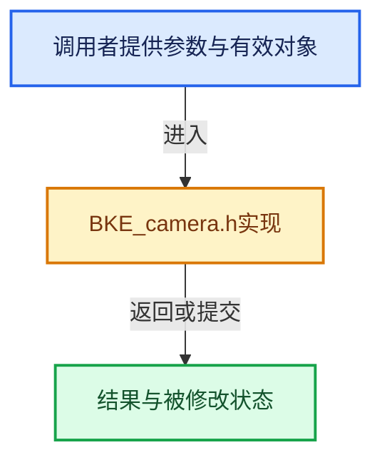

# 实现依赖专题：source/blender/blenkernel/BKE_camera.h

[方向导航](README.md) · [符号索引](../%E7%AC%A6%E5%8F%B7%E4%BE%9D%E8%B5%96%E4%B8%8E%E5%AE%9E%E7%8E%B0%E7%B4%A2%E5%BC%95.md)

本专题从正文实际调用进入，集中保存共享实现。函数有稳定锚点，可从调用处直接跳到对应完整函数；递归与互相调用通过回链组织。

## 本文件的实现关系





## 相关类型布局与成员入口

<a id="t-a4fed3f56b70"></a>

### `blender::CameraParams`

原始声明：[source/blender/blenkernel/BKE_camera.h](../../../../../source/blender/blenkernel/BKE_camera.h) · L53—L96。

成员布局：

- `bool is_ortho`
- `bool is_flipped_x`
- `float lens`
- `float ortho_scale`
- `float zoom`
- `float roll`
- `float shiftx`
- `float shifty`
- `float offsetx`
- `float offsety`
- `float sensor_x`
- `float sensor_y`
- `int sensor_fit`
- `bool use_aspect_override`
- `float aspect_override`
- `float clip_start`
- `float clip_end`
- `float ycor`
- `float viewdx`
- `float viewdy`
- `rctf viewplane`
- `float winmat`

以下保留类的数据声明与编译条件，成员函数实现通过后面的精确链接阅读。

<!-- annotated:ee8f76ac988965 -->

```cpp
struct CameraParams {
  /* lens */
  bool is_ortho = false;
  bool is_flipped_x = false;
  float lens = 0.0f;
  float ortho_scale = 1.0f;
  float zoom = 1.0f;
  float roll = 0.0f;

  float shiftx = 0.0f;
  float shifty = 0.0f;
  float offsetx = 0.0f;
  float offsety = 0.0f;

  /* sensor */
  float sensor_x = 0.0f;
  float sensor_y = 0.0f;
  int sensor_fit = 0;

  /**
   * Aspect override: the aspect (y-over-x) of the camera frame, used to resolve the sensor fit
   * and framing in place of the view rect.
   *
   * Only set when the frame is drawn inside the view rect instead of filling it,
   * e.g. #BKE_camera_params_from_view3d for the camera view.
   *
   * \warning Never set this for rendering, it would change the render output.
   */
  bool use_aspect_override = false;
  float aspect_override = 0.0f;

  /* clipping */
  float clip_start = 0.1f;
  float clip_end = 100.0f;

  /* computed viewplane */
  float ycor = 0.0f;
  float viewdx = 0.0f;
  float viewdy = 0.0f;
  rctf viewplane;

  /* computed matrix */
  float winmat[4][4] = {};
};
```

<details>
<summary>核对原始源码：source/blender/blenkernel/BKE_camera.h · L53—L96</summary>

<!-- original:ee8f76ac988965:source/blender/blenkernel/BKE_camera.h:53:96 -->

```cpp
struct CameraParams {
  /* lens */
  bool is_ortho = false;
  bool is_flipped_x = false;
  float lens = 0.0f;
  float ortho_scale = 1.0f;
  float zoom = 1.0f;
  float roll = 0.0f;

  float shiftx = 0.0f;
  float shifty = 0.0f;
  float offsetx = 0.0f;
  float offsety = 0.0f;

  /* sensor */
  float sensor_x = 0.0f;
  float sensor_y = 0.0f;
  int sensor_fit = 0;

  /**
   * Aspect override: the aspect (y-over-x) of the camera frame, used to resolve the sensor fit
   * and framing in place of the view rect.
   *
   * Only set when the frame is drawn inside the view rect instead of filling it,
   * e.g. #BKE_camera_params_from_view3d for the camera view.
   *
   * \warning Never set this for rendering, it would change the render output.
   */
  bool use_aspect_override = false;
  float aspect_override = 0.0f;

  /* clipping */
  float clip_start = 0.1f;
  float clip_end = 100.0f;

  /* computed viewplane */
  float ycor = 0.0f;
  float viewdx = 0.0f;
  float viewdy = 0.0f;
  rctf viewplane;

  /* computed matrix */
  float winmat[4][4] = {};
};
```

</details>


<a id="t-0ec3f453a6f6"></a>

### `blender::CameraParams`

原始声明：[source/blender/blenkernel/BKE_camera.h](../../../../../source/blender/blenkernel/BKE_camera.h) · L213—L213。

成员布局：

- `bool is_ortho`
- `bool is_flipped_x`
- `float lens`
- `float ortho_scale`
- `float zoom`
- `float roll`
- `float shiftx`
- `float shifty`
- `float offsetx`
- `float offsety`
- `float sensor_x`
- `float sensor_y`
- `int sensor_fit`
- `bool use_aspect_override`
- `float aspect_override`
- `float clip_start`
- `float clip_end`
- `float ycor`
- `float viewdx`
- `float viewdy`
- `rctf viewplane`
- `float winmat`

以下保留类的数据声明与编译条件，成员函数实现通过后面的精确链接阅读。

<!-- annotated:0fc60bdf264d9b -->

```cpp
                                 struct CameraParams *params,
```

<details>
<summary>核对原始源码：source/blender/blenkernel/BKE_camera.h · L213—L213</summary>

<!-- original:0fc60bdf264d9b:source/blender/blenkernel/BKE_camera.h:213:213 -->

```cpp
                                 struct CameraParams *params,
```

</details>


## 完整成员与函数实现
