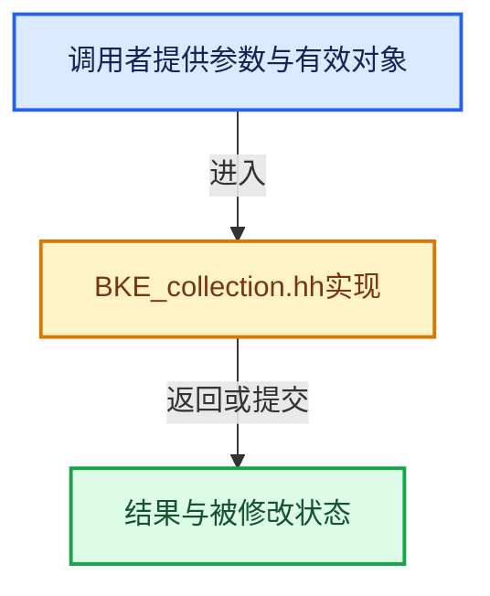

# 实现依赖专题：source/blender/blenkernel/BKE_collection.hh

[方向导航](README.md) · [符号索引](../%E7%AC%A6%E5%8F%B7%E4%BE%9D%E8%B5%96%E4%B8%8E%E5%AE%9E%E7%8E%B0%E7%B4%A2%E5%BC%95.md)

本专题从正文实际调用进入，集中保存共享实现。函数有稳定锚点，可从调用处直接跳到对应完整函数；递归与互相调用通过回链组织。

## 本文件的实现关系





<a id="m-ee3da0f42433"></a>

## 宏 `FOREACH_COLLECTION_VISIBLE_OBJECT_RECURSIVE_BEGIN`

<!-- annotated:78972cf08f4bc6 -->

```cpp
#define FOREACH_COLLECTION_VISIBLE_OBJECT_RECURSIVE_BEGIN(_collection, _object, _mode) \
  { \
    int _base_flag = (_mode == DAG_EVAL_VIEWPORT) ? BASE_ENABLED_VIEWPORT : BASE_ENABLED_RENDER; \
    int _object_visibility_flag = (_mode == DAG_EVAL_VIEWPORT) ? OB_HIDE_VIEWPORT : \
                                                                 OB_HIDE_RENDER; \
    [[maybe_unused]] int _base_id = 0; \
    for (Base *_base = BKE_collection_object_cache_get(_collection).first(); _base; \
         _base = _base->next, _base_id++) \
    { \
      Object *_object = _base->object; \
      if ((_base->flag & _base_flag) && \
          (_object->visibility_flag & _object_visibility_flag) == 0) \
      {

```

<details>
<summary>核对原始源码：source/blender/blenkernel/BKE_collection.hh · L465—L478</summary>

<!-- original:78972cf08f4bc6:source/blender/blenkernel/BKE_collection.hh:465:478 -->

```cpp
#define FOREACH_COLLECTION_VISIBLE_OBJECT_RECURSIVE_BEGIN(_collection, _object, _mode) \
  { \
    int _base_flag = (_mode == DAG_EVAL_VIEWPORT) ? BASE_ENABLED_VIEWPORT : BASE_ENABLED_RENDER; \
    int _object_visibility_flag = (_mode == DAG_EVAL_VIEWPORT) ? OB_HIDE_VIEWPORT : \
                                                                 OB_HIDE_RENDER; \
    [[maybe_unused]] int _base_id = 0; \
    for (Base *_base = BKE_collection_object_cache_get(_collection).first(); _base; \
         _base = _base->next, _base_id++) \
    { \
      Object *_object = _base->object; \
      if ((_base->flag & _base_flag) && \
          (_object->visibility_flag & _object_visibility_flag) == 0) \
      {

```

</details>

宏在预处理阶段展开，参数替换、重复求值和条件编译应直接从该定义检查。与普通函数不同，宏不会自动提供参数类型检查；构建配置选择哪个定义需结合外围条件。

<a id="m-056dd72ee5fb"></a>

## 宏 `FOREACH_COLLECTION_OBJECT_RECURSIVE_BEGIN`

<!-- annotated:0e24cd04666ecf -->

```cpp
#define FOREACH_COLLECTION_OBJECT_RECURSIVE_BEGIN(_collection, _object) \
  for (Base *_base = BKE_collection_object_cache_get(_collection).first(); _base; \
       _base = _base->next) \
  { \
    Object *_object = _base->object; \
    BLI_assert(_object != NULL);

```

<details>
<summary>核对原始源码：source/blender/blenkernel/BKE_collection.hh · L485—L491</summary>

<!-- original:0e24cd04666ecf:source/blender/blenkernel/BKE_collection.hh:485:491 -->

```cpp
#define FOREACH_COLLECTION_OBJECT_RECURSIVE_BEGIN(_collection, _object) \
  for (Base *_base = BKE_collection_object_cache_get(_collection).first(); _base; \
       _base = _base->next) \
  { \
    Object *_object = _base->object; \
    BLI_assert(_object != NULL);

```

</details>

宏在预处理阶段展开，参数替换、重复求值和条件编译应直接从该定义检查。与普通函数不同，宏不会自动提供参数类型检查；构建配置选择哪个定义需结合外围条件。

<a id="m-02f7b358de24"></a>

## 宏 `FOREACH_SCENE_OBJECT_BEGIN`

<!-- annotated:11d3fe51aff71c -->

```cpp
#define FOREACH_SCENE_OBJECT_BEGIN(scene, _instance) \
  ITER_BEGIN (BKE_scene_objects_iterator_begin, \
              BKE_scene_objects_iterator_next, \
              BKE_scene_objects_iterator_end, \
              scene, \
              Object *, \
              _instance)

```

<details>
<summary>核对原始源码：source/blender/blenkernel/BKE_collection.hh · L572—L579</summary>

<!-- original:11d3fe51aff71c:source/blender/blenkernel/BKE_collection.hh:572:579 -->

```cpp
#define FOREACH_SCENE_OBJECT_BEGIN(scene, _instance) \
  ITER_BEGIN (BKE_scene_objects_iterator_begin, \
              BKE_scene_objects_iterator_next, \
              BKE_scene_objects_iterator_end, \
              scene, \
              Object *, \
              _instance)

```

</details>

宏在预处理阶段展开，参数替换、重复求值和条件编译应直接从该定义检查。与普通函数不同，宏不会自动提供参数类型检查；构建配置选择哪个定义需结合外围条件。

## 完整成员与函数实现
