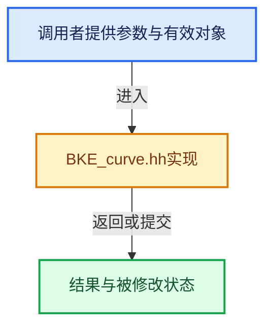

# 实现依赖专题：source/blender/blenkernel/BKE_curve.hh

[方向导航](README.md) · [符号索引](../%E7%AC%A6%E5%8F%B7%E4%BE%9D%E8%B5%96%E4%B8%8E%E5%AE%9E%E7%8E%B0%E7%B4%A2%E5%BC%95.md)

本专题从正文实际调用进入，集中保存共享实现。函数有稳定锚点，可从调用处直接跳到对应完整函数；递归与互相调用通过回链组织。

## 本文件的实现关系





## 相关类型布局与成员入口

<a id="t-7a0017ccea08"></a>

### `blender::ObjectType`

原始声明：[source/blender/blenkernel/BKE_curve.hh](../../../../../source/blender/blenkernel/BKE_curve.hh) · L39—L39。

以下保留类的数据声明与编译条件，成员函数实现通过后面的精确链接阅读。

<!-- annotated:24a47ffce78f91 -->

```cpp
enum ObjectType : short;
```

<details>
<summary>核对原始源码：source/blender/blenkernel/BKE_curve.hh · L39—L39</summary>

<!-- original:24a47ffce78f91:source/blender/blenkernel/BKE_curve.hh:39:39 -->

```cpp
enum ObjectType : short;
```

</details>


<a id="m-a3984184f8d0"></a>

## 宏 `KNOTSU`

<!-- annotated:0d39905f1f7d02 -->

```cpp
#define KNOTSU(nu) \
  ((nu)->orderu + (nu)->pntsu + (((nu)->flagu & CU_NURB_CYCLIC) ? ((nu)->orderu - 1) : 0))
#define KNOTSV(nu) \
```

<details>
<summary>核对原始源码：source/blender/blenkernel/BKE_curve.hh · L78—L80</summary>

<!-- original:0d39905f1f7d02:source/blender/blenkernel/BKE_curve.hh:78:80 -->

```cpp
#define KNOTSU(nu) \
  ((nu)->orderu + (nu)->pntsu + (((nu)->flagu & CU_NURB_CYCLIC) ? ((nu)->orderu - 1) : 0))
#define KNOTSV(nu) \
```

</details>

宏在预处理阶段展开，参数替换、重复求值和条件编译应直接从该定义检查。与普通函数不同，宏不会自动提供参数类型检查；构建配置选择哪个定义需结合外围条件。

<a id="m-08e77f861691"></a>

## 宏 `KNOTSV`

<!-- annotated:fef8b47e90899c -->

```cpp
#define KNOTSV(nu) \
  ((nu)->orderv + (nu)->pntsv + (((nu)->flagv & CU_NURB_CYCLIC) ? ((nu)->orderv - 1) : 0))

```

<details>
<summary>核对原始源码：source/blender/blenkernel/BKE_curve.hh · L80—L82</summary>

<!-- original:fef8b47e90899c:source/blender/blenkernel/BKE_curve.hh:80:82 -->

```cpp
#define KNOTSV(nu) \
  ((nu)->orderv + (nu)->pntsv + (((nu)->flagv & CU_NURB_CYCLIC) ? ((nu)->orderv - 1) : 0))

```

</details>

宏在预处理阶段展开，参数替换、重复求值和条件编译应直接从该定义检查。与普通函数不同，宏不会自动提供参数类型检查；构建配置选择哪个定义需结合外围条件。

<a id="m-d1b4e857a9fa"></a>

## 宏 `SEGMENTSU`

<!-- annotated:02f388c8a954a5 -->

```cpp
#define SEGMENTSU(nu) (((nu)->flagu & CU_NURB_CYCLIC) ? (nu)->pntsu : (nu)->pntsu - 1)
#define SEGMENTSV(nu) (((nu)->flagv & CU_NURB_CYCLIC) ? (nu)->pntsv : (nu)->pntsv - 1)
```

<details>
<summary>核对原始源码：source/blender/blenkernel/BKE_curve.hh · L84—L85</summary>

<!-- original:02f388c8a954a5:source/blender/blenkernel/BKE_curve.hh:84:85 -->

```cpp
#define SEGMENTSU(nu) (((nu)->flagu & CU_NURB_CYCLIC) ? (nu)->pntsu : (nu)->pntsu - 1)
#define SEGMENTSV(nu) (((nu)->flagv & CU_NURB_CYCLIC) ? (nu)->pntsv : (nu)->pntsv - 1)
```

</details>

宏在预处理阶段展开，参数替换、重复求值和条件编译应直接从该定义检查。与普通函数不同，宏不会自动提供参数类型检查；构建配置选择哪个定义需结合外围条件。

<a id="m-e61e732a51f9"></a>

## 宏 `CU_DO_RADIUS`

<!-- annotated:751ef551287cdb -->

```cpp
#define CU_DO_RADIUS(cu, nu) \
  ((((cu)->flag & (CU_PATH_RADIUS | CU_3D)) || (cu)->bevobj || (cu)->extrude != 0.0f || \
    (cu)->bevel_radius != 0.0f) ? \
       1 : \
       0)

```

<details>
<summary>核对原始源码：source/blender/blenkernel/BKE_curve.hh · L87—L92</summary>

<!-- original:751ef551287cdb:source/blender/blenkernel/BKE_curve.hh:87:92 -->

```cpp
#define CU_DO_RADIUS(cu, nu) \
  ((((cu)->flag & (CU_PATH_RADIUS | CU_3D)) || (cu)->bevobj || (cu)->extrude != 0.0f || \
    (cu)->bevel_radius != 0.0f) ? \
       1 : \
       0)

```

</details>

宏在预处理阶段展开，参数替换、重复求值和条件编译应直接从该定义检查。与普通函数不同，宏不会自动提供参数类型检查；构建配置选择哪个定义需结合外围条件。

<a id="m-2114be5270f1"></a>

## 宏 `CU_IS_2D`

<!-- annotated:10b302f62675d1 -->

```cpp
#define CU_IS_2D(cu) (((cu)->flag & CU_3D) == 0)

```

<details>
<summary>核对原始源码：source/blender/blenkernel/BKE_curve.hh · L93—L94</summary>

<!-- original:10b302f62675d1:source/blender/blenkernel/BKE_curve.hh:93:94 -->

```cpp
#define CU_IS_2D(cu) (((cu)->flag & CU_3D) == 0)

```

</details>

宏在预处理阶段展开，参数替换、重复求值和条件编译应直接从该定义检查。与普通函数不同，宏不会自动提供参数类型检查；构建配置选择哪个定义需结合外围条件。

<a id="m-b3dd99c47394"></a>

## 宏 `CU_DO_2DFILL`

<!-- annotated:eee434cb7a428f -->

```cpp
#define CU_DO_2DFILL(cu) (CU_IS_2D(cu) && (((cu)->flag & (CU_FRONT | CU_BACK)) != 0))

```

<details>
<summary>核对原始源码：source/blender/blenkernel/BKE_curve.hh · L96—L97</summary>

<!-- original:eee434cb7a428f:source/blender/blenkernel/BKE_curve.hh:96:97 -->

```cpp
#define CU_DO_2DFILL(cu) (CU_IS_2D(cu) && (((cu)->flag & (CU_FRONT | CU_BACK)) != 0))

```

</details>

宏在预处理阶段展开，参数替换、重复求值和条件编译应直接从该定义检查。与普通函数不同，宏不会自动提供参数类型检查；构建配置选择哪个定义需结合外围条件。

## 完整成员与函数实现
