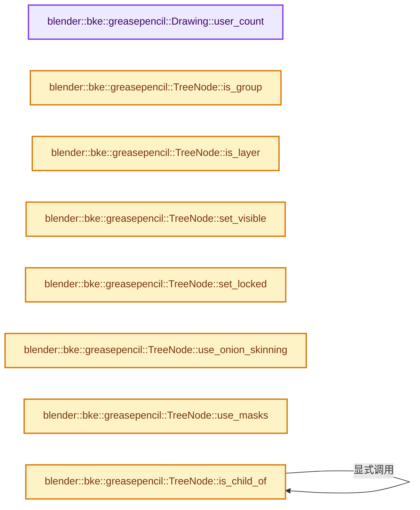

# 实现依赖专题：source/blender/blenkernel/BKE_grease_pencil.hh

[方向导航](README.md) · [符号索引](../%E7%AC%A6%E5%8F%B7%E4%BE%9D%E8%B5%96%E4%B8%8E%E5%AE%9E%E7%8E%B0%E7%B4%A2%E5%BC%95.md)

本专题从正文实际调用进入，集中保存共享实现。函数有稳定锚点，可从调用处直接跳到对应完整函数；递归与互相调用通过回链组织。

## 本文件的实现关系




## 完整成员与函数实现

<a id="f-f6ec49c6243c17ca"></a>

### `blender::bke::greasepencil::Drawing::user_count`

实现位置：[source/blender/blenkernel/BKE_grease_pencil.hh](../../../../../source/blender/blenkernel/BKE_grease_pencil.hh) · L874—L877。

**教学注释版**

<!-- annotated:93edd7fd2ab09c -->

```cpp
inline int Drawing::user_count() const
{
  return this->runtime->user_count.load(std::memory_order_relaxed);
}
```

<details>
<summary>核对原始源码：source/blender/blenkernel/BKE_grease_pencil.hh · L874—L877</summary>

<!-- original:93edd7fd2ab09c:source/blender/blenkernel/BKE_grease_pencil.hh:874:877 -->

```cpp
inline int Drawing::user_count() const
{
  return this->runtime->user_count.load(std::memory_order_relaxed);
}
```

</details>

**结果出口**

- `return this->runtime->user_count.load(std::memory_order_relaxed);`

**继续追踪实现**

- `this->runtime->user_count.load` → [调用协议](../%E6%A8%A1%E6%9D%BF%E5%AE%8F%E4%B8%8E%E5%8A%A8%E6%80%81%E5%88%86%E6%B4%BE%E5%8D%8F%E8%AE%AE.md)：接收对象类型依赖auto、返回值或模板实例；不按同名猜测目标。调用位置L876。

<a id="f-d0de4d5ec686715f"></a>

### `blender::bke::greasepencil::TreeNode::is_group`

实现位置：[source/blender/blenkernel/BKE_grease_pencil.hh](../../../../../source/blender/blenkernel/BKE_grease_pencil.hh) · L879—L882。

**教学注释版**

<!-- annotated:b53268e6124da3 -->

```cpp
inline bool TreeNode::is_group() const
{
  return this->type == GP_LAYER_TREE_GROUP;
}
```

<details>
<summary>核对原始源码：source/blender/blenkernel/BKE_grease_pencil.hh · L879—L882</summary>

<!-- original:b53268e6124da3:source/blender/blenkernel/BKE_grease_pencil.hh:879:882 -->

```cpp
inline bool TreeNode::is_group() const
{
  return this->type == GP_LAYER_TREE_GROUP;
}
```

</details>

**结果出口**

- `return this->type == GP_LAYER_TREE_GROUP;`

**继续追踪实现**

本实现没有需要继续展开的显式调用；检查返回表达式、对象转换和调用者前置条件。

<a id="f-64d6a765be215846"></a>

### `blender::bke::greasepencil::TreeNode::is_layer`

实现位置：[source/blender/blenkernel/BKE_grease_pencil.hh](../../../../../source/blender/blenkernel/BKE_grease_pencil.hh) · L883—L886。

**教学注释版**

<!-- annotated:cce9e4f8345933 -->

```cpp
inline bool TreeNode::is_layer() const
{
  return this->type == GP_LAYER_TREE_LEAF;
}
```

<details>
<summary>核对原始源码：source/blender/blenkernel/BKE_grease_pencil.hh · L883—L886</summary>

<!-- original:cce9e4f8345933:source/blender/blenkernel/BKE_grease_pencil.hh:883:886 -->

```cpp
inline bool TreeNode::is_layer() const
{
  return this->type == GP_LAYER_TREE_LEAF;
}
```

</details>

**结果出口**

- `return this->type == GP_LAYER_TREE_LEAF;`

**继续追踪实现**

本实现没有需要继续展开的显式调用；检查返回表达式、对象转换和调用者前置条件。

<a id="f-e277290f6841034a"></a>

### `blender::bke::greasepencil::TreeNode::set_visible`

实现位置：[source/blender/blenkernel/BKE_grease_pencil.hh](../../../../../source/blender/blenkernel/BKE_grease_pencil.hh) · L892—L895。

接口参数：

- `const bool visible`

**教学注释版**

<!-- annotated:eb8cb0736c3d1b -->

```cpp
inline void TreeNode::set_visible(const bool visible)
{
  SET_FLAG_FROM_TEST(this->flag, !visible, GP_LAYER_TREE_NODE_HIDE);
}
```

<details>
<summary>核对原始源码：source/blender/blenkernel/BKE_grease_pencil.hh · L892—L895</summary>

<!-- original:eb8cb0736c3d1b:source/blender/blenkernel/BKE_grease_pencil.hh:892:895 -->

```cpp
inline void TreeNode::set_visible(const bool visible)
{
  SET_FLAG_FROM_TEST(this->flag, !visible, GP_LAYER_TREE_NODE_HIDE);
}
```

</details>

**继续追踪实现**

- `SET_FLAG_FROM_TEST` → [SET_FLAG_FROM_TEST · L557](../01-%E5%9F%BA%E7%A1%80%E5%AE%B9%E5%99%A8%E4%B8%8E%E7%8E%B0%E4%BB%A3CPP/%E4%BE%9D%E8%B5%96-BLI_utildefines-293a0a.md#m-8e0dc83e01a8)。宏定义由构建条件选择。

<a id="f-f33555ab61e735d7"></a>

### `blender::bke::greasepencil::TreeNode::set_locked`

实现位置：[source/blender/blenkernel/BKE_grease_pencil.hh](../../../../../source/blender/blenkernel/BKE_grease_pencil.hh) · L901—L904。

接口参数：

- `const bool locked`

**教学注释版**

<!-- annotated:5dc701e884f0e1 -->

```cpp
inline void TreeNode::set_locked(const bool locked)
{
  SET_FLAG_FROM_TEST(this->flag, locked, GP_LAYER_TREE_NODE_LOCKED);
}
```

<details>
<summary>核对原始源码：source/blender/blenkernel/BKE_grease_pencil.hh · L901—L904</summary>

<!-- original:5dc701e884f0e1:source/blender/blenkernel/BKE_grease_pencil.hh:901:904 -->

```cpp
inline void TreeNode::set_locked(const bool locked)
{
  SET_FLAG_FROM_TEST(this->flag, locked, GP_LAYER_TREE_NODE_LOCKED);
}
```

</details>

**继续追踪实现**

- `SET_FLAG_FROM_TEST` → [SET_FLAG_FROM_TEST · L557](../01-%E5%9F%BA%E7%A1%80%E5%AE%B9%E5%99%A8%E4%B8%8E%E7%8E%B0%E4%BB%A3CPP/%E4%BE%9D%E8%B5%96-BLI_utildefines-293a0a.md#m-8e0dc83e01a8)。宏定义由构建条件选择。

<a id="f-f30929cd8a9a0a69"></a>

### `blender::bke::greasepencil::TreeNode::use_onion_skinning`

实现位置：[source/blender/blenkernel/BKE_grease_pencil.hh](../../../../../source/blender/blenkernel/BKE_grease_pencil.hh) · L917—L921。

**教学注释版**

<!-- annotated:61533c74d52cc3 -->

```cpp
inline bool TreeNode::use_onion_skinning() const
{
  return ((this->flag & GP_LAYER_TREE_NODE_HIDE_ONION_SKINNING) == 0) &&
         (!this->parent_group() || this->parent_group()->as_node().use_onion_skinning());
}
```

<details>
<summary>核对原始源码：source/blender/blenkernel/BKE_grease_pencil.hh · L917—L921</summary>

<!-- original:61533c74d52cc3:source/blender/blenkernel/BKE_grease_pencil.hh:917:921 -->

```cpp
inline bool TreeNode::use_onion_skinning() const
{
  return ((this->flag & GP_LAYER_TREE_NODE_HIDE_ONION_SKINNING) == 0) &&
         (!this->parent_group() || this->parent_group()->as_node().use_onion_skinning());
}
```

</details>

**结果出口**

- `return ((this->flag & GP_LAYER_TREE_NODE_HIDE_ONION_SKINNING) == 0) &&`

**继续追踪实现**

- `this->parent_group` → [blender::bke::greasepencil::TreeNode::parent_group · L1488](%E4%BE%9D%E8%B5%96-grease_pencil-f750d6.md#f-c51c800e8aa282ee)；[blender::bke::greasepencil::TreeNode::parent_group · L1492](%E4%BE%9D%E8%B5%96-grease_pencil-f750d6.md#f-e755b6d825a0842b)。同名重载需按实参类型选择。
- `this->parent_group()->as_node().use_onion_skinning` → [调用协议](../%E6%A8%A1%E6%9D%BF%E5%AE%8F%E4%B8%8E%E5%8A%A8%E6%80%81%E5%88%86%E6%B4%BE%E5%8D%8F%E8%AE%AE.md)：接收对象类型依赖auto、返回值或模板实例；不按同名猜测目标。调用位置L920。
- `this->parent_group()->as_node` → [调用协议](../%E6%A8%A1%E6%9D%BF%E5%AE%8F%E4%B8%8E%E5%8A%A8%E6%80%81%E5%88%86%E6%B4%BE%E5%8D%8F%E8%AE%AE.md)：接收对象类型依赖auto、返回值或模板实例；不按同名猜测目标。调用位置L920。

<a id="f-7cd9f11f68ef911e"></a>

### `blender::bke::greasepencil::TreeNode::use_masks`

实现位置：[source/blender/blenkernel/BKE_grease_pencil.hh](../../../../../source/blender/blenkernel/BKE_grease_pencil.hh) · L922—L926。

**教学注释版**

<!-- annotated:53828dd9fb5f96 -->

```cpp
inline bool TreeNode::use_masks() const
{
  return ((this->flag & GP_LAYER_TREE_NODE_HIDE_MASKS) == 0) &&
         (!this->parent_group() || this->parent_group()->as_node().use_masks());
}
```

<details>
<summary>核对原始源码：source/blender/blenkernel/BKE_grease_pencil.hh · L922—L926</summary>

<!-- original:53828dd9fb5f96:source/blender/blenkernel/BKE_grease_pencil.hh:922:926 -->

```cpp
inline bool TreeNode::use_masks() const
{
  return ((this->flag & GP_LAYER_TREE_NODE_HIDE_MASKS) == 0) &&
         (!this->parent_group() || this->parent_group()->as_node().use_masks());
}
```

</details>

**结果出口**

- `return ((this->flag & GP_LAYER_TREE_NODE_HIDE_MASKS) == 0) &&`

**继续追踪实现**

- `this->parent_group` → [blender::bke::greasepencil::TreeNode::parent_group · L1488](%E4%BE%9D%E8%B5%96-grease_pencil-f750d6.md#f-c51c800e8aa282ee)；[blender::bke::greasepencil::TreeNode::parent_group · L1492](%E4%BE%9D%E8%B5%96-grease_pencil-f750d6.md#f-e755b6d825a0842b)。同名重载需按实参类型选择。
- `this->parent_group()->as_node().use_masks` → [调用协议](../%E6%A8%A1%E6%9D%BF%E5%AE%8F%E4%B8%8E%E5%8A%A8%E6%80%81%E5%88%86%E6%B4%BE%E5%8D%8F%E8%AE%AE.md)：接收对象类型依赖auto、返回值或模板实例；不按同名猜测目标。调用位置L925。
- `this->parent_group()->as_node` → [调用协议](../%E6%A8%A1%E6%9D%BF%E5%AE%8F%E4%B8%8E%E5%8A%A8%E6%80%81%E5%88%86%E6%B4%BE%E5%8D%8F%E8%AE%AE.md)：接收对象类型依赖auto、返回值或模板实例；不按同名猜测目标。调用位置L925。

<a id="f-897558c8d619f098"></a>

### `blender::bke::greasepencil::TreeNode::is_child_of`

实现位置：[source/blender/blenkernel/BKE_grease_pencil.hh](../../../../../source/blender/blenkernel/BKE_grease_pencil.hh) · L931—L940。

接口参数：

- `const LayerGroup &group`

**教学注释版**

<!-- annotated:7487ad6a1edab2 -->

```cpp
inline bool TreeNode::is_child_of(const LayerGroup &group) const
{
  if (const LayerGroup *parent = this->parent_group()) {
    if (parent == &group) {
      return true;
    }
    return parent->is_child_of(group);
  }
  return false;
}
```

<details>
<summary>核对原始源码：source/blender/blenkernel/BKE_grease_pencil.hh · L931—L940</summary>

<!-- original:7487ad6a1edab2:source/blender/blenkernel/BKE_grease_pencil.hh:931:940 -->

```cpp
inline bool TreeNode::is_child_of(const LayerGroup &group) const
{
  if (const LayerGroup *parent = this->parent_group()) {
    if (parent == &group) {
      return true;
    }
    return parent->is_child_of(group);
  }
  return false;
}
```

</details>

**结果出口**

- `return true;`
- `return parent->is_child_of(group);`
- `return false;`

**继续追踪实现**

- `this->parent_group` → [blender::bke::greasepencil::TreeNode::parent_group · L1488](%E4%BE%9D%E8%B5%96-grease_pencil-f750d6.md#f-c51c800e8aa282ee)；[blender::bke::greasepencil::TreeNode::parent_group · L1492](%E4%BE%9D%E8%B5%96-grease_pencil-f750d6.md#f-e755b6d825a0842b)。同名重载需按实参类型选择。
- `parent->is_child_of` → [blender::bke::greasepencil::TreeNode::is_child_of · L931](%E4%BE%9D%E8%B5%96-BKE_grease_pencil-42a7a1.md#f-897558c8d619f098)。

<a id="f-241823c76fc0da2b"></a>

### `blender::bke::greasepencil::TreeNode::name`

实现位置：[source/blender/blenkernel/BKE_grease_pencil.hh](../../../../../source/blender/blenkernel/BKE_grease_pencil.hh) · L941—L946。

**教学注释版**

<!-- annotated:f999f5901cead1 -->

```cpp
inline StringRefNull TreeNode::name() const
{
  return (this->GreasePencilLayerTreeNode::name != nullptr) ?
             this->GreasePencilLayerTreeNode::name :
             StringRefNull();
}
```

<details>
<summary>核对原始源码：source/blender/blenkernel/BKE_grease_pencil.hh · L941—L946</summary>

<!-- original:f999f5901cead1:source/blender/blenkernel/BKE_grease_pencil.hh:941:946 -->

```cpp
inline StringRefNull TreeNode::name() const
{
  return (this->GreasePencilLayerTreeNode::name != nullptr) ?
             this->GreasePencilLayerTreeNode::name :
             StringRefNull();
}
```

</details>

**结果出口**

- `return (this->GreasePencilLayerTreeNode::name != nullptr) ?`

**继续追踪实现**

- `StringRefNull` → [blender::StringRefNull::StringRefNull · L149](../01-%E5%9F%BA%E7%A1%80%E5%AE%B9%E5%99%A8%E4%B8%8E%E7%8E%B0%E4%BB%A3CPP/15-StringRef%E5%AD%97%E7%AC%A6%E4%B8%B2%E8%A7%86%E5%9B%BE.md#f-ebc6ee5f8fc16390)；[blender::StringRefNull::StringRefNull · L496](../01-%E5%9F%BA%E7%A1%80%E5%AE%B9%E5%99%A8%E4%B8%8E%E7%8E%B0%E4%BB%A3CPP/15-StringRef%E5%AD%97%E7%AC%A6%E4%B8%B2%E8%A7%86%E5%9B%BE.md#f-936c98fc0d9ae39e)；[blender::StringRefNull::StringRefNull · L502](../01-%E5%9F%BA%E7%A1%80%E5%AE%B9%E5%99%A8%E4%B8%8E%E7%8E%B0%E4%BB%A3CPP/15-StringRef%E5%AD%97%E7%AC%A6%E4%B8%B2%E8%A7%86%E5%9B%BE.md#f-cf03ac0c28007ee0)；[blender::StringRefNull::StringRefNull · L512](../01-%E5%9F%BA%E7%A1%80%E5%AE%B9%E5%99%A8%E4%B8%8E%E7%8E%B0%E4%BB%A3CPP/15-StringRef%E5%AD%97%E7%AC%A6%E4%B8%B2%E8%A7%86%E5%9B%BE.md#f-8a14273318bc57e1)；[blender::StringRefNull::StringRefNull · L523](../01-%E5%9F%BA%E7%A1%80%E5%AE%B9%E5%99%A8%E4%B8%8E%E7%8E%B0%E4%BB%A3CPP/15-StringRef%E5%AD%97%E7%AC%A6%E4%B8%B2%E8%A7%86%E5%9B%BE.md#f-e1cc63a4ff92775b)。同名重载需按实参类型选择。

<a id="f-d66fdb165928801f"></a>

### `blender::bke::greasepencil::Layer::as_node`

实现位置：[source/blender/blenkernel/BKE_grease_pencil.hh](../../../../../source/blender/blenkernel/BKE_grease_pencil.hh) · L955—L958。

**教学注释版**

<!-- annotated:6451ff11736c0c -->

```cpp
inline const TreeNode &Layer::as_node() const
{
  return *reinterpret_cast<const TreeNode *>(this);
}
```

<details>
<summary>核对原始源码：source/blender/blenkernel/BKE_grease_pencil.hh · L955—L958</summary>

<!-- original:6451ff11736c0c:source/blender/blenkernel/BKE_grease_pencil.hh:955:958 -->

```cpp
inline const TreeNode &Layer::as_node() const
{
  return *reinterpret_cast<const TreeNode *>(this);
}
```

</details>

**结果出口**

- `return *reinterpret_cast<const TreeNode *>(this);`

**继续追踪实现**

本实现没有需要继续展开的显式调用；检查返回表达式、对象转换和调用者前置条件。

<a id="f-b17219164f80cc3e"></a>

### `blender::bke::greasepencil::Layer::as_node`

实现位置：[source/blender/blenkernel/BKE_grease_pencil.hh](../../../../../source/blender/blenkernel/BKE_grease_pencil.hh) · L959—L962。

**教学注释版**

<!-- annotated:53f53e2173b2c6 -->

```cpp
inline TreeNode &Layer::as_node()
{
  return *reinterpret_cast<TreeNode *>(this);
}
```

<details>
<summary>核对原始源码：source/blender/blenkernel/BKE_grease_pencil.hh · L959—L962</summary>

<!-- original:53f53e2173b2c6:source/blender/blenkernel/BKE_grease_pencil.hh:959:962 -->

```cpp
inline TreeNode &Layer::as_node()
{
  return *reinterpret_cast<TreeNode *>(this);
}
```

</details>

**结果出口**

- `return *reinterpret_cast<TreeNode *>(this);`

**继续追踪实现**

本实现没有需要继续展开的显式调用；检查返回表达式、对象转换和调用者前置条件。

<a id="f-b2e1752679d2ec00"></a>

### `blender::bke::greasepencil::Layer::is_empty`

实现位置：[source/blender/blenkernel/BKE_grease_pencil.hh](../../../../../source/blender/blenkernel/BKE_grease_pencil.hh) · L965—L968。

**教学注释版**

<!-- annotated:fd4f379b131a5d -->

```cpp
inline bool Layer::is_empty() const
{
  return (this->frames().is_empty());
}
```

<details>
<summary>核对原始源码：source/blender/blenkernel/BKE_grease_pencil.hh · L965—L968</summary>

<!-- original:fd4f379b131a5d:source/blender/blenkernel/BKE_grease_pencil.hh:965:968 -->

```cpp
inline bool Layer::is_empty() const
{
  return (this->frames().is_empty());
}
```

</details>

**结果出口**

- `return (this->frames().is_empty());`

**继续追踪实现**

- `this->frames().is_empty` → [调用协议](../%E6%A8%A1%E6%9D%BF%E5%AE%8F%E4%B8%8E%E5%8A%A8%E6%80%81%E5%88%86%E6%B4%BE%E5%8D%8F%E8%AE%AE.md)：接收对象类型依赖auto、返回值或模板实例；不按同名猜测目标。调用位置L967。
- `this->frames` → [blender::bke::greasepencil::Layer::frames · L1632](%E4%BE%9D%E8%B5%96-grease_pencil-f750d6.md#f-b94ffd8cfd88ea17)。

<a id="f-50995519579f4f36"></a>

### `blender::bke::greasepencil::Layer::parent_group`

实现位置：[source/blender/blenkernel/BKE_grease_pencil.hh](../../../../../source/blender/blenkernel/BKE_grease_pencil.hh) · L969—L972。

**教学注释版**

<!-- annotated:045fec86bf760c -->

```cpp
inline const LayerGroup &Layer::parent_group() const
{
  return *this->as_node().parent_group();
}
```

<details>
<summary>核对原始源码：source/blender/blenkernel/BKE_grease_pencil.hh · L969—L972</summary>

<!-- original:045fec86bf760c:source/blender/blenkernel/BKE_grease_pencil.hh:969:972 -->

```cpp
inline const LayerGroup &Layer::parent_group() const
{
  return *this->as_node().parent_group();
}
```

</details>

**结果出口**

- `return *this->as_node().parent_group();`

**继续追踪实现**

- `this->as_node().parent_group` → [调用协议](../%E6%A8%A1%E6%9D%BF%E5%AE%8F%E4%B8%8E%E5%8A%A8%E6%80%81%E5%88%86%E6%B4%BE%E5%8D%8F%E8%AE%AE.md)：接收对象类型依赖auto、返回值或模板实例；不按同名猜测目标。调用位置L971。
- `this->as_node` → [blender::bke::greasepencil::Layer::as_node · L955](%E4%BE%9D%E8%B5%96-BKE_grease_pencil-42a7a1.md#f-d66fdb165928801f)；[blender::bke::greasepencil::Layer::as_node · L959](%E4%BE%9D%E8%B5%96-BKE_grease_pencil-42a7a1.md#f-b17219164f80cc3e)。同名重载需按实参类型选择。

<a id="f-da88db1dc1aee4c7"></a>

### `blender::bke::greasepencil::Layer::parent_group`

实现位置：[source/blender/blenkernel/BKE_grease_pencil.hh](../../../../../source/blender/blenkernel/BKE_grease_pencil.hh) · L973—L976。

**教学注释版**

<!-- annotated:ad1454fe1d6d2b -->

```cpp
inline LayerGroup &Layer::parent_group()
{
  return *this->as_node().parent_group();
}
```

<details>
<summary>核对原始源码：source/blender/blenkernel/BKE_grease_pencil.hh · L973—L976</summary>

<!-- original:ad1454fe1d6d2b:source/blender/blenkernel/BKE_grease_pencil.hh:973:976 -->

```cpp
inline LayerGroup &Layer::parent_group()
{
  return *this->as_node().parent_group();
}
```

</details>

**结果出口**

- `return *this->as_node().parent_group();`

**继续追踪实现**

- `this->as_node().parent_group` → [调用协议](../%E6%A8%A1%E6%9D%BF%E5%AE%8F%E4%B8%8E%E5%8A%A8%E6%80%81%E5%88%86%E6%B4%BE%E5%8D%8F%E8%AE%AE.md)：接收对象类型依赖auto、返回值或模板实例；不按同名猜测目标。调用位置L975。
- `this->as_node` → [blender::bke::greasepencil::Layer::as_node · L955](%E4%BE%9D%E8%B5%96-BKE_grease_pencil-42a7a1.md#f-d66fdb165928801f)；[blender::bke::greasepencil::Layer::as_node · L959](%E4%BE%9D%E8%B5%96-BKE_grease_pencil-42a7a1.md#f-b17219164f80cc3e)。同名重载需按实参类型选择。

<a id="f-566c8db236585685"></a>

### `blender::GreasePencilDrawing::wrap`

实现位置：[source/blender/blenkernel/BKE_grease_pencil.hh](../../../../../source/blender/blenkernel/BKE_grease_pencil.hh) · L1059—L1062。

**教学注释版**

<!-- annotated:29a0996b9229c3 -->

```cpp
inline bke::greasepencil::Drawing &GreasePencilDrawing::wrap()
{
  return *reinterpret_cast<bke::greasepencil::Drawing *>(this);
}
```

<details>
<summary>核对原始源码：source/blender/blenkernel/BKE_grease_pencil.hh · L1059—L1062</summary>

<!-- original:29a0996b9229c3:source/blender/blenkernel/BKE_grease_pencil.hh:1059:1062 -->

```cpp
inline bke::greasepencil::Drawing &GreasePencilDrawing::wrap()
{
  return *reinterpret_cast<bke::greasepencil::Drawing *>(this);
}
```

</details>

**结果出口**

- `return *reinterpret_cast<bke::greasepencil::Drawing *>(this);`

**继续追踪实现**

本实现没有需要继续展开的显式调用；检查返回表达式、对象转换和调用者前置条件。

<a id="f-696df207288f4617"></a>

### `blender::GreasePencilDrawing::wrap`

实现位置：[source/blender/blenkernel/BKE_grease_pencil.hh](../../../../../source/blender/blenkernel/BKE_grease_pencil.hh) · L1063—L1066。

**教学注释版**

<!-- annotated:4573ca2e0d540b -->

```cpp
inline const bke::greasepencil::Drawing &GreasePencilDrawing::wrap() const
{
  return *reinterpret_cast<const bke::greasepencil::Drawing *>(this);
}
```

<details>
<summary>核对原始源码：source/blender/blenkernel/BKE_grease_pencil.hh · L1063—L1066</summary>

<!-- original:4573ca2e0d540b:source/blender/blenkernel/BKE_grease_pencil.hh:1063:1066 -->

```cpp
inline const bke::greasepencil::Drawing &GreasePencilDrawing::wrap() const
{
  return *reinterpret_cast<const bke::greasepencil::Drawing *>(this);
}
```

</details>

**结果出口**

- `return *reinterpret_cast<const bke::greasepencil::Drawing *>(this);`

**继续追踪实现**

本实现没有需要继续展开的显式调用；检查返回表达式、对象转换和调用者前置条件。

<a id="f-9823f89ae1b58dd3"></a>

### `blender::GreasePencilDrawingReference::wrap`

实现位置：[source/blender/blenkernel/BKE_grease_pencil.hh](../../../../../source/blender/blenkernel/BKE_grease_pencil.hh) · L1068—L1071。

**教学注释版**

<!-- annotated:3c6a9177e4331f -->

```cpp
inline bke::greasepencil::DrawingReference &GreasePencilDrawingReference::wrap()
{
  return *reinterpret_cast<bke::greasepencil::DrawingReference *>(this);
}
```

<details>
<summary>核对原始源码：source/blender/blenkernel/BKE_grease_pencil.hh · L1068—L1071</summary>

<!-- original:3c6a9177e4331f:source/blender/blenkernel/BKE_grease_pencil.hh:1068:1071 -->

```cpp
inline bke::greasepencil::DrawingReference &GreasePencilDrawingReference::wrap()
{
  return *reinterpret_cast<bke::greasepencil::DrawingReference *>(this);
}
```

</details>

**结果出口**

- `return *reinterpret_cast<bke::greasepencil::DrawingReference *>(this);`

**继续追踪实现**

本实现没有需要继续展开的显式调用；检查返回表达式、对象转换和调用者前置条件。

<a id="f-5d0d58c43410ce9f"></a>

### `blender::GreasePencilDrawingReference::wrap`

实现位置：[source/blender/blenkernel/BKE_grease_pencil.hh](../../../../../source/blender/blenkernel/BKE_grease_pencil.hh) · L1072—L1075。

**教学注释版**

<!-- annotated:e27176bba73e27 -->

```cpp
inline const bke::greasepencil::DrawingReference &GreasePencilDrawingReference::wrap() const
{
  return *reinterpret_cast<const bke::greasepencil::DrawingReference *>(this);
}
```

<details>
<summary>核对原始源码：source/blender/blenkernel/BKE_grease_pencil.hh · L1072—L1075</summary>

<!-- original:e27176bba73e27:source/blender/blenkernel/BKE_grease_pencil.hh:1072:1075 -->

```cpp
inline const bke::greasepencil::DrawingReference &GreasePencilDrawingReference::wrap() const
{
  return *reinterpret_cast<const bke::greasepencil::DrawingReference *>(this);
}
```

</details>

**结果出口**

- `return *reinterpret_cast<const bke::greasepencil::DrawingReference *>(this);`

**继续追踪实现**

本实现没有需要继续展开的显式调用；检查返回表达式、对象转换和调用者前置条件。

<a id="f-1293ef8adad46989"></a>

### `blender::GreasePencilFrame::end`

实现位置：[source/blender/blenkernel/BKE_grease_pencil.hh](../../../../../source/blender/blenkernel/BKE_grease_pencil.hh) · L1077—L1080。

**教学注释版**

<!-- annotated:f3048ebcbc1e2c -->

```cpp
inline GreasePencilFrame GreasePencilFrame::end()
{
  return GreasePencilFrame{-1, {}, 0};
}
```

<details>
<summary>核对原始源码：source/blender/blenkernel/BKE_grease_pencil.hh · L1077—L1080</summary>

<!-- original:f3048ebcbc1e2c:source/blender/blenkernel/BKE_grease_pencil.hh:1077:1080 -->

```cpp
inline GreasePencilFrame GreasePencilFrame::end()
{
  return GreasePencilFrame{-1, {}, 0};
}
```

</details>

**结果出口**

- `return GreasePencilFrame{-1, {}, 0};`

**继续追踪实现**

本实现没有需要继续展开的显式调用；检查返回表达式、对象转换和调用者前置条件。

<a id="f-7dff15e5f3aaef66"></a>

### `blender::GreasePencilFrame::is_end`

实现位置：[source/blender/blenkernel/BKE_grease_pencil.hh](../../../../../source/blender/blenkernel/BKE_grease_pencil.hh) · L1082—L1085。

**教学注释版**

<!-- annotated:e3f60228efeac4 -->

```cpp
inline bool GreasePencilFrame::is_end() const
{
  return this->drawing_index == -1;
}
```

<details>
<summary>核对原始源码：source/blender/blenkernel/BKE_grease_pencil.hh · L1082—L1085</summary>

<!-- original:e3f60228efeac4:source/blender/blenkernel/BKE_grease_pencil.hh:1082:1085 -->

```cpp
inline bool GreasePencilFrame::is_end() const
{
  return this->drawing_index == -1;
}
```

</details>

**结果出口**

- `return this->drawing_index == -1;`

**继续追踪实现**

本实现没有需要继续展开的显式调用；检查返回表达式、对象转换和调用者前置条件。

<a id="f-a6db8dd8d7a6ec70"></a>

### `blender::GreasePencilFrame::is_selected`

实现位置：[source/blender/blenkernel/BKE_grease_pencil.hh](../../../../../source/blender/blenkernel/BKE_grease_pencil.hh) · L1092—L1095。

**教学注释版**

<!-- annotated:6ea89cbed55c58 -->

```cpp
inline bool GreasePencilFrame::is_selected() const
{
  return (this->flag & GP_FRAME_SELECTED) != 0;
}
```

<details>
<summary>核对原始源码：source/blender/blenkernel/BKE_grease_pencil.hh · L1092—L1095</summary>

<!-- original:6ea89cbed55c58:source/blender/blenkernel/BKE_grease_pencil.hh:1092:1095 -->

```cpp
inline bool GreasePencilFrame::is_selected() const
{
  return (this->flag & GP_FRAME_SELECTED) != 0;
}
```

</details>

**结果出口**

- `return (this->flag & GP_FRAME_SELECTED) != 0;`

**继续追踪实现**

本实现没有需要继续展开的显式调用；检查返回表达式、对象转换和调用者前置条件。

<a id="f-49979aa55e7e3c10"></a>

### `blender::GreasePencilLayerTreeNode::wrap`

实现位置：[source/blender/blenkernel/BKE_grease_pencil.hh](../../../../../source/blender/blenkernel/BKE_grease_pencil.hh) · L1097—L1100。

**教学注释版**

<!-- annotated:676b7f6ee8addc -->

```cpp
inline bke::greasepencil::TreeNode &GreasePencilLayerTreeNode::wrap()
{
  return *reinterpret_cast<bke::greasepencil::TreeNode *>(this);
}
```

<details>
<summary>核对原始源码：source/blender/blenkernel/BKE_grease_pencil.hh · L1097—L1100</summary>

<!-- original:676b7f6ee8addc:source/blender/blenkernel/BKE_grease_pencil.hh:1097:1100 -->

```cpp
inline bke::greasepencil::TreeNode &GreasePencilLayerTreeNode::wrap()
{
  return *reinterpret_cast<bke::greasepencil::TreeNode *>(this);
}
```

</details>

**结果出口**

- `return *reinterpret_cast<bke::greasepencil::TreeNode *>(this);`

**继续追踪实现**

本实现没有需要继续展开的显式调用；检查返回表达式、对象转换和调用者前置条件。

<a id="f-e97064e011b8609b"></a>

### `blender::GreasePencilLayerTreeNode::wrap`

实现位置：[source/blender/blenkernel/BKE_grease_pencil.hh](../../../../../source/blender/blenkernel/BKE_grease_pencil.hh) · L1101—L1104。

**教学注释版**

<!-- annotated:366a73f3492822 -->

```cpp
inline const bke::greasepencil::TreeNode &GreasePencilLayerTreeNode::wrap() const
{
  return *reinterpret_cast<const bke::greasepencil::TreeNode *>(this);
}
```

<details>
<summary>核对原始源码：source/blender/blenkernel/BKE_grease_pencil.hh · L1101—L1104</summary>

<!-- original:366a73f3492822:source/blender/blenkernel/BKE_grease_pencil.hh:1101:1104 -->

```cpp
inline const bke::greasepencil::TreeNode &GreasePencilLayerTreeNode::wrap() const
{
  return *reinterpret_cast<const bke::greasepencil::TreeNode *>(this);
}
```

</details>

**结果出口**

- `return *reinterpret_cast<const bke::greasepencil::TreeNode *>(this);`

**继续追踪实现**

本实现没有需要继续展开的显式调用；检查返回表达式、对象转换和调用者前置条件。

<a id="f-0a784c2f36fd3dec"></a>

### `blender::GreasePencilLayer::wrap`

实现位置：[source/blender/blenkernel/BKE_grease_pencil.hh](../../../../../source/blender/blenkernel/BKE_grease_pencil.hh) · L1106—L1109。

**教学注释版**

<!-- annotated:2f6fe4fa6f8bf0 -->

```cpp
inline bke::greasepencil::Layer &GreasePencilLayer::wrap()
{
  return *reinterpret_cast<bke::greasepencil::Layer *>(this);
}
```

<details>
<summary>核对原始源码：source/blender/blenkernel/BKE_grease_pencil.hh · L1106—L1109</summary>

<!-- original:2f6fe4fa6f8bf0:source/blender/blenkernel/BKE_grease_pencil.hh:1106:1109 -->

```cpp
inline bke::greasepencil::Layer &GreasePencilLayer::wrap()
{
  return *reinterpret_cast<bke::greasepencil::Layer *>(this);
}
```

</details>

**结果出口**

- `return *reinterpret_cast<bke::greasepencil::Layer *>(this);`

**继续追踪实现**

本实现没有需要继续展开的显式调用；检查返回表达式、对象转换和调用者前置条件。

<a id="f-8948e20a0da0410b"></a>

### `blender::GreasePencilLayer::wrap`

实现位置：[source/blender/blenkernel/BKE_grease_pencil.hh](../../../../../source/blender/blenkernel/BKE_grease_pencil.hh) · L1110—L1113。

**教学注释版**

<!-- annotated:d9dc1bb6849c5d -->

```cpp
inline const bke::greasepencil::Layer &GreasePencilLayer::wrap() const
{
  return *reinterpret_cast<const bke::greasepencil::Layer *>(this);
}
```

<details>
<summary>核对原始源码：source/blender/blenkernel/BKE_grease_pencil.hh · L1110—L1113</summary>

<!-- original:d9dc1bb6849c5d:source/blender/blenkernel/BKE_grease_pencil.hh:1110:1113 -->

```cpp
inline const bke::greasepencil::Layer &GreasePencilLayer::wrap() const
{
  return *reinterpret_cast<const bke::greasepencil::Layer *>(this);
}
```

</details>

**结果出口**

- `return *reinterpret_cast<const bke::greasepencil::Layer *>(this);`

**继续追踪实现**

本实现没有需要继续展开的显式调用；检查返回表达式、对象转换和调用者前置条件。

<a id="f-57e9b35f67172c94"></a>

### `blender::GreasePencilLayerMask::wrap`

实现位置：[source/blender/blenkernel/BKE_grease_pencil.hh](../../../../../source/blender/blenkernel/BKE_grease_pencil.hh) · L1115—L1118。

**教学注释版**

<!-- annotated:ee55e9d10e4754 -->

```cpp
inline bke::greasepencil::LayerMask &GreasePencilLayerMask::wrap()
{
  return *reinterpret_cast<bke::greasepencil::LayerMask *>(this);
}
```

<details>
<summary>核对原始源码：source/blender/blenkernel/BKE_grease_pencil.hh · L1115—L1118</summary>

<!-- original:ee55e9d10e4754:source/blender/blenkernel/BKE_grease_pencil.hh:1115:1118 -->

```cpp
inline bke::greasepencil::LayerMask &GreasePencilLayerMask::wrap()
{
  return *reinterpret_cast<bke::greasepencil::LayerMask *>(this);
}
```

</details>

**结果出口**

- `return *reinterpret_cast<bke::greasepencil::LayerMask *>(this);`

**继续追踪实现**

本实现没有需要继续展开的显式调用；检查返回表达式、对象转换和调用者前置条件。

<a id="f-c31fbb831a031422"></a>

### `blender::GreasePencilLayerMask::wrap`

实现位置：[source/blender/blenkernel/BKE_grease_pencil.hh](../../../../../source/blender/blenkernel/BKE_grease_pencil.hh) · L1119—L1122。

**教学注释版**

<!-- annotated:e41689e8a59324 -->

```cpp
inline const bke::greasepencil::LayerMask &GreasePencilLayerMask::wrap() const
{
  return *reinterpret_cast<const bke::greasepencil::LayerMask *>(this);
}
```

<details>
<summary>核对原始源码：source/blender/blenkernel/BKE_grease_pencil.hh · L1119—L1122</summary>

<!-- original:e41689e8a59324:source/blender/blenkernel/BKE_grease_pencil.hh:1119:1122 -->

```cpp
inline const bke::greasepencil::LayerMask &GreasePencilLayerMask::wrap() const
{
  return *reinterpret_cast<const bke::greasepencil::LayerMask *>(this);
}
```

</details>

**结果出口**

- `return *reinterpret_cast<const bke::greasepencil::LayerMask *>(this);`

**继续追踪实现**

本实现没有需要继续展开的显式调用；检查返回表达式、对象转换和调用者前置条件。

<a id="f-062b7dbfa198df20"></a>

### `blender::GreasePencilLayerTreeGroup::wrap`

实现位置：[source/blender/blenkernel/BKE_grease_pencil.hh](../../../../../source/blender/blenkernel/BKE_grease_pencil.hh) · L1124—L1127。

**教学注释版**

<!-- annotated:cd32db85519139 -->

```cpp
inline bke::greasepencil::LayerGroup &GreasePencilLayerTreeGroup::wrap()
{
  return *reinterpret_cast<bke::greasepencil::LayerGroup *>(this);
}
```

<details>
<summary>核对原始源码：source/blender/blenkernel/BKE_grease_pencil.hh · L1124—L1127</summary>

<!-- original:cd32db85519139:source/blender/blenkernel/BKE_grease_pencil.hh:1124:1127 -->

```cpp
inline bke::greasepencil::LayerGroup &GreasePencilLayerTreeGroup::wrap()
{
  return *reinterpret_cast<bke::greasepencil::LayerGroup *>(this);
}
```

</details>

**结果出口**

- `return *reinterpret_cast<bke::greasepencil::LayerGroup *>(this);`

**继续追踪实现**

本实现没有需要继续展开的显式调用；检查返回表达式、对象转换和调用者前置条件。

<a id="f-0262511e00afeedd"></a>

### `blender::GreasePencilLayerTreeGroup::wrap`

实现位置：[source/blender/blenkernel/BKE_grease_pencil.hh](../../../../../source/blender/blenkernel/BKE_grease_pencil.hh) · L1128—L1131。

**教学注释版**

<!-- annotated:6e767cb33845b2 -->

```cpp
inline const bke::greasepencil::LayerGroup &GreasePencilLayerTreeGroup::wrap() const
{
  return *reinterpret_cast<const bke::greasepencil::LayerGroup *>(this);
}
```

<details>
<summary>核对原始源码：source/blender/blenkernel/BKE_grease_pencil.hh · L1128—L1131</summary>

<!-- original:6e767cb33845b2:source/blender/blenkernel/BKE_grease_pencil.hh:1128:1131 -->

```cpp
inline const bke::greasepencil::LayerGroup &GreasePencilLayerTreeGroup::wrap() const
{
  return *reinterpret_cast<const bke::greasepencil::LayerGroup *>(this);
}
```

</details>

**结果出口**

- `return *reinterpret_cast<const bke::greasepencil::LayerGroup *>(this);`

**继续追踪实现**

本实现没有需要继续展开的显式调用；检查返回表达式、对象转换和调用者前置条件。

<a id="f-5a5ba7db95e1944e"></a>

### `blender::GreasePencil::drawing`

实现位置：[source/blender/blenkernel/BKE_grease_pencil.hh](../../../../../source/blender/blenkernel/BKE_grease_pencil.hh) · L1133—L1137。

接口参数：

- `const int64_t index`

**教学注释版**

<!-- annotated:ab69d51c57482f -->

```cpp
inline const GreasePencilDrawingBase *GreasePencil::drawing(const int64_t index) const
{
  BLI_assert(index >= 0 && index < this->drawings().size());
  return this->drawings()[index];
}
```

<details>
<summary>核对原始源码：source/blender/blenkernel/BKE_grease_pencil.hh · L1133—L1137</summary>

<!-- original:ab69d51c57482f:source/blender/blenkernel/BKE_grease_pencil.hh:1133:1137 -->

```cpp
inline const GreasePencilDrawingBase *GreasePencil::drawing(const int64_t index) const
{
  BLI_assert(index >= 0 && index < this->drawings().size());
  return this->drawings()[index];
}
```

</details>

**结果出口**

- `return this->drawings()[index];`

**继续追踪实现**

- `BLI_assert` → [BLI_assert · L48](../01-%E5%9F%BA%E7%A1%80%E5%AE%B9%E5%99%A8%E4%B8%8E%E7%8E%B0%E4%BB%A3CPP/%E4%BE%9D%E8%B5%96-BLI_assert-cc98e8.md#m-57a88495704d)；[BLI_assert · L63](../01-%E5%9F%BA%E7%A1%80%E5%AE%B9%E5%99%A8%E4%B8%8E%E7%8E%B0%E4%BB%A3CPP/%E4%BE%9D%E8%B5%96-BLI_assert-cc98e8.md#m-d07050020cb5)。宏定义由构建条件选择。
- `this->drawings().size` → [调用协议](../%E6%A8%A1%E6%9D%BF%E5%AE%8F%E4%B8%8E%E5%8A%A8%E6%80%81%E5%88%86%E6%B4%BE%E5%8D%8F%E8%AE%AE.md)：接收对象类型依赖auto、返回值或模板实例；不按同名猜测目标。调用位置L1135。
- `this->drawings` → [blender::GreasePencil::drawings · L3338](%E4%BE%9D%E8%B5%96-grease_pencil-f750d6.md#f-4a9381efc430533a)；[blender::GreasePencil::drawings · L3343](%E4%BE%9D%E8%B5%96-grease_pencil-f750d6.md#f-75a528a69126428b)。同名重载需按实参类型选择。

<a id="f-4c491e3d2d00fe91"></a>

### `blender::GreasePencil::drawing`

实现位置：[source/blender/blenkernel/BKE_grease_pencil.hh](../../../../../source/blender/blenkernel/BKE_grease_pencil.hh) · L1138—L1142。

接口参数：

- `const int64_t index`

**教学注释版**

<!-- annotated:3be948641c03e2 -->

```cpp
inline GreasePencilDrawingBase *GreasePencil::drawing(const int64_t index)
{
  BLI_assert(index >= 0 && index < this->drawings().size());
  return this->drawings()[index];
}
```

<details>
<summary>核对原始源码：source/blender/blenkernel/BKE_grease_pencil.hh · L1138—L1142</summary>

<!-- original:3be948641c03e2:source/blender/blenkernel/BKE_grease_pencil.hh:1138:1142 -->

```cpp
inline GreasePencilDrawingBase *GreasePencil::drawing(const int64_t index)
{
  BLI_assert(index >= 0 && index < this->drawings().size());
  return this->drawings()[index];
}
```

</details>

**结果出口**

- `return this->drawings()[index];`

**继续追踪实现**

- `BLI_assert` → [BLI_assert · L48](../01-%E5%9F%BA%E7%A1%80%E5%AE%B9%E5%99%A8%E4%B8%8E%E7%8E%B0%E4%BB%A3CPP/%E4%BE%9D%E8%B5%96-BLI_assert-cc98e8.md#m-57a88495704d)；[BLI_assert · L63](../01-%E5%9F%BA%E7%A1%80%E5%AE%B9%E5%99%A8%E4%B8%8E%E7%8E%B0%E4%BB%A3CPP/%E4%BE%9D%E8%B5%96-BLI_assert-cc98e8.md#m-d07050020cb5)。宏定义由构建条件选择。
- `this->drawings().size` → [调用协议](../%E6%A8%A1%E6%9D%BF%E5%AE%8F%E4%B8%8E%E5%8A%A8%E6%80%81%E5%88%86%E6%B4%BE%E5%8D%8F%E8%AE%AE.md)：接收对象类型依赖auto、返回值或模板实例；不按同名猜测目标。调用位置L1140。
- `this->drawings` → [blender::GreasePencil::drawings · L3338](%E4%BE%9D%E8%B5%96-grease_pencil-f750d6.md#f-4a9381efc430533a)；[blender::GreasePencil::drawings · L3343](%E4%BE%9D%E8%B5%96-grease_pencil-f750d6.md#f-75a528a69126428b)。同名重载需按实参类型选择。

<a id="f-7196ac6431650af5"></a>

### `blender::GreasePencil::layer`

实现位置：[source/blender/blenkernel/BKE_grease_pencil.hh](../../../../../source/blender/blenkernel/BKE_grease_pencil.hh) · L1144—L1147。

接口参数：

- `const int64_t index`

**教学注释版**

<!-- annotated:3b0c540b7e665b -->

```cpp
inline const bke::greasepencil::Layer &GreasePencil::layer(const int64_t index) const
{
  return *this->layers()[index];
}
```

<details>
<summary>核对原始源码：source/blender/blenkernel/BKE_grease_pencil.hh · L1144—L1147</summary>

<!-- original:3b0c540b7e665b:source/blender/blenkernel/BKE_grease_pencil.hh:1144:1147 -->

```cpp
inline const bke::greasepencil::Layer &GreasePencil::layer(const int64_t index) const
{
  return *this->layers()[index];
}
```

</details>

**结果出口**

- `return *this->layers()[index];`

**继续追踪实现**

- `this->layers` → [blender::GreasePencil::layers · L3983](%E4%BE%9D%E8%B5%96-grease_pencil-f750d6.md#f-15d64ed11a2babc0)。

<a id="f-82f7eddc62fb11fe"></a>

### `blender::GreasePencil::layer`

实现位置：[source/blender/blenkernel/BKE_grease_pencil.hh](../../../../../source/blender/blenkernel/BKE_grease_pencil.hh) · L1148—L1151。

接口参数：

- `const int64_t index`

**教学注释版**

<!-- annotated:f5432bfacd01c9 -->

```cpp
inline bke::greasepencil::Layer &GreasePencil::layer(const int64_t index)
{
  return *this->layers_for_write()[index];
}
```

<details>
<summary>核对原始源码：source/blender/blenkernel/BKE_grease_pencil.hh · L1148—L1151</summary>

<!-- original:f5432bfacd01c9:source/blender/blenkernel/BKE_grease_pencil.hh:1148:1151 -->

```cpp
inline bke::greasepencil::Layer &GreasePencil::layer(const int64_t index)
{
  return *this->layers_for_write()[index];
}
```

</details>

**结果出口**

- `return *this->layers_for_write()[index];`

**继续追踪实现**

- `this->layers_for_write` → [blender::GreasePencil::layers_for_write · L3989](%E4%BE%9D%E8%B5%96-grease_pencil-f750d6.md#f-8d19d3f84ede61d5)。

<a id="f-d0c7c4eb2df4f38e"></a>

### `blender::GreasePencil::root_group`

实现位置：[source/blender/blenkernel/BKE_grease_pencil.hh](../../../../../source/blender/blenkernel/BKE_grease_pencil.hh) · L1153—L1156。

**教学注释版**

<!-- annotated:c3e5da02fc369c -->

```cpp
inline const bke::greasepencil::LayerGroup &GreasePencil::root_group() const
{
  return this->root_group_ptr->wrap();
}
```

<details>
<summary>核对原始源码：source/blender/blenkernel/BKE_grease_pencil.hh · L1153—L1156</summary>

<!-- original:c3e5da02fc369c:source/blender/blenkernel/BKE_grease_pencil.hh:1153:1156 -->

```cpp
inline const bke::greasepencil::LayerGroup &GreasePencil::root_group() const
{
  return this->root_group_ptr->wrap();
}
```

</details>

**结果出口**

- `return this->root_group_ptr->wrap();`

**继续追踪实现**

- `this->root_group_ptr->wrap` → [调用协议](../%E6%A8%A1%E6%9D%BF%E5%AE%8F%E4%B8%8E%E5%8A%A8%E6%80%81%E5%88%86%E6%B4%BE%E5%8D%8F%E8%AE%AE.md)：接收对象类型依赖auto、返回值或模板实例；不按同名猜测目标。调用位置L1155。

<a id="f-13f5d66f58f00b66"></a>

### `blender::GreasePencil::root_group`

实现位置：[source/blender/blenkernel/BKE_grease_pencil.hh](../../../../../source/blender/blenkernel/BKE_grease_pencil.hh) · L1157—L1160。

**教学注释版**

<!-- annotated:9b4ca22ed8c86c -->

```cpp
inline bke::greasepencil::LayerGroup &GreasePencil::root_group()
{
  return this->root_group_ptr->wrap();
}
```

<details>
<summary>核对原始源码：source/blender/blenkernel/BKE_grease_pencil.hh · L1157—L1160</summary>

<!-- original:9b4ca22ed8c86c:source/blender/blenkernel/BKE_grease_pencil.hh:1157:1160 -->

```cpp
inline bke::greasepencil::LayerGroup &GreasePencil::root_group()
{
  return this->root_group_ptr->wrap();
}
```

</details>

**结果出口**

- `return this->root_group_ptr->wrap();`

**继续追踪实现**

- `this->root_group_ptr->wrap` → [调用协议](../%E6%A8%A1%E6%9D%BF%E5%AE%8F%E4%B8%8E%E5%8A%A8%E6%80%81%E5%88%86%E6%B4%BE%E5%8D%8F%E8%AE%AE.md)：接收对象类型依赖auto、返回值或模板实例；不按同名猜测目标。调用位置L1159。
