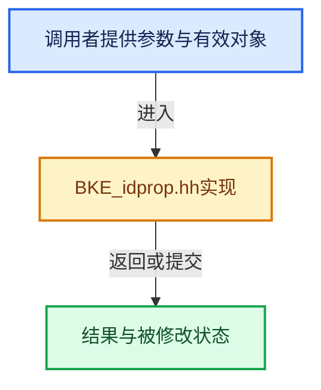

# 实现依赖专题：source/blender/blenkernel/BKE_idprop.hh

[方向导航](README.md) · [符号索引](../%E7%AC%A6%E5%8F%B7%E4%BE%9D%E8%B5%96%E4%B8%8E%E5%AE%9E%E7%8E%B0%E7%B4%A2%E5%BC%95.md)

本专题从正文实际调用进入，集中保存共享实现。函数有稳定锚点，可从调用处直接跳到对应完整函数；递归与互相调用通过回链组织。

## 本文件的实现关系





## 相关类型布局与成员入口

<a id="t-295d951f0692"></a>

### `blender::io::serialize::Value`

原始声明：[source/blender/blenkernel/BKE_idprop.hh](../../../../../source/blender/blenkernel/BKE_idprop.hh) · L34—L34。

以下保留类的数据声明与编译条件，成员函数实现通过后面的精确链接阅读。

<!-- annotated:1df427b8f16534 -->

```cpp
class Value;
```

<details>
<summary>核对原始源码：source/blender/blenkernel/BKE_idprop.hh · L34—L34</summary>

<!-- original:1df427b8f16534:source/blender/blenkernel/BKE_idprop.hh:34:34 -->

```cpp
class Value;
```

</details>


<a id="m-921e5bc3f26e"></a>

## 宏 `IDP_int_get`

<!-- annotated:b45dbcac54d95b -->

```cpp
#define IDP_int_get(prop) (_IDP_assert_type(prop, IDP_INT)->data.val)
#define IDP_int_set(prop, value) \
```

<details>
<summary>核对原始源码：source/blender/blenkernel/BKE_idprop.hh · L311—L312</summary>

<!-- original:b45dbcac54d95b:source/blender/blenkernel/BKE_idprop.hh:311:312 -->

```cpp
#define IDP_int_get(prop) (_IDP_assert_type(prop, IDP_INT)->data.val)
#define IDP_int_set(prop, value) \
```

</details>

宏在预处理阶段展开，参数替换、重复求值和条件编译应直接从该定义检查。与普通函数不同，宏不会自动提供参数类型检查；构建配置选择哪个定义需结合外围条件。

<a id="m-e6029d8f612d"></a>

## 宏 `IDP_int_set`

<!-- annotated:71365a48fad306 -->

```cpp
#define IDP_int_set(prop, value) \
  { \
    IDProperty *prop_ = (prop); \
    BLI_assert(prop_->type == IDP_INT); \
    prop_->data.val = value; \
  } \
  ((void)0)

```

<details>
<summary>核对原始源码：source/blender/blenkernel/BKE_idprop.hh · L312—L319</summary>

<!-- original:71365a48fad306:source/blender/blenkernel/BKE_idprop.hh:312:319 -->

```cpp
#define IDP_int_set(prop, value) \
  { \
    IDProperty *prop_ = (prop); \
    BLI_assert(prop_->type == IDP_INT); \
    prop_->data.val = value; \
  } \
  ((void)0)

```

</details>

宏在预处理阶段展开，参数替换、重复求值和条件编译应直接从该定义检查。与普通函数不同，宏不会自动提供参数类型检查；构建配置选择哪个定义需结合外围条件。

<a id="m-27ca26d9570b"></a>

## 宏 `IDP_bool_get`

<!-- annotated:8b8ab51ccc07c0 -->

```cpp
#define IDP_bool_get(prop) ((_IDP_assert_type(prop, IDP_BOOLEAN))->data.val)
#define IDP_bool_set(prop, value) \
```

<details>
<summary>核对原始源码：source/blender/blenkernel/BKE_idprop.hh · L320—L321</summary>

<!-- original:8b8ab51ccc07c0:source/blender/blenkernel/BKE_idprop.hh:320:321 -->

```cpp
#define IDP_bool_get(prop) ((_IDP_assert_type(prop, IDP_BOOLEAN))->data.val)
#define IDP_bool_set(prop, value) \
```

</details>

宏在预处理阶段展开，参数替换、重复求值和条件编译应直接从该定义检查。与普通函数不同，宏不会自动提供参数类型检查；构建配置选择哪个定义需结合外围条件。

<a id="m-1e52115e868f"></a>

## 宏 `IDP_bool_set`

<!-- annotated:5e2a0dbe0d60d4 -->

```cpp
#define IDP_bool_set(prop, value) \
  { \
    IDProperty *prop_ = (prop); \
    BLI_assert(prop_->type == IDP_BOOLEAN); \
    prop_->data.val = value; \
  } \
  ((void)0)

```

<details>
<summary>核对原始源码：source/blender/blenkernel/BKE_idprop.hh · L321—L328</summary>

<!-- original:5e2a0dbe0d60d4:source/blender/blenkernel/BKE_idprop.hh:321:328 -->

```cpp
#define IDP_bool_set(prop, value) \
  { \
    IDProperty *prop_ = (prop); \
    BLI_assert(prop_->type == IDP_BOOLEAN); \
    prop_->data.val = value; \
  } \
  ((void)0)

```

</details>

宏在预处理阶段展开，参数替换、重复求值和条件编译应直接从该定义检查。与普通函数不同，宏不会自动提供参数类型检查；构建配置选择哪个定义需结合外围条件。

<a id="m-ba9ee7e04f78"></a>

## 宏 `IDP_int_or_bool_get`

<!-- annotated:148ed1973a37cc -->

```cpp
#define IDP_int_or_bool_get(prop) \
  (_IDP_assert_type_mask(prop, (1 << IDP_INT) | (1 << IDP_BOOLEAN))->data.val)
#define IDP_int_or_bool_set(prop, value) \
```

<details>
<summary>核对原始源码：source/blender/blenkernel/BKE_idprop.hh · L329—L331</summary>

<!-- original:148ed1973a37cc:source/blender/blenkernel/BKE_idprop.hh:329:331 -->

```cpp
#define IDP_int_or_bool_get(prop) \
  (_IDP_assert_type_mask(prop, (1 << IDP_INT) | (1 << IDP_BOOLEAN))->data.val)
#define IDP_int_or_bool_set(prop, value) \
```

</details>

宏在预处理阶段展开，参数替换、重复求值和条件编译应直接从该定义检查。与普通函数不同，宏不会自动提供参数类型检查；构建配置选择哪个定义需结合外围条件。

<a id="m-38a37cecebb9"></a>

## 宏 `IDP_int_or_bool_set`

<!-- annotated:c6f358807c9b71 -->

```cpp
#define IDP_int_or_bool_set(prop, value) \
  { \
    IDProperty *prop_ = (prop); \
    BLI_assert(ELEM(prop_->type, IDP_INT, IDP_BOOLEAN)); \
    prop_->data.val = value; \
  } \
  ((void)0)

```

<details>
<summary>核对原始源码：source/blender/blenkernel/BKE_idprop.hh · L331—L338</summary>

<!-- original:c6f358807c9b71:source/blender/blenkernel/BKE_idprop.hh:331:338 -->

```cpp
#define IDP_int_or_bool_set(prop, value) \
  { \
    IDProperty *prop_ = (prop); \
    BLI_assert(ELEM(prop_->type, IDP_INT, IDP_BOOLEAN)); \
    prop_->data.val = value; \
  } \
  ((void)0)

```

</details>

宏在预处理阶段展开，参数替换、重复求值和条件编译应直接从该定义检查。与普通函数不同，宏不会自动提供参数类型检查；构建配置选择哪个定义需结合外围条件。

<a id="m-cc419e289062"></a>

## 宏 `IDP_float_get`

<!-- annotated:db8862ff7bd8b5 -->

```cpp
#define IDP_float_get(prop) (*(const float *)&(_IDP_assert_type(prop, IDP_FLOAT)->data.val))
#define IDP_float_set(prop, value) \
```

<details>
<summary>核对原始源码：source/blender/blenkernel/BKE_idprop.hh · L339—L340</summary>

<!-- original:db8862ff7bd8b5:source/blender/blenkernel/BKE_idprop.hh:339:340 -->

```cpp
#define IDP_float_get(prop) (*(const float *)&(_IDP_assert_type(prop, IDP_FLOAT)->data.val))
#define IDP_float_set(prop, value) \
```

</details>

宏在预处理阶段展开，参数替换、重复求值和条件编译应直接从该定义检查。与普通函数不同，宏不会自动提供参数类型检查；构建配置选择哪个定义需结合外围条件。

<a id="m-3fe0f4649b82"></a>

## 宏 `IDP_float_set`

<!-- annotated:bc314c44e04fb4 -->

```cpp
#define IDP_float_set(prop, value) \
  { \
    IDProperty *prop_ = (prop); \
    BLI_assert(prop_->type == IDP_FLOAT); \
    (*(float *)&(prop_)->data.val) = value; \
  } \
  ((void)0)

```

<details>
<summary>核对原始源码：source/blender/blenkernel/BKE_idprop.hh · L340—L347</summary>

<!-- original:bc314c44e04fb4:source/blender/blenkernel/BKE_idprop.hh:340:347 -->

```cpp
#define IDP_float_set(prop, value) \
  { \
    IDProperty *prop_ = (prop); \
    BLI_assert(prop_->type == IDP_FLOAT); \
    (*(float *)&(prop_)->data.val) = value; \
  } \
  ((void)0)

```

</details>

宏在预处理阶段展开，参数替换、重复求值和条件编译应直接从该定义检查。与普通函数不同，宏不会自动提供参数类型检查；构建配置选择哪个定义需结合外围条件。

<a id="m-f38831735afc"></a>

## 宏 `IDP_double_get`

<!-- annotated:d35910b933c932 -->

```cpp
#define IDP_double_get(prop) (*(const double *)&(_IDP_assert_type(prop, IDP_DOUBLE)->data.val))
#define IDP_double_set(prop, value) \
```

<details>
<summary>核对原始源码：source/blender/blenkernel/BKE_idprop.hh · L348—L349</summary>

<!-- original:d35910b933c932:source/blender/blenkernel/BKE_idprop.hh:348:349 -->

```cpp
#define IDP_double_get(prop) (*(const double *)&(_IDP_assert_type(prop, IDP_DOUBLE)->data.val))
#define IDP_double_set(prop, value) \
```

</details>

宏在预处理阶段展开，参数替换、重复求值和条件编译应直接从该定义检查。与普通函数不同，宏不会自动提供参数类型检查；构建配置选择哪个定义需结合外围条件。

<a id="m-6b48725d23b4"></a>

## 宏 `IDP_double_set`

<!-- annotated:9283a67ce5d23b -->

```cpp
#define IDP_double_set(prop, value) \
  { \
    IDProperty *prop_ = (prop); \
    BLI_assert(prop_->type == IDP_DOUBLE); \
    (*(double *)&(prop_)->data.val) = value; \
  } \
  ((void)0)

```

<details>
<summary>核对原始源码：source/blender/blenkernel/BKE_idprop.hh · L349—L356</summary>

<!-- original:9283a67ce5d23b:source/blender/blenkernel/BKE_idprop.hh:349:356 -->

```cpp
#define IDP_double_set(prop, value) \
  { \
    IDProperty *prop_ = (prop); \
    BLI_assert(prop_->type == IDP_DOUBLE); \
    (*(double *)&(prop_)->data.val) = value; \
  } \
  ((void)0)

```

</details>

宏在预处理阶段展开，参数替换、重复求值和条件编译应直接从该定义检查。与普通函数不同，宏不会自动提供参数类型检查；构建配置选择哪个定义需结合外围条件。

<a id="m-1dad2578c511"></a>

## 宏 `IDP_array_voidp_get`

<!-- annotated:1ac5be0eb40b9d -->

```cpp
#define IDP_array_voidp_get(prop) (_IDP_assert_type(prop, IDP_ARRAY)->data.pointer)

```

<details>
<summary>核对原始源码：source/blender/blenkernel/BKE_idprop.hh · L362—L363</summary>

<!-- original:1ac5be0eb40b9d:source/blender/blenkernel/BKE_idprop.hh:362:363 -->

```cpp
#define IDP_array_voidp_get(prop) (_IDP_assert_type(prop, IDP_ARRAY)->data.pointer)

```

</details>

宏在预处理阶段展开，参数替换、重复求值和条件编译应直接从该定义检查。与普通函数不同，宏不会自动提供参数类型检查；构建配置选择哪个定义需结合外围条件。

<a id="m-be08ca3b0480"></a>

## 宏 `IDP_array_int_get`

<!-- annotated:bd68ae81098bdc -->

```cpp
#define IDP_array_int_get(prop) \
  static_cast<int *>(_IDP_assert_type_and_subtype(prop, IDP_ARRAY, IDP_INT)->data.pointer)
#define IDP_array_bool_get(prop) \
```

<details>
<summary>核对原始源码：source/blender/blenkernel/BKE_idprop.hh · L364—L366</summary>

<!-- original:bd68ae81098bdc:source/blender/blenkernel/BKE_idprop.hh:364:366 -->

```cpp
#define IDP_array_int_get(prop) \
  static_cast<int *>(_IDP_assert_type_and_subtype(prop, IDP_ARRAY, IDP_INT)->data.pointer)
#define IDP_array_bool_get(prop) \
```

</details>

宏在预处理阶段展开，参数替换、重复求值和条件编译应直接从该定义检查。与普通函数不同，宏不会自动提供参数类型检查；构建配置选择哪个定义需结合外围条件。

<a id="m-d9189de51e1d"></a>

## 宏 `IDP_array_bool_get`

<!-- annotated:421176b0954b73 -->

```cpp
#define IDP_array_bool_get(prop) \
  static_cast<int8_t *>(_IDP_assert_type_and_subtype(prop, IDP_ARRAY, IDP_BOOLEAN)->data.pointer)
#define IDP_array_float_get(prop) \
```

<details>
<summary>核对原始源码：source/blender/blenkernel/BKE_idprop.hh · L366—L368</summary>

<!-- original:421176b0954b73:source/blender/blenkernel/BKE_idprop.hh:366:368 -->

```cpp
#define IDP_array_bool_get(prop) \
  static_cast<int8_t *>(_IDP_assert_type_and_subtype(prop, IDP_ARRAY, IDP_BOOLEAN)->data.pointer)
#define IDP_array_float_get(prop) \
```

</details>

宏在预处理阶段展开，参数替换、重复求值和条件编译应直接从该定义检查。与普通函数不同，宏不会自动提供参数类型检查；构建配置选择哪个定义需结合外围条件。

<a id="m-af8b95ead8cf"></a>

## 宏 `IDP_array_float_get`

<!-- annotated:5c8aedb505279b -->

```cpp
#define IDP_array_float_get(prop) \
  static_cast<float *>(_IDP_assert_type_and_subtype(prop, IDP_ARRAY, IDP_FLOAT)->data.pointer)
#define IDP_array_double_get(prop) \
```

<details>
<summary>核对原始源码：source/blender/blenkernel/BKE_idprop.hh · L368—L370</summary>

<!-- original:5c8aedb505279b:source/blender/blenkernel/BKE_idprop.hh:368:370 -->

```cpp
#define IDP_array_float_get(prop) \
  static_cast<float *>(_IDP_assert_type_and_subtype(prop, IDP_ARRAY, IDP_FLOAT)->data.pointer)
#define IDP_array_double_get(prop) \
```

</details>

宏在预处理阶段展开，参数替换、重复求值和条件编译应直接从该定义检查。与普通函数不同，宏不会自动提供参数类型检查；构建配置选择哪个定义需结合外围条件。

<a id="m-7d2e90991c8d"></a>

## 宏 `IDP_array_double_get`

<!-- annotated:6e3c8b1144dc94 -->

```cpp
#define IDP_array_double_get(prop) \
  static_cast<double *>(_IDP_assert_type_and_subtype(prop, IDP_ARRAY, IDP_DOUBLE)->data.pointer)
#define IDP_property_array_get(prop) \
```

<details>
<summary>核对原始源码：source/blender/blenkernel/BKE_idprop.hh · L370—L372</summary>

<!-- original:6e3c8b1144dc94:source/blender/blenkernel/BKE_idprop.hh:370:372 -->

```cpp
#define IDP_array_double_get(prop) \
  static_cast<double *>(_IDP_assert_type_and_subtype(prop, IDP_ARRAY, IDP_DOUBLE)->data.pointer)
#define IDP_property_array_get(prop) \
```

</details>

宏在预处理阶段展开，参数替换、重复求值和条件编译应直接从该定义检查。与普通函数不同，宏不会自动提供参数类型检查；构建配置选择哪个定义需结合外围条件。

<a id="m-726e461f0236"></a>

## 宏 `IDP_property_array_get`

<!-- annotated:62e30a1873995b -->

```cpp
#define IDP_property_array_get(prop) \
  static_cast<IDProperty *>(_IDP_assert_type(prop, IDP_IDPARRAY)->data.pointer)

```

<details>
<summary>核对原始源码：source/blender/blenkernel/BKE_idprop.hh · L372—L374</summary>

<!-- original:62e30a1873995b:source/blender/blenkernel/BKE_idprop.hh:372:374 -->

```cpp
#define IDP_property_array_get(prop) \
  static_cast<IDProperty *>(_IDP_assert_type(prop, IDP_IDPARRAY)->data.pointer)

```

</details>

宏在预处理阶段展开，参数替换、重复求值和条件编译应直接从该定义检查。与普通函数不同，宏不会自动提供参数类型检查；构建配置选择哪个定义需结合外围条件。

<a id="m-bedef49dcb76"></a>

## 宏 `IDP_string_get`

<!-- annotated:86794ee2dbb527 -->

```cpp
#define IDP_string_get(prop) ((char *)_IDP_assert_type(prop, IDP_STRING)->data.pointer)
/* No `IDP_string_set` needed. */
```

<details>
<summary>核对原始源码：source/blender/blenkernel/BKE_idprop.hh · L375—L376</summary>

<!-- original:86794ee2dbb527:source/blender/blenkernel/BKE_idprop.hh:375:376 -->

```cpp
#define IDP_string_get(prop) ((char *)_IDP_assert_type(prop, IDP_STRING)->data.pointer)
/* No `IDP_string_set` needed. */
```

</details>

宏在预处理阶段展开，参数替换、重复求值和条件编译应直接从该定义检查。与普通函数不同，宏不会自动提供参数类型检查；构建配置选择哪个定义需结合外围条件。

<a id="m-e3b1c0302622"></a>

## 宏 `IDP_ID_get`

<!-- annotated:8050f1b4852e7f -->

```cpp
#define IDP_ID_get(prop) ((void)0, ((ID *)_IDP_assert_type(prop, IDP_ID)->data.pointer))
/* No `IDP_ID_set` needed. */
```

<details>
<summary>核对原始源码：source/blender/blenkernel/BKE_idprop.hh · L377—L378</summary>

<!-- original:8050f1b4852e7f:source/blender/blenkernel/BKE_idprop.hh:377:378 -->

```cpp
#define IDP_ID_get(prop) ((void)0, ((ID *)_IDP_assert_type(prop, IDP_ID)->data.pointer))
/* No `IDP_ID_set` needed. */
```

</details>

宏在预处理阶段展开，参数替换、重复求值和条件编译应直接从该定义检查。与普通函数不同，宏不会自动提供参数类型检查；构建配置选择哪个定义需结合外围条件。

<a id="m-8b058cdaeb74"></a>

## 宏 `IDP_BlendDataRead`

<!-- annotated:c69a068e1da817 -->

```cpp
#define IDP_BlendDataRead(reader, prop) IDP_BlendReadData_impl(reader, prop, __func__)

```

<details>
<summary>核对原始源码：source/blender/blenkernel/BKE_idprop.hh · L430—L431</summary>

<!-- original:c69a068e1da817:source/blender/blenkernel/BKE_idprop.hh:430:431 -->

```cpp
#define IDP_BlendDataRead(reader, prop) IDP_BlendReadData_impl(reader, prop, __func__)

```

</details>

宏在预处理阶段展开，参数替换、重复求值和条件编译应直接从该定义检查。与普通函数不同，宏不会自动提供参数类型检查；构建配置选择哪个定义需结合外围条件。

## 完整成员与函数实现
