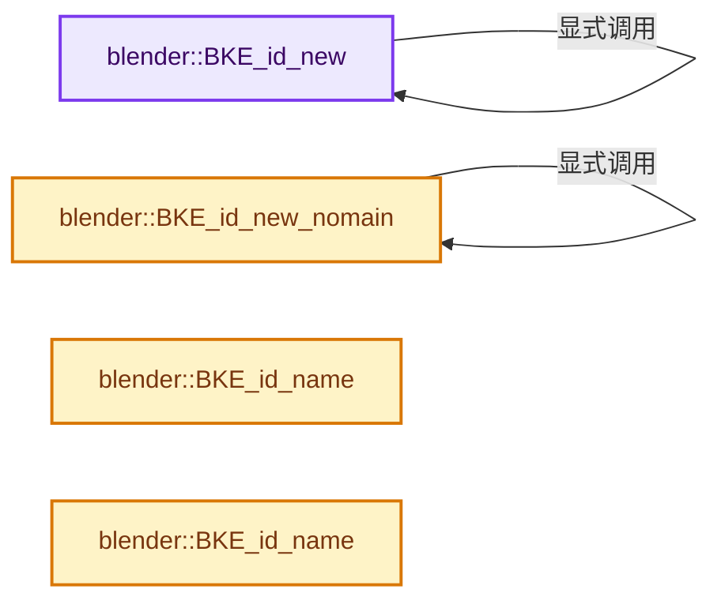
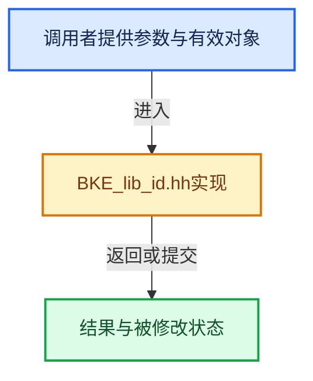

# 实现依赖专题：source/blender/blenkernel/BKE_lib_id.hh

[方向导航](README.md) · [符号索引](../%E7%AC%A6%E5%8F%B7%E4%BE%9D%E8%B5%96%E4%B8%8E%E5%AE%9E%E7%8E%B0%E7%B4%A2%E5%BC%95.md)

本专题从正文实际调用进入，集中保存共享实现。函数有稳定锚点，可从调用处直接跳到对应完整函数；递归与互相调用通过回链组织。

## 本文件的实现关系






## 完整成员与函数实现

<a id="f-ab121eff1c5b5325"></a>

### `blender::BKE_id_new`

实现位置：[source/blender/blenkernel/BKE_lib_id.hh](../../../../../source/blender/blenkernel/BKE_lib_id.hh) · L188—L192。

接口参数：

- `Main *bmain`
- `const char *name`

**教学注释版**

<!-- annotated:a3a63cfaf7a071 -->

```cpp
template<typename T> inline T *BKE_id_new(Main *bmain, const char *name)
{
  const ID_Type id_type = T::id_type;
  return static_cast<T *>(BKE_id_new(bmain, id_type, name));
}
```

<details>
<summary>核对原始源码：source/blender/blenkernel/BKE_lib_id.hh · L188—L192</summary>

<!-- original:a3a63cfaf7a071:source/blender/blenkernel/BKE_lib_id.hh:188:192 -->

```cpp
template<typename T> inline T *BKE_id_new(Main *bmain, const char *name)
{
  const ID_Type id_type = T::id_type;
  return static_cast<T *>(BKE_id_new(bmain, id_type, name));
}
```

</details>

**结果出口**

- `return static_cast<T *>(BKE_id_new(bmain, id_type, name));`

**继续追踪实现**

- `BKE_id_new` → [blender::BKE_id_new · L188](%E4%BE%9D%E8%B5%96-BKE_lib_id-3c6ccd.md#f-ab121eff1c5b5325)。

<a id="f-36ad361e833dd065"></a>

### `blender::BKE_id_new_nomain`

实现位置：[source/blender/blenkernel/BKE_lib_id.hh](../../../../../source/blender/blenkernel/BKE_lib_id.hh) · L221—L225。

接口参数：

- `const char *name`

**教学注释版**

<!-- annotated:11e91756321c7b -->

```cpp
template<typename T> inline T *BKE_id_new_nomain(const char *name)
{
  const ID_Type id_type = T::id_type;
  return static_cast<T *>(BKE_id_new_nomain(id_type, name));
}
```

<details>
<summary>核对原始源码：source/blender/blenkernel/BKE_lib_id.hh · L221—L225</summary>

<!-- original:11e91756321c7b:source/blender/blenkernel/BKE_lib_id.hh:221:225 -->

```cpp
template<typename T> inline T *BKE_id_new_nomain(const char *name)
{
  const ID_Type id_type = T::id_type;
  return static_cast<T *>(BKE_id_new_nomain(id_type, name));
}
```

</details>

**结果出口**

- `return static_cast<T *>(BKE_id_new_nomain(id_type, name));`

**继续追踪实现**

- `BKE_id_new_nomain` → [blender::BKE_id_new_nomain · L221](%E4%BE%9D%E8%B5%96-BKE_lib_id-3c6ccd.md#f-36ad361e833dd065)。

<a id="f-b9397f1fe1fcc017"></a>

### `blender::BKE_id_name`

实现位置：[source/blender/blenkernel/BKE_lib_id.hh](../../../../../source/blender/blenkernel/BKE_lib_id.hh) · L1001—L1004。

接口参数：

- `const ID &id`

**教学注释版**

<!-- annotated:474ee9764cf842 -->

```cpp
inline const char *BKE_id_name(const ID &id)
{
  return id.name + 2;
}
```

<details>
<summary>核对原始源码：source/blender/blenkernel/BKE_lib_id.hh · L1001—L1004</summary>

<!-- original:474ee9764cf842:source/blender/blenkernel/BKE_lib_id.hh:1001:1004 -->

```cpp
inline const char *BKE_id_name(const ID &id)
{
  return id.name + 2;
}
```

</details>

**结果出口**

- `return id.name + 2;`

**继续追踪实现**

本实现没有需要继续展开的显式调用；检查返回表达式、对象转换和调用者前置条件。

<a id="f-c026427d13979145"></a>

### `blender::BKE_id_name`

实现位置：[source/blender/blenkernel/BKE_lib_id.hh](../../../../../source/blender/blenkernel/BKE_lib_id.hh) · L1005—L1008。

接口参数：

- `ID &id`

**教学注释版**

<!-- annotated:a1d9596e11057c -->

```cpp
inline char *BKE_id_name(ID &id)
{
  return id.name + 2;
}
```

<details>
<summary>核对原始源码：source/blender/blenkernel/BKE_lib_id.hh · L1005—L1008</summary>

<!-- original:a1d9596e11057c:source/blender/blenkernel/BKE_lib_id.hh:1005:1008 -->

```cpp
inline char *BKE_id_name(ID &id)
{
  return id.name + 2;
}
```

</details>

**结果出口**

- `return id.name + 2;`

**继续追踪实现**

本实现没有需要继续展开的显式调用；检查返回表达式、对象转换和调用者前置条件。
