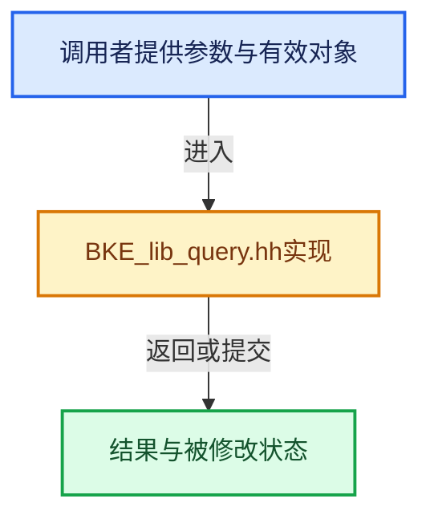

# 实现依赖专题：source/blender/blenkernel/BKE_lib_query.hh

[方向导航](README.md) · [符号索引](../%E7%AC%A6%E5%8F%B7%E4%BE%9D%E8%B5%96%E4%B8%8E%E5%AE%9E%E7%8E%B0%E7%B4%A2%E5%BC%95.md)

本专题从正文实际调用进入，集中保存共享实现。函数有稳定锚点，可从调用处直接跳到对应完整函数；递归与互相调用通过回链组织。

## 本文件的实现关系





## 相关类型布局与成员入口

<a id="t-5596f590d942"></a>

### `blender::LibraryForeachIDCallbackFlag`

原始声明：[source/blender/blenkernel/BKE_lib_query.hh](../../../../../source/blender/blenkernel/BKE_lib_query.hh) · L36—L131。

以下保留类的数据声明与编译条件，成员函数实现通过后面的精确链接阅读。

<!-- annotated:1c5472f906cddc -->

```cpp
enum LibraryForeachIDCallbackFlag {
  IDWALK_CB_NOP = 0,
  IDWALK_CB_NEVER_NULL = (1 << 0),
  IDWALK_CB_NEVER_SELF = (1 << 1),

  /**
   * Indicates whether this is direct (i.e. by local data) or indirect (i.e. by linked data) usage.
   */
  IDWALK_CB_INDIRECT_USAGE = (1 << 2),
  /**
   * Indicates that this is a direct weak link usage, i.e. if the user is a local ID, and is using
   * (pointing to) a linked ID, that usage does not make the linked ID directly linked.
   *
   * E.g. usages of linked collections or objects by ViewLayerCollections or Bases in scenes.
   *
   * Also used for most Editors ID usages (active node tree in the Node editor, shown image in the
   * Image editor, and so on).
   *
   * See also #ID_FLAG_INDIRECT_WEAK_LINK in DNA_ID.h
   */
  IDWALK_CB_DIRECT_WEAK_LINK = (1 << 3),

  /**
   * That ID is used as mere sub-data by its owner (only case currently: those root node-trees in
   * materials etc., and the Scene's master collections).
   * This means callback shall not *do* anything, only use this as informative data if it needs it.
   */
  IDWALK_CB_EMBEDDED = (1 << 4),
  /**
   * That ID pointer points to an embedded ID, but does not own it.
   *
   * E.g the `collection` pointer of the first ViewLayerCollection of a ViewLayer should always
   * point to the scene's master collection, which is an embedded ID 'owned' by
   * `Scene.master_collection`.
   */
  IDWALK_CB_EMBEDDED_NOT_OWNING = (1 << 5),

  /**
   * That ID is not really used by its owner, it's just an internal hint/helper.
   * This marks the 'from' pointers issue, like Key->from.
   * How to handle that kind of cases totally depends on what caller code is doing...
   */
  IDWALK_CB_LOOPBACK = (1 << 6),

  /**
   * Indicates that this is an internal runtime ID pointer, like e.g. `ID.newid` or `ID.original`.
   * \note Those should be ignored in most cases, and won't be processed/generated anyway unless
   * `IDWALK_DO_INTERNAL_RUNTIME_POINTERS` option is enabled.
   */
  IDWALK_CB_INTERNAL = (1 << 9),

  /**
   * This ID usage should not be processed during readfile (neither during lib-linking nor
   * expanding).
   *
   * Note that all embedded IDs pointers (#IDWALK_CB_EMBEDDED and #IDWALK_CB_EMBEDDED_NOT_OWNING)
   * cases are also ignored during readfile.
   *
   * Mainly used for some 'loop-back' pointers like the 'owner_id' of the embedded IDs.
   */
  IDWALK_CB_READFILE_IGNORE = (1 << 10),
  /**
   * This ID usage should not be processed during writefile.
   *
   * Mainly used to avoid explicit reference to some linked data from UI, like e.g. the Outliner
   * making all IDs 'directly linked'..
   */
  IDWALK_CB_WRITEFILE_IGNORE = (1 << 11),

  /**
   * This ID usage is fully refcounted.
   * Callback is responsible to deal accordingly with #ID.us if needed.
   */
  IDWALK_CB_USER = (1 << 12),
  /**
   * This ID usage is not refcounted, but at least one user should be generated by it (to avoid
   * e.g. losing the used ID on save/reload).
   * Callback is responsible to deal accordingly with #ID.us if needed.
   */
  IDWALK_CB_USER_ONE = (1 << 13),

  /** This ID is used as library override's reference by its owner. */
  IDWALK_CB_OVERRIDE_LIBRARY_REFERENCE = (1 << 16),

  /** This ID is used as library override's hierarchy root by its owner. */
  IDWALK_CB_OVERRIDE_LIBRARY_HIERARCHY_ROOT = (1 << 17),

  /** This ID pointer is not overridable. */
  IDWALK_CB_OVERRIDE_LIBRARY_NOT_OVERRIDABLE = (1 << 18),

  /** This ID pointer is expected to be overridden by default, in liboverride hierarchy context. */
  IDWALK_CB_OVERRIDE_LIBRARY_HIERARCHY_DEFAULT = (1 << 19),

  /** This ID pointer is runtime data and it should not affect the ID.deep_hash computation. */
  IDWALK_CB_HASH_IGNORE = (1 << 20),
};
```

<details>
<summary>核对原始源码：source/blender/blenkernel/BKE_lib_query.hh · L36—L131</summary>

<!-- original:1c5472f906cddc:source/blender/blenkernel/BKE_lib_query.hh:36:131 -->

```cpp
enum LibraryForeachIDCallbackFlag {
  IDWALK_CB_NOP = 0,
  IDWALK_CB_NEVER_NULL = (1 << 0),
  IDWALK_CB_NEVER_SELF = (1 << 1),

  /**
   * Indicates whether this is direct (i.e. by local data) or indirect (i.e. by linked data) usage.
   */
  IDWALK_CB_INDIRECT_USAGE = (1 << 2),
  /**
   * Indicates that this is a direct weak link usage, i.e. if the user is a local ID, and is using
   * (pointing to) a linked ID, that usage does not make the linked ID directly linked.
   *
   * E.g. usages of linked collections or objects by ViewLayerCollections or Bases in scenes.
   *
   * Also used for most Editors ID usages (active node tree in the Node editor, shown image in the
   * Image editor, and so on).
   *
   * See also #ID_FLAG_INDIRECT_WEAK_LINK in DNA_ID.h
   */
  IDWALK_CB_DIRECT_WEAK_LINK = (1 << 3),

  /**
   * That ID is used as mere sub-data by its owner (only case currently: those root node-trees in
   * materials etc., and the Scene's master collections).
   * This means callback shall not *do* anything, only use this as informative data if it needs it.
   */
  IDWALK_CB_EMBEDDED = (1 << 4),
  /**
   * That ID pointer points to an embedded ID, but does not own it.
   *
   * E.g the `collection` pointer of the first ViewLayerCollection of a ViewLayer should always
   * point to the scene's master collection, which is an embedded ID 'owned' by
   * `Scene.master_collection`.
   */
  IDWALK_CB_EMBEDDED_NOT_OWNING = (1 << 5),

  /**
   * That ID is not really used by its owner, it's just an internal hint/helper.
   * This marks the 'from' pointers issue, like Key->from.
   * How to handle that kind of cases totally depends on what caller code is doing...
   */
  IDWALK_CB_LOOPBACK = (1 << 6),

  /**
   * Indicates that this is an internal runtime ID pointer, like e.g. `ID.newid` or `ID.original`.
   * \note Those should be ignored in most cases, and won't be processed/generated anyway unless
   * `IDWALK_DO_INTERNAL_RUNTIME_POINTERS` option is enabled.
   */
  IDWALK_CB_INTERNAL = (1 << 9),

  /**
   * This ID usage should not be processed during readfile (neither during lib-linking nor
   * expanding).
   *
   * Note that all embedded IDs pointers (#IDWALK_CB_EMBEDDED and #IDWALK_CB_EMBEDDED_NOT_OWNING)
   * cases are also ignored during readfile.
   *
   * Mainly used for some 'loop-back' pointers like the 'owner_id' of the embedded IDs.
   */
  IDWALK_CB_READFILE_IGNORE = (1 << 10),
  /**
   * This ID usage should not be processed during writefile.
   *
   * Mainly used to avoid explicit reference to some linked data from UI, like e.g. the Outliner
   * making all IDs 'directly linked'..
   */
  IDWALK_CB_WRITEFILE_IGNORE = (1 << 11),

  /**
   * This ID usage is fully refcounted.
   * Callback is responsible to deal accordingly with #ID.us if needed.
   */
  IDWALK_CB_USER = (1 << 12),
  /**
   * This ID usage is not refcounted, but at least one user should be generated by it (to avoid
   * e.g. losing the used ID on save/reload).
   * Callback is responsible to deal accordingly with #ID.us if needed.
   */
  IDWALK_CB_USER_ONE = (1 << 13),

  /** This ID is used as library override's reference by its owner. */
  IDWALK_CB_OVERRIDE_LIBRARY_REFERENCE = (1 << 16),

  /** This ID is used as library override's hierarchy root by its owner. */
  IDWALK_CB_OVERRIDE_LIBRARY_HIERARCHY_ROOT = (1 << 17),

  /** This ID pointer is not overridable. */
  IDWALK_CB_OVERRIDE_LIBRARY_NOT_OVERRIDABLE = (1 << 18),

  /** This ID pointer is expected to be overridden by default, in liboverride hierarchy context. */
  IDWALK_CB_OVERRIDE_LIBRARY_HIERARCHY_DEFAULT = (1 << 19),

  /** This ID pointer is runtime data and it should not affect the ID.deep_hash computation. */
  IDWALK_CB_HASH_IGNORE = (1 << 20),
};
```

</details>


<a id="m-bd783c561d42"></a>

## 宏 `BKE_LIB_FOREACHID_PROCESS_ID`

<!-- annotated:f38625f63bb6b2 -->

```cpp
#define BKE_LIB_FOREACHID_PROCESS_ID(data_, id_, cb_flag_) \
  { \
    CHECK_TYPE_ANY((id_), ID *, void *); \
    BKE_LIB_FOREACHID_PROCESS_ID_NOCHECK(data_, id_, cb_flag_); \
  } \
  ((void)0)

```

<details>
<summary>核对原始源码：source/blender/blenkernel/BKE_lib_query.hh · L276—L282</summary>

<!-- original:f38625f63bb6b2:source/blender/blenkernel/BKE_lib_query.hh:276:282 -->

```cpp
#define BKE_LIB_FOREACHID_PROCESS_ID(data_, id_, cb_flag_) \
  { \
    CHECK_TYPE_ANY((id_), ID *, void *); \
    BKE_LIB_FOREACHID_PROCESS_ID_NOCHECK(data_, id_, cb_flag_); \
  } \
  ((void)0)

```

</details>

宏在预处理阶段展开，参数替换、重复求值和条件编译应直接从该定义检查。与普通函数不同，宏不会自动提供参数类型检查；构建配置选择哪个定义需结合外围条件。

<a id="m-1b059b49d6cb"></a>

## 宏 `BKE_LIB_FOREACHID_PROCESS_IDSUPER`

<!-- annotated:2564d48be930a5 -->

```cpp
#define BKE_LIB_FOREACHID_PROCESS_IDSUPER(data_, id_super_, cb_flag_) \
  { \
    BKE_LIB_FOREACHID_PROCESS_IDSUPER_P(data_, &(id_super_), cb_flag_); \
  } \
  ((void)0)

```

<details>
<summary>核对原始源码：source/blender/blenkernel/BKE_lib_query.hh · L293—L298</summary>

<!-- original:2564d48be930a5:source/blender/blenkernel/BKE_lib_query.hh:293:298 -->

```cpp
#define BKE_LIB_FOREACHID_PROCESS_IDSUPER(data_, id_super_, cb_flag_) \
  { \
    BKE_LIB_FOREACHID_PROCESS_IDSUPER_P(data_, &(id_super_), cb_flag_); \
  } \
  ((void)0)

```

</details>

宏在预处理阶段展开，参数替换、重复求值和条件编译应直接从该定义检查。与普通函数不同，宏不会自动提供参数类型检查；构建配置选择哪个定义需结合外围条件。

<a id="m-c45df84f7bf3"></a>

## 宏 `BKE_LIB_FOREACHID_PROCESS_FUNCTION_CALL`

<!-- annotated:20ca59a657e326 -->

```cpp
#define BKE_LIB_FOREACHID_PROCESS_FUNCTION_CALL(data_, func_call_) \
  { \
    func_call_; \
    if (BKE_lib_query_foreachid_iter_stop((data_))) { \
      return; \
    } \
  } \
  ((void)0)

```

<details>
<summary>核对原始源码：source/blender/blenkernel/BKE_lib_query.hh · L299—L307</summary>

<!-- original:20ca59a657e326:source/blender/blenkernel/BKE_lib_query.hh:299:307 -->

```cpp
#define BKE_LIB_FOREACHID_PROCESS_FUNCTION_CALL(data_, func_call_) \
  { \
    func_call_; \
    if (BKE_lib_query_foreachid_iter_stop((data_))) { \
      return; \
    } \
  } \
  ((void)0)

```

</details>

宏在预处理阶段展开，参数替换、重复求值和条件编译应直接从该定义检查。与普通函数不同，宏不会自动提供参数类型检查；构建配置选择哪个定义需结合外围条件。

## 完整成员与函数实现
