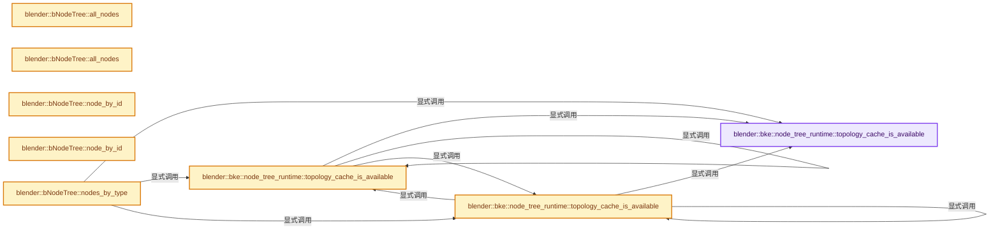
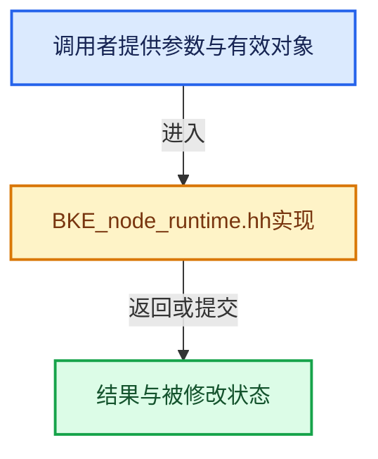

# 实现依赖专题：source/blender/blenkernel/BKE_node_runtime.hh

[方向导航](README.md) · [符号索引](../%E7%AC%A6%E5%8F%B7%E4%BE%9D%E8%B5%96%E4%B8%8E%E5%AE%9E%E7%8E%B0%E7%B4%A2%E5%BC%95.md)

本专题从正文实际调用进入，集中保存共享实现。函数有稳定锚点，可从调用处直接跳到对应完整函数；递归与互相调用通过回链组织。

## 本文件的实现关系






## 完整成员与函数实现

<a id="f-12caabb825726d07"></a>

### `blender::bke::node_tree_runtime::topology_cache_is_available`

实现位置：[source/blender/blenkernel/BKE_node_runtime.hh](../../../../../source/blender/blenkernel/BKE_node_runtime.hh) · L456—L468。

接口参数：

- `const bNodeTree &tree`

**教学注释版**

<!-- annotated:3301f37e42e269 -->

```cpp
inline bool topology_cache_is_available(const bNodeTree &tree)
{
  if (!tree.runtime->topology_cache_exists) {
    return false;
  }
  if (tree.runtime->allow_use_dirty_topology_cache.load() > 0) {
    return true;
  }
  if (tree.runtime->topology_cache_mutex.is_dirty()) {
    return false;
  }
  return true;
}
```

<details>
<summary>核对原始源码：source/blender/blenkernel/BKE_node_runtime.hh · L456—L468</summary>

<!-- original:3301f37e42e269:source/blender/blenkernel/BKE_node_runtime.hh:456:468 -->

```cpp
inline bool topology_cache_is_available(const bNodeTree &tree)
{
  if (!tree.runtime->topology_cache_exists) {
    return false;
  }
  if (tree.runtime->allow_use_dirty_topology_cache.load() > 0) {
    return true;
  }
  if (tree.runtime->topology_cache_mutex.is_dirty()) {
    return false;
  }
  return true;
}
```

</details>

**结果出口**

- `return false;`
- `return true;`

**继续追踪实现**

- `tree.runtime->allow_use_dirty_topology_cache.load` → [调用协议](../%E6%A8%A1%E6%9D%BF%E5%AE%8F%E4%B8%8E%E5%8A%A8%E6%80%81%E5%88%86%E6%B4%BE%E5%8D%8F%E8%AE%AE.md)：接收对象类型依赖auto、返回值或模板实例；不按同名猜测目标。调用位置L461。
- `tree.runtime->topology_cache_mutex.is_dirty` → [调用协议](../%E6%A8%A1%E6%9D%BF%E5%AE%8F%E4%B8%8E%E5%8A%A8%E6%80%81%E5%88%86%E6%B4%BE%E5%8D%8F%E8%AE%AE.md)：接收对象类型依赖auto、返回值或模板实例；不按同名猜测目标。调用位置L464。

<a id="f-de145c13b3ce3142"></a>

### `blender::bke::node_tree_runtime::topology_cache_is_available`

实现位置：[source/blender/blenkernel/BKE_node_runtime.hh](../../../../../source/blender/blenkernel/BKE_node_runtime.hh) · L470—L477。

接口参数：

- `const bNode &node`

**教学注释版**

<!-- annotated:d02be260c4ba86 -->

```cpp
inline bool topology_cache_is_available(const bNode &node)
{
  const bNodeTree *ntree = node.runtime->owner_tree;
  if (ntree == nullptr) {
    return false;
  }
  return topology_cache_is_available(*ntree);
}
```

<details>
<summary>核对原始源码：source/blender/blenkernel/BKE_node_runtime.hh · L470—L477</summary>

<!-- original:d02be260c4ba86:source/blender/blenkernel/BKE_node_runtime.hh:470:477 -->

```cpp
inline bool topology_cache_is_available(const bNode &node)
{
  const bNodeTree *ntree = node.runtime->owner_tree;
  if (ntree == nullptr) {
    return false;
  }
  return topology_cache_is_available(*ntree);
}
```

</details>

**结果出口**

- `return false;`
- `return topology_cache_is_available(*ntree);`

**继续追踪实现**

- `topology_cache_is_available` → [blender::bke::node_tree_runtime::topology_cache_is_available · L456](%E4%BE%9D%E8%B5%96-BKE_node_runtime-ee561b.md#f-12caabb825726d07)；[blender::bke::node_tree_runtime::topology_cache_is_available · L470](%E4%BE%9D%E8%B5%96-BKE_node_runtime-ee561b.md#f-de145c13b3ce3142)；[blender::bke::node_tree_runtime::topology_cache_is_available · L479](%E4%BE%9D%E8%B5%96-BKE_node_runtime-ee561b.md#f-0652c04a9c9c3f12)。同名重载需按实参类型选择。

<a id="f-0652c04a9c9c3f12"></a>

### `blender::bke::node_tree_runtime::topology_cache_is_available`

实现位置：[source/blender/blenkernel/BKE_node_runtime.hh](../../../../../source/blender/blenkernel/BKE_node_runtime.hh) · L479—L486。

接口参数：

- `const bNodeSocket &socket`

**教学注释版**

<!-- annotated:5d1f8d0fe4af0e -->

```cpp
inline bool topology_cache_is_available(const bNodeSocket &socket)
{
  const bNode *node = socket.runtime->owner_node;
  if (node == nullptr) {
    return false;
  }
  return topology_cache_is_available(*node);
}
```

<details>
<summary>核对原始源码：source/blender/blenkernel/BKE_node_runtime.hh · L479—L486</summary>

<!-- original:5d1f8d0fe4af0e:source/blender/blenkernel/BKE_node_runtime.hh:479:486 -->

```cpp
inline bool topology_cache_is_available(const bNodeSocket &socket)
{
  const bNode *node = socket.runtime->owner_node;
  if (node == nullptr) {
    return false;
  }
  return topology_cache_is_available(*node);
}
```

</details>

**结果出口**

- `return false;`
- `return topology_cache_is_available(*node);`

**继续追踪实现**

- `topology_cache_is_available` → [blender::bke::node_tree_runtime::topology_cache_is_available · L456](%E4%BE%9D%E8%B5%96-BKE_node_runtime-ee561b.md#f-12caabb825726d07)；[blender::bke::node_tree_runtime::topology_cache_is_available · L470](%E4%BE%9D%E8%B5%96-BKE_node_runtime-ee561b.md#f-de145c13b3ce3142)；[blender::bke::node_tree_runtime::topology_cache_is_available · L479](%E4%BE%9D%E8%B5%96-BKE_node_runtime-ee561b.md#f-0652c04a9c9c3f12)。同名重载需按实参类型选择。

<a id="f-cda455cbcc6c7f36"></a>

### `blender::bNodeTree::all_nodes`

实现位置：[source/blender/blenkernel/BKE_node_runtime.hh](../../../../../source/blender/blenkernel/BKE_node_runtime.hh) · L500—L503。

**教学注释版**

<!-- annotated:d815afee8565b8 -->

```cpp
inline Span<const bNode *> bNodeTree::all_nodes() const
{
  return this->runtime->nodes_by_id.as_span();
}
```

<details>
<summary>核对原始源码：source/blender/blenkernel/BKE_node_runtime.hh · L500—L503</summary>

<!-- original:d815afee8565b8:source/blender/blenkernel/BKE_node_runtime.hh:500:503 -->

```cpp
inline Span<const bNode *> bNodeTree::all_nodes() const
{
  return this->runtime->nodes_by_id.as_span();
}
```

</details>

**结果出口**

- `return this->runtime->nodes_by_id.as_span();`

**继续追踪实现**

- `this->runtime->nodes_by_id.as_span` → [调用协议](../%E6%A8%A1%E6%9D%BF%E5%AE%8F%E4%B8%8E%E5%8A%A8%E6%80%81%E5%88%86%E6%B4%BE%E5%8D%8F%E8%AE%AE.md)：接收对象类型依赖auto、返回值或模板实例；不按同名猜测目标。调用位置L502。

<a id="f-358b65e5678f8a32"></a>

### `blender::bNodeTree::all_nodes`

实现位置：[source/blender/blenkernel/BKE_node_runtime.hh](../../../../../source/blender/blenkernel/BKE_node_runtime.hh) · L505—L508。

**教学注释版**

<!-- annotated:7d5e9f178487ac -->

```cpp
inline Span<bNode *> bNodeTree::all_nodes()
{
  return this->runtime->nodes_by_id;
}
```

<details>
<summary>核对原始源码：source/blender/blenkernel/BKE_node_runtime.hh · L505—L508</summary>

<!-- original:7d5e9f178487ac:source/blender/blenkernel/BKE_node_runtime.hh:505:508 -->

```cpp
inline Span<bNode *> bNodeTree::all_nodes()
{
  return this->runtime->nodes_by_id;
}
```

</details>

**结果出口**

- `return this->runtime->nodes_by_id;`

**继续追踪实现**

本实现没有需要继续展开的显式调用；检查返回表达式、对象转换和调用者前置条件。

<a id="f-9ad10482fbea31d4"></a>

### `blender::bNodeTree::node_by_id`

实现位置：[source/blender/blenkernel/BKE_node_runtime.hh](../../../../../source/blender/blenkernel/BKE_node_runtime.hh) · L510—L515。

接口参数：

- `const int32_t identifier`

**教学注释版**

<!-- annotated:214a73dff0a956 -->

```cpp
inline bNode *bNodeTree::node_by_id(const int32_t identifier)
{
  BLI_assert(identifier >= 0);
  bNode *const *node = this->runtime->nodes_by_id.lookup_key_ptr_as(identifier);
  return node ? *node : nullptr;
}
```

<details>
<summary>核对原始源码：source/blender/blenkernel/BKE_node_runtime.hh · L510—L515</summary>

<!-- original:214a73dff0a956:source/blender/blenkernel/BKE_node_runtime.hh:510:515 -->

```cpp
inline bNode *bNodeTree::node_by_id(const int32_t identifier)
{
  BLI_assert(identifier >= 0);
  bNode *const *node = this->runtime->nodes_by_id.lookup_key_ptr_as(identifier);
  return node ? *node : nullptr;
}
```

</details>

**结果出口**

- `return node ? *node : nullptr;`

**继续追踪实现**

- `BLI_assert` → [BLI_assert · L48](../01-%E5%9F%BA%E7%A1%80%E5%AE%B9%E5%99%A8%E4%B8%8E%E7%8E%B0%E4%BB%A3CPP/%E4%BE%9D%E8%B5%96-BLI_assert-cc98e8.md#m-57a88495704d)；[BLI_assert · L63](../01-%E5%9F%BA%E7%A1%80%E5%AE%B9%E5%99%A8%E4%B8%8E%E7%8E%B0%E4%BB%A3CPP/%E4%BE%9D%E8%B5%96-BLI_assert-cc98e8.md#m-d07050020cb5)。宏定义由构建条件选择。
- `this->runtime->nodes_by_id.lookup_key_ptr_as` → [调用协议](../%E6%A8%A1%E6%9D%BF%E5%AE%8F%E4%B8%8E%E5%8A%A8%E6%80%81%E5%88%86%E6%B4%BE%E5%8D%8F%E8%AE%AE.md)：接收对象类型依赖auto、返回值或模板实例；不按同名猜测目标。调用位置L513。

<a id="f-d25cdfa86a7c2cb1"></a>

### `blender::bNodeTree::node_by_id`

实现位置：[source/blender/blenkernel/BKE_node_runtime.hh](../../../../../source/blender/blenkernel/BKE_node_runtime.hh) · L517—L522。

接口参数：

- `const int32_t identifier`

**教学注释版**

<!-- annotated:b223c1c39f0b4f -->

```cpp
inline const bNode *bNodeTree::node_by_id(const int32_t identifier) const
{
  BLI_assert(identifier >= 0);
  const bNode *const *node = this->runtime->nodes_by_id.lookup_key_ptr_as(identifier);
  return node ? *node : nullptr;
}
```

<details>
<summary>核对原始源码：source/blender/blenkernel/BKE_node_runtime.hh · L517—L522</summary>

<!-- original:b223c1c39f0b4f:source/blender/blenkernel/BKE_node_runtime.hh:517:522 -->

```cpp
inline const bNode *bNodeTree::node_by_id(const int32_t identifier) const
{
  BLI_assert(identifier >= 0);
  const bNode *const *node = this->runtime->nodes_by_id.lookup_key_ptr_as(identifier);
  return node ? *node : nullptr;
}
```

</details>

**结果出口**

- `return node ? *node : nullptr;`

**继续追踪实现**

- `BLI_assert` → [BLI_assert · L48](../01-%E5%9F%BA%E7%A1%80%E5%AE%B9%E5%99%A8%E4%B8%8E%E7%8E%B0%E4%BB%A3CPP/%E4%BE%9D%E8%B5%96-BLI_assert-cc98e8.md#m-57a88495704d)；[BLI_assert · L63](../01-%E5%9F%BA%E7%A1%80%E5%AE%B9%E5%99%A8%E4%B8%8E%E7%8E%B0%E4%BB%A3CPP/%E4%BE%9D%E8%B5%96-BLI_assert-cc98e8.md#m-d07050020cb5)。宏定义由构建条件选择。
- `this->runtime->nodes_by_id.lookup_key_ptr_as` → [调用协议](../%E6%A8%A1%E6%9D%BF%E5%AE%8F%E4%B8%8E%E5%8A%A8%E6%80%81%E5%88%86%E6%B4%BE%E5%8D%8F%E8%AE%AE.md)：接收对象类型依赖auto、返回值或模板实例；不按同名猜测目标。调用位置L520。

<a id="f-dbf5b02db7697f8c"></a>

### `blender::bNodeTree::nodes_by_type`

实现位置：[source/blender/blenkernel/BKE_node_runtime.hh](../../../../../source/blender/blenkernel/BKE_node_runtime.hh) · L524—L528。

接口参数：

- `const UString type_idname`

**教学注释版**

<!-- annotated:cb50cfc168be92 -->

```cpp
inline Span<bNode *> bNodeTree::nodes_by_type(const UString type_idname)
{
  BLI_assert(bke::node_tree_runtime::topology_cache_is_available(*this));
  return this->runtime->nodes_by_type.lookup(bke::node_type_find(type_idname));
}
```

<details>
<summary>核对原始源码：source/blender/blenkernel/BKE_node_runtime.hh · L524—L528</summary>

<!-- original:cb50cfc168be92:source/blender/blenkernel/BKE_node_runtime.hh:524:528 -->

```cpp
inline Span<bNode *> bNodeTree::nodes_by_type(const UString type_idname)
{
  BLI_assert(bke::node_tree_runtime::topology_cache_is_available(*this));
  return this->runtime->nodes_by_type.lookup(bke::node_type_find(type_idname));
}
```

</details>

**结果出口**

- `return this->runtime->nodes_by_type.lookup(bke::node_type_find(type_idname));`

**继续追踪实现**

- `BLI_assert` → [BLI_assert · L48](../01-%E5%9F%BA%E7%A1%80%E5%AE%B9%E5%99%A8%E4%B8%8E%E7%8E%B0%E4%BB%A3CPP/%E4%BE%9D%E8%B5%96-BLI_assert-cc98e8.md#m-57a88495704d)；[BLI_assert · L63](../01-%E5%9F%BA%E7%A1%80%E5%AE%B9%E5%99%A8%E4%B8%8E%E7%8E%B0%E4%BB%A3CPP/%E4%BE%9D%E8%B5%96-BLI_assert-cc98e8.md#m-d07050020cb5)。宏定义由构建条件选择。
- `bke::node_tree_runtime::topology_cache_is_available` → [blender::bke::node_tree_runtime::topology_cache_is_available · L456](%E4%BE%9D%E8%B5%96-BKE_node_runtime-ee561b.md#f-12caabb825726d07)；[blender::bke::node_tree_runtime::topology_cache_is_available · L470](%E4%BE%9D%E8%B5%96-BKE_node_runtime-ee561b.md#f-de145c13b3ce3142)；[blender::bke::node_tree_runtime::topology_cache_is_available · L479](%E4%BE%9D%E8%B5%96-BKE_node_runtime-ee561b.md#f-0652c04a9c9c3f12)。同名重载需按实参类型选择。
- `this->runtime->nodes_by_type.lookup` → [调用协议](../%E6%A8%A1%E6%9D%BF%E5%AE%8F%E4%B8%8E%E5%8A%A8%E6%80%81%E5%88%86%E6%B4%BE%E5%8D%8F%E8%AE%AE.md)：接收对象类型依赖auto、返回值或模板实例；不按同名猜测目标。调用位置L527。
- `bke::node_type_find` → [blender::bke::node_type_find · L2883](%E4%BE%9D%E8%B5%96-node-89d753.md#f-43bb33d661e48fe2)。

<a id="f-1316cfee8b291699"></a>

### `blender::bNodeTree::nodes_by_type`

实现位置：[source/blender/blenkernel/BKE_node_runtime.hh](../../../../../source/blender/blenkernel/BKE_node_runtime.hh) · L530—L534。

接口参数：

- `const UString type_idname`

**教学注释版**

<!-- annotated:d3b1d83efabdc6 -->

```cpp
inline Span<const bNode *> bNodeTree::nodes_by_type(const UString type_idname) const
{
  BLI_assert(bke::node_tree_runtime::topology_cache_is_available(*this));
  return this->runtime->nodes_by_type.lookup(bke::node_type_find(type_idname));
}
```

<details>
<summary>核对原始源码：source/blender/blenkernel/BKE_node_runtime.hh · L530—L534</summary>

<!-- original:d3b1d83efabdc6:source/blender/blenkernel/BKE_node_runtime.hh:530:534 -->

```cpp
inline Span<const bNode *> bNodeTree::nodes_by_type(const UString type_idname) const
{
  BLI_assert(bke::node_tree_runtime::topology_cache_is_available(*this));
  return this->runtime->nodes_by_type.lookup(bke::node_type_find(type_idname));
}
```

</details>

**结果出口**

- `return this->runtime->nodes_by_type.lookup(bke::node_type_find(type_idname));`

**继续追踪实现**

- `BLI_assert` → [BLI_assert · L48](../01-%E5%9F%BA%E7%A1%80%E5%AE%B9%E5%99%A8%E4%B8%8E%E7%8E%B0%E4%BB%A3CPP/%E4%BE%9D%E8%B5%96-BLI_assert-cc98e8.md#m-57a88495704d)；[BLI_assert · L63](../01-%E5%9F%BA%E7%A1%80%E5%AE%B9%E5%99%A8%E4%B8%8E%E7%8E%B0%E4%BB%A3CPP/%E4%BE%9D%E8%B5%96-BLI_assert-cc98e8.md#m-d07050020cb5)。宏定义由构建条件选择。
- `bke::node_tree_runtime::topology_cache_is_available` → [blender::bke::node_tree_runtime::topology_cache_is_available · L456](%E4%BE%9D%E8%B5%96-BKE_node_runtime-ee561b.md#f-12caabb825726d07)；[blender::bke::node_tree_runtime::topology_cache_is_available · L470](%E4%BE%9D%E8%B5%96-BKE_node_runtime-ee561b.md#f-de145c13b3ce3142)；[blender::bke::node_tree_runtime::topology_cache_is_available · L479](%E4%BE%9D%E8%B5%96-BKE_node_runtime-ee561b.md#f-0652c04a9c9c3f12)。同名重载需按实参类型选择。
- `this->runtime->nodes_by_type.lookup` → [调用协议](../%E6%A8%A1%E6%9D%BF%E5%AE%8F%E4%B8%8E%E5%8A%A8%E6%80%81%E5%88%86%E6%B4%BE%E5%8D%8F%E8%AE%AE.md)：接收对象类型依赖auto、返回值或模板实例；不按同名猜测目标。调用位置L533。
- `bke::node_type_find` → [blender::bke::node_type_find · L2883](%E4%BE%9D%E8%B5%96-node-89d753.md#f-43bb33d661e48fe2)。

<a id="f-78989f1063f73ab2"></a>

### `blender::bNodeTree::toposort_left_to_right`

实现位置：[source/blender/blenkernel/BKE_node_runtime.hh](../../../../../source/blender/blenkernel/BKE_node_runtime.hh) · L536—L540。

**教学注释版**

<!-- annotated:f932aa06beceb1 -->

```cpp
inline Span<const bNode *> bNodeTree::toposort_left_to_right() const
{
  BLI_assert(bke::node_tree_runtime::topology_cache_is_available(*this));
  return this->runtime->toposort_left_to_right;
}
```

<details>
<summary>核对原始源码：source/blender/blenkernel/BKE_node_runtime.hh · L536—L540</summary>

<!-- original:f932aa06beceb1:source/blender/blenkernel/BKE_node_runtime.hh:536:540 -->

```cpp
inline Span<const bNode *> bNodeTree::toposort_left_to_right() const
{
  BLI_assert(bke::node_tree_runtime::topology_cache_is_available(*this));
  return this->runtime->toposort_left_to_right;
}
```

</details>

**结果出口**

- `return this->runtime->toposort_left_to_right;`

**继续追踪实现**

- `BLI_assert` → [BLI_assert · L48](../01-%E5%9F%BA%E7%A1%80%E5%AE%B9%E5%99%A8%E4%B8%8E%E7%8E%B0%E4%BB%A3CPP/%E4%BE%9D%E8%B5%96-BLI_assert-cc98e8.md#m-57a88495704d)；[BLI_assert · L63](../01-%E5%9F%BA%E7%A1%80%E5%AE%B9%E5%99%A8%E4%B8%8E%E7%8E%B0%E4%BB%A3CPP/%E4%BE%9D%E8%B5%96-BLI_assert-cc98e8.md#m-d07050020cb5)。宏定义由构建条件选择。
- `bke::node_tree_runtime::topology_cache_is_available` → [blender::bke::node_tree_runtime::topology_cache_is_available · L456](%E4%BE%9D%E8%B5%96-BKE_node_runtime-ee561b.md#f-12caabb825726d07)；[blender::bke::node_tree_runtime::topology_cache_is_available · L470](%E4%BE%9D%E8%B5%96-BKE_node_runtime-ee561b.md#f-de145c13b3ce3142)；[blender::bke::node_tree_runtime::topology_cache_is_available · L479](%E4%BE%9D%E8%B5%96-BKE_node_runtime-ee561b.md#f-0652c04a9c9c3f12)。同名重载需按实参类型选择。

<a id="f-35b8b72c0f4e3706"></a>

### `blender::bNodeTree::toposort_right_to_left`

实现位置：[source/blender/blenkernel/BKE_node_runtime.hh](../../../../../source/blender/blenkernel/BKE_node_runtime.hh) · L542—L546。

**教学注释版**

<!-- annotated:4b532ee40d38ca -->

```cpp
inline Span<const bNode *> bNodeTree::toposort_right_to_left() const
{
  BLI_assert(bke::node_tree_runtime::topology_cache_is_available(*this));
  return this->runtime->toposort_right_to_left;
}
```

<details>
<summary>核对原始源码：source/blender/blenkernel/BKE_node_runtime.hh · L542—L546</summary>

<!-- original:4b532ee40d38ca:source/blender/blenkernel/BKE_node_runtime.hh:542:546 -->

```cpp
inline Span<const bNode *> bNodeTree::toposort_right_to_left() const
{
  BLI_assert(bke::node_tree_runtime::topology_cache_is_available(*this));
  return this->runtime->toposort_right_to_left;
}
```

</details>

**结果出口**

- `return this->runtime->toposort_right_to_left;`

**继续追踪实现**

- `BLI_assert` → [BLI_assert · L48](../01-%E5%9F%BA%E7%A1%80%E5%AE%B9%E5%99%A8%E4%B8%8E%E7%8E%B0%E4%BB%A3CPP/%E4%BE%9D%E8%B5%96-BLI_assert-cc98e8.md#m-57a88495704d)；[BLI_assert · L63](../01-%E5%9F%BA%E7%A1%80%E5%AE%B9%E5%99%A8%E4%B8%8E%E7%8E%B0%E4%BB%A3CPP/%E4%BE%9D%E8%B5%96-BLI_assert-cc98e8.md#m-d07050020cb5)。宏定义由构建条件选择。
- `bke::node_tree_runtime::topology_cache_is_available` → [blender::bke::node_tree_runtime::topology_cache_is_available · L456](%E4%BE%9D%E8%B5%96-BKE_node_runtime-ee561b.md#f-12caabb825726d07)；[blender::bke::node_tree_runtime::topology_cache_is_available · L470](%E4%BE%9D%E8%B5%96-BKE_node_runtime-ee561b.md#f-de145c13b3ce3142)；[blender::bke::node_tree_runtime::topology_cache_is_available · L479](%E4%BE%9D%E8%B5%96-BKE_node_runtime-ee561b.md#f-0652c04a9c9c3f12)。同名重载需按实参类型选择。

<a id="f-f08564985dc90c11"></a>

### `blender::bNodeTree::toposort_left_to_right`

实现位置：[source/blender/blenkernel/BKE_node_runtime.hh](../../../../../source/blender/blenkernel/BKE_node_runtime.hh) · L548—L552。

**教学注释版**

<!-- annotated:fbc03041918b02 -->

```cpp
inline Span<bNode *> bNodeTree::toposort_left_to_right()
{
  BLI_assert(bke::node_tree_runtime::topology_cache_is_available(*this));
  return this->runtime->toposort_left_to_right;
}
```

<details>
<summary>核对原始源码：source/blender/blenkernel/BKE_node_runtime.hh · L548—L552</summary>

<!-- original:fbc03041918b02:source/blender/blenkernel/BKE_node_runtime.hh:548:552 -->

```cpp
inline Span<bNode *> bNodeTree::toposort_left_to_right()
{
  BLI_assert(bke::node_tree_runtime::topology_cache_is_available(*this));
  return this->runtime->toposort_left_to_right;
}
```

</details>

**结果出口**

- `return this->runtime->toposort_left_to_right;`

**继续追踪实现**

- `BLI_assert` → [BLI_assert · L48](../01-%E5%9F%BA%E7%A1%80%E5%AE%B9%E5%99%A8%E4%B8%8E%E7%8E%B0%E4%BB%A3CPP/%E4%BE%9D%E8%B5%96-BLI_assert-cc98e8.md#m-57a88495704d)；[BLI_assert · L63](../01-%E5%9F%BA%E7%A1%80%E5%AE%B9%E5%99%A8%E4%B8%8E%E7%8E%B0%E4%BB%A3CPP/%E4%BE%9D%E8%B5%96-BLI_assert-cc98e8.md#m-d07050020cb5)。宏定义由构建条件选择。
- `bke::node_tree_runtime::topology_cache_is_available` → [blender::bke::node_tree_runtime::topology_cache_is_available · L456](%E4%BE%9D%E8%B5%96-BKE_node_runtime-ee561b.md#f-12caabb825726d07)；[blender::bke::node_tree_runtime::topology_cache_is_available · L470](%E4%BE%9D%E8%B5%96-BKE_node_runtime-ee561b.md#f-de145c13b3ce3142)；[blender::bke::node_tree_runtime::topology_cache_is_available · L479](%E4%BE%9D%E8%B5%96-BKE_node_runtime-ee561b.md#f-0652c04a9c9c3f12)。同名重载需按实参类型选择。

<a id="f-e32e4c3c7da5d6ad"></a>

### `blender::bNodeTree::toposort_right_to_left`

实现位置：[source/blender/blenkernel/BKE_node_runtime.hh](../../../../../source/blender/blenkernel/BKE_node_runtime.hh) · L554—L558。

**教学注释版**

<!-- annotated:0c234a86d6691a -->

```cpp
inline Span<bNode *> bNodeTree::toposort_right_to_left()
{
  BLI_assert(bke::node_tree_runtime::topology_cache_is_available(*this));
  return this->runtime->toposort_right_to_left;
}
```

<details>
<summary>核对原始源码：source/blender/blenkernel/BKE_node_runtime.hh · L554—L558</summary>

<!-- original:0c234a86d6691a:source/blender/blenkernel/BKE_node_runtime.hh:554:558 -->

```cpp
inline Span<bNode *> bNodeTree::toposort_right_to_left()
{
  BLI_assert(bke::node_tree_runtime::topology_cache_is_available(*this));
  return this->runtime->toposort_right_to_left;
}
```

</details>

**结果出口**

- `return this->runtime->toposort_right_to_left;`

**继续追踪实现**

- `BLI_assert` → [BLI_assert · L48](../01-%E5%9F%BA%E7%A1%80%E5%AE%B9%E5%99%A8%E4%B8%8E%E7%8E%B0%E4%BB%A3CPP/%E4%BE%9D%E8%B5%96-BLI_assert-cc98e8.md#m-57a88495704d)；[BLI_assert · L63](../01-%E5%9F%BA%E7%A1%80%E5%AE%B9%E5%99%A8%E4%B8%8E%E7%8E%B0%E4%BB%A3CPP/%E4%BE%9D%E8%B5%96-BLI_assert-cc98e8.md#m-d07050020cb5)。宏定义由构建条件选择。
- `bke::node_tree_runtime::topology_cache_is_available` → [blender::bke::node_tree_runtime::topology_cache_is_available · L456](%E4%BE%9D%E8%B5%96-BKE_node_runtime-ee561b.md#f-12caabb825726d07)；[blender::bke::node_tree_runtime::topology_cache_is_available · L470](%E4%BE%9D%E8%B5%96-BKE_node_runtime-ee561b.md#f-de145c13b3ce3142)；[blender::bke::node_tree_runtime::topology_cache_is_available · L479](%E4%BE%9D%E8%B5%96-BKE_node_runtime-ee561b.md#f-0652c04a9c9c3f12)。同名重载需按实参类型选择。

<a id="f-63ff240a4f6eb180"></a>

### `blender::bNodeTree::group_nodes`

实现位置：[source/blender/blenkernel/BKE_node_runtime.hh](../../../../../source/blender/blenkernel/BKE_node_runtime.hh) · L560—L564。

**教学注释版**

<!-- annotated:c60da67bcc3a41 -->

```cpp
inline Span<const bNode *> bNodeTree::group_nodes() const
{
  BLI_assert(bke::node_tree_runtime::topology_cache_is_available(*this));
  return this->runtime->group_nodes;
}
```

<details>
<summary>核对原始源码：source/blender/blenkernel/BKE_node_runtime.hh · L560—L564</summary>

<!-- original:c60da67bcc3a41:source/blender/blenkernel/BKE_node_runtime.hh:560:564 -->

```cpp
inline Span<const bNode *> bNodeTree::group_nodes() const
{
  BLI_assert(bke::node_tree_runtime::topology_cache_is_available(*this));
  return this->runtime->group_nodes;
}
```

</details>

**结果出口**

- `return this->runtime->group_nodes;`

**继续追踪实现**

- `BLI_assert` → [BLI_assert · L48](../01-%E5%9F%BA%E7%A1%80%E5%AE%B9%E5%99%A8%E4%B8%8E%E7%8E%B0%E4%BB%A3CPP/%E4%BE%9D%E8%B5%96-BLI_assert-cc98e8.md#m-57a88495704d)；[BLI_assert · L63](../01-%E5%9F%BA%E7%A1%80%E5%AE%B9%E5%99%A8%E4%B8%8E%E7%8E%B0%E4%BB%A3CPP/%E4%BE%9D%E8%B5%96-BLI_assert-cc98e8.md#m-d07050020cb5)。宏定义由构建条件选择。
- `bke::node_tree_runtime::topology_cache_is_available` → [blender::bke::node_tree_runtime::topology_cache_is_available · L456](%E4%BE%9D%E8%B5%96-BKE_node_runtime-ee561b.md#f-12caabb825726d07)；[blender::bke::node_tree_runtime::topology_cache_is_available · L470](%E4%BE%9D%E8%B5%96-BKE_node_runtime-ee561b.md#f-de145c13b3ce3142)；[blender::bke::node_tree_runtime::topology_cache_is_available · L479](%E4%BE%9D%E8%B5%96-BKE_node_runtime-ee561b.md#f-0652c04a9c9c3f12)。同名重载需按实参类型选择。

<a id="f-aa4b0e32732fba68"></a>

### `blender::bNodeTree::group_nodes`

实现位置：[source/blender/blenkernel/BKE_node_runtime.hh](../../../../../source/blender/blenkernel/BKE_node_runtime.hh) · L566—L570。

**教学注释版**

<!-- annotated:44dee3e6ee8116 -->

```cpp
inline Span<bNode *> bNodeTree::group_nodes()
{
  BLI_assert(bke::node_tree_runtime::topology_cache_is_available(*this));
  return this->runtime->group_nodes;
}
```

<details>
<summary>核对原始源码：source/blender/blenkernel/BKE_node_runtime.hh · L566—L570</summary>

<!-- original:44dee3e6ee8116:source/blender/blenkernel/BKE_node_runtime.hh:566:570 -->

```cpp
inline Span<bNode *> bNodeTree::group_nodes()
{
  BLI_assert(bke::node_tree_runtime::topology_cache_is_available(*this));
  return this->runtime->group_nodes;
}
```

</details>

**结果出口**

- `return this->runtime->group_nodes;`

**继续追踪实现**

- `BLI_assert` → [BLI_assert · L48](../01-%E5%9F%BA%E7%A1%80%E5%AE%B9%E5%99%A8%E4%B8%8E%E7%8E%B0%E4%BB%A3CPP/%E4%BE%9D%E8%B5%96-BLI_assert-cc98e8.md#m-57a88495704d)；[BLI_assert · L63](../01-%E5%9F%BA%E7%A1%80%E5%AE%B9%E5%99%A8%E4%B8%8E%E7%8E%B0%E4%BB%A3CPP/%E4%BE%9D%E8%B5%96-BLI_assert-cc98e8.md#m-d07050020cb5)。宏定义由构建条件选择。
- `bke::node_tree_runtime::topology_cache_is_available` → [blender::bke::node_tree_runtime::topology_cache_is_available · L456](%E4%BE%9D%E8%B5%96-BKE_node_runtime-ee561b.md#f-12caabb825726d07)；[blender::bke::node_tree_runtime::topology_cache_is_available · L470](%E4%BE%9D%E8%B5%96-BKE_node_runtime-ee561b.md#f-de145c13b3ce3142)；[blender::bke::node_tree_runtime::topology_cache_is_available · L479](%E4%BE%9D%E8%B5%96-BKE_node_runtime-ee561b.md#f-0652c04a9c9c3f12)。同名重载需按实参类型选择。

<a id="f-7bdcb85482e6bf35"></a>

### `blender::bNodeTree::has_available_link_cycle`

实现位置：[source/blender/blenkernel/BKE_node_runtime.hh](../../../../../source/blender/blenkernel/BKE_node_runtime.hh) · L572—L576。

**教学注释版**

<!-- annotated:c7a09e31b4cda4 -->

```cpp
inline bool bNodeTree::has_available_link_cycle() const
{
  BLI_assert(bke::node_tree_runtime::topology_cache_is_available(*this));
  return this->runtime->has_available_link_cycle;
}
```

<details>
<summary>核对原始源码：source/blender/blenkernel/BKE_node_runtime.hh · L572—L576</summary>

<!-- original:c7a09e31b4cda4:source/blender/blenkernel/BKE_node_runtime.hh:572:576 -->

```cpp
inline bool bNodeTree::has_available_link_cycle() const
{
  BLI_assert(bke::node_tree_runtime::topology_cache_is_available(*this));
  return this->runtime->has_available_link_cycle;
}
```

</details>

**结果出口**

- `return this->runtime->has_available_link_cycle;`

**继续追踪实现**

- `BLI_assert` → [BLI_assert · L48](../01-%E5%9F%BA%E7%A1%80%E5%AE%B9%E5%99%A8%E4%B8%8E%E7%8E%B0%E4%BB%A3CPP/%E4%BE%9D%E8%B5%96-BLI_assert-cc98e8.md#m-57a88495704d)；[BLI_assert · L63](../01-%E5%9F%BA%E7%A1%80%E5%AE%B9%E5%99%A8%E4%B8%8E%E7%8E%B0%E4%BB%A3CPP/%E4%BE%9D%E8%B5%96-BLI_assert-cc98e8.md#m-d07050020cb5)。宏定义由构建条件选择。
- `bke::node_tree_runtime::topology_cache_is_available` → [blender::bke::node_tree_runtime::topology_cache_is_available · L456](%E4%BE%9D%E8%B5%96-BKE_node_runtime-ee561b.md#f-12caabb825726d07)；[blender::bke::node_tree_runtime::topology_cache_is_available · L470](%E4%BE%9D%E8%B5%96-BKE_node_runtime-ee561b.md#f-de145c13b3ce3142)；[blender::bke::node_tree_runtime::topology_cache_is_available · L479](%E4%BE%9D%E8%B5%96-BKE_node_runtime-ee561b.md#f-0652c04a9c9c3f12)。同名重载需按实参类型选择。

<a id="f-a01078b19d92ff02"></a>

### `blender::bNodeTree::group_output_node`

实现位置：[source/blender/blenkernel/BKE_node_runtime.hh](../../../../../source/blender/blenkernel/BKE_node_runtime.hh) · L584—L588。

**教学注释版**

<!-- annotated:cccfbfb7dc8389 -->

```cpp
inline bNode *bNodeTree::group_output_node()
{
  BLI_assert(bke::node_tree_runtime::topology_cache_is_available(*this));
  return this->runtime->group_output_node;
}
```

<details>
<summary>核对原始源码：source/blender/blenkernel/BKE_node_runtime.hh · L584—L588</summary>

<!-- original:cccfbfb7dc8389:source/blender/blenkernel/BKE_node_runtime.hh:584:588 -->

```cpp
inline bNode *bNodeTree::group_output_node()
{
  BLI_assert(bke::node_tree_runtime::topology_cache_is_available(*this));
  return this->runtime->group_output_node;
}
```

</details>

**结果出口**

- `return this->runtime->group_output_node;`

**继续追踪实现**

- `BLI_assert` → [BLI_assert · L48](../01-%E5%9F%BA%E7%A1%80%E5%AE%B9%E5%99%A8%E4%B8%8E%E7%8E%B0%E4%BB%A3CPP/%E4%BE%9D%E8%B5%96-BLI_assert-cc98e8.md#m-57a88495704d)；[BLI_assert · L63](../01-%E5%9F%BA%E7%A1%80%E5%AE%B9%E5%99%A8%E4%B8%8E%E7%8E%B0%E4%BB%A3CPP/%E4%BE%9D%E8%B5%96-BLI_assert-cc98e8.md#m-d07050020cb5)。宏定义由构建条件选择。
- `bke::node_tree_runtime::topology_cache_is_available` → [blender::bke::node_tree_runtime::topology_cache_is_available · L456](%E4%BE%9D%E8%B5%96-BKE_node_runtime-ee561b.md#f-12caabb825726d07)；[blender::bke::node_tree_runtime::topology_cache_is_available · L470](%E4%BE%9D%E8%B5%96-BKE_node_runtime-ee561b.md#f-de145c13b3ce3142)；[blender::bke::node_tree_runtime::topology_cache_is_available · L479](%E4%BE%9D%E8%B5%96-BKE_node_runtime-ee561b.md#f-0652c04a9c9c3f12)。同名重载需按实参类型选择。

<a id="f-453bfee152775d3a"></a>

### `blender::bNodeTree::group_output_node`

实现位置：[source/blender/blenkernel/BKE_node_runtime.hh](../../../../../source/blender/blenkernel/BKE_node_runtime.hh) · L590—L594。

**教学注释版**

<!-- annotated:dc971cfca041ca -->

```cpp
inline const bNode *bNodeTree::group_output_node() const
{
  BLI_assert(bke::node_tree_runtime::topology_cache_is_available(*this));
  return this->runtime->group_output_node;
}
```

<details>
<summary>核对原始源码：source/blender/blenkernel/BKE_node_runtime.hh · L590—L594</summary>

<!-- original:dc971cfca041ca:source/blender/blenkernel/BKE_node_runtime.hh:590:594 -->

```cpp
inline const bNode *bNodeTree::group_output_node() const
{
  BLI_assert(bke::node_tree_runtime::topology_cache_is_available(*this));
  return this->runtime->group_output_node;
}
```

</details>

**结果出口**

- `return this->runtime->group_output_node;`

**继续追踪实现**

- `BLI_assert` → [BLI_assert · L48](../01-%E5%9F%BA%E7%A1%80%E5%AE%B9%E5%99%A8%E4%B8%8E%E7%8E%B0%E4%BB%A3CPP/%E4%BE%9D%E8%B5%96-BLI_assert-cc98e8.md#m-57a88495704d)；[BLI_assert · L63](../01-%E5%9F%BA%E7%A1%80%E5%AE%B9%E5%99%A8%E4%B8%8E%E7%8E%B0%E4%BB%A3CPP/%E4%BE%9D%E8%B5%96-BLI_assert-cc98e8.md#m-d07050020cb5)。宏定义由构建条件选择。
- `bke::node_tree_runtime::topology_cache_is_available` → [blender::bke::node_tree_runtime::topology_cache_is_available · L456](%E4%BE%9D%E8%B5%96-BKE_node_runtime-ee561b.md#f-12caabb825726d07)；[blender::bke::node_tree_runtime::topology_cache_is_available · L470](%E4%BE%9D%E8%B5%96-BKE_node_runtime-ee561b.md#f-de145c13b3ce3142)；[blender::bke::node_tree_runtime::topology_cache_is_available · L479](%E4%BE%9D%E8%B5%96-BKE_node_runtime-ee561b.md#f-0652c04a9c9c3f12)。同名重载需按实参类型选择。

<a id="f-f4d5daa939963761"></a>

### `blender::bNodeTree::group_input_nodes`

实现位置：[source/blender/blenkernel/BKE_node_runtime.hh](../../../../../source/blender/blenkernel/BKE_node_runtime.hh) · L596—L599。

**教学注释版**

<!-- annotated:30c4e5c9e6274d -->

```cpp
inline Span<bNode *> bNodeTree::group_input_nodes()
{
  return this->nodes_by_type("NodeGroupInput"_ustr);
}
```

<details>
<summary>核对原始源码：source/blender/blenkernel/BKE_node_runtime.hh · L596—L599</summary>

<!-- original:30c4e5c9e6274d:source/blender/blenkernel/BKE_node_runtime.hh:596:599 -->

```cpp
inline Span<bNode *> bNodeTree::group_input_nodes()
{
  return this->nodes_by_type("NodeGroupInput"_ustr);
}
```

</details>

**结果出口**

- `return this->nodes_by_type("NodeGroupInput"_ustr);`

**继续追踪实现**

- `this->nodes_by_type` → [blender::bNodeTree::nodes_by_type · L524](%E4%BE%9D%E8%B5%96-BKE_node_runtime-ee561b.md#f-dbf5b02db7697f8c)；[blender::bNodeTree::nodes_by_type · L530](%E4%BE%9D%E8%B5%96-BKE_node_runtime-ee561b.md#f-1316cfee8b291699)。同名重载需按实参类型选择。

<a id="f-b54e41a48ba6ce7a"></a>

### `blender::bNodeTree::group_input_nodes`

实现位置：[source/blender/blenkernel/BKE_node_runtime.hh](../../../../../source/blender/blenkernel/BKE_node_runtime.hh) · L601—L604。

**教学注释版**

<!-- annotated:b5c85a1883c480 -->

```cpp
inline Span<const bNode *> bNodeTree::group_input_nodes() const
{
  return this->nodes_by_type("NodeGroupInput"_ustr);
}
```

<details>
<summary>核对原始源码：source/blender/blenkernel/BKE_node_runtime.hh · L601—L604</summary>

<!-- original:b5c85a1883c480:source/blender/blenkernel/BKE_node_runtime.hh:601:604 -->

```cpp
inline Span<const bNode *> bNodeTree::group_input_nodes() const
{
  return this->nodes_by_type("NodeGroupInput"_ustr);
}
```

</details>

**结果出口**

- `return this->nodes_by_type("NodeGroupInput"_ustr);`

**继续追踪实现**

- `this->nodes_by_type` → [blender::bNodeTree::nodes_by_type · L524](%E4%BE%9D%E8%B5%96-BKE_node_runtime-ee561b.md#f-dbf5b02db7697f8c)；[blender::bNodeTree::nodes_by_type · L530](%E4%BE%9D%E8%B5%96-BKE_node_runtime-ee561b.md#f-1316cfee8b291699)。同名重载需按实参类型选择。

<a id="f-7195abfb90a880ce"></a>

### `blender::bNodeTree::all_input_sockets`

实现位置：[source/blender/blenkernel/BKE_node_runtime.hh](../../../../../source/blender/blenkernel/BKE_node_runtime.hh) · L606—L610。

**教学注释版**

<!-- annotated:3d5fdf9f7a77cf -->

```cpp
inline Span<const bNodeSocket *> bNodeTree::all_input_sockets() const
{
  BLI_assert(bke::node_tree_runtime::topology_cache_is_available(*this));
  return this->runtime->input_sockets;
}
```

<details>
<summary>核对原始源码：source/blender/blenkernel/BKE_node_runtime.hh · L606—L610</summary>

<!-- original:3d5fdf9f7a77cf:source/blender/blenkernel/BKE_node_runtime.hh:606:610 -->

```cpp
inline Span<const bNodeSocket *> bNodeTree::all_input_sockets() const
{
  BLI_assert(bke::node_tree_runtime::topology_cache_is_available(*this));
  return this->runtime->input_sockets;
}
```

</details>

**结果出口**

- `return this->runtime->input_sockets;`

**继续追踪实现**

- `BLI_assert` → [BLI_assert · L48](../01-%E5%9F%BA%E7%A1%80%E5%AE%B9%E5%99%A8%E4%B8%8E%E7%8E%B0%E4%BB%A3CPP/%E4%BE%9D%E8%B5%96-BLI_assert-cc98e8.md#m-57a88495704d)；[BLI_assert · L63](../01-%E5%9F%BA%E7%A1%80%E5%AE%B9%E5%99%A8%E4%B8%8E%E7%8E%B0%E4%BB%A3CPP/%E4%BE%9D%E8%B5%96-BLI_assert-cc98e8.md#m-d07050020cb5)。宏定义由构建条件选择。
- `bke::node_tree_runtime::topology_cache_is_available` → [blender::bke::node_tree_runtime::topology_cache_is_available · L456](%E4%BE%9D%E8%B5%96-BKE_node_runtime-ee561b.md#f-12caabb825726d07)；[blender::bke::node_tree_runtime::topology_cache_is_available · L470](%E4%BE%9D%E8%B5%96-BKE_node_runtime-ee561b.md#f-de145c13b3ce3142)；[blender::bke::node_tree_runtime::topology_cache_is_available · L479](%E4%BE%9D%E8%B5%96-BKE_node_runtime-ee561b.md#f-0652c04a9c9c3f12)。同名重载需按实参类型选择。

<a id="f-6de8196ec964f24b"></a>

### `blender::bNodeTree::all_input_sockets`

实现位置：[source/blender/blenkernel/BKE_node_runtime.hh](../../../../../source/blender/blenkernel/BKE_node_runtime.hh) · L612—L616。

**教学注释版**

<!-- annotated:667a08044aa61f -->

```cpp
inline Span<bNodeSocket *> bNodeTree::all_input_sockets()
{
  BLI_assert(bke::node_tree_runtime::topology_cache_is_available(*this));
  return this->runtime->input_sockets;
}
```

<details>
<summary>核对原始源码：source/blender/blenkernel/BKE_node_runtime.hh · L612—L616</summary>

<!-- original:667a08044aa61f:source/blender/blenkernel/BKE_node_runtime.hh:612:616 -->

```cpp
inline Span<bNodeSocket *> bNodeTree::all_input_sockets()
{
  BLI_assert(bke::node_tree_runtime::topology_cache_is_available(*this));
  return this->runtime->input_sockets;
}
```

</details>

**结果出口**

- `return this->runtime->input_sockets;`

**继续追踪实现**

- `BLI_assert` → [BLI_assert · L48](../01-%E5%9F%BA%E7%A1%80%E5%AE%B9%E5%99%A8%E4%B8%8E%E7%8E%B0%E4%BB%A3CPP/%E4%BE%9D%E8%B5%96-BLI_assert-cc98e8.md#m-57a88495704d)；[BLI_assert · L63](../01-%E5%9F%BA%E7%A1%80%E5%AE%B9%E5%99%A8%E4%B8%8E%E7%8E%B0%E4%BB%A3CPP/%E4%BE%9D%E8%B5%96-BLI_assert-cc98e8.md#m-d07050020cb5)。宏定义由构建条件选择。
- `bke::node_tree_runtime::topology_cache_is_available` → [blender::bke::node_tree_runtime::topology_cache_is_available · L456](%E4%BE%9D%E8%B5%96-BKE_node_runtime-ee561b.md#f-12caabb825726d07)；[blender::bke::node_tree_runtime::topology_cache_is_available · L470](%E4%BE%9D%E8%B5%96-BKE_node_runtime-ee561b.md#f-de145c13b3ce3142)；[blender::bke::node_tree_runtime::topology_cache_is_available · L479](%E4%BE%9D%E8%B5%96-BKE_node_runtime-ee561b.md#f-0652c04a9c9c3f12)。同名重载需按实参类型选择。

<a id="f-4652483fcd8f9ebd"></a>

### `blender::bNodeTree::all_output_sockets`

实现位置：[source/blender/blenkernel/BKE_node_runtime.hh](../../../../../source/blender/blenkernel/BKE_node_runtime.hh) · L618—L622。

**教学注释版**

<!-- annotated:f5c4f2ee4ea687 -->

```cpp
inline Span<const bNodeSocket *> bNodeTree::all_output_sockets() const
{
  BLI_assert(bke::node_tree_runtime::topology_cache_is_available(*this));
  return this->runtime->output_sockets;
}
```

<details>
<summary>核对原始源码：source/blender/blenkernel/BKE_node_runtime.hh · L618—L622</summary>

<!-- original:f5c4f2ee4ea687:source/blender/blenkernel/BKE_node_runtime.hh:618:622 -->

```cpp
inline Span<const bNodeSocket *> bNodeTree::all_output_sockets() const
{
  BLI_assert(bke::node_tree_runtime::topology_cache_is_available(*this));
  return this->runtime->output_sockets;
}
```

</details>

**结果出口**

- `return this->runtime->output_sockets;`

**继续追踪实现**

- `BLI_assert` → [BLI_assert · L48](../01-%E5%9F%BA%E7%A1%80%E5%AE%B9%E5%99%A8%E4%B8%8E%E7%8E%B0%E4%BB%A3CPP/%E4%BE%9D%E8%B5%96-BLI_assert-cc98e8.md#m-57a88495704d)；[BLI_assert · L63](../01-%E5%9F%BA%E7%A1%80%E5%AE%B9%E5%99%A8%E4%B8%8E%E7%8E%B0%E4%BB%A3CPP/%E4%BE%9D%E8%B5%96-BLI_assert-cc98e8.md#m-d07050020cb5)。宏定义由构建条件选择。
- `bke::node_tree_runtime::topology_cache_is_available` → [blender::bke::node_tree_runtime::topology_cache_is_available · L456](%E4%BE%9D%E8%B5%96-BKE_node_runtime-ee561b.md#f-12caabb825726d07)；[blender::bke::node_tree_runtime::topology_cache_is_available · L470](%E4%BE%9D%E8%B5%96-BKE_node_runtime-ee561b.md#f-de145c13b3ce3142)；[blender::bke::node_tree_runtime::topology_cache_is_available · L479](%E4%BE%9D%E8%B5%96-BKE_node_runtime-ee561b.md#f-0652c04a9c9c3f12)。同名重载需按实参类型选择。

<a id="f-c45501aaaebff6cf"></a>

### `blender::bNodeTree::all_output_sockets`

实现位置：[source/blender/blenkernel/BKE_node_runtime.hh](../../../../../source/blender/blenkernel/BKE_node_runtime.hh) · L624—L628。

**教学注释版**

<!-- annotated:d3c74d49813a89 -->

```cpp
inline Span<bNodeSocket *> bNodeTree::all_output_sockets()
{
  BLI_assert(bke::node_tree_runtime::topology_cache_is_available(*this));
  return this->runtime->output_sockets;
}
```

<details>
<summary>核对原始源码：source/blender/blenkernel/BKE_node_runtime.hh · L624—L628</summary>

<!-- original:d3c74d49813a89:source/blender/blenkernel/BKE_node_runtime.hh:624:628 -->

```cpp
inline Span<bNodeSocket *> bNodeTree::all_output_sockets()
{
  BLI_assert(bke::node_tree_runtime::topology_cache_is_available(*this));
  return this->runtime->output_sockets;
}
```

</details>

**结果出口**

- `return this->runtime->output_sockets;`

**继续追踪实现**

- `BLI_assert` → [BLI_assert · L48](../01-%E5%9F%BA%E7%A1%80%E5%AE%B9%E5%99%A8%E4%B8%8E%E7%8E%B0%E4%BB%A3CPP/%E4%BE%9D%E8%B5%96-BLI_assert-cc98e8.md#m-57a88495704d)；[BLI_assert · L63](../01-%E5%9F%BA%E7%A1%80%E5%AE%B9%E5%99%A8%E4%B8%8E%E7%8E%B0%E4%BB%A3CPP/%E4%BE%9D%E8%B5%96-BLI_assert-cc98e8.md#m-d07050020cb5)。宏定义由构建条件选择。
- `bke::node_tree_runtime::topology_cache_is_available` → [blender::bke::node_tree_runtime::topology_cache_is_available · L456](%E4%BE%9D%E8%B5%96-BKE_node_runtime-ee561b.md#f-12caabb825726d07)；[blender::bke::node_tree_runtime::topology_cache_is_available · L470](%E4%BE%9D%E8%B5%96-BKE_node_runtime-ee561b.md#f-de145c13b3ce3142)；[blender::bke::node_tree_runtime::topology_cache_is_available · L479](%E4%BE%9D%E8%B5%96-BKE_node_runtime-ee561b.md#f-0652c04a9c9c3f12)。同名重载需按实参类型选择。

<a id="f-ba7946d064c035f9"></a>

### `blender::bNodeTree::all_sockets`

实现位置：[source/blender/blenkernel/BKE_node_runtime.hh](../../../../../source/blender/blenkernel/BKE_node_runtime.hh) · L630—L634。

**教学注释版**

<!-- annotated:5d1933abe650e1 -->

```cpp
inline Span<const bNodeSocket *> bNodeTree::all_sockets() const
{
  BLI_assert(bke::node_tree_runtime::topology_cache_is_available(*this));
  return this->runtime->sockets;
}
```

<details>
<summary>核对原始源码：source/blender/blenkernel/BKE_node_runtime.hh · L630—L634</summary>

<!-- original:5d1933abe650e1:source/blender/blenkernel/BKE_node_runtime.hh:630:634 -->

```cpp
inline Span<const bNodeSocket *> bNodeTree::all_sockets() const
{
  BLI_assert(bke::node_tree_runtime::topology_cache_is_available(*this));
  return this->runtime->sockets;
}
```

</details>

**结果出口**

- `return this->runtime->sockets;`

**继续追踪实现**

- `BLI_assert` → [BLI_assert · L48](../01-%E5%9F%BA%E7%A1%80%E5%AE%B9%E5%99%A8%E4%B8%8E%E7%8E%B0%E4%BB%A3CPP/%E4%BE%9D%E8%B5%96-BLI_assert-cc98e8.md#m-57a88495704d)；[BLI_assert · L63](../01-%E5%9F%BA%E7%A1%80%E5%AE%B9%E5%99%A8%E4%B8%8E%E7%8E%B0%E4%BB%A3CPP/%E4%BE%9D%E8%B5%96-BLI_assert-cc98e8.md#m-d07050020cb5)。宏定义由构建条件选择。
- `bke::node_tree_runtime::topology_cache_is_available` → [blender::bke::node_tree_runtime::topology_cache_is_available · L456](%E4%BE%9D%E8%B5%96-BKE_node_runtime-ee561b.md#f-12caabb825726d07)；[blender::bke::node_tree_runtime::topology_cache_is_available · L470](%E4%BE%9D%E8%B5%96-BKE_node_runtime-ee561b.md#f-de145c13b3ce3142)；[blender::bke::node_tree_runtime::topology_cache_is_available · L479](%E4%BE%9D%E8%B5%96-BKE_node_runtime-ee561b.md#f-0652c04a9c9c3f12)。同名重载需按实参类型选择。

<a id="f-e6c5064300cb4f69"></a>

### `blender::bNodeTree::all_sockets`

实现位置：[source/blender/blenkernel/BKE_node_runtime.hh](../../../../../source/blender/blenkernel/BKE_node_runtime.hh) · L636—L640。

**教学注释版**

<!-- annotated:0fcb8630c44ff0 -->

```cpp
inline Span<bNodeSocket *> bNodeTree::all_sockets()
{
  BLI_assert(bke::node_tree_runtime::topology_cache_is_available(*this));
  return this->runtime->sockets;
}
```

<details>
<summary>核对原始源码：source/blender/blenkernel/BKE_node_runtime.hh · L636—L640</summary>

<!-- original:0fcb8630c44ff0:source/blender/blenkernel/BKE_node_runtime.hh:636:640 -->

```cpp
inline Span<bNodeSocket *> bNodeTree::all_sockets()
{
  BLI_assert(bke::node_tree_runtime::topology_cache_is_available(*this));
  return this->runtime->sockets;
}
```

</details>

**结果出口**

- `return this->runtime->sockets;`

**继续追踪实现**

- `BLI_assert` → [BLI_assert · L48](../01-%E5%9F%BA%E7%A1%80%E5%AE%B9%E5%99%A8%E4%B8%8E%E7%8E%B0%E4%BB%A3CPP/%E4%BE%9D%E8%B5%96-BLI_assert-cc98e8.md#m-57a88495704d)；[BLI_assert · L63](../01-%E5%9F%BA%E7%A1%80%E5%AE%B9%E5%99%A8%E4%B8%8E%E7%8E%B0%E4%BB%A3CPP/%E4%BE%9D%E8%B5%96-BLI_assert-cc98e8.md#m-d07050020cb5)。宏定义由构建条件选择。
- `bke::node_tree_runtime::topology_cache_is_available` → [blender::bke::node_tree_runtime::topology_cache_is_available · L456](%E4%BE%9D%E8%B5%96-BKE_node_runtime-ee561b.md#f-12caabb825726d07)；[blender::bke::node_tree_runtime::topology_cache_is_available · L470](%E4%BE%9D%E8%B5%96-BKE_node_runtime-ee561b.md#f-de145c13b3ce3142)；[blender::bke::node_tree_runtime::topology_cache_is_available · L479](%E4%BE%9D%E8%B5%96-BKE_node_runtime-ee561b.md#f-0652c04a9c9c3f12)。同名重载需按实参类型选择。

<a id="f-cfcf7bf984de76d5"></a>

### `blender::bNodeTree::all_links`

实现位置：[source/blender/blenkernel/BKE_node_runtime.hh](../../../../../source/blender/blenkernel/BKE_node_runtime.hh) · L648—L652。

**教学注释版**

<!-- annotated:6a21334c65dcb9 -->

```cpp
inline Span<bNodeLink *> bNodeTree::all_links()
{
  BLI_assert(bke::node_tree_runtime::topology_cache_is_available(*this));
  return this->runtime->links;
}
```

<details>
<summary>核对原始源码：source/blender/blenkernel/BKE_node_runtime.hh · L648—L652</summary>

<!-- original:6a21334c65dcb9:source/blender/blenkernel/BKE_node_runtime.hh:648:652 -->

```cpp
inline Span<bNodeLink *> bNodeTree::all_links()
{
  BLI_assert(bke::node_tree_runtime::topology_cache_is_available(*this));
  return this->runtime->links;
}
```

</details>

**结果出口**

- `return this->runtime->links;`

**继续追踪实现**

- `BLI_assert` → [BLI_assert · L48](../01-%E5%9F%BA%E7%A1%80%E5%AE%B9%E5%99%A8%E4%B8%8E%E7%8E%B0%E4%BB%A3CPP/%E4%BE%9D%E8%B5%96-BLI_assert-cc98e8.md#m-57a88495704d)；[BLI_assert · L63](../01-%E5%9F%BA%E7%A1%80%E5%AE%B9%E5%99%A8%E4%B8%8E%E7%8E%B0%E4%BB%A3CPP/%E4%BE%9D%E8%B5%96-BLI_assert-cc98e8.md#m-d07050020cb5)。宏定义由构建条件选择。
- `bke::node_tree_runtime::topology_cache_is_available` → [blender::bke::node_tree_runtime::topology_cache_is_available · L456](%E4%BE%9D%E8%B5%96-BKE_node_runtime-ee561b.md#f-12caabb825726d07)；[blender::bke::node_tree_runtime::topology_cache_is_available · L470](%E4%BE%9D%E8%B5%96-BKE_node_runtime-ee561b.md#f-de145c13b3ce3142)；[blender::bke::node_tree_runtime::topology_cache_is_available · L479](%E4%BE%9D%E8%B5%96-BKE_node_runtime-ee561b.md#f-0652c04a9c9c3f12)。同名重载需按实参类型选择。

<a id="f-ef41559be796ba97"></a>

### `blender::bNodeTree::all_links`

实现位置：[source/blender/blenkernel/BKE_node_runtime.hh](../../../../../source/blender/blenkernel/BKE_node_runtime.hh) · L654—L658。

**教学注释版**

<!-- annotated:260753ce61b6a9 -->

```cpp
inline Span<const bNodeLink *> bNodeTree::all_links() const
{
  BLI_assert(bke::node_tree_runtime::topology_cache_is_available(*this));
  return this->runtime->links;
}
```

<details>
<summary>核对原始源码：source/blender/blenkernel/BKE_node_runtime.hh · L654—L658</summary>

<!-- original:260753ce61b6a9:source/blender/blenkernel/BKE_node_runtime.hh:654:658 -->

```cpp
inline Span<const bNodeLink *> bNodeTree::all_links() const
{
  BLI_assert(bke::node_tree_runtime::topology_cache_is_available(*this));
  return this->runtime->links;
}
```

</details>

**结果出口**

- `return this->runtime->links;`

**继续追踪实现**

- `BLI_assert` → [BLI_assert · L48](../01-%E5%9F%BA%E7%A1%80%E5%AE%B9%E5%99%A8%E4%B8%8E%E7%8E%B0%E4%BB%A3CPP/%E4%BE%9D%E8%B5%96-BLI_assert-cc98e8.md#m-57a88495704d)；[BLI_assert · L63](../01-%E5%9F%BA%E7%A1%80%E5%AE%B9%E5%99%A8%E4%B8%8E%E7%8E%B0%E4%BB%A3CPP/%E4%BE%9D%E8%B5%96-BLI_assert-cc98e8.md#m-d07050020cb5)。宏定义由构建条件选择。
- `bke::node_tree_runtime::topology_cache_is_available` → [blender::bke::node_tree_runtime::topology_cache_is_available · L456](%E4%BE%9D%E8%B5%96-BKE_node_runtime-ee561b.md#f-12caabb825726d07)；[blender::bke::node_tree_runtime::topology_cache_is_available · L470](%E4%BE%9D%E8%B5%96-BKE_node_runtime-ee561b.md#f-de145c13b3ce3142)；[blender::bke::node_tree_runtime::topology_cache_is_available · L479](%E4%BE%9D%E8%B5%96-BKE_node_runtime-ee561b.md#f-0652c04a9c9c3f12)。同名重载需按实参类型选择。

<a id="f-d151f2bdba4f0f3e"></a>

### `blender::bNodeTree::nested_node_refs_span`

实现位置：[source/blender/blenkernel/BKE_node_runtime.hh](../../../../../source/blender/blenkernel/BKE_node_runtime.hh) · L660—L663。

**教学注释版**

<!-- annotated:4b8ac8d59e2072 -->

```cpp
inline MutableSpan<bNestedNodeRef> bNodeTree::nested_node_refs_span()
{
  return {this->nested_node_refs, this->nested_node_refs_num};
}
```

<details>
<summary>核对原始源码：source/blender/blenkernel/BKE_node_runtime.hh · L660—L663</summary>

<!-- original:4b8ac8d59e2072:source/blender/blenkernel/BKE_node_runtime.hh:660:663 -->

```cpp
inline MutableSpan<bNestedNodeRef> bNodeTree::nested_node_refs_span()
{
  return {this->nested_node_refs, this->nested_node_refs_num};
}
```

</details>

**结果出口**

- `return {this->nested_node_refs, this->nested_node_refs_num};`

**继续追踪实现**

本实现没有需要继续展开的显式调用；检查返回表达式、对象转换和调用者前置条件。

<a id="f-61ca6123ee478974"></a>

### `blender::bNodeTree::nested_node_refs_span`

实现位置：[source/blender/blenkernel/BKE_node_runtime.hh](../../../../../source/blender/blenkernel/BKE_node_runtime.hh) · L665—L668。

**教学注释版**

<!-- annotated:8036470f8c56c7 -->

```cpp
inline Span<bNestedNodeRef> bNodeTree::nested_node_refs_span() const
{
  return {this->nested_node_refs, this->nested_node_refs_num};
}
```

<details>
<summary>核对原始源码：source/blender/blenkernel/BKE_node_runtime.hh · L665—L668</summary>

<!-- original:8036470f8c56c7:source/blender/blenkernel/BKE_node_runtime.hh:665:668 -->

```cpp
inline Span<bNestedNodeRef> bNodeTree::nested_node_refs_span() const
{
  return {this->nested_node_refs, this->nested_node_refs_num};
}
```

</details>

**结果出口**

- `return {this->nested_node_refs, this->nested_node_refs_num};`

**继续追踪实现**

本实现没有需要继续展开的显式调用；检查返回表达式、对象转换和调用者前置条件。

<a id="f-73fea7b58035b1f9"></a>

### `blender::bNodeTree::ensure_interface_cache`

实现位置：[source/blender/blenkernel/BKE_node_runtime.hh](../../../../../source/blender/blenkernel/BKE_node_runtime.hh) · L670—L673。

**教学注释版**

<!-- annotated:a386fa1fb780d8 -->

```cpp
inline void bNodeTree::ensure_interface_cache() const
{
  this->tree_interface.ensure_items_cache();
}
```

<details>
<summary>核对原始源码：source/blender/blenkernel/BKE_node_runtime.hh · L670—L673</summary>

<!-- original:a386fa1fb780d8:source/blender/blenkernel/BKE_node_runtime.hh:670:673 -->

```cpp
inline void bNodeTree::ensure_interface_cache() const
{
  this->tree_interface.ensure_items_cache();
}
```

</details>

**继续追踪实现**

- `this->tree_interface.ensure_items_cache` → [调用协议](../%E6%A8%A1%E6%9D%BF%E5%AE%8F%E4%B8%8E%E5%8A%A8%E6%80%81%E5%88%86%E6%B4%BE%E5%8D%8F%E8%AE%AE.md)：接收对象类型依赖auto、返回值或模板实例；不按同名猜测目标。调用位置L672。

<a id="f-b5decde7a09fbf57"></a>

### `blender::bNodeTree::interface_inputs`

实现位置：[source/blender/blenkernel/BKE_node_runtime.hh](../../../../../source/blender/blenkernel/BKE_node_runtime.hh) · L675—L679。

**教学注释版**

<!-- annotated:2a0870bcb1888f -->

```cpp
inline Span<bNodeTreeInterfaceSocket *> bNodeTree::interface_inputs()
{
  BLI_assert(this->tree_interface.items_cache_is_available());
  return this->tree_interface.runtime->inputs_;
}
```

<details>
<summary>核对原始源码：source/blender/blenkernel/BKE_node_runtime.hh · L675—L679</summary>

<!-- original:2a0870bcb1888f:source/blender/blenkernel/BKE_node_runtime.hh:675:679 -->

```cpp
inline Span<bNodeTreeInterfaceSocket *> bNodeTree::interface_inputs()
{
  BLI_assert(this->tree_interface.items_cache_is_available());
  return this->tree_interface.runtime->inputs_;
}
```

</details>

**结果出口**

- `return this->tree_interface.runtime->inputs_;`

**继续追踪实现**

- `BLI_assert` → [BLI_assert · L48](../01-%E5%9F%BA%E7%A1%80%E5%AE%B9%E5%99%A8%E4%B8%8E%E7%8E%B0%E4%BB%A3CPP/%E4%BE%9D%E8%B5%96-BLI_assert-cc98e8.md#m-57a88495704d)；[BLI_assert · L63](../01-%E5%9F%BA%E7%A1%80%E5%AE%B9%E5%99%A8%E4%B8%8E%E7%8E%B0%E4%BB%A3CPP/%E4%BE%9D%E8%B5%96-BLI_assert-cc98e8.md#m-d07050020cb5)。宏定义由构建条件选择。
- `this->tree_interface.items_cache_is_available` → [调用协议](../%E6%A8%A1%E6%9D%BF%E5%AE%8F%E4%B8%8E%E5%8A%A8%E6%80%81%E5%88%86%E6%B4%BE%E5%8D%8F%E8%AE%AE.md)：接收对象类型依赖auto、返回值或模板实例；不按同名猜测目标。调用位置L677。

<a id="f-f999995c05009884"></a>

### `blender::bNodeTree::interface_inputs`

实现位置：[source/blender/blenkernel/BKE_node_runtime.hh](../../../../../source/blender/blenkernel/BKE_node_runtime.hh) · L681—L685。

**教学注释版**

<!-- annotated:c7403f135de2b2 -->

```cpp
inline Span<const bNodeTreeInterfaceSocket *> bNodeTree::interface_inputs() const
{
  BLI_assert(this->tree_interface.items_cache_is_available());
  return this->tree_interface.runtime->inputs_.as_span();
}
```

<details>
<summary>核对原始源码：source/blender/blenkernel/BKE_node_runtime.hh · L681—L685</summary>

<!-- original:c7403f135de2b2:source/blender/blenkernel/BKE_node_runtime.hh:681:685 -->

```cpp
inline Span<const bNodeTreeInterfaceSocket *> bNodeTree::interface_inputs() const
{
  BLI_assert(this->tree_interface.items_cache_is_available());
  return this->tree_interface.runtime->inputs_.as_span();
}
```

</details>

**结果出口**

- `return this->tree_interface.runtime->inputs_.as_span();`

**继续追踪实现**

- `BLI_assert` → [BLI_assert · L48](../01-%E5%9F%BA%E7%A1%80%E5%AE%B9%E5%99%A8%E4%B8%8E%E7%8E%B0%E4%BB%A3CPP/%E4%BE%9D%E8%B5%96-BLI_assert-cc98e8.md#m-57a88495704d)；[BLI_assert · L63](../01-%E5%9F%BA%E7%A1%80%E5%AE%B9%E5%99%A8%E4%B8%8E%E7%8E%B0%E4%BB%A3CPP/%E4%BE%9D%E8%B5%96-BLI_assert-cc98e8.md#m-d07050020cb5)。宏定义由构建条件选择。
- `this->tree_interface.items_cache_is_available` → [调用协议](../%E6%A8%A1%E6%9D%BF%E5%AE%8F%E4%B8%8E%E5%8A%A8%E6%80%81%E5%88%86%E6%B4%BE%E5%8D%8F%E8%AE%AE.md)：接收对象类型依赖auto、返回值或模板实例；不按同名猜测目标。调用位置L683。
- `this->tree_interface.runtime->inputs_.as_span` → [调用协议](../%E6%A8%A1%E6%9D%BF%E5%AE%8F%E4%B8%8E%E5%8A%A8%E6%80%81%E5%88%86%E6%B4%BE%E5%8D%8F%E8%AE%AE.md)：接收对象类型依赖auto、返回值或模板实例；不按同名猜测目标。调用位置L684。

<a id="f-6ce8b655d24a2365"></a>

### `blender::bNodeTree::interface_outputs`

实现位置：[source/blender/blenkernel/BKE_node_runtime.hh](../../../../../source/blender/blenkernel/BKE_node_runtime.hh) · L687—L691。

**教学注释版**

<!-- annotated:4b008b6221f845 -->

```cpp
inline Span<bNodeTreeInterfaceSocket *> bNodeTree::interface_outputs()
{
  BLI_assert(this->tree_interface.items_cache_is_available());
  return this->tree_interface.runtime->outputs_;
}
```

<details>
<summary>核对原始源码：source/blender/blenkernel/BKE_node_runtime.hh · L687—L691</summary>

<!-- original:4b008b6221f845:source/blender/blenkernel/BKE_node_runtime.hh:687:691 -->

```cpp
inline Span<bNodeTreeInterfaceSocket *> bNodeTree::interface_outputs()
{
  BLI_assert(this->tree_interface.items_cache_is_available());
  return this->tree_interface.runtime->outputs_;
}
```

</details>

**结果出口**

- `return this->tree_interface.runtime->outputs_;`

**继续追踪实现**

- `BLI_assert` → [BLI_assert · L48](../01-%E5%9F%BA%E7%A1%80%E5%AE%B9%E5%99%A8%E4%B8%8E%E7%8E%B0%E4%BB%A3CPP/%E4%BE%9D%E8%B5%96-BLI_assert-cc98e8.md#m-57a88495704d)；[BLI_assert · L63](../01-%E5%9F%BA%E7%A1%80%E5%AE%B9%E5%99%A8%E4%B8%8E%E7%8E%B0%E4%BB%A3CPP/%E4%BE%9D%E8%B5%96-BLI_assert-cc98e8.md#m-d07050020cb5)。宏定义由构建条件选择。
- `this->tree_interface.items_cache_is_available` → [调用协议](../%E6%A8%A1%E6%9D%BF%E5%AE%8F%E4%B8%8E%E5%8A%A8%E6%80%81%E5%88%86%E6%B4%BE%E5%8D%8F%E8%AE%AE.md)：接收对象类型依赖auto、返回值或模板实例；不按同名猜测目标。调用位置L689。

<a id="f-64e16fb2a089e741"></a>

### `blender::bNodeTree::interface_outputs`

实现位置：[source/blender/blenkernel/BKE_node_runtime.hh](../../../../../source/blender/blenkernel/BKE_node_runtime.hh) · L693—L697。

**教学注释版**

<!-- annotated:c75c4cee8abfb6 -->

```cpp
inline Span<const bNodeTreeInterfaceSocket *> bNodeTree::interface_outputs() const
{
  BLI_assert(this->tree_interface.items_cache_is_available());
  return this->tree_interface.runtime->outputs_.as_span();
}
```

<details>
<summary>核对原始源码：source/blender/blenkernel/BKE_node_runtime.hh · L693—L697</summary>

<!-- original:c75c4cee8abfb6:source/blender/blenkernel/BKE_node_runtime.hh:693:697 -->

```cpp
inline Span<const bNodeTreeInterfaceSocket *> bNodeTree::interface_outputs() const
{
  BLI_assert(this->tree_interface.items_cache_is_available());
  return this->tree_interface.runtime->outputs_.as_span();
}
```

</details>

**结果出口**

- `return this->tree_interface.runtime->outputs_.as_span();`

**继续追踪实现**

- `BLI_assert` → [BLI_assert · L48](../01-%E5%9F%BA%E7%A1%80%E5%AE%B9%E5%99%A8%E4%B8%8E%E7%8E%B0%E4%BB%A3CPP/%E4%BE%9D%E8%B5%96-BLI_assert-cc98e8.md#m-57a88495704d)；[BLI_assert · L63](../01-%E5%9F%BA%E7%A1%80%E5%AE%B9%E5%99%A8%E4%B8%8E%E7%8E%B0%E4%BB%A3CPP/%E4%BE%9D%E8%B5%96-BLI_assert-cc98e8.md#m-d07050020cb5)。宏定义由构建条件选择。
- `this->tree_interface.items_cache_is_available` → [调用协议](../%E6%A8%A1%E6%9D%BF%E5%AE%8F%E4%B8%8E%E5%8A%A8%E6%80%81%E5%88%86%E6%B4%BE%E5%8D%8F%E8%AE%AE.md)：接收对象类型依赖auto、返回值或模板实例；不按同名猜测目标。调用位置L695。
- `this->tree_interface.runtime->outputs_.as_span` → [调用协议](../%E6%A8%A1%E6%9D%BF%E5%AE%8F%E4%B8%8E%E5%8A%A8%E6%80%81%E5%88%86%E6%B4%BE%E5%8D%8F%E8%AE%AE.md)：接收对象类型依赖auto、返回值或模板实例；不按同名猜测目标。调用位置L696。

<a id="f-a4378b71bb958204"></a>

### `blender::bNodeTree::interface_items`

实现位置：[source/blender/blenkernel/BKE_node_runtime.hh](../../../../../source/blender/blenkernel/BKE_node_runtime.hh) · L699—L703。

**教学注释版**

<!-- annotated:11fb47d3a8551d -->

```cpp
inline Span<bNodeTreeInterfaceItem *> bNodeTree::interface_items()
{
  BLI_assert(this->tree_interface.items_cache_is_available());
  return this->tree_interface.runtime->items_;
}
```

<details>
<summary>核对原始源码：source/blender/blenkernel/BKE_node_runtime.hh · L699—L703</summary>

<!-- original:11fb47d3a8551d:source/blender/blenkernel/BKE_node_runtime.hh:699:703 -->

```cpp
inline Span<bNodeTreeInterfaceItem *> bNodeTree::interface_items()
{
  BLI_assert(this->tree_interface.items_cache_is_available());
  return this->tree_interface.runtime->items_;
}
```

</details>

**结果出口**

- `return this->tree_interface.runtime->items_;`

**继续追踪实现**

- `BLI_assert` → [BLI_assert · L48](../01-%E5%9F%BA%E7%A1%80%E5%AE%B9%E5%99%A8%E4%B8%8E%E7%8E%B0%E4%BB%A3CPP/%E4%BE%9D%E8%B5%96-BLI_assert-cc98e8.md#m-57a88495704d)；[BLI_assert · L63](../01-%E5%9F%BA%E7%A1%80%E5%AE%B9%E5%99%A8%E4%B8%8E%E7%8E%B0%E4%BB%A3CPP/%E4%BE%9D%E8%B5%96-BLI_assert-cc98e8.md#m-d07050020cb5)。宏定义由构建条件选择。
- `this->tree_interface.items_cache_is_available` → [调用协议](../%E6%A8%A1%E6%9D%BF%E5%AE%8F%E4%B8%8E%E5%8A%A8%E6%80%81%E5%88%86%E6%B4%BE%E5%8D%8F%E8%AE%AE.md)：接收对象类型依赖auto、返回值或模板实例；不按同名猜测目标。调用位置L701。

<a id="f-12f77272cc5b4792"></a>

### `blender::bNodeTree::interface_items`

实现位置：[source/blender/blenkernel/BKE_node_runtime.hh](../../../../../source/blender/blenkernel/BKE_node_runtime.hh) · L705—L709。

**教学注释版**

<!-- annotated:79d4bc881f32c1 -->

```cpp
inline Span<const bNodeTreeInterfaceItem *> bNodeTree::interface_items() const
{
  BLI_assert(this->tree_interface.items_cache_is_available());
  return this->tree_interface.runtime->items_.as_span();
}
```

<details>
<summary>核对原始源码：source/blender/blenkernel/BKE_node_runtime.hh · L705—L709</summary>

<!-- original:79d4bc881f32c1:source/blender/blenkernel/BKE_node_runtime.hh:705:709 -->

```cpp
inline Span<const bNodeTreeInterfaceItem *> bNodeTree::interface_items() const
{
  BLI_assert(this->tree_interface.items_cache_is_available());
  return this->tree_interface.runtime->items_.as_span();
}
```

</details>

**结果出口**

- `return this->tree_interface.runtime->items_.as_span();`

**继续追踪实现**

- `BLI_assert` → [BLI_assert · L48](../01-%E5%9F%BA%E7%A1%80%E5%AE%B9%E5%99%A8%E4%B8%8E%E7%8E%B0%E4%BB%A3CPP/%E4%BE%9D%E8%B5%96-BLI_assert-cc98e8.md#m-57a88495704d)；[BLI_assert · L63](../01-%E5%9F%BA%E7%A1%80%E5%AE%B9%E5%99%A8%E4%B8%8E%E7%8E%B0%E4%BB%A3CPP/%E4%BE%9D%E8%B5%96-BLI_assert-cc98e8.md#m-d07050020cb5)。宏定义由构建条件选择。
- `this->tree_interface.items_cache_is_available` → [调用协议](../%E6%A8%A1%E6%9D%BF%E5%AE%8F%E4%B8%8E%E5%8A%A8%E6%80%81%E5%88%86%E6%B4%BE%E5%8D%8F%E8%AE%AE.md)：接收对象类型依赖auto、返回值或模板实例；不按同名猜测目标。调用位置L707。
- `this->tree_interface.runtime->items_.as_span` → [调用协议](../%E6%A8%A1%E6%9D%BF%E5%AE%8F%E4%B8%8E%E5%8A%A8%E6%80%81%E5%88%86%E6%B4%BE%E5%8D%8F%E8%AE%AE.md)：接收对象类型依赖auto、返回值或模板实例；不按同名猜测目标。调用位置L708。

<a id="f-4a9be1c3d2b5c9f3"></a>

### `blender::bNodeTree::interface_input_index`

实现位置：[source/blender/blenkernel/BKE_node_runtime.hh](../../../../../source/blender/blenkernel/BKE_node_runtime.hh) · L711—L715。

接口参数：

- `const bNodeTreeInterfaceSocket &io_socket`

**教学注释版**

<!-- annotated:fa575066191551 -->

```cpp
inline int bNodeTree::interface_input_index(const bNodeTreeInterfaceSocket &io_socket) const
{
  BLI_assert(this->tree_interface.items_cache_is_available());
  return this->tree_interface.runtime->inputs_.index_of_as(io_socket.identifier);
}
```

<details>
<summary>核对原始源码：source/blender/blenkernel/BKE_node_runtime.hh · L711—L715</summary>

<!-- original:fa575066191551:source/blender/blenkernel/BKE_node_runtime.hh:711:715 -->

```cpp
inline int bNodeTree::interface_input_index(const bNodeTreeInterfaceSocket &io_socket) const
{
  BLI_assert(this->tree_interface.items_cache_is_available());
  return this->tree_interface.runtime->inputs_.index_of_as(io_socket.identifier);
}
```

</details>

**结果出口**

- `return this->tree_interface.runtime->inputs_.index_of_as(io_socket.identifier);`

**继续追踪实现**

- `BLI_assert` → [BLI_assert · L48](../01-%E5%9F%BA%E7%A1%80%E5%AE%B9%E5%99%A8%E4%B8%8E%E7%8E%B0%E4%BB%A3CPP/%E4%BE%9D%E8%B5%96-BLI_assert-cc98e8.md#m-57a88495704d)；[BLI_assert · L63](../01-%E5%9F%BA%E7%A1%80%E5%AE%B9%E5%99%A8%E4%B8%8E%E7%8E%B0%E4%BB%A3CPP/%E4%BE%9D%E8%B5%96-BLI_assert-cc98e8.md#m-d07050020cb5)。宏定义由构建条件选择。
- `this->tree_interface.items_cache_is_available` → [调用协议](../%E6%A8%A1%E6%9D%BF%E5%AE%8F%E4%B8%8E%E5%8A%A8%E6%80%81%E5%88%86%E6%B4%BE%E5%8D%8F%E8%AE%AE.md)：接收对象类型依赖auto、返回值或模板实例；不按同名猜测目标。调用位置L713。
- `this->tree_interface.runtime->inputs_.index_of_as` → [调用协议](../%E6%A8%A1%E6%9D%BF%E5%AE%8F%E4%B8%8E%E5%8A%A8%E6%80%81%E5%88%86%E6%B4%BE%E5%8D%8F%E8%AE%AE.md)：接收对象类型依赖auto、返回值或模板实例；不按同名猜测目标。调用位置L714。

<a id="f-0b206fb814a0e6da"></a>

### `blender::bNode::index`

实现位置：[source/blender/blenkernel/BKE_node_runtime.hh](../../../../../source/blender/blenkernel/BKE_node_runtime.hh) · L745—L752。

**教学注释版**

<!-- annotated:d530f0dcf013f3 -->

```cpp
inline int bNode::index() const
{
  const int index = this->runtime->index_in_tree;
  /* The order of nodes should always be consistent with the `nodes_by_id` vector. */
  BLI_assert(index ==
             this->runtime->owner_tree->runtime->nodes_by_id.index_of_as(this->identifier));
  return index;
}
```

<details>
<summary>核对原始源码：source/blender/blenkernel/BKE_node_runtime.hh · L745—L752</summary>

<!-- original:d530f0dcf013f3:source/blender/blenkernel/BKE_node_runtime.hh:745:752 -->

```cpp
inline int bNode::index() const
{
  const int index = this->runtime->index_in_tree;
  /* The order of nodes should always be consistent with the `nodes_by_id` vector. */
  BLI_assert(index ==
             this->runtime->owner_tree->runtime->nodes_by_id.index_of_as(this->identifier));
  return index;
}
```

</details>

**结果出口**

- `return index;`

**继续追踪实现**

- `BLI_assert` → [BLI_assert · L48](../01-%E5%9F%BA%E7%A1%80%E5%AE%B9%E5%99%A8%E4%B8%8E%E7%8E%B0%E4%BB%A3CPP/%E4%BE%9D%E8%B5%96-BLI_assert-cc98e8.md#m-57a88495704d)；[BLI_assert · L63](../01-%E5%9F%BA%E7%A1%80%E5%AE%B9%E5%99%A8%E4%B8%8E%E7%8E%B0%E4%BB%A3CPP/%E4%BE%9D%E8%B5%96-BLI_assert-cc98e8.md#m-d07050020cb5)。宏定义由构建条件选择。
- `this->runtime->owner_tree->runtime->nodes_by_id.index_of_as` → [调用协议](../%E6%A8%A1%E6%9D%BF%E5%AE%8F%E4%B8%8E%E5%8A%A8%E6%80%81%E5%88%86%E6%B4%BE%E5%8D%8F%E8%AE%AE.md)：接收对象类型依赖auto、返回值或模板实例；不按同名猜测目标。调用位置L750。

<a id="f-82cd385c5c18b40d"></a>

### `blender::bNode::input_sockets`

实现位置：[source/blender/blenkernel/BKE_node_runtime.hh](../../../../../source/blender/blenkernel/BKE_node_runtime.hh) · L754—L758。

**教学注释版**

<!-- annotated:a2c10ed8657a67 -->

```cpp
inline Span<bNodeSocket *> bNode::input_sockets()
{
  BLI_assert(bke::node_tree_runtime::topology_cache_is_available(*this));
  return this->runtime->inputs;
}
```

<details>
<summary>核对原始源码：source/blender/blenkernel/BKE_node_runtime.hh · L754—L758</summary>

<!-- original:a2c10ed8657a67:source/blender/blenkernel/BKE_node_runtime.hh:754:758 -->

```cpp
inline Span<bNodeSocket *> bNode::input_sockets()
{
  BLI_assert(bke::node_tree_runtime::topology_cache_is_available(*this));
  return this->runtime->inputs;
}
```

</details>

**结果出口**

- `return this->runtime->inputs;`

**继续追踪实现**

- `BLI_assert` → [BLI_assert · L48](../01-%E5%9F%BA%E7%A1%80%E5%AE%B9%E5%99%A8%E4%B8%8E%E7%8E%B0%E4%BB%A3CPP/%E4%BE%9D%E8%B5%96-BLI_assert-cc98e8.md#m-57a88495704d)；[BLI_assert · L63](../01-%E5%9F%BA%E7%A1%80%E5%AE%B9%E5%99%A8%E4%B8%8E%E7%8E%B0%E4%BB%A3CPP/%E4%BE%9D%E8%B5%96-BLI_assert-cc98e8.md#m-d07050020cb5)。宏定义由构建条件选择。
- `bke::node_tree_runtime::topology_cache_is_available` → [blender::bke::node_tree_runtime::topology_cache_is_available · L456](%E4%BE%9D%E8%B5%96-BKE_node_runtime-ee561b.md#f-12caabb825726d07)；[blender::bke::node_tree_runtime::topology_cache_is_available · L470](%E4%BE%9D%E8%B5%96-BKE_node_runtime-ee561b.md#f-de145c13b3ce3142)；[blender::bke::node_tree_runtime::topology_cache_is_available · L479](%E4%BE%9D%E8%B5%96-BKE_node_runtime-ee561b.md#f-0652c04a9c9c3f12)。同名重载需按实参类型选择。

<a id="f-40ec6d6aed2ab6fb"></a>

### `blender::bNode::output_sockets`

实现位置：[source/blender/blenkernel/BKE_node_runtime.hh](../../../../../source/blender/blenkernel/BKE_node_runtime.hh) · L760—L764。

**教学注释版**

<!-- annotated:a560f159248e2e -->

```cpp
inline Span<bNodeSocket *> bNode::output_sockets()
{
  BLI_assert(bke::node_tree_runtime::topology_cache_is_available(*this));
  return this->runtime->outputs;
}
```

<details>
<summary>核对原始源码：source/blender/blenkernel/BKE_node_runtime.hh · L760—L764</summary>

<!-- original:a560f159248e2e:source/blender/blenkernel/BKE_node_runtime.hh:760:764 -->

```cpp
inline Span<bNodeSocket *> bNode::output_sockets()
{
  BLI_assert(bke::node_tree_runtime::topology_cache_is_available(*this));
  return this->runtime->outputs;
}
```

</details>

**结果出口**

- `return this->runtime->outputs;`

**继续追踪实现**

- `BLI_assert` → [BLI_assert · L48](../01-%E5%9F%BA%E7%A1%80%E5%AE%B9%E5%99%A8%E4%B8%8E%E7%8E%B0%E4%BB%A3CPP/%E4%BE%9D%E8%B5%96-BLI_assert-cc98e8.md#m-57a88495704d)；[BLI_assert · L63](../01-%E5%9F%BA%E7%A1%80%E5%AE%B9%E5%99%A8%E4%B8%8E%E7%8E%B0%E4%BB%A3CPP/%E4%BE%9D%E8%B5%96-BLI_assert-cc98e8.md#m-d07050020cb5)。宏定义由构建条件选择。
- `bke::node_tree_runtime::topology_cache_is_available` → [blender::bke::node_tree_runtime::topology_cache_is_available · L456](%E4%BE%9D%E8%B5%96-BKE_node_runtime-ee561b.md#f-12caabb825726d07)；[blender::bke::node_tree_runtime::topology_cache_is_available · L470](%E4%BE%9D%E8%B5%96-BKE_node_runtime-ee561b.md#f-de145c13b3ce3142)；[blender::bke::node_tree_runtime::topology_cache_is_available · L479](%E4%BE%9D%E8%B5%96-BKE_node_runtime-ee561b.md#f-0652c04a9c9c3f12)。同名重载需按实参类型选择。

<a id="f-65ad84a029887502"></a>

### `blender::bNode::input_sockets`

实现位置：[source/blender/blenkernel/BKE_node_runtime.hh](../../../../../source/blender/blenkernel/BKE_node_runtime.hh) · L766—L770。

**教学注释版**

<!-- annotated:133f9a97ab407e -->

```cpp
inline Span<const bNodeSocket *> bNode::input_sockets() const
{
  BLI_assert(bke::node_tree_runtime::topology_cache_is_available(*this));
  return this->runtime->inputs;
}
```

<details>
<summary>核对原始源码：source/blender/blenkernel/BKE_node_runtime.hh · L766—L770</summary>

<!-- original:133f9a97ab407e:source/blender/blenkernel/BKE_node_runtime.hh:766:770 -->

```cpp
inline Span<const bNodeSocket *> bNode::input_sockets() const
{
  BLI_assert(bke::node_tree_runtime::topology_cache_is_available(*this));
  return this->runtime->inputs;
}
```

</details>

**结果出口**

- `return this->runtime->inputs;`

**继续追踪实现**

- `BLI_assert` → [BLI_assert · L48](../01-%E5%9F%BA%E7%A1%80%E5%AE%B9%E5%99%A8%E4%B8%8E%E7%8E%B0%E4%BB%A3CPP/%E4%BE%9D%E8%B5%96-BLI_assert-cc98e8.md#m-57a88495704d)；[BLI_assert · L63](../01-%E5%9F%BA%E7%A1%80%E5%AE%B9%E5%99%A8%E4%B8%8E%E7%8E%B0%E4%BB%A3CPP/%E4%BE%9D%E8%B5%96-BLI_assert-cc98e8.md#m-d07050020cb5)。宏定义由构建条件选择。
- `bke::node_tree_runtime::topology_cache_is_available` → [blender::bke::node_tree_runtime::topology_cache_is_available · L456](%E4%BE%9D%E8%B5%96-BKE_node_runtime-ee561b.md#f-12caabb825726d07)；[blender::bke::node_tree_runtime::topology_cache_is_available · L470](%E4%BE%9D%E8%B5%96-BKE_node_runtime-ee561b.md#f-de145c13b3ce3142)；[blender::bke::node_tree_runtime::topology_cache_is_available · L479](%E4%BE%9D%E8%B5%96-BKE_node_runtime-ee561b.md#f-0652c04a9c9c3f12)。同名重载需按实参类型选择。

<a id="f-ddbd8f42409bdcd1"></a>

### `blender::bNode::output_sockets`

实现位置：[source/blender/blenkernel/BKE_node_runtime.hh](../../../../../source/blender/blenkernel/BKE_node_runtime.hh) · L772—L776。

**教学注释版**

<!-- annotated:3a5c2d7a1b49dd -->

```cpp
inline Span<const bNodeSocket *> bNode::output_sockets() const
{
  BLI_assert(bke::node_tree_runtime::topology_cache_is_available(*this));
  return this->runtime->outputs;
}
```

<details>
<summary>核对原始源码：source/blender/blenkernel/BKE_node_runtime.hh · L772—L776</summary>

<!-- original:3a5c2d7a1b49dd:source/blender/blenkernel/BKE_node_runtime.hh:772:776 -->

```cpp
inline Span<const bNodeSocket *> bNode::output_sockets() const
{
  BLI_assert(bke::node_tree_runtime::topology_cache_is_available(*this));
  return this->runtime->outputs;
}
```

</details>

**结果出口**

- `return this->runtime->outputs;`

**继续追踪实现**

- `BLI_assert` → [BLI_assert · L48](../01-%E5%9F%BA%E7%A1%80%E5%AE%B9%E5%99%A8%E4%B8%8E%E7%8E%B0%E4%BB%A3CPP/%E4%BE%9D%E8%B5%96-BLI_assert-cc98e8.md#m-57a88495704d)；[BLI_assert · L63](../01-%E5%9F%BA%E7%A1%80%E5%AE%B9%E5%99%A8%E4%B8%8E%E7%8E%B0%E4%BB%A3CPP/%E4%BE%9D%E8%B5%96-BLI_assert-cc98e8.md#m-d07050020cb5)。宏定义由构建条件选择。
- `bke::node_tree_runtime::topology_cache_is_available` → [blender::bke::node_tree_runtime::topology_cache_is_available · L456](%E4%BE%9D%E8%B5%96-BKE_node_runtime-ee561b.md#f-12caabb825726d07)；[blender::bke::node_tree_runtime::topology_cache_is_available · L470](%E4%BE%9D%E8%B5%96-BKE_node_runtime-ee561b.md#f-de145c13b3ce3142)；[blender::bke::node_tree_runtime::topology_cache_is_available · L479](%E4%BE%9D%E8%B5%96-BKE_node_runtime-ee561b.md#f-0652c04a9c9c3f12)。同名重载需按实参类型选择。

<a id="f-ec49e89d6ffc675d"></a>

### `blender::bNode::input_socket_indices_in_tree`

实现位置：[source/blender/blenkernel/BKE_node_runtime.hh](../../../../../source/blender/blenkernel/BKE_node_runtime.hh) · L778—L786。

**教学注释版**

<!-- annotated:fca3f4a4748645 -->

```cpp
inline IndexRange bNode::input_socket_indices_in_tree() const
{
  BLI_assert(bke::node_tree_runtime::topology_cache_is_available(*this));
  const int num_inputs = this->runtime->inputs.size();
  if (num_inputs == 0) {
    return {};
  }
  return IndexRange::from_begin_size(this->input_socket(0).index_in_tree(), num_inputs);
}
```

<details>
<summary>核对原始源码：source/blender/blenkernel/BKE_node_runtime.hh · L778—L786</summary>

<!-- original:fca3f4a4748645:source/blender/blenkernel/BKE_node_runtime.hh:778:786 -->

```cpp
inline IndexRange bNode::input_socket_indices_in_tree() const
{
  BLI_assert(bke::node_tree_runtime::topology_cache_is_available(*this));
  const int num_inputs = this->runtime->inputs.size();
  if (num_inputs == 0) {
    return {};
  }
  return IndexRange::from_begin_size(this->input_socket(0).index_in_tree(), num_inputs);
}
```

</details>

**结果出口**

- `return {};`
- `return IndexRange::from_begin_size(this->input_socket(0).index_in_tree(), num_inputs);`

**继续追踪实现**

- `BLI_assert` → [BLI_assert · L48](../01-%E5%9F%BA%E7%A1%80%E5%AE%B9%E5%99%A8%E4%B8%8E%E7%8E%B0%E4%BB%A3CPP/%E4%BE%9D%E8%B5%96-BLI_assert-cc98e8.md#m-57a88495704d)；[BLI_assert · L63](../01-%E5%9F%BA%E7%A1%80%E5%AE%B9%E5%99%A8%E4%B8%8E%E7%8E%B0%E4%BB%A3CPP/%E4%BE%9D%E8%B5%96-BLI_assert-cc98e8.md#m-d07050020cb5)。宏定义由构建条件选择。
- `bke::node_tree_runtime::topology_cache_is_available` → [blender::bke::node_tree_runtime::topology_cache_is_available · L456](%E4%BE%9D%E8%B5%96-BKE_node_runtime-ee561b.md#f-12caabb825726d07)；[blender::bke::node_tree_runtime::topology_cache_is_available · L470](%E4%BE%9D%E8%B5%96-BKE_node_runtime-ee561b.md#f-de145c13b3ce3142)；[blender::bke::node_tree_runtime::topology_cache_is_available · L479](%E4%BE%9D%E8%B5%96-BKE_node_runtime-ee561b.md#f-0652c04a9c9c3f12)。同名重载需按实参类型选择。
- `this->runtime->inputs.size` → [调用协议](../%E6%A8%A1%E6%9D%BF%E5%AE%8F%E4%B8%8E%E5%8A%A8%E6%80%81%E5%88%86%E6%B4%BE%E5%8D%8F%E8%AE%AE.md)：接收对象类型依赖auto、返回值或模板实例；不按同名猜测目标。调用位置L781。
- `IndexRange::from_begin_size` → [blender::IndexRange::from_begin_size · L73](../01-%E5%9F%BA%E7%A1%80%E5%AE%B9%E5%99%A8%E4%B8%8E%E7%8E%B0%E4%BB%A3CPP/04-IndexRange%E8%BF%9E%E7%BB%AD%E6%95%B4%E6%95%B0%E5%8C%BA%E9%97%B4.md#f-392d3c73c80f255d)。
- `this->input_socket(0).index_in_tree` → [调用协议](../%E6%A8%A1%E6%9D%BF%E5%AE%8F%E4%B8%8E%E5%8A%A8%E6%80%81%E5%88%86%E6%B4%BE%E5%8D%8F%E8%AE%AE.md)：接收对象类型依赖auto、返回值或模板实例；不按同名猜测目标。调用位置L785。
- `this->input_socket` → [blender::bNode::input_socket · L818](%E4%BE%9D%E8%B5%96-BKE_node_runtime-ee561b.md#f-00274c021929d3dc)；[blender::bNode::input_socket · L830](%E4%BE%9D%E8%B5%96-BKE_node_runtime-ee561b.md#f-e9c8cccac4999eb8)。同名重载需按实参类型选择。

<a id="f-00274c021929d3dc"></a>

### `blender::bNode::input_socket`

实现位置：[source/blender/blenkernel/BKE_node_runtime.hh](../../../../../source/blender/blenkernel/BKE_node_runtime.hh) · L818—L822。

接口参数：

- `int index`

**教学注释版**

<!-- annotated:8d82935170896a -->

```cpp
inline bNodeSocket &bNode::input_socket(int index)
{
  BLI_assert(bke::node_tree_runtime::topology_cache_is_available(*this));
  return *this->runtime->inputs[index];
}
```

<details>
<summary>核对原始源码：source/blender/blenkernel/BKE_node_runtime.hh · L818—L822</summary>

<!-- original:8d82935170896a:source/blender/blenkernel/BKE_node_runtime.hh:818:822 -->

```cpp
inline bNodeSocket &bNode::input_socket(int index)
{
  BLI_assert(bke::node_tree_runtime::topology_cache_is_available(*this));
  return *this->runtime->inputs[index];
}
```

</details>

**结果出口**

- `return *this->runtime->inputs[index];`

**继续追踪实现**

- `BLI_assert` → [BLI_assert · L48](../01-%E5%9F%BA%E7%A1%80%E5%AE%B9%E5%99%A8%E4%B8%8E%E7%8E%B0%E4%BB%A3CPP/%E4%BE%9D%E8%B5%96-BLI_assert-cc98e8.md#m-57a88495704d)；[BLI_assert · L63](../01-%E5%9F%BA%E7%A1%80%E5%AE%B9%E5%99%A8%E4%B8%8E%E7%8E%B0%E4%BB%A3CPP/%E4%BE%9D%E8%B5%96-BLI_assert-cc98e8.md#m-d07050020cb5)。宏定义由构建条件选择。
- `bke::node_tree_runtime::topology_cache_is_available` → [blender::bke::node_tree_runtime::topology_cache_is_available · L456](%E4%BE%9D%E8%B5%96-BKE_node_runtime-ee561b.md#f-12caabb825726d07)；[blender::bke::node_tree_runtime::topology_cache_is_available · L470](%E4%BE%9D%E8%B5%96-BKE_node_runtime-ee561b.md#f-de145c13b3ce3142)；[blender::bke::node_tree_runtime::topology_cache_is_available · L479](%E4%BE%9D%E8%B5%96-BKE_node_runtime-ee561b.md#f-0652c04a9c9c3f12)。同名重载需按实参类型选择。

<a id="f-9e46f3a437215eb5"></a>

### `blender::bNode::output_socket`

实现位置：[source/blender/blenkernel/BKE_node_runtime.hh](../../../../../source/blender/blenkernel/BKE_node_runtime.hh) · L824—L828。

接口参数：

- `int index`

**教学注释版**

<!-- annotated:97c4e1127f8781 -->

```cpp
inline bNodeSocket &bNode::output_socket(int index)
{
  BLI_assert(bke::node_tree_runtime::topology_cache_is_available(*this));
  return *this->runtime->outputs[index];
}
```

<details>
<summary>核对原始源码：source/blender/blenkernel/BKE_node_runtime.hh · L824—L828</summary>

<!-- original:97c4e1127f8781:source/blender/blenkernel/BKE_node_runtime.hh:824:828 -->

```cpp
inline bNodeSocket &bNode::output_socket(int index)
{
  BLI_assert(bke::node_tree_runtime::topology_cache_is_available(*this));
  return *this->runtime->outputs[index];
}
```

</details>

**结果出口**

- `return *this->runtime->outputs[index];`

**继续追踪实现**

- `BLI_assert` → [BLI_assert · L48](../01-%E5%9F%BA%E7%A1%80%E5%AE%B9%E5%99%A8%E4%B8%8E%E7%8E%B0%E4%BB%A3CPP/%E4%BE%9D%E8%B5%96-BLI_assert-cc98e8.md#m-57a88495704d)；[BLI_assert · L63](../01-%E5%9F%BA%E7%A1%80%E5%AE%B9%E5%99%A8%E4%B8%8E%E7%8E%B0%E4%BB%A3CPP/%E4%BE%9D%E8%B5%96-BLI_assert-cc98e8.md#m-d07050020cb5)。宏定义由构建条件选择。
- `bke::node_tree_runtime::topology_cache_is_available` → [blender::bke::node_tree_runtime::topology_cache_is_available · L456](%E4%BE%9D%E8%B5%96-BKE_node_runtime-ee561b.md#f-12caabb825726d07)；[blender::bke::node_tree_runtime::topology_cache_is_available · L470](%E4%BE%9D%E8%B5%96-BKE_node_runtime-ee561b.md#f-de145c13b3ce3142)；[blender::bke::node_tree_runtime::topology_cache_is_available · L479](%E4%BE%9D%E8%B5%96-BKE_node_runtime-ee561b.md#f-0652c04a9c9c3f12)。同名重载需按实参类型选择。

<a id="f-e9c8cccac4999eb8"></a>

### `blender::bNode::input_socket`

实现位置：[source/blender/blenkernel/BKE_node_runtime.hh](../../../../../source/blender/blenkernel/BKE_node_runtime.hh) · L830—L834。

接口参数：

- `int index`

**教学注释版**

<!-- annotated:b5864c01e5db50 -->

```cpp
inline const bNodeSocket &bNode::input_socket(int index) const
{
  BLI_assert(bke::node_tree_runtime::topology_cache_is_available(*this));
  return *this->runtime->inputs[index];
}
```

<details>
<summary>核对原始源码：source/blender/blenkernel/BKE_node_runtime.hh · L830—L834</summary>

<!-- original:b5864c01e5db50:source/blender/blenkernel/BKE_node_runtime.hh:830:834 -->

```cpp
inline const bNodeSocket &bNode::input_socket(int index) const
{
  BLI_assert(bke::node_tree_runtime::topology_cache_is_available(*this));
  return *this->runtime->inputs[index];
}
```

</details>

**结果出口**

- `return *this->runtime->inputs[index];`

**继续追踪实现**

- `BLI_assert` → [BLI_assert · L48](../01-%E5%9F%BA%E7%A1%80%E5%AE%B9%E5%99%A8%E4%B8%8E%E7%8E%B0%E4%BB%A3CPP/%E4%BE%9D%E8%B5%96-BLI_assert-cc98e8.md#m-57a88495704d)；[BLI_assert · L63](../01-%E5%9F%BA%E7%A1%80%E5%AE%B9%E5%99%A8%E4%B8%8E%E7%8E%B0%E4%BB%A3CPP/%E4%BE%9D%E8%B5%96-BLI_assert-cc98e8.md#m-d07050020cb5)。宏定义由构建条件选择。
- `bke::node_tree_runtime::topology_cache_is_available` → [blender::bke::node_tree_runtime::topology_cache_is_available · L456](%E4%BE%9D%E8%B5%96-BKE_node_runtime-ee561b.md#f-12caabb825726d07)；[blender::bke::node_tree_runtime::topology_cache_is_available · L470](%E4%BE%9D%E8%B5%96-BKE_node_runtime-ee561b.md#f-de145c13b3ce3142)；[blender::bke::node_tree_runtime::topology_cache_is_available · L479](%E4%BE%9D%E8%B5%96-BKE_node_runtime-ee561b.md#f-0652c04a9c9c3f12)。同名重载需按实参类型选择。

<a id="f-39021ff32ee7c409"></a>

### `blender::bNode::output_socket`

实现位置：[source/blender/blenkernel/BKE_node_runtime.hh](../../../../../source/blender/blenkernel/BKE_node_runtime.hh) · L836—L840。

接口参数：

- `int index`

**教学注释版**

<!-- annotated:18acee3076b473 -->

```cpp
inline const bNodeSocket &bNode::output_socket(int index) const
{
  BLI_assert(bke::node_tree_runtime::topology_cache_is_available(*this));
  return *this->runtime->outputs[index];
}
```

<details>
<summary>核对原始源码：source/blender/blenkernel/BKE_node_runtime.hh · L836—L840</summary>

<!-- original:18acee3076b473:source/blender/blenkernel/BKE_node_runtime.hh:836:840 -->

```cpp
inline const bNodeSocket &bNode::output_socket(int index) const
{
  BLI_assert(bke::node_tree_runtime::topology_cache_is_available(*this));
  return *this->runtime->outputs[index];
}
```

</details>

**结果出口**

- `return *this->runtime->outputs[index];`

**继续追踪实现**

- `BLI_assert` → [BLI_assert · L48](../01-%E5%9F%BA%E7%A1%80%E5%AE%B9%E5%99%A8%E4%B8%8E%E7%8E%B0%E4%BB%A3CPP/%E4%BE%9D%E8%B5%96-BLI_assert-cc98e8.md#m-57a88495704d)；[BLI_assert · L63](../01-%E5%9F%BA%E7%A1%80%E5%AE%B9%E5%99%A8%E4%B8%8E%E7%8E%B0%E4%BB%A3CPP/%E4%BE%9D%E8%B5%96-BLI_assert-cc98e8.md#m-d07050020cb5)。宏定义由构建条件选择。
- `bke::node_tree_runtime::topology_cache_is_available` → [blender::bke::node_tree_runtime::topology_cache_is_available · L456](%E4%BE%9D%E8%B5%96-BKE_node_runtime-ee561b.md#f-12caabb825726d07)；[blender::bke::node_tree_runtime::topology_cache_is_available · L470](%E4%BE%9D%E8%B5%96-BKE_node_runtime-ee561b.md#f-de145c13b3ce3142)；[blender::bke::node_tree_runtime::topology_cache_is_available · L479](%E4%BE%9D%E8%B5%96-BKE_node_runtime-ee561b.md#f-0652c04a9c9c3f12)。同名重载需按实参类型选择。

<a id="f-d7bd2e97ab2dd5f4"></a>

### `blender::bNode::input_by_identifier`

实现位置：[source/blender/blenkernel/BKE_node_runtime.hh](../../../../../source/blender/blenkernel/BKE_node_runtime.hh) · L842—L846。

接口参数：

- `UString identifier`

**教学注释版**

<!-- annotated:72c397a015fe2c -->

```cpp
inline const bNodeSocket *bNode::input_by_identifier(UString identifier) const
{
  BLI_assert(bke::node_tree_runtime::topology_cache_is_available(*this));
  return this->runtime->inputs_by_identifier.lookup_default_as(identifier, nullptr);
}
```

<details>
<summary>核对原始源码：source/blender/blenkernel/BKE_node_runtime.hh · L842—L846</summary>

<!-- original:72c397a015fe2c:source/blender/blenkernel/BKE_node_runtime.hh:842:846 -->

```cpp
inline const bNodeSocket *bNode::input_by_identifier(UString identifier) const
{
  BLI_assert(bke::node_tree_runtime::topology_cache_is_available(*this));
  return this->runtime->inputs_by_identifier.lookup_default_as(identifier, nullptr);
}
```

</details>

**结果出口**

- `return this->runtime->inputs_by_identifier.lookup_default_as(identifier, nullptr);`

**继续追踪实现**

- `BLI_assert` → [BLI_assert · L48](../01-%E5%9F%BA%E7%A1%80%E5%AE%B9%E5%99%A8%E4%B8%8E%E7%8E%B0%E4%BB%A3CPP/%E4%BE%9D%E8%B5%96-BLI_assert-cc98e8.md#m-57a88495704d)；[BLI_assert · L63](../01-%E5%9F%BA%E7%A1%80%E5%AE%B9%E5%99%A8%E4%B8%8E%E7%8E%B0%E4%BB%A3CPP/%E4%BE%9D%E8%B5%96-BLI_assert-cc98e8.md#m-d07050020cb5)。宏定义由构建条件选择。
- `bke::node_tree_runtime::topology_cache_is_available` → [blender::bke::node_tree_runtime::topology_cache_is_available · L456](%E4%BE%9D%E8%B5%96-BKE_node_runtime-ee561b.md#f-12caabb825726d07)；[blender::bke::node_tree_runtime::topology_cache_is_available · L470](%E4%BE%9D%E8%B5%96-BKE_node_runtime-ee561b.md#f-de145c13b3ce3142)；[blender::bke::node_tree_runtime::topology_cache_is_available · L479](%E4%BE%9D%E8%B5%96-BKE_node_runtime-ee561b.md#f-0652c04a9c9c3f12)。同名重载需按实参类型选择。
- `this->runtime->inputs_by_identifier.lookup_default_as` → [调用协议](../%E6%A8%A1%E6%9D%BF%E5%AE%8F%E4%B8%8E%E5%8A%A8%E6%80%81%E5%88%86%E6%B4%BE%E5%8D%8F%E8%AE%AE.md)：接收对象类型依赖auto、返回值或模板实例；不按同名猜测目标。调用位置L845。

<a id="f-effd81b896f56b04"></a>

### `blender::bNode::output_by_identifier`

实现位置：[source/blender/blenkernel/BKE_node_runtime.hh](../../../../../source/blender/blenkernel/BKE_node_runtime.hh) · L848—L852。

接口参数：

- `UString identifier`

**教学注释版**

<!-- annotated:5a66a6f5a346ae -->

```cpp
inline const bNodeSocket *bNode::output_by_identifier(UString identifier) const
{
  BLI_assert(bke::node_tree_runtime::topology_cache_is_available(*this));
  return this->runtime->outputs_by_identifier.lookup_default_as(identifier, nullptr);
}
```

<details>
<summary>核对原始源码：source/blender/blenkernel/BKE_node_runtime.hh · L848—L852</summary>

<!-- original:5a66a6f5a346ae:source/blender/blenkernel/BKE_node_runtime.hh:848:852 -->

```cpp
inline const bNodeSocket *bNode::output_by_identifier(UString identifier) const
{
  BLI_assert(bke::node_tree_runtime::topology_cache_is_available(*this));
  return this->runtime->outputs_by_identifier.lookup_default_as(identifier, nullptr);
}
```

</details>

**结果出口**

- `return this->runtime->outputs_by_identifier.lookup_default_as(identifier, nullptr);`

**继续追踪实现**

- `BLI_assert` → [BLI_assert · L48](../01-%E5%9F%BA%E7%A1%80%E5%AE%B9%E5%99%A8%E4%B8%8E%E7%8E%B0%E4%BB%A3CPP/%E4%BE%9D%E8%B5%96-BLI_assert-cc98e8.md#m-57a88495704d)；[BLI_assert · L63](../01-%E5%9F%BA%E7%A1%80%E5%AE%B9%E5%99%A8%E4%B8%8E%E7%8E%B0%E4%BB%A3CPP/%E4%BE%9D%E8%B5%96-BLI_assert-cc98e8.md#m-d07050020cb5)。宏定义由构建条件选择。
- `bke::node_tree_runtime::topology_cache_is_available` → [blender::bke::node_tree_runtime::topology_cache_is_available · L456](%E4%BE%9D%E8%B5%96-BKE_node_runtime-ee561b.md#f-12caabb825726d07)；[blender::bke::node_tree_runtime::topology_cache_is_available · L470](%E4%BE%9D%E8%B5%96-BKE_node_runtime-ee561b.md#f-de145c13b3ce3142)；[blender::bke::node_tree_runtime::topology_cache_is_available · L479](%E4%BE%9D%E8%B5%96-BKE_node_runtime-ee561b.md#f-0652c04a9c9c3f12)。同名重载需按实参类型选择。
- `this->runtime->outputs_by_identifier.lookup_default_as` → [调用协议](../%E6%A8%A1%E6%9D%BF%E5%AE%8F%E4%B8%8E%E5%8A%A8%E6%80%81%E5%88%86%E6%B4%BE%E5%8D%8F%E8%AE%AE.md)：接收对象类型依赖auto、返回值或模板实例；不按同名猜测目标。调用位置L851。

<a id="f-37095a407a90a740"></a>

### `blender::bNode::input_by_identifier`

实现位置：[source/blender/blenkernel/BKE_node_runtime.hh](../../../../../source/blender/blenkernel/BKE_node_runtime.hh) · L854—L858。

接口参数：

- `UString identifier`

**教学注释版**

<!-- annotated:85ae7f2fa4dddc -->

```cpp
inline bNodeSocket *bNode::input_by_identifier(UString identifier)
{
  BLI_assert(bke::node_tree_runtime::topology_cache_is_available(*this));
  return this->runtime->inputs_by_identifier.lookup_default_as(identifier, nullptr);
}
```

<details>
<summary>核对原始源码：source/blender/blenkernel/BKE_node_runtime.hh · L854—L858</summary>

<!-- original:85ae7f2fa4dddc:source/blender/blenkernel/BKE_node_runtime.hh:854:858 -->

```cpp
inline bNodeSocket *bNode::input_by_identifier(UString identifier)
{
  BLI_assert(bke::node_tree_runtime::topology_cache_is_available(*this));
  return this->runtime->inputs_by_identifier.lookup_default_as(identifier, nullptr);
}
```

</details>

**结果出口**

- `return this->runtime->inputs_by_identifier.lookup_default_as(identifier, nullptr);`

**继续追踪实现**

- `BLI_assert` → [BLI_assert · L48](../01-%E5%9F%BA%E7%A1%80%E5%AE%B9%E5%99%A8%E4%B8%8E%E7%8E%B0%E4%BB%A3CPP/%E4%BE%9D%E8%B5%96-BLI_assert-cc98e8.md#m-57a88495704d)；[BLI_assert · L63](../01-%E5%9F%BA%E7%A1%80%E5%AE%B9%E5%99%A8%E4%B8%8E%E7%8E%B0%E4%BB%A3CPP/%E4%BE%9D%E8%B5%96-BLI_assert-cc98e8.md#m-d07050020cb5)。宏定义由构建条件选择。
- `bke::node_tree_runtime::topology_cache_is_available` → [blender::bke::node_tree_runtime::topology_cache_is_available · L456](%E4%BE%9D%E8%B5%96-BKE_node_runtime-ee561b.md#f-12caabb825726d07)；[blender::bke::node_tree_runtime::topology_cache_is_available · L470](%E4%BE%9D%E8%B5%96-BKE_node_runtime-ee561b.md#f-de145c13b3ce3142)；[blender::bke::node_tree_runtime::topology_cache_is_available · L479](%E4%BE%9D%E8%B5%96-BKE_node_runtime-ee561b.md#f-0652c04a9c9c3f12)。同名重载需按实参类型选择。
- `this->runtime->inputs_by_identifier.lookup_default_as` → [调用协议](../%E6%A8%A1%E6%9D%BF%E5%AE%8F%E4%B8%8E%E5%8A%A8%E6%80%81%E5%88%86%E6%B4%BE%E5%8D%8F%E8%AE%AE.md)：接收对象类型依赖auto、返回值或模板实例；不按同名猜测目标。调用位置L857。

<a id="f-e943cf0627c88da6"></a>

### `blender::bNode::output_by_identifier`

实现位置：[source/blender/blenkernel/BKE_node_runtime.hh](../../../../../source/blender/blenkernel/BKE_node_runtime.hh) · L860—L864。

接口参数：

- `UString identifier`

**教学注释版**

<!-- annotated:13c359036b759d -->

```cpp
inline bNodeSocket *bNode::output_by_identifier(UString identifier)
{
  BLI_assert(bke::node_tree_runtime::topology_cache_is_available(*this));
  return this->runtime->outputs_by_identifier.lookup_default_as(identifier, nullptr);
}
```

<details>
<summary>核对原始源码：source/blender/blenkernel/BKE_node_runtime.hh · L860—L864</summary>

<!-- original:13c359036b759d:source/blender/blenkernel/BKE_node_runtime.hh:860:864 -->

```cpp
inline bNodeSocket *bNode::output_by_identifier(UString identifier)
{
  BLI_assert(bke::node_tree_runtime::topology_cache_is_available(*this));
  return this->runtime->outputs_by_identifier.lookup_default_as(identifier, nullptr);
}
```

</details>

**结果出口**

- `return this->runtime->outputs_by_identifier.lookup_default_as(identifier, nullptr);`

**继续追踪实现**

- `BLI_assert` → [BLI_assert · L48](../01-%E5%9F%BA%E7%A1%80%E5%AE%B9%E5%99%A8%E4%B8%8E%E7%8E%B0%E4%BB%A3CPP/%E4%BE%9D%E8%B5%96-BLI_assert-cc98e8.md#m-57a88495704d)；[BLI_assert · L63](../01-%E5%9F%BA%E7%A1%80%E5%AE%B9%E5%99%A8%E4%B8%8E%E7%8E%B0%E4%BB%A3CPP/%E4%BE%9D%E8%B5%96-BLI_assert-cc98e8.md#m-d07050020cb5)。宏定义由构建条件选择。
- `bke::node_tree_runtime::topology_cache_is_available` → [blender::bke::node_tree_runtime::topology_cache_is_available · L456](%E4%BE%9D%E8%B5%96-BKE_node_runtime-ee561b.md#f-12caabb825726d07)；[blender::bke::node_tree_runtime::topology_cache_is_available · L470](%E4%BE%9D%E8%B5%96-BKE_node_runtime-ee561b.md#f-de145c13b3ce3142)；[blender::bke::node_tree_runtime::topology_cache_is_available · L479](%E4%BE%9D%E8%B5%96-BKE_node_runtime-ee561b.md#f-0652c04a9c9c3f12)。同名重载需按实参类型选择。
- `this->runtime->outputs_by_identifier.lookup_default_as` → [调用协议](../%E6%A8%A1%E6%9D%BF%E5%AE%8F%E4%B8%8E%E5%8A%A8%E6%80%81%E5%88%86%E6%B4%BE%E5%8D%8F%E8%AE%AE.md)：接收对象类型依赖auto、返回值或模板实例；不按同名猜测目标。调用位置L863。

<a id="f-7e471005a1325135"></a>

### `blender::bNode::owner_tree`

实现位置：[source/blender/blenkernel/BKE_node_runtime.hh](../../../../../source/blender/blenkernel/BKE_node_runtime.hh) · L866—L870。

**教学注释版**

<!-- annotated:698905eae386f5 -->

```cpp
inline const bNodeTree &bNode::owner_tree() const
{
  BLI_assert(bke::node_tree_runtime::topology_cache_is_available(*this));
  return *this->runtime->owner_tree;
}
```

<details>
<summary>核对原始源码：source/blender/blenkernel/BKE_node_runtime.hh · L866—L870</summary>

<!-- original:698905eae386f5:source/blender/blenkernel/BKE_node_runtime.hh:866:870 -->

```cpp
inline const bNodeTree &bNode::owner_tree() const
{
  BLI_assert(bke::node_tree_runtime::topology_cache_is_available(*this));
  return *this->runtime->owner_tree;
}
```

</details>

**结果出口**

- `return *this->runtime->owner_tree;`

**继续追踪实现**

- `BLI_assert` → [BLI_assert · L48](../01-%E5%9F%BA%E7%A1%80%E5%AE%B9%E5%99%A8%E4%B8%8E%E7%8E%B0%E4%BB%A3CPP/%E4%BE%9D%E8%B5%96-BLI_assert-cc98e8.md#m-57a88495704d)；[BLI_assert · L63](../01-%E5%9F%BA%E7%A1%80%E5%AE%B9%E5%99%A8%E4%B8%8E%E7%8E%B0%E4%BB%A3CPP/%E4%BE%9D%E8%B5%96-BLI_assert-cc98e8.md#m-d07050020cb5)。宏定义由构建条件选择。
- `bke::node_tree_runtime::topology_cache_is_available` → [blender::bke::node_tree_runtime::topology_cache_is_available · L456](%E4%BE%9D%E8%B5%96-BKE_node_runtime-ee561b.md#f-12caabb825726d07)；[blender::bke::node_tree_runtime::topology_cache_is_available · L470](%E4%BE%9D%E8%B5%96-BKE_node_runtime-ee561b.md#f-de145c13b3ce3142)；[blender::bke::node_tree_runtime::topology_cache_is_available · L479](%E4%BE%9D%E8%B5%96-BKE_node_runtime-ee561b.md#f-0652c04a9c9c3f12)。同名重载需按实参类型选择。

<a id="f-641a1000c92d9a52"></a>

### `blender::bNode::owner_tree`

实现位置：[source/blender/blenkernel/BKE_node_runtime.hh](../../../../../source/blender/blenkernel/BKE_node_runtime.hh) · L872—L876。

**教学注释版**

<!-- annotated:a7aa8fe60fc14d -->

```cpp
inline bNodeTree &bNode::owner_tree()
{
  BLI_assert(bke::node_tree_runtime::topology_cache_is_available(*this));
  return *this->runtime->owner_tree;
}
```

<details>
<summary>核对原始源码：source/blender/blenkernel/BKE_node_runtime.hh · L872—L876</summary>

<!-- original:a7aa8fe60fc14d:source/blender/blenkernel/BKE_node_runtime.hh:872:876 -->

```cpp
inline bNodeTree &bNode::owner_tree()
{
  BLI_assert(bke::node_tree_runtime::topology_cache_is_available(*this));
  return *this->runtime->owner_tree;
}
```

</details>

**结果出口**

- `return *this->runtime->owner_tree;`

**继续追踪实现**

- `BLI_assert` → [BLI_assert · L48](../01-%E5%9F%BA%E7%A1%80%E5%AE%B9%E5%99%A8%E4%B8%8E%E7%8E%B0%E4%BB%A3CPP/%E4%BE%9D%E8%B5%96-BLI_assert-cc98e8.md#m-57a88495704d)；[BLI_assert · L63](../01-%E5%9F%BA%E7%A1%80%E5%AE%B9%E5%99%A8%E4%B8%8E%E7%8E%B0%E4%BB%A3CPP/%E4%BE%9D%E8%B5%96-BLI_assert-cc98e8.md#m-d07050020cb5)。宏定义由构建条件选择。
- `bke::node_tree_runtime::topology_cache_is_available` → [blender::bke::node_tree_runtime::topology_cache_is_available · L456](%E4%BE%9D%E8%B5%96-BKE_node_runtime-ee561b.md#f-12caabb825726d07)；[blender::bke::node_tree_runtime::topology_cache_is_available · L470](%E4%BE%9D%E8%B5%96-BKE_node_runtime-ee561b.md#f-de145c13b3ce3142)；[blender::bke::node_tree_runtime::topology_cache_is_available · L479](%E4%BE%9D%E8%B5%96-BKE_node_runtime-ee561b.md#f-0652c04a9c9c3f12)。同名重载需按实参类型选择。

<a id="f-4d91efc4cc87d00d"></a>

### `blender::bNode::is_muted`

实现位置：[source/blender/blenkernel/BKE_node_runtime.hh](../../../../../source/blender/blenkernel/BKE_node_runtime.hh) · L886—L889。

**教学注释版**

<!-- annotated:4905030cedc457 -->

```cpp
inline bool bNode::is_muted() const
{
  return this->flag & NODE_MUTED;
}
```

<details>
<summary>核对原始源码：source/blender/blenkernel/BKE_node_runtime.hh · L886—L889</summary>

<!-- original:4905030cedc457:source/blender/blenkernel/BKE_node_runtime.hh:886:889 -->

```cpp
inline bool bNode::is_muted() const
{
  return this->flag & NODE_MUTED;
}
```

</details>

**结果出口**

- `return this->flag & NODE_MUTED;`

**继续追踪实现**

本实现没有需要继续展开的显式调用；检查返回表达式、对象转换和调用者前置条件。

<a id="f-6d61eef1a15aafb3"></a>

### `blender::bNode::is_selected`

实现位置：[source/blender/blenkernel/BKE_node_runtime.hh](../../../../../source/blender/blenkernel/BKE_node_runtime.hh) · L891—L894。

**教学注释版**

<!-- annotated:aa5ae080a693da -->

```cpp
inline bool bNode::is_selected() const
{
  return this->flag & NODE_SELECT;
}
```

<details>
<summary>核对原始源码：source/blender/blenkernel/BKE_node_runtime.hh · L891—L894</summary>

<!-- original:aa5ae080a693da:source/blender/blenkernel/BKE_node_runtime.hh:891:894 -->

```cpp
inline bool bNode::is_selected() const
{
  return this->flag & NODE_SELECT;
}
```

</details>

**结果出口**

- `return this->flag & NODE_SELECT;`

**继续追踪实现**

本实现没有需要继续展开的显式调用；检查返回表达式、对象转换和调用者前置条件。

<a id="f-d97a49597e48e8ea"></a>

### `blender::bNode::is_reroute`

实现位置：[source/blender/blenkernel/BKE_node_runtime.hh](../../../../../source/blender/blenkernel/BKE_node_runtime.hh) · L896—L899。

**教学注释版**

<!-- annotated:073f7b8450366c -->

```cpp
inline bool bNode::is_reroute() const
{
  return this->type_legacy == NODE_REROUTE;
}
```

<details>
<summary>核对原始源码：source/blender/blenkernel/BKE_node_runtime.hh · L896—L899</summary>

<!-- original:073f7b8450366c:source/blender/blenkernel/BKE_node_runtime.hh:896:899 -->

```cpp
inline bool bNode::is_reroute() const
{
  return this->type_legacy == NODE_REROUTE;
}
```

</details>

**结果出口**

- `return this->type_legacy == NODE_REROUTE;`

**继续追踪实现**

本实现没有需要继续展开的显式调用；检查返回表达式、对象转换和调用者前置条件。

<a id="f-7c36c36c92ef87a4"></a>

### `blender::bNode::is_frame`

实现位置：[source/blender/blenkernel/BKE_node_runtime.hh](../../../../../source/blender/blenkernel/BKE_node_runtime.hh) · L901—L904。

**教学注释版**

<!-- annotated:32a0ca00fe4416 -->

```cpp
inline bool bNode::is_frame() const
{
  return this->type_legacy == NODE_FRAME;
}
```

<details>
<summary>核对原始源码：source/blender/blenkernel/BKE_node_runtime.hh · L901—L904</summary>

<!-- original:32a0ca00fe4416:source/blender/blenkernel/BKE_node_runtime.hh:901:904 -->

```cpp
inline bool bNode::is_frame() const
{
  return this->type_legacy == NODE_FRAME;
}
```

</details>

**结果出口**

- `return this->type_legacy == NODE_FRAME;`

**继续追踪实现**

本实现没有需要继续展开的显式调用；检查返回表达式、对象转换和调用者前置条件。

<a id="f-0685281392963ec9"></a>

### `blender::bNode::is_group`

实现位置：[source/blender/blenkernel/BKE_node_runtime.hh](../../../../../source/blender/blenkernel/BKE_node_runtime.hh) · L906—L909。

**教学注释版**

<!-- annotated:0e1452b7eae6c4 -->

```cpp
inline bool bNode::is_group() const
{
  return ELEM(this->type_legacy, NODE_GROUP, NODE_CUSTOM_GROUP);
}
```

<details>
<summary>核对原始源码：source/blender/blenkernel/BKE_node_runtime.hh · L906—L909</summary>

<!-- original:0e1452b7eae6c4:source/blender/blenkernel/BKE_node_runtime.hh:906:909 -->

```cpp
inline bool bNode::is_group() const
{
  return ELEM(this->type_legacy, NODE_GROUP, NODE_CUSTOM_GROUP);
}
```

</details>

**结果出口**

- `return ELEM(this->type_legacy, NODE_GROUP, NODE_CUSTOM_GROUP);`

**继续追踪实现**

- `ELEM` → [ELEM · L88](%E4%BE%9D%E8%B5%96-GHOST_utildefines-34b996.md#m-d28724a15928)；[ELEM · L135](../01-%E5%9F%BA%E7%A1%80%E5%AE%B9%E5%99%A8%E4%B8%8E%E7%8E%B0%E4%BB%A3CPP/%E4%BE%9D%E8%B5%96-BLI_utildefines-293a0a.md#m-d6572de7cae0)。宏定义由构建条件选择。

<a id="f-eb0154c1b06d331c"></a>

### `blender::bNode::is_group_input`

实现位置：[source/blender/blenkernel/BKE_node_runtime.hh](../../../../../source/blender/blenkernel/BKE_node_runtime.hh) · L916—L919。

**教学注释版**

<!-- annotated:9a84e725a93bd5 -->

```cpp
inline bool bNode::is_group_input() const
{
  return this->type_legacy == NODE_GROUP_INPUT;
}
```

<details>
<summary>核对原始源码：source/blender/blenkernel/BKE_node_runtime.hh · L916—L919</summary>

<!-- original:9a84e725a93bd5:source/blender/blenkernel/BKE_node_runtime.hh:916:919 -->

```cpp
inline bool bNode::is_group_input() const
{
  return this->type_legacy == NODE_GROUP_INPUT;
}
```

</details>

**结果出口**

- `return this->type_legacy == NODE_GROUP_INPUT;`

**继续追踪实现**

本实现没有需要继续展开的显式调用；检查返回表达式、对象转换和调用者前置条件。

<a id="f-5e0dcfe5880af674"></a>

### `blender::bNode::is_group_output`

实现位置：[source/blender/blenkernel/BKE_node_runtime.hh](../../../../../source/blender/blenkernel/BKE_node_runtime.hh) · L921—L924。

**教学注释版**

<!-- annotated:9da8131bc02b14 -->

```cpp
inline bool bNode::is_group_output() const
{
  return this->type_legacy == NODE_GROUP_OUTPUT;
}
```

<details>
<summary>核对原始源码：source/blender/blenkernel/BKE_node_runtime.hh · L921—L924</summary>

<!-- original:9da8131bc02b14:source/blender/blenkernel/BKE_node_runtime.hh:921:924 -->

```cpp
inline bool bNode::is_group_output() const
{
  return this->type_legacy == NODE_GROUP_OUTPUT;
}
```

</details>

**结果出口**

- `return this->type_legacy == NODE_GROUP_OUTPUT;`

**继续追踪实现**

本实现没有需要继续展开的显式调用；检查返回表达式、对象转换和调用者前置条件。

<a id="f-48ba40c353bcf4a3"></a>

### `blender::bNode::is_undefined`

实现位置：[source/blender/blenkernel/BKE_node_runtime.hh](../../../../../source/blender/blenkernel/BKE_node_runtime.hh) · L926—L929。

**教学注释版**

<!-- annotated:8be884b98156ac -->

```cpp
inline bool bNode::is_undefined() const
{
  return this->typeinfo == &bke::NodeTypeUndefined;
}
```

<details>
<summary>核对原始源码：source/blender/blenkernel/BKE_node_runtime.hh · L926—L929</summary>

<!-- original:8be884b98156ac:source/blender/blenkernel/BKE_node_runtime.hh:926:929 -->

```cpp
inline bool bNode::is_undefined() const
{
  return this->typeinfo == &bke::NodeTypeUndefined;
}
```

</details>

**结果出口**

- `return this->typeinfo == &bke::NodeTypeUndefined;`

**继续追踪实现**

本实现没有需要继续展开的显式调用；检查返回表达式、对象转换和调用者前置条件。

<a id="f-828d5e91e96da197"></a>

### `blender::bNode::is_type`

实现位置：[source/blender/blenkernel/BKE_node_runtime.hh](../../../../../source/blender/blenkernel/BKE_node_runtime.hh) · L931—L934。

接口参数：

- `const UString query_idname`

**教学注释版**

<!-- annotated:42409b4223829e -->

```cpp
inline bool bNode::is_type(const UString query_idname) const
{
  return this->typeinfo->is_type(query_idname);
}
```

<details>
<summary>核对原始源码：source/blender/blenkernel/BKE_node_runtime.hh · L931—L934</summary>

<!-- original:42409b4223829e:source/blender/blenkernel/BKE_node_runtime.hh:931:934 -->

```cpp
inline bool bNode::is_type(const UString query_idname) const
{
  return this->typeinfo->is_type(query_idname);
}
```

</details>

**结果出口**

- `return this->typeinfo->is_type(query_idname);`

**继续追踪实现**

- `this->typeinfo->is_type` → [调用协议](../%E6%A8%A1%E6%9D%BF%E5%AE%8F%E4%B8%8E%E5%8A%A8%E6%80%81%E5%88%86%E6%B4%BE%E5%8D%8F%E8%AE%AE.md)：接收对象类型依赖auto、返回值或模板实例；不按同名猜测目标。调用位置L933。

<a id="f-333e5379d38629d0"></a>

### `blender::bNode::internal_links`

实现位置：[source/blender/blenkernel/BKE_node_runtime.hh](../../../../../source/blender/blenkernel/BKE_node_runtime.hh) · L936—L939。

**教学注释版**

<!-- annotated:64966d828a3317 -->

```cpp
inline Span<bNodeInternalLink> bNode::internal_links() const
{
  return this->runtime->internal_links;
}
```

<details>
<summary>核对原始源码：source/blender/blenkernel/BKE_node_runtime.hh · L936—L939</summary>

<!-- original:64966d828a3317:source/blender/blenkernel/BKE_node_runtime.hh:936:939 -->

```cpp
inline Span<bNodeInternalLink> bNode::internal_links() const
{
  return this->runtime->internal_links;
}
```

</details>

**结果出口**

- `return this->runtime->internal_links;`

**继续追踪实现**

本实现没有需要继续展开的显式调用；检查返回表达式、对象转换和调用者前置条件。

<a id="f-f092d18c09c116e8"></a>

### `blender::bNode::declaration`

实现位置：[source/blender/blenkernel/BKE_node_runtime.hh](../../../../../source/blender/blenkernel/BKE_node_runtime.hh) · L954—L957。

**教学注释版**

<!-- annotated:40c6af2aac95e9 -->

```cpp
inline const nodes::NodeDeclaration *bNode::declaration() const
{
  return this->runtime->declaration;
}
```

<details>
<summary>核对原始源码：source/blender/blenkernel/BKE_node_runtime.hh · L954—L957</summary>

<!-- original:40c6af2aac95e9:source/blender/blenkernel/BKE_node_runtime.hh:954:957 -->

```cpp
inline const nodes::NodeDeclaration *bNode::declaration() const
{
  return this->runtime->declaration;
}
```

</details>

**结果出口**

- `return this->runtime->declaration;`

**继续追踪实现**

本实现没有需要继续展开的显式调用；检查返回表达式、对象转换和调用者前置条件。

<a id="f-7d0d7d579323ae86"></a>

### `blender::bNode::panel_states`

实现位置：[source/blender/blenkernel/BKE_node_runtime.hh](../../../../../source/blender/blenkernel/BKE_node_runtime.hh) · L959—L962。

**教学注释版**

<!-- annotated:b02f6b79d97898 -->

```cpp
inline Span<bNodePanelState> bNode::panel_states() const
{
  return {panel_states_array, num_panel_states};
}
```

<details>
<summary>核对原始源码：source/blender/blenkernel/BKE_node_runtime.hh · L959—L962</summary>

<!-- original:b02f6b79d97898:source/blender/blenkernel/BKE_node_runtime.hh:959:962 -->

```cpp
inline Span<bNodePanelState> bNode::panel_states() const
{
  return {panel_states_array, num_panel_states};
}
```

</details>

**结果出口**

- `return {panel_states_array, num_panel_states};`

**继续追踪实现**

本实现没有需要继续展开的显式调用；检查返回表达式、对象转换和调用者前置条件。

<a id="f-f978465c0f3684a3"></a>

### `blender::bNode::panel_states`

实现位置：[source/blender/blenkernel/BKE_node_runtime.hh](../../../../../source/blender/blenkernel/BKE_node_runtime.hh) · L964—L967。

**教学注释版**

<!-- annotated:6f0c7279a148e8 -->

```cpp
inline MutableSpan<bNodePanelState> bNode::panel_states()
{
  return {panel_states_array, num_panel_states};
}
```

<details>
<summary>核对原始源码：source/blender/blenkernel/BKE_node_runtime.hh · L964—L967</summary>

<!-- original:6f0c7279a148e8:source/blender/blenkernel/BKE_node_runtime.hh:964:967 -->

```cpp
inline MutableSpan<bNodePanelState> bNode::panel_states()
{
  return {panel_states_array, num_panel_states};
}
```

</details>

**结果出口**

- `return {panel_states_array, num_panel_states};`

**继续追踪实现**

本实现没有需要继续展开的显式调用；检查返回表达式、对象转换和调用者前置条件。

<a id="f-ec592cde4d79a66a"></a>

### `blender::bNodeLink::is_muted`

实现位置：[source/blender/blenkernel/BKE_node_runtime.hh](../../../../../source/blender/blenkernel/BKE_node_runtime.hh) · L975—L978。

**教学注释版**

<!-- annotated:2e7b593a6c5d1e -->

```cpp
inline bool bNodeLink::is_muted() const
{
  return this->flag & NODE_LINK_MUTED;
}
```

<details>
<summary>核对原始源码：source/blender/blenkernel/BKE_node_runtime.hh · L975—L978</summary>

<!-- original:2e7b593a6c5d1e:source/blender/blenkernel/BKE_node_runtime.hh:975:978 -->

```cpp
inline bool bNodeLink::is_muted() const
{
  return this->flag & NODE_LINK_MUTED;
}
```

</details>

**结果出口**

- `return this->flag & NODE_LINK_MUTED;`

**继续追踪实现**

本实现没有需要继续展开的显式调用；检查返回表达式、对象转换和调用者前置条件。

<a id="f-6f8d8214f7b6c1b8"></a>

### `blender::bNodeLink::is_available`

实现位置：[source/blender/blenkernel/BKE_node_runtime.hh](../../../../../source/blender/blenkernel/BKE_node_runtime.hh) · L980—L983。

**教学注释版**

<!-- annotated:9a4c839aaab856 -->

```cpp
inline bool bNodeLink::is_available() const
{
  return this->fromsock->is_available() && this->tosock->is_available();
}
```

<details>
<summary>核对原始源码：source/blender/blenkernel/BKE_node_runtime.hh · L980—L983</summary>

<!-- original:9a4c839aaab856:source/blender/blenkernel/BKE_node_runtime.hh:980:983 -->

```cpp
inline bool bNodeLink::is_available() const
{
  return this->fromsock->is_available() && this->tosock->is_available();
}
```

</details>

**结果出口**

- `return this->fromsock->is_available() && this->tosock->is_available();`

**继续追踪实现**

- `this->fromsock->is_available` → [调用协议](../%E6%A8%A1%E6%9D%BF%E5%AE%8F%E4%B8%8E%E5%8A%A8%E6%80%81%E5%88%86%E6%B4%BE%E5%8D%8F%E8%AE%AE.md)：接收对象类型依赖auto、返回值或模板实例；不按同名猜测目标。调用位置L982。
- `this->tosock->is_available` → [调用协议](../%E6%A8%A1%E6%9D%BF%E5%AE%8F%E4%B8%8E%E5%8A%A8%E6%80%81%E5%88%86%E6%B4%BE%E5%8D%8F%E8%AE%AE.md)：接收对象类型依赖auto、返回值或模板实例；不按同名猜测目标。调用位置L982。

<a id="f-42aba29c790d7e12"></a>

### `blender::bNodeLink::is_used`

实现位置：[source/blender/blenkernel/BKE_node_runtime.hh](../../../../../source/blender/blenkernel/BKE_node_runtime.hh) · L985—L988。

**教学注释版**

<!-- annotated:9072e4f8a08913 -->

```cpp
inline bool bNodeLink::is_used() const
{
  return !this->is_muted() && this->is_available();
}
```

<details>
<summary>核对原始源码：source/blender/blenkernel/BKE_node_runtime.hh · L985—L988</summary>

<!-- original:9072e4f8a08913:source/blender/blenkernel/BKE_node_runtime.hh:985:988 -->

```cpp
inline bool bNodeLink::is_used() const
{
  return !this->is_muted() && this->is_available();
}
```

</details>

**结果出口**

- `return !this->is_muted() && this->is_available();`

**继续追踪实现**

- `this->is_muted` → [blender::bNodeLink::is_muted · L975](%E4%BE%9D%E8%B5%96-BKE_node_runtime-ee561b.md#f-ec592cde4d79a66a)。
- `this->is_available` → [blender::bNodeLink::is_available · L980](%E4%BE%9D%E8%B5%96-BKE_node_runtime-ee561b.md#f-6f8d8214f7b6c1b8)。

<a id="f-9ca591f4923e916a"></a>

### `blender::bNodeSocket::index`

实现位置：[source/blender/blenkernel/BKE_node_runtime.hh](../../../../../source/blender/blenkernel/BKE_node_runtime.hh) · L996—L1000。

**教学注释版**

<!-- annotated:c54c9e92aea96e -->

```cpp
inline int bNodeSocket::index() const
{
  BLI_assert(bke::node_tree_runtime::topology_cache_is_available(*this));
  return this->runtime->index_in_node;
}
```

<details>
<summary>核对原始源码：source/blender/blenkernel/BKE_node_runtime.hh · L996—L1000</summary>

<!-- original:c54c9e92aea96e:source/blender/blenkernel/BKE_node_runtime.hh:996:1000 -->

```cpp
inline int bNodeSocket::index() const
{
  BLI_assert(bke::node_tree_runtime::topology_cache_is_available(*this));
  return this->runtime->index_in_node;
}
```

</details>

**结果出口**

- `return this->runtime->index_in_node;`

**继续追踪实现**

- `BLI_assert` → [BLI_assert · L48](../01-%E5%9F%BA%E7%A1%80%E5%AE%B9%E5%99%A8%E4%B8%8E%E7%8E%B0%E4%BB%A3CPP/%E4%BE%9D%E8%B5%96-BLI_assert-cc98e8.md#m-57a88495704d)；[BLI_assert · L63](../01-%E5%9F%BA%E7%A1%80%E5%AE%B9%E5%99%A8%E4%B8%8E%E7%8E%B0%E4%BB%A3CPP/%E4%BE%9D%E8%B5%96-BLI_assert-cc98e8.md#m-d07050020cb5)。宏定义由构建条件选择。
- `bke::node_tree_runtime::topology_cache_is_available` → [blender::bke::node_tree_runtime::topology_cache_is_available · L456](%E4%BE%9D%E8%B5%96-BKE_node_runtime-ee561b.md#f-12caabb825726d07)；[blender::bke::node_tree_runtime::topology_cache_is_available · L470](%E4%BE%9D%E8%B5%96-BKE_node_runtime-ee561b.md#f-de145c13b3ce3142)；[blender::bke::node_tree_runtime::topology_cache_is_available · L479](%E4%BE%9D%E8%B5%96-BKE_node_runtime-ee561b.md#f-0652c04a9c9c3f12)。同名重载需按实参类型选择。

<a id="f-84ec49d8e3ae0cdb"></a>

### `blender::bNodeSocket::index_in_tree`

实现位置：[source/blender/blenkernel/BKE_node_runtime.hh](../../../../../source/blender/blenkernel/BKE_node_runtime.hh) · L1002—L1006。

**教学注释版**

<!-- annotated:1c263846142f6b -->

```cpp
inline int bNodeSocket::index_in_tree() const
{
  BLI_assert(bke::node_tree_runtime::topology_cache_is_available(*this));
  return this->runtime->index_in_all_sockets;
}
```

<details>
<summary>核对原始源码：source/blender/blenkernel/BKE_node_runtime.hh · L1002—L1006</summary>

<!-- original:1c263846142f6b:source/blender/blenkernel/BKE_node_runtime.hh:1002:1006 -->

```cpp
inline int bNodeSocket::index_in_tree() const
{
  BLI_assert(bke::node_tree_runtime::topology_cache_is_available(*this));
  return this->runtime->index_in_all_sockets;
}
```

</details>

**结果出口**

- `return this->runtime->index_in_all_sockets;`

**继续追踪实现**

- `BLI_assert` → [BLI_assert · L48](../01-%E5%9F%BA%E7%A1%80%E5%AE%B9%E5%99%A8%E4%B8%8E%E7%8E%B0%E4%BB%A3CPP/%E4%BE%9D%E8%B5%96-BLI_assert-cc98e8.md#m-57a88495704d)；[BLI_assert · L63](../01-%E5%9F%BA%E7%A1%80%E5%AE%B9%E5%99%A8%E4%B8%8E%E7%8E%B0%E4%BB%A3CPP/%E4%BE%9D%E8%B5%96-BLI_assert-cc98e8.md#m-d07050020cb5)。宏定义由构建条件选择。
- `bke::node_tree_runtime::topology_cache_is_available` → [blender::bke::node_tree_runtime::topology_cache_is_available · L456](%E4%BE%9D%E8%B5%96-BKE_node_runtime-ee561b.md#f-12caabb825726d07)；[blender::bke::node_tree_runtime::topology_cache_is_available · L470](%E4%BE%9D%E8%B5%96-BKE_node_runtime-ee561b.md#f-de145c13b3ce3142)；[blender::bke::node_tree_runtime::topology_cache_is_available · L479](%E4%BE%9D%E8%B5%96-BKE_node_runtime-ee561b.md#f-0652c04a9c9c3f12)。同名重载需按实参类型选择。

<a id="f-c69ac37d66d97027"></a>

### `blender::bNodeSocket::index_in_all_inputs`

实现位置：[source/blender/blenkernel/BKE_node_runtime.hh](../../../../../source/blender/blenkernel/BKE_node_runtime.hh) · L1008—L1013。

**教学注释版**

<!-- annotated:bba15467df64bc -->

```cpp
inline int bNodeSocket::index_in_all_inputs() const
{
  BLI_assert(bke::node_tree_runtime::topology_cache_is_available(*this));
  BLI_assert(this->is_input());
  return this->runtime->index_in_inout_sockets;
}
```

<details>
<summary>核对原始源码：source/blender/blenkernel/BKE_node_runtime.hh · L1008—L1013</summary>

<!-- original:bba15467df64bc:source/blender/blenkernel/BKE_node_runtime.hh:1008:1013 -->

```cpp
inline int bNodeSocket::index_in_all_inputs() const
{
  BLI_assert(bke::node_tree_runtime::topology_cache_is_available(*this));
  BLI_assert(this->is_input());
  return this->runtime->index_in_inout_sockets;
}
```

</details>

**结果出口**

- `return this->runtime->index_in_inout_sockets;`

**继续追踪实现**

- `BLI_assert` → [BLI_assert · L48](../01-%E5%9F%BA%E7%A1%80%E5%AE%B9%E5%99%A8%E4%B8%8E%E7%8E%B0%E4%BB%A3CPP/%E4%BE%9D%E8%B5%96-BLI_assert-cc98e8.md#m-57a88495704d)；[BLI_assert · L63](../01-%E5%9F%BA%E7%A1%80%E5%AE%B9%E5%99%A8%E4%B8%8E%E7%8E%B0%E4%BB%A3CPP/%E4%BE%9D%E8%B5%96-BLI_assert-cc98e8.md#m-d07050020cb5)。宏定义由构建条件选择。
- `bke::node_tree_runtime::topology_cache_is_available` → [blender::bke::node_tree_runtime::topology_cache_is_available · L456](%E4%BE%9D%E8%B5%96-BKE_node_runtime-ee561b.md#f-12caabb825726d07)；[blender::bke::node_tree_runtime::topology_cache_is_available · L470](%E4%BE%9D%E8%B5%96-BKE_node_runtime-ee561b.md#f-de145c13b3ce3142)；[blender::bke::node_tree_runtime::topology_cache_is_available · L479](%E4%BE%9D%E8%B5%96-BKE_node_runtime-ee561b.md#f-0652c04a9c9c3f12)。同名重载需按实参类型选择。
- `this->is_input` → [blender::bNodeSocket::is_input · L1144](%E4%BE%9D%E8%B5%96-BKE_node_runtime-ee561b.md#f-708c56203502bb29)。

<a id="f-260bb13a30ff322f"></a>

### `blender::bNodeSocket::index_in_all_outputs`

实现位置：[source/blender/blenkernel/BKE_node_runtime.hh](../../../../../source/blender/blenkernel/BKE_node_runtime.hh) · L1015—L1020。

**教学注释版**

<!-- annotated:327fc65123a650 -->

```cpp
inline int bNodeSocket::index_in_all_outputs() const
{
  BLI_assert(bke::node_tree_runtime::topology_cache_is_available(*this));
  BLI_assert(this->is_output());
  return this->runtime->index_in_inout_sockets;
}
```

<details>
<summary>核对原始源码：source/blender/blenkernel/BKE_node_runtime.hh · L1015—L1020</summary>

<!-- original:327fc65123a650:source/blender/blenkernel/BKE_node_runtime.hh:1015:1020 -->

```cpp
inline int bNodeSocket::index_in_all_outputs() const
{
  BLI_assert(bke::node_tree_runtime::topology_cache_is_available(*this));
  BLI_assert(this->is_output());
  return this->runtime->index_in_inout_sockets;
}
```

</details>

**结果出口**

- `return this->runtime->index_in_inout_sockets;`

**继续追踪实现**

- `BLI_assert` → [BLI_assert · L48](../01-%E5%9F%BA%E7%A1%80%E5%AE%B9%E5%99%A8%E4%B8%8E%E7%8E%B0%E4%BB%A3CPP/%E4%BE%9D%E8%B5%96-BLI_assert-cc98e8.md#m-57a88495704d)；[BLI_assert · L63](../01-%E5%9F%BA%E7%A1%80%E5%AE%B9%E5%99%A8%E4%B8%8E%E7%8E%B0%E4%BB%A3CPP/%E4%BE%9D%E8%B5%96-BLI_assert-cc98e8.md#m-d07050020cb5)。宏定义由构建条件选择。
- `bke::node_tree_runtime::topology_cache_is_available` → [blender::bke::node_tree_runtime::topology_cache_is_available · L456](%E4%BE%9D%E8%B5%96-BKE_node_runtime-ee561b.md#f-12caabb825726d07)；[blender::bke::node_tree_runtime::topology_cache_is_available · L470](%E4%BE%9D%E8%B5%96-BKE_node_runtime-ee561b.md#f-de145c13b3ce3142)；[blender::bke::node_tree_runtime::topology_cache_is_available · L479](%E4%BE%9D%E8%B5%96-BKE_node_runtime-ee561b.md#f-0652c04a9c9c3f12)。同名重载需按实参类型选择。
- `this->is_output` → [blender::bNodeSocket::is_output · L1149](%E4%BE%9D%E8%B5%96-BKE_node_runtime-ee561b.md#f-50a6549b2d3958ca)。

<a id="f-7b1ea1d03e4b14c9"></a>

### `blender::bNodeSocket::identifier_ustr`

实现位置：[source/blender/blenkernel/BKE_node_runtime.hh](../../../../../source/blender/blenkernel/BKE_node_runtime.hh) · L1022—L1025。

**教学注释版**

<!-- annotated:68884a91699aaa -->

```cpp
inline UString bNodeSocket::identifier_ustr() const
{
  return this->runtime->identifier_ustr;
}
```

<details>
<summary>核对原始源码：source/blender/blenkernel/BKE_node_runtime.hh · L1022—L1025</summary>

<!-- original:68884a91699aaa:source/blender/blenkernel/BKE_node_runtime.hh:1022:1025 -->

```cpp
inline UString bNodeSocket::identifier_ustr() const
{
  return this->runtime->identifier_ustr;
}
```

</details>

**结果出口**

- `return this->runtime->identifier_ustr;`

**继续追踪实现**

本实现没有需要继续展开的显式调用；检查返回表达式、对象转换和调用者前置条件。

<a id="f-8d64851dfe266c2f"></a>

### `blender::bNodeSocket::is_user_hidden`

实现位置：[source/blender/blenkernel/BKE_node_runtime.hh](../../../../../source/blender/blenkernel/BKE_node_runtime.hh) · L1027—L1030。

**教学注释版**

<!-- annotated:aa477ba20c146e -->

```cpp
inline bool bNodeSocket::is_user_hidden() const
{
  return (this->flag & SOCK_HIDDEN) != 0;
}
```

<details>
<summary>核对原始源码：source/blender/blenkernel/BKE_node_runtime.hh · L1027—L1030</summary>

<!-- original:aa477ba20c146e:source/blender/blenkernel/BKE_node_runtime.hh:1027:1030 -->

```cpp
inline bool bNodeSocket::is_user_hidden() const
{
  return (this->flag & SOCK_HIDDEN) != 0;
}
```

</details>

**结果出口**

- `return (this->flag & SOCK_HIDDEN) != 0;`

**继续追踪实现**

本实现没有需要继续展开的显式调用；检查返回表达式、对象转换和调用者前置条件。

<a id="f-3fc68909a23928e0"></a>

### `blender::bNodeSocket::is_inactive`

实现位置：[source/blender/blenkernel/BKE_node_runtime.hh](../../../../../source/blender/blenkernel/BKE_node_runtime.hh) · L1032—L1039。

**教学注释版**

<!-- annotated:eaa7075e218bd7 -->

```cpp
inline bool bNodeSocket::is_inactive() const
{
  /* Gray out inputs that do not affect the output of the node currently.
   * Don't gray out any inputs if the node has no outputs (in which case no input can affect the
   * output). Otherwise, viewer node inputs would be inactive. */
  return this->is_input() && !this->affects_node_output() &&
         !this->owner_node().output_sockets().is_empty();
}
```

<details>
<summary>核对原始源码：source/blender/blenkernel/BKE_node_runtime.hh · L1032—L1039</summary>

<!-- original:eaa7075e218bd7:source/blender/blenkernel/BKE_node_runtime.hh:1032:1039 -->

```cpp
inline bool bNodeSocket::is_inactive() const
{
  /* Gray out inputs that do not affect the output of the node currently.
   * Don't gray out any inputs if the node has no outputs (in which case no input can affect the
   * output). Otherwise, viewer node inputs would be inactive. */
  return this->is_input() && !this->affects_node_output() &&
         !this->owner_node().output_sockets().is_empty();
}
```

</details>

**结果出口**

- `return this->is_input() && !this->affects_node_output() &&`

**继续追踪实现**

- `this->is_input` → [blender::bNodeSocket::is_input · L1144](%E4%BE%9D%E8%B5%96-BKE_node_runtime-ee561b.md#f-708c56203502bb29)。
- `this->affects_node_output` → [blender::bNodeSocket::affects_node_output · L719](%E4%BE%9D%E8%B5%96-node_runtime-ee7c39.md#f-0e216ef6a0d0fe26)。
- `this->owner_node().output_sockets().is_empty` → [调用协议](../%E6%A8%A1%E6%9D%BF%E5%AE%8F%E4%B8%8E%E5%8A%A8%E6%80%81%E5%88%86%E6%B4%BE%E5%8D%8F%E8%AE%AE.md)：接收对象类型依赖auto、返回值或模板实例；不按同名猜测目标。调用位置L1038。
- `this->owner_node().output_sockets` → [调用协议](../%E6%A8%A1%E6%9D%BF%E5%AE%8F%E4%B8%8E%E5%8A%A8%E6%80%81%E5%88%86%E6%B4%BE%E5%8D%8F%E8%AE%AE.md)：接收对象类型依赖auto、返回值或模板实例；不按同名猜测目标。调用位置L1038。
- `this->owner_node` → [blender::bNodeSocket::owner_node · L1069](%E4%BE%9D%E8%B5%96-BKE_node_runtime-ee561b.md#f-e92f9934c26a08ec)；[blender::bNodeSocket::owner_node · L1159](%E4%BE%9D%E8%B5%96-BKE_node_runtime-ee561b.md#f-88477f32cb5dce90)。同名重载需按实参类型选择。

<a id="f-24ff02531a14ce08"></a>

### `blender::bNodeSocket::is_available`

实现位置：[source/blender/blenkernel/BKE_node_runtime.hh](../../../../../source/blender/blenkernel/BKE_node_runtime.hh) · L1041—L1044。

**教学注释版**

<!-- annotated:9f53a7d3d2d08b -->

```cpp
inline bool bNodeSocket::is_available() const
{
  return (this->flag & SOCK_UNAVAIL) == 0;
}
```

<details>
<summary>核对原始源码：source/blender/blenkernel/BKE_node_runtime.hh · L1041—L1044</summary>

<!-- original:9f53a7d3d2d08b:source/blender/blenkernel/BKE_node_runtime.hh:1041:1044 -->

```cpp
inline bool bNodeSocket::is_available() const
{
  return (this->flag & SOCK_UNAVAIL) == 0;
}
```

</details>

**结果出口**

- `return (this->flag & SOCK_UNAVAIL) == 0;`

**继续追踪实现**

本实现没有需要继续展开的显式调用；检查返回表达式、对象转换和调用者前置条件。

<a id="f-18dfa7b349efba14"></a>

### `blender::bNodeSocket::may_be_field`

实现位置：[source/blender/blenkernel/BKE_node_runtime.hh](../../../../../source/blender/blenkernel/BKE_node_runtime.hh) · L1062—L1067。

**教学注释版**

<!-- annotated:fc32579cf785f5 -->

```cpp
inline bool bNodeSocket::may_be_field() const
{
  return ELEM(this->runtime->inferred_structure_type,
              nodes::StructureType::Field,
              nodes::StructureType::Dynamic);
}
```

<details>
<summary>核对原始源码：source/blender/blenkernel/BKE_node_runtime.hh · L1062—L1067</summary>

<!-- original:fc32579cf785f5:source/blender/blenkernel/BKE_node_runtime.hh:1062:1067 -->

```cpp
inline bool bNodeSocket::may_be_field() const
{
  return ELEM(this->runtime->inferred_structure_type,
              nodes::StructureType::Field,
              nodes::StructureType::Dynamic);
}
```

</details>

**结果出口**

- `return ELEM(this->runtime->inferred_structure_type,`

**继续追踪实现**

- `ELEM` → [ELEM · L88](%E4%BE%9D%E8%B5%96-GHOST_utildefines-34b996.md#m-d28724a15928)；[ELEM · L135](../01-%E5%9F%BA%E7%A1%80%E5%AE%B9%E5%99%A8%E4%B8%8E%E7%8E%B0%E4%BB%A3CPP/%E4%BE%9D%E8%B5%96-BLI_utildefines-293a0a.md#m-d6572de7cae0)。宏定义由构建条件选择。

<a id="f-e92f9934c26a08ec"></a>

### `blender::bNodeSocket::owner_node`

实现位置：[source/blender/blenkernel/BKE_node_runtime.hh](../../../../../source/blender/blenkernel/BKE_node_runtime.hh) · L1069—L1073。

**教学注释版**

<!-- annotated:ca6cfd362e346e -->

```cpp
inline bNode &bNodeSocket::owner_node()
{
  BLI_assert(bke::node_tree_runtime::topology_cache_is_available(*this));
  return *this->runtime->owner_node;
}
```

<details>
<summary>核对原始源码：source/blender/blenkernel/BKE_node_runtime.hh · L1069—L1073</summary>

<!-- original:ca6cfd362e346e:source/blender/blenkernel/BKE_node_runtime.hh:1069:1073 -->

```cpp
inline bNode &bNodeSocket::owner_node()
{
  BLI_assert(bke::node_tree_runtime::topology_cache_is_available(*this));
  return *this->runtime->owner_node;
}
```

</details>

**结果出口**

- `return *this->runtime->owner_node;`

**继续追踪实现**

- `BLI_assert` → [BLI_assert · L48](../01-%E5%9F%BA%E7%A1%80%E5%AE%B9%E5%99%A8%E4%B8%8E%E7%8E%B0%E4%BB%A3CPP/%E4%BE%9D%E8%B5%96-BLI_assert-cc98e8.md#m-57a88495704d)；[BLI_assert · L63](../01-%E5%9F%BA%E7%A1%80%E5%AE%B9%E5%99%A8%E4%B8%8E%E7%8E%B0%E4%BB%A3CPP/%E4%BE%9D%E8%B5%96-BLI_assert-cc98e8.md#m-d07050020cb5)。宏定义由构建条件选择。
- `bke::node_tree_runtime::topology_cache_is_available` → [blender::bke::node_tree_runtime::topology_cache_is_available · L456](%E4%BE%9D%E8%B5%96-BKE_node_runtime-ee561b.md#f-12caabb825726d07)；[blender::bke::node_tree_runtime::topology_cache_is_available · L470](%E4%BE%9D%E8%B5%96-BKE_node_runtime-ee561b.md#f-de145c13b3ce3142)；[blender::bke::node_tree_runtime::topology_cache_is_available · L479](%E4%BE%9D%E8%B5%96-BKE_node_runtime-ee561b.md#f-0652c04a9c9c3f12)。同名重载需按实参类型选择。

<a id="f-f9e57ebb7c921e6e"></a>

### `blender::bNodeSocket::owner_tree`

实现位置：[source/blender/blenkernel/BKE_node_runtime.hh](../../../../../source/blender/blenkernel/BKE_node_runtime.hh) · L1075—L1079。

**教学注释版**

<!-- annotated:b384b518be3df2 -->

```cpp
inline const bNodeTree &bNodeSocket::owner_tree() const
{
  BLI_assert(bke::node_tree_runtime::topology_cache_is_available(*this));
  return *this->runtime->owner_node->runtime->owner_tree;
}
```

<details>
<summary>核对原始源码：source/blender/blenkernel/BKE_node_runtime.hh · L1075—L1079</summary>

<!-- original:b384b518be3df2:source/blender/blenkernel/BKE_node_runtime.hh:1075:1079 -->

```cpp
inline const bNodeTree &bNodeSocket::owner_tree() const
{
  BLI_assert(bke::node_tree_runtime::topology_cache_is_available(*this));
  return *this->runtime->owner_node->runtime->owner_tree;
}
```

</details>

**结果出口**

- `return *this->runtime->owner_node->runtime->owner_tree;`

**继续追踪实现**

- `BLI_assert` → [BLI_assert · L48](../01-%E5%9F%BA%E7%A1%80%E5%AE%B9%E5%99%A8%E4%B8%8E%E7%8E%B0%E4%BB%A3CPP/%E4%BE%9D%E8%B5%96-BLI_assert-cc98e8.md#m-57a88495704d)；[BLI_assert · L63](../01-%E5%9F%BA%E7%A1%80%E5%AE%B9%E5%99%A8%E4%B8%8E%E7%8E%B0%E4%BB%A3CPP/%E4%BE%9D%E8%B5%96-BLI_assert-cc98e8.md#m-d07050020cb5)。宏定义由构建条件选择。
- `bke::node_tree_runtime::topology_cache_is_available` → [blender::bke::node_tree_runtime::topology_cache_is_available · L456](%E4%BE%9D%E8%B5%96-BKE_node_runtime-ee561b.md#f-12caabb825726d07)；[blender::bke::node_tree_runtime::topology_cache_is_available · L470](%E4%BE%9D%E8%B5%96-BKE_node_runtime-ee561b.md#f-de145c13b3ce3142)；[blender::bke::node_tree_runtime::topology_cache_is_available · L479](%E4%BE%9D%E8%B5%96-BKE_node_runtime-ee561b.md#f-0652c04a9c9c3f12)。同名重载需按实参类型选择。

<a id="f-d25eb820cedebb99"></a>

### `blender::bNodeSocket::owner_tree`

实现位置：[source/blender/blenkernel/BKE_node_runtime.hh](../../../../../source/blender/blenkernel/BKE_node_runtime.hh) · L1081—L1085。

**教学注释版**

<!-- annotated:e0ae8761d31b71 -->

```cpp
inline bNodeTree &bNodeSocket::owner_tree()
{
  BLI_assert(bke::node_tree_runtime::topology_cache_is_available(*this));
  return *this->runtime->owner_node->runtime->owner_tree;
}
```

<details>
<summary>核对原始源码：source/blender/blenkernel/BKE_node_runtime.hh · L1081—L1085</summary>

<!-- original:e0ae8761d31b71:source/blender/blenkernel/BKE_node_runtime.hh:1081:1085 -->

```cpp
inline bNodeTree &bNodeSocket::owner_tree()
{
  BLI_assert(bke::node_tree_runtime::topology_cache_is_available(*this));
  return *this->runtime->owner_node->runtime->owner_tree;
}
```

</details>

**结果出口**

- `return *this->runtime->owner_node->runtime->owner_tree;`

**继续追踪实现**

- `BLI_assert` → [BLI_assert · L48](../01-%E5%9F%BA%E7%A1%80%E5%AE%B9%E5%99%A8%E4%B8%8E%E7%8E%B0%E4%BB%A3CPP/%E4%BE%9D%E8%B5%96-BLI_assert-cc98e8.md#m-57a88495704d)；[BLI_assert · L63](../01-%E5%9F%BA%E7%A1%80%E5%AE%B9%E5%99%A8%E4%B8%8E%E7%8E%B0%E4%BB%A3CPP/%E4%BE%9D%E8%B5%96-BLI_assert-cc98e8.md#m-d07050020cb5)。宏定义由构建条件选择。
- `bke::node_tree_runtime::topology_cache_is_available` → [blender::bke::node_tree_runtime::topology_cache_is_available · L456](%E4%BE%9D%E8%B5%96-BKE_node_runtime-ee561b.md#f-12caabb825726d07)；[blender::bke::node_tree_runtime::topology_cache_is_available · L470](%E4%BE%9D%E8%B5%96-BKE_node_runtime-ee561b.md#f-de145c13b3ce3142)；[blender::bke::node_tree_runtime::topology_cache_is_available · L479](%E4%BE%9D%E8%B5%96-BKE_node_runtime-ee561b.md#f-0652c04a9c9c3f12)。同名重载需按实参类型选择。

<a id="f-b2ec659245ed07f9"></a>

### `blender::bNodeSocket::logically_linked_sockets`

实现位置：[source/blender/blenkernel/BKE_node_runtime.hh](../../../../../source/blender/blenkernel/BKE_node_runtime.hh) · L1087—L1091。

**教学注释版**

<!-- annotated:d46717ac910165 -->

```cpp
inline Span<const bNodeSocket *> bNodeSocket::logically_linked_sockets() const
{
  BLI_assert(bke::node_tree_runtime::topology_cache_is_available(*this));
  return this->runtime->logically_linked_sockets;
}
```

<details>
<summary>核对原始源码：source/blender/blenkernel/BKE_node_runtime.hh · L1087—L1091</summary>

<!-- original:d46717ac910165:source/blender/blenkernel/BKE_node_runtime.hh:1087:1091 -->

```cpp
inline Span<const bNodeSocket *> bNodeSocket::logically_linked_sockets() const
{
  BLI_assert(bke::node_tree_runtime::topology_cache_is_available(*this));
  return this->runtime->logically_linked_sockets;
}
```

</details>

**结果出口**

- `return this->runtime->logically_linked_sockets;`

**继续追踪实现**

- `BLI_assert` → [BLI_assert · L48](../01-%E5%9F%BA%E7%A1%80%E5%AE%B9%E5%99%A8%E4%B8%8E%E7%8E%B0%E4%BB%A3CPP/%E4%BE%9D%E8%B5%96-BLI_assert-cc98e8.md#m-57a88495704d)；[BLI_assert · L63](../01-%E5%9F%BA%E7%A1%80%E5%AE%B9%E5%99%A8%E4%B8%8E%E7%8E%B0%E4%BB%A3CPP/%E4%BE%9D%E8%B5%96-BLI_assert-cc98e8.md#m-d07050020cb5)。宏定义由构建条件选择。
- `bke::node_tree_runtime::topology_cache_is_available` → [blender::bke::node_tree_runtime::topology_cache_is_available · L456](%E4%BE%9D%E8%B5%96-BKE_node_runtime-ee561b.md#f-12caabb825726d07)；[blender::bke::node_tree_runtime::topology_cache_is_available · L470](%E4%BE%9D%E8%B5%96-BKE_node_runtime-ee561b.md#f-de145c13b3ce3142)；[blender::bke::node_tree_runtime::topology_cache_is_available · L479](%E4%BE%9D%E8%B5%96-BKE_node_runtime-ee561b.md#f-0652c04a9c9c3f12)。同名重载需按实参类型选择。

<a id="f-d4c09496836a84b5"></a>

### `blender::bNodeSocket::directly_linked_links`

实现位置：[source/blender/blenkernel/BKE_node_runtime.hh](../../../../../source/blender/blenkernel/BKE_node_runtime.hh) · L1093—L1097。

**教学注释版**

<!-- annotated:488d1da188acf3 -->

```cpp
inline Span<const bNodeLink *> bNodeSocket::directly_linked_links() const
{
  BLI_assert(bke::node_tree_runtime::topology_cache_is_available(*this));
  return this->runtime->directly_linked_links;
}
```

<details>
<summary>核对原始源码：source/blender/blenkernel/BKE_node_runtime.hh · L1093—L1097</summary>

<!-- original:488d1da188acf3:source/blender/blenkernel/BKE_node_runtime.hh:1093:1097 -->

```cpp
inline Span<const bNodeLink *> bNodeSocket::directly_linked_links() const
{
  BLI_assert(bke::node_tree_runtime::topology_cache_is_available(*this));
  return this->runtime->directly_linked_links;
}
```

</details>

**结果出口**

- `return this->runtime->directly_linked_links;`

**继续追踪实现**

- `BLI_assert` → [BLI_assert · L48](../01-%E5%9F%BA%E7%A1%80%E5%AE%B9%E5%99%A8%E4%B8%8E%E7%8E%B0%E4%BB%A3CPP/%E4%BE%9D%E8%B5%96-BLI_assert-cc98e8.md#m-57a88495704d)；[BLI_assert · L63](../01-%E5%9F%BA%E7%A1%80%E5%AE%B9%E5%99%A8%E4%B8%8E%E7%8E%B0%E4%BB%A3CPP/%E4%BE%9D%E8%B5%96-BLI_assert-cc98e8.md#m-d07050020cb5)。宏定义由构建条件选择。
- `bke::node_tree_runtime::topology_cache_is_available` → [blender::bke::node_tree_runtime::topology_cache_is_available · L456](%E4%BE%9D%E8%B5%96-BKE_node_runtime-ee561b.md#f-12caabb825726d07)；[blender::bke::node_tree_runtime::topology_cache_is_available · L470](%E4%BE%9D%E8%B5%96-BKE_node_runtime-ee561b.md#f-de145c13b3ce3142)；[blender::bke::node_tree_runtime::topology_cache_is_available · L479](%E4%BE%9D%E8%B5%96-BKE_node_runtime-ee561b.md#f-0652c04a9c9c3f12)。同名重载需按实参类型选择。

<a id="f-d56c6693569c33fe"></a>

### `blender::bNodeSocket::directly_linked_links`

实现位置：[source/blender/blenkernel/BKE_node_runtime.hh](../../../../../source/blender/blenkernel/BKE_node_runtime.hh) · L1099—L1103。

**教学注释版**

<!-- annotated:5dbb34f8f479cc -->

```cpp
inline Span<bNodeLink *> bNodeSocket::directly_linked_links()
{
  BLI_assert(bke::node_tree_runtime::topology_cache_is_available(*this));
  return this->runtime->directly_linked_links;
}
```

<details>
<summary>核对原始源码：source/blender/blenkernel/BKE_node_runtime.hh · L1099—L1103</summary>

<!-- original:5dbb34f8f479cc:source/blender/blenkernel/BKE_node_runtime.hh:1099:1103 -->

```cpp
inline Span<bNodeLink *> bNodeSocket::directly_linked_links()
{
  BLI_assert(bke::node_tree_runtime::topology_cache_is_available(*this));
  return this->runtime->directly_linked_links;
}
```

</details>

**结果出口**

- `return this->runtime->directly_linked_links;`

**继续追踪实现**

- `BLI_assert` → [BLI_assert · L48](../01-%E5%9F%BA%E7%A1%80%E5%AE%B9%E5%99%A8%E4%B8%8E%E7%8E%B0%E4%BB%A3CPP/%E4%BE%9D%E8%B5%96-BLI_assert-cc98e8.md#m-57a88495704d)；[BLI_assert · L63](../01-%E5%9F%BA%E7%A1%80%E5%AE%B9%E5%99%A8%E4%B8%8E%E7%8E%B0%E4%BB%A3CPP/%E4%BE%9D%E8%B5%96-BLI_assert-cc98e8.md#m-d07050020cb5)。宏定义由构建条件选择。
- `bke::node_tree_runtime::topology_cache_is_available` → [blender::bke::node_tree_runtime::topology_cache_is_available · L456](%E4%BE%9D%E8%B5%96-BKE_node_runtime-ee561b.md#f-12caabb825726d07)；[blender::bke::node_tree_runtime::topology_cache_is_available · L470](%E4%BE%9D%E8%B5%96-BKE_node_runtime-ee561b.md#f-de145c13b3ce3142)；[blender::bke::node_tree_runtime::topology_cache_is_available · L479](%E4%BE%9D%E8%B5%96-BKE_node_runtime-ee561b.md#f-0652c04a9c9c3f12)。同名重载需按实参类型选择。

<a id="f-12f0d14262f9dc33"></a>

### `blender::bNodeSocket::directly_linked_sockets`

实现位置：[source/blender/blenkernel/BKE_node_runtime.hh](../../../../../source/blender/blenkernel/BKE_node_runtime.hh) · L1105—L1109。

**教学注释版**

<!-- annotated:0e920db6bdff29 -->

```cpp
inline Span<const bNodeSocket *> bNodeSocket::directly_linked_sockets() const
{
  BLI_assert(bke::node_tree_runtime::topology_cache_is_available(*this));
  return this->runtime->directly_linked_sockets;
}
```

<details>
<summary>核对原始源码：source/blender/blenkernel/BKE_node_runtime.hh · L1105—L1109</summary>

<!-- original:0e920db6bdff29:source/blender/blenkernel/BKE_node_runtime.hh:1105:1109 -->

```cpp
inline Span<const bNodeSocket *> bNodeSocket::directly_linked_sockets() const
{
  BLI_assert(bke::node_tree_runtime::topology_cache_is_available(*this));
  return this->runtime->directly_linked_sockets;
}
```

</details>

**结果出口**

- `return this->runtime->directly_linked_sockets;`

**继续追踪实现**

- `BLI_assert` → [BLI_assert · L48](../01-%E5%9F%BA%E7%A1%80%E5%AE%B9%E5%99%A8%E4%B8%8E%E7%8E%B0%E4%BB%A3CPP/%E4%BE%9D%E8%B5%96-BLI_assert-cc98e8.md#m-57a88495704d)；[BLI_assert · L63](../01-%E5%9F%BA%E7%A1%80%E5%AE%B9%E5%99%A8%E4%B8%8E%E7%8E%B0%E4%BB%A3CPP/%E4%BE%9D%E8%B5%96-BLI_assert-cc98e8.md#m-d07050020cb5)。宏定义由构建条件选择。
- `bke::node_tree_runtime::topology_cache_is_available` → [blender::bke::node_tree_runtime::topology_cache_is_available · L456](%E4%BE%9D%E8%B5%96-BKE_node_runtime-ee561b.md#f-12caabb825726d07)；[blender::bke::node_tree_runtime::topology_cache_is_available · L470](%E4%BE%9D%E8%B5%96-BKE_node_runtime-ee561b.md#f-de145c13b3ce3142)；[blender::bke::node_tree_runtime::topology_cache_is_available · L479](%E4%BE%9D%E8%B5%96-BKE_node_runtime-ee561b.md#f-0652c04a9c9c3f12)。同名重载需按实参类型选择。

<a id="f-0076ff8a0b592cc9"></a>

### `blender::bNodeSocket::directly_linked_sockets`

实现位置：[source/blender/blenkernel/BKE_node_runtime.hh](../../../../../source/blender/blenkernel/BKE_node_runtime.hh) · L1111—L1115。

**教学注释版**

<!-- annotated:eee56d3f5fa77e -->

```cpp
inline Span<bNodeSocket *> bNodeSocket::directly_linked_sockets()
{
  BLI_assert(bke::node_tree_runtime::topology_cache_is_available(*this));
  return this->runtime->directly_linked_sockets;
}
```

<details>
<summary>核对原始源码：source/blender/blenkernel/BKE_node_runtime.hh · L1111—L1115</summary>

<!-- original:eee56d3f5fa77e:source/blender/blenkernel/BKE_node_runtime.hh:1111:1115 -->

```cpp
inline Span<bNodeSocket *> bNodeSocket::directly_linked_sockets()
{
  BLI_assert(bke::node_tree_runtime::topology_cache_is_available(*this));
  return this->runtime->directly_linked_sockets;
}
```

</details>

**结果出口**

- `return this->runtime->directly_linked_sockets;`

**继续追踪实现**

- `BLI_assert` → [BLI_assert · L48](../01-%E5%9F%BA%E7%A1%80%E5%AE%B9%E5%99%A8%E4%B8%8E%E7%8E%B0%E4%BB%A3CPP/%E4%BE%9D%E8%B5%96-BLI_assert-cc98e8.md#m-57a88495704d)；[BLI_assert · L63](../01-%E5%9F%BA%E7%A1%80%E5%AE%B9%E5%99%A8%E4%B8%8E%E7%8E%B0%E4%BB%A3CPP/%E4%BE%9D%E8%B5%96-BLI_assert-cc98e8.md#m-d07050020cb5)。宏定义由构建条件选择。
- `bke::node_tree_runtime::topology_cache_is_available` → [blender::bke::node_tree_runtime::topology_cache_is_available · L456](%E4%BE%9D%E8%B5%96-BKE_node_runtime-ee561b.md#f-12caabb825726d07)；[blender::bke::node_tree_runtime::topology_cache_is_available · L470](%E4%BE%9D%E8%B5%96-BKE_node_runtime-ee561b.md#f-de145c13b3ce3142)；[blender::bke::node_tree_runtime::topology_cache_is_available · L479](%E4%BE%9D%E8%B5%96-BKE_node_runtime-ee561b.md#f-0652c04a9c9c3f12)。同名重载需按实参类型选择。

<a id="f-3cb481d43d55e865"></a>

### `blender::bNodeSocket::is_directly_linked`

实现位置：[source/blender/blenkernel/BKE_node_runtime.hh](../../../../../source/blender/blenkernel/BKE_node_runtime.hh) · L1117—L1120。

**教学注释版**

<!-- annotated:f2d7440bfe34f6 -->

```cpp
inline bool bNodeSocket::is_directly_linked() const
{
  return !this->directly_linked_links().is_empty();
}
```

<details>
<summary>核对原始源码：source/blender/blenkernel/BKE_node_runtime.hh · L1117—L1120</summary>

<!-- original:f2d7440bfe34f6:source/blender/blenkernel/BKE_node_runtime.hh:1117:1120 -->

```cpp
inline bool bNodeSocket::is_directly_linked() const
{
  return !this->directly_linked_links().is_empty();
}
```

</details>

**结果出口**

- `return !this->directly_linked_links().is_empty();`

**继续追踪实现**

- `this->directly_linked_links().is_empty` → [调用协议](../%E6%A8%A1%E6%9D%BF%E5%AE%8F%E4%B8%8E%E5%8A%A8%E6%80%81%E5%88%86%E6%B4%BE%E5%8D%8F%E8%AE%AE.md)：接收对象类型依赖auto、返回值或模板实例；不按同名猜测目标。调用位置L1119。
- `this->directly_linked_links` → [blender::bNodeSocket::directly_linked_links · L1093](%E4%BE%9D%E8%B5%96-BKE_node_runtime-ee561b.md#f-d4c09496836a84b5)；[blender::bNodeSocket::directly_linked_links · L1099](%E4%BE%9D%E8%B5%96-BKE_node_runtime-ee561b.md#f-d56c6693569c33fe)。同名重载需按实参类型选择。

<a id="f-e3b1d6d30d453709"></a>

### `blender::bNodeSocket::is_logically_linked`

实现位置：[source/blender/blenkernel/BKE_node_runtime.hh](../../../../../source/blender/blenkernel/BKE_node_runtime.hh) · L1122—L1125。

**教学注释版**

<!-- annotated:8f18dc8ce8a705 -->

```cpp
inline bool bNodeSocket::is_logically_linked() const
{
  return !this->logically_linked_sockets().is_empty();
}
```

<details>
<summary>核对原始源码：source/blender/blenkernel/BKE_node_runtime.hh · L1122—L1125</summary>

<!-- original:8f18dc8ce8a705:source/blender/blenkernel/BKE_node_runtime.hh:1122:1125 -->

```cpp
inline bool bNodeSocket::is_logically_linked() const
{
  return !this->logically_linked_sockets().is_empty();
}
```

</details>

**结果出口**

- `return !this->logically_linked_sockets().is_empty();`

**继续追踪实现**

- `this->logically_linked_sockets().is_empty` → [调用协议](../%E6%A8%A1%E6%9D%BF%E5%AE%8F%E4%B8%8E%E5%8A%A8%E6%80%81%E5%88%86%E6%B4%BE%E5%8D%8F%E8%AE%AE.md)：接收对象类型依赖auto、返回值或模板实例；不按同名猜测目标。调用位置L1124。
- `this->logically_linked_sockets` → [blender::bNodeSocket::logically_linked_sockets · L1087](%E4%BE%9D%E8%B5%96-BKE_node_runtime-ee561b.md#f-b2ec659245ed07f9)。

<a id="f-186b4a478e362631"></a>

### `blender::bNodeSocket::internal_link_input`

实现位置：[source/blender/blenkernel/BKE_node_runtime.hh](../../../../../source/blender/blenkernel/BKE_node_runtime.hh) · L1127—L1132。

**教学注释版**

<!-- annotated:10fc925f7c401e -->

```cpp
inline const bNodeSocket *bNodeSocket::internal_link_input() const
{
  BLI_assert(bke::node_tree_runtime::topology_cache_is_available(*this));
  BLI_assert(this->in_out == SOCK_OUT);
  return this->runtime->internal_link_input;
}
```

<details>
<summary>核对原始源码：source/blender/blenkernel/BKE_node_runtime.hh · L1127—L1132</summary>

<!-- original:10fc925f7c401e:source/blender/blenkernel/BKE_node_runtime.hh:1127:1132 -->

```cpp
inline const bNodeSocket *bNodeSocket::internal_link_input() const
{
  BLI_assert(bke::node_tree_runtime::topology_cache_is_available(*this));
  BLI_assert(this->in_out == SOCK_OUT);
  return this->runtime->internal_link_input;
}
```

</details>

**结果出口**

- `return this->runtime->internal_link_input;`

**继续追踪实现**

- `BLI_assert` → [BLI_assert · L48](../01-%E5%9F%BA%E7%A1%80%E5%AE%B9%E5%99%A8%E4%B8%8E%E7%8E%B0%E4%BB%A3CPP/%E4%BE%9D%E8%B5%96-BLI_assert-cc98e8.md#m-57a88495704d)；[BLI_assert · L63](../01-%E5%9F%BA%E7%A1%80%E5%AE%B9%E5%99%A8%E4%B8%8E%E7%8E%B0%E4%BB%A3CPP/%E4%BE%9D%E8%B5%96-BLI_assert-cc98e8.md#m-d07050020cb5)。宏定义由构建条件选择。
- `bke::node_tree_runtime::topology_cache_is_available` → [blender::bke::node_tree_runtime::topology_cache_is_available · L456](%E4%BE%9D%E8%B5%96-BKE_node_runtime-ee561b.md#f-12caabb825726d07)；[blender::bke::node_tree_runtime::topology_cache_is_available · L470](%E4%BE%9D%E8%B5%96-BKE_node_runtime-ee561b.md#f-de145c13b3ce3142)；[blender::bke::node_tree_runtime::topology_cache_is_available · L479](%E4%BE%9D%E8%B5%96-BKE_node_runtime-ee561b.md#f-0652c04a9c9c3f12)。同名重载需按实参类型选择。

<a id="f-ce490d0e5a28d98d"></a>

### `blender::bNodeSocket::default_value_typed`

实现位置：[source/blender/blenkernel/BKE_node_runtime.hh](../../../../../source/blender/blenkernel/BKE_node_runtime.hh) · L1134—L1137。

**教学注释版**

<!-- annotated:5e28aabed8da2a -->

```cpp
template<typename T> T *bNodeSocket::default_value_typed()
{
  return static_cast<T *>(this->default_value);
}
```

<details>
<summary>核对原始源码：source/blender/blenkernel/BKE_node_runtime.hh · L1134—L1137</summary>

<!-- original:5e28aabed8da2a:source/blender/blenkernel/BKE_node_runtime.hh:1134:1137 -->

```cpp
template<typename T> T *bNodeSocket::default_value_typed()
{
  return static_cast<T *>(this->default_value);
}
```

</details>

**结果出口**

- `return static_cast<T *>(this->default_value);`

**继续追踪实现**

本实现没有需要继续展开的显式调用；检查返回表达式、对象转换和调用者前置条件。

<a id="f-392726ff93a0389d"></a>

### `blender::bNodeSocket::default_value_typed`

实现位置：[source/blender/blenkernel/BKE_node_runtime.hh](../../../../../source/blender/blenkernel/BKE_node_runtime.hh) · L1139—L1142。

**教学注释版**

<!-- annotated:475fef5b802da1 -->

```cpp
template<typename T> const T *bNodeSocket::default_value_typed() const
{
  return static_cast<const T *>(this->default_value);
}
```

<details>
<summary>核对原始源码：source/blender/blenkernel/BKE_node_runtime.hh · L1139—L1142</summary>

<!-- original:475fef5b802da1:source/blender/blenkernel/BKE_node_runtime.hh:1139:1142 -->

```cpp
template<typename T> const T *bNodeSocket::default_value_typed() const
{
  return static_cast<const T *>(this->default_value);
}
```

</details>

**结果出口**

- `return static_cast<const T *>(this->default_value);`

**继续追踪实现**

本实现没有需要继续展开的显式调用；检查返回表达式、对象转换和调用者前置条件。

<a id="f-708c56203502bb29"></a>

### `blender::bNodeSocket::is_input`

实现位置：[source/blender/blenkernel/BKE_node_runtime.hh](../../../../../source/blender/blenkernel/BKE_node_runtime.hh) · L1144—L1147。

**教学注释版**

<!-- annotated:d1e8ad963d8879 -->

```cpp
inline bool bNodeSocket::is_input() const
{
  return this->in_out == SOCK_IN;
}
```

<details>
<summary>核对原始源码：source/blender/blenkernel/BKE_node_runtime.hh · L1144—L1147</summary>

<!-- original:d1e8ad963d8879:source/blender/blenkernel/BKE_node_runtime.hh:1144:1147 -->

```cpp
inline bool bNodeSocket::is_input() const
{
  return this->in_out == SOCK_IN;
}
```

</details>

**结果出口**

- `return this->in_out == SOCK_IN;`

**继续追踪实现**

本实现没有需要继续展开的显式调用；检查返回表达式、对象转换和调用者前置条件。

<a id="f-50a6549b2d3958ca"></a>

### `blender::bNodeSocket::is_output`

实现位置：[source/blender/blenkernel/BKE_node_runtime.hh](../../../../../source/blender/blenkernel/BKE_node_runtime.hh) · L1149—L1152。

**教学注释版**

<!-- annotated:dfb32a41271c3e -->

```cpp
inline bool bNodeSocket::is_output() const
{
  return this->in_out == SOCK_OUT;
}
```

<details>
<summary>核对原始源码：source/blender/blenkernel/BKE_node_runtime.hh · L1149—L1152</summary>

<!-- original:dfb32a41271c3e:source/blender/blenkernel/BKE_node_runtime.hh:1149:1152 -->

```cpp
inline bool bNodeSocket::is_output() const
{
  return this->in_out == SOCK_OUT;
}
```

</details>

**结果出口**

- `return this->in_out == SOCK_OUT;`

**继续追踪实现**

本实现没有需要继续展开的显式调用；检查返回表达式、对象转换和调用者前置条件。

<a id="f-202e0c9cb21ab442"></a>

### `blender::bNodeSocket::is_multi_input`

实现位置：[source/blender/blenkernel/BKE_node_runtime.hh](../../../../../source/blender/blenkernel/BKE_node_runtime.hh) · L1154—L1157。

**教学注释版**

<!-- annotated:c4d50fca508694 -->

```cpp
inline bool bNodeSocket::is_multi_input() const
{
  return this->flag & SOCK_MULTI_INPUT;
}
```

<details>
<summary>核对原始源码：source/blender/blenkernel/BKE_node_runtime.hh · L1154—L1157</summary>

<!-- original:c4d50fca508694:source/blender/blenkernel/BKE_node_runtime.hh:1154:1157 -->

```cpp
inline bool bNodeSocket::is_multi_input() const
{
  return this->flag & SOCK_MULTI_INPUT;
}
```

</details>

**结果出口**

- `return this->flag & SOCK_MULTI_INPUT;`

**继续追踪实现**

本实现没有需要继续展开的显式调用；检查返回表达式、对象转换和调用者前置条件。

<a id="f-88477f32cb5dce90"></a>

### `blender::bNodeSocket::owner_node`

实现位置：[source/blender/blenkernel/BKE_node_runtime.hh](../../../../../source/blender/blenkernel/BKE_node_runtime.hh) · L1159—L1163。

**教学注释版**

<!-- annotated:da36dc6dff8323 -->

```cpp
inline const bNode &bNodeSocket::owner_node() const
{
  BLI_assert(bke::node_tree_runtime::topology_cache_is_available(*this));
  return *this->runtime->owner_node;
}
```

<details>
<summary>核对原始源码：source/blender/blenkernel/BKE_node_runtime.hh · L1159—L1163</summary>

<!-- original:da36dc6dff8323:source/blender/blenkernel/BKE_node_runtime.hh:1159:1163 -->

```cpp
inline const bNode &bNodeSocket::owner_node() const
{
  BLI_assert(bke::node_tree_runtime::topology_cache_is_available(*this));
  return *this->runtime->owner_node;
}
```

</details>

**结果出口**

- `return *this->runtime->owner_node;`

**继续追踪实现**

- `BLI_assert` → [BLI_assert · L48](../01-%E5%9F%BA%E7%A1%80%E5%AE%B9%E5%99%A8%E4%B8%8E%E7%8E%B0%E4%BB%A3CPP/%E4%BE%9D%E8%B5%96-BLI_assert-cc98e8.md#m-57a88495704d)；[BLI_assert · L63](../01-%E5%9F%BA%E7%A1%80%E5%AE%B9%E5%99%A8%E4%B8%8E%E7%8E%B0%E4%BB%A3CPP/%E4%BE%9D%E8%B5%96-BLI_assert-cc98e8.md#m-d07050020cb5)。宏定义由构建条件选择。
- `bke::node_tree_runtime::topology_cache_is_available` → [blender::bke::node_tree_runtime::topology_cache_is_available · L456](%E4%BE%9D%E8%B5%96-BKE_node_runtime-ee561b.md#f-12caabb825726d07)；[blender::bke::node_tree_runtime::topology_cache_is_available · L470](%E4%BE%9D%E8%B5%96-BKE_node_runtime-ee561b.md#f-de145c13b3ce3142)；[blender::bke::node_tree_runtime::topology_cache_is_available · L479](%E4%BE%9D%E8%B5%96-BKE_node_runtime-ee561b.md#f-0652c04a9c9c3f12)。同名重载需按实参类型选择。

<a id="f-58d2003cddbcb646"></a>

### `blender::bNodePanelState::is_collapsed`

实现位置：[source/blender/blenkernel/BKE_node_runtime.hh](../../../../../source/blender/blenkernel/BKE_node_runtime.hh) · L1171—L1174。

**教学注释版**

<!-- annotated:d4a41dd527c8b2 -->

```cpp
inline bool bNodePanelState::is_collapsed() const
{
  return flag & NODE_PANEL_COLLAPSED;
}
```

<details>
<summary>核对原始源码：source/blender/blenkernel/BKE_node_runtime.hh · L1171—L1174</summary>

<!-- original:d4a41dd527c8b2:source/blender/blenkernel/BKE_node_runtime.hh:1171:1174 -->

```cpp
inline bool bNodePanelState::is_collapsed() const
{
  return flag & NODE_PANEL_COLLAPSED;
}
```

</details>

**结果出口**

- `return flag & NODE_PANEL_COLLAPSED;`

**继续追踪实现**

本实现没有需要继续展开的显式调用；检查返回表达式、对象转换和调用者前置条件。
