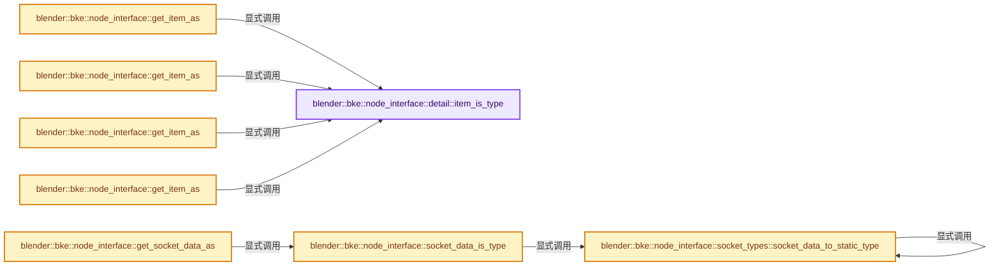
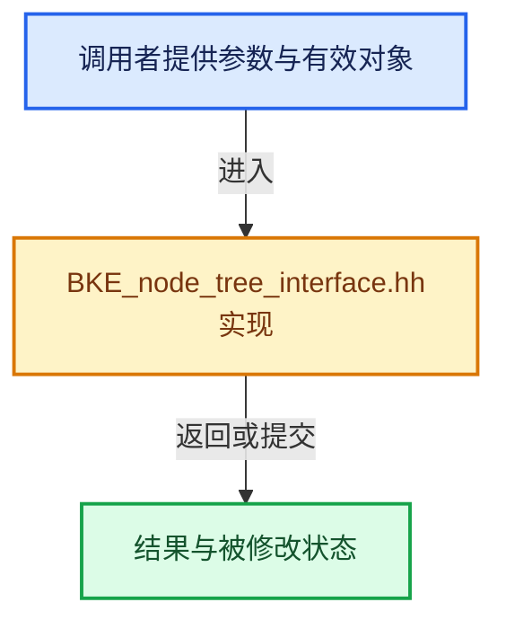

# 实现依赖专题：source/blender/blenkernel/BKE_node_tree_interface.hh

[方向导航](README.md) · [符号索引](../%E7%AC%A6%E5%8F%B7%E4%BE%9D%E8%B5%96%E4%B8%8E%E5%AE%9E%E7%8E%B0%E7%B4%A2%E5%BC%95.md)

本专题从正文实际调用进入，集中保存共享实现。函数有稳定锚点，可从调用处直接跳到对应完整函数；递归与互相调用通过回链组织。

## 本文件的实现关系






## 完整成员与函数实现

<a id="f-9199bc8cc5edf70f"></a>

### `blender::bke::node_interface::detail::item_is_type`

实现位置：[source/blender/blenkernel/BKE_node_tree_interface.hh](../../../../../source/blender/blenkernel/BKE_node_tree_interface.hh) · L60—L74。

接口参数：

- `const bNodeTreeInterfaceItem &item`

**教学注释版**

<!-- annotated:7cac2d62190b59 -->

```cpp
template<typename T> static bool item_is_type(const bNodeTreeInterfaceItem &item)
{
  bool match = false;
  switch (item.item_type) {
    case NodeTreeInterfaceItemType::Socket: {
      match |= std::is_same_v<T, bNodeTreeInterfaceSocket>;
      break;
    }
    case NodeTreeInterfaceItemType::Panel: {
      match |= std::is_same_v<T, bNodeTreeInterfacePanel>;
      break;
    }
  }
  return match;
}
```

<details>
<summary>核对原始源码：source/blender/blenkernel/BKE_node_tree_interface.hh · L60—L74</summary>

<!-- original:7cac2d62190b59:source/blender/blenkernel/BKE_node_tree_interface.hh:60:74 -->

```cpp
template<typename T> static bool item_is_type(const bNodeTreeInterfaceItem &item)
{
  bool match = false;
  switch (item.item_type) {
    case NodeTreeInterfaceItemType::Socket: {
      match |= std::is_same_v<T, bNodeTreeInterfaceSocket>;
      break;
    }
    case NodeTreeInterfaceItemType::Panel: {
      match |= std::is_same_v<T, bNodeTreeInterfacePanel>;
      break;
    }
  }
  return match;
}
```

</details>

**沿实际写入检查状态**

- `match |= std::is_same_v<T, bNodeTreeInterfaceSocket>;`
- `match |= std::is_same_v<T, bNodeTreeInterfacePanel>;`

**结果出口**

- `return match;`

**继续追踪实现**

本实现没有需要继续展开的显式调用；检查返回表达式、对象转换和调用者前置条件。

<a id="f-76ced6fe7f66b781"></a>

### `blender::bke::node_interface::get_item_as`

实现位置：[source/blender/blenkernel/BKE_node_tree_interface.hh](../../../../../source/blender/blenkernel/BKE_node_tree_interface.hh) · L78—L82。

接口参数：

- `bNodeTreeInterfaceItem &item`

**教学注释版**

<!-- annotated:8fc14ee52aeaa0 -->

```cpp
template<typename T> T &get_item_as(bNodeTreeInterfaceItem &item)
{
  BLI_assert(detail::item_is_type<T>(item));
  return reinterpret_cast<T &>(item);
}
```

<details>
<summary>核对原始源码：source/blender/blenkernel/BKE_node_tree_interface.hh · L78—L82</summary>

<!-- original:8fc14ee52aeaa0:source/blender/blenkernel/BKE_node_tree_interface.hh:78:82 -->

```cpp
template<typename T> T &get_item_as(bNodeTreeInterfaceItem &item)
{
  BLI_assert(detail::item_is_type<T>(item));
  return reinterpret_cast<T &>(item);
}
```

</details>

**结果出口**

- `return reinterpret_cast<T &>(item);`

**继续追踪实现**

- `BLI_assert` → [BLI_assert · L48](../01-%E5%9F%BA%E7%A1%80%E5%AE%B9%E5%99%A8%E4%B8%8E%E7%8E%B0%E4%BB%A3CPP/%E4%BE%9D%E8%B5%96-BLI_assert-cc98e8.md#m-57a88495704d)；[BLI_assert · L63](../01-%E5%9F%BA%E7%A1%80%E5%AE%B9%E5%99%A8%E4%B8%8E%E7%8E%B0%E4%BB%A3CPP/%E4%BE%9D%E8%B5%96-BLI_assert-cc98e8.md#m-d07050020cb5)。宏定义由构建条件选择。
- `detail::item_is_type<T>` → [blender::bke::node_interface::detail::item_is_type · L60](%E4%BE%9D%E8%B5%96-BKE_node_tree_interface-a38e1b.md#f-9199bc8cc5edf70f)。

<a id="f-e58dbdce088e2922"></a>

### `blender::bke::node_interface::get_item_as`

实现位置：[source/blender/blenkernel/BKE_node_tree_interface.hh](../../../../../source/blender/blenkernel/BKE_node_tree_interface.hh) · L84—L88。

接口参数：

- `const bNodeTreeInterfaceItem &item`

**教学注释版**

<!-- annotated:9cb20c955538ca -->

```cpp
template<typename T> const T &get_item_as(const bNodeTreeInterfaceItem &item)
{
  BLI_assert(detail::item_is_type<T>(item));
  return reinterpret_cast<const T &>(item);
}
```

<details>
<summary>核对原始源码：source/blender/blenkernel/BKE_node_tree_interface.hh · L84—L88</summary>

<!-- original:9cb20c955538ca:source/blender/blenkernel/BKE_node_tree_interface.hh:84:88 -->

```cpp
template<typename T> const T &get_item_as(const bNodeTreeInterfaceItem &item)
{
  BLI_assert(detail::item_is_type<T>(item));
  return reinterpret_cast<const T &>(item);
}
```

</details>

**结果出口**

- `return reinterpret_cast<const T &>(item);`

**继续追踪实现**

- `BLI_assert` → [BLI_assert · L48](../01-%E5%9F%BA%E7%A1%80%E5%AE%B9%E5%99%A8%E4%B8%8E%E7%8E%B0%E4%BB%A3CPP/%E4%BE%9D%E8%B5%96-BLI_assert-cc98e8.md#m-57a88495704d)；[BLI_assert · L63](../01-%E5%9F%BA%E7%A1%80%E5%AE%B9%E5%99%A8%E4%B8%8E%E7%8E%B0%E4%BB%A3CPP/%E4%BE%9D%E8%B5%96-BLI_assert-cc98e8.md#m-d07050020cb5)。宏定义由构建条件选择。
- `detail::item_is_type<T>` → [blender::bke::node_interface::detail::item_is_type · L60](%E4%BE%9D%E8%B5%96-BKE_node_tree_interface-a38e1b.md#f-9199bc8cc5edf70f)。

<a id="f-405151e1e9846ed0"></a>

### `blender::bke::node_interface::get_item_as`

实现位置：[source/blender/blenkernel/BKE_node_tree_interface.hh](../../../../../source/blender/blenkernel/BKE_node_tree_interface.hh) · L90—L96。

接口参数：

- `bNodeTreeInterfaceItem *item`

**教学注释版**

<!-- annotated:6aaa03dd6de8d0 -->

```cpp
template<typename T> T *get_item_as(bNodeTreeInterfaceItem *item)
{
  if (item && detail::item_is_type<T>(*item)) {
    return reinterpret_cast<T *>(item);
  }
  return nullptr;
}
```

<details>
<summary>核对原始源码：source/blender/blenkernel/BKE_node_tree_interface.hh · L90—L96</summary>

<!-- original:6aaa03dd6de8d0:source/blender/blenkernel/BKE_node_tree_interface.hh:90:96 -->

```cpp
template<typename T> T *get_item_as(bNodeTreeInterfaceItem *item)
{
  if (item && detail::item_is_type<T>(*item)) {
    return reinterpret_cast<T *>(item);
  }
  return nullptr;
}
```

</details>

**结果出口**

- `return reinterpret_cast<T *>(item);`
- `return nullptr;`

**继续追踪实现**

- `detail::item_is_type<T>` → [blender::bke::node_interface::detail::item_is_type · L60](%E4%BE%9D%E8%B5%96-BKE_node_tree_interface-a38e1b.md#f-9199bc8cc5edf70f)。

<a id="f-acff7fe443ea201d"></a>

### `blender::bke::node_interface::get_item_as`

实现位置：[source/blender/blenkernel/BKE_node_tree_interface.hh](../../../../../source/blender/blenkernel/BKE_node_tree_interface.hh) · L98—L104。

接口参数：

- `const bNodeTreeInterfaceItem *item`

**教学注释版**

<!-- annotated:a912e41e4cf874 -->

```cpp
template<typename T> const T *get_item_as(const bNodeTreeInterfaceItem *item)
{
  if (item && detail::item_is_type<T>(*item)) {
    return reinterpret_cast<const T *>(item);
  }
  return nullptr;
}
```

<details>
<summary>核对原始源码：source/blender/blenkernel/BKE_node_tree_interface.hh · L98—L104</summary>

<!-- original:a912e41e4cf874:source/blender/blenkernel/BKE_node_tree_interface.hh:98:104 -->

```cpp
template<typename T> const T *get_item_as(const bNodeTreeInterfaceItem *item)
{
  if (item && detail::item_is_type<T>(*item)) {
    return reinterpret_cast<const T *>(item);
  }
  return nullptr;
}
```

</details>

**结果出口**

- `return reinterpret_cast<const T *>(item);`
- `return nullptr;`

**继续追踪实现**

- `detail::item_is_type<T>` → [blender::bke::node_interface::detail::item_is_type · L60](%E4%BE%9D%E8%B5%96-BKE_node_tree_interface-a38e1b.md#f-9199bc8cc5edf70f)。

<a id="f-73ef587f4bfa1589"></a>

### `blender::bke::node_interface::socket_types::socket_data_to_static_type`

实现位置：[source/blender/blenkernel/BKE_node_tree_interface.hh](../../../../../source/blender/blenkernel/BKE_node_tree_interface.hh) · L306—L314。

接口参数：

- `const StringRef socket_type`
- `const Fn &fn`

**教学注释版**

<!-- annotated:cd361d7dc71a7d -->

```cpp
template<typename Fn> bool socket_data_to_static_type(const StringRef socket_type, const Fn &fn)
{
  for (const bNodeSocketStaticTypeInfo &info : node_socket_subtypes) {
    if (socket_type == info.socket_identifier) {
      return bke::socket_data_to_static_type(info.type, fn);
    }
  }
  return false;
}
```

<details>
<summary>核对原始源码：source/blender/blenkernel/BKE_node_tree_interface.hh · L306—L314</summary>

<!-- original:cd361d7dc71a7d:source/blender/blenkernel/BKE_node_tree_interface.hh:306:314 -->

```cpp
template<typename Fn> bool socket_data_to_static_type(const StringRef socket_type, const Fn &fn)
{
  for (const bNodeSocketStaticTypeInfo &info : node_socket_subtypes) {
    if (socket_type == info.socket_identifier) {
      return bke::socket_data_to_static_type(info.type, fn);
    }
  }
  return false;
}
```

</details>

**结果出口**

- `return bke::socket_data_to_static_type(info.type, fn);`
- `return false;`

**继续追踪实现**

- `bke::socket_data_to_static_type` → [blender::bke::node_interface::socket_types::socket_data_to_static_type · L306](%E4%BE%9D%E8%B5%96-BKE_node_tree_interface-a38e1b.md#f-73ef587f4bfa1589)。

<a id="f-c61dcbc405c5cc1d"></a>

### `blender::bke::node_interface::socket_data_is_type`

实现位置：[source/blender/blenkernel/BKE_node_tree_interface.hh](../../../../../source/blender/blenkernel/BKE_node_tree_interface.hh) · L318—L325。

接口参数：

- `const char *socket_type`

**教学注释版**

<!-- annotated:5817fd7cef6e59 -->

```cpp
template<typename T> bool socket_data_is_type(const char *socket_type)
{
  bool match = false;
  socket_types::socket_data_to_static_type(socket_type, [&match]<typename SocketDataType>() {
    match |= std::is_same_v<T, SocketDataType>;
  });
  return match;
}
```

<details>
<summary>核对原始源码：source/blender/blenkernel/BKE_node_tree_interface.hh · L318—L325</summary>

<!-- original:5817fd7cef6e59:source/blender/blenkernel/BKE_node_tree_interface.hh:318:325 -->

```cpp
template<typename T> bool socket_data_is_type(const char *socket_type)
{
  bool match = false;
  socket_types::socket_data_to_static_type(socket_type, [&match]<typename SocketDataType>() {
    match |= std::is_same_v<T, SocketDataType>;
  });
  return match;
}
```

</details>

**沿实际写入检查状态**

- `match |= std::is_same_v<T, SocketDataType>;`

**结果出口**

- `return match;`

**继续追踪实现**

- `socket_types::socket_data_to_static_type` → [blender::bke::node_interface::socket_types::socket_data_to_static_type · L306](%E4%BE%9D%E8%B5%96-BKE_node_tree_interface-a38e1b.md#f-73ef587f4bfa1589)。

<a id="f-ec1cf21faf45ae8d"></a>

### `blender::bke::node_interface::get_socket_data_as`

实现位置：[source/blender/blenkernel/BKE_node_tree_interface.hh](../../../../../source/blender/blenkernel/BKE_node_tree_interface.hh) · L327—L331。

接口参数：

- `bNodeTreeInterfaceSocket &item`

**教学注释版**

<!-- annotated:4ccf2b95806775 -->

```cpp
template<typename T> T &get_socket_data_as(bNodeTreeInterfaceSocket &item)
{
  BLI_assert(socket_data_is_type<T>(item.socket_type));
  return *static_cast<T *>(item.socket_data);
}
```

<details>
<summary>核对原始源码：source/blender/blenkernel/BKE_node_tree_interface.hh · L327—L331</summary>

<!-- original:4ccf2b95806775:source/blender/blenkernel/BKE_node_tree_interface.hh:327:331 -->

```cpp
template<typename T> T &get_socket_data_as(bNodeTreeInterfaceSocket &item)
{
  BLI_assert(socket_data_is_type<T>(item.socket_type));
  return *static_cast<T *>(item.socket_data);
}
```

</details>

**结果出口**

- `return *static_cast<T *>(item.socket_data);`

**继续追踪实现**

- `BLI_assert` → [BLI_assert · L48](../01-%E5%9F%BA%E7%A1%80%E5%AE%B9%E5%99%A8%E4%B8%8E%E7%8E%B0%E4%BB%A3CPP/%E4%BE%9D%E8%B5%96-BLI_assert-cc98e8.md#m-57a88495704d)；[BLI_assert · L63](../01-%E5%9F%BA%E7%A1%80%E5%AE%B9%E5%99%A8%E4%B8%8E%E7%8E%B0%E4%BB%A3CPP/%E4%BE%9D%E8%B5%96-BLI_assert-cc98e8.md#m-d07050020cb5)。宏定义由构建条件选择。
- `socket_data_is_type<T>` → [blender::bke::node_interface::socket_data_is_type · L318](%E4%BE%9D%E8%B5%96-BKE_node_tree_interface-a38e1b.md#f-c61dcbc405c5cc1d)。

<a id="f-fb86310e2041c317"></a>

### `blender::bke::node_interface::get_socket_data_as`

实现位置：[source/blender/blenkernel/BKE_node_tree_interface.hh](../../../../../source/blender/blenkernel/BKE_node_tree_interface.hh) · L333—L337。

接口参数：

- `const bNodeTreeInterfaceSocket &item`

**教学注释版**

<!-- annotated:caa0fcce307e1d -->

```cpp
template<typename T> const T &get_socket_data_as(const bNodeTreeInterfaceSocket &item)
{
  BLI_assert(socket_data_is_type<T>(item.socket_type));
  return *static_cast<const T *>(item.socket_data);
}
```

<details>
<summary>核对原始源码：source/blender/blenkernel/BKE_node_tree_interface.hh · L333—L337</summary>

<!-- original:caa0fcce307e1d:source/blender/blenkernel/BKE_node_tree_interface.hh:333:337 -->

```cpp
template<typename T> const T &get_socket_data_as(const bNodeTreeInterfaceSocket &item)
{
  BLI_assert(socket_data_is_type<T>(item.socket_type));
  return *static_cast<const T *>(item.socket_data);
}
```

</details>

**结果出口**

- `return *static_cast<const T *>(item.socket_data);`

**继续追踪实现**

- `BLI_assert` → [BLI_assert · L48](../01-%E5%9F%BA%E7%A1%80%E5%AE%B9%E5%99%A8%E4%B8%8E%E7%8E%B0%E4%BB%A3CPP/%E4%BE%9D%E8%B5%96-BLI_assert-cc98e8.md#m-57a88495704d)；[BLI_assert · L63](../01-%E5%9F%BA%E7%A1%80%E5%AE%B9%E5%99%A8%E4%B8%8E%E7%8E%B0%E4%BB%A3CPP/%E4%BE%9D%E8%B5%96-BLI_assert-cc98e8.md#m-d07050020cb5)。宏定义由构建条件选择。
- `socket_data_is_type<T>` → [blender::bke::node_interface::socket_data_is_type · L318](%E4%BE%9D%E8%B5%96-BKE_node_tree_interface-a38e1b.md#f-c61dcbc405c5cc1d)。
