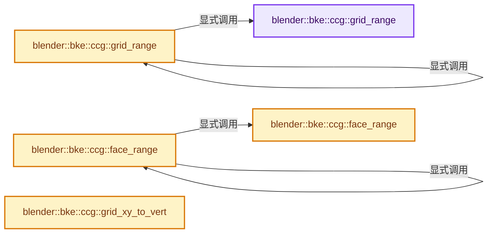

# 实现依赖专题：source/blender/blenkernel/BKE_subdiv_ccg.hh

[方向导航](README.md) · [符号索引](../%E7%AC%A6%E5%8F%B7%E4%BE%9D%E8%B5%96%E4%B8%8E%E5%AE%9E%E7%8E%B0%E7%B4%A2%E5%BC%95.md)

本专题从正文实际调用进入，集中保存共享实现。函数有稳定锚点，可从调用处直接跳到对应完整函数；递归与互相调用通过回链组织。

## 本文件的实现关系




## 完整成员与函数实现

<a id="f-9bddb2329ec72943"></a>

### `blender::bke::ccg::grid_range`

实现位置：[source/blender/blenkernel/BKE_subdiv_ccg.hh](../../../../../source/blender/blenkernel/BKE_subdiv_ccg.hh) · L354—L357。

接口参数：

- `const int grid_area`
- `const int grid`

**教学注释版**

<!-- annotated:5d57df8eab7693 -->

```cpp
inline IndexRange grid_range(const int grid_area, const int grid)
{
  return IndexRange(grid * grid_area, grid_area);
}
```

<details>
<summary>核对原始源码：source/blender/blenkernel/BKE_subdiv_ccg.hh · L354—L357</summary>

<!-- original:5d57df8eab7693:source/blender/blenkernel/BKE_subdiv_ccg.hh:354:357 -->

```cpp
inline IndexRange grid_range(const int grid_area, const int grid)
{
  return IndexRange(grid * grid_area, grid_area);
}
```

</details>

**结果出口**

- `return IndexRange(grid * grid_area, grid_area);`

**继续追踪实现**

- `IndexRange` → [blender::IndexRange](../01-%E5%9F%BA%E7%A1%80%E5%AE%B9%E5%99%A8%E4%B8%8E%E7%8E%B0%E4%BB%A3CPP/%E4%BE%9D%E8%B5%96-BLI_index_range-7d7cc5.md#t-caa3466d6776)；[blender::gpu::shader::parser::IndexRange](%E4%BE%9D%E8%B5%96-utils-06433d.md#t-82d2bd4ea71c)；[blender::IndexRange](%E4%BE%9D%E8%B5%96-DNA_node_types-6708b9.md#t-0448cc889d39)。

<a id="f-7249652bbdaf1279"></a>

### `blender::bke::ccg::grid_range`

实现位置：[source/blender/blenkernel/BKE_subdiv_ccg.hh](../../../../../source/blender/blenkernel/BKE_subdiv_ccg.hh) · L358—L361。

接口参数：

- `const CCGKey &key`
- `const int grid`

**教学注释版**

<!-- annotated:4aee576de2207d -->

```cpp
inline IndexRange grid_range(const CCGKey &key, const int grid)
{
  return grid_range(key.grid_area, grid);
}
```

<details>
<summary>核对原始源码：source/blender/blenkernel/BKE_subdiv_ccg.hh · L358—L361</summary>

<!-- original:4aee576de2207d:source/blender/blenkernel/BKE_subdiv_ccg.hh:358:361 -->

```cpp
inline IndexRange grid_range(const CCGKey &key, const int grid)
{
  return grid_range(key.grid_area, grid);
}
```

</details>

**结果出口**

- `return grid_range(key.grid_area, grid);`

**继续追踪实现**

- `grid_range` → [blender::bke::ccg::grid_range · L354](%E4%BE%9D%E8%B5%96-BKE_subdiv_ccg-b67d4c.md#f-9bddb2329ec72943)；[blender::bke::ccg::grid_range · L358](%E4%BE%9D%E8%B5%96-BKE_subdiv_ccg-b67d4c.md#f-7249652bbdaf1279)。同名重载需按实参类型选择。

<a id="f-78b24d819fe4a31b"></a>

### `blender::bke::ccg::face_range`

实现位置：[source/blender/blenkernel/BKE_subdiv_ccg.hh](../../../../../source/blender/blenkernel/BKE_subdiv_ccg.hh) · L364—L368。

接口参数：

- `const OffsetIndices<int> faces`
- `const int grid_area`
- `const int face`

**教学注释版**

<!-- annotated:4196a796480e2f -->

```cpp
inline IndexRange face_range(const OffsetIndices<int> faces, const int grid_area, const int face)
{
  const IndexRange corners = faces[face];
  // [讲解] corners.start：读取连续区间或分组的边界信息。
  return IndexRange(corners.start() * grid_area, corners.size() * grid_area);
}
```

<details>
<summary>核对原始源码：source/blender/blenkernel/BKE_subdiv_ccg.hh · L364—L368</summary>

<!-- original:4196a796480e2f:source/blender/blenkernel/BKE_subdiv_ccg.hh:364:368 -->

```cpp
inline IndexRange face_range(const OffsetIndices<int> faces, const int grid_area, const int face)
{
  const IndexRange corners = faces[face];
  return IndexRange(corners.start() * grid_area, corners.size() * grid_area);
}
```

</details>

**结果出口**

- `return IndexRange(corners.start() * grid_area, corners.size() * grid_area);`

**继续追踪实现**

- `IndexRange` → [blender::IndexRange](../01-%E5%9F%BA%E7%A1%80%E5%AE%B9%E5%99%A8%E4%B8%8E%E7%8E%B0%E4%BB%A3CPP/%E4%BE%9D%E8%B5%96-BLI_index_range-7d7cc5.md#t-caa3466d6776)；[blender::gpu::shader::parser::IndexRange](%E4%BE%9D%E8%B5%96-utils-06433d.md#t-82d2bd4ea71c)；[blender::IndexRange](%E4%BE%9D%E8%B5%96-DNA_node_types-6708b9.md#t-0448cc889d39)。
- `corners.start` → [blender::IndexRange::start · L243](../01-%E5%9F%BA%E7%A1%80%E5%AE%B9%E5%99%A8%E4%B8%8E%E7%8E%B0%E4%BB%A3CPP/04-IndexRange%E8%BF%9E%E7%BB%AD%E6%95%B4%E6%95%B0%E5%8C%BA%E9%97%B4.md#f-99d2195bd9cfd1f0)。
- `corners.size` → [blender::IndexRange::size · L156](../01-%E5%9F%BA%E7%A1%80%E5%AE%B9%E5%99%A8%E4%B8%8E%E7%8E%B0%E4%BB%A3CPP/04-IndexRange%E8%BF%9E%E7%BB%AD%E6%95%B4%E6%95%B0%E5%8C%BA%E9%97%B4.md#f-05f66c3ebb2fdfec)。

<a id="f-d7b174f2cd49b454"></a>

### `blender::bke::ccg::face_range`

实现位置：[source/blender/blenkernel/BKE_subdiv_ccg.hh](../../../../../source/blender/blenkernel/BKE_subdiv_ccg.hh) · L369—L372。

接口参数：

- `const OffsetIndices<int> faces`
- `const CCGKey &key`
- `const int face`

**教学注释版**

<!-- annotated:fe823ef1575165 -->

```cpp
inline IndexRange face_range(const OffsetIndices<int> faces, const CCGKey &key, const int face)
{
  return face_range(faces, key.grid_area, face);
}
```

<details>
<summary>核对原始源码：source/blender/blenkernel/BKE_subdiv_ccg.hh · L369—L372</summary>

<!-- original:fe823ef1575165:source/blender/blenkernel/BKE_subdiv_ccg.hh:369:372 -->

```cpp
inline IndexRange face_range(const OffsetIndices<int> faces, const CCGKey &key, const int face)
{
  return face_range(faces, key.grid_area, face);
}
```

</details>

**结果出口**

- `return face_range(faces, key.grid_area, face);`

**继续追踪实现**

- `face_range` → [blender::bke::ccg::face_range · L364](%E4%BE%9D%E8%B5%96-BKE_subdiv_ccg-b67d4c.md#f-78b24d819fe4a31b)；[blender::bke::ccg::face_range · L369](%E4%BE%9D%E8%B5%96-BKE_subdiv_ccg-b67d4c.md#f-d7b174f2cd49b454)。同名重载需按实参类型选择。

<a id="f-7576014dd26d80eb"></a>

### `blender::bke::ccg::grid_xy_to_vert`

实现位置：[source/blender/blenkernel/BKE_subdiv_ccg.hh](../../../../../source/blender/blenkernel/BKE_subdiv_ccg.hh) · L375—L378。

接口参数：

- `const CCGKey &key`
- `const int grid`
- `const int x`
- `const int y`

**教学注释版**

<!-- annotated:86b694108688d8 -->

```cpp
inline int grid_xy_to_vert(const CCGKey &key, const int grid, const int x, const int y)
{
  return key.grid_area * grid + CCG_grid_xy_to_index(key.grid_size, x, y);
}
```

<details>
<summary>核对原始源码：source/blender/blenkernel/BKE_subdiv_ccg.hh · L375—L378</summary>

<!-- original:86b694108688d8:source/blender/blenkernel/BKE_subdiv_ccg.hh:375:378 -->

```cpp
inline int grid_xy_to_vert(const CCGKey &key, const int grid, const int x, const int y)
{
  return key.grid_area * grid + CCG_grid_xy_to_index(key.grid_size, x, y);
}
```

</details>

**结果出口**

- `return key.grid_area * grid + CCG_grid_xy_to_index(key.grid_size, x, y);`

**继续追踪实现**

- `CCG_grid_xy_to_index` → [blender::CCG_grid_xy_to_index · L75](%E4%BE%9D%E8%B5%96-BKE_ccg-361d09.md#f-cb617293b1c08b35)。
