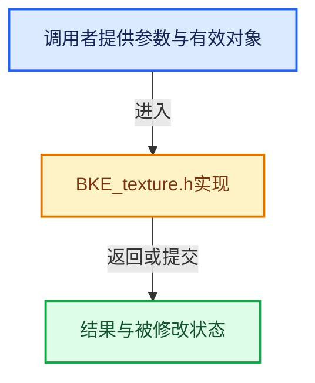

# 实现依赖专题：source/blender/blenkernel/BKE_texture.h

[方向导航](README.md) · [符号索引](../%E7%AC%A6%E5%8F%B7%E4%BE%9D%E8%B5%96%E4%B8%8E%E5%AE%9E%E7%8E%B0%E7%B4%A2%E5%BC%95.md)

本专题从正文实际调用进入，集中保存共享实现。函数有稳定锚点，可从调用处直接跳到对应完整函数；递归与互相调用通过回链组织。

## 本文件的实现关系





## 相关类型布局与成员入口

<a id="t-7cc95d58c84e"></a>

### `blender::MTex`

原始声明：[source/blender/blenkernel/BKE_texture.h](../../../../../source/blender/blenkernel/BKE_texture.h) · L17—L17。

以下保留类的数据声明与编译条件，成员函数实现通过后面的精确链接阅读。

<!-- annotated:e17835f91f399e -->

```cpp
struct MTex;
```

<details>
<summary>核对原始源码：source/blender/blenkernel/BKE_texture.h · L17—L17</summary>

<!-- original:e17835f91f399e:source/blender/blenkernel/BKE_texture.h:17:17 -->

```cpp
struct MTex;
```

</details>


<a id="t-479eb1dce525"></a>

### `blender::eTex_Type`

原始声明：[source/blender/blenkernel/BKE_texture.h](../../../../../source/blender/blenkernel/BKE_texture.h) · L24—L24。

以下保留类的数据声明与编译条件，成员函数实现通过后面的精确链接阅读。

<!-- annotated:f39fe288b96994 -->

```cpp
enum eTex_Type : short;
```

<details>
<summary>核对原始源码：source/blender/blenkernel/BKE_texture.h · L24—L24</summary>

<!-- original:f39fe288b96994:source/blender/blenkernel/BKE_texture.h:24:24 -->

```cpp
enum eTex_Type : short;
```

</details>


<a id="t-5d3e3c151a5e"></a>

### `blender::MTex`

原始声明：[source/blender/blenkernel/BKE_texture.h](../../../../../source/blender/blenkernel/BKE_texture.h) · L32—L32。

以下保留类的数据声明与编译条件，成员函数实现通过后面的精确链接阅读。

<!-- annotated:986fd3837e7e71 -->

```cpp
void BKE_texture_mtex_foreach_id(struct LibraryForeachIDData *data, struct MTex *mtex);
```

<details>
<summary>核对原始源码：source/blender/blenkernel/BKE_texture.h · L32—L32</summary>

<!-- original:986fd3837e7e71:source/blender/blenkernel/BKE_texture.h:32:32 -->

```cpp
void BKE_texture_mtex_foreach_id(struct LibraryForeachIDData *data, struct MTex *mtex);
```

</details>


<a id="t-523efeb6b3ba"></a>

### `blender::MTex`

原始声明：[source/blender/blenkernel/BKE_texture.h](../../../../../source/blender/blenkernel/BKE_texture.h) · L38—L38。

以下保留类的数据声明与编译条件，成员函数实现通过后面的精确链接阅读。

<!-- annotated:be0615854d14d7 -->

```cpp
void BKE_texture_mtex_default(struct MTex *mtex);
```

<details>
<summary>核对原始源码：source/blender/blenkernel/BKE_texture.h · L38—L38</summary>

<!-- original:be0615854d14d7:source/blender/blenkernel/BKE_texture.h:38:38 -->

```cpp
void BKE_texture_mtex_default(struct MTex *mtex);
```

</details>


<a id="t-ed10784d9b3c"></a>

### `blender::MTex`

原始声明：[source/blender/blenkernel/BKE_texture.h](../../../../../source/blender/blenkernel/BKE_texture.h) · L39—L39。

以下保留类的数据声明与编译条件，成员函数实现通过后面的精确链接阅读。

<!-- annotated:5cc01add8a344f -->

```cpp
struct MTex *BKE_texture_mtex_add();
```

<details>
<summary>核对原始源码：source/blender/blenkernel/BKE_texture.h · L39—L39</summary>

<!-- original:5cc01add8a344f:source/blender/blenkernel/BKE_texture.h:39:39 -->

```cpp
struct MTex *BKE_texture_mtex_add();
```

</details>


<a id="t-a724aef12d49"></a>

### `blender::MTex`

原始声明：[source/blender/blenkernel/BKE_texture.h](../../../../../source/blender/blenkernel/BKE_texture.h) · L43—L43。

以下保留类的数据声明与编译条件，成员函数实现通过后面的精确链接阅读。

<!-- annotated:6d7a7b41555de9 -->

```cpp
struct MTex *BKE_texture_mtex_add_id(struct ID *id, int slot);
```

<details>
<summary>核对原始源码：source/blender/blenkernel/BKE_texture.h · L43—L43</summary>

<!-- original:6d7a7b41555de9:source/blender/blenkernel/BKE_texture.h:43:43 -->

```cpp
struct MTex *BKE_texture_mtex_add_id(struct ID *id, int slot);
```

</details>


<a id="t-09c33176094b"></a>

### `blender::MTex`

原始声明：[source/blender/blenkernel/BKE_texture.h](../../../../../source/blender/blenkernel/BKE_texture.h) · L51—L51。

以下保留类的数据声明与编译条件，成员函数实现通过后面的精确链接阅读。

<!-- annotated:4c02e949be1164 -->

```cpp
bool give_active_mtex(struct ID *id, struct MTex ***mtex_ar, short *act);
```

<details>
<summary>核对原始源码：source/blender/blenkernel/BKE_texture.h · L51—L51</summary>

<!-- original:4c02e949be1164:source/blender/blenkernel/BKE_texture.h:51:51 -->

```cpp
bool give_active_mtex(struct ID *id, struct MTex ***mtex_ar, short *act);
```

</details>


## 完整成员与函数实现
