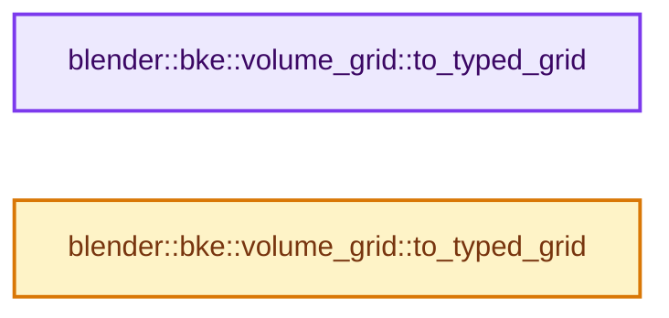
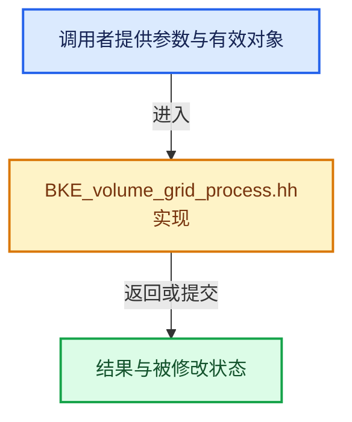

# 实现依赖专题：source/blender/blenkernel/BKE_volume_grid_process.hh

[方向导航](README.md) · [符号索引](../%E7%AC%A6%E5%8F%B7%E4%BE%9D%E8%B5%96%E4%B8%8E%E5%AE%9E%E7%8E%B0%E7%B4%A2%E5%BC%95.md)

本专题从正文实际调用进入，集中保存共享实现。函数有稳定锚点，可从调用处直接跳到对应完整函数；递归与互相调用通过回链组织。

## 本文件的实现关系






## 完整成员与函数实现

<a id="f-356e1d0ee290f573"></a>

### `blender::bke::volume_grid::to_typed_grid`

实现位置：[source/blender/blenkernel/BKE_volume_grid_process.hh](../../../../../source/blender/blenkernel/BKE_volume_grid_process.hh) · L64—L76。

接口参数：

- `const openvdb::GridBase &grid_base`
- `Fn &&fn`

**教学注释版**

<!-- annotated:ea71484cadbe85 -->

```cpp
template<typename Fn> inline void to_typed_grid(const openvdb::GridBase &grid_base, Fn &&fn)
{
  const VolumeGridType grid_type = get_type(grid_base);
  BKE_volume_grid_type_to_static_type(grid_type,
                                      [&]<std::derived_from<openvdb::GridBase> GridT>() {
                                        if constexpr (is_supported_grid_type<GridT>) {
                                          fn(static_cast<const GridT &>(grid_base));
                                        }
                                        else {
                                          BLI_assert_unreachable();
                                        }
                                      });
}
```

<details>
<summary>核对原始源码：source/blender/blenkernel/BKE_volume_grid_process.hh · L64—L76</summary>

<!-- original:ea71484cadbe85:source/blender/blenkernel/BKE_volume_grid_process.hh:64:76 -->

```cpp
template<typename Fn> inline void to_typed_grid(const openvdb::GridBase &grid_base, Fn &&fn)
{
  const VolumeGridType grid_type = get_type(grid_base);
  BKE_volume_grid_type_to_static_type(grid_type,
                                      [&]<std::derived_from<openvdb::GridBase> GridT>() {
                                        if constexpr (is_supported_grid_type<GridT>) {
                                          fn(static_cast<const GridT &>(grid_base));
                                        }
                                        else {
                                          BLI_assert_unreachable();
                                        }
                                      });
}
```

</details>

**继续追踪实现**

- `get_type` → [blender::bke::volume_grid::get_type · L416](%E4%BE%9D%E8%B5%96-volume_grid-a7c9da.md#f-6ec0031de7935520)；[blender::bke::volume_grid::get_type · L451](%E4%BE%9D%E8%B5%96-volume_grid-a7c9da.md#f-e58020f175d3e983)；[blender::bke::volume_grid::get_type · L499](%E4%BE%9D%E8%B5%96-volume_grid-a7c9da.md#f-522a600410e01abc)。同名重载需按实参类型选择。
- `BKE_volume_grid_type_to_static_type` → [blender::BKE_volume_grid_type_to_static_type · L84](%E4%BE%9D%E8%B5%96-BKE_volume_openvdb-4fd2e3.md#f-1d920456c1819c30)。
- `fn` → [调用协议](../%E6%A8%A1%E6%9D%BF%E5%AE%8F%E4%B8%8E%E5%8A%A8%E6%80%81%E5%88%86%E6%B4%BE%E5%8D%8F%E8%AE%AE.md)：局部可调用对象，须结合其初始化与捕获环境。调用位置L70。
- `BLI_assert_unreachable` → [BLI_assert_unreachable · L77](../01-%E5%9F%BA%E7%A1%80%E5%AE%B9%E5%99%A8%E4%B8%8E%E7%8E%B0%E4%BB%A3CPP/%E4%BE%9D%E8%B5%96-BLI_assert-cc98e8.md#m-7a2d91a67d8e)。宏定义由构建条件选择。

<a id="f-3f4ee1f29941cc08"></a>

### `blender::bke::volume_grid::to_typed_grid`

实现位置：[source/blender/blenkernel/BKE_volume_grid_process.hh](../../../../../source/blender/blenkernel/BKE_volume_grid_process.hh) · L78—L90。

接口参数：

- `openvdb::GridBase &grid_base`
- `Fn &&fn`

**教学注释版**

<!-- annotated:554e24b74b5192 -->

```cpp
template<typename Fn> inline void to_typed_grid(openvdb::GridBase &grid_base, Fn &&fn)
{
  const VolumeGridType grid_type = get_type(grid_base);
  BKE_volume_grid_type_to_static_type(grid_type,
                                      [&]<std::derived_from<openvdb::GridBase> GridT>() {
                                        if constexpr (is_supported_grid_type<GridT>) {
                                          fn(static_cast<GridT &>(grid_base));
                                        }
                                        else {
                                          BLI_assert_unreachable();
                                        }
                                      });
}
```

<details>
<summary>核对原始源码：source/blender/blenkernel/BKE_volume_grid_process.hh · L78—L90</summary>

<!-- original:554e24b74b5192:source/blender/blenkernel/BKE_volume_grid_process.hh:78:90 -->

```cpp
template<typename Fn> inline void to_typed_grid(openvdb::GridBase &grid_base, Fn &&fn)
{
  const VolumeGridType grid_type = get_type(grid_base);
  BKE_volume_grid_type_to_static_type(grid_type,
                                      [&]<std::derived_from<openvdb::GridBase> GridT>() {
                                        if constexpr (is_supported_grid_type<GridT>) {
                                          fn(static_cast<GridT &>(grid_base));
                                        }
                                        else {
                                          BLI_assert_unreachable();
                                        }
                                      });
}
```

</details>

**继续追踪实现**

- `get_type` → [blender::bke::volume_grid::get_type · L416](%E4%BE%9D%E8%B5%96-volume_grid-a7c9da.md#f-6ec0031de7935520)；[blender::bke::volume_grid::get_type · L451](%E4%BE%9D%E8%B5%96-volume_grid-a7c9da.md#f-e58020f175d3e983)；[blender::bke::volume_grid::get_type · L499](%E4%BE%9D%E8%B5%96-volume_grid-a7c9da.md#f-522a600410e01abc)。同名重载需按实参类型选择。
- `BKE_volume_grid_type_to_static_type` → [blender::BKE_volume_grid_type_to_static_type · L84](%E4%BE%9D%E8%B5%96-BKE_volume_openvdb-4fd2e3.md#f-1d920456c1819c30)。
- `fn` → [调用协议](../%E6%A8%A1%E6%9D%BF%E5%AE%8F%E4%B8%8E%E5%8A%A8%E6%80%81%E5%88%86%E6%B4%BE%E5%8D%8F%E8%AE%AE.md)：局部可调用对象，须结合其初始化与捕获环境。调用位置L84。
- `BLI_assert_unreachable` → [BLI_assert_unreachable · L77](../01-%E5%9F%BA%E7%A1%80%E5%AE%B9%E5%99%A8%E4%B8%8E%E7%8E%B0%E4%BB%A3CPP/%E4%BE%9D%E8%B5%96-BLI_assert-cc98e8.md#m-7a2d91a67d8e)。宏定义由构建条件选择。
