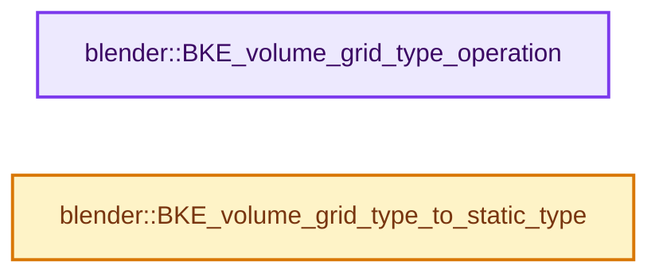
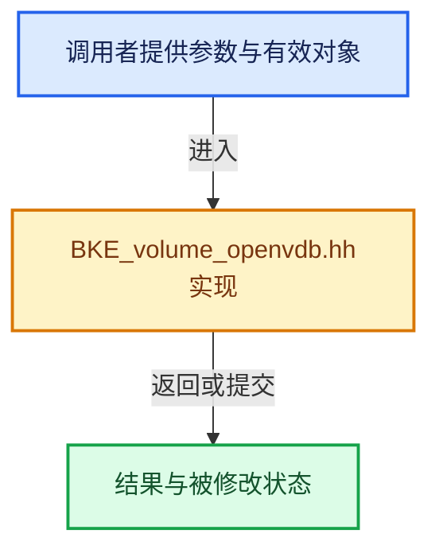

# 实现依赖专题：source/blender/blenkernel/BKE_volume_openvdb.hh

[方向导航](README.md) · [符号索引](../%E7%AC%A6%E5%8F%B7%E4%BE%9D%E8%B5%96%E4%B8%8E%E5%AE%9E%E7%8E%B0%E7%B4%A2%E5%BC%95.md)

本专题从正文实际调用进入，集中保存共享实现。函数有稳定锚点，可从调用处直接跳到对应完整函数；递归与互相调用通过回链组织。

## 本文件的实现关系






## 完整成员与函数实现

<a id="f-1d1852185d7a47bd"></a>

### `blender::BKE_volume_grid_type_operation`

实现位置：[source/blender/blenkernel/BKE_volume_openvdb.hh](../../../../../source/blender/blenkernel/BKE_volume_openvdb.hh) · L51—L82。

接口参数：

- `const VolumeGridType grid_type`
- `OpType &&op`

**教学注释版**

<!-- annotated:11289a15fb11ae -->

```cpp
template<typename OpType>
auto BKE_volume_grid_type_operation(const VolumeGridType grid_type, OpType &&op)
{
  switch (grid_type) {
    case VOLUME_GRID_FLOAT:
      return op.template operator()<openvdb::FloatGrid>();
    case VOLUME_GRID_VECTOR_FLOAT:
      return op.template operator()<openvdb::Vec3fGrid>();
    case VOLUME_GRID_BOOLEAN:
      return op.template operator()<openvdb::BoolGrid>();
    case VOLUME_GRID_DOUBLE:
      return op.template operator()<openvdb::DoubleGrid>();
    case VOLUME_GRID_INT:
      return op.template operator()<openvdb::Int32Grid>();
    case VOLUME_GRID_INT64:
      return op.template operator()<openvdb::Int64Grid>();
    case VOLUME_GRID_VECTOR_INT:
      return op.template operator()<openvdb::Vec3IGrid>();
    case VOLUME_GRID_VECTOR_DOUBLE:
      return op.template operator()<openvdb::Vec3dGrid>();
    case VOLUME_GRID_MASK:
      return op.template operator()<openvdb::MaskGrid>();
    case VOLUME_GRID_POINTS:
      return op.template operator()<openvdb::points::PointDataGrid>();
    case VOLUME_GRID_UNKNOWN:
      break;
  }

  /* Should never be called. */
  BLI_assert_msg(0, "should never be reached");
  return op.template operator()<openvdb::FloatGrid>();
}
```

<details>
<summary>核对原始源码：source/blender/blenkernel/BKE_volume_openvdb.hh · L51—L82</summary>

<!-- original:11289a15fb11ae:source/blender/blenkernel/BKE_volume_openvdb.hh:51:82 -->

```cpp
template<typename OpType>
auto BKE_volume_grid_type_operation(const VolumeGridType grid_type, OpType &&op)
{
  switch (grid_type) {
    case VOLUME_GRID_FLOAT:
      return op.template operator()<openvdb::FloatGrid>();
    case VOLUME_GRID_VECTOR_FLOAT:
      return op.template operator()<openvdb::Vec3fGrid>();
    case VOLUME_GRID_BOOLEAN:
      return op.template operator()<openvdb::BoolGrid>();
    case VOLUME_GRID_DOUBLE:
      return op.template operator()<openvdb::DoubleGrid>();
    case VOLUME_GRID_INT:
      return op.template operator()<openvdb::Int32Grid>();
    case VOLUME_GRID_INT64:
      return op.template operator()<openvdb::Int64Grid>();
    case VOLUME_GRID_VECTOR_INT:
      return op.template operator()<openvdb::Vec3IGrid>();
    case VOLUME_GRID_VECTOR_DOUBLE:
      return op.template operator()<openvdb::Vec3dGrid>();
    case VOLUME_GRID_MASK:
      return op.template operator()<openvdb::MaskGrid>();
    case VOLUME_GRID_POINTS:
      return op.template operator()<openvdb::points::PointDataGrid>();
    case VOLUME_GRID_UNKNOWN:
      break;
  }

  /* Should never be called. */
  BLI_assert_msg(0, "should never be reached");
  return op.template operator()<openvdb::FloatGrid>();
}
```

</details>

**结果出口**

- `return op.template operator()<openvdb::FloatGrid>();`
- `return op.template operator()<openvdb::Vec3fGrid>();`
- `return op.template operator()<openvdb::BoolGrid>();`
- `return op.template operator()<openvdb::DoubleGrid>();`
- `return op.template operator()<openvdb::Int32Grid>();`
- `return op.template operator()<openvdb::Int64Grid>();`
- `return op.template operator()<openvdb::Vec3IGrid>();`
- `return op.template operator()<openvdb::Vec3dGrid>();`
- `return op.template operator()<openvdb::MaskGrid>();`
- `return op.template operator()<openvdb::points::PointDataGrid>();`

**继续追踪实现**

- `op.template operator()<openvdb::FloatGrid>` → [blender::Task::operator() · L118](../11-Depsgraph%E4%B8%8E%E5%B9%B6%E8%A1%8C%E4%BB%BB%E5%8A%A1%E7%B3%BB%E7%BB%9F/07-%E4%BB%BB%E5%8A%A1%E6%B1%A0%E4%B8%8ETBB%E6%8E%A5%E5%85%A5.md#f-c05b54195be0238f)；[blender::PropertyRNAIdentifierGetter::operator() · L495](%E4%BE%9D%E8%B5%96-rna_internal_types-f26a41.md#f-13e8f72be1b7c83b)。同名重载需按实参类型选择。
- `op.template operator()<openvdb::Vec3fGrid>` → [blender::Task::operator() · L118](../11-Depsgraph%E4%B8%8E%E5%B9%B6%E8%A1%8C%E4%BB%BB%E5%8A%A1%E7%B3%BB%E7%BB%9F/07-%E4%BB%BB%E5%8A%A1%E6%B1%A0%E4%B8%8ETBB%E6%8E%A5%E5%85%A5.md#f-c05b54195be0238f)；[blender::PropertyRNAIdentifierGetter::operator() · L495](%E4%BE%9D%E8%B5%96-rna_internal_types-f26a41.md#f-13e8f72be1b7c83b)。同名重载需按实参类型选择。
- `op.template operator()<openvdb::BoolGrid>` → [blender::Task::operator() · L118](../11-Depsgraph%E4%B8%8E%E5%B9%B6%E8%A1%8C%E4%BB%BB%E5%8A%A1%E7%B3%BB%E7%BB%9F/07-%E4%BB%BB%E5%8A%A1%E6%B1%A0%E4%B8%8ETBB%E6%8E%A5%E5%85%A5.md#f-c05b54195be0238f)；[blender::PropertyRNAIdentifierGetter::operator() · L495](%E4%BE%9D%E8%B5%96-rna_internal_types-f26a41.md#f-13e8f72be1b7c83b)。同名重载需按实参类型选择。
- `op.template operator()<openvdb::DoubleGrid>` → [blender::Task::operator() · L118](../11-Depsgraph%E4%B8%8E%E5%B9%B6%E8%A1%8C%E4%BB%BB%E5%8A%A1%E7%B3%BB%E7%BB%9F/07-%E4%BB%BB%E5%8A%A1%E6%B1%A0%E4%B8%8ETBB%E6%8E%A5%E5%85%A5.md#f-c05b54195be0238f)；[blender::PropertyRNAIdentifierGetter::operator() · L495](%E4%BE%9D%E8%B5%96-rna_internal_types-f26a41.md#f-13e8f72be1b7c83b)。同名重载需按实参类型选择。
- `op.template operator()<openvdb::Int32Grid>` → [blender::Task::operator() · L118](../11-Depsgraph%E4%B8%8E%E5%B9%B6%E8%A1%8C%E4%BB%BB%E5%8A%A1%E7%B3%BB%E7%BB%9F/07-%E4%BB%BB%E5%8A%A1%E6%B1%A0%E4%B8%8ETBB%E6%8E%A5%E5%85%A5.md#f-c05b54195be0238f)；[blender::PropertyRNAIdentifierGetter::operator() · L495](%E4%BE%9D%E8%B5%96-rna_internal_types-f26a41.md#f-13e8f72be1b7c83b)。同名重载需按实参类型选择。
- `op.template operator()<openvdb::Int64Grid>` → [blender::Task::operator() · L118](../11-Depsgraph%E4%B8%8E%E5%B9%B6%E8%A1%8C%E4%BB%BB%E5%8A%A1%E7%B3%BB%E7%BB%9F/07-%E4%BB%BB%E5%8A%A1%E6%B1%A0%E4%B8%8ETBB%E6%8E%A5%E5%85%A5.md#f-c05b54195be0238f)；[blender::PropertyRNAIdentifierGetter::operator() · L495](%E4%BE%9D%E8%B5%96-rna_internal_types-f26a41.md#f-13e8f72be1b7c83b)。同名重载需按实参类型选择。
- `op.template operator()<openvdb::Vec3IGrid>` → [blender::Task::operator() · L118](../11-Depsgraph%E4%B8%8E%E5%B9%B6%E8%A1%8C%E4%BB%BB%E5%8A%A1%E7%B3%BB%E7%BB%9F/07-%E4%BB%BB%E5%8A%A1%E6%B1%A0%E4%B8%8ETBB%E6%8E%A5%E5%85%A5.md#f-c05b54195be0238f)；[blender::PropertyRNAIdentifierGetter::operator() · L495](%E4%BE%9D%E8%B5%96-rna_internal_types-f26a41.md#f-13e8f72be1b7c83b)。同名重载需按实参类型选择。
- `op.template operator()<openvdb::Vec3dGrid>` → [blender::Task::operator() · L118](../11-Depsgraph%E4%B8%8E%E5%B9%B6%E8%A1%8C%E4%BB%BB%E5%8A%A1%E7%B3%BB%E7%BB%9F/07-%E4%BB%BB%E5%8A%A1%E6%B1%A0%E4%B8%8ETBB%E6%8E%A5%E5%85%A5.md#f-c05b54195be0238f)；[blender::PropertyRNAIdentifierGetter::operator() · L495](%E4%BE%9D%E8%B5%96-rna_internal_types-f26a41.md#f-13e8f72be1b7c83b)。同名重载需按实参类型选择。
- `op.template operator()<openvdb::MaskGrid>` → [blender::Task::operator() · L118](../11-Depsgraph%E4%B8%8E%E5%B9%B6%E8%A1%8C%E4%BB%BB%E5%8A%A1%E7%B3%BB%E7%BB%9F/07-%E4%BB%BB%E5%8A%A1%E6%B1%A0%E4%B8%8ETBB%E6%8E%A5%E5%85%A5.md#f-c05b54195be0238f)；[blender::PropertyRNAIdentifierGetter::operator() · L495](%E4%BE%9D%E8%B5%96-rna_internal_types-f26a41.md#f-13e8f72be1b7c83b)。同名重载需按实参类型选择。
- `op.template operator()<openvdb::points::PointDataGrid>` → [blender::Task::operator() · L118](../11-Depsgraph%E4%B8%8E%E5%B9%B6%E8%A1%8C%E4%BB%BB%E5%8A%A1%E7%B3%BB%E7%BB%9F/07-%E4%BB%BB%E5%8A%A1%E6%B1%A0%E4%B8%8ETBB%E6%8E%A5%E5%85%A5.md#f-c05b54195be0238f)；[blender::PropertyRNAIdentifierGetter::operator() · L495](%E4%BE%9D%E8%B5%96-rna_internal_types-f26a41.md#f-13e8f72be1b7c83b)。同名重载需按实参类型选择。
- `BLI_assert_msg` → [BLI_assert_msg · L55](../01-%E5%9F%BA%E7%A1%80%E5%AE%B9%E5%99%A8%E4%B8%8E%E7%8E%B0%E4%BB%A3CPP/%E4%BE%9D%E8%B5%96-BLI_assert-cc98e8.md#m-695eed20dceb)；[BLI_assert_msg · L64](../01-%E5%9F%BA%E7%A1%80%E5%AE%B9%E5%99%A8%E4%B8%8E%E7%8E%B0%E4%BB%A3CPP/%E4%BE%9D%E8%B5%96-BLI_assert-cc98e8.md#m-7de5563de4db)。宏定义由构建条件选择。

<a id="f-1d920456c1819c30"></a>

### `blender::BKE_volume_grid_type_to_static_type`

实现位置：[source/blender/blenkernel/BKE_volume_openvdb.hh](../../../../../source/blender/blenkernel/BKE_volume_openvdb.hh) · L84—L112。

接口参数：

- `const VolumeGridType grid_type`
- `Fn &&fn`

**教学注释版**

<!-- annotated:ea52d4760a5cd1 -->

```cpp
template<typename Fn>
inline void BKE_volume_grid_type_to_static_type(const VolumeGridType grid_type, Fn &&fn)
{
  switch (grid_type) {
    case VOLUME_GRID_FLOAT:
      return fn.template operator()<openvdb::FloatGrid>();
    case VOLUME_GRID_VECTOR_FLOAT:
      return fn.template operator()<openvdb::Vec3fGrid>();
    case VOLUME_GRID_BOOLEAN:
      return fn.template operator()<openvdb::BoolGrid>();
    case VOLUME_GRID_DOUBLE:
      return fn.template operator()<openvdb::DoubleGrid>();
    case VOLUME_GRID_INT:
      return fn.template operator()<openvdb::Int32Grid>();
    case VOLUME_GRID_INT64:
      return fn.template operator()<openvdb::Int64Grid>();
    case VOLUME_GRID_VECTOR_INT:
      return fn.template operator()<openvdb::Vec3IGrid>();
    case VOLUME_GRID_VECTOR_DOUBLE:
      return fn.template operator()<openvdb::Vec3dGrid>();
    case VOLUME_GRID_MASK:
      return fn.template operator()<openvdb::MaskGrid>();
    case VOLUME_GRID_POINTS:
      return fn.template operator()<openvdb::points::PointDataGrid>();
    case VOLUME_GRID_UNKNOWN:
      break;
  }
  BLI_assert_unreachable();
}
```

<details>
<summary>核对原始源码：source/blender/blenkernel/BKE_volume_openvdb.hh · L84—L112</summary>

<!-- original:ea52d4760a5cd1:source/blender/blenkernel/BKE_volume_openvdb.hh:84:112 -->

```cpp
template<typename Fn>
inline void BKE_volume_grid_type_to_static_type(const VolumeGridType grid_type, Fn &&fn)
{
  switch (grid_type) {
    case VOLUME_GRID_FLOAT:
      return fn.template operator()<openvdb::FloatGrid>();
    case VOLUME_GRID_VECTOR_FLOAT:
      return fn.template operator()<openvdb::Vec3fGrid>();
    case VOLUME_GRID_BOOLEAN:
      return fn.template operator()<openvdb::BoolGrid>();
    case VOLUME_GRID_DOUBLE:
      return fn.template operator()<openvdb::DoubleGrid>();
    case VOLUME_GRID_INT:
      return fn.template operator()<openvdb::Int32Grid>();
    case VOLUME_GRID_INT64:
      return fn.template operator()<openvdb::Int64Grid>();
    case VOLUME_GRID_VECTOR_INT:
      return fn.template operator()<openvdb::Vec3IGrid>();
    case VOLUME_GRID_VECTOR_DOUBLE:
      return fn.template operator()<openvdb::Vec3dGrid>();
    case VOLUME_GRID_MASK:
      return fn.template operator()<openvdb::MaskGrid>();
    case VOLUME_GRID_POINTS:
      return fn.template operator()<openvdb::points::PointDataGrid>();
    case VOLUME_GRID_UNKNOWN:
      break;
  }
  BLI_assert_unreachable();
}
```

</details>

**结果出口**

- `return fn.template operator()<openvdb::FloatGrid>();`
- `return fn.template operator()<openvdb::Vec3fGrid>();`
- `return fn.template operator()<openvdb::BoolGrid>();`
- `return fn.template operator()<openvdb::DoubleGrid>();`
- `return fn.template operator()<openvdb::Int32Grid>();`
- `return fn.template operator()<openvdb::Int64Grid>();`
- `return fn.template operator()<openvdb::Vec3IGrid>();`
- `return fn.template operator()<openvdb::Vec3dGrid>();`
- `return fn.template operator()<openvdb::MaskGrid>();`
- `return fn.template operator()<openvdb::points::PointDataGrid>();`

**继续追踪实现**

- `fn.template operator()<openvdb::FloatGrid>` → [调用协议](../%E6%A8%A1%E6%9D%BF%E5%AE%8F%E4%B8%8E%E5%8A%A8%E6%80%81%E5%88%86%E6%B4%BE%E5%8D%8F%E8%AE%AE.md)：Fn模板参数提供的操作协议。调用位置L89。
- `fn.template operator()<openvdb::Vec3fGrid>` → [调用协议](../%E6%A8%A1%E6%9D%BF%E5%AE%8F%E4%B8%8E%E5%8A%A8%E6%80%81%E5%88%86%E6%B4%BE%E5%8D%8F%E8%AE%AE.md)：Fn模板参数提供的操作协议。调用位置L91。
- `fn.template operator()<openvdb::BoolGrid>` → [调用协议](../%E6%A8%A1%E6%9D%BF%E5%AE%8F%E4%B8%8E%E5%8A%A8%E6%80%81%E5%88%86%E6%B4%BE%E5%8D%8F%E8%AE%AE.md)：Fn模板参数提供的操作协议。调用位置L93。
- `fn.template operator()<openvdb::DoubleGrid>` → [调用协议](../%E6%A8%A1%E6%9D%BF%E5%AE%8F%E4%B8%8E%E5%8A%A8%E6%80%81%E5%88%86%E6%B4%BE%E5%8D%8F%E8%AE%AE.md)：Fn模板参数提供的操作协议。调用位置L95。
- `fn.template operator()<openvdb::Int32Grid>` → [调用协议](../%E6%A8%A1%E6%9D%BF%E5%AE%8F%E4%B8%8E%E5%8A%A8%E6%80%81%E5%88%86%E6%B4%BE%E5%8D%8F%E8%AE%AE.md)：Fn模板参数提供的操作协议。调用位置L97。
- `fn.template operator()<openvdb::Int64Grid>` → [调用协议](../%E6%A8%A1%E6%9D%BF%E5%AE%8F%E4%B8%8E%E5%8A%A8%E6%80%81%E5%88%86%E6%B4%BE%E5%8D%8F%E8%AE%AE.md)：Fn模板参数提供的操作协议。调用位置L99。
- `fn.template operator()<openvdb::Vec3IGrid>` → [调用协议](../%E6%A8%A1%E6%9D%BF%E5%AE%8F%E4%B8%8E%E5%8A%A8%E6%80%81%E5%88%86%E6%B4%BE%E5%8D%8F%E8%AE%AE.md)：Fn模板参数提供的操作协议。调用位置L101。
- `fn.template operator()<openvdb::Vec3dGrid>` → [调用协议](../%E6%A8%A1%E6%9D%BF%E5%AE%8F%E4%B8%8E%E5%8A%A8%E6%80%81%E5%88%86%E6%B4%BE%E5%8D%8F%E8%AE%AE.md)：Fn模板参数提供的操作协议。调用位置L103。
- `fn.template operator()<openvdb::MaskGrid>` → [调用协议](../%E6%A8%A1%E6%9D%BF%E5%AE%8F%E4%B8%8E%E5%8A%A8%E6%80%81%E5%88%86%E6%B4%BE%E5%8D%8F%E8%AE%AE.md)：Fn模板参数提供的操作协议。调用位置L105。
- `fn.template operator()<openvdb::points::PointDataGrid>` → [调用协议](../%E6%A8%A1%E6%9D%BF%E5%AE%8F%E4%B8%8E%E5%8A%A8%E6%80%81%E5%88%86%E6%B4%BE%E5%8D%8F%E8%AE%AE.md)：Fn模板参数提供的操作协议。调用位置L107。
- `BLI_assert_unreachable` → [BLI_assert_unreachable · L77](../01-%E5%9F%BA%E7%A1%80%E5%AE%B9%E5%99%A8%E4%B8%8E%E7%8E%B0%E4%BB%A3CPP/%E4%BE%9D%E8%B5%96-BLI_assert-cc98e8.md#m-7a2d91a67d8e)。宏定义由构建条件选择。
