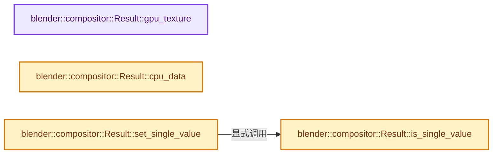
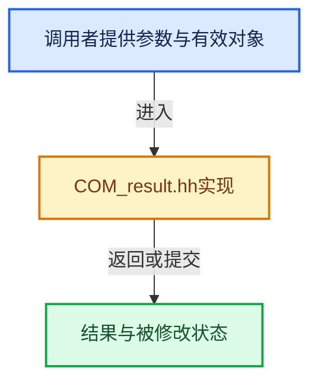

# 实现依赖专题：source/blender/compositor/COM_result.hh

[方向导航](README.md) · [符号索引](../%E7%AC%A6%E5%8F%B7%E4%BE%9D%E8%B5%96%E4%B8%8E%E5%AE%9E%E7%8E%B0%E7%B4%A2%E5%BC%95.md)

本专题从正文实际调用进入，集中保存共享实现。函数有稳定锚点，可从调用处直接跳到对应完整函数；递归与互相调用通过回链组织。

## 本文件的实现关系






## 完整成员与函数实现

<a id="f-074a867c6799cb62"></a>

### `blender::compositor::Result::gpu_texture`

实现位置：[source/blender/compositor/COM_result.hh](../../../../../source/blender/compositor/COM_result.hh) · L501—L505。

**教学注释版**

<!-- annotated:b3f0b7e090feb0 -->

```cpp
BLI_INLINE_METHOD gpu::Texture *Result::gpu_texture() const
{
  BLI_assert(storage_type_ == ResultStorageType::GPUImage);
  return gpu_texture_;
}
```

<details>
<summary>核对原始源码：source/blender/compositor/COM_result.hh · L501—L505</summary>

<!-- original:b3f0b7e090feb0:source/blender/compositor/COM_result.hh:501:505 -->

```cpp
BLI_INLINE_METHOD gpu::Texture *Result::gpu_texture() const
{
  BLI_assert(storage_type_ == ResultStorageType::GPUImage);
  return gpu_texture_;
}
```

</details>

**结果出口**

- `return gpu_texture_;`

**继续追踪实现**

- `BLI_assert` → [BLI_assert · L48](../01-%E5%9F%BA%E7%A1%80%E5%AE%B9%E5%99%A8%E4%B8%8E%E7%8E%B0%E4%BB%A3CPP/%E4%BE%9D%E8%B5%96-BLI_assert-cc98e8.md#m-57a88495704d)；[BLI_assert · L63](../01-%E5%9F%BA%E7%A1%80%E5%AE%B9%E5%99%A8%E4%B8%8E%E7%8E%B0%E4%BB%A3CPP/%E4%BE%9D%E8%B5%96-BLI_assert-cc98e8.md#m-d07050020cb5)。宏定义由构建条件选择。

<a id="f-e33e2d7175596b5e"></a>

### `blender::compositor::Result::cpu_data`

实现位置：[source/blender/compositor/COM_result.hh](../../../../../source/blender/compositor/COM_result.hh) · L507—L511。

**教学注释版**

<!-- annotated:1a47e0437c3744 -->

```cpp
BLI_INLINE_METHOD GSpan Result::cpu_data() const
{
  BLI_assert(storage_type_ == ResultStorageType::CPUImage);
  return cpu_data_;
}
```

<details>
<summary>核对原始源码：source/blender/compositor/COM_result.hh · L507—L511</summary>

<!-- original:1a47e0437c3744:source/blender/compositor/COM_result.hh:507:511 -->

```cpp
BLI_INLINE_METHOD GSpan Result::cpu_data() const
{
  BLI_assert(storage_type_ == ResultStorageType::CPUImage);
  return cpu_data_;
}
```

</details>

**结果出口**

- `return cpu_data_;`

**继续追踪实现**

- `BLI_assert` → [BLI_assert · L48](../01-%E5%9F%BA%E7%A1%80%E5%AE%B9%E5%99%A8%E4%B8%8E%E7%8E%B0%E4%BB%A3CPP/%E4%BE%9D%E8%B5%96-BLI_assert-cc98e8.md#m-57a88495704d)；[BLI_assert · L63](../01-%E5%9F%BA%E7%A1%80%E5%AE%B9%E5%99%A8%E4%B8%8E%E7%8E%B0%E4%BB%A3CPP/%E4%BE%9D%E8%B5%96-BLI_assert-cc98e8.md#m-d07050020cb5)。宏定义由构建条件选择。

<a id="f-721ced9d59f56116"></a>

### `blender::compositor::Result::is_single_value`

实现位置：[source/blender/compositor/COM_result.hh](../../../../../source/blender/compositor/COM_result.hh) · L518—L521。

**教学注释版**

<!-- annotated:3b8e0bf4153f2c -->

```cpp
BLI_INLINE_METHOD bool Result::is_single_value() const
{
  return storage_type_ == ResultStorageType::SingleValue;
}
```

<details>
<summary>核对原始源码：source/blender/compositor/COM_result.hh · L518—L521</summary>

<!-- original:3b8e0bf4153f2c:source/blender/compositor/COM_result.hh:518:521 -->

```cpp
BLI_INLINE_METHOD bool Result::is_single_value() const
{
  return storage_type_ == ResultStorageType::SingleValue;
}
```

</details>

**结果出口**

- `return storage_type_ == ResultStorageType::SingleValue;`

**继续追踪实现**

本实现没有需要继续展开的显式调用；检查返回表达式、对象转换和调用者前置条件。

<a id="f-cb89c0019c20c94b"></a>

### `blender::compositor::Result::set_single_value`

实现位置：[source/blender/compositor/COM_result.hh](../../../../../source/blender/compositor/COM_result.hh) · L546—L552。

接口参数：

- `const T &value`

**教学注释版**

<!-- annotated:0f9a285724fc3d -->

```cpp
template<typename T> BLI_INLINE_METHOD void Result::set_single_value(const T &value)
{
  BLI_assert(this->is_allocated());
  BLI_assert(this->is_single_value());

  single_value_ = value;
}
```

<details>
<summary>核对原始源码：source/blender/compositor/COM_result.hh · L546—L552</summary>

<!-- original:0f9a285724fc3d:source/blender/compositor/COM_result.hh:546:552 -->

```cpp
template<typename T> BLI_INLINE_METHOD void Result::set_single_value(const T &value)
{
  BLI_assert(this->is_allocated());
  BLI_assert(this->is_single_value());

  single_value_ = value;
}
```

</details>

**沿实际写入检查状态**

- `single_value_ = value;`

**继续追踪实现**

- `BLI_assert` → [BLI_assert · L48](../01-%E5%9F%BA%E7%A1%80%E5%AE%B9%E5%99%A8%E4%B8%8E%E7%8E%B0%E4%BB%A3CPP/%E4%BE%9D%E8%B5%96-BLI_assert-cc98e8.md#m-57a88495704d)；[BLI_assert · L63](../01-%E5%9F%BA%E7%A1%80%E5%AE%B9%E5%99%A8%E4%B8%8E%E7%8E%B0%E4%BB%A3CPP/%E4%BE%9D%E8%B5%96-BLI_assert-cc98e8.md#m-d07050020cb5)。宏定义由构建条件选择。
- `this->is_allocated` → [blender::compositor::Result::is_allocated · L1161](%E4%BE%9D%E8%B5%96-result-844e73.md#f-5463461816c77611)。
- `this->is_single_value` → [blender::compositor::Result::is_single_value · L518](%E4%BE%9D%E8%B5%96-COM_result-462d01.md#f-721ced9d59f56116)。
