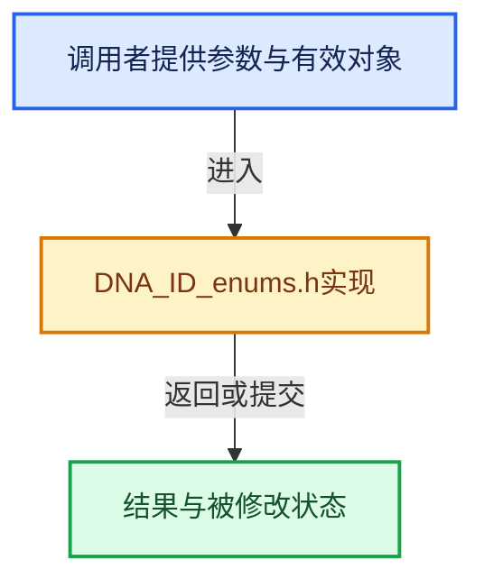

# 实现依赖专题：source/blender/makesdna/DNA_ID_enums.h

[方向导航](README.md) · [符号索引](../%E7%AC%A6%E5%8F%B7%E4%BE%9D%E8%B5%96%E4%B8%8E%E5%AE%9E%E7%8E%B0%E7%B4%A2%E5%BC%95.md)

本专题从正文实际调用进入，集中保存共享实现。函数有稳定锚点，可从调用处直接跳到对应完整函数；递归与互相调用通过回链组织。

## 本文件的实现关系





## 相关类型布局与成员入口

<a id="t-c694e1e91f39"></a>

### `blender::eIconSizes`

原始声明：[source/blender/makesdna/DNA_ID_enums.h](../../../../../source/blender/makesdna/DNA_ID_enums.h) · L16—L21。

以下保留类的数据声明与编译条件，成员函数实现通过后面的精确链接阅读。

<!-- annotated:292c20238026dc -->

```cpp
enum eIconSizes {
  ICON_SIZE_ICON = 0,
  ICON_SIZE_PREVIEW = 1,

  NUM_ICON_SIZES,
};
```

<details>
<summary>核对原始源码：source/blender/makesdna/DNA_ID_enums.h · L16—L21</summary>

<!-- original:292c20238026dc:source/blender/makesdna/DNA_ID_enums.h:16:21 -->

```cpp
enum eIconSizes {
  ICON_SIZE_ICON = 0,
  ICON_SIZE_PREVIEW = 1,

  NUM_ICON_SIZES,
};
```

</details>


<a id="t-8634c1412885"></a>

### `blender::eIDPropertyType`

原始声明：[source/blender/makesdna/DNA_ID_enums.h](../../../../../source/blender/makesdna/DNA_ID_enums.h) · L24—L39。

以下保留类的数据声明与编译条件，成员函数实现通过后面的精确链接阅读。

<!-- annotated:72f9416dac60a2 -->

```cpp
enum eIDPropertyType : char {
  IDP_STRING = 0,
  IDP_INT = 1,
  IDP_FLOAT = 2,
  /** Array containing int, floats, doubles or groups. */
  IDP_ARRAY = 5,
  IDP_GROUP = 6,
  IDP_ID = 7,
  IDP_DOUBLE = 8,
  IDP_IDPARRAY = 9,
  /**
   * True or false value, backed by an `int8_t` underlying type for arrays. Values are expected to
   * be 0 or 1.
   */
  IDP_BOOLEAN = 10,
};
```

<details>
<summary>核对原始源码：source/blender/makesdna/DNA_ID_enums.h · L24—L39</summary>

<!-- original:72f9416dac60a2:source/blender/makesdna/DNA_ID_enums.h:24:39 -->

```cpp
enum eIDPropertyType : char {
  IDP_STRING = 0,
  IDP_INT = 1,
  IDP_FLOAT = 2,
  /** Array containing int, floats, doubles or groups. */
  IDP_ARRAY = 5,
  IDP_GROUP = 6,
  IDP_ID = 7,
  IDP_DOUBLE = 8,
  IDP_IDPARRAY = 9,
  /**
   * True or false value, backed by an `int8_t` underlying type for arrays. Values are expected to
   * be 0 or 1.
   */
  IDP_BOOLEAN = 10,
};
```

</details>


<a id="t-fee8e790057b"></a>

### `blender::LibraryFlag`

原始声明：[source/blender/makesdna/DNA_ID_enums.h](../../../../../source/blender/makesdna/DNA_ID_enums.h) · L105—L112。

以下保留类的数据声明与编译条件，成员函数实现通过后面的精确链接阅读。

<!-- annotated:9e8f2b0b0085d9 -->

```cpp
enum LibraryFlag {
  /** The library is an 'archive' that only contains embedded linked data. */
  LIBRARY_FLAG_IS_ARCHIVE = 1 << 0,
  /**
   * The library is an 'external' (non-blend file) archive that only contains embedded linked data.
   */
  LIBRARY_FLAG_IS_EXTERNAL = 1 << 1,
};
```

<details>
<summary>核对原始源码：source/blender/makesdna/DNA_ID_enums.h · L105—L112</summary>

<!-- original:9e8f2b0b0085d9:source/blender/makesdna/DNA_ID_enums.h:105:112 -->

```cpp
enum LibraryFlag {
  /** The library is an 'archive' that only contains embedded linked data. */
  LIBRARY_FLAG_IS_ARCHIVE = 1 << 0,
  /**
   * The library is an 'external' (non-blend file) archive that only contains embedded linked data.
   */
  LIBRARY_FLAG_IS_EXTERNAL = 1 << 1,
};
```

</details>


<a id="t-4fa202c1cee5"></a>

### `blender::ID_Type`

原始声明：[source/blender/makesdna/DNA_ID_enums.h](../../../../../source/blender/makesdna/DNA_ID_enums.h) · L136—L176。

以下保留类的数据声明与编译条件，成员函数实现通过后面的精确链接阅读。

<!-- annotated:30c86388ff5e6b -->

```cpp
enum ID_Type : uint16_t {
  ID_SCE = MAKE_ID2('S', 'C'),       /* Scene */
  ID_LI = MAKE_ID2('L', 'I'),        /* Library */
  ID_OB = MAKE_ID2('O', 'B'),        /* Object */
  ID_ME = MAKE_ID2('M', 'E'),        /* Mesh */
  ID_CU_LEGACY = MAKE_ID2('C', 'U'), /* Curve. ID_CV should be used in the future (see #95355). */
  ID_MB = MAKE_ID2('M', 'B'),        /* MetaBall */
  ID_MA = MAKE_ID2('M', 'A'),        /* Material */
  ID_TE = MAKE_ID2('T', 'E'),        /* Tex (Texture) */
  ID_IM = MAKE_ID2('I', 'M'),        /* Image */
  ID_LT = MAKE_ID2('L', 'T'),        /* Lattice */
  ID_LA = MAKE_ID2('L', 'A'),        /* Light */
  ID_CA = MAKE_ID2('C', 'A'),        /* Camera */
  ID_KE = MAKE_ID2('K', 'E'),        /* Key (shape key) */
  ID_WO = MAKE_ID2('W', 'O'),        /* World */
  ID_SCR = MAKE_ID2('S', 'R'),       /* bScreen */
  ID_VF = MAKE_ID2('V', 'F'),        /* VFont (Vector Font) */
  ID_TXT = MAKE_ID2('T', 'X'),       /* Text */
  ID_SPK = MAKE_ID2('S', 'K'),       /* Speaker */
  ID_SO = MAKE_ID2('S', 'O'),        /* Sound */
  ID_GR = MAKE_ID2('G', 'R'),        /* Collection */
  ID_AR = MAKE_ID2('A', 'R'),        /* bArmature */
  ID_AC = MAKE_ID2('A', 'C'),        /* bAction */
  ID_NT = MAKE_ID2('N', 'T'),        /* bNodeTree */
  ID_BR = MAKE_ID2('B', 'R'),        /* Brush */
  ID_PA = MAKE_ID2('P', 'A'),        /* ParticleSettings */
  ID_GD_LEGACY = MAKE_ID2('G', 'D'), /* bGPdata, (legacy Grease Pencil) */
  ID_WM = MAKE_ID2('W', 'M'),        /* wmWindowManager */
  ID_MC = MAKE_ID2('M', 'C'),        /* MovieClip */
  ID_MSK = MAKE_ID2('M', 'S'),       /* Mask */
  ID_LS = MAKE_ID2('L', 'S'),        /* FreestyleLineStyle */
  ID_PAL = MAKE_ID2('P', 'L'),       /* Palette */
  ID_PC = MAKE_ID2('P', 'C'),        /* PaintCurve */
  ID_CF = MAKE_ID2('C', 'F'),        /* CacheFile */
  ID_WS = MAKE_ID2('W', 'S'),        /* WorkSpace */
  ID_LP = MAKE_ID2('L', 'P'),        /* LightProbe */
  ID_CV = MAKE_ID2('C', 'V'),        /* Curves */
  ID_PT = MAKE_ID2('P', 'T'),        /* PointCloud */
  ID_VO = MAKE_ID2('V', 'O'),        /* Volume */
  ID_GP = MAKE_ID2('G', 'P'),        /* Grease Pencil */
};
```

<details>
<summary>核对原始源码：source/blender/makesdna/DNA_ID_enums.h · L136—L176</summary>

<!-- original:30c86388ff5e6b:source/blender/makesdna/DNA_ID_enums.h:136:176 -->

```cpp
enum ID_Type : uint16_t {
  ID_SCE = MAKE_ID2('S', 'C'),       /* Scene */
  ID_LI = MAKE_ID2('L', 'I'),        /* Library */
  ID_OB = MAKE_ID2('O', 'B'),        /* Object */
  ID_ME = MAKE_ID2('M', 'E'),        /* Mesh */
  ID_CU_LEGACY = MAKE_ID2('C', 'U'), /* Curve. ID_CV should be used in the future (see #95355). */
  ID_MB = MAKE_ID2('M', 'B'),        /* MetaBall */
  ID_MA = MAKE_ID2('M', 'A'),        /* Material */
  ID_TE = MAKE_ID2('T', 'E'),        /* Tex (Texture) */
  ID_IM = MAKE_ID2('I', 'M'),        /* Image */
  ID_LT = MAKE_ID2('L', 'T'),        /* Lattice */
  ID_LA = MAKE_ID2('L', 'A'),        /* Light */
  ID_CA = MAKE_ID2('C', 'A'),        /* Camera */
  ID_KE = MAKE_ID2('K', 'E'),        /* Key (shape key) */
  ID_WO = MAKE_ID2('W', 'O'),        /* World */
  ID_SCR = MAKE_ID2('S', 'R'),       /* bScreen */
  ID_VF = MAKE_ID2('V', 'F'),        /* VFont (Vector Font) */
  ID_TXT = MAKE_ID2('T', 'X'),       /* Text */
  ID_SPK = MAKE_ID2('S', 'K'),       /* Speaker */
  ID_SO = MAKE_ID2('S', 'O'),        /* Sound */
  ID_GR = MAKE_ID2('G', 'R'),        /* Collection */
  ID_AR = MAKE_ID2('A', 'R'),        /* bArmature */
  ID_AC = MAKE_ID2('A', 'C'),        /* bAction */
  ID_NT = MAKE_ID2('N', 'T'),        /* bNodeTree */
  ID_BR = MAKE_ID2('B', 'R'),        /* Brush */
  ID_PA = MAKE_ID2('P', 'A'),        /* ParticleSettings */
  ID_GD_LEGACY = MAKE_ID2('G', 'D'), /* bGPdata, (legacy Grease Pencil) */
  ID_WM = MAKE_ID2('W', 'M'),        /* wmWindowManager */
  ID_MC = MAKE_ID2('M', 'C'),        /* MovieClip */
  ID_MSK = MAKE_ID2('M', 'S'),       /* Mask */
  ID_LS = MAKE_ID2('L', 'S'),        /* FreestyleLineStyle */
  ID_PAL = MAKE_ID2('P', 'L'),       /* Palette */
  ID_PC = MAKE_ID2('P', 'C'),        /* PaintCurve */
  ID_CF = MAKE_ID2('C', 'F'),        /* CacheFile */
  ID_WS = MAKE_ID2('W', 'S'),        /* WorkSpace */
  ID_LP = MAKE_ID2('L', 'P'),        /* LightProbe */
  ID_CV = MAKE_ID2('C', 'V'),        /* Curves */
  ID_PT = MAKE_ID2('P', 'T'),        /* PointCloud */
  ID_VO = MAKE_ID2('V', 'O'),        /* Volume */
  ID_GP = MAKE_ID2('G', 'P'),        /* Grease Pencil */
};
```

</details>


## 完整成员与函数实现
