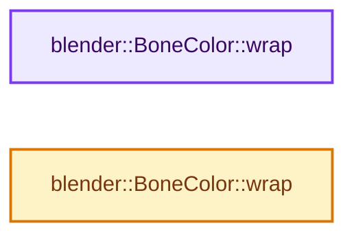
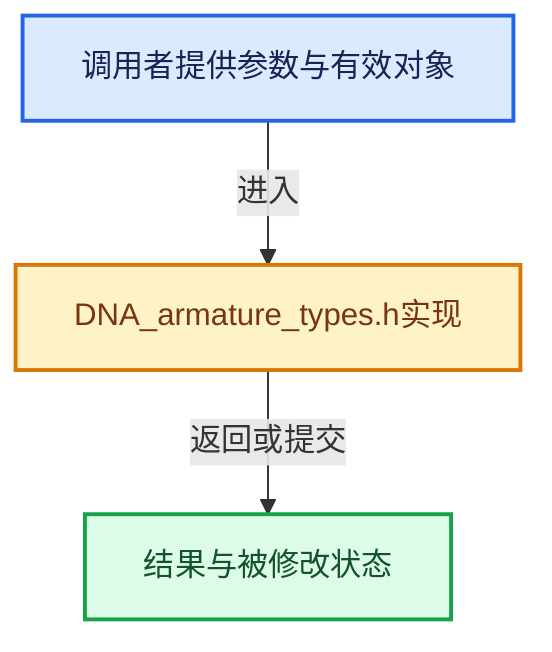

# 实现依赖专题：source/blender/makesdna/DNA_armature_types.h

[方向导航](README.md) · [符号索引](../%E7%AC%A6%E5%8F%B7%E4%BE%9D%E8%B5%96%E4%B8%8E%E5%AE%9E%E7%8E%B0%E7%B4%A2%E5%BC%95.md)

本专题从正文实际调用进入，集中保存共享实现。函数有稳定锚点，可从调用处直接跳到对应完整函数；递归与互相调用通过回链组织。

## 本文件的实现关系






## 相关类型布局与成员入口

<a id="t-7aca154df161"></a>

### `blender::eArmature_Flag`

原始声明：[source/blender/makesdna/DNA_armature_types.h](../../../../../source/blender/makesdna/DNA_armature_types.h) · L37—L68。

以下保留类的数据声明与编译条件，成员函数实现通过后面的精确链接阅读。

<!-- annotated:c345377be00a63 -->

```cpp
enum eArmature_Flag : int {
  ARM_RESTPOS = (1 << 0),
  /** XRAY is here only for backwards converting */
  ARM_FLAG_UNUSED_1 = (1 << 1), /* cleared */
  ARM_DRAWAXES = (1 << 2),
  ARM_DRAWNAMES = (1 << 3),
  /* ARM_POSEMODE = (1 << 4), Deprecated. */
  /** Position of the parent-child relation lines on the bone (cleared = drawn
   * from the tail, set = drawn from the head). Only controls the parent side of
   * the line; the child side is always drawn to the head of the bone. */
  ARM_DRAW_RELATION_FROM_HEAD = (1 << 5), /* Cleared in versioning of pre-2.80 files. */
  /**
   * Whether any bone collection is marked with the 'solo' flag.
   * When this is the case, bone collection visibility flags don't matter any more, and only ones
   * that have their 'solo' flag set will be visible.
   *
   * \see eBoneCollection_Flag::BONE_COLLECTION_SOLO */
  ARM_BCOLL_SOLO_ACTIVE = (1 << 6), /* Cleared in versioning of pre-2.80 files. */
  ARM_FLAG_UNUSED_7 = (1 << 7),     /* cleared */
  ARM_MIRROR_EDIT = (1 << 8),
  ARM_FLAG_UNUSED_9 = (1 << 9),
  /** Made option negative, for backwards compatibility. */
  ARM_NO_CUSTOM = (1 << 10),
  /** Draw custom colors. */
  ARM_COL_CUSTOM = (1 << 11),
  /** When ghosting, only show selected bones (this should belong to ghostflag instead). */
  ARM_FLAG_UNUSED_12 = (1 << 12), /* cleared */
  /** Dope-sheet channel is expanded */
  ARM_DS_EXPAND = (1 << 13),
  /** Other objects are used for visualizing various states (hack for efficient updates). */
  ARM_HAS_VIZ_DEPS = (1 << 14),
};
```

<details>
<summary>核对原始源码：source/blender/makesdna/DNA_armature_types.h · L37—L68</summary>

<!-- original:c345377be00a63:source/blender/makesdna/DNA_armature_types.h:37:68 -->

```cpp
enum eArmature_Flag : int {
  ARM_RESTPOS = (1 << 0),
  /** XRAY is here only for backwards converting */
  ARM_FLAG_UNUSED_1 = (1 << 1), /* cleared */
  ARM_DRAWAXES = (1 << 2),
  ARM_DRAWNAMES = (1 << 3),
  /* ARM_POSEMODE = (1 << 4), Deprecated. */
  /** Position of the parent-child relation lines on the bone (cleared = drawn
   * from the tail, set = drawn from the head). Only controls the parent side of
   * the line; the child side is always drawn to the head of the bone. */
  ARM_DRAW_RELATION_FROM_HEAD = (1 << 5), /* Cleared in versioning of pre-2.80 files. */
  /**
   * Whether any bone collection is marked with the 'solo' flag.
   * When this is the case, bone collection visibility flags don't matter any more, and only ones
   * that have their 'solo' flag set will be visible.
   *
   * \see eBoneCollection_Flag::BONE_COLLECTION_SOLO */
  ARM_BCOLL_SOLO_ACTIVE = (1 << 6), /* Cleared in versioning of pre-2.80 files. */
  ARM_FLAG_UNUSED_7 = (1 << 7),     /* cleared */
  ARM_MIRROR_EDIT = (1 << 8),
  ARM_FLAG_UNUSED_9 = (1 << 9),
  /** Made option negative, for backwards compatibility. */
  ARM_NO_CUSTOM = (1 << 10),
  /** Draw custom colors. */
  ARM_COL_CUSTOM = (1 << 11),
  /** When ghosting, only show selected bones (this should belong to ghostflag instead). */
  ARM_FLAG_UNUSED_12 = (1 << 12), /* cleared */
  /** Dope-sheet channel is expanded */
  ARM_DS_EXPAND = (1 << 13),
  /** Other objects are used for visualizing various states (hack for efficient updates). */
  ARM_HAS_VIZ_DEPS = (1 << 14),
};
```

</details>


## 完整成员与函数实现

<a id="f-50a6b39a0b2c6a80"></a>

### `blender::BoneColor::wrap`

实现位置：[source/blender/makesdna/DNA_armature_types.h](../../../../../source/blender/makesdna/DNA_armature_types.h) · L595—L598。

**教学注释版**

<!-- annotated:ac5cd3f64d9467 -->

```cpp
inline animrig::BoneColor &BoneColor::wrap()
{
  return *reinterpret_cast<animrig::BoneColor *>(this);
}
```

<details>
<summary>核对原始源码：source/blender/makesdna/DNA_armature_types.h · L595—L598</summary>

<!-- original:ac5cd3f64d9467:source/blender/makesdna/DNA_armature_types.h:595:598 -->

```cpp
inline animrig::BoneColor &BoneColor::wrap()
{
  return *reinterpret_cast<animrig::BoneColor *>(this);
}
```

</details>

**结果出口**

- `return *reinterpret_cast<animrig::BoneColor *>(this);`

**继续追踪实现**

本实现没有需要继续展开的显式调用；检查返回表达式、对象转换和调用者前置条件。

<a id="f-2034fba332a3a41b"></a>

### `blender::BoneColor::wrap`

实现位置：[source/blender/makesdna/DNA_armature_types.h](../../../../../source/blender/makesdna/DNA_armature_types.h) · L599—L602。

**教学注释版**

<!-- annotated:4e63ebbbfb7162 -->

```cpp
inline const animrig::BoneColor &BoneColor::wrap() const
{
  return *reinterpret_cast<const animrig::BoneColor *>(this);
}
```

<details>
<summary>核对原始源码：source/blender/makesdna/DNA_armature_types.h · L599—L602</summary>

<!-- original:4e63ebbbfb7162:source/blender/makesdna/DNA_armature_types.h:599:602 -->

```cpp
inline const animrig::BoneColor &BoneColor::wrap() const
{
  return *reinterpret_cast<const animrig::BoneColor *>(this);
}
```

</details>

**结果出口**

- `return *reinterpret_cast<const animrig::BoneColor *>(this);`

**继续追踪实现**

本实现没有需要继续展开的显式调用；检查返回表达式、对象转换和调用者前置条件。
