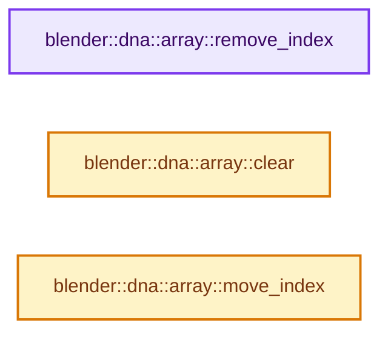

# 实现依赖专题：source/blender/makesdna/DNA_array_utils.hh

[方向导航](README.md) · [符号索引](../%E7%AC%A6%E5%8F%B7%E4%BE%9D%E8%B5%96%E4%B8%8E%E5%AE%9E%E7%8E%B0%E7%B4%A2%E5%BC%95.md)

本专题从正文实际调用进入，集中保存共享实现。函数有稳定锚点，可从调用处直接跳到对应完整函数；递归与互相调用通过回链组织。

## 本文件的实现关系




## 完整成员与函数实现

<a id="f-edce13296305a40f"></a>

### `blender::dna::array::remove_index`

实现位置：[source/blender/makesdna/DNA_array_utils.hh](../../../../../source/blender/makesdna/DNA_array_utils.hh) · L26—L55。

接口参数：

- `T **items`
- `int *items_num`
- `int *active_index`
- `const int index`
- `void (*destruct_item)(T *)`
- `T *`

**教学注释版**

<!-- annotated:e773fdc125c3b0 -->

```cpp
template<typename T>
inline void remove_index(
    T **items, int *items_num, int *active_index, const int index, void (*destruct_item)(T *))
{
  static_assert(std::is_trivially_copyable_v<T>);
  BLI_assert(index >= 0);
  BLI_assert(index < *items_num);

  const int old_items_num = *items_num;
  const int new_items_num = old_items_num - 1;

  T *old_items = *items;
  T *new_items = MEM_new_array<T>(new_items_num, __func__);

  std::copy_n(old_items, index, new_items);
  std::copy_n(old_items + index + 1, old_items_num - index - 1, new_items + index);

  destruct_item(&old_items[index]);
  MEM_delete(old_items);

  *items = new_items;
  *items_num = new_items_num;

  if (active_index) {
    const int old_active_index = active_index ? *active_index : 0;
    // [讲解] std::max：按比较关系选取较大值。本讲解中的增长公式同时满足最低请求和几何增长；若保存返回引用，还需注意实参寿命。
    const int new_active_index = std::max(
        0, old_active_index == new_items_num ? new_items_num - 1 : old_active_index);
    *active_index = new_active_index;
  }
}
```

<details>
<summary>核对原始源码：source/blender/makesdna/DNA_array_utils.hh · L26—L55</summary>

<!-- original:e773fdc125c3b0:source/blender/makesdna/DNA_array_utils.hh:26:55 -->

```cpp
template<typename T>
inline void remove_index(
    T **items, int *items_num, int *active_index, const int index, void (*destruct_item)(T *))
{
  static_assert(std::is_trivially_copyable_v<T>);
  BLI_assert(index >= 0);
  BLI_assert(index < *items_num);

  const int old_items_num = *items_num;
  const int new_items_num = old_items_num - 1;

  T *old_items = *items;
  T *new_items = MEM_new_array<T>(new_items_num, __func__);

  std::copy_n(old_items, index, new_items);
  std::copy_n(old_items + index + 1, old_items_num - index - 1, new_items + index);

  destruct_item(&old_items[index]);
  MEM_delete(old_items);

  *items = new_items;
  *items_num = new_items_num;

  if (active_index) {
    const int old_active_index = active_index ? *active_index : 0;
    const int new_active_index = std::max(
        0, old_active_index == new_items_num ? new_items_num - 1 : old_active_index);
    *active_index = new_active_index;
  }
}
```

</details>

**继续追踪实现**

- `BLI_assert` → [BLI_assert · L48](../01-%E5%9F%BA%E7%A1%80%E5%AE%B9%E5%99%A8%E4%B8%8E%E7%8E%B0%E4%BB%A3CPP/%E4%BE%9D%E8%B5%96-BLI_assert-cc98e8.md#m-57a88495704d)；[BLI_assert · L63](../01-%E5%9F%BA%E7%A1%80%E5%AE%B9%E5%99%A8%E4%B8%8E%E7%8E%B0%E4%BB%A3CPP/%E4%BE%9D%E8%B5%96-BLI_assert-cc98e8.md#m-d07050020cb5)。宏定义由构建条件选择。
- `MEM_new_array<T>` → [MEM_new_array · L372](../03-%E5%86%85%E5%AD%98%E5%88%86%E9%85%8D%E4%B8%8E%E8%BF%90%E8%A1%8C%E6%97%B6%E7%B1%BB%E5%9E%8B/%E4%BE%9D%E8%B5%96-MEM_guardedalloc-b54eca.md#f-56b8fe3d391af460)。
- `std::copy_n` → [外部契约](https://eel.is/c++draft/)：这个边界按实际表达式及所属类型核对参数、返回值、寿命与失败行为。这里提供接口入口，不声称已解释该第三方版本的内部实现。
- `destruct_item` → [调用协议](../%E6%A8%A1%E6%9D%BF%E5%AE%8F%E4%B8%8E%E5%8A%A8%E6%80%81%E5%88%86%E6%B4%BE%E5%8D%8F%E8%AE%AE.md)：局部可调用对象，须结合其初始化与捕获环境。调用位置L43。
- `MEM_delete` → [MEM_delete · L400](../03-%E5%86%85%E5%AD%98%E5%88%86%E9%85%8D%E4%B8%8E%E8%BF%90%E8%A1%8C%E6%97%B6%E7%B1%BB%E5%9E%8B/%E4%BE%9D%E8%B5%96-MEM_guardedalloc-b54eca.md#f-9049ffdd1682887c)。
- `std::max` → [外部契约](https://eel.is/c++draft/alg.min.max)：按比较关系选取较大值。本讲解中的增长公式同时满足最低请求和几何增长；若保存返回引用，还需注意实参寿命。

<a id="f-7c1eed21b7767301"></a>

### `blender::dna::array::clear`

实现位置：[source/blender/makesdna/DNA_array_utils.hh](../../../../../source/blender/makesdna/DNA_array_utils.hh) · L82—L94。

接口参数：

- `T **items`
- `int *items_num`
- `int *active_index`
- `void (*destruct_item)(T *)`
- `T *`

**教学注释版**

<!-- annotated:0a8113fe998d59 -->

```cpp
template<typename T>
inline void clear(T **items, int *items_num, int *active_index, void (*destruct_item)(T *))
{
  static_assert(std::is_trivially_copyable_v<T>);
  for (const int i : IndexRange(*items_num)) {
    destruct_item(&(*items)[i]);
  }
  MEM_SAFE_DELETE(*items);
  *items_num = 0;
  if (active_index) {
    *active_index = 0;
  }
}
```

<details>
<summary>核对原始源码：source/blender/makesdna/DNA_array_utils.hh · L82—L94</summary>

<!-- original:0a8113fe998d59:source/blender/makesdna/DNA_array_utils.hh:82:94 -->

```cpp
template<typename T>
inline void clear(T **items, int *items_num, int *active_index, void (*destruct_item)(T *))
{
  static_assert(std::is_trivially_copyable_v<T>);
  for (const int i : IndexRange(*items_num)) {
    destruct_item(&(*items)[i]);
  }
  MEM_SAFE_DELETE(*items);
  *items_num = 0;
  if (active_index) {
    *active_index = 0;
  }
}
```

</details>

**继续追踪实现**

- `IndexRange` → [blender::IndexRange](../01-%E5%9F%BA%E7%A1%80%E5%AE%B9%E5%99%A8%E4%B8%8E%E7%8E%B0%E4%BB%A3CPP/%E4%BE%9D%E8%B5%96-BLI_index_range-7d7cc5.md#t-caa3466d6776)；[blender::gpu::shader::parser::IndexRange](%E4%BE%9D%E8%B5%96-utils-06433d.md#t-82d2bd4ea71c)；[blender::IndexRange](%E4%BE%9D%E8%B5%96-DNA_node_types-6708b9.md#t-0448cc889d39)。
- `destruct_item` → [调用协议](../%E6%A8%A1%E6%9D%BF%E5%AE%8F%E4%B8%8E%E5%8A%A8%E6%80%81%E5%88%86%E6%B4%BE%E5%8D%8F%E8%AE%AE.md)：局部可调用对象，须结合其初始化与捕获环境。调用位置L87。
- `MEM_SAFE_DELETE` → [MEM_SAFE_DELETE · L436](../03-%E5%86%85%E5%AD%98%E5%88%86%E9%85%8D%E4%B8%8E%E8%BF%90%E8%A1%8C%E6%97%B6%E7%B1%BB%E5%9E%8B/%E4%BE%9D%E8%B5%96-MEM_guardedalloc-b54eca.md#m-eadb3bc5b902)。宏定义由构建条件选择。

<a id="f-df5f0d61d8df196c"></a>

### `blender::dna::array::move_index`

实现位置：[source/blender/makesdna/DNA_array_utils.hh](../../../../../source/blender/makesdna/DNA_array_utils.hh) · L99—L127。

接口参数：

- `T *items`
- `const int items_num`
- `const int from_index`
- `const int to_index`

**教学注释版**

<!-- annotated:05d66c1922cb81 -->

```cpp
template<typename T>
inline void move_index(T *items, const int items_num, const int from_index, const int to_index)
{
  static_assert(std::is_trivially_copyable_v<T>);
  BLI_assert(from_index >= 0);
  BLI_assert(from_index < items_num);
  BLI_assert(to_index >= 0);
  BLI_assert(to_index < items_num);
  UNUSED_VARS_NDEBUG(items_num);

  if (from_index == to_index) {
    return;
  }

  if (from_index < to_index) {
    const T tmp = items[from_index];
    for (int i = from_index; i < to_index; i++) {
      items[i] = items[i + 1];
    }
    items[to_index] = tmp;
  }
  else if (from_index > to_index) {
    const T tmp = items[from_index];
    for (int i = from_index; i > to_index; i--) {
      items[i] = items[i - 1];
    }
    items[to_index] = tmp;
  }
}
```

<details>
<summary>核对原始源码：source/blender/makesdna/DNA_array_utils.hh · L99—L127</summary>

<!-- original:05d66c1922cb81:source/blender/makesdna/DNA_array_utils.hh:99:127 -->

```cpp
template<typename T>
inline void move_index(T *items, const int items_num, const int from_index, const int to_index)
{
  static_assert(std::is_trivially_copyable_v<T>);
  BLI_assert(from_index >= 0);
  BLI_assert(from_index < items_num);
  BLI_assert(to_index >= 0);
  BLI_assert(to_index < items_num);
  UNUSED_VARS_NDEBUG(items_num);

  if (from_index == to_index) {
    return;
  }

  if (from_index < to_index) {
    const T tmp = items[from_index];
    for (int i = from_index; i < to_index; i++) {
      items[i] = items[i + 1];
    }
    items[to_index] = tmp;
  }
  else if (from_index > to_index) {
    const T tmp = items[from_index];
    for (int i = from_index; i > to_index; i--) {
      items[i] = items[i - 1];
    }
    items[to_index] = tmp;
  }
}
```

</details>

**沿实际写入检查状态**

- `items[i] = items[i + 1];`
- `items[to_index] = tmp;`
- `items[i] = items[i - 1];`

**继续追踪实现**

- `BLI_assert` → [BLI_assert · L48](../01-%E5%9F%BA%E7%A1%80%E5%AE%B9%E5%99%A8%E4%B8%8E%E7%8E%B0%E4%BB%A3CPP/%E4%BE%9D%E8%B5%96-BLI_assert-cc98e8.md#m-57a88495704d)；[BLI_assert · L63](../01-%E5%9F%BA%E7%A1%80%E5%AE%B9%E5%99%A8%E4%B8%8E%E7%8E%B0%E4%BB%A3CPP/%E4%BE%9D%E8%B5%96-BLI_assert-cc98e8.md#m-d07050020cb5)。宏定义由构建条件选择。
- `UNUSED_VARS_NDEBUG` → [UNUSED_VARS_NDEBUG · L526](../01-%E5%9F%BA%E7%A1%80%E5%AE%B9%E5%99%A8%E4%B8%8E%E7%8E%B0%E4%BB%A3CPP/%E4%BE%9D%E8%B5%96-BLI_utildefines-293a0a.md#m-fea439f7d366)；[UNUSED_VARS_NDEBUG · L528](../01-%E5%9F%BA%E7%A1%80%E5%AE%B9%E5%99%A8%E4%B8%8E%E7%8E%B0%E4%BB%A3CPP/%E4%BE%9D%E8%B5%96-BLI_utildefines-293a0a.md#m-a8f8cfac06c0)。宏定义由构建条件选择。
