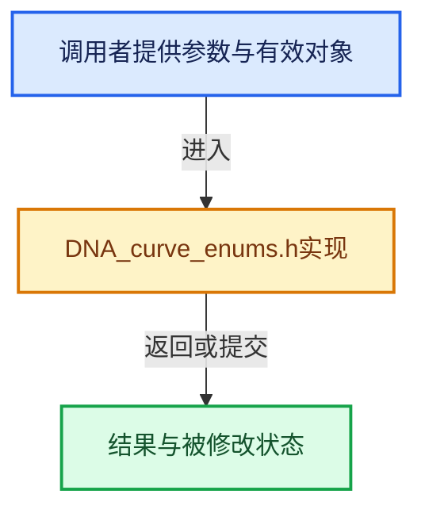

# 实现依赖专题：source/blender/makesdna/DNA_curve_enums.h

[方向导航](README.md) · [符号索引](../%E7%AC%A6%E5%8F%B7%E4%BE%9D%E8%B5%96%E4%B8%8E%E5%AE%9E%E7%8E%B0%E7%B4%A2%E5%BC%95.md)

本专题从正文实际调用进入，集中保存共享实现。函数有稳定锚点，可从调用处直接跳到对应完整函数；递归与互相调用通过回链组织。

## 本文件的实现关系





## 相关类型布局与成员入口

<a id="t-2a1384b9a1cd"></a>

### `blender::CurveFillSolverType`

原始声明：[source/blender/makesdna/DNA_curve_enums.h](../../../../../source/blender/makesdna/DNA_curve_enums.h) · L103—L113。

以下保留类的数据声明与编译条件，成员函数实现通过后面的精确链接阅读。

<!-- annotated:baa2de5c111d70 -->

```cpp
enum CurveFillSolverType : char {
  /**
   * Fast filling without support for self-intersections.
   * Uses `BLI_scanfill`.
   */
  CU_FILL_SOLVER_SWEEP_LINE = 0,
  /**
   * Constrained Delaunay Triangulation with self-intersection and fill rule support.
   */
  CU_FILL_SOLVER_CDT = 1,
};
```

<details>
<summary>核对原始源码：source/blender/makesdna/DNA_curve_enums.h · L103—L113</summary>

<!-- original:baa2de5c111d70:source/blender/makesdna/DNA_curve_enums.h:103:113 -->

```cpp
enum CurveFillSolverType : char {
  /**
   * Fast filling without support for self-intersections.
   * Uses `BLI_scanfill`.
   */
  CU_FILL_SOLVER_SWEEP_LINE = 0,
  /**
   * Constrained Delaunay Triangulation with self-intersection and fill rule support.
   */
  CU_FILL_SOLVER_CDT = 1,
};
```

</details>


<a id="t-4f7baa6fd007"></a>

### `blender::CurveFillRuleType`

原始声明：[source/blender/makesdna/DNA_curve_enums.h](../../../../../source/blender/makesdna/DNA_curve_enums.h) · L116—L119。

以下保留类的数据声明与编译条件，成员函数实现通过后面的精确链接阅读。

<!-- annotated:a28e0bc1fc4900 -->

```cpp
enum CurveFillRuleType : char {
  CU_FILL_RULE_EVEN_ODD = 0,
  CU_FILL_RULE_NONZERO = 1,
};
```

<details>
<summary>核对原始源码：source/blender/makesdna/DNA_curve_enums.h · L116—L119</summary>

<!-- original:a28e0bc1fc4900:source/blender/makesdna/DNA_curve_enums.h:116:119 -->

```cpp
enum CurveFillRuleType : char {
  CU_FILL_RULE_EVEN_ODD = 0,
  CU_FILL_RULE_NONZERO = 1,
};
```

</details>


<a id="t-5576909fe0e4"></a>

### `blender::eNurbFlag`

原始声明：[source/blender/makesdna/DNA_curve_enums.h](../../../../../source/blender/makesdna/DNA_curve_enums.h) · L129—L131。

以下保留类的数据声明与编译条件，成员函数实现通过后面的精确链接阅读。

<!-- annotated:9cd8a9b3cff764 -->

```cpp
enum eNurbFlag : short {
  CU_SMOOTH = 1 << 0,
};
```

<details>
<summary>核对原始源码：source/blender/makesdna/DNA_curve_enums.h · L129—L131</summary>

<!-- original:9cd8a9b3cff764:source/blender/makesdna/DNA_curve_enums.h:129:131 -->

```cpp
enum eNurbFlag : short {
  CU_SMOOTH = 1 << 0,
};
```

</details>


<a id="t-0a45e333a619"></a>

### `blender::eNurbType`

原始声明：[source/blender/makesdna/DNA_curve_enums.h](../../../../../source/blender/makesdna/DNA_curve_enums.h) · L135—L155。

以下保留类的数据声明与编译条件，成员函数实现通过后面的精确链接阅读。

<!-- annotated:05d12f609950d0 -->

```cpp
enum eNurbType : short {
  CU_POLY = 0,
  CU_BEZIER = 1,
  CU_NURBS = 4,
  CU_TYPE = (CU_POLY | CU_BEZIER | CU_NURBS),

  /* only for adding */
  CU_PRIMITIVE = 0xF00,

  /* 2 or 4 points */
  CU_PRIM_CURVE = 0x100,
  /* 8 points circle */
  CU_PRIM_CIRCLE = 0x200,
  /* 4x4 patch NURB. */
  CU_PRIM_PATCH = 0x300,
  CU_PRIM_TUBE = 0x400,
  CU_PRIM_SPHERE = 0x500,
  CU_PRIM_DONUT = 0x600,
  /* 5 points,  5th order straight line (for anim path) */
  CU_PRIM_PATH = 0x700,
};
```

<details>
<summary>核对原始源码：source/blender/makesdna/DNA_curve_enums.h · L135—L155</summary>

<!-- original:05d12f609950d0:source/blender/makesdna/DNA_curve_enums.h:135:155 -->

```cpp
enum eNurbType : short {
  CU_POLY = 0,
  CU_BEZIER = 1,
  CU_NURBS = 4,
  CU_TYPE = (CU_POLY | CU_BEZIER | CU_NURBS),

  /* only for adding */
  CU_PRIMITIVE = 0xF00,

  /* 2 or 4 points */
  CU_PRIM_CURVE = 0x100,
  /* 8 points circle */
  CU_PRIM_CIRCLE = 0x200,
  /* 4x4 patch NURB. */
  CU_PRIM_PATCH = 0x300,
  CU_PRIM_TUBE = 0x400,
  CU_PRIM_SPHERE = 0x500,
  CU_PRIM_DONUT = 0x600,
  /* 5 points,  5th order straight line (for anim path) */
  CU_PRIM_PATH = 0x700,
};
```

</details>


<a id="t-400017160651"></a>

### `blender::eBezTriple_Flag`

原始声明：[source/blender/makesdna/DNA_curve_enums.h](../../../../../source/blender/makesdna/DNA_curve_enums.h) · L171—L176。

以下保留类的数据声明与编译条件，成员函数实现通过后面的精确链接阅读。

<!-- annotated:42f92b2fc04732 -->

```cpp
enum eBezTriple_Flag : uint8_t {
  BEZT_FLAG_SELECT = (1 << 0),
  BEZT_FLAG_TEMP_TAG = (1 << 1), /* always clear. */
  /* Can be used to ignore keyframe points for certain operations. */
  BEZT_FLAG_IGNORE_TAG = (1 << 2),
};
```

<details>
<summary>核对原始源码：source/blender/makesdna/DNA_curve_enums.h · L171—L176</summary>

<!-- original:42f92b2fc04732:source/blender/makesdna/DNA_curve_enums.h:171:176 -->

```cpp
enum eBezTriple_Flag : uint8_t {
  BEZT_FLAG_SELECT = (1 << 0),
  BEZT_FLAG_TEMP_TAG = (1 << 1), /* always clear. */
  /* Can be used to ignore keyframe points for certain operations. */
  BEZT_FLAG_IGNORE_TAG = (1 << 2),
};
```

</details>


<a id="t-8f0057ec722c"></a>

### `blender::eBezTriple_Handle`

原始声明：[source/blender/makesdna/DNA_curve_enums.h](../../../../../source/blender/makesdna/DNA_curve_enums.h) · L180—L187。

以下保留类的数据声明与编译条件，成员函数实现通过后面的精确链接阅读。

<!-- annotated:4806bab5140e6b -->

```cpp
enum eBezTriple_Handle : uint8_t {
  HD_FREE = 0,
  HD_AUTO = 1,
  HD_VECT = 2,
  HD_ALIGN = 3,
  HD_AUTO_ANIM = 4,        /* auto-clamped handles for animation */
  HD_ALIGN_DOUBLESIDE = 5, /* align handles, displayed both of them. used for masks */
};
```

<details>
<summary>核对原始源码：source/blender/makesdna/DNA_curve_enums.h · L180—L187</summary>

<!-- original:4806bab5140e6b:source/blender/makesdna/DNA_curve_enums.h:180:187 -->

```cpp
enum eBezTriple_Handle : uint8_t {
  HD_FREE = 0,
  HD_AUTO = 1,
  HD_VECT = 2,
  HD_ALIGN = 3,
  HD_AUTO_ANIM = 4,        /* auto-clamped handles for animation */
  HD_ALIGN_DOUBLESIDE = 5, /* align handles, displayed both of them. used for masks */
};
```

</details>


<a id="t-a5e4f38dc92b"></a>

### `blender::eBezTriple_Interpolation`

原始声明：[source/blender/makesdna/DNA_curve_enums.h](../../../../../source/blender/makesdna/DNA_curve_enums.h) · L200—L217。

以下保留类的数据声明与编译条件，成员函数实现通过后面的精确链接阅读。

<!-- annotated:f6277fd9eacd9d -->

```cpp
enum eBezTriple_Interpolation : char {
  /* traditional interpolation */
  BEZT_IPO_CONST = 0, /* constant interpolation */
  BEZT_IPO_LIN = 1,   /* linear interpolation */
  BEZT_IPO_BEZ = 2,   /* bezier interpolation */

  /* easing equations */
  BEZT_IPO_BACK = 3,
  BEZT_IPO_BOUNCE = 4,
  BEZT_IPO_CIRC = 5,
  BEZT_IPO_CUBIC = 6,
  BEZT_IPO_ELASTIC = 7,
  BEZT_IPO_EXPO = 8,
  BEZT_IPO_QUAD = 9,
  BEZT_IPO_QUART = 10,
  BEZT_IPO_QUINT = 11,
  BEZT_IPO_SINE = 12,
};
```

<details>
<summary>核对原始源码：source/blender/makesdna/DNA_curve_enums.h · L200—L217</summary>

<!-- original:f6277fd9eacd9d:source/blender/makesdna/DNA_curve_enums.h:200:217 -->

```cpp
enum eBezTriple_Interpolation : char {
  /* traditional interpolation */
  BEZT_IPO_CONST = 0, /* constant interpolation */
  BEZT_IPO_LIN = 1,   /* linear interpolation */
  BEZT_IPO_BEZ = 2,   /* bezier interpolation */

  /* easing equations */
  BEZT_IPO_BACK = 3,
  BEZT_IPO_BOUNCE = 4,
  BEZT_IPO_CIRC = 5,
  BEZT_IPO_CUBIC = 6,
  BEZT_IPO_ELASTIC = 7,
  BEZT_IPO_EXPO = 8,
  BEZT_IPO_QUAD = 9,
  BEZT_IPO_QUART = 10,
  BEZT_IPO_QUINT = 11,
  BEZT_IPO_SINE = 12,
};
```

</details>


<a id="t-cc9e594b0d3e"></a>

### `blender::eBezTriple_KeyframeType`

原始声明：[source/blender/makesdna/DNA_curve_enums.h](../../../../../source/blender/makesdna/DNA_curve_enums.h) · L229—L240。

以下保留类的数据声明与编译条件，成员函数实现通过后面的精确链接阅读。

<!-- annotated:b882a5b2cf9ade -->

```cpp
enum eBezTriple_KeyframeType : char {
  BEZT_KEYTYPE_KEYFRAME = 0,  /* default - 'proper' Keyframe */
  BEZT_KEYTYPE_EXTREME = 1,   /* 'extreme' keyframe */
  BEZT_KEYTYPE_BREAKDOWN = 2, /* 'breakdown' keyframe */
  BEZT_KEYTYPE_JITTER = 3,    /* 'jitter' keyframe (for adding 'filler' secondary motion) */
  BEZT_KEYTYPE_MOVEHOLD = 4,  /* one end of a 'moving hold' */
  /**
   * Key set by some automatic helper tool, marking that this key can be erased
   * and the tool re-run.
   */
  BEZT_KEYTYPE_GENERATED = 5,
};
```

<details>
<summary>核对原始源码：source/blender/makesdna/DNA_curve_enums.h · L229—L240</summary>

<!-- original:b882a5b2cf9ade:source/blender/makesdna/DNA_curve_enums.h:229:240 -->

```cpp
enum eBezTriple_KeyframeType : char {
  BEZT_KEYTYPE_KEYFRAME = 0,  /* default - 'proper' Keyframe */
  BEZT_KEYTYPE_EXTREME = 1,   /* 'extreme' keyframe */
  BEZT_KEYTYPE_BREAKDOWN = 2, /* 'breakdown' keyframe */
  BEZT_KEYTYPE_JITTER = 3,    /* 'jitter' keyframe (for adding 'filler' secondary motion) */
  BEZT_KEYTYPE_MOVEHOLD = 4,  /* one end of a 'moving hold' */
  /**
   * Key set by some automatic helper tool, marking that this key can be erased
   * and the tool re-run.
   */
  BEZT_KEYTYPE_GENERATED = 5,
};
```

</details>


## 完整成员与函数实现
