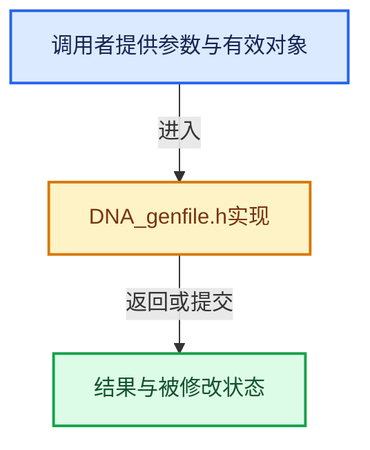

# 实现依赖专题：source/blender/makesdna/DNA_genfile.h

[方向导航](README.md) · [符号索引](../%E7%AC%A6%E5%8F%B7%E4%BE%9D%E8%B5%96%E4%B8%8E%E5%AE%9E%E7%8E%B0%E7%B4%A2%E5%BC%95.md)

本专题从正文实际调用进入，集中保存共享实现。函数有稳定锚点，可从调用处直接跳到对应完整函数；递归与互相调用通过回链组织。

## 本文件的实现关系





## 相关类型布局与成员入口

<a id="t-4e946de5f2c3"></a>

### `blender::eSDNA_Type`

原始声明：[source/blender/makesdna/DNA_genfile.h](../../../../../source/blender/makesdna/DNA_genfile.h) · L35—L56。

以下保留类的数据声明与编译条件，成员函数实现通过后面的精确链接阅读。

<!-- annotated:c3a6417f528550 -->

```cpp
enum eSDNA_Type {
  SDNA_TYPE_CHAR = 0,
  SDNA_TYPE_UCHAR = 1,
  SDNA_TYPE_SHORT = 2,
  SDNA_TYPE_USHORT = 3,
  SDNA_TYPE_INT = 4,
  /* SDNA_TYPE_LONG     = 5, */ /* deprecated (use as int) */
  /* SDNA_TYPE_ULONG    = 6, */ /* deprecated (use as int) */
  SDNA_TYPE_FLOAT = 7,
  SDNA_TYPE_DOUBLE = 8,
  SDNA_TYPE_INT64 = 9,
  SDNA_TYPE_UINT64 = 10,
  SDNA_TYPE_VOID = 11,
  SDNA_TYPE_INT8 = 12,
  /**
   * Type used for untyped raw bytes buffers (written by #BlendWriter::write_raw and read by
   * #BLO_read_raw_address).
   *
   * Technically, it also covers all 'raw data' types above.
   */
  SDNA_TYPE_RAW_DATA = 13,
};
```

<details>
<summary>核对原始源码：source/blender/makesdna/DNA_genfile.h · L35—L56</summary>

<!-- original:c3a6417f528550:source/blender/makesdna/DNA_genfile.h:35:56 -->

```cpp
enum eSDNA_Type {
  SDNA_TYPE_CHAR = 0,
  SDNA_TYPE_UCHAR = 1,
  SDNA_TYPE_SHORT = 2,
  SDNA_TYPE_USHORT = 3,
  SDNA_TYPE_INT = 4,
  /* SDNA_TYPE_LONG     = 5, */ /* deprecated (use as int) */
  /* SDNA_TYPE_ULONG    = 6, */ /* deprecated (use as int) */
  SDNA_TYPE_FLOAT = 7,
  SDNA_TYPE_DOUBLE = 8,
  SDNA_TYPE_INT64 = 9,
  SDNA_TYPE_UINT64 = 10,
  SDNA_TYPE_VOID = 11,
  SDNA_TYPE_INT8 = 12,
  /**
   * Type used for untyped raw bytes buffers (written by #BlendWriter::write_raw and read by
   * #BLO_read_raw_address).
   *
   * Technically, it also covers all 'raw data' types above.
   */
  SDNA_TYPE_RAW_DATA = 13,
};
```

</details>


<a id="t-eeb10f3cc34e"></a>

### `blender::eSDNA_StructCompare`

原始声明：[source/blender/makesdna/DNA_genfile.h](../../../../../source/blender/makesdna/DNA_genfile.h) · L61—L72。

以下保留类的数据声明与编译条件，成员函数实现通过后面的精确链接阅读。

<!-- annotated:b285f9f6d407ce -->

```cpp
enum eSDNA_StructCompare {
  /* Struct has disappeared
   * (values of this struct type will not be loaded by the current Blender) */
  SDNA_CMP_REMOVED = 0,
  /* Struct is the same (can be loaded with straight memory copy). */
  SDNA_CMP_EQUAL = 1,
  /* Struct is different in some way
   * (needs to be copied/converted field by field) */
  SDNA_CMP_NOT_EQUAL = 2,
  /* This is only used temporarily by #DNA_struct_get_compareflags. */
  SDNA_CMP_UNKNOWN = 3,
};
```

<details>
<summary>核对原始源码：source/blender/makesdna/DNA_genfile.h · L61—L72</summary>

<!-- original:b285f9f6d407ce:source/blender/makesdna/DNA_genfile.h:61:72 -->

```cpp
enum eSDNA_StructCompare {
  /* Struct has disappeared
   * (values of this struct type will not be loaded by the current Blender) */
  SDNA_CMP_REMOVED = 0,
  /* Struct is the same (can be loaded with straight memory copy). */
  SDNA_CMP_EQUAL = 1,
  /* Struct is different in some way
   * (needs to be copied/converted field by field) */
  SDNA_CMP_NOT_EQUAL = 2,
  /* This is only used temporarily by #DNA_struct_get_compareflags. */
  SDNA_CMP_UNKNOWN = 3,
};
```

</details>


<a id="m-e23df20d6cd4"></a>

## 宏 `DNA_struct_exists`

<!-- annotated:4430fcdd6dbb56 -->

```cpp
#  define DNA_struct_exists(sdna, str) DNA_struct_exists_with_alias(sdna.get(), str)
#  define DNA_struct_member_exists(sdna, stype, vartype, name) \
```

<details>
<summary>核对原始源码：source/blender/makesdna/DNA_genfile.h · L235—L236</summary>

<!-- original:4430fcdd6dbb56:source/blender/makesdna/DNA_genfile.h:235:236 -->

```cpp
#  define DNA_struct_exists(sdna, str) DNA_struct_exists_with_alias(sdna.get(), str)
#  define DNA_struct_member_exists(sdna, stype, vartype, name) \
```

</details>

宏在预处理阶段展开，参数替换、重复求值和条件编译应直接从该定义检查。与普通函数不同，宏不会自动提供参数类型检查；构建配置选择哪个定义需结合外围条件。

<a id="m-b937e198178a"></a>

## 宏 `DNA_struct_member_exists`

<!-- annotated:e4964ea18deed3 -->

```cpp
#  define DNA_struct_member_exists(sdna, stype, vartype, name) \
    DNA_struct_member_exists_with_alias(sdna.get(), stype, vartype, name)
#endif
```

<details>
<summary>核对原始源码：source/blender/makesdna/DNA_genfile.h · L236—L238</summary>

<!-- original:e4964ea18deed3:source/blender/makesdna/DNA_genfile.h:236:238 -->

```cpp
#  define DNA_struct_member_exists(sdna, stype, vartype, name) \
    DNA_struct_member_exists_with_alias(sdna.get(), stype, vartype, name)
#endif
```

</details>

宏在预处理阶段展开，参数替换、重复求值和条件编译应直接从该定义检查。与普通函数不同，宏不会自动提供参数类型检查；构建配置选择哪个定义需结合外围条件。

## 完整成员与函数实现
