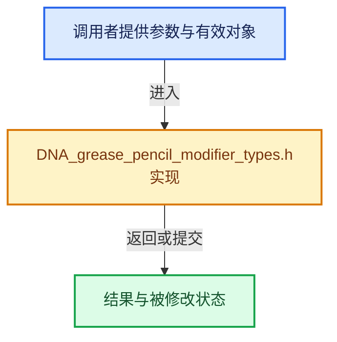

# 实现依赖专题：source/blender/makesdna/DNA_grease_pencil_modifier_types.h

[方向导航](README.md) · [符号索引](../%E7%AC%A6%E5%8F%B7%E4%BE%9D%E8%B5%96%E4%B8%8E%E5%AE%9E%E7%8E%B0%E7%B4%A2%E5%BC%95.md)

本专题从正文实际调用进入，集中保存共享实现。函数有稳定锚点，可从调用处直接跳到对应完整函数；递归与互相调用通过回链组织。

## 本文件的实现关系





## 相关类型布局与成员入口

<a id="t-a87cc2976753"></a>

### `blender::eGpencilModifierSpace`

原始声明：[source/blender/makesdna/DNA_grease_pencil_modifier_types.h](../../../../../source/blender/makesdna/DNA_grease_pencil_modifier_types.h) · L43—L46。

以下保留类的数据声明与编译条件，成员函数实现通过后面的精确链接阅读。

<!-- annotated:851668922f6db7 -->

```cpp
enum eGpencilModifierSpace : int {
  GP_SPACE_LOCAL = 0,
  GP_SPACE_WORLD = 1,
};
```

<details>
<summary>核对原始源码：source/blender/makesdna/DNA_grease_pencil_modifier_types.h · L43—L46</summary>

<!-- original:851668922f6db7:source/blender/makesdna/DNA_grease_pencil_modifier_types.h:43:46 -->

```cpp
enum eGpencilModifierSpace : int {
  GP_SPACE_LOCAL = 0,
  GP_SPACE_WORLD = 1,
};
```

</details>


<a id="t-cd31aa3da735"></a>

### `blender::GpencilModifierType`

原始声明：[source/blender/makesdna/DNA_grease_pencil_modifier_types.h](../../../../../source/blender/makesdna/DNA_grease_pencil_modifier_types.h) · L52—L82。

以下保留类的数据声明与编译条件，成员函数实现通过后面的精确链接阅读。

<!-- annotated:5c20e016f1d028 -->

```cpp
enum GpencilModifierType : int {
  eGpencilModifierType_None = 0,
  eGpencilModifierType_Noise = 1,
  eGpencilModifierType_Subdiv = 2,
  eGpencilModifierType_Thick = 3,
  eGpencilModifierType_Tint = 4,
  eGpencilModifierType_Array = 5,
  eGpencilModifierType_Build = 6,
  eGpencilModifierType_Opacity = 7,
  eGpencilModifierType_Color = 8,
  eGpencilModifierType_Lattice = 9,
  eGpencilModifierType_Simplify = 10,
  eGpencilModifierType_Smooth = 11,
  eGpencilModifierType_Hook = 12,
  eGpencilModifierType_Offset = 13,
  eGpencilModifierType_Mirror = 14,
  eGpencilModifierType_Armature = 15,
  eGpencilModifierType_Time = 16,
  eGpencilModifierType_Multiply = 17,
  eGpencilModifierType_Texture = 18,
  eGpencilModifierType_Lineart = 19,
  eGpencilModifierType_Length = 20,
  eGpencilModifierType_WeightProximity = 21,
  eGpencilModifierType_Dash = 22,
  eGpencilModifierType_WeightAngle = 23,
  eGpencilModifierType_Shrinkwrap = 24,
  eGpencilModifierType_Envelope = 25,
  eGpencilModifierType_Outline = 26,
  /* Keep last. */
  NUM_GREASEPENCIL_MODIFIER_TYPES,
};
```

<details>
<summary>核对原始源码：source/blender/makesdna/DNA_grease_pencil_modifier_types.h · L52—L82</summary>

<!-- original:5c20e016f1d028:source/blender/makesdna/DNA_grease_pencil_modifier_types.h:52:82 -->

```cpp
enum GpencilModifierType : int {
  eGpencilModifierType_None = 0,
  eGpencilModifierType_Noise = 1,
  eGpencilModifierType_Subdiv = 2,
  eGpencilModifierType_Thick = 3,
  eGpencilModifierType_Tint = 4,
  eGpencilModifierType_Array = 5,
  eGpencilModifierType_Build = 6,
  eGpencilModifierType_Opacity = 7,
  eGpencilModifierType_Color = 8,
  eGpencilModifierType_Lattice = 9,
  eGpencilModifierType_Simplify = 10,
  eGpencilModifierType_Smooth = 11,
  eGpencilModifierType_Hook = 12,
  eGpencilModifierType_Offset = 13,
  eGpencilModifierType_Mirror = 14,
  eGpencilModifierType_Armature = 15,
  eGpencilModifierType_Time = 16,
  eGpencilModifierType_Multiply = 17,
  eGpencilModifierType_Texture = 18,
  eGpencilModifierType_Lineart = 19,
  eGpencilModifierType_Length = 20,
  eGpencilModifierType_WeightProximity = 21,
  eGpencilModifierType_Dash = 22,
  eGpencilModifierType_WeightAngle = 23,
  eGpencilModifierType_Shrinkwrap = 24,
  eGpencilModifierType_Envelope = 25,
  eGpencilModifierType_Outline = 26,
  /* Keep last. */
  NUM_GREASEPENCIL_MODIFIER_TYPES,
};
```

</details>


<a id="t-04934acaaafb"></a>

### `blender::eSubdivGpencil_Flag`

原始声明：[source/blender/makesdna/DNA_grease_pencil_modifier_types.h](../../../../../source/blender/makesdna/DNA_grease_pencil_modifier_types.h) · L131—L136。

以下保留类的数据声明与编译条件，成员函数实现通过后面的精确链接阅读。

<!-- annotated:8f4452c4d3b3f4 -->

```cpp
enum eSubdivGpencil_Flag : int {
  GP_SUBDIV_INVERT_LAYER = (1 << 1),
  GP_SUBDIV_INVERT_PASS = (1 << 2),
  GP_SUBDIV_INVERT_LAYERPASS = (1 << 3),
  GP_SUBDIV_INVERT_MATERIAL = (1 << 4),
};
```

<details>
<summary>核对原始源码：source/blender/makesdna/DNA_grease_pencil_modifier_types.h · L131—L136</summary>

<!-- original:8f4452c4d3b3f4:source/blender/makesdna/DNA_grease_pencil_modifier_types.h:131:136 -->

```cpp
enum eSubdivGpencil_Flag : int {
  GP_SUBDIV_INVERT_LAYER = (1 << 1),
  GP_SUBDIV_INVERT_PASS = (1 << 2),
  GP_SUBDIV_INVERT_LAYERPASS = (1 << 3),
  GP_SUBDIV_INVERT_MATERIAL = (1 << 4),
};
```

</details>


<a id="t-6fcbbbc5e3d3"></a>

### `blender::eSubdivGpencil_Type`

原始声明：[source/blender/makesdna/DNA_grease_pencil_modifier_types.h](../../../../../source/blender/makesdna/DNA_grease_pencil_modifier_types.h) · L139—L142。

以下保留类的数据声明与编译条件，成员函数实现通过后面的精确链接阅读。

<!-- annotated:10ed1cdb624377 -->

```cpp
enum eSubdivGpencil_Type : short {
  GP_SUBDIV_CATMULL = 0,
  GP_SUBDIV_SIMPLE = 1,
};
```

<details>
<summary>核对原始源码：source/blender/makesdna/DNA_grease_pencil_modifier_types.h · L139—L142</summary>

<!-- original:10ed1cdb624377:source/blender/makesdna/DNA_grease_pencil_modifier_types.h:139:142 -->

```cpp
enum eSubdivGpencil_Type : short {
  GP_SUBDIV_CATMULL = 0,
  GP_SUBDIV_SIMPLE = 1,
};
```

</details>


<a id="t-ec813cc58a12"></a>

### `blender::eTimeGpencil_Mode`

原始声明：[source/blender/makesdna/DNA_grease_pencil_modifier_types.h](../../../../../source/blender/makesdna/DNA_grease_pencil_modifier_types.h) · L209—L215。

以下保留类的数据声明与编译条件，成员函数实现通过后面的精确链接阅读。

<!-- annotated:a444b05523e24f -->

```cpp
enum eTimeGpencil_Mode : int {
  GP_TIME_MODE_NORMAL = 0,
  GP_TIME_MODE_REVERSE = 1,
  GP_TIME_MODE_FIX = 2,
  GP_TIME_MODE_PINGPONG = 3,
  GP_TIME_MODE_CHAIN = 4,
};
```

<details>
<summary>核对原始源码：source/blender/makesdna/DNA_grease_pencil_modifier_types.h · L209—L215</summary>

<!-- original:a444b05523e24f:source/blender/makesdna/DNA_grease_pencil_modifier_types.h:209:215 -->

```cpp
enum eTimeGpencil_Mode : int {
  GP_TIME_MODE_NORMAL = 0,
  GP_TIME_MODE_REVERSE = 1,
  GP_TIME_MODE_FIX = 2,
  GP_TIME_MODE_PINGPONG = 3,
  GP_TIME_MODE_CHAIN = 4,
};
```

</details>


<a id="t-8560ef9d239e"></a>

### `blender::eTimeGpencil_Seg_Mode`

原始声明：[source/blender/makesdna/DNA_grease_pencil_modifier_types.h](../../../../../source/blender/makesdna/DNA_grease_pencil_modifier_types.h) · L217—L221。

以下保留类的数据声明与编译条件，成员函数实现通过后面的精确链接阅读。

<!-- annotated:01d1ed5c5810c4 -->

```cpp
enum eTimeGpencil_Seg_Mode : int {
  GP_TIME_SEG_MODE_NORMAL = 0,
  GP_TIME_SEG_MODE_REVERSE = 1,
  GP_TIME_SEG_MODE_PINGPONG = 2,
};
```

<details>
<summary>核对原始源码：source/blender/makesdna/DNA_grease_pencil_modifier_types.h · L217—L221</summary>

<!-- original:01d1ed5c5810c4:source/blender/makesdna/DNA_grease_pencil_modifier_types.h:217:221 -->

```cpp
enum eTimeGpencil_Seg_Mode : int {
  GP_TIME_SEG_MODE_NORMAL = 0,
  GP_TIME_SEG_MODE_REVERSE = 1,
  GP_TIME_SEG_MODE_PINGPONG = 2,
};
```

</details>


<a id="t-0b33b28cbe5e"></a>

### `blender::eModifyColorGpencil_Flag`

原始声明：[source/blender/makesdna/DNA_grease_pencil_modifier_types.h](../../../../../source/blender/makesdna/DNA_grease_pencil_modifier_types.h) · L256—L261。

以下保留类的数据声明与编译条件，成员函数实现通过后面的精确链接阅读。

<!-- annotated:37284a4dd9c3ea -->

```cpp
enum eModifyColorGpencil_Flag : char {
  GP_MODIFY_COLOR_BOTH = 0,
  GP_MODIFY_COLOR_STROKE = 1,
  GP_MODIFY_COLOR_FILL = 2,
  GP_MODIFY_COLOR_HARDNESS = 3,
};
```

<details>
<summary>核对原始源码：source/blender/makesdna/DNA_grease_pencil_modifier_types.h · L256—L261</summary>

<!-- original:37284a4dd9c3ea:source/blender/makesdna/DNA_grease_pencil_modifier_types.h:256:261 -->

```cpp
enum eModifyColorGpencil_Flag : char {
  GP_MODIFY_COLOR_BOTH = 0,
  GP_MODIFY_COLOR_STROKE = 1,
  GP_MODIFY_COLOR_FILL = 2,
  GP_MODIFY_COLOR_HARDNESS = 3,
};
```

</details>


<a id="t-006efb8e707a"></a>

### `blender::eHookGpencil_Falloff`

原始声明：[source/blender/makesdna/DNA_grease_pencil_modifier_types.h](../../../../../source/blender/makesdna/DNA_grease_pencil_modifier_types.h) · L662—L672。

以下保留类的数据声明与编译条件，成员函数实现通过后面的精确链接阅读。

<!-- annotated:703cc41e70a635 -->

```cpp
enum eHookGpencil_Falloff : char {
  eGPHook_Falloff_None = 0,
  eGPHook_Falloff_Curve = 1,
  eGPHook_Falloff_Sharp = 2,
  eGPHook_Falloff_Smooth = 3,
  eGPHook_Falloff_Root = 4,
  eGPHook_Falloff_Linear = 5,
  eGPHook_Falloff_Const = 6,
  eGPHook_Falloff_Sphere = 7,
  eGPHook_Falloff_InvSquare = 8,
};
```

<details>
<summary>核对原始源码：source/blender/makesdna/DNA_grease_pencil_modifier_types.h · L662—L672</summary>

<!-- original:703cc41e70a635:source/blender/makesdna/DNA_grease_pencil_modifier_types.h:662:672 -->

```cpp
enum eHookGpencil_Falloff : char {
  eGPHook_Falloff_None = 0,
  eGPHook_Falloff_Curve = 1,
  eGPHook_Falloff_Sharp = 2,
  eGPHook_Falloff_Smooth = 3,
  eGPHook_Falloff_Root = 4,
  eGPHook_Falloff_Linear = 5,
  eGPHook_Falloff_Const = 6,
  eGPHook_Falloff_Sphere = 7,
  eGPHook_Falloff_InvSquare = 8,
};
```

</details>


<a id="t-452f3a8cce62"></a>

### `blender::eOffsetGpencil_Mode`

原始声明：[source/blender/makesdna/DNA_grease_pencil_modifier_types.h](../../../../../source/blender/makesdna/DNA_grease_pencil_modifier_types.h) · L757—L762。

以下保留类的数据声明与编译条件，成员函数实现通过后面的精确链接阅读。

<!-- annotated:bb74a84636433f -->

```cpp
enum eOffsetGpencil_Mode : int {
  GP_OFFSET_RANDOM = 0,
  GP_OFFSET_LAYER = 1,
  GP_OFFSET_MATERIAL = 2,
  GP_OFFSET_STROKE = 3,
};
```

<details>
<summary>核对原始源码：source/blender/makesdna/DNA_grease_pencil_modifier_types.h · L757—L762</summary>

<!-- original:bb74a84636433f:source/blender/makesdna/DNA_grease_pencil_modifier_types.h:757:762 -->

```cpp
enum eOffsetGpencil_Mode : int {
  GP_OFFSET_RANDOM = 0,
  GP_OFFSET_LAYER = 1,
  GP_OFFSET_MATERIAL = 2,
  GP_OFFSET_STROKE = 3,
};
```

</details>


<a id="t-2272e65aa3e5"></a>

### `blender::eTintGpencil_Type`

原始声明：[source/blender/makesdna/DNA_grease_pencil_modifier_types.h](../../../../../source/blender/makesdna/DNA_grease_pencil_modifier_types.h) · L890—L893。

以下保留类的数据声明与编译条件，成员函数实现通过后面的精确链接阅读。

<!-- annotated:aee9e301be79a9 -->

```cpp
enum eTintGpencil_Type : int {
  GP_TINT_UNIFORM = 0,
  GP_TINT_GRADIENT = 1,
};
```

<details>
<summary>核对原始源码：source/blender/makesdna/DNA_grease_pencil_modifier_types.h · L890—L893</summary>

<!-- original:aee9e301be79a9:source/blender/makesdna/DNA_grease_pencil_modifier_types.h:890:893 -->

```cpp
enum eTintGpencil_Type : int {
  GP_TINT_UNIFORM = 0,
  GP_TINT_GRADIENT = 1,
};
```

</details>


<a id="t-3449cf86c440"></a>

### `blender::eTextureGpencil_Mode`

原始声明：[source/blender/makesdna/DNA_grease_pencil_modifier_types.h](../../../../../source/blender/makesdna/DNA_grease_pencil_modifier_types.h) · L949—L953。

以下保留类的数据声明与编译条件，成员函数实现通过后面的精确链接阅读。

<!-- annotated:b3239839661099 -->

```cpp
enum eTextureGpencil_Mode : short {
  STROKE = 0,
  FILL = 1,
  STROKE_AND_FILL = 2,
};
```

<details>
<summary>核对原始源码：source/blender/makesdna/DNA_grease_pencil_modifier_types.h · L949—L953</summary>

<!-- original:b3239839661099:source/blender/makesdna/DNA_grease_pencil_modifier_types.h:949:953 -->

```cpp
enum eTextureGpencil_Mode : short {
  STROKE = 0,
  FILL = 1,
  STROKE_AND_FILL = 2,
};
```

</details>


<a id="t-1ba6437d5fc6"></a>

### `blender::eEnvelopeGpencil_Mode`

原始声明：[source/blender/makesdna/DNA_grease_pencil_modifier_types.h](../../../../../source/blender/makesdna/DNA_grease_pencil_modifier_types.h) · L1225—L1229。

以下保留类的数据声明与编译条件，成员函数实现通过后面的精确链接阅读。

<!-- annotated:f8be67db20a420 -->

```cpp
enum eEnvelopeGpencil_Mode : int {
  GP_ENVELOPE_DEFORM = 0,
  GP_ENVELOPE_SEGMENTS = 1,
  GP_ENVELOPE_FILLS = 2,
};
```

<details>
<summary>核对原始源码：source/blender/makesdna/DNA_grease_pencil_modifier_types.h · L1225—L1229</summary>

<!-- original:f8be67db20a420:source/blender/makesdna/DNA_grease_pencil_modifier_types.h:1225:1229 -->

```cpp
enum eEnvelopeGpencil_Mode : int {
  GP_ENVELOPE_DEFORM = 0,
  GP_ENVELOPE_SEGMENTS = 1,
  GP_ENVELOPE_FILLS = 2,
};
```

</details>


## 完整成员与函数实现
