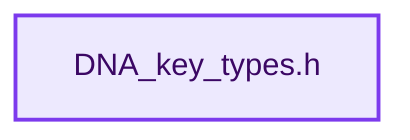
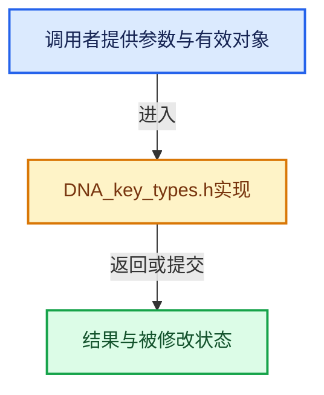

# 实现依赖专题：source/blender/makesdna/DNA_key_types.h

[方向导航](README.md) · [符号索引](../%E7%AC%A6%E5%8F%B7%E4%BE%9D%E8%B5%96%E4%B8%8E%E5%AE%9E%E7%8E%B0%E7%B4%A2%E5%BC%95.md)

本专题从正文实际调用进入，集中保存共享实现。函数有稳定锚点，可从调用处直接跳到对应完整函数；递归与互相调用通过回链组织。

## 本文件的实现关系






## 相关类型布局与成员入口

<a id="t-9992054eaf23"></a>

### `blender::KeyInterpolationType`

原始声明：[source/blender/makesdna/DNA_key_types.h](../../../../../source/blender/makesdna/DNA_key_types.h) · L40—L45。

以下保留类的数据声明与编译条件，成员函数实现通过后面的精确链接阅读。

<!-- annotated:e3f48d41294c4a -->

```cpp
enum KeyInterpolationType : short {
  KEY_LINEAR = 0,
  KEY_CARDINAL = 1,
  KEY_BSPLINE = 2,
  KEY_CATMULL_ROM = 3,
};
```

<details>
<summary>核对原始源码：source/blender/makesdna/DNA_key_types.h · L40—L45</summary>

<!-- original:e3f48d41294c4a:source/blender/makesdna/DNA_key_types.h:40:45 -->

```cpp
enum KeyInterpolationType : short {
  KEY_LINEAR = 0,
  KEY_CARDINAL = 1,
  KEY_BSPLINE = 2,
  KEY_CATMULL_ROM = 3,
};
```

</details>


<a id="t-5af61269bbd5"></a>

### `blender::Key`

原始声明：[source/blender/makesdna/DNA_key_types.h](../../../../../source/blender/makesdna/DNA_key_types.h) · L108—L155。

成员布局：

- `ID_Type id_type`
- `ID id`
- `struct AnimData adt`
- `KeyBlock refkey`
- `char elemstr`
- `int elemsize`
- `char _pad`
- `ListBaseT<KeyBlock> block`
- `ID from`
- `int totkey`
- `ShapekeyContainerFlag flag`
- `ShapekeyContainerType type`
- `char _pad2`
- `float ctime`
- `int uidgen`

以下保留类的数据声明与编译条件，成员函数实现通过后面的精确链接阅读。

<!-- annotated:d01eec5e8f4abd -->

```cpp
struct Key {
#ifdef __cplusplus
  /** See #ID_Type comment for why this is here. */
  static constexpr ID_Type id_type = ID_KE;
#endif

  ID id;
  /** Animation data (must be immediately after id for utilities to use it). */
  struct AnimData *adt = nullptr;

  /**
   * Commonly called 'Basis', `(Key::type == KEY_RELATIVE)` only.
   * Looks like this is _always_ 'key->block.first',
   * perhaps later on it could be defined as some other KeyBlock - campbell.
   */
  KeyBlock *refkey = nullptr;

  /**
   * This is not a regular string, although it is \0 terminated
   * this is an array of (element_array_size, element_type) pairs
   * (each one char) used for calculating shape key-blocks. */
  char elemstr[32] = "";
  /** Size of each element in #KeyBlock.data, use for allocation and stride. */
  int elemsize = 0;
  char _pad[4] = {};

  /** A list of KeyBlock's. */
  ListBaseT<KeyBlock> block = {nullptr, nullptr};

  ID *from = nullptr;

  /** (totkey == key->block.count()). */
  int totkey = 0;
  ShapekeyContainerFlag flag = {};
  /** Absolute or relative shape key. */
  ShapekeyContainerType type = KEY_NORMAL;
  char _pad2 = {};

  /** Only used when (Key::type == KEY_NORMAL), this value is used as a time slider,
   * rather than using the scene's time, this value can be animated to give greater control */
  float ctime = 0;

  /**
   * Can never be 0, this is used for detecting old data.
   * current free UID for key-blocks.
   */
  int uidgen = 0;
};
```

<details>
<summary>核对原始源码：source/blender/makesdna/DNA_key_types.h · L108—L155</summary>

<!-- original:d01eec5e8f4abd:source/blender/makesdna/DNA_key_types.h:108:155 -->

```cpp
struct Key {
#ifdef __cplusplus
  /** See #ID_Type comment for why this is here. */
  static constexpr ID_Type id_type = ID_KE;
#endif

  ID id;
  /** Animation data (must be immediately after id for utilities to use it). */
  struct AnimData *adt = nullptr;

  /**
   * Commonly called 'Basis', `(Key::type == KEY_RELATIVE)` only.
   * Looks like this is _always_ 'key->block.first',
   * perhaps later on it could be defined as some other KeyBlock - campbell.
   */
  KeyBlock *refkey = nullptr;

  /**
   * This is not a regular string, although it is \0 terminated
   * this is an array of (element_array_size, element_type) pairs
   * (each one char) used for calculating shape key-blocks. */
  char elemstr[32] = "";
  /** Size of each element in #KeyBlock.data, use for allocation and stride. */
  int elemsize = 0;
  char _pad[4] = {};

  /** A list of KeyBlock's. */
  ListBaseT<KeyBlock> block = {nullptr, nullptr};

  ID *from = nullptr;

  /** (totkey == key->block.count()). */
  int totkey = 0;
  ShapekeyContainerFlag flag = {};
  /** Absolute or relative shape key. */
  ShapekeyContainerType type = KEY_NORMAL;
  char _pad2 = {};

  /** Only used when (Key::type == KEY_NORMAL), this value is used as a time slider,
   * rather than using the scene's time, this value can be animated to give greater control */
  float ctime = 0;

  /**
   * Can never be 0, this is used for detecting old data.
   * current free UID for key-blocks.
   */
  int uidgen = 0;
};
```

</details>


## 完整成员与函数实现
