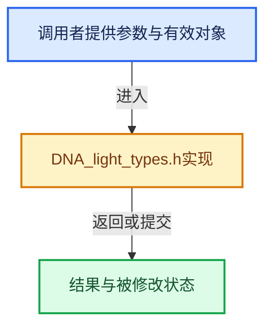

# 实现依赖专题：source/blender/makesdna/DNA_light_types.h

[方向导航](README.md) · [符号索引](../%E7%AC%A6%E5%8F%B7%E4%BE%9D%E8%B5%96%E4%B8%8E%E5%AE%9E%E7%8E%B0%E7%B4%A2%E5%BC%95.md)

本专题从正文实际调用进入，集中保存共享实现。函数有稳定锚点，可从调用处直接跳到对应完整函数；递归与互相调用通过回链组织。

## 本文件的实现关系





## 相关类型布局与成员入口

<a id="t-6c2e99fc7874"></a>

### `blender::eLight_Mode`

原始声明：[source/blender/makesdna/DNA_light_types.h](../../../../../source/blender/makesdna/DNA_light_types.h) · L47—L79。

以下保留类的数据声明与编译条件，成员函数实现通过后面的精确链接阅读。

<!-- annotated:e8f3fba5223c33 -->

```cpp
enum eLight_Mode : int {
  LA_SHADOW = 1 << 0,
  // LA_HALO = 1 << 1, /* Deprecated. */
  // LA_LAYER = 1 << 2, /* Deprecated. */
  // LA_QUAD = 1 << 3, /* Deprecated. */
  // LA_NEG = 1 << 4, /* Deprecated. */
  // LA_ONLYSHADOW = 1 << 5, /* Deprecated. */
  // LA_SPHERE = 1 << 6, /* Deprecated. */
  LA_SQUARE = 1 << 7,
  // LA_TEXTURE = 1 << 8, /* Deprecated. */
  // LA_OSATEX = 1 << 9, /* Deprecated. */
  // LA_DEEP_SHADOW = 1 << 10, /* Deprecated. */
  // LA_NO_DIFF = 1 << 11, /* Deprecated. */
  // LA_NO_SPEC = 1 << 12, /* Deprecated. */
  LA_SHAD_RAY = 1 << 13, /* Deprecated, cleaned. */
  /**
   * YAFRAY: light shadow-buffer flag, soft-light.
   * Since it is used with LOCAL light, can't use LA_SHAD.
   */
  // LA_YF_SOFT = 1 << 14, /* Deprecated. */
  // LA_LAYER_SHADOW = 1 << 15, /* Deprecated. */
  // LA_SHAD_TEX = 1 << 16, /* Deprecated. */
  LA_SHOW_CONE = 1 << 17,
  // LA_SHOW_SHADOW_BOX = 1 << 18,
  // LA_SHAD_CONTACT = 1 << 19, /* Deprecated. */
  LA_CUSTOM_ATTENUATION = 1 << 20,
  LA_USE_SOFT_FALLOFF = 1 << 21,
  /** Use absolute resolution clamping instead of relative. */
  LA_SHAD_RES_ABSOLUTE = 1 << 22,
  LA_SHADOW_JITTER = 1 << 23,
  LA_USE_TEMPERATURE = 1 << 24,
  LA_UNNORMALIZED = 1 << 25,
};
```

<details>
<summary>核对原始源码：source/blender/makesdna/DNA_light_types.h · L47—L79</summary>

<!-- original:e8f3fba5223c33:source/blender/makesdna/DNA_light_types.h:47:79 -->

```cpp
enum eLight_Mode : int {
  LA_SHADOW = 1 << 0,
  // LA_HALO = 1 << 1, /* Deprecated. */
  // LA_LAYER = 1 << 2, /* Deprecated. */
  // LA_QUAD = 1 << 3, /* Deprecated. */
  // LA_NEG = 1 << 4, /* Deprecated. */
  // LA_ONLYSHADOW = 1 << 5, /* Deprecated. */
  // LA_SPHERE = 1 << 6, /* Deprecated. */
  LA_SQUARE = 1 << 7,
  // LA_TEXTURE = 1 << 8, /* Deprecated. */
  // LA_OSATEX = 1 << 9, /* Deprecated. */
  // LA_DEEP_SHADOW = 1 << 10, /* Deprecated. */
  // LA_NO_DIFF = 1 << 11, /* Deprecated. */
  // LA_NO_SPEC = 1 << 12, /* Deprecated. */
  LA_SHAD_RAY = 1 << 13, /* Deprecated, cleaned. */
  /**
   * YAFRAY: light shadow-buffer flag, soft-light.
   * Since it is used with LOCAL light, can't use LA_SHAD.
   */
  // LA_YF_SOFT = 1 << 14, /* Deprecated. */
  // LA_LAYER_SHADOW = 1 << 15, /* Deprecated. */
  // LA_SHAD_TEX = 1 << 16, /* Deprecated. */
  LA_SHOW_CONE = 1 << 17,
  // LA_SHOW_SHADOW_BOX = 1 << 18,
  // LA_SHAD_CONTACT = 1 << 19, /* Deprecated. */
  LA_CUSTOM_ATTENUATION = 1 << 20,
  LA_USE_SOFT_FALLOFF = 1 << 21,
  /** Use absolute resolution clamping instead of relative. */
  LA_SHAD_RES_ABSOLUTE = 1 << 22,
  LA_SHADOW_JITTER = 1 << 23,
  LA_USE_TEMPERATURE = 1 << 24,
  LA_UNNORMALIZED = 1 << 25,
};
```

</details>


## 完整成员与函数实现
