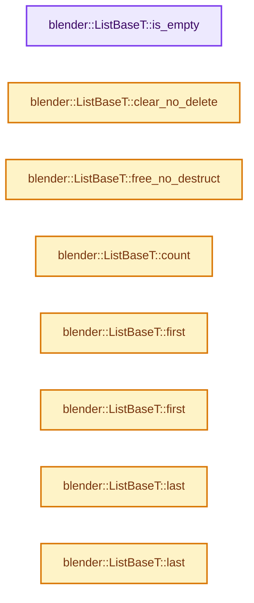
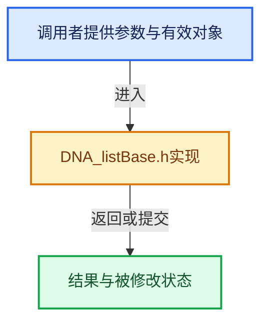

# 实现依赖专题：source/blender/makesdna/DNA_listBase.h

[方向导航](README.md) · [符号索引](../%E7%AC%A6%E5%8F%B7%E4%BE%9D%E8%B5%96%E4%B8%8E%E5%AE%9E%E7%8E%B0%E7%B4%A2%E5%BC%95.md)

本专题从正文实际调用进入，集中保存共享实现。函数有稳定锚点，可从调用处直接跳到对应完整函数；递归与互相调用通过回链组织。

## 本文件的实现关系






## 完整成员与函数实现

<a id="f-189938e5bf0f989b"></a>

### `blender::ListBaseT::is_empty`

实现位置：[source/blender/makesdna/DNA_listBase.h](../../../../../source/blender/makesdna/DNA_listBase.h) · L54—L57。

**教学注释版**

<!-- annotated:8ed2ab80c9fff3 -->

```cpp
  bool is_empty() const
  {
    return this->first_ == nullptr;
  }
```

<details>
<summary>核对原始源码：source/blender/makesdna/DNA_listBase.h · L54—L57</summary>

<!-- original:8ed2ab80c9fff3:source/blender/makesdna/DNA_listBase.h:54:57 -->

```cpp
  bool is_empty() const
  {
    return this->first_ == nullptr;
  }
```

</details>

**结果出口**

- `return this->first_ == nullptr;`

**继续追踪实现**

本实现没有需要继续展开的显式调用；检查返回表达式、对象转换和调用者前置条件。

<a id="f-431defdf189ae643"></a>

### `blender::ListBaseT::clear_no_delete`

实现位置：[source/blender/makesdna/DNA_listBase.h](../../../../../source/blender/makesdna/DNA_listBase.h) · L68—L72。

**教学注释版**

<!-- annotated:bb748a36a917e1 -->

```cpp
  void clear_no_delete()
  {
    this->first_ = nullptr;
    this->last_ = nullptr;
  }
```

<details>
<summary>核对原始源码：source/blender/makesdna/DNA_listBase.h · L68—L72</summary>

<!-- original:bb748a36a917e1:source/blender/makesdna/DNA_listBase.h:68:72 -->

```cpp
  void clear_no_delete()
  {
    this->first_ = nullptr;
    this->last_ = nullptr;
  }
```

</details>

**沿实际写入检查状态**

- `this->first_ = nullptr;`
- `this->last_ = nullptr;`

**继续追踪实现**

本实现没有需要继续展开的显式调用；检查返回表达式、对象转换和调用者前置条件。

<a id="f-8656670edd0f6b7e"></a>

### `blender::ListBaseT::free_no_destruct`

实现位置：[source/blender/makesdna/DNA_listBase.h](../../../../../source/blender/makesdna/DNA_listBase.h) · L78—L87。

**教学注释版**

<!-- annotated:8eeab14956d200 -->

```cpp
  void free_no_destruct()
  {
    static_assert(std::is_trivially_destructible_v<T>,
                  "Items with a non-trivial destructor have to be freed separately");
    for (T &item : this->items_mutable()) {
      MEM_delete(&item);
    }
    this->first_ = nullptr;
    this->last_ = nullptr;
  }
```

<details>
<summary>核对原始源码：source/blender/makesdna/DNA_listBase.h · L78—L87</summary>

<!-- original:8eeab14956d200:source/blender/makesdna/DNA_listBase.h:78:87 -->

```cpp
  void free_no_destruct()
  {
    static_assert(std::is_trivially_destructible_v<T>,
                  "Items with a non-trivial destructor have to be freed separately");
    for (T &item : this->items_mutable()) {
      MEM_delete(&item);
    }
    this->first_ = nullptr;
    this->last_ = nullptr;
  }
```

</details>

**沿实际写入检查状态**

- `this->first_ = nullptr;`
- `this->last_ = nullptr;`

**继续追踪实现**

- `this->items_mutable` → [blender::ListBaseT::items_mutable · L163](%E4%BE%9D%E8%B5%96-DNA_listBase-48dbc9.md#f-cc603252f543d4ad)。
- `MEM_delete` → [MEM_delete · L400](../03-%E5%86%85%E5%AD%98%E5%88%86%E9%85%8D%E4%B8%8E%E8%BF%90%E8%A1%8C%E6%97%B6%E7%B1%BB%E5%9E%8B/%E4%BE%9D%E8%B5%96-MEM_guardedalloc-b54eca.md#f-9049ffdd1682887c)。

<a id="f-7d243d006ac4c693"></a>

### `blender::ListBaseT::count`

实现位置：[source/blender/makesdna/DNA_listBase.h](../../../../../source/blender/makesdna/DNA_listBase.h) · L92—L99。

**教学注释版**

<!-- annotated:1e1a39b1e473e5 -->

```cpp
  int count() const
  {
    int count = 0;
    for ([[maybe_unused]] const T &item : *this) {
      count++;
    }
    return count;
  }
```

<details>
<summary>核对原始源码：source/blender/makesdna/DNA_listBase.h · L92—L99</summary>

<!-- original:1e1a39b1e473e5:source/blender/makesdna/DNA_listBase.h:92:99 -->

```cpp
  int count() const
  {
    int count = 0;
    for ([[maybe_unused]] const T &item : *this) {
      count++;
    }
    return count;
  }
```

</details>

**结果出口**

- `return count;`

**继续追踪实现**

本实现没有需要继续展开的显式调用；检查返回表达式、对象转换和调用者前置条件。

<a id="f-3d12ff35da057c9e"></a>

### `blender::ListBaseT::first`

实现位置：[source/blender/makesdna/DNA_listBase.h](../../../../../source/blender/makesdna/DNA_listBase.h) · L102—L105。

**教学注释版**

<!-- annotated:c77de60146034c -->

```cpp
  T *first() const
  {
    return static_cast<T *>(this->first_);
  }
```

<details>
<summary>核对原始源码：source/blender/makesdna/DNA_listBase.h · L102—L105</summary>

<!-- original:c77de60146034c:source/blender/makesdna/DNA_listBase.h:102:105 -->

```cpp
  T *first() const
  {
    return static_cast<T *>(this->first_);
  }
```

</details>

**结果出口**

- `return static_cast<T *>(this->first_);`

**继续追踪实现**

本实现没有需要继续展开的显式调用；检查返回表达式、对象转换和调用者前置条件。

<a id="f-0df87c3480e059f9"></a>

### `blender::ListBaseT::first`

实现位置：[source/blender/makesdna/DNA_listBase.h](../../../../../source/blender/makesdna/DNA_listBase.h) · L106—L109。

**教学注释版**

<!-- annotated:20eec1e3d8b172 -->

```cpp
  T *first()
  {
    return static_cast<T *>(this->first_);
  }
```

<details>
<summary>核对原始源码：source/blender/makesdna/DNA_listBase.h · L106—L109</summary>

<!-- original:20eec1e3d8b172:source/blender/makesdna/DNA_listBase.h:106:109 -->

```cpp
  T *first()
  {
    return static_cast<T *>(this->first_);
  }
```

</details>

**结果出口**

- `return static_cast<T *>(this->first_);`

**继续追踪实现**

本实现没有需要继续展开的显式调用；检查返回表达式、对象转换和调用者前置条件。

<a id="f-7b7d35c25b6d06a4"></a>

### `blender::ListBaseT::last`

实现位置：[source/blender/makesdna/DNA_listBase.h](../../../../../source/blender/makesdna/DNA_listBase.h) · L110—L113。

**教学注释版**

<!-- annotated:0dd6baa5e0d5bb -->

```cpp
  T *last() const
  {
    return static_cast<T *>(this->last_);
  }
```

<details>
<summary>核对原始源码：source/blender/makesdna/DNA_listBase.h · L110—L113</summary>

<!-- original:0dd6baa5e0d5bb:source/blender/makesdna/DNA_listBase.h:110:113 -->

```cpp
  T *last() const
  {
    return static_cast<T *>(this->last_);
  }
```

</details>

**结果出口**

- `return static_cast<T *>(this->last_);`

**继续追踪实现**

本实现没有需要继续展开的显式调用；检查返回表达式、对象转换和调用者前置条件。

<a id="f-1376db91ee7f5ddb"></a>

### `blender::ListBaseT::last`

实现位置：[source/blender/makesdna/DNA_listBase.h](../../../../../source/blender/makesdna/DNA_listBase.h) · L114—L117。

**教学注释版**

<!-- annotated:7e56541e84946f -->

```cpp
  T *last()
  {
    return static_cast<T *>(this->last_);
  }
```

<details>
<summary>核对原始源码：source/blender/makesdna/DNA_listBase.h · L114—L117</summary>

<!-- original:7e56541e84946f:source/blender/makesdna/DNA_listBase.h:114:117 -->

```cpp
  T *last()
  {
    return static_cast<T *>(this->last_);
  }
```

</details>

**结果出口**

- `return static_cast<T *>(this->last_);`

**继续追踪实现**

本实现没有需要继续展开的显式调用；检查返回表达式、对象转换和调用者前置条件。

<a id="f-73544c49caea6d30"></a>

### `blender::ListBaseT::enumerate`

实现位置：[source/blender/makesdna/DNA_listBase.h](../../../../../source/blender/makesdna/DNA_listBase.h) · L152—L155。

**教学注释版**

<!-- annotated:9df7e6bbf2ebbc -->

```cpp
  ListBaseEnumerateWrapper<T> enumerate()
  {
    return {this->first_};
  }
```

<details>
<summary>核对原始源码：source/blender/makesdna/DNA_listBase.h · L152—L155</summary>

<!-- original:9df7e6bbf2ebbc:source/blender/makesdna/DNA_listBase.h:152:155 -->

```cpp
  ListBaseEnumerateWrapper<T> enumerate()
  {
    return {this->first_};
  }
```

</details>

**结果出口**

- `return {this->first_};`

**继续追踪实现**

本实现没有需要继续展开的显式调用；检查返回表达式、对象转换和调用者前置条件。

<a id="f-b4ef4f7169c0afd0"></a>

### `blender::ListBaseT::enumerate`

实现位置：[source/blender/makesdna/DNA_listBase.h](../../../../../source/blender/makesdna/DNA_listBase.h) · L157—L160。

**教学注释版**

<!-- annotated:d23477a152a222 -->

```cpp
  ListBaseEnumerateWrapper<const T> enumerate() const
  {
    return {this->first_};
  }
```

<details>
<summary>核对原始源码：source/blender/makesdna/DNA_listBase.h · L157—L160</summary>

<!-- original:d23477a152a222:source/blender/makesdna/DNA_listBase.h:157:160 -->

```cpp
  ListBaseEnumerateWrapper<const T> enumerate() const
  {
    return {this->first_};
  }
```

</details>

**结果出口**

- `return {this->first_};`

**继续追踪实现**

本实现没有需要继续展开的显式调用；检查返回表达式、对象转换和调用者前置条件。

<a id="f-cc603252f543d4ad"></a>

### `blender::ListBaseT::items_mutable`

实现位置：[source/blender/makesdna/DNA_listBase.h](../../../../../source/blender/makesdna/DNA_listBase.h) · L163—L166。

**教学注释版**

<!-- annotated:75327c99ad5e20 -->

```cpp
  ListBaseMutableWrapper<T> items_mutable()
  {
    return {this->first_};
  }
```

<details>
<summary>核对原始源码：source/blender/makesdna/DNA_listBase.h · L163—L166</summary>

<!-- original:75327c99ad5e20:source/blender/makesdna/DNA_listBase.h:163:166 -->

```cpp
  ListBaseMutableWrapper<T> items_mutable()
  {
    return {this->first_};
  }
```

</details>

**结果出口**

- `return {this->first_};`

**继续追踪实现**

本实现没有需要继续展开的显式调用；检查返回表达式、对象转换和调用者前置条件。

<a id="f-b3e66527a9d65d3d"></a>

### `blender::ListBaseT::items_reversed`

实现位置：[source/blender/makesdna/DNA_listBase.h](../../../../../source/blender/makesdna/DNA_listBase.h) · L169—L172。

**教学注释版**

<!-- annotated:668675d6d47fa5 -->

```cpp
  ListBaseBackwardWrapper<T> items_reversed()
  {
    return {this->last_};
  }
```

<details>
<summary>核对原始源码：source/blender/makesdna/DNA_listBase.h · L169—L172</summary>

<!-- original:668675d6d47fa5:source/blender/makesdna/DNA_listBase.h:169:172 -->

```cpp
  ListBaseBackwardWrapper<T> items_reversed()
  {
    return {this->last_};
  }
```

</details>

**结果出口**

- `return {this->last_};`

**继续追踪实现**

本实现没有需要继续展开的显式调用；检查返回表达式、对象转换和调用者前置条件。

<a id="f-46ee6c76cb55120e"></a>

### `blender::ListBaseT::items_reversed`

实现位置：[source/blender/makesdna/DNA_listBase.h](../../../../../source/blender/makesdna/DNA_listBase.h) · L174—L177。

**教学注释版**

<!-- annotated:6f7f816d6f3423 -->

```cpp
  ListBaseBackwardWrapper<const T> items_reversed() const
  {
    return {this->last_};
  }
```

<details>
<summary>核对原始源码：source/blender/makesdna/DNA_listBase.h · L174—L177</summary>

<!-- original:6f7f816d6f3423:source/blender/makesdna/DNA_listBase.h:174:177 -->

```cpp
  ListBaseBackwardWrapper<const T> items_reversed() const
  {
    return {this->last_};
  }
```

</details>

**结果出口**

- `return {this->last_};`

**继续追踪实现**

本实现没有需要继续展开的显式调用；检查返回表达式、对象转换和调用者前置条件。

<a id="f-3ed7e795eed6a902"></a>

### `blender::ListBaseT::cast`

实现位置：[source/blender/makesdna/DNA_listBase.h](../../../../../source/blender/makesdna/DNA_listBase.h) · L186—L189。

**教学注释版**

<!-- annotated:1814de108b9b40 -->

```cpp
  template<typename OtherT> const ListBaseT<OtherT> &cast() const
  {
    return *reinterpret_cast<const ListBaseT<OtherT> *>(this);
  }
```

<details>
<summary>核对原始源码：source/blender/makesdna/DNA_listBase.h · L186—L189</summary>

<!-- original:1814de108b9b40:source/blender/makesdna/DNA_listBase.h:186:189 -->

```cpp
  template<typename OtherT> const ListBaseT<OtherT> &cast() const
  {
    return *reinterpret_cast<const ListBaseT<OtherT> *>(this);
  }
```

</details>

**结果出口**

- `return *reinterpret_cast<const ListBaseT<OtherT> *>(this);`

**继续追踪实现**

本实现没有需要继续展开的显式调用；检查返回表达式、对象转换和调用者前置条件。

<a id="f-82b47073c05302b7"></a>

### `blender::ListBaseT::cast`

实现位置：[source/blender/makesdna/DNA_listBase.h](../../../../../source/blender/makesdna/DNA_listBase.h) · L191—L194。

**教学注释版**

<!-- annotated:dfce854a6b364c -->

```cpp
  template<typename OtherT> ListBaseT<OtherT> &cast()
  {
    return *reinterpret_cast<ListBaseT<OtherT> *>(this);
  }
```

<details>
<summary>核对原始源码：source/blender/makesdna/DNA_listBase.h · L191—L194</summary>

<!-- original:dfce854a6b364c:source/blender/makesdna/DNA_listBase.h:191:194 -->

```cpp
  template<typename OtherT> ListBaseT<OtherT> &cast()
  {
    return *reinterpret_cast<ListBaseT<OtherT> *>(this);
  }
```

</details>

**结果出口**

- `return *reinterpret_cast<ListBaseT<OtherT> *>(this);`

**继续追踪实现**

本实现没有需要继续展开的显式调用；检查返回表达式、对象转换和调用者前置条件。
