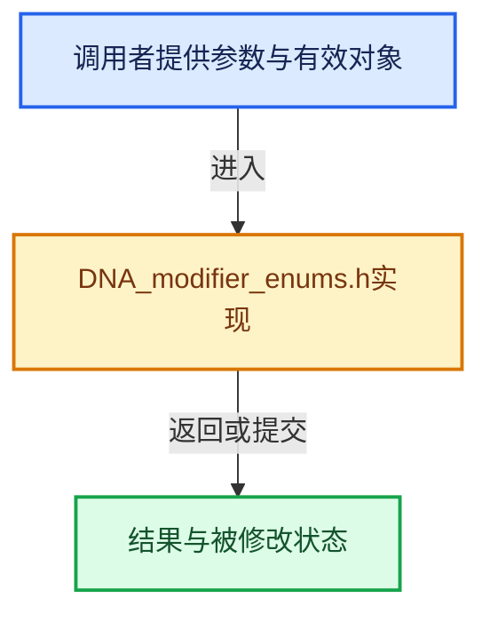

# 实现依赖专题：source/blender/makesdna/DNA_modifier_enums.h

[方向导航](README.md) · [符号索引](../%E7%AC%A6%E5%8F%B7%E4%BE%9D%E8%B5%96%E4%B8%8E%E5%AE%9E%E7%8E%B0%E7%B4%A2%E5%BC%95.md)

本专题从正文实际调用进入，集中保存共享实现。函数有稳定锚点，可从调用处直接跳到对应完整函数；递归与互相调用通过回链组织。

## 本文件的实现关系





## 相关类型布局与成员入口

<a id="t-81e9c0cbefa9"></a>

### `blender::eTextureGpencil_Fit`

原始声明：[source/blender/makesdna/DNA_modifier_enums.h](../../../../../source/blender/makesdna/DNA_modifier_enums.h) · L30—L33。

以下保留类的数据声明与编译条件，成员函数实现通过后面的精确链接阅读。

<!-- annotated:2fa8e0ca220729 -->

```cpp
enum eTextureGpencil_Fit : short {
  GP_TEX_FIT_STROKE = 0,
  GP_TEX_CONSTANT_LENGTH = 1,
};
```

<details>
<summary>核对原始源码：source/blender/makesdna/DNA_modifier_enums.h · L30—L33</summary>

<!-- original:2fa8e0ca220729:source/blender/makesdna/DNA_modifier_enums.h:30:33 -->

```cpp
enum eTextureGpencil_Fit : short {
  GP_TEX_FIT_STROKE = 0,
  GP_TEX_CONSTANT_LENGTH = 1,
};
```

</details>


<a id="m-dfd5a2276cdd"></a>

## 宏 `DT_DATATYPE_IS_VERT`

<!-- annotated:a10bd72a13c5fe -->

```cpp
#define DT_DATATYPE_IS_VERT(_dt) \
  ELEM(_dt, \
       DT_TYPE_MDEFORMVERT, \
       DT_TYPE_SKIN, \
       DT_TYPE_BWEIGHT_VERT, \
       DT_TYPE_MLOOPCOL_VERT, \
       DT_TYPE_MPROPCOL_VERT, \
       DT_TYPE_MPROPCOL_VERT | DT_TYPE_MLOOPCOL_VERT)
#define DT_DATATYPE_IS_EDGE(_dt) \
```

<details>
<summary>核对原始源码：source/blender/makesdna/DNA_modifier_enums.h · L165—L173</summary>

<!-- original:a10bd72a13c5fe:source/blender/makesdna/DNA_modifier_enums.h:165:173 -->

```cpp
#define DT_DATATYPE_IS_VERT(_dt) \
  ELEM(_dt, \
       DT_TYPE_MDEFORMVERT, \
       DT_TYPE_SKIN, \
       DT_TYPE_BWEIGHT_VERT, \
       DT_TYPE_MLOOPCOL_VERT, \
       DT_TYPE_MPROPCOL_VERT, \
       DT_TYPE_MPROPCOL_VERT | DT_TYPE_MLOOPCOL_VERT)
#define DT_DATATYPE_IS_EDGE(_dt) \
```

</details>

宏在预处理阶段展开，参数替换、重复求值和条件编译应直接从该定义检查。与普通函数不同，宏不会自动提供参数类型检查；构建配置选择哪个定义需结合外围条件。

<a id="m-1d72abc7a4bd"></a>

## 宏 `DT_DATATYPE_IS_EDGE`

<!-- annotated:b729502c95cc03 -->

```cpp
#define DT_DATATYPE_IS_EDGE(_dt) \
  ELEM(_dt, \
       DT_TYPE_CREASE, \
       DT_TYPE_SHARP_EDGE, \
       DT_TYPE_SEAM, \
       DT_TYPE_BWEIGHT_EDGE, \
       DT_TYPE_FREESTYLE_EDGE)
#define DT_DATATYPE_IS_LOOP(_dt) \
```

<details>
<summary>核对原始源码：source/blender/makesdna/DNA_modifier_enums.h · L173—L180</summary>

<!-- original:b729502c95cc03:source/blender/makesdna/DNA_modifier_enums.h:173:180 -->

```cpp
#define DT_DATATYPE_IS_EDGE(_dt) \
  ELEM(_dt, \
       DT_TYPE_CREASE, \
       DT_TYPE_SHARP_EDGE, \
       DT_TYPE_SEAM, \
       DT_TYPE_BWEIGHT_EDGE, \
       DT_TYPE_FREESTYLE_EDGE)
#define DT_DATATYPE_IS_LOOP(_dt) \
```

</details>

宏在预处理阶段展开，参数替换、重复求值和条件编译应直接从该定义检查。与普通函数不同，宏不会自动提供参数类型检查；构建配置选择哪个定义需结合外围条件。

<a id="m-d83f51ace117"></a>

## 宏 `DT_DATATYPE_IS_LOOP`

<!-- annotated:87103d9f897a25 -->

```cpp
#define DT_DATATYPE_IS_LOOP(_dt) \
  ELEM(_dt, \
       DT_TYPE_UV, \
       DT_TYPE_LNOR, \
       DT_TYPE_MLOOPCOL_LOOP, \
       DT_TYPE_MPROPCOL_LOOP, \
       DT_TYPE_MPROPCOL_LOOP | DT_TYPE_MLOOPCOL_LOOP)
#define DT_DATATYPE_IS_FACE(_dt) ELEM(_dt, DT_TYPE_UV, DT_TYPE_SHARP_FACE, DT_TYPE_FREESTYLE_FACE)
```

<details>
<summary>核对原始源码：source/blender/makesdna/DNA_modifier_enums.h · L180—L187</summary>

<!-- original:87103d9f897a25:source/blender/makesdna/DNA_modifier_enums.h:180:187 -->

```cpp
#define DT_DATATYPE_IS_LOOP(_dt) \
  ELEM(_dt, \
       DT_TYPE_UV, \
       DT_TYPE_LNOR, \
       DT_TYPE_MLOOPCOL_LOOP, \
       DT_TYPE_MPROPCOL_LOOP, \
       DT_TYPE_MPROPCOL_LOOP | DT_TYPE_MLOOPCOL_LOOP)
#define DT_DATATYPE_IS_FACE(_dt) ELEM(_dt, DT_TYPE_UV, DT_TYPE_SHARP_FACE, DT_TYPE_FREESTYLE_FACE)
```

</details>

宏在预处理阶段展开，参数替换、重复求值和条件编译应直接从该定义检查。与普通函数不同，宏不会自动提供参数类型检查；构建配置选择哪个定义需结合外围条件。

<a id="m-12271712e8ea"></a>

## 宏 `DT_DATATYPE_IS_FACE`

<!-- annotated:524fc0f8437835 -->

```cpp
#define DT_DATATYPE_IS_FACE(_dt) ELEM(_dt, DT_TYPE_UV, DT_TYPE_SHARP_FACE, DT_TYPE_FREESTYLE_FACE)
#define DT_DATATYPE_IS_MULTILAYERS(_dt) \
```

<details>
<summary>核对原始源码：source/blender/makesdna/DNA_modifier_enums.h · L187—L188</summary>

<!-- original:524fc0f8437835:source/blender/makesdna/DNA_modifier_enums.h:187:188 -->

```cpp
#define DT_DATATYPE_IS_FACE(_dt) ELEM(_dt, DT_TYPE_UV, DT_TYPE_SHARP_FACE, DT_TYPE_FREESTYLE_FACE)
#define DT_DATATYPE_IS_MULTILAYERS(_dt) \
```

</details>

宏在预处理阶段展开，参数替换、重复求值和条件编译应直接从该定义检查。与普通函数不同，宏不会自动提供参数类型检查；构建配置选择哪个定义需结合外围条件。

## 完整成员与函数实现
