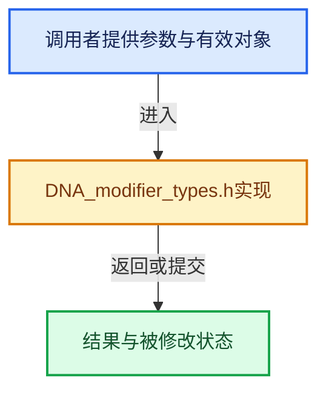

# 实现依赖专题：source/blender/makesdna/DNA_modifier_types.h

[方向导航](README.md) · [符号索引](../%E7%AC%A6%E5%8F%B7%E4%BE%9D%E8%B5%96%E4%B8%8E%E5%AE%9E%E7%8E%B0%E7%B4%A2%E5%BC%95.md)

本专题从正文实际调用进入，集中保存共享实现。函数有稳定锚点，可从调用处直接跳到对应完整函数；递归与互相调用通过回链组织。

## 本文件的实现关系





## 相关类型布局与成员入口

<a id="t-319e36205f63"></a>

### `blender::ModifierType`

原始声明：[source/blender/makesdna/DNA_modifier_types.h](../../../../../source/blender/makesdna/DNA_modifier_types.h) · L38—L129。

以下保留类的数据声明与编译条件，成员函数实现通过后面的精确链接阅读。

<!-- annotated:071728ace50499 -->

```cpp
enum ModifierType : int {
  eModifierType_None = 0,
  eModifierType_Subsurf = 1,
  eModifierType_Lattice = 2,
  eModifierType_Curve = 3,
  eModifierType_Build = 4,
  eModifierType_Mirror = 5,
  eModifierType_Decimate = 6,
  eModifierType_Wave = 7,
  eModifierType_Armature = 8,
  eModifierType_Hook = 9,
  eModifierType_Softbody = 10,
  eModifierType_Boolean = 11,
  eModifierType_Array = 12,
  eModifierType_EdgeSplit = 13,
  eModifierType_Displace = 14,
  eModifierType_UVProject = 15,
  eModifierType_Smooth = 16,
  eModifierType_Cast = 17,
  eModifierType_MeshDeform = 18,
  eModifierType_ParticleSystem = 19,
  eModifierType_ParticleInstance = 20,
  eModifierType_Explode = 21,
  eModifierType_Cloth = 22,
  eModifierType_Collision = 23,
  eModifierType_Bevel = 24,
  eModifierType_Shrinkwrap = 25,
  eModifierType_Fluidsim = 26,
  eModifierType_Mask = 27,
  eModifierType_SimpleDeform = 28,
  eModifierType_Multires = 29,
  eModifierType_Surface = 30,
#ifdef DNA_DEPRECATED_ALLOW
  eModifierType_Smoke = 31,
#endif
  eModifierType_ShapeKey = 32,
  eModifierType_Solidify = 33,
  eModifierType_Screw = 34,
  eModifierType_Warp = 35,
  eModifierType_WeightVGEdit = 36,
  eModifierType_WeightVGMix = 37,
  eModifierType_WeightVGProximity = 38,
  eModifierType_Ocean = 39,
  eModifierType_DynamicPaint = 40,
  eModifierType_Remesh = 41,
  eModifierType_Skin = 42,
  eModifierType_LaplacianSmooth = 43,
  eModifierType_Triangulate = 44,
  eModifierType_UVWarp = 45,
  eModifierType_MeshCache = 46,
  eModifierType_LaplacianDeform = 47,
  eModifierType_Wireframe = 48,
  eModifierType_DataTransfer = 49,
  eModifierType_NormalEdit = 50,
  eModifierType_CorrectiveSmooth = 51,
  eModifierType_MeshSequenceCache = 52,
  eModifierType_SurfaceDeform = 53,
  eModifierType_WeightedNormal = 54,
  eModifierType_Weld = 55,
  eModifierType_Fluid = 56,
  eModifierType_Nodes = 57,
  eModifierType_MeshToVolume = 58,
  eModifierType_VolumeDisplace = 59,
  eModifierType_VolumeToMesh = 60,
  eModifierType_GreasePencilOpacity = 61,
  eModifierType_GreasePencilSubdiv = 62,
  eModifierType_GreasePencilColor = 63,
  eModifierType_GreasePencilTint = 64,
  eModifierType_GreasePencilSmooth = 65,
  eModifierType_GreasePencilOffset = 66,
  eModifierType_GreasePencilNoise = 67,
  eModifierType_GreasePencilMirror = 68,
  eModifierType_GreasePencilThickness = 69,
  eModifierType_GreasePencilLattice = 70,
  eModifierType_GreasePencilDash = 71,
  eModifierType_GreasePencilMultiply = 72,
  eModifierType_GreasePencilLength = 73,
  eModifierType_GreasePencilWeightAngle = 74,
  eModifierType_GreasePencilArray = 75,
  eModifierType_GreasePencilWeightProximity = 76,
  eModifierType_GreasePencilHook = 77,
  eModifierType_GreasePencilLineart = 78,
  eModifierType_GreasePencilArmature = 79,
  eModifierType_GreasePencilTime = 80,
  eModifierType_GreasePencilEnvelope = 81,
  eModifierType_GreasePencilOutline = 82,
  eModifierType_GreasePencilShrinkwrap = 83,
  eModifierType_GreasePencilBuild = 84,
  eModifierType_GreasePencilSimplify = 85,
  eModifierType_GreasePencilTexture = 86,
  NUM_MODIFIER_TYPES,
};
```

<details>
<summary>核对原始源码：source/blender/makesdna/DNA_modifier_types.h · L38—L129</summary>

<!-- original:071728ace50499:source/blender/makesdna/DNA_modifier_types.h:38:129 -->

```cpp
enum ModifierType : int {
  eModifierType_None = 0,
  eModifierType_Subsurf = 1,
  eModifierType_Lattice = 2,
  eModifierType_Curve = 3,
  eModifierType_Build = 4,
  eModifierType_Mirror = 5,
  eModifierType_Decimate = 6,
  eModifierType_Wave = 7,
  eModifierType_Armature = 8,
  eModifierType_Hook = 9,
  eModifierType_Softbody = 10,
  eModifierType_Boolean = 11,
  eModifierType_Array = 12,
  eModifierType_EdgeSplit = 13,
  eModifierType_Displace = 14,
  eModifierType_UVProject = 15,
  eModifierType_Smooth = 16,
  eModifierType_Cast = 17,
  eModifierType_MeshDeform = 18,
  eModifierType_ParticleSystem = 19,
  eModifierType_ParticleInstance = 20,
  eModifierType_Explode = 21,
  eModifierType_Cloth = 22,
  eModifierType_Collision = 23,
  eModifierType_Bevel = 24,
  eModifierType_Shrinkwrap = 25,
  eModifierType_Fluidsim = 26,
  eModifierType_Mask = 27,
  eModifierType_SimpleDeform = 28,
  eModifierType_Multires = 29,
  eModifierType_Surface = 30,
#ifdef DNA_DEPRECATED_ALLOW
  eModifierType_Smoke = 31,
#endif
  eModifierType_ShapeKey = 32,
  eModifierType_Solidify = 33,
  eModifierType_Screw = 34,
  eModifierType_Warp = 35,
  eModifierType_WeightVGEdit = 36,
  eModifierType_WeightVGMix = 37,
  eModifierType_WeightVGProximity = 38,
  eModifierType_Ocean = 39,
  eModifierType_DynamicPaint = 40,
  eModifierType_Remesh = 41,
  eModifierType_Skin = 42,
  eModifierType_LaplacianSmooth = 43,
  eModifierType_Triangulate = 44,
  eModifierType_UVWarp = 45,
  eModifierType_MeshCache = 46,
  eModifierType_LaplacianDeform = 47,
  eModifierType_Wireframe = 48,
  eModifierType_DataTransfer = 49,
  eModifierType_NormalEdit = 50,
  eModifierType_CorrectiveSmooth = 51,
  eModifierType_MeshSequenceCache = 52,
  eModifierType_SurfaceDeform = 53,
  eModifierType_WeightedNormal = 54,
  eModifierType_Weld = 55,
  eModifierType_Fluid = 56,
  eModifierType_Nodes = 57,
  eModifierType_MeshToVolume = 58,
  eModifierType_VolumeDisplace = 59,
  eModifierType_VolumeToMesh = 60,
  eModifierType_GreasePencilOpacity = 61,
  eModifierType_GreasePencilSubdiv = 62,
  eModifierType_GreasePencilColor = 63,
  eModifierType_GreasePencilTint = 64,
  eModifierType_GreasePencilSmooth = 65,
  eModifierType_GreasePencilOffset = 66,
  eModifierType_GreasePencilNoise = 67,
  eModifierType_GreasePencilMirror = 68,
  eModifierType_GreasePencilThickness = 69,
  eModifierType_GreasePencilLattice = 70,
  eModifierType_GreasePencilDash = 71,
  eModifierType_GreasePencilMultiply = 72,
  eModifierType_GreasePencilLength = 73,
  eModifierType_GreasePencilWeightAngle = 74,
  eModifierType_GreasePencilArray = 75,
  eModifierType_GreasePencilWeightProximity = 76,
  eModifierType_GreasePencilHook = 77,
  eModifierType_GreasePencilLineart = 78,
  eModifierType_GreasePencilArmature = 79,
  eModifierType_GreasePencilTime = 80,
  eModifierType_GreasePencilEnvelope = 81,
  eModifierType_GreasePencilOutline = 82,
  eModifierType_GreasePencilShrinkwrap = 83,
  eModifierType_GreasePencilBuild = 84,
  eModifierType_GreasePencilSimplify = 85,
  eModifierType_GreasePencilTexture = 86,
  NUM_MODIFIER_TYPES,
};
```

</details>


<a id="t-2e244905d690"></a>

### `blender::ModifierMode`

原始声明：[source/blender/makesdna/DNA_modifier_types.h](../../../../../source/blender/makesdna/DNA_modifier_types.h) · L131—L143。

以下保留类的数据声明与编译条件，成员函数实现通过后面的精确链接阅读。

<!-- annotated:c5888103a4be68 -->

```cpp
enum ModifierMode : uint32_t {
  eModifierMode_Realtime = (1 << 0),
  eModifierMode_Render = (1 << 1),
  eModifierMode_Editmode = (1 << 2),
  eModifierMode_OnCage = (1 << 3),
#ifdef DNA_DEPRECATED_ALLOW
  /** Old modifier box expansion, just for versioning. */
  eModifierMode_Expanded_DEPRECATED = (1 << 4),
#endif
  eModifierMode_Virtual = (1 << 5),
  eModifierMode_ApplyOnSpline = (1 << 6),
  eModifierMode_DisableTemporary = (1u << 31),
};
```

<details>
<summary>核对原始源码：source/blender/makesdna/DNA_modifier_types.h · L131—L143</summary>

<!-- original:c5888103a4be68:source/blender/makesdna/DNA_modifier_types.h:131:143 -->

```cpp
enum ModifierMode : uint32_t {
  eModifierMode_Realtime = (1 << 0),
  eModifierMode_Render = (1 << 1),
  eModifierMode_Editmode = (1 << 2),
  eModifierMode_OnCage = (1 << 3),
#ifdef DNA_DEPRECATED_ALLOW
  /** Old modifier box expansion, just for versioning. */
  eModifierMode_Expanded_DEPRECATED = (1 << 4),
#endif
  eModifierMode_Virtual = (1 << 5),
  eModifierMode_ApplyOnSpline = (1 << 6),
  eModifierMode_DisableTemporary = (1u << 31),
};
```

</details>


<a id="t-2d61c95b741f"></a>

### `blender::ModifierFlag`

原始声明：[source/blender/makesdna/DNA_modifier_types.h](../../../../../source/blender/makesdna/DNA_modifier_types.h) · L146—L166。

以下保留类的数据声明与编译条件，成员函数实现通过后面的精确链接阅读。

<!-- annotated:bf0d0136b4cb77 -->

```cpp
enum ModifierFlag : short {
  /** This modifier has been inserted in local override, and hence can be fully edited. */
  eModifierFlag_OverrideLibrary_Local = (1 << 0),
  /** This modifier does not own its caches, but instead shares them with another modifier. */
  eModifierFlag_SharedCaches = (1 << 1),
  /**
   * This modifier is the object's active modifier. Used for context in the node editor.
   * Only one modifier on an object should have this flag set.
   */
  eModifierFlag_Active = (1 << 2),
  /**
   * Only set on modifiers in evaluated objects. The flag indicates that the user modified inputs
   * to the modifier which might invalidate simulation caches.
   */
  eModifierFlag_UserModified = (1 << 3),
  /**
   * New modifiers are added before this modifier, and dragging non-pinned modifiers after is
   * disabled.
   */
  eModifierFlag_PinLast = (1 << 4),
};
```

<details>
<summary>核对原始源码：source/blender/makesdna/DNA_modifier_types.h · L146—L166</summary>

<!-- original:bf0d0136b4cb77:source/blender/makesdna/DNA_modifier_types.h:146:166 -->

```cpp
enum ModifierFlag : short {
  /** This modifier has been inserted in local override, and hence can be fully edited. */
  eModifierFlag_OverrideLibrary_Local = (1 << 0),
  /** This modifier does not own its caches, but instead shares them with another modifier. */
  eModifierFlag_SharedCaches = (1 << 1),
  /**
   * This modifier is the object's active modifier. Used for context in the node editor.
   * Only one modifier on an object should have this flag set.
   */
  eModifierFlag_Active = (1 << 2),
  /**
   * Only set on modifiers in evaluated objects. The flag indicates that the user modified inputs
   * to the modifier which might invalidate simulation caches.
   */
  eModifierFlag_UserModified = (1 << 3),
  /**
   * New modifiers are added before this modifier, and dragging non-pinned modifiers after is
   * disabled.
   */
  eModifierFlag_PinLast = (1 << 4),
};
```

</details>


<a id="t-22f860df0640"></a>

### `blender::CurveModifierDefaultAxis`

原始声明：[source/blender/makesdna/DNA_modifier_types.h](../../../../../source/blender/makesdna/DNA_modifier_types.h) · L301—L308。

以下保留类的数据声明与编译条件，成员函数实现通过后面的精确链接阅读。

<!-- annotated:16f03b47a7405f -->

```cpp
enum CurveModifierDefaultAxis : short {
  MOD_CURVE_POSX = 1,
  MOD_CURVE_POSY = 2,
  MOD_CURVE_POSZ = 3,
  MOD_CURVE_NEGX = 4,
  MOD_CURVE_NEGY = 5,
  MOD_CURVE_NEGZ = 6,
};
```

<details>
<summary>核对原始源码：source/blender/makesdna/DNA_modifier_types.h · L301—L308</summary>

<!-- original:16f03b47a7405f:source/blender/makesdna/DNA_modifier_types.h:301:308 -->

```cpp
enum CurveModifierDefaultAxis : short {
  MOD_CURVE_POSX = 1,
  MOD_CURVE_POSY = 2,
  MOD_CURVE_POSZ = 3,
  MOD_CURVE_NEGX = 4,
  MOD_CURVE_NEGY = 5,
  MOD_CURVE_NEGZ = 6,
};
```

</details>


<a id="t-6ac0c6ff6d14"></a>

### `blender::BooleanModifierMaterialMode`

原始声明：[source/blender/makesdna/DNA_modifier_types.h](../../../../../source/blender/makesdna/DNA_modifier_types.h) · L999—L1002。

以下保留类的数据声明与编译条件，成员函数实现通过后面的精确链接阅读。

<!-- annotated:e3a6ad2510b23e -->

```cpp
enum BooleanModifierMaterialMode : char {
  eBooleanModifierMaterialMode_Index = 0,
  eBooleanModifierMaterialMode_Transfer = 1,
};
```

<details>
<summary>核对原始源码：source/blender/makesdna/DNA_modifier_types.h · L999—L1002</summary>

<!-- original:e3a6ad2510b23e:source/blender/makesdna/DNA_modifier_types.h:999:1002 -->

```cpp
enum BooleanModifierMaterialMode : char {
  eBooleanModifierMaterialMode_Index = 0,
  eBooleanModifierMaterialMode_Transfer = 1,
};
```

</details>


<a id="t-aff10fa8e4af"></a>

### `blender::SimpleDeformModifierLockAxis`

原始声明：[source/blender/makesdna/DNA_modifier_types.h](../../../../../source/blender/makesdna/DNA_modifier_types.h) · L1300—L1304。

以下保留类的数据声明与编译条件，成员函数实现通过后面的精确链接阅读。

<!-- annotated:515f5ed3043028 -->

```cpp
enum SimpleDeformModifierLockAxis : char {
  MOD_SIMPLEDEFORM_LOCK_AXIS_X = (1 << 0),
  MOD_SIMPLEDEFORM_LOCK_AXIS_Y = (1 << 1),
  MOD_SIMPLEDEFORM_LOCK_AXIS_Z = (1 << 2),
};
```

<details>
<summary>核对原始源码：source/blender/makesdna/DNA_modifier_types.h · L1300—L1304</summary>

<!-- original:515f5ed3043028:source/blender/makesdna/DNA_modifier_types.h:1300:1304 -->

```cpp
enum SimpleDeformModifierLockAxis : char {
  MOD_SIMPLEDEFORM_LOCK_AXIS_X = (1 << 0),
  MOD_SIMPLEDEFORM_LOCK_AXIS_Y = (1 << 1),
  MOD_SIMPLEDEFORM_LOCK_AXIS_Z = (1 << 2),
};
```

</details>


<a id="t-2c2900b2d6f7"></a>

### `blender::GreasePencilTintModifierMode`

原始声明：[source/blender/makesdna/DNA_modifier_types.h](../../../../../source/blender/makesdna/DNA_modifier_types.h) · L2731—L2734。

以下保留类的数据声明与编译条件，成员函数实现通过后面的精确链接阅读。

<!-- annotated:66c5b30b576458 -->

```cpp
enum GreasePencilTintModifierMode : char {
  MOD_GREASE_PENCIL_TINT_UNIFORM = 0,
  MOD_GREASE_PENCIL_TINT_GRADIENT = 1,
};
```

<details>
<summary>核对原始源码：source/blender/makesdna/DNA_modifier_types.h · L2731—L2734</summary>

<!-- original:66c5b30b576458:source/blender/makesdna/DNA_modifier_types.h:2731:2734 -->

```cpp
enum GreasePencilTintModifierMode : char {
  MOD_GREASE_PENCIL_TINT_UNIFORM = 0,
  MOD_GREASE_PENCIL_TINT_GRADIENT = 1,
};
```

</details>


<a id="t-0da9a1c75a94"></a>

### `blender::eGreasePencilLineartFlags`

原始声明：[source/blender/makesdna/DNA_modifier_types.h](../../../../../source/blender/makesdna/DNA_modifier_types.h) · L3069—L3080。

以下保留类的数据声明与编译条件，成员函数实现通过后面的精确链接阅读。

<!-- annotated:25d9c7bef18c0a -->

```cpp
enum eGreasePencilLineartFlags : int {
  /* These two moved to #eLineartMainFlags to keep consistent with flag variable purpose. */
  /* LINEART_GPENCIL_INVERT_SOURCE_VGROUP = (1 << 0), */
  /* LINEART_GPENCIL_MATCH_OUTPUT_VGROUP = (1 << 1), */
  LINEART_GPENCIL_BINARY_WEIGHTS = (1
                                    << 2) /* Deprecated, this is removed for lack of use case. */,
  LINEART_GPENCIL_IS_BAKED = (1 << 3),
  LINEART_GPENCIL_USE_CACHE = (1 << 4),
  LINEART_GPENCIL_OFFSET_TOWARDS_CUSTOM_CAMERA = (1 << 5),
  LINEART_GPENCIL_INVERT_COLLECTION = (1 << 6),
  LINEART_GPENCIL_INVERT_SILHOUETTE_FILTER = (1 << 7),
};
```

<details>
<summary>核对原始源码：source/blender/makesdna/DNA_modifier_types.h · L3069—L3080</summary>

<!-- original:25d9c7bef18c0a:source/blender/makesdna/DNA_modifier_types.h:3069:3080 -->

```cpp
enum eGreasePencilLineartFlags : int {
  /* These two moved to #eLineartMainFlags to keep consistent with flag variable purpose. */
  /* LINEART_GPENCIL_INVERT_SOURCE_VGROUP = (1 << 0), */
  /* LINEART_GPENCIL_MATCH_OUTPUT_VGROUP = (1 << 1), */
  LINEART_GPENCIL_BINARY_WEIGHTS = (1
                                    << 2) /* Deprecated, this is removed for lack of use case. */,
  LINEART_GPENCIL_IS_BAKED = (1 << 3),
  LINEART_GPENCIL_USE_CACHE = (1 << 4),
  LINEART_GPENCIL_OFFSET_TOWARDS_CUSTOM_CAMERA = (1 << 5),
  LINEART_GPENCIL_INVERT_COLLECTION = (1 << 6),
  LINEART_GPENCIL_INVERT_SILHOUETTE_FILTER = (1 << 7),
};
```

</details>


<a id="t-8fc05296208d"></a>

### `blender::GreasePencilLineartModifierSource`

原始声明：[source/blender/makesdna/DNA_modifier_types.h](../../../../../source/blender/makesdna/DNA_modifier_types.h) · L3083—L3087。

以下保留类的数据声明与编译条件，成员函数实现通过后面的精确链接阅读。

<!-- annotated:58ccd115d2affc -->

```cpp
enum GreasePencilLineartModifierSource : char {
  LINEART_SOURCE_COLLECTION = 0,
  LINEART_SOURCE_OBJECT = 1,
  LINEART_SOURCE_SCENE = 2,
};
```

<details>
<summary>核对原始源码：source/blender/makesdna/DNA_modifier_types.h · L3083—L3087</summary>

<!-- original:58ccd115d2affc:source/blender/makesdna/DNA_modifier_types.h:3083:3087 -->

```cpp
enum GreasePencilLineartModifierSource : char {
  LINEART_SOURCE_COLLECTION = 0,
  LINEART_SOURCE_OBJECT = 1,
  LINEART_SOURCE_SCENE = 2,
};
```

</details>


<a id="t-1d460dfcfd56"></a>

### `blender::eGreasePencilLineartMaskSwitches`

原始声明：[source/blender/makesdna/DNA_modifier_types.h](../../../../../source/blender/makesdna/DNA_modifier_types.h) · L3108—L3113。

以下保留类的数据声明与编译条件，成员函数实现通过后面的精确链接阅读。

<!-- annotated:66ebbf6a0a1f9a -->

```cpp
enum eGreasePencilLineartMaskSwitches : char {
  LINEART_GPENCIL_MATERIAL_MASK_ENABLE = (1 << 0),
  /** When set, material mask bit comparisons are done with bit wise "AND" instead of "OR". */
  LINEART_GPENCIL_MATERIAL_MASK_MATCH = (1 << 1),
  LINEART_GPENCIL_INTERSECTION_MATCH = (1 << 2),
};
```

<details>
<summary>核对原始源码：source/blender/makesdna/DNA_modifier_types.h · L3108—L3113</summary>

<!-- original:66ebbf6a0a1f9a:source/blender/makesdna/DNA_modifier_types.h:3108:3113 -->

```cpp
enum eGreasePencilLineartMaskSwitches : char {
  LINEART_GPENCIL_MATERIAL_MASK_ENABLE = (1 << 0),
  /** When set, material mask bit comparisons are done with bit wise "AND" instead of "OR". */
  LINEART_GPENCIL_MATERIAL_MASK_MATCH = (1 << 1),
  LINEART_GPENCIL_INTERSECTION_MATCH = (1 << 2),
};
```

</details>


<a id="t-fdaa9685c4a8"></a>

### `blender::GreasePencilTimeModifierMode`

原始声明：[source/blender/makesdna/DNA_modifier_types.h](../../../../../source/blender/makesdna/DNA_modifier_types.h) · L3250—L3256。

以下保留类的数据声明与编译条件，成员函数实现通过后面的精确链接阅读。

<!-- annotated:4f333228979283 -->

```cpp
enum GreasePencilTimeModifierMode : int {
  MOD_GREASE_PENCIL_TIME_MODE_NORMAL = 0,
  MOD_GREASE_PENCIL_TIME_MODE_REVERSE = 1,
  MOD_GREASE_PENCIL_TIME_MODE_FIX = 2,
  MOD_GREASE_PENCIL_TIME_MODE_PINGPONG = 3,
  MOD_GREASE_PENCIL_TIME_MODE_CHAIN = 4,
};
```

<details>
<summary>核对原始源码：source/blender/makesdna/DNA_modifier_types.h · L3250—L3256</summary>

<!-- original:4f333228979283:source/blender/makesdna/DNA_modifier_types.h:3250:3256 -->

```cpp
enum GreasePencilTimeModifierMode : int {
  MOD_GREASE_PENCIL_TIME_MODE_NORMAL = 0,
  MOD_GREASE_PENCIL_TIME_MODE_REVERSE = 1,
  MOD_GREASE_PENCIL_TIME_MODE_FIX = 2,
  MOD_GREASE_PENCIL_TIME_MODE_PINGPONG = 3,
  MOD_GREASE_PENCIL_TIME_MODE_CHAIN = 4,
};
```

</details>


<a id="t-96d14f7db807"></a>

### `blender::GreasePencilTimeModifierSegmentMode`

原始声明：[source/blender/makesdna/DNA_modifier_types.h](../../../../../source/blender/makesdna/DNA_modifier_types.h) · L3258—L3262。

以下保留类的数据声明与编译条件，成员函数实现通过后面的精确链接阅读。

<!-- annotated:9a9fb8c28105eb -->

```cpp
enum GreasePencilTimeModifierSegmentMode : int {
  MOD_GREASE_PENCIL_TIME_SEG_MODE_NORMAL = 0,
  MOD_GREASE_PENCIL_TIME_SEG_MODE_REVERSE = 1,
  MOD_GREASE_PENCIL_TIME_SEG_MODE_PINGPONG = 2,
};
```

<details>
<summary>核对原始源码：source/blender/makesdna/DNA_modifier_types.h · L3258—L3262</summary>

<!-- original:9a9fb8c28105eb:source/blender/makesdna/DNA_modifier_types.h:3258:3262 -->

```cpp
enum GreasePencilTimeModifierSegmentMode : int {
  MOD_GREASE_PENCIL_TIME_SEG_MODE_NORMAL = 0,
  MOD_GREASE_PENCIL_TIME_SEG_MODE_REVERSE = 1,
  MOD_GREASE_PENCIL_TIME_SEG_MODE_PINGPONG = 2,
};
```

</details>


<a id="t-1d07948ed9d1"></a>

### `blender::GreasePencilEnvelopeModifierMode`

原始声明：[source/blender/makesdna/DNA_modifier_types.h](../../../../../source/blender/makesdna/DNA_modifier_types.h) · L3294—L3298。

以下保留类的数据声明与编译条件，成员函数实现通过后面的精确链接阅读。

<!-- annotated:fa1b6cd211e009 -->

```cpp
enum GreasePencilEnvelopeModifierMode : int {
  MOD_GREASE_PENCIL_ENVELOPE_DEFORM = 0,
  MOD_GREASE_PENCIL_ENVELOPE_SEGMENTS = 1,
  MOD_GREASE_PENCIL_ENVELOPE_FILLS = 2,
};
```

<details>
<summary>核对原始源码：source/blender/makesdna/DNA_modifier_types.h · L3294—L3298</summary>

<!-- original:fa1b6cd211e009:source/blender/makesdna/DNA_modifier_types.h:3294:3298 -->

```cpp
enum GreasePencilEnvelopeModifierMode : int {
  MOD_GREASE_PENCIL_ENVELOPE_DEFORM = 0,
  MOD_GREASE_PENCIL_ENVELOPE_SEGMENTS = 1,
  MOD_GREASE_PENCIL_ENVELOPE_FILLS = 2,
};
```

</details>


<a id="t-462976413070"></a>

### `blender::GreasePencilBuildTimeMode`

原始声明：[source/blender/makesdna/DNA_modifier_types.h](../../../../../source/blender/makesdna/DNA_modifier_types.h) · L3401—L3408。

以下保留类的数据声明与编译条件，成员函数实现通过后面的精确链接阅读。

<!-- annotated:dc0cebde8233cf -->

```cpp
enum GreasePencilBuildTimeMode : short {
  /** Use a number of frames build. */
  MOD_GREASE_PENCIL_BUILD_TIMEMODE_FRAMES = 0,
  /** Use manual percentage to build. */
  MOD_GREASE_PENCIL_BUILD_TIMEMODE_PERCENTAGE = 1,
  /** Use factor of recorded speed to build. */
  MOD_GREASE_PENCIL_BUILD_TIMEMODE_DRAWSPEED = 2,
};
```

<details>
<summary>核对原始源码：source/blender/makesdna/DNA_modifier_types.h · L3401—L3408</summary>

<!-- original:dc0cebde8233cf:source/blender/makesdna/DNA_modifier_types.h:3401:3408 -->

```cpp
enum GreasePencilBuildTimeMode : short {
  /** Use a number of frames build. */
  MOD_GREASE_PENCIL_BUILD_TIMEMODE_FRAMES = 0,
  /** Use manual percentage to build. */
  MOD_GREASE_PENCIL_BUILD_TIMEMODE_PERCENTAGE = 1,
  /** Use factor of recorded speed to build. */
  MOD_GREASE_PENCIL_BUILD_TIMEMODE_DRAWSPEED = 2,
};
```

</details>


<a id="t-3ada13e6a788"></a>

### `blender::GreasePencilTextureModifierMode`

原始声明：[source/blender/makesdna/DNA_modifier_types.h](../../../../../source/blender/makesdna/DNA_modifier_types.h) · L3494—L3498。

以下保留类的数据声明与编译条件，成员函数实现通过后面的精确链接阅读。

<!-- annotated:3db0e0dece3b9e -->

```cpp
enum GreasePencilTextureModifierMode : short {
  MOD_GREASE_PENCIL_TEXTURE_STROKE = 0,
  MOD_GREASE_PENCIL_TEXTURE_FILL = 1,
  MOD_GREASE_PENCIL_TEXTURE_STROKE_AND_FILL = 2,
};
```

<details>
<summary>核对原始源码：source/blender/makesdna/DNA_modifier_types.h · L3494—L3498</summary>

<!-- original:3db0e0dece3b9e:source/blender/makesdna/DNA_modifier_types.h:3494:3498 -->

```cpp
enum GreasePencilTextureModifierMode : short {
  MOD_GREASE_PENCIL_TEXTURE_STROKE = 0,
  MOD_GREASE_PENCIL_TEXTURE_FILL = 1,
  MOD_GREASE_PENCIL_TEXTURE_STROKE_AND_FILL = 2,
};
```

</details>


## 完整成员与函数实现
