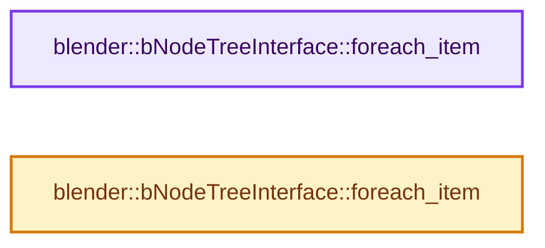
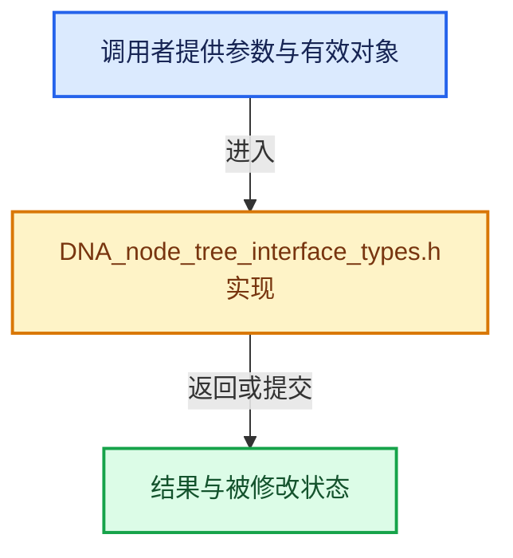

# 实现依赖专题：source/blender/makesdna/DNA_node_tree_interface_types.h

[方向导航](README.md) · [符号索引](../%E7%AC%A6%E5%8F%B7%E4%BE%9D%E8%B5%96%E4%B8%8E%E5%AE%9E%E7%8E%B0%E7%B4%A2%E5%BC%95.md)

本专题从正文实际调用进入，集中保存共享实现。函数有稳定锚点，可从调用处直接跳到对应完整函数；递归与互相调用通过回链组织。

## 本文件的实现关系






## 相关类型布局与成员入口

<a id="t-12228606b9f6"></a>

### `blender::NodeSocketInterfaceStructureType`

原始声明：[source/blender/makesdna/DNA_node_tree_interface_types.h](../../../../../source/blender/makesdna/DNA_node_tree_interface_types.h) · L77—L84。

以下保留类的数据声明与编译条件，成员函数实现通过后面的精确链接阅读。

<!-- annotated:7b0456f575c4c8 -->

```cpp
enum class NodeSocketInterfaceStructureType : int8_t {
  Auto = 0,
  Single = 1,
  Dynamic = 2,
  Field = 3,
  Grid = 4,
  List = 5,
};
```

<details>
<summary>核对原始源码：source/blender/makesdna/DNA_node_tree_interface_types.h · L77—L84</summary>

<!-- original:7b0456f575c4c8:source/blender/makesdna/DNA_node_tree_interface_types.h:77:84 -->

```cpp
enum class NodeSocketInterfaceStructureType : int8_t {
  Auto = 0,
  Single = 1,
  Dynamic = 2,
  Field = 3,
  Grid = 4,
  List = 5,
};
```

</details>


<a id="t-b820bfddfd8f"></a>

### `blender::nodes::StructureType`

原始声明：[source/blender/makesdna/DNA_node_tree_interface_types.h](../../../../../source/blender/makesdna/DNA_node_tree_interface_types.h) · L89—L95。

以下保留类的数据声明与编译条件，成员函数实现通过后面的精确链接阅读。

<!-- annotated:30f5e292d8d061 -->

```cpp
enum class StructureType : int8_t {
  Single = int8_t(NodeSocketInterfaceStructureType::Single),
  Dynamic = int8_t(NodeSocketInterfaceStructureType::Dynamic),
  Field = int8_t(NodeSocketInterfaceStructureType::Field),
  Grid = int8_t(NodeSocketInterfaceStructureType::Grid),
  List = int8_t(NodeSocketInterfaceStructureType::List),
};
```

<details>
<summary>核对原始源码：source/blender/makesdna/DNA_node_tree_interface_types.h · L89—L95</summary>

<!-- original:30f5e292d8d061:source/blender/makesdna/DNA_node_tree_interface_types.h:89:95 -->

```cpp
enum class StructureType : int8_t {
  Single = int8_t(NodeSocketInterfaceStructureType::Single),
  Dynamic = int8_t(NodeSocketInterfaceStructureType::Dynamic),
  Field = int8_t(NodeSocketInterfaceStructureType::Field),
  Grid = int8_t(NodeSocketInterfaceStructureType::Grid),
  List = int8_t(NodeSocketInterfaceStructureType::List),
};
```

</details>


## 完整成员与函数实现

<a id="f-034ee6007da1a7de"></a>

### `blender::bNodeTreeInterface::foreach_item`

实现位置：[source/blender/makesdna/DNA_node_tree_interface_types.h](../../../../../source/blender/makesdna/DNA_node_tree_interface_types.h) · L465—L468。

接口参数：

- `FunctionRef<bool(bNodeTreeInterfaceItem &item)> fn`
- `bNodeTreeInterfaceItem &item`
- `bool include_root = false`

**教学注释版**

<!-- annotated:2492e852384083 -->

```cpp
  void foreach_item(FunctionRef<bool(bNodeTreeInterfaceItem &item)> fn, bool include_root = false)
  {
    root_panel.foreach_item(fn, /*include_self=*/include_root);
  }
```

<details>
<summary>核对原始源码：source/blender/makesdna/DNA_node_tree_interface_types.h · L465—L468</summary>

<!-- original:2492e852384083:source/blender/makesdna/DNA_node_tree_interface_types.h:465:468 -->

```cpp
  void foreach_item(FunctionRef<bool(bNodeTreeInterfaceItem &item)> fn, bool include_root = false)
  {
    root_panel.foreach_item(fn, /*include_self=*/include_root);
  }
```

</details>

**继续追踪实现**

- `root_panel.foreach_item` → [blender::bNodeTreeInterfacePanel::foreach_item · L1160](%E4%BE%9D%E8%B5%96-node_tree_interface-893d31.md#f-4b0f769e66c64d9c)；[blender::bNodeTreeInterfacePanel::foreach_item · L1195](%E4%BE%9D%E8%B5%96-node_tree_interface-893d31.md#f-c31131b8e14b0d72)。同名重载需按实参类型选择。

<a id="f-a5a684b14af4f96e"></a>

### `blender::bNodeTreeInterface::foreach_item`

实现位置：[source/blender/makesdna/DNA_node_tree_interface_types.h](../../../../../source/blender/makesdna/DNA_node_tree_interface_types.h) · L476—L480。

接口参数：

- `FunctionRef<bool(const bNodeTreeInterfaceItem &item)> fn`
- `const bNodeTreeInterfaceItem &item`
- `bool include_root = false`

**教学注释版**

<!-- annotated:1b27a7707199c9 -->

```cpp
  void foreach_item(FunctionRef<bool(const bNodeTreeInterfaceItem &item)> fn,
                    bool include_root = false) const
  {
    root_panel.foreach_item(fn, /*include_self=*/include_root);
  }
```

<details>
<summary>核对原始源码：source/blender/makesdna/DNA_node_tree_interface_types.h · L476—L480</summary>

<!-- original:1b27a7707199c9:source/blender/makesdna/DNA_node_tree_interface_types.h:476:480 -->

```cpp
  void foreach_item(FunctionRef<bool(const bNodeTreeInterfaceItem &item)> fn,
                    bool include_root = false) const
  {
    root_panel.foreach_item(fn, /*include_self=*/include_root);
  }
```

</details>

**继续追踪实现**

- `root_panel.foreach_item` → [blender::bNodeTreeInterfacePanel::foreach_item · L1160](%E4%BE%9D%E8%B5%96-node_tree_interface-893d31.md#f-4b0f769e66c64d9c)；[blender::bNodeTreeInterfacePanel::foreach_item · L1195](%E4%BE%9D%E8%B5%96-node_tree_interface-893d31.md#f-c31131b8e14b0d72)。同名重载需按实参类型选择。
