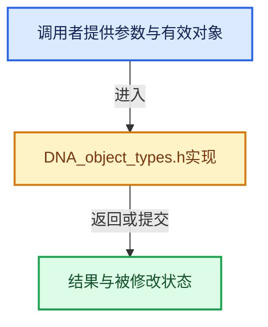

# 实现依赖专题：source/blender/makesdna/DNA_object_types.h

[方向导航](README.md) · [符号索引](../%E7%AC%A6%E5%8F%B7%E4%BE%9D%E8%B5%96%E4%B8%8E%E5%AE%9E%E7%8E%B0%E7%B4%A2%E5%BC%95.md)

本专题从正文实际调用进入，集中保存共享实现。函数有稳定锚点，可从调用处直接跳到对应完整函数；递归与互相调用通过回链组织。

## 本文件的实现关系





## 相关类型布局与成员入口

<a id="t-1ec597c07f87"></a>

### `blender::ObjectType`

原始声明：[source/blender/makesdna/DNA_object_types.h](../../../../../source/blender/makesdna/DNA_object_types.h) · L97—L128。

以下保留类的数据声明与编译条件，成员函数实现通过后面的精确链接阅读。

<!-- annotated:1956fca3fa4b87 -->

```cpp
enum ObjectType : short {
  OB_EMPTY = 0,
  OB_MESH = 1,
  /** Curve object is still used but replaced by "Curves" for the future (see #95355). */
  OB_CURVES_LEGACY = 2,
  OB_SURF = 3,
  OB_FONT = 4,
  OB_MBALL = 5,

  OB_LAMP = 10,
  OB_CAMERA = 11,

  OB_SPEAKER = 12,
  OB_LIGHTPROBE = 13,

  OB_LATTICE = 22,

  OB_ARMATURE = 25,

  OB_GPENCIL_LEGACY = 26,

  OB_CURVES = 27,

  OB_POINTCLOUD = 28,

  OB_VOLUME = 29,

  OB_GREASE_PENCIL = 30,

  /* Keep last. */
  OB_TYPE_MAX,
};
```

<details>
<summary>核对原始源码：source/blender/makesdna/DNA_object_types.h · L97—L128</summary>

<!-- original:1956fca3fa4b87:source/blender/makesdna/DNA_object_types.h:97:128 -->

```cpp
enum ObjectType : short {
  OB_EMPTY = 0,
  OB_MESH = 1,
  /** Curve object is still used but replaced by "Curves" for the future (see #95355). */
  OB_CURVES_LEGACY = 2,
  OB_SURF = 3,
  OB_FONT = 4,
  OB_MBALL = 5,

  OB_LAMP = 10,
  OB_CAMERA = 11,

  OB_SPEAKER = 12,
  OB_LIGHTPROBE = 13,

  OB_LATTICE = 22,

  OB_ARMATURE = 25,

  OB_GPENCIL_LEGACY = 26,

  OB_CURVES = 27,

  OB_POINTCLOUD = 28,

  OB_VOLUME = 29,

  OB_GREASE_PENCIL = 30,

  /* Keep last. */
  OB_TYPE_MAX,
};
```

</details>


<a id="t-99f255625174"></a>

### `blender::eObject_Partype`

原始声明：[source/blender/makesdna/DNA_object_types.h](../../../../../source/blender/makesdna/DNA_object_types.h) · L131—L139。

以下保留类的数据声明与编译条件，成员函数实现通过后面的精确链接阅读。

<!-- annotated:49bd1af660041e -->

```cpp
enum eObject_Partype : short {
  PAROBJECT = 0,
  PARSKEL = 4,
  PARVERT1 = 5,
  PARVERT3 = 6,
  PARBONE = 7,
  /** Mask for the parent type bits. */
  PARTYPE = (1 << 4) - 1,
};
```

<details>
<summary>核对原始源码：source/blender/makesdna/DNA_object_types.h · L131—L139</summary>

<!-- original:49bd1af660041e:source/blender/makesdna/DNA_object_types.h:131:139 -->

```cpp
enum eObject_Partype : short {
  PAROBJECT = 0,
  PARSKEL = 4,
  PARVERT1 = 5,
  PARVERT3 = 6,
  PARBONE = 7,
  /** Mask for the parent type bits. */
  PARTYPE = (1 << 4) - 1,
};
```

</details>


<a id="t-5588a39847f9"></a>

### `blender::eObject_TransFlag`

原始声明：[source/blender/makesdna/DNA_object_types.h](../../../../../source/blender/makesdna/DNA_object_types.h) · L143—L164。

以下保留类的数据声明与编译条件，成员函数实现通过后面的精确链接阅读。

<!-- annotated:2906fcdf55f61d -->

```cpp
enum eObject_TransFlag : short {
  OB_TRANSFORM_ADJUST_ROOT_PARENT_FOR_VIEW_LOCK = 1 << 0,
  OB_TRANSFLAG_UNUSED_1 = 1 << 1, /* cleared */
  OB_NEG_SCALE = 1 << 2,
  OB_TRANSFLAG_UNUSED_3 = 1 << 3, /* cleared */
  OB_DUPLIVERTS = 1 << 4,
  OB_DUPLIROT = 1 << 5,
  OB_TRANSFLAG_UNUSED_6 = 1 << 6, /* cleared */
  /* runtime, calculate derivedmesh for dupli before it's used */
  OB_TRANSFLAG_UNUSED_7 = 1 << 7, /* dirty */
  OB_DUPLICOLLECTION = 1 << 8,
  OB_DUPLIFACES = 1 << 9,
  OB_DUPLIFACES_SCALE = 1 << 10,
  OB_DUPLIPARTS = 1 << 11,
  OB_TRANSFLAG_UNUSED_12 = 1 << 12, /* cleared */
  /* runtime constraints disable */
  OB_NO_CONSTRAINTS = 1 << 13,
  /* when calculating vertex parent position, ignore CD_ORIGINDEX layer */
  OB_PARENT_USE_FINAL_INDICES = 1 << 14,

  OB_DUPLI = OB_DUPLIVERTS | OB_DUPLICOLLECTION | OB_DUPLIFACES | OB_DUPLIPARTS,
};
```

<details>
<summary>核对原始源码：source/blender/makesdna/DNA_object_types.h · L143—L164</summary>

<!-- original:2906fcdf55f61d:source/blender/makesdna/DNA_object_types.h:143:164 -->

```cpp
enum eObject_TransFlag : short {
  OB_TRANSFORM_ADJUST_ROOT_PARENT_FOR_VIEW_LOCK = 1 << 0,
  OB_TRANSFLAG_UNUSED_1 = 1 << 1, /* cleared */
  OB_NEG_SCALE = 1 << 2,
  OB_TRANSFLAG_UNUSED_3 = 1 << 3, /* cleared */
  OB_DUPLIVERTS = 1 << 4,
  OB_DUPLIROT = 1 << 5,
  OB_TRANSFLAG_UNUSED_6 = 1 << 6, /* cleared */
  /* runtime, calculate derivedmesh for dupli before it's used */
  OB_TRANSFLAG_UNUSED_7 = 1 << 7, /* dirty */
  OB_DUPLICOLLECTION = 1 << 8,
  OB_DUPLIFACES = 1 << 9,
  OB_DUPLIFACES_SCALE = 1 << 10,
  OB_DUPLIPARTS = 1 << 11,
  OB_TRANSFLAG_UNUSED_12 = 1 << 12, /* cleared */
  /* runtime constraints disable */
  OB_NO_CONSTRAINTS = 1 << 13,
  /* when calculating vertex parent position, ignore CD_ORIGINDEX layer */
  OB_PARENT_USE_FINAL_INDICES = 1 << 14,

  OB_DUPLI = OB_DUPLIVERTS | OB_DUPLICOLLECTION | OB_DUPLIFACES | OB_DUPLIPARTS,
};
```

</details>


<a id="t-211d5a023c74"></a>

### `blender::eObject_VisibilityFlag`

原始声明：[source/blender/makesdna/DNA_object_types.h](../../../../../source/blender/makesdna/DNA_object_types.h) · L235—L252。

以下保留类的数据声明与编译条件，成员函数实现通过后面的精确链接阅读。

<!-- annotated:04c4d6e3bac0f2 -->

```cpp
enum eObject_VisibilityFlag : int {
  OB_HIDE_VIEWPORT = 1 << 0,
  OB_HIDE_SELECT = 1 << 1,
  OB_HIDE_RENDER = 1 << 2,
  OB_HIDE_CAMERA = 1 << 3,
  OB_HIDE_DIFFUSE = 1 << 4,
  OB_HIDE_GLOSSY = 1 << 5,
  OB_HIDE_TRANSMISSION = 1 << 6,
  OB_HIDE_VOLUME_SCATTER = 1 << 7,
  OB_HIDE_SHADOW = 1 << 8,
  OB_HOLDOUT = 1 << 9,
  OB_SHADOW_CATCHER = 1 << 10,
  OB_HIDE_PROBE_VOLUME = 1 << 11,
  OB_HIDE_PROBE_CUBEMAP = 1 << 12,
  OB_HIDE_PROBE_PLANAR = 1 << 13,
  OB_HIDE_SURFACE_PICK = 1 << 14,
  OB_HIDE_RAYCAST = 1 << 15,
};
```

<details>
<summary>核对原始源码：source/blender/makesdna/DNA_object_types.h · L235—L252</summary>

<!-- original:04c4d6e3bac0f2:source/blender/makesdna/DNA_object_types.h:235:252 -->

```cpp
enum eObject_VisibilityFlag : int {
  OB_HIDE_VIEWPORT = 1 << 0,
  OB_HIDE_SELECT = 1 << 1,
  OB_HIDE_RENDER = 1 << 2,
  OB_HIDE_CAMERA = 1 << 3,
  OB_HIDE_DIFFUSE = 1 << 4,
  OB_HIDE_GLOSSY = 1 << 5,
  OB_HIDE_TRANSMISSION = 1 << 6,
  OB_HIDE_VOLUME_SCATTER = 1 << 7,
  OB_HIDE_SHADOW = 1 << 8,
  OB_HOLDOUT = 1 << 9,
  OB_SHADOW_CATCHER = 1 << 10,
  OB_HIDE_PROBE_VOLUME = 1 << 11,
  OB_HIDE_PROBE_CUBEMAP = 1 << 12,
  OB_HIDE_PROBE_PLANAR = 1 << 13,
  OB_HIDE_SURFACE_PICK = 1 << 14,
  OB_HIDE_RAYCAST = 1 << 15,
};
```

</details>


<a id="m-d3d3ce623daa"></a>

## 宏 `OB_TYPE_SUPPORT_MATERIAL`

<!-- annotated:b74038e21e1ee4 -->

```cpp
#define OB_TYPE_SUPPORT_MATERIAL(_type) \
  (((_type) >= OB_MESH && (_type) <= OB_MBALL) || \
   ((_type) >= OB_CURVES && (_type) <= OB_GREASE_PENCIL))

```

<details>
<summary>核对原始源码：source/blender/makesdna/DNA_object_types.h · L714—L717</summary>

<!-- original:b74038e21e1ee4:source/blender/makesdna/DNA_object_types.h:714:717 -->

```cpp
#define OB_TYPE_SUPPORT_MATERIAL(_type) \
  (((_type) >= OB_MESH && (_type) <= OB_MBALL) || \
   ((_type) >= OB_CURVES && (_type) <= OB_GREASE_PENCIL))

```

</details>

宏在预处理阶段展开，参数替换、重复求值和条件编译应直接从该定义检查。与普通函数不同，宏不会自动提供参数类型检查；构建配置选择哪个定义需结合外围条件。

<a id="m-d7d958f8bae9"></a>

## 宏 `OB_TYPE_IS_GEOMETRY`

<!-- annotated:a2a5812e575b30 -->

```cpp
#define OB_TYPE_IS_GEOMETRY(_type) \
  (ELEM(_type, \
        OB_MESH, \
        OB_SURF, \
        OB_FONT, \
        OB_MBALL, \
        OB_CURVES_LEGACY, \
        OB_CURVES, \
        OB_POINTCLOUD, \
        OB_VOLUME, \
        OB_GREASE_PENCIL))

```

<details>
<summary>核对原始源码：source/blender/makesdna/DNA_object_types.h · L722—L733</summary>

<!-- original:a2a5812e575b30:source/blender/makesdna/DNA_object_types.h:722:733 -->

```cpp
#define OB_TYPE_IS_GEOMETRY(_type) \
  (ELEM(_type, \
        OB_MESH, \
        OB_SURF, \
        OB_FONT, \
        OB_MBALL, \
        OB_CURVES_LEGACY, \
        OB_CURVES, \
        OB_POINTCLOUD, \
        OB_VOLUME, \
        OB_GREASE_PENCIL))

```

</details>

宏在预处理阶段展开，参数替换、重复求值和条件编译应直接从该定义检查。与普通函数不同，宏不会自动提供参数类型检查；构建配置选择哪个定义需结合外围条件。

<a id="m-418d8ceae920"></a>

## 宏 `OB_TYPE_SUPPORT_VGROUP`

<!-- annotated:1327bc9365f4ed -->

```cpp
#define OB_TYPE_SUPPORT_VGROUP(_type) (ELEM(_type, OB_MESH, OB_LATTICE, OB_GREASE_PENCIL))

```

<details>
<summary>核对原始源码：source/blender/makesdna/DNA_object_types.h · L734—L735</summary>

<!-- original:1327bc9365f4ed:source/blender/makesdna/DNA_object_types.h:734:735 -->

```cpp
#define OB_TYPE_SUPPORT_VGROUP(_type) (ELEM(_type, OB_MESH, OB_LATTICE, OB_GREASE_PENCIL))

```

</details>

宏在预处理阶段展开，参数替换、重复求值和条件编译应直接从该定义检查。与普通函数不同，宏不会自动提供参数类型检查；构建配置选择哪个定义需结合外围条件。

<a id="m-d271a33b1221"></a>

## 宏 `OB_TYPE_SUPPORT_PARVERT`

<!-- annotated:f7ede58ca24192 -->

```cpp
#define OB_TYPE_SUPPORT_PARVERT(_type) \
  (ELEM(_type, OB_MESH, OB_SURF, OB_CURVES_LEGACY, OB_LATTICE))

```

<details>
<summary>核对原始源码：source/blender/makesdna/DNA_object_types.h · L749—L751</summary>

<!-- original:f7ede58ca24192:source/blender/makesdna/DNA_object_types.h:749:751 -->

```cpp
#define OB_TYPE_SUPPORT_PARVERT(_type) \
  (ELEM(_type, OB_MESH, OB_SURF, OB_CURVES_LEGACY, OB_LATTICE))

```

</details>

宏在预处理阶段展开，参数替换、重复求值和条件编译应直接从该定义检查。与普通函数不同，宏不会自动提供参数类型检查；构建配置选择哪个定义需结合外围条件。

<a id="m-568216539b9e"></a>

## 宏 `OB_DATA_SUPPORT_EDITMODE`

<!-- annotated:aa3c8c4a343b93 -->

```cpp
#define OB_DATA_SUPPORT_EDITMODE(_type) \
  (ELEM(_type, ID_ME, ID_CU_LEGACY, ID_MB, ID_LT, ID_AR, ID_CV, ID_GP))

```

<details>
<summary>核对原始源码：source/blender/makesdna/DNA_object_types.h · L753—L755</summary>

<!-- original:aa3c8c4a343b93:source/blender/makesdna/DNA_object_types.h:753:755 -->

```cpp
#define OB_DATA_SUPPORT_EDITMODE(_type) \
  (ELEM(_type, ID_ME, ID_CU_LEGACY, ID_MB, ID_LT, ID_AR, ID_CV, ID_GP))

```

</details>

宏在预处理阶段展开，参数替换、重复求值和条件编译应直接从该定义检查。与普通函数不同，宏不会自动提供参数类型检查；构建配置选择哪个定义需结合外围条件。

<a id="m-6e26060bd356"></a>

## 宏 `OB_DATA_SUPPORT_ID`

<!-- annotated:025cbb971e969f -->

```cpp
#define OB_DATA_SUPPORT_ID(_id_type) \
  (ELEM(_id_type, \
        ID_ME, \
        ID_CU_LEGACY, \
        ID_MB, \
        ID_LA, \
        ID_SPK, \
        ID_LP, \
        ID_CA, \
        ID_LT, \
        ID_GD_LEGACY, \
        ID_AR, \
        ID_CV, \
        ID_PT, \
        ID_VO, \
        ID_GP))

```

<details>
<summary>核对原始源码：source/blender/makesdna/DNA_object_types.h · L757—L773</summary>

<!-- original:025cbb971e969f:source/blender/makesdna/DNA_object_types.h:757:773 -->

```cpp
#define OB_DATA_SUPPORT_ID(_id_type) \
  (ELEM(_id_type, \
        ID_ME, \
        ID_CU_LEGACY, \
        ID_MB, \
        ID_LA, \
        ID_SPK, \
        ID_LP, \
        ID_CA, \
        ID_LT, \
        ID_GD_LEGACY, \
        ID_AR, \
        ID_CV, \
        ID_PT, \
        ID_VO, \
        ID_GP))

```

</details>

宏在预处理阶段展开，参数替换、重复求值和条件编译应直接从该定义检查。与普通函数不同，宏不会自动提供参数类型检查；构建配置选择哪个定义需结合外围条件。

## 完整成员与函数实现
