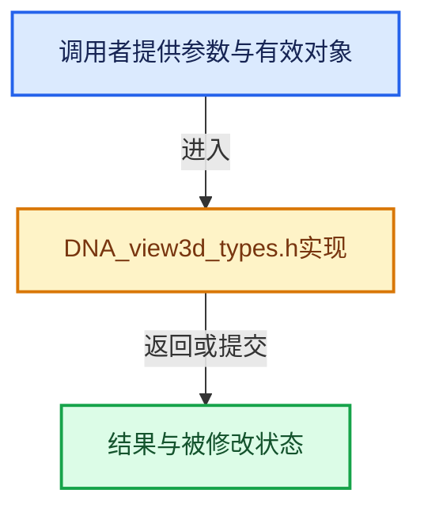

# 实现依赖专题：source/blender/makesdna/DNA_view3d_types.h

[方向导航](README.md) · [符号索引](../%E7%AC%A6%E5%8F%B7%E4%BE%9D%E8%B5%96%E4%B8%8E%E5%AE%9E%E7%8E%B0%E7%B4%A2%E5%BC%95.md)

本专题从正文实际调用进入，集中保存共享实现。函数有稳定锚点，可从调用处直接跳到对应完整函数；递归与互相调用通过回链组织。

## 本文件的实现关系





## 相关类型布局与成员入口

<a id="t-193cf794b34b"></a>

### `blender::eView3D_Flag2`

原始声明：[source/blender/makesdna/DNA_view3d_types.h](../../../../../source/blender/makesdna/DNA_view3d_types.h) · L186—L206。

以下保留类的数据声明与编译条件，成员函数实现通过后面的精确链接阅读。

<!-- annotated:0991ee68bcd215 -->

```cpp
enum eView3D_Flag2 : int {
  V3D_HIDE_OVERLAYS = 1 << 2,
  V3D_SHOW_VIEWER = 1 << 3,
  V3D_SHOW_ANNOTATION = 1 << 4,
  V3D_LOCK_CAMERA = 1 << 5,
  V3D_FLAG2_UNUSED_6 = 1 << 6, /* cleared */
  V3D_SHOW_RECONSTRUCTION = 1 << 7,
  V3D_SHOW_CAMERAPATH = 1 << 8,
  V3D_SHOW_BUNDLENAME = 1 << 9,
  V3D_FLAG2_UNUSED_10 = 1 << 10, /* cleared */
  V3D_RENDER_BORDER = 1 << 11,
  V3D_FLAG2_UNUSED_12 = 1 << 12, /* cleared */
  V3D_FLAG2_UNUSED_13 = 1 << 13, /* cleared */
  V3D_FLAG2_UNUSED_14 = 1 << 14, /* cleared */
  V3D_FLAG2_UNUSED_15 = 1 << 15, /* cleared */
  V3D_XR_SHOW_CONTROLLERS = 1 << 16,
  V3D_XR_SHOW_CUSTOM_OVERLAYS = 1 << 17,
  V3D_SHOW_CAMERA_GUIDES = (1 << 18),
  V3D_SHOW_CAMERA_PASSEPARTOUT = (1 << 19),
  V3D_XR_SHOW_PASSTHROUGH = 1 << 20,
};
```

<details>
<summary>核对原始源码：source/blender/makesdna/DNA_view3d_types.h · L186—L206</summary>

<!-- original:0991ee68bcd215:source/blender/makesdna/DNA_view3d_types.h:186:206 -->

```cpp
enum eView3D_Flag2 : int {
  V3D_HIDE_OVERLAYS = 1 << 2,
  V3D_SHOW_VIEWER = 1 << 3,
  V3D_SHOW_ANNOTATION = 1 << 4,
  V3D_LOCK_CAMERA = 1 << 5,
  V3D_FLAG2_UNUSED_6 = 1 << 6, /* cleared */
  V3D_SHOW_RECONSTRUCTION = 1 << 7,
  V3D_SHOW_CAMERAPATH = 1 << 8,
  V3D_SHOW_BUNDLENAME = 1 << 9,
  V3D_FLAG2_UNUSED_10 = 1 << 10, /* cleared */
  V3D_RENDER_BORDER = 1 << 11,
  V3D_FLAG2_UNUSED_12 = 1 << 12, /* cleared */
  V3D_FLAG2_UNUSED_13 = 1 << 13, /* cleared */
  V3D_FLAG2_UNUSED_14 = 1 << 14, /* cleared */
  V3D_FLAG2_UNUSED_15 = 1 << 15, /* cleared */
  V3D_XR_SHOW_CONTROLLERS = 1 << 16,
  V3D_XR_SHOW_CUSTOM_OVERLAYS = 1 << 17,
  V3D_SHOW_CAMERA_GUIDES = (1 << 18),
  V3D_SHOW_CAMERA_PASSEPARTOUT = (1 << 19),
  V3D_XR_SHOW_PASSTHROUGH = 1 << 20,
};
```

</details>


<a id="t-1f9877ec51c6"></a>

### `blender::View3DShading`

原始声明：[source/blender/makesdna/DNA_view3d_types.h](../../../../../source/blender/makesdna/DNA_view3d_types.h) · L596—L646。

成员布局：

- `eDrawType type`
- `eDrawType prev_type`
- `eDrawType prev_type_wire`
- `eV3DShadingColorType color_type`
- `eView3DShading_Flag flag`
- `eV3DShadingLightingMode light`
- `eV3DShadingBackgroundType background_type`
- `eView3DShading_CavityType cavity_type`
- `eV3DShadingColorType wire_color_type`
- `View3DShadingUseCompositor use_compositor`
- `char _pad`
- `char studio_light`
- `char lookdev_light`
- `char matcap`
- `float shadow_intensity`
- `float single_color`
- `float studiolight_rot_z`
- `float studiolight_background`
- `float studiolight_intensity`
- `float studiolight_blur`
- `float object_outline_color`
- `float xray_alpha`
- `float xray_alpha_wire`
- `float cavity_valley_factor`
- `float cavity_ridge_factor`
- `float background_color`
- `float curvature_ridge_factor`
- `float curvature_valley_factor`
- `int render_pass`
- `char aov_name`
- `struct IDProperty prop`
- `void _pad2`

以下保留类的数据声明与编译条件，成员函数实现通过后面的精确链接阅读。

<!-- annotated:db32bbed8ec2a3 -->

```cpp
struct View3DShading {
  eDrawType type = OB_SOLID;
  /** Runtime, for toggle between rendered viewport. */
  eDrawType prev_type = OB_SOLID;
  eDrawType prev_type_wire = eDrawType{};

  eV3DShadingColorType color_type = V3D_SHADING_MATERIAL_COLOR;
  eView3DShading_Flag flag = V3D_SHADING_SPECULAR_HIGHLIGHT | V3D_SHADING_XRAY_WIREFRAME |
                             V3D_SHADING_SCENE_LIGHTS_RENDER | V3D_SHADING_SCENE_WORLD_RENDER;

  eV3DShadingLightingMode light = V3D_LIGHTING_STUDIO;
  eV3DShadingBackgroundType background_type = V3D_SHADING_BACKGROUND_THEME;
  eView3DShading_CavityType cavity_type = V3D_SHADING_CAVITY_CURVATURE;
  eV3DShadingColorType wire_color_type = V3D_SHADING_SINGLE_COLOR;

  /** When to preview the compositor output in the viewport. */
  View3DShadingUseCompositor use_compositor = V3D_SHADING_USE_COMPOSITOR_DISABLED;

  char _pad = {};

  char studio_light[/*FILE_MAXFILE*/ 256] = "";
  char lookdev_light[/*FILE_MAXFILE*/ 256] = "";
  char matcap[/*FILE_MAXFILE*/ 256] = "";

  float shadow_intensity = 0.5f;
  float single_color[3] = {0.8f, 0.8f, 0.8f};

  float studiolight_rot_z = 0;
  float studiolight_background = 0;
  float studiolight_intensity = 1.0f;
  float studiolight_blur = 0;

  float object_outline_color[3] = {};
  float xray_alpha = 0.5f;
  float xray_alpha_wire = 0.5f;

  float cavity_valley_factor = 1.0f;
  float cavity_ridge_factor = 1.0f;

  float background_color[3] = {0.05f, 0.05f, 0.05f};

  float curvature_ridge_factor = 1.0f;
  float curvature_valley_factor = 1.0f;

  /* Render pass displayed in the viewport. Is an `eScenePassType` where one bit is set */
  int render_pass = SCE_PASS_COMBINED;
  char aov_name[64] = "";

  struct IDProperty *prop = nullptr;
  void *_pad2 = nullptr;
};
```

<details>
<summary>核对原始源码：source/blender/makesdna/DNA_view3d_types.h · L596—L646</summary>

<!-- original:db32bbed8ec2a3:source/blender/makesdna/DNA_view3d_types.h:596:646 -->

```cpp
struct View3DShading {
  eDrawType type = OB_SOLID;
  /** Runtime, for toggle between rendered viewport. */
  eDrawType prev_type = OB_SOLID;
  eDrawType prev_type_wire = eDrawType{};

  eV3DShadingColorType color_type = V3D_SHADING_MATERIAL_COLOR;
  eView3DShading_Flag flag = V3D_SHADING_SPECULAR_HIGHLIGHT | V3D_SHADING_XRAY_WIREFRAME |
                             V3D_SHADING_SCENE_LIGHTS_RENDER | V3D_SHADING_SCENE_WORLD_RENDER;

  eV3DShadingLightingMode light = V3D_LIGHTING_STUDIO;
  eV3DShadingBackgroundType background_type = V3D_SHADING_BACKGROUND_THEME;
  eView3DShading_CavityType cavity_type = V3D_SHADING_CAVITY_CURVATURE;
  eV3DShadingColorType wire_color_type = V3D_SHADING_SINGLE_COLOR;

  /** When to preview the compositor output in the viewport. */
  View3DShadingUseCompositor use_compositor = V3D_SHADING_USE_COMPOSITOR_DISABLED;

  char _pad = {};

  char studio_light[/*FILE_MAXFILE*/ 256] = "";
  char lookdev_light[/*FILE_MAXFILE*/ 256] = "";
  char matcap[/*FILE_MAXFILE*/ 256] = "";

  float shadow_intensity = 0.5f;
  float single_color[3] = {0.8f, 0.8f, 0.8f};

  float studiolight_rot_z = 0;
  float studiolight_background = 0;
  float studiolight_intensity = 1.0f;
  float studiolight_blur = 0;

  float object_outline_color[3] = {};
  float xray_alpha = 0.5f;
  float xray_alpha_wire = 0.5f;

  float cavity_valley_factor = 1.0f;
  float cavity_ridge_factor = 1.0f;

  float background_color[3] = {0.05f, 0.05f, 0.05f};

  float curvature_ridge_factor = 1.0f;
  float curvature_valley_factor = 1.0f;

  /* Render pass displayed in the viewport. Is an `eScenePassType` where one bit is set */
  int render_pass = SCE_PASS_COMBINED;
  char aov_name[64] = "";

  struct IDProperty *prop = nullptr;
  void *_pad2 = nullptr;
};
```

</details>


<a id="m-a24a459cd06f"></a>

## 宏 `RV3D_LOCK_FLAGS`

<!-- annotated:6fe9219dab5e6e -->

```cpp
#define RV3D_LOCK_FLAGS(rv3d) ((rv3d)->viewlock | ((rv3d)->runtime_viewlock))

```

<details>
<summary>核对原始源码：source/blender/makesdna/DNA_view3d_types.h · L127—L128</summary>

<!-- original:6fe9219dab5e6e:source/blender/makesdna/DNA_view3d_types.h:127:128 -->

```cpp
#define RV3D_LOCK_FLAGS(rv3d) ((rv3d)->viewlock | ((rv3d)->runtime_viewlock))

```

</details>

宏在预处理阶段展开，参数替换、重复求值和条件编译应直接从该定义检查。与普通函数不同，宏不会自动提供参数类型检查；构建配置选择哪个定义需结合外围条件。

<a id="m-d98bb13a4e54"></a>

## 宏 `RV3D_VIEW_IS_AXIS`

<!-- annotated:25370b34b1ba95 -->

```cpp
#define RV3D_VIEW_IS_AXIS(view) (((view) >= RV3D_VIEW_FRONT) && ((view) <= RV3D_VIEW_BOTTOM))

```

<details>
<summary>核对原始源码：source/blender/makesdna/DNA_view3d_types.h · L147—L148</summary>

<!-- original:25370b34b1ba95:source/blender/makesdna/DNA_view3d_types.h:147:148 -->

```cpp
#define RV3D_VIEW_IS_AXIS(view) (((view) >= RV3D_VIEW_FRONT) && ((view) <= RV3D_VIEW_BOTTOM))

```

</details>

宏在预处理阶段展开，参数替换、重复求值和条件编译应直接从该定义检查。与普通函数不同，宏不会自动提供参数类型检查；构建配置选择哪个定义需结合外围条件。

<a id="m-54e190dda833"></a>

## 宏 `RV3D_CLIPPING_ENABLED`

<!-- annotated:93299b39df9d60 -->

```cpp
#define RV3D_CLIPPING_ENABLED(v3d, rv3d) \
  ((rv3d) && (v3d) && ((rv3d)->rflag & RV3D_CLIPPING) && \
   ELEM((v3d)->shading.type, OB_WIRE, OB_SOLID) && (rv3d)->clipbb)

```

<details>
<summary>核对原始源码：source/blender/makesdna/DNA_view3d_types.h · L181—L184</summary>

<!-- original:93299b39df9d60:source/blender/makesdna/DNA_view3d_types.h:181:184 -->

```cpp
#define RV3D_CLIPPING_ENABLED(v3d, rv3d) \
  ((rv3d) && (v3d) && ((rv3d)->rflag & RV3D_CLIPPING) && \
   ELEM((v3d)->shading.type, OB_WIRE, OB_SOLID) && (rv3d)->clipbb)

```

</details>

宏在预处理阶段展开，参数替换、重复求值和条件编译应直接从该定义检查。与普通函数不同，宏不会自动提供参数类型检查；构建配置选择哪个定义需结合外围条件。

<a id="m-80bbb3ef24fe"></a>

## 宏 `V3D_USES_SCENE_LIGHTS`

<!-- annotated:13a69bfa88365b -->

```cpp
#define V3D_USES_SCENE_LIGHTS(v3d) \
  ((((v3d)->shading.type == OB_MATERIAL) && ((v3d)->shading.flag & V3D_SHADING_SCENE_LIGHTS)) || \
   (((v3d)->shading.type == OB_RENDER) && \
    ((v3d)->shading.flag & V3D_SHADING_SCENE_LIGHTS_RENDER)))

```

<details>
<summary>核对原始源码：source/blender/makesdna/DNA_view3d_types.h · L262—L266</summary>

<!-- original:13a69bfa88365b:source/blender/makesdna/DNA_view3d_types.h:262:266 -->

```cpp
#define V3D_USES_SCENE_LIGHTS(v3d) \
  ((((v3d)->shading.type == OB_MATERIAL) && ((v3d)->shading.flag & V3D_SHADING_SCENE_LIGHTS)) || \
   (((v3d)->shading.type == OB_RENDER) && \
    ((v3d)->shading.flag & V3D_SHADING_SCENE_LIGHTS_RENDER)))

```

</details>

宏在预处理阶段展开，参数替换、重复求值和条件编译应直接从该定义检查。与普通函数不同，宏不会自动提供参数类型检查；构建配置选择哪个定义需结合外围条件。

<a id="m-b9449ddf6101"></a>

## 宏 `V3D_USES_SCENE_WORLD`

<!-- annotated:06e9e96b950187 -->

```cpp
#define V3D_USES_SCENE_WORLD(v3d) \
  ((((v3d)->shading.type == OB_MATERIAL) && ((v3d)->shading.flag & V3D_SHADING_SCENE_WORLD)) || \
   (((v3d)->shading.type == OB_RENDER) && \
    ((v3d)->shading.flag & V3D_SHADING_SCENE_WORLD_RENDER)))

```

<details>
<summary>核对原始源码：source/blender/makesdna/DNA_view3d_types.h · L267—L271</summary>

<!-- original:06e9e96b950187:source/blender/makesdna/DNA_view3d_types.h:267:271 -->

```cpp
#define V3D_USES_SCENE_WORLD(v3d) \
  ((((v3d)->shading.type == OB_MATERIAL) && ((v3d)->shading.flag & V3D_SHADING_SCENE_WORLD)) || \
   (((v3d)->shading.type == OB_RENDER) && \
    ((v3d)->shading.flag & V3D_SHADING_SCENE_WORLD_RENDER)))

```

</details>

宏在预处理阶段展开，参数替换、重复求值和条件编译应直接从该定义检查。与普通函数不同，宏不会自动提供参数类型检查；构建配置选择哪个定义需结合外围条件。

## 完整成员与函数实现
