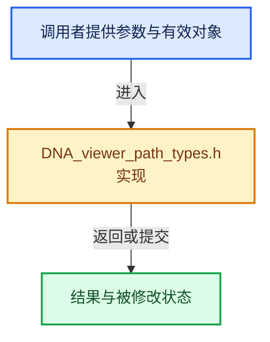

# 实现依赖专题：source/blender/makesdna/DNA_viewer_path_types.h

[方向导航](README.md) · [符号索引](../%E7%AC%A6%E5%8F%B7%E4%BE%9D%E8%B5%96%E4%B8%8E%E5%AE%9E%E7%8E%B0%E7%B4%A2%E5%BC%95.md)

本专题从正文实际调用进入，集中保存共享实现。函数有稳定锚点，可从调用处直接跳到对应完整函数；递归与互相调用通过回链组织。

## 本文件的实现关系





## 相关类型布局与成员入口

<a id="t-2a310f00002f"></a>

### `blender::ViewerPathElemType`

原始声明：[source/blender/makesdna/DNA_viewer_path_types.h](../../../../../source/blender/makesdna/DNA_viewer_path_types.h) · L20—L29。

以下保留类的数据声明与编译条件，成员函数实现通过后面的精确链接阅读。

<!-- annotated:2628d4c3e5926e -->

```cpp
enum ViewerPathElemType : int {
  VIEWER_PATH_ELEM_TYPE_ID = 0,
  VIEWER_PATH_ELEM_TYPE_MODIFIER = 1,
  VIEWER_PATH_ELEM_TYPE_GROUP_NODE = 2,
  VIEWER_PATH_ELEM_TYPE_SIMULATION_ZONE = 3,
  VIEWER_PATH_ELEM_TYPE_VIEWER_NODE = 4,
  VIEWER_PATH_ELEM_TYPE_REPEAT_ZONE = 5,
  VIEWER_PATH_ELEM_TYPE_FOREACH_GEOMETRY_ELEMENT_ZONE = 6,
  VIEWER_PATH_ELEM_TYPE_EVALUATE_CLOSURE = 7,
};
```

<details>
<summary>核对原始源码：source/blender/makesdna/DNA_viewer_path_types.h · L20—L29</summary>

<!-- original:2628d4c3e5926e:source/blender/makesdna/DNA_viewer_path_types.h:20:29 -->

```cpp
enum ViewerPathElemType : int {
  VIEWER_PATH_ELEM_TYPE_ID = 0,
  VIEWER_PATH_ELEM_TYPE_MODIFIER = 1,
  VIEWER_PATH_ELEM_TYPE_GROUP_NODE = 2,
  VIEWER_PATH_ELEM_TYPE_SIMULATION_ZONE = 3,
  VIEWER_PATH_ELEM_TYPE_VIEWER_NODE = 4,
  VIEWER_PATH_ELEM_TYPE_REPEAT_ZONE = 5,
  VIEWER_PATH_ELEM_TYPE_FOREACH_GEOMETRY_ELEMENT_ZONE = 6,
  VIEWER_PATH_ELEM_TYPE_EVALUATE_CLOSURE = 7,
};
```

</details>


## 完整成员与函数实现
