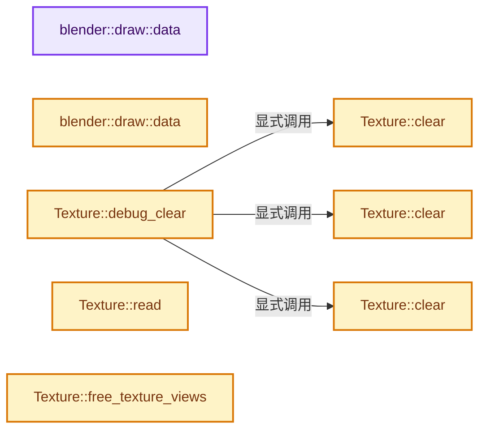
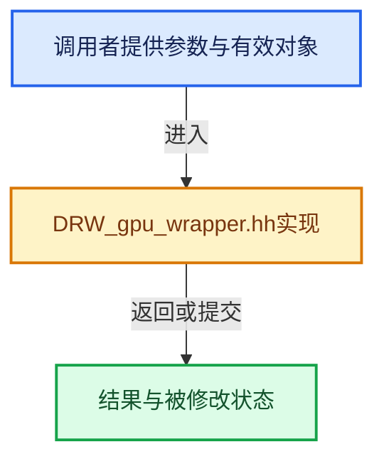

# 实现依赖专题：source/blender/draw/intern/DRW_gpu_wrapper.hh

[方向导航](README.md) · [符号索引](../%E7%AC%A6%E5%8F%B7%E4%BE%9D%E8%B5%96%E4%B8%8E%E5%AE%9E%E7%8E%B0%E7%B4%A2%E5%BC%95.md)

本专题从正文实际调用进入，集中保存共享实现。函数有稳定锚点，可从调用处直接跳到对应完整函数；递归与互相调用通过回链组织。

## 本文件的实现关系






## 完整成员与函数实现

<a id="f-dc115dc22e0c9f33"></a>

### `blender::draw::data`

实现位置：[source/blender/draw/intern/DRW_gpu_wrapper.hh](../../../../../source/blender/draw/intern/DRW_gpu_wrapper.hh) · L124—L128。

**教学注释版**

<!-- annotated:8924b998c4dbd9 -->

```cpp
  const T *data() const
  {
    BLI_STATIC_ASSERT(!device_only, "");
    return data_;
  }
```

<details>
<summary>核对原始源码：source/blender/draw/intern/DRW_gpu_wrapper.hh · L124—L128</summary>

<!-- original:8924b998c4dbd9:source/blender/draw/intern/DRW_gpu_wrapper.hh:124:128 -->

```cpp
  const T *data() const
  {
    BLI_STATIC_ASSERT(!device_only, "");
    return data_;
  }
```

</details>

**结果出口**

- `return data_;`

**继续追踪实现**

- `BLI_STATIC_ASSERT` → [BLI_STATIC_ASSERT · L68](../01-%E5%9F%BA%E7%A1%80%E5%AE%B9%E5%99%A8%E4%B8%8E%E7%8E%B0%E4%BB%A3CPP/%E4%BE%9D%E8%B5%96-BLI_assert-cc98e8.md#m-2847bd43464c)；[BLI_STATIC_ASSERT · L37](%E4%BE%9D%E8%B5%96-GPU_shader_shared_utils-0adda3.md#m-84775b53af8c)；[BLI_STATIC_ASSERT · L58](%E4%BE%9D%E8%B5%96-GPU_shader_shared_utils-0adda3.md#m-4227322768f0)。宏定义由构建条件选择。

<a id="f-5f325cb75387045c"></a>

### `blender::draw::data`

实现位置：[source/blender/draw/intern/DRW_gpu_wrapper.hh](../../../../../source/blender/draw/intern/DRW_gpu_wrapper.hh) · L129—L133。

**教学注释版**

<!-- annotated:12b35b03607fef -->

```cpp
  T *data()
  {
    BLI_STATIC_ASSERT(!device_only, "");
    return data_;
  }
```

<details>
<summary>核对原始源码：source/blender/draw/intern/DRW_gpu_wrapper.hh · L129—L133</summary>

<!-- original:12b35b03607fef:source/blender/draw/intern/DRW_gpu_wrapper.hh:129:133 -->

```cpp
  T *data()
  {
    BLI_STATIC_ASSERT(!device_only, "");
    return data_;
  }
```

</details>

**结果出口**

- `return data_;`

**继续追踪实现**

- `BLI_STATIC_ASSERT` → [BLI_STATIC_ASSERT · L68](../01-%E5%9F%BA%E7%A1%80%E5%AE%B9%E5%99%A8%E4%B8%8E%E7%8E%B0%E4%BB%A3CPP/%E4%BE%9D%E8%B5%96-BLI_assert-cc98e8.md#m-2847bd43464c)；[BLI_STATIC_ASSERT · L37](%E4%BE%9D%E8%B5%96-GPU_shader_shared_utils-0adda3.md#m-84775b53af8c)；[BLI_STATIC_ASSERT · L58](%E4%BE%9D%E8%B5%96-GPU_shader_shared_utils-0adda3.md#m-4227322768f0)。宏定义由构建条件选择。

<a id="f-6365fed7e26dff63"></a>

### `Texture::clear`

实现位置：[source/blender/draw/intern/DRW_gpu_wrapper.hh](../../../../../source/blender/draw/intern/DRW_gpu_wrapper.hh) · L908—L911。

接口参数：

- `float4 values`

**教学注释版**

<!-- annotated:e15986dbf48bcb -->

```cpp
  void clear(float4 values)
  {
    GPU_texture_clear(tx_, GPU_DATA_FLOAT, &values[0]);
  }
```

<details>
<summary>核对原始源码：source/blender/draw/intern/DRW_gpu_wrapper.hh · L908—L911</summary>

<!-- original:e15986dbf48bcb:source/blender/draw/intern/DRW_gpu_wrapper.hh:908:911 -->

```cpp
  void clear(float4 values)
  {
    GPU_texture_clear(tx_, GPU_DATA_FLOAT, &values[0]);
  }
```

</details>

**继续追踪实现**

- `GPU_texture_clear` → [blender::GPU_texture_clear · L583](%E4%BE%9D%E8%B5%96-gpu_texture-234bda.md#f-5c978eb203430df2)。

<a id="f-352c37ec2c5abc62"></a>

### `Texture::clear`

实现位置：[source/blender/draw/intern/DRW_gpu_wrapper.hh](../../../../../source/blender/draw/intern/DRW_gpu_wrapper.hh) · L916—L919。

接口参数：

- `uint4 values`

**教学注释版**

<!-- annotated:0eca4e82c2d934 -->

```cpp
  void clear(uint4 values)
  {
    GPU_texture_clear(tx_, GPU_DATA_UINT, &values[0]);
  }
```

<details>
<summary>核对原始源码：source/blender/draw/intern/DRW_gpu_wrapper.hh · L916—L919</summary>

<!-- original:0eca4e82c2d934:source/blender/draw/intern/DRW_gpu_wrapper.hh:916:919 -->

```cpp
  void clear(uint4 values)
  {
    GPU_texture_clear(tx_, GPU_DATA_UINT, &values[0]);
  }
```

</details>

**继续追踪实现**

- `GPU_texture_clear` → [blender::GPU_texture_clear · L583](%E4%BE%9D%E8%B5%96-gpu_texture-234bda.md#f-5c978eb203430df2)。

<a id="f-305decc7a91321a8"></a>

### `Texture::clear`

实现位置：[source/blender/draw/intern/DRW_gpu_wrapper.hh](../../../../../source/blender/draw/intern/DRW_gpu_wrapper.hh) · L924—L927。

接口参数：

- `int4 values`

**教学注释版**

<!-- annotated:679a83865a0ec4 -->

```cpp
  void clear(int4 values)
  {
    GPU_texture_clear(tx_, GPU_DATA_INT, &values[0]);
  }
```

<details>
<summary>核对原始源码：source/blender/draw/intern/DRW_gpu_wrapper.hh · L924—L927</summary>

<!-- original:679a83865a0ec4:source/blender/draw/intern/DRW_gpu_wrapper.hh:924:927 -->

```cpp
  void clear(int4 values)
  {
    GPU_texture_clear(tx_, GPU_DATA_INT, &values[0]);
  }
```

</details>

**继续追踪实现**

- `GPU_texture_clear` → [blender::GPU_texture_clear · L583](%E4%BE%9D%E8%B5%96-gpu_texture-234bda.md#f-5c978eb203430df2)。

<a id="f-a90b3935b7a7cf2e"></a>

### `Texture::debug_clear`

实现位置：[source/blender/draw/intern/DRW_gpu_wrapper.hh](../../../../../source/blender/draw/intern/DRW_gpu_wrapper.hh) · L933—L951。

**教学注释版**

<!-- annotated:aab5719cbfa247 -->

```cpp
  void debug_clear()
  {
    if (GPU_texture_dimensions(this->tx_) == 1) {
      /* Clearing of 1D texture is currently unsupported. */
      return;
    }

    if (GPU_texture_has_float_format(this->tx_) || GPU_texture_has_normalized_format(this->tx_)) {
      this->clear(float4(NAN_FLT));
    }
    else if (GPU_texture_has_integer_format(this->tx_)) {
      if (GPU_texture_has_signed_format(this->tx_)) {
        this->clear(int4(0xF0F0F0F0));
      }
      else {
        this->clear(uint4(0xF0F0F0F0));
      }
    }
  }
```

<details>
<summary>核对原始源码：source/blender/draw/intern/DRW_gpu_wrapper.hh · L933—L951</summary>

<!-- original:aab5719cbfa247:source/blender/draw/intern/DRW_gpu_wrapper.hh:933:951 -->

```cpp
  void debug_clear()
  {
    if (GPU_texture_dimensions(this->tx_) == 1) {
      /* Clearing of 1D texture is currently unsupported. */
      return;
    }

    if (GPU_texture_has_float_format(this->tx_) || GPU_texture_has_normalized_format(this->tx_)) {
      this->clear(float4(NAN_FLT));
    }
    else if (GPU_texture_has_integer_format(this->tx_)) {
      if (GPU_texture_has_signed_format(this->tx_)) {
        this->clear(int4(0xF0F0F0F0));
      }
      else {
        this->clear(uint4(0xF0F0F0F0));
      }
    }
  }
```

</details>

**继续追踪实现**

- `GPU_texture_dimensions` → [blender::GPU_texture_dimensions · L754](%E4%BE%9D%E8%B5%96-gpu_texture-234bda.md#f-e0da61b9656e9212)。
- `GPU_texture_has_float_format` → [blender::GPU_texture_has_float_format · L977](%E4%BE%9D%E8%B5%96-gpu_texture-234bda.md#f-e263173537b96cbb)。
- `GPU_texture_has_normalized_format` → [blender::GPU_texture_has_normalized_format · L982](%E4%BE%9D%E8%B5%96-gpu_texture-234bda.md#f-6e33f0f5788efbda)。
- `this->clear` → [Texture::clear · L908](%E4%BE%9D%E8%B5%96-DRW_gpu_wrapper-c80c4f.md#f-6365fed7e26dff63)；[Texture::clear · L916](%E4%BE%9D%E8%B5%96-DRW_gpu_wrapper-c80c4f.md#f-352c37ec2c5abc62)；[Texture::clear · L924](%E4%BE%9D%E8%B5%96-DRW_gpu_wrapper-c80c4f.md#f-305decc7a91321a8)。同名重载需按实参类型选择。
- `float4` → [float4 · L56](%E4%BE%9D%E8%B5%96-radial_tiling_shared-98abf9.md#m-f0908e385c5b)；[float4 · L60](../01-%E5%9F%BA%E7%A1%80%E5%AE%B9%E5%99%A8%E4%B8%8E%E7%8E%B0%E4%BB%A3CPP/%E4%BE%9D%E8%B5%96-radial_tiling_shared-7989a4.md#m-7962dcdc288b)；[float4 · L56](%E4%BE%9D%E8%B5%96-node_radial_tiling_shared-b14bc2.md#m-adb8e9e87775)；[float4 · L642](%E4%BE%9D%E8%B5%96-smaa-b67bc2.md#m-9362daaa821c)。宏定义由构建条件选择。
- `GPU_texture_has_integer_format` → [blender::GPU_texture_has_integer_format · L972](%E4%BE%9D%E8%B5%96-gpu_texture-234bda.md#f-51affa66efb02f6c)。
- `GPU_texture_has_signed_format` → [blender::GPU_texture_has_signed_format · L987](%E4%BE%9D%E8%B5%96-gpu_texture-234bda.md#f-953508f8d1370637)。
- `int4` → [int4 · L645](%E4%BE%9D%E8%B5%96-smaa-b67bc2.md#m-98b3207edab6)。宏定义由构建条件选择。
- `uint4` → [uint4](%E4%BE%9D%E8%B5%96-types_uint4-675ccb.md#t-758c723e200c)。

<a id="f-dd35ddf873a3c53b"></a>

### `Texture::read`

实现位置：[source/blender/draw/intern/DRW_gpu_wrapper.hh](../../../../../source/blender/draw/intern/DRW_gpu_wrapper.hh) · L957—L960。

接口参数：

- `eGPUDataFormat format`
- `int miplvl = 0`

**教学注释版**

<!-- annotated:22b0db47cacb96 -->

```cpp
  template<typename T> T *read(eGPUDataFormat format, int miplvl = 0)
  {
    return reinterpret_cast<T *>(GPU_texture_read(tx_, format, miplvl));
  }
```

<details>
<summary>核对原始源码：source/blender/draw/intern/DRW_gpu_wrapper.hh · L957—L960</summary>

<!-- original:22b0db47cacb96:source/blender/draw/intern/DRW_gpu_wrapper.hh:957:960 -->

```cpp
  template<typename T> T *read(eGPUDataFormat format, int miplvl = 0)
  {
    return reinterpret_cast<T *>(GPU_texture_read(tx_, format, miplvl));
  }
```

</details>

**结果出口**

- `return reinterpret_cast<T *>(GPU_texture_read(tx_, format, miplvl));`

**继续追踪实现**

- `GPU_texture_read` → [blender::GPU_texture_read · L538](%E4%BE%9D%E8%B5%96-gpu_texture-234bda.md#f-0177a1016e0e9c44)；[blender::GPU_texture_read · L554](%E4%BE%9D%E8%B5%96-gpu_texture-234bda.md#f-ed121c82244456ef)。同名重载需按实参类型选择。

<a id="f-0a6fe359dfef6305"></a>

### `Texture::free_texture_views`

实现位置：[source/blender/draw/intern/DRW_gpu_wrapper.hh](../../../../../source/blender/draw/intern/DRW_gpu_wrapper.hh) · L990—L1002。

**教学注释版**

<!-- annotated:1d11327e5119fc -->

```cpp
  void free_texture_views()
  {
    for (gpu::Texture *&view : mip_views_) {
      GPU_TEXTURE_FREE_SAFE(view);
    }
    for (gpu::Texture *&view : layer_views_) {
      GPU_TEXTURE_FREE_SAFE(view);
    }
    GPU_TEXTURE_FREE_SAFE(stencil_view_);
    GPU_TEXTURE_FREE_SAFE(layer_range_view_);
    // [讲解] mip_views_.clear：销毁所有有效元素，把size变为0，但保留原分配或内嵌容量。
    mip_views_.clear();
    layer_views_.clear();
  }
```

<details>
<summary>核对原始源码：source/blender/draw/intern/DRW_gpu_wrapper.hh · L990—L1002</summary>

<!-- original:1d11327e5119fc:source/blender/draw/intern/DRW_gpu_wrapper.hh:990:1002 -->

```cpp
  void free_texture_views()
  {
    for (gpu::Texture *&view : mip_views_) {
      GPU_TEXTURE_FREE_SAFE(view);
    }
    for (gpu::Texture *&view : layer_views_) {
      GPU_TEXTURE_FREE_SAFE(view);
    }
    GPU_TEXTURE_FREE_SAFE(stencil_view_);
    GPU_TEXTURE_FREE_SAFE(layer_range_view_);
    mip_views_.clear();
    layer_views_.clear();
  }
```

</details>

**继续追踪实现**

- `GPU_TEXTURE_FREE_SAFE` → [GPU_TEXTURE_FREE_SAFE · L902](%E4%BE%9D%E8%B5%96-GPU_texture-7797f2.md#m-fa9785b115fa)。宏定义由构建条件选择。
- `mip_views_.clear` → [blender::Vector::clear · L468](../01-%E5%9F%BA%E7%A1%80%E5%AE%B9%E5%99%A8%E4%B8%8E%E7%8E%B0%E4%BB%A3CPP/10-Vector%E6%89%A9%E5%AE%B9%E4%B8%8E%E5%A2%9E%E9%95%BF.md#f-d051bebff5275a43)。
- `layer_views_.clear` → [blender::Vector::clear · L468](../01-%E5%9F%BA%E7%A1%80%E5%AE%B9%E5%99%A8%E4%B8%8E%E7%8E%B0%E4%BB%A3CPP/10-Vector%E6%89%A9%E5%AE%B9%E4%B8%8E%E5%A2%9E%E9%95%BF.md#f-d051bebff5275a43)。

<a id="f-e467543ae458a060"></a>

### `TextureFromPool::acquire_2d`

实现位置：[source/blender/draw/intern/DRW_gpu_wrapper.hh](../../../../../source/blender/draw/intern/DRW_gpu_wrapper.hh) · L1111—L1117。

接口参数：

- `int2 extent`
- `gpu::TextureFormat format`
- `eGPUTextureUsage usage = GPU_TEXTURE_USAGE_GENERAL`
- `int mip_len = 1`

**教学注释版**

<!-- annotated:67c75147c0c949 -->

```cpp
  bool acquire_2d(int2 extent,
                  gpu::TextureFormat format,
                  eGPUTextureUsage usage = GPU_TEXTURE_USAGE_GENERAL,
                  int mip_len = 1)
  {
    return acquire_impl(extent.x, extent.y, 0, mip_len, format, usage, false, false);
  }
```

<details>
<summary>核对原始源码：source/blender/draw/intern/DRW_gpu_wrapper.hh · L1111—L1117</summary>

<!-- original:67c75147c0c949:source/blender/draw/intern/DRW_gpu_wrapper.hh:1111:1117 -->

```cpp
  bool acquire_2d(int2 extent,
                  gpu::TextureFormat format,
                  eGPUTextureUsage usage = GPU_TEXTURE_USAGE_GENERAL,
                  int mip_len = 1)
  {
    return acquire_impl(extent.x, extent.y, 0, mip_len, format, usage, false, false);
  }
```

</details>

**结果出口**

- `return acquire_impl(extent.x, extent.y, 0, mip_len, format, usage, false, false);`

**继续追踪实现**

- `acquire_impl` → [TextureFromPool::acquire_impl · L1214](%E4%BE%9D%E8%B5%96-DRW_gpu_wrapper-c80c4f.md#f-a4409910d9da5d2f)。

<a id="f-7b4acd661e9456b9"></a>

### `TextureFromPool::release`

实现位置：[source/blender/draw/intern/DRW_gpu_wrapper.hh](../../../../../source/blender/draw/intern/DRW_gpu_wrapper.hh) · L1170—L1179。

**教学注释版**

<!-- annotated:565fc1b6df5137 -->

```cpp
  void release()
  {
    if (tx_ == nullptr) {
      return;
    }
    free_texture_views();
    pool_->release_texture(tx_);
    tx_ = nullptr;
    pool_ = nullptr;
  }
```

<details>
<summary>核对原始源码：source/blender/draw/intern/DRW_gpu_wrapper.hh · L1170—L1179</summary>

<!-- original:565fc1b6df5137:source/blender/draw/intern/DRW_gpu_wrapper.hh:1170:1179 -->

```cpp
  void release()
  {
    if (tx_ == nullptr) {
      return;
    }
    free_texture_views();
    pool_->release_texture(tx_);
    tx_ = nullptr;
    pool_ = nullptr;
  }
```

</details>

**沿实际写入检查状态**

- `tx_ = nullptr;`
- `pool_ = nullptr;`

**继续追踪实现**

- `free_texture_views` → [Texture::free_texture_views · L990](%E4%BE%9D%E8%B5%96-DRW_gpu_wrapper-c80c4f.md#f-0a6fe359dfef6305)。
- `pool_->release_texture` → [调用协议](../%E6%A8%A1%E6%9D%BF%E5%AE%8F%E4%B8%8E%E5%8A%A8%E6%80%81%E5%88%86%E6%B4%BE%E5%8D%8F%E8%AE%AE.md)：由接收对象具体类型或运行时策略提供实现。调用位置L1176。

<a id="f-a4409910d9da5d2f"></a>

### `TextureFromPool::acquire_impl`

实现位置：[source/blender/draw/intern/DRW_gpu_wrapper.hh](../../../../../source/blender/draw/intern/DRW_gpu_wrapper.hh) · L1214—L1269。

接口参数：

- `int w`
- `int h`
- `int d`
- `int mip_len`
- `gpu::TextureFormat format`
- `eGPUTextureUsage usage`
- `bool layered`
- `bool cubemap`

**教学注释版**

<!-- annotated:ae713ade050639 -->

```cpp
  bool acquire_impl(int w,
                    int h,
                    int d,
                    int mip_len,
                    gpu::TextureFormat format,
                    eGPUTextureUsage usage,
                    bool layered,
                    bool cubemap)
  {
    if (tx_ != nullptr) {
      if (GPU_texture_width(tx_) != w || GPU_texture_height(tx_) != h ||
          GPU_texture_depth(tx_) != d || GPU_texture_format(tx_) != format ||
          (GPU_texture_usage(tx_) & usage) != usage)
      {
        release();
      }
      else {
        pool_->offset_users_count(tx_, 1);
        return false;
      }
    }

    pool_ = &gpu::TexturePool::get();

    if (h == 0) {
      tx_ = pool_->acquire_texture_1d(w, mip_len, format, usage, name_);
    }
    else if (cubemap) {
      if (layered) {
        tx_ = pool_->acquire_texture_cube_array(w, h, mip_len, format, usage, name_);
      }
      else {
        tx_ = pool_->acquire_texture_cube(w, mip_len, format, usage, name_);
      }
    }
    else if (d == 0) {
      if (layered) {
        tx_ = pool_->acquire_texture_1d_array(w, h, mip_len, format, usage, name_);
      }
      else {
        tx_ = pool_->acquire_texture_2d({w, h}, mip_len, format, usage, name_);
      }
    }
    else if (layered) {
      tx_ = pool_->acquire_texture_2d_array({w, h}, d, mip_len, format, usage, name_);
    }
    else {
      tx_ = pool_->acquire_texture_3d({w, h, d}, mip_len, format, usage, name_);
    }

    if (G.debug & G_DEBUG_GPU) {
      debug_clear();
    }

    return true;
  }
```

<details>
<summary>核对原始源码：source/blender/draw/intern/DRW_gpu_wrapper.hh · L1214—L1269</summary>

<!-- original:ae713ade050639:source/blender/draw/intern/DRW_gpu_wrapper.hh:1214:1269 -->

```cpp
  bool acquire_impl(int w,
                    int h,
                    int d,
                    int mip_len,
                    gpu::TextureFormat format,
                    eGPUTextureUsage usage,
                    bool layered,
                    bool cubemap)
  {
    if (tx_ != nullptr) {
      if (GPU_texture_width(tx_) != w || GPU_texture_height(tx_) != h ||
          GPU_texture_depth(tx_) != d || GPU_texture_format(tx_) != format ||
          (GPU_texture_usage(tx_) & usage) != usage)
      {
        release();
      }
      else {
        pool_->offset_users_count(tx_, 1);
        return false;
      }
    }

    pool_ = &gpu::TexturePool::get();

    if (h == 0) {
      tx_ = pool_->acquire_texture_1d(w, mip_len, format, usage, name_);
    }
    else if (cubemap) {
      if (layered) {
        tx_ = pool_->acquire_texture_cube_array(w, h, mip_len, format, usage, name_);
      }
      else {
        tx_ = pool_->acquire_texture_cube(w, mip_len, format, usage, name_);
      }
    }
    else if (d == 0) {
      if (layered) {
        tx_ = pool_->acquire_texture_1d_array(w, h, mip_len, format, usage, name_);
      }
      else {
        tx_ = pool_->acquire_texture_2d({w, h}, mip_len, format, usage, name_);
      }
    }
    else if (layered) {
      tx_ = pool_->acquire_texture_2d_array({w, h}, d, mip_len, format, usage, name_);
    }
    else {
      tx_ = pool_->acquire_texture_3d({w, h, d}, mip_len, format, usage, name_);
    }

    if (G.debug & G_DEBUG_GPU) {
      debug_clear();
    }

    return true;
  }
```

</details>

**沿实际写入检查状态**

- `pool_ = &gpu::TexturePool::get();`
- `tx_ = pool_->acquire_texture_1d(w, mip_len, format, usage, name_);`
- `tx_ = pool_->acquire_texture_cube_array(w, h, mip_len, format, usage, name_);`
- `tx_ = pool_->acquire_texture_cube(w, mip_len, format, usage, name_);`
- `tx_ = pool_->acquire_texture_1d_array(w, h, mip_len, format, usage, name_);`
- `tx_ = pool_->acquire_texture_2d({w, h}, mip_len, format, usage, name_);`
- `tx_ = pool_->acquire_texture_2d_array({w, h}, d, mip_len, format, usage, name_);`
- `tx_ = pool_->acquire_texture_3d({w, h, d}, mip_len, format, usage, name_);`

**结果出口**

- `return false;`
- `return true;`

**继续追踪实现**

- `GPU_texture_width` → [blender::GPU_texture_width · L773](%E4%BE%9D%E8%B5%96-gpu_texture-234bda.md#f-0f5cbfbefa217516)。
- `GPU_texture_height` → [blender::GPU_texture_height · L778](%E4%BE%9D%E8%B5%96-gpu_texture-234bda.md#f-aabd7afc7f83d281)。
- `GPU_texture_depth` → [blender::GPU_texture_depth · L783](%E4%BE%9D%E8%B5%96-gpu_texture-234bda.md#f-9f2a3b2ac885ad75)。
- `GPU_texture_format` → [blender::GPU_texture_format · L814](%E4%BE%9D%E8%B5%96-gpu_texture-234bda.md#f-842c3f6555a1c248)。
- `GPU_texture_usage` → [blender::GPU_texture_usage · L489](%E4%BE%9D%E8%B5%96-gpu_texture-234bda.md#f-994e62665df34877)。
- `release` → [TextureFromPool::release · L1170](%E4%BE%9D%E8%B5%96-DRW_gpu_wrapper-c80c4f.md#f-7b4acd661e9456b9)。
- `pool_->offset_users_count` → [调用协议](../%E6%A8%A1%E6%9D%BF%E5%AE%8F%E4%B8%8E%E5%8A%A8%E6%80%81%E5%88%86%E6%B4%BE%E5%8D%8F%E8%AE%AE.md)：由接收对象具体类型或运行时策略提供实现。调用位置L1231。
- `gpu::TexturePool::get` → [blender::gpu::TexturePool::get · L23](%E4%BE%9D%E8%B5%96-gpu_texture_pool-81583e.md#f-75a6087748d9f104)。
- `pool_->acquire_texture_1d` → [blender::gpu::TexturePoolBase::acquire_texture_1d · L30](%E4%BE%9D%E8%B5%96-gpu_texture_pool_private-1132be.md#f-3bcaf715febcfd9b)。
- `pool_->acquire_texture_cube_array` → [blender::gpu::TexturePoolBase::acquire_texture_cube_array · L84](%E4%BE%9D%E8%B5%96-gpu_texture_pool_private-1132be.md#f-81d2661dcf46f481)。
- `pool_->acquire_texture_cube` → [blender::gpu::TexturePoolBase::acquire_texture_cube · L75](%E4%BE%9D%E8%B5%96-gpu_texture_pool_private-1132be.md#f-fd3004ec745150b2)。
- `pool_->acquire_texture_1d_array` → [blender::gpu::TexturePoolBase::acquire_texture_1d_array · L38](%E4%BE%9D%E8%B5%96-gpu_texture_pool_private-1132be.md#f-67a0a52618de7979)。
- `pool_->acquire_texture_2d` → [blender::gpu::TexturePoolBase::acquire_texture_2d · L48](%E4%BE%9D%E8%B5%96-gpu_texture_pool_private-1132be.md#f-0e2da5735f914dc1)。
- `pool_->acquire_texture_2d_array` → [blender::gpu::TexturePoolBase::acquire_texture_2d_array · L57](%E4%BE%9D%E8%B5%96-gpu_texture_pool_private-1132be.md#f-21ba60a70c6eeb8b)。
- `pool_->acquire_texture_3d` → [blender::gpu::TexturePoolBase::acquire_texture_3d · L67](%E4%BE%9D%E8%B5%96-gpu_texture_pool_private-1132be.md#f-d5f6486a0e189ee6)。
- `debug_clear` → [Texture::debug_clear · L933](%E4%BE%9D%E8%B5%96-DRW_gpu_wrapper-c80c4f.md#f-a90b3935b7a7cf2e)。

<a id="f-131ae5493b8e8eb3"></a>

### `Framebuffer::ensure`

实现位置：[source/blender/draw/intern/DRW_gpu_wrapper.hh](../../../../../source/blender/draw/intern/DRW_gpu_wrapper.hh) · L1349—L1365。

接口参数：

- `GPUAttachment depth = GPU_ATTACHMENT_NONE`
- `GPUAttachment color1 = GPU_ATTACHMENT_NONE`
- `GPUAttachment color2 = GPU_ATTACHMENT_NONE`
- `GPUAttachment color3 = GPU_ATTACHMENT_NONE`
- `GPUAttachment color4 = GPU_ATTACHMENT_NONE`
- `GPUAttachment color5 = GPU_ATTACHMENT_NONE`
- `GPUAttachment color6 = GPU_ATTACHMENT_NONE`
- `GPUAttachment color7 = GPU_ATTACHMENT_NONE`
- `GPUAttachment color8 = GPU_ATTACHMENT_NONE`

**教学注释版**

<!-- annotated:cf07266faa91cf -->

```cpp
  void ensure(GPUAttachment depth = GPU_ATTACHMENT_NONE,
              GPUAttachment color1 = GPU_ATTACHMENT_NONE,
              GPUAttachment color2 = GPU_ATTACHMENT_NONE,
              GPUAttachment color3 = GPU_ATTACHMENT_NONE,
              GPUAttachment color4 = GPU_ATTACHMENT_NONE,
              GPUAttachment color5 = GPU_ATTACHMENT_NONE,
              GPUAttachment color6 = GPU_ATTACHMENT_NONE,
              GPUAttachment color7 = GPU_ATTACHMENT_NONE,
              GPUAttachment color8 = GPU_ATTACHMENT_NONE)
  {
    if (fb_ == nullptr) {
      fb_ = GPU_framebuffer_create(name_);
    }
    GPUAttachment config[] = {
        depth, color1, color2, color3, color4, color5, color6, color7, color8};
    GPU_framebuffer_config_array(fb_, config, sizeof(config) / sizeof(GPUAttachment));
  }
```

<details>
<summary>核对原始源码：source/blender/draw/intern/DRW_gpu_wrapper.hh · L1349—L1365</summary>

<!-- original:cf07266faa91cf:source/blender/draw/intern/DRW_gpu_wrapper.hh:1349:1365 -->

```cpp
  void ensure(GPUAttachment depth = GPU_ATTACHMENT_NONE,
              GPUAttachment color1 = GPU_ATTACHMENT_NONE,
              GPUAttachment color2 = GPU_ATTACHMENT_NONE,
              GPUAttachment color3 = GPU_ATTACHMENT_NONE,
              GPUAttachment color4 = GPU_ATTACHMENT_NONE,
              GPUAttachment color5 = GPU_ATTACHMENT_NONE,
              GPUAttachment color6 = GPU_ATTACHMENT_NONE,
              GPUAttachment color7 = GPU_ATTACHMENT_NONE,
              GPUAttachment color8 = GPU_ATTACHMENT_NONE)
  {
    if (fb_ == nullptr) {
      fb_ = GPU_framebuffer_create(name_);
    }
    GPUAttachment config[] = {
        depth, color1, color2, color3, color4, color5, color6, color7, color8};
    GPU_framebuffer_config_array(fb_, config, sizeof(config) / sizeof(GPUAttachment));
  }
```

</details>

**沿实际写入检查状态**

- `fb_ = GPU_framebuffer_create(name_);`

**继续追踪实现**

- `GPU_framebuffer_create` → [blender::GPU_framebuffer_create · L226](%E4%BE%9D%E8%B5%96-gpu_framebuffer-cfe3fe.md#f-774e057b3b8fe207)。
- `GPU_framebuffer_config_array` → [blender::GPU_framebuffer_config_array · L355](%E4%BE%9D%E8%B5%96-gpu_framebuffer-cfe3fe.md#f-1a9deabccf418ff2)。

<a id="f-83c4714b059ed873"></a>

### `Framebuffer::ensure`

实现位置：[source/blender/draw/intern/DRW_gpu_wrapper.hh](../../../../../source/blender/draw/intern/DRW_gpu_wrapper.hh) · L1370—L1376。

接口参数：

- `int2 target_size`

**教学注释版**

<!-- annotated:be643198b78145 -->

```cpp
  void ensure(int2 target_size)
  {
    if (fb_ == nullptr) {
      fb_ = GPU_framebuffer_create(name_);
    }
    GPU_framebuffer_default_size(fb_, UNPACK2(target_size));
  }
```

<details>
<summary>核对原始源码：source/blender/draw/intern/DRW_gpu_wrapper.hh · L1370—L1376</summary>

<!-- original:be643198b78145:source/blender/draw/intern/DRW_gpu_wrapper.hh:1370:1376 -->

```cpp
  void ensure(int2 target_size)
  {
    if (fb_ == nullptr) {
      fb_ = GPU_framebuffer_create(name_);
    }
    GPU_framebuffer_default_size(fb_, UNPACK2(target_size));
  }
```

</details>

**沿实际写入检查状态**

- `fb_ = GPU_framebuffer_create(name_);`

**继续追踪实现**

- `GPU_framebuffer_create` → [blender::GPU_framebuffer_create · L226](%E4%BE%9D%E8%B5%96-gpu_framebuffer-cfe3fe.md#f-774e057b3b8fe207)。
- `GPU_framebuffer_default_size` → [blender::GPU_framebuffer_default_size · L384](%E4%BE%9D%E8%B5%96-gpu_framebuffer-cfe3fe.md#f-4bf5fc6e7feb2dc8)。
- `UNPACK2` → [UNPACK2 · L22](%E4%BE%9D%E8%B5%96-GHOST_utildefines-34b996.md#m-00ad768fe1c1)；[UNPACK2 · L234](../01-%E5%9F%BA%E7%A1%80%E5%AE%B9%E5%99%A8%E4%B8%8E%E7%8E%B0%E4%BB%A3CPP/%E4%BE%9D%E8%B5%96-BLI_utildefines-293a0a.md#m-96ff8266d239)；[UNPACK2 · L13](%E4%BE%9D%E8%B5%96-gpu_shader_utildefines.bsl-e9f199.md#m-8316603fb9a6)。宏定义由构建条件选择。

<a id="f-82bf5ab482066826"></a>

### `size`

实现位置：[source/blender/draw/intern/DRW_gpu_wrapper.hh](../../../../../source/blender/draw/intern/DRW_gpu_wrapper.hh) · L1450—L1453。

**教学注释版**

<!-- annotated:79e9b8012501c7 -->

```cpp
  constexpr int64_t size()
  {
    return len;
  }
```

<details>
<summary>核对原始源码：source/blender/draw/intern/DRW_gpu_wrapper.hh · L1450—L1453</summary>

<!-- original:79e9b8012501c7:source/blender/draw/intern/DRW_gpu_wrapper.hh:1450:1453 -->

```cpp
  constexpr int64_t size()
  {
    return len;
  }
```

</details>

**结果出口**

- `return len;`

**继续追踪实现**

本实现没有需要继续展开的显式调用；检查返回表达式、对象转换和调用者前置条件。

<a id="f-241f5fd248365b76"></a>

### `current`

实现位置：[source/blender/draw/intern/DRW_gpu_wrapper.hh](../../../../../source/blender/draw/intern/DRW_gpu_wrapper.hh) · L1455—L1458。

**教学注释版**

<!-- annotated:46ab007fda9a09 -->

```cpp
  T &current()
  {
    return chain_[0];
  }
```

<details>
<summary>核对原始源码：source/blender/draw/intern/DRW_gpu_wrapper.hh · L1455—L1458</summary>

<!-- original:46ab007fda9a09:source/blender/draw/intern/DRW_gpu_wrapper.hh:1455:1458 -->

```cpp
  T &current()
  {
    return chain_[0];
  }
```

</details>

**结果出口**

- `return chain_[0];`

**继续追踪实现**

本实现没有需要继续展开的显式调用；检查返回表达式、对象转换和调用者前置条件。

<a id="f-b62e68c32f25a1a2"></a>

### `current`

实现位置：[source/blender/draw/intern/DRW_gpu_wrapper.hh](../../../../../source/blender/draw/intern/DRW_gpu_wrapper.hh) · L1471—L1474。

**教学注释版**

<!-- annotated:e1d7b3fcf98009 -->

```cpp
  const T &current() const
  {
    return chain_[0];
  }
```

<details>
<summary>核对原始源码：source/blender/draw/intern/DRW_gpu_wrapper.hh · L1471—L1474</summary>

<!-- original:e1d7b3fcf98009:source/blender/draw/intern/DRW_gpu_wrapper.hh:1471:1474 -->

```cpp
  const T &current() const
  {
    return chain_[0];
  }
```

</details>

**结果出口**

- `return chain_[0];`

**继续追踪实现**

本实现没有需要继续展开的显式调用；检查返回表达式、对象转换和调用者前置条件。
