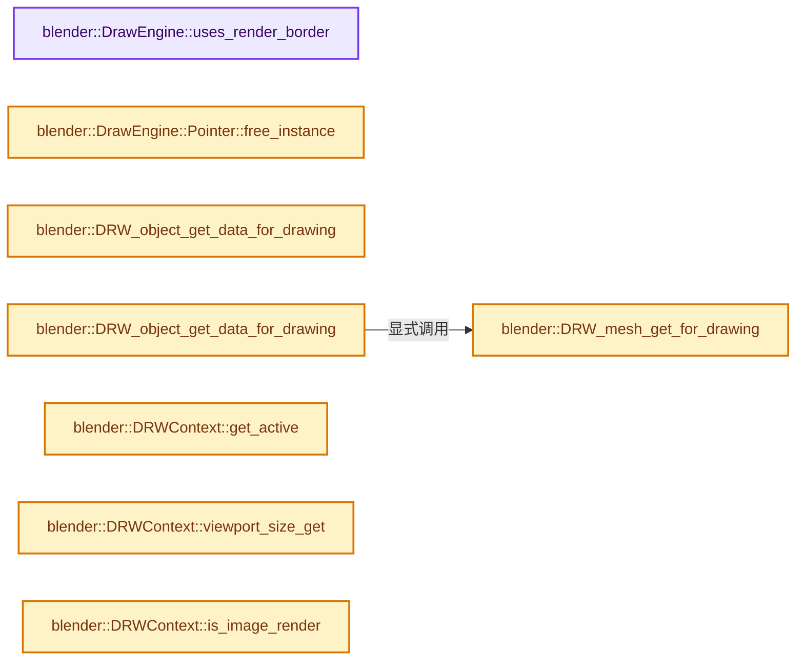
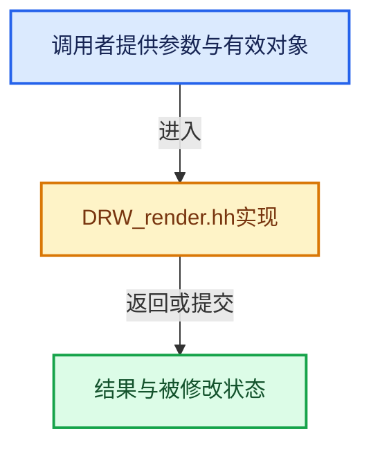

# 实现依赖专题：source/blender/draw/intern/DRW_render.hh

[方向导航](README.md) · [符号索引](../%E7%AC%A6%E5%8F%B7%E4%BE%9D%E8%B5%96%E4%B8%8E%E5%AE%9E%E7%8E%B0%E7%B4%A2%E5%BC%95.md)

本专题从正文实际调用进入，集中保存共享实现。函数有稳定锚点，可从调用处直接跳到对应完整函数；递归与互相调用通过回链组织。

## 本文件的实现关系






## 相关类型布局与成员入口

<a id="t-64f637499984"></a>

### `blender::RenderResult`

原始声明：[source/blender/draw/intern/DRW_render.hh](../../../../../source/blender/draw/intern/DRW_render.hh) · L47—L47。

以下保留类的数据声明与编译条件，成员函数实现通过后面的精确链接阅读。

<!-- annotated:3bfa1cd3dc84e2 -->

```cpp
struct RenderResult;
```

<details>
<summary>核对原始源码：source/blender/draw/intern/DRW_render.hh · L47—L47</summary>

<!-- original:3bfa1cd3dc84e2:source/blender/draw/intern/DRW_render.hh:47:47 -->

```cpp
struct RenderResult;
```

</details>


<a id="t-afed06a9c27b"></a>

### `blender::DrawEngine::Pointer`

原始声明：[source/blender/draw/intern/DRW_render.hh](../../../../../source/blender/draw/intern/DRW_render.hh) · L104—L132。

成员布局：

- `DrawEngine instance`
- `DrawEngine create_instance`

以下保留类的数据声明与编译条件，成员函数实现通过后面的精确链接阅读。

<!-- annotated:74c5135be7811c -->

```cpp
  struct Pointer {
    DrawEngine *instance = nullptr;

```

<details>
<summary>核对原始源码：source/blender/draw/intern/DRW_render.hh · L104—L106</summary>

<!-- original:74c5135be7811c:source/blender/draw/intern/DRW_render.hh:104:106 -->

```cpp
  struct Pointer {
    DrawEngine *instance = nullptr;

```

</details>

<!-- annotated:6463b405f064d6 -->

```cpp

```

<details>
<summary>核对原始源码：source/blender/draw/intern/DRW_render.hh · L111—L111</summary>

<!-- original:6463b405f064d6:source/blender/draw/intern/DRW_render.hh:111:111 -->

```cpp

```

</details>

<!-- annotated:3064a2d86c7a28 -->

```cpp

```

<details>
<summary>核对原始源码：source/blender/draw/intern/DRW_render.hh · L117—L117</summary>

<!-- original:3064a2d86c7a28:source/blender/draw/intern/DRW_render.hh:117:117 -->

```cpp

```

</details>

<!-- annotated:d47056f9eb9a2f -->

```cpp

    virtual DrawEngine *create_instance() = 0;
  };
```

<details>
<summary>核对原始源码：source/blender/draw/intern/DRW_render.hh · L130—L132</summary>

<!-- original:d47056f9eb9a2f:source/blender/draw/intern/DRW_render.hh:130:132 -->

```cpp

    virtual DrawEngine *create_instance() = 0;
  };
```

</details>

- [free_instance](%E4%BE%9D%E8%B5%96-DRW_render-2c5210.md#f-aa12c1c327fd8469)

## 完整成员与函数实现

<a id="f-3be568e067c9b81e"></a>

### `blender::DrawEngine::uses_render_border`

实现位置：[source/blender/draw/intern/DRW_render.hh](../../../../../source/blender/draw/intern/DRW_render.hh) · L83—L86。

**教学注释版**

<!-- annotated:38c0baaa68dd8a -->

```cpp
  virtual bool uses_render_border() const
  {
    return false;
  }
```

<details>
<summary>核对原始源码：source/blender/draw/intern/DRW_render.hh · L83—L86</summary>

<!-- original:38c0baaa68dd8a:source/blender/draw/intern/DRW_render.hh:83:86 -->

```cpp
  virtual bool uses_render_border() const
  {
    return false;
  }
```

</details>

**结果出口**

- `return false;`

**继续追踪实现**

本实现没有需要继续展开的显式调用；检查返回表达式、对象转换和调用者前置条件。

<a id="f-aa12c1c327fd8469"></a>

### `blender::DrawEngine::Pointer::free_instance`

实现位置：[source/blender/draw/intern/DRW_render.hh](../../../../../source/blender/draw/intern/DRW_render.hh) · L112—L116。

**教学注释版**

<!-- annotated:3cdbd4ef1c4a3f -->

```cpp
    void free_instance()
    {
      delete instance;
      instance = nullptr;
    }
```

<details>
<summary>核对原始源码：source/blender/draw/intern/DRW_render.hh · L112—L116</summary>

<!-- original:3cdbd4ef1c4a3f:source/blender/draw/intern/DRW_render.hh:112:116 -->

```cpp
    void free_instance()
    {
      delete instance;
      instance = nullptr;
    }
```

</details>

**沿实际写入检查状态**

- `instance = nullptr;`

**继续追踪实现**

本实现没有需要继续展开的显式调用；检查返回表达式、对象转换和调用者前置条件。

<a id="f-dad88423243c219e"></a>

### `blender::DRW_object_get_data_for_drawing`

实现位置：[source/blender/draw/intern/DRW_render.hh](../../../../../source/blender/draw/intern/DRW_render.hh) · L203—L206。

接口参数：

- `const Object &object`

**教学注释版**

<!-- annotated:c51aa99d6a2d8c -->

```cpp
template<typename T> T &DRW_object_get_data_for_drawing(const Object &object)
{
  return *id_cast<T *>(object.data);
}
```

<details>
<summary>核对原始源码：source/blender/draw/intern/DRW_render.hh · L203—L206</summary>

<!-- original:c51aa99d6a2d8c:source/blender/draw/intern/DRW_render.hh:203:206 -->

```cpp
template<typename T> T &DRW_object_get_data_for_drawing(const Object &object)
{
  return *id_cast<T *>(object.data);
}
```

</details>

**结果出口**

- `return *id_cast<T *>(object.data);`

**继续追踪实现**

- `id_cast<T *>` → [blender::id_cast · L1417](%E4%BE%9D%E8%B5%96-DNA_ID-3eb091.md#f-6c8ac6412850ac5a)。

<a id="f-6a3f1053c13a5cef"></a>

### `blender::DRW_mesh_get_for_drawing`

实现位置：[source/blender/draw/intern/DRW_render.hh](../../../../../source/blender/draw/intern/DRW_render.hh) · L208—L216。

接口参数：

- `Mesh &mesh`

**教学注释版**

<!-- annotated:630bf7d545f301 -->

```cpp
inline Mesh &DRW_mesh_get_for_drawing(Mesh &mesh)
{
  /* For drawing we want either the base mesh if GPU subdivision is enabled, or the
   * tessellated mesh if GPU subdivision is disabled. */
  if (BKE_subsurf_modifier_has_gpu_subdiv(&mesh)) {
    return mesh;
  }
  return *BKE_mesh_wrapper_ensure_subdivision(&mesh);
}
```

<details>
<summary>核对原始源码：source/blender/draw/intern/DRW_render.hh · L208—L216</summary>

<!-- original:630bf7d545f301:source/blender/draw/intern/DRW_render.hh:208:216 -->

```cpp
inline Mesh &DRW_mesh_get_for_drawing(Mesh &mesh)
{
  /* For drawing we want either the base mesh if GPU subdivision is enabled, or the
   * tessellated mesh if GPU subdivision is disabled. */
  if (BKE_subsurf_modifier_has_gpu_subdiv(&mesh)) {
    return mesh;
  }
  return *BKE_mesh_wrapper_ensure_subdivision(&mesh);
}
```

</details>

**结果出口**

- `return mesh;`
- `return *BKE_mesh_wrapper_ensure_subdivision(&mesh);`

**继续追踪实现**

- `BKE_subsurf_modifier_has_gpu_subdiv` → [blender::BKE_subsurf_modifier_has_gpu_subdiv · L86](%E4%BE%9D%E8%B5%96-BKE_subdiv_modifier-8fccac.md#f-15e677020968596a)。
- `BKE_mesh_wrapper_ensure_subdivision` → [blender::BKE_mesh_wrapper_ensure_subdivision · L380](%E4%BE%9D%E8%B5%96-mesh_wrapper-33fdae.md#f-a140cbf2ffa716c8)；[blender::BKE_mesh_wrapper_ensure_subdivision · L403](%E4%BE%9D%E8%B5%96-mesh_wrapper-33fdae.md#f-3f4bc2c278da5751)。同名重载需按实参类型选择。

<a id="f-223e280efbea59b2"></a>

### `blender::DRW_object_get_data_for_drawing`

实现位置：[source/blender/draw/intern/DRW_render.hh](../../../../../source/blender/draw/intern/DRW_render.hh) · L218—L222。

接口参数：

- `const Object &object`

**教学注释版**

<!-- annotated:fab15ae1b3bc78 -->

```cpp
template<> inline Mesh &DRW_object_get_data_for_drawing(const Object &object)
{
  BLI_assert(object.type == OB_MESH);
  return DRW_mesh_get_for_drawing(*id_cast<Mesh *>(object.data));
}
```

<details>
<summary>核对原始源码：source/blender/draw/intern/DRW_render.hh · L218—L222</summary>

<!-- original:fab15ae1b3bc78:source/blender/draw/intern/DRW_render.hh:218:222 -->

```cpp
template<> inline Mesh &DRW_object_get_data_for_drawing(const Object &object)
{
  BLI_assert(object.type == OB_MESH);
  return DRW_mesh_get_for_drawing(*id_cast<Mesh *>(object.data));
}
```

</details>

**结果出口**

- `return DRW_mesh_get_for_drawing(*id_cast<Mesh *>(object.data));`

**继续追踪实现**

- `BLI_assert` → [BLI_assert · L48](../01-%E5%9F%BA%E7%A1%80%E5%AE%B9%E5%99%A8%E4%B8%8E%E7%8E%B0%E4%BB%A3CPP/%E4%BE%9D%E8%B5%96-BLI_assert-cc98e8.md#m-57a88495704d)；[BLI_assert · L63](../01-%E5%9F%BA%E7%A1%80%E5%AE%B9%E5%99%A8%E4%B8%8E%E7%8E%B0%E4%BB%A3CPP/%E4%BE%9D%E8%B5%96-BLI_assert-cc98e8.md#m-d07050020cb5)。宏定义由构建条件选择。
- `DRW_mesh_get_for_drawing` → [blender::DRW_mesh_get_for_drawing · L208](%E4%BE%9D%E8%B5%96-DRW_render-2c5210.md#f-6a3f1053c13a5cef)。
- `id_cast<Mesh *>` → [blender::id_cast · L1417](%E4%BE%9D%E8%B5%96-DNA_ID-3eb091.md#f-6c8ac6412850ac5a)。

<a id="f-6b5885f39fd0d45c"></a>

### `blender::DRWContext::get_active`

实现位置：[source/blender/draw/intern/DRW_render.hh](../../../../../source/blender/draw/intern/DRW_render.hh) · L400—L403。

**教学注释版**

<!-- annotated:48920e68748fb2 -->

```cpp
  static DRWContext &get_active()
  {
    return *g_context;
  }
```

<details>
<summary>核对原始源码：source/blender/draw/intern/DRW_render.hh · L400—L403</summary>

<!-- original:48920e68748fb2:source/blender/draw/intern/DRW_render.hh:400:403 -->

```cpp
  static DRWContext &get_active()
  {
    return *g_context;
  }
```

</details>

**结果出口**

- `return *g_context;`

**继续追踪实现**

本实现没有需要继续展开的显式调用；检查返回表达式、对象转换和调用者前置条件。

<a id="f-ad70e0f99f77aa24"></a>

### `blender::DRWContext::viewport_size_get`

实现位置：[source/blender/draw/intern/DRW_render.hh](../../../../../source/blender/draw/intern/DRW_render.hh) · L405—L408。

**教学注释版**

<!-- annotated:0be5058878c24d -->

```cpp
  float2 viewport_size_get() const
  {
    return size;
  }
```

<details>
<summary>核对原始源码：source/blender/draw/intern/DRW_render.hh · L405—L408</summary>

<!-- original:0be5058878c24d:source/blender/draw/intern/DRW_render.hh:405:408 -->

```cpp
  float2 viewport_size_get() const
  {
    return size;
  }
```

</details>

**结果出口**

- `return size;`

**继续追踪实现**

本实现没有需要继续展开的显式调用；检查返回表达式、对象转换和调用者前置条件。

<a id="f-72047f533582a365"></a>

### `blender::DRWContext::is_image_render`

实现位置：[source/blender/draw/intern/DRW_render.hh](../../../../../source/blender/draw/intern/DRW_render.hh) · L428—L431。

**教学注释版**

<!-- annotated:975c2ee502c48b -->

```cpp
  bool is_image_render() const
  {
    return ELEM(mode, VIEWPORT_RENDER, RENDER);
  }
```

<details>
<summary>核对原始源码：source/blender/draw/intern/DRW_render.hh · L428—L431</summary>

<!-- original:975c2ee502c48b:source/blender/draw/intern/DRW_render.hh:428:431 -->

```cpp
  bool is_image_render() const
  {
    return ELEM(mode, VIEWPORT_RENDER, RENDER);
  }
```

</details>

**结果出口**

- `return ELEM(mode, VIEWPORT_RENDER, RENDER);`

**继续追踪实现**

- `ELEM` → [ELEM · L88](%E4%BE%9D%E8%B5%96-GHOST_utildefines-34b996.md#m-d28724a15928)；[ELEM · L135](../01-%E5%9F%BA%E7%A1%80%E5%AE%B9%E5%99%A8%E4%B8%8E%E7%8E%B0%E4%BB%A3CPP/%E4%BE%9D%E8%B5%96-BLI_utildefines-293a0a.md#m-d6572de7cae0)。宏定义由构建条件选择。
