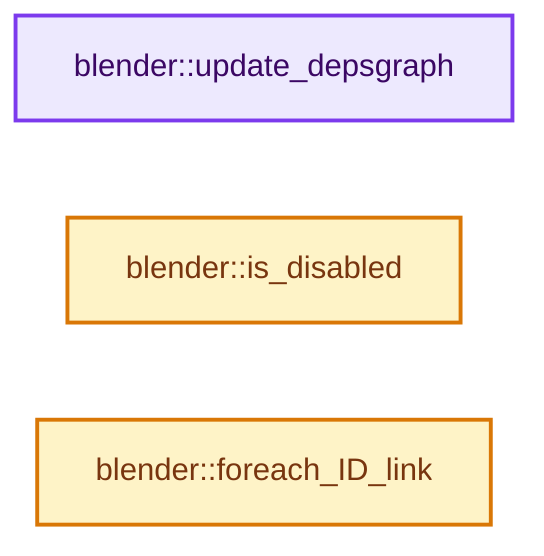

# 实现依赖专题：source/blender/shader_fx/intern/FX_shader_swirl.cc

[方向导航](README.md) · [符号索引](../%E7%AC%A6%E5%8F%B7%E4%BE%9D%E8%B5%96%E4%B8%8E%E5%AE%9E%E7%8E%B0%E7%B4%A2%E5%BC%95.md)

本专题从正文实际调用进入，集中保存共享实现。函数有稳定锚点，可从调用处直接跳到对应完整函数；递归与互相调用通过回链组织。

## 本文件的实现关系




## 完整成员与函数实现

<a id="f-4fef01bb50f35acb"></a>

### `blender::update_depsgraph`

实现位置：[source/blender/shader_fx/intern/FX_shader_swirl.cc](../../../../../source/blender/shader_fx/intern/FX_shader_swirl.cc) · L45—L52。

接口参数：

- `ShaderFxData *fx`
- `const ModifierUpdateDepsgraphContext *ctx`

**教学注释版**

<!-- annotated:8bbd91d166c2e6 -->

```cpp
static void update_depsgraph(ShaderFxData *fx, const ModifierUpdateDepsgraphContext *ctx)
{
  SwirlShaderFxData *fxd = reinterpret_cast<SwirlShaderFxData *>(fx);
  if (fxd->object != nullptr) {
    DEG_add_object_relation(ctx->node, fxd->object, DEG_OB_COMP_TRANSFORM, "Swirl ShaderFx");
  }
  DEG_add_object_relation(ctx->node, ctx->object, DEG_OB_COMP_TRANSFORM, "Swirl ShaderFx");
}
```

<details>
<summary>核对原始源码：source/blender/shader_fx/intern/FX_shader_swirl.cc · L45—L52</summary>

<!-- original:8bbd91d166c2e6:source/blender/shader_fx/intern/FX_shader_swirl.cc:45:52 -->

```cpp
static void update_depsgraph(ShaderFxData *fx, const ModifierUpdateDepsgraphContext *ctx)
{
  SwirlShaderFxData *fxd = reinterpret_cast<SwirlShaderFxData *>(fx);
  if (fxd->object != nullptr) {
    DEG_add_object_relation(ctx->node, fxd->object, DEG_OB_COMP_TRANSFORM, "Swirl ShaderFx");
  }
  DEG_add_object_relation(ctx->node, ctx->object, DEG_OB_COMP_TRANSFORM, "Swirl ShaderFx");
}
```

</details>

**继续追踪实现**

- `DEG_add_object_relation` → [blender::DEG_add_object_relation · L123](../11-Depsgraph%E4%B8%8E%E5%B9%B6%E8%A1%8C%E4%BB%BB%E5%8A%A1%E7%B3%BB%E7%BB%9F/%E4%BE%9D%E8%B5%96-depsgraph_build-ea2fc8.md#f-f570cffae97e273c)。

<a id="f-1fa33151afe58068"></a>

### `blender::is_disabled`

实现位置：[source/blender/shader_fx/intern/FX_shader_swirl.cc](../../../../../source/blender/shader_fx/intern/FX_shader_swirl.cc) · L54—L59。

接口参数：

- `ShaderFxData *fx`
- `bool`

**教学注释版**

<!-- annotated:5d7d5e7fea196c -->

```cpp
static bool is_disabled(ShaderFxData *fx, bool /*use_render_params*/)
{
  SwirlShaderFxData *fxd = reinterpret_cast<SwirlShaderFxData *>(fx);

  return !fxd->object;
}
```

<details>
<summary>核对原始源码：source/blender/shader_fx/intern/FX_shader_swirl.cc · L54—L59</summary>

<!-- original:5d7d5e7fea196c:source/blender/shader_fx/intern/FX_shader_swirl.cc:54:59 -->

```cpp
static bool is_disabled(ShaderFxData *fx, bool /*use_render_params*/)
{
  SwirlShaderFxData *fxd = reinterpret_cast<SwirlShaderFxData *>(fx);

  return !fxd->object;
}
```

</details>

**结果出口**

- `return !fxd->object;`

**继续追踪实现**

本实现没有需要继续展开的显式调用；检查返回表达式、对象转换和调用者前置条件。

<a id="f-624ffd8ef1929253"></a>

### `blender::foreach_ID_link`

实现位置：[source/blender/shader_fx/intern/FX_shader_swirl.cc](../../../../../source/blender/shader_fx/intern/FX_shader_swirl.cc) · L61—L66。

接口参数：

- `ShaderFxData *fx`
- `Object *ob`
- `IDWalkFunc walk`
- `void *user_data`

**教学注释版**

<!-- annotated:d3a22b0ee8adcb -->

```cpp
static void foreach_ID_link(ShaderFxData *fx, Object *ob, IDWalkFunc walk, void *user_data)
{
  SwirlShaderFxData *fxd = reinterpret_cast<SwirlShaderFxData *>(fx);

  walk(user_data, ob, reinterpret_cast<ID **>(&fxd->object), IDWALK_CB_NOP);
}
```

<details>
<summary>核对原始源码：source/blender/shader_fx/intern/FX_shader_swirl.cc · L61—L66</summary>

<!-- original:d3a22b0ee8adcb:source/blender/shader_fx/intern/FX_shader_swirl.cc:61:66 -->

```cpp
static void foreach_ID_link(ShaderFxData *fx, Object *ob, IDWalkFunc walk, void *user_data)
{
  SwirlShaderFxData *fxd = reinterpret_cast<SwirlShaderFxData *>(fx);

  walk(user_data, ob, reinterpret_cast<ID **>(&fxd->object), IDWALK_CB_NOP);
}
```

</details>

**继续追踪实现**

- `walk` → [调用协议](../%E6%A8%A1%E6%9D%BF%E5%AE%8F%E4%B8%8E%E5%8A%A8%E6%80%81%E5%88%86%E6%B4%BE%E5%8D%8F%E8%AE%AE.md)：局部可调用对象，须结合其初始化与捕获环境。调用位置L65。
